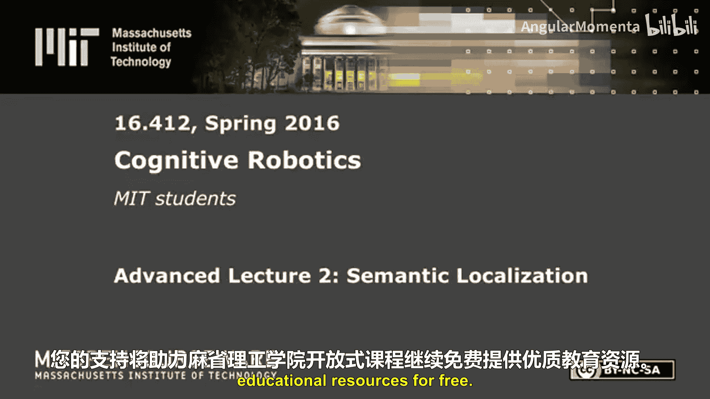
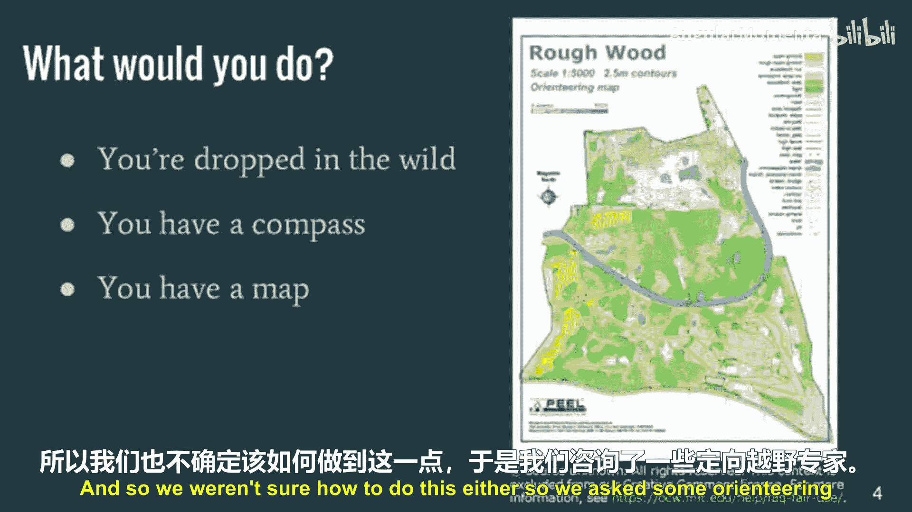
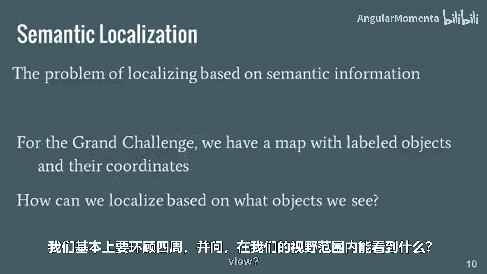
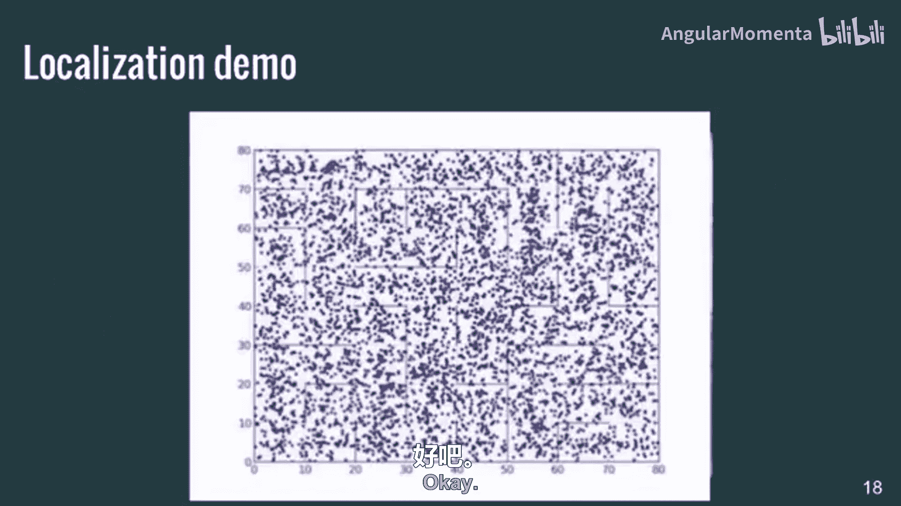
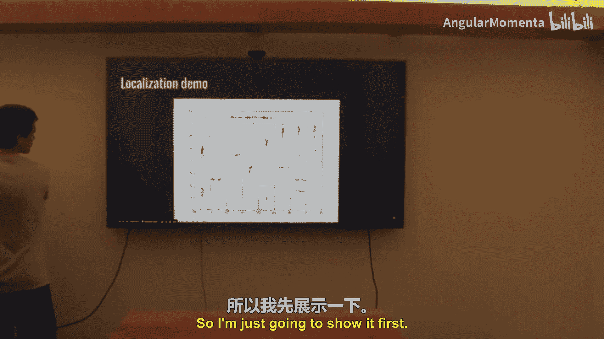
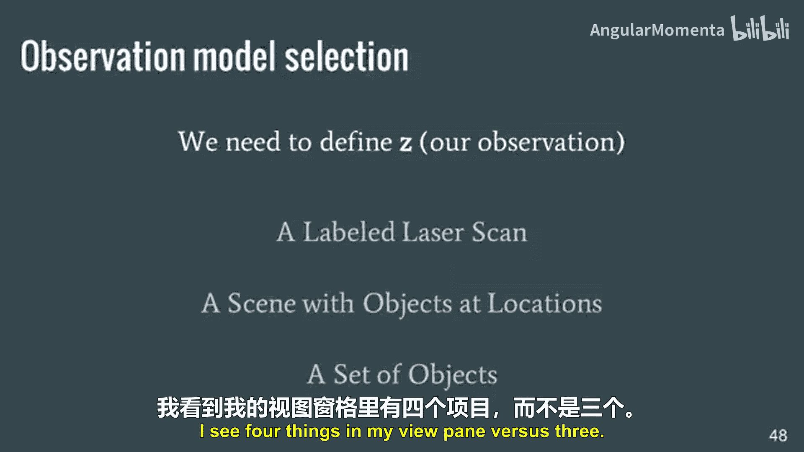
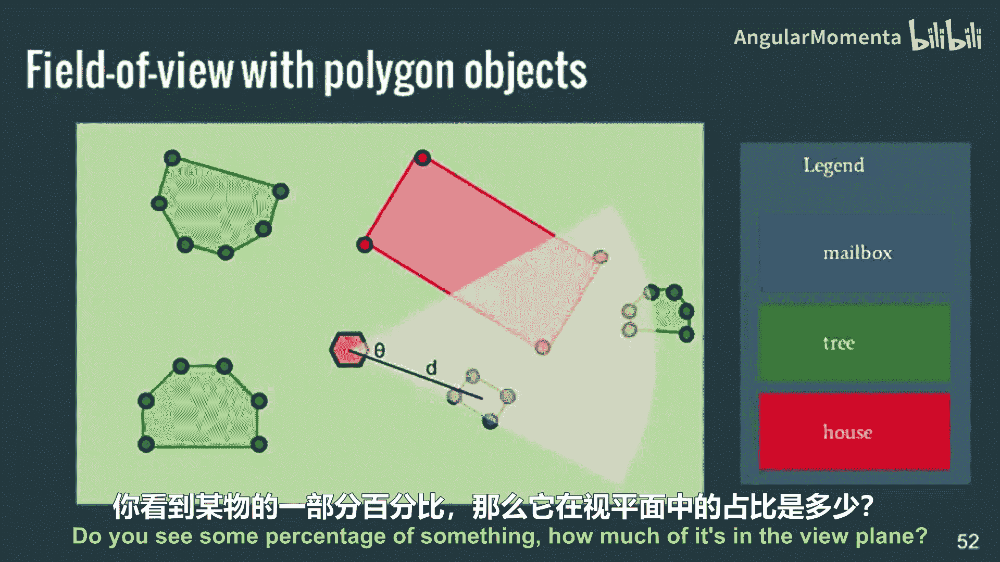
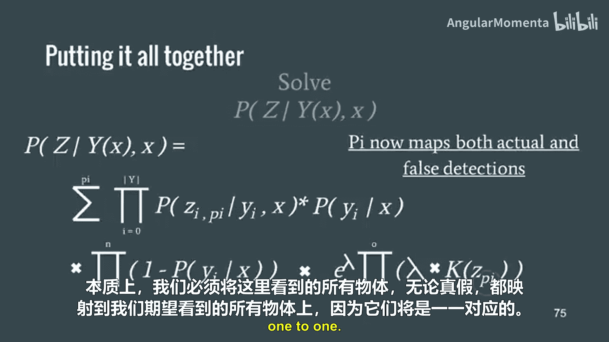
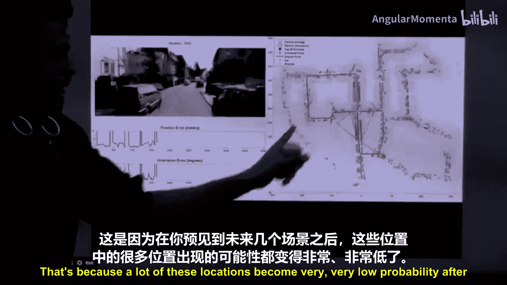
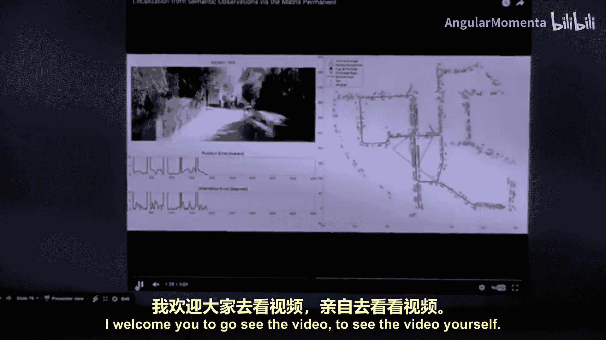

# 【麻省理工】认知机器人学-｜-MIT-16.412J-Cognitive-Robotics,-Spring-2016-p02-高级2.-语义本地化--BV1eEtTzhExj_p2-

The following content is provided under a Cative Commons license。

 Your support will help Mi T OpenCourseware continue to offer high quality educational resources for free to make a donation or to view additional materials from hundreds of MiT courses。

 Visit Mit Opencourseseware at Ocw。 Mt Eduu。

Hi everybody， today we're going to talk about semantic localization。

So first I'm going to talk about you what is semantic localization and what is the motivation for it。

 then we'll go through an algorithm that will allow us to localize and then we'll go into how to actually add semantic information into this algorithm。

So our sort of focus when we were coming up with this was the Orienting Grand challengege。

 so in Orienting basically you have a map and you have a compass and you have to go around to various checkpoints。

嗯。So。As you can imagine， this is sort of difficult because you don't know where you are on this map except what you can tell from your compass。

And so we weren't sure how to do this either， so we asked some orientering experts。

So basically the key ideas are。If you are disorientated， that's fine。

 you just need to sort of find a reference point so that you can figure out where you are。

 you can think about where you last knew where where you are and sort of estimate what your movement has been since you were there and that can give you some options as to where you are and you can look around for features that you can identify uniquely on the map。

And if you of this is an example of an orienting map。If you just sort of have。Was over here。

 it's not very useful， you can't actually you know tell what those things are。

 you might guess that green is grass， but you don't actually know what they are。

 This map isn't useful until you actually have a legend to go along with it so that you can say you know you have roads or footpaths or pits or different things on the map that you can actually identify。

So this is sort of the difference between how robots typically localize and how humans localize so humans think about places in terms of features。

 in terms of what you can do with them， things like that。

 whereas robots might measure distances with laser scanners to form a perfect map of the entire space。

 whereas humans might think about abstractions such as rooms and their relative location to each other。

So we can sort of define semantic information as signs and symbols that contain meaningful concepts for humans。

 basically different sorts of abstractions。And why might we want this semantic information well one very important application would be improving human robot interaction。

 so say you want a robot that can make coffee， it has to understand commands like go to the kitchen。

 like get a mug and turn on the coffee maker this is sort of the language that humans think in and it's very useful if a robot can actually understand the sort of language as well。

 you know what a coffeemakerr is， what it does and where it is。嗯嗯。And additionally。

 you can sort of get some performance and memory benefits。

 you're not storing this full map you know with the distance to every single surface。

 you're just storing locations of key information and this means that your search space is a lot smaller too so you can prune everything that's not related to kitchens or coffee makers and sort of get a performance benefit that way Finally。

 the fact that you can use simply a camera instead of a complicated laser scanner means that this is a lot cheaper and more accessible for robots to have。

So we talked about what semantic information is， so now let's define what semantic localizations。

 so basically it's localizing based on semantic information rather than metric information like distances。

So for our grand challengege we have a map with labeled objects and their coordinates。

 this is our semantic information。And we want to basically look around and say。

 what can we see in our field of view and from that we want to figure out where could we be on this map？

And it's important to note that map building is actually a very different and hard problem with a lot of other research on it。

 in our case we've been given a map and we're simply talking about the problem of localizing based on that map。

And now。I'm going to let Matt tell you about particle filters。

 which is an algorithm for localization。Okay， so my name is Matt Deo and now we're going to talk about particle filters。

 so this is a tool that we're going to teach you how to use。

 specifically for a state estimation using a given map。And measurements， so what is localization。

 we just went over it， specifically is's the question of where am I for any system to work。

 the robot needs to know where it is on a map。This is not so simple of an answer。

Meentric globalization， as was said before， it is quantitative。

How many meters are you from this wall or from your origin， what's your orientation and degrees？

And here's some examples of that， you can convert between coordinate frames really easily if you have metric。

So the localization is while in our case mathematically。

 the problem statement is you have to control you。You're going to observe。诶。

Something about your state， it might be a camera image， it might be laser scans。

And then essentially on your map， you're going to。Use probability to figure out where you are。

So this equation specifically is taking into account the probability of the position or being in a position at your current time based off your previous position。

 the observation that you're taking right now， the command variable you gave it， and then your map。

 like I said。So that's built on the observation noise， actuation， and then the belief。

 we're specifically looking at the belief here for the particle filter。So in our case。

 we're approximating by a set of points also known as particles。

So we're going to look at an example here， actually first about method。

ルクても。Is it over to the left right there？So a quick YouTube demo of particle filter in action。

So I'm just going to show it first。

So pause the red dot here is our actual robot position and it's trying to localize itself in a maze。

 there's black walls throughout here and it looks like a grid world but that initial distribution we had was completely random across all the walls。

 so it's taking observations of，Probably probablyably laser range for finders。

 so it essentially knows that there are walls around it and it knows that there's not a wall in front of it。

So that centers all of these guesses on the center of hallways。

 obviously it got rid of things that were close to the walls。

There's a low probability that it's right up against the wall because of the observations it' taken and we're going to revisit this example。

At the end of the presentation。Part of filters。The method that we're going to teach you has four as these steps。

 one is not repeated so the initialization step is your first sample of particles if you don't know anything about your state at the start then you can sample just a distribution of your entire space。

And then the repeated steps are updating weights， resampling， and then propagating dynamics。

So we're going to show you a toy example， this is a really simple example just to get the idea across。

 we're focusing on just one dimension。We have an aircraft constant altitude so take that variable out the only thing we're trying to localize to is a distance x over a map The sensor is just a range finder down to the ground at this constant altitude and then the map is a known mapping of X location to ground altitudes and we're about to see what that means the goal here is determining where you are in the mountain。

So are you ever playing？As you see， we know the map below and we know that it has to be flying at this altitude。

So with our range finder。You can measure different depths down to the mountain。

 so here we have long distances， a medium distance and a short distance as it's directly on top of the mountain。

Constant altitude， unknown X that's what we're solving for。

 and then we actually have a noisy velocity forward so we know how fast the plane wants to be traveling but in this direction。

 but obviously there's some noise it could be traveling a little faster or a little slower。

So the first step sampling our initial belief here is that we don't know where it is with respect to these mountains。

 so we're going to actually sample with the uniform distribution。

 well this is as uniform as I could get it so over this range， those are our initial particles。

Essentially guesses for what the Xloc is。We're going to update these weights based on the observation。

 so we did our first observation from our range finder and it's this length。

 so it's a long length it's， I guess green in this case。This is our measured value。

Here are all the values that we expect to see at these particles。

 so this is pretty easy to calculate based on the map that you have。

The position of each particle maps directly to a range finder measurement。

So we're going to compare them， so the likelihood of getting these so measuring the likelihood of each of these occurring。

And we're actually waiting the particles。Based on what we measured， these are most likely。

 so they get a larger weight。And we are most likely not on top of a mountain at this point。

 so those get smaller weights。So we're going to resample given that。

 so we're going to keep the same number of samples the entire time that's just how this particle filter works。

 except we're going to resample。Across our new distribution。

So this these are the ways that we just came up with。And we're going to resample over them。

 so now it's more likely that's here or here or wherever there。

And then the final step is propagating so this whole time that we've been filtering and updating our weights。

 the plane has been moving forward so we need to take that into account so we have a forward velocity it might be traveling let's say this range is zero meters per second to5 meters per second to 10ters per second that you can see almost this plot so we're most likely moving5 meters per second so essentially this is your change in time between sensor measurements。

 obviously if you're only getting sensor measurements at 10 hertz。

Then you can propagate in between each of those。So here we are using our new sample particles。

 propagating them forward。For example， this one moving there is a low likelihood that's a large distance and these moving at a shorter distance is more likely given our model。

So we have those new ones， the new weights are now based on the probability of the transitioning to that point。

How likely is it for a plane to move that far， essentially？And then we repeat。

So we're repeating it the steps again， we're going to get a measurement in our range finder。

 we're going to compare it to the map。To our particles。

Keep the ones that are most likely and wait them more and then propagate them。So as an example。

 here's time step two。When we're measuring the uphill of this fountain。

Time step three now we're halfway up the mountain， so positions that we've kept are at similar heights。

 so here and here。And then we can slowly get down to differentiating it。

 so now that we're on top of a mountain， the only pattern that matches that is here and maybe over there。

And then eventually we get down to these two。And then eventually as this mountain drops off。

 it's a unique position where it goes farther than that one did so in the end our particle filter think that we're right around here or here。

And then finally， there's a pretty high chance that we're over that Valley。

So we're going look at this again now that you know how to do the filter。

And this will make a little more sense now。So they started with the uniform distribution。

 they had no clue where they were at the beginning。And as the robot moves forward。

 they are resampling and the measurements are changing obviously because it's seeing these two walls and eventually it sees that there's a doorway to the left。

And you can keep going forward as well， so eventually that geometry doesn't line up with any other spot on the map。

Here we see it knows it's in this hallway， I think this top hallway is the only one on this map that's that long。

 but it still doesn't know which direction it's going， it hasn't been able to differentiate that yet。

But it's about to so the only remaining particles are here and here。

 it knows it's in the middle of the hallway and it knows it's moved about two blocks now without seeing a wall and directly in front of it。

 which。That doesn't occur anywhere else without having another turnoff。So it's about to solve itself。

Because eventually。It sees this wall over here and those observations don't match up with what it's actually seen。

So there we go。Here's a particle filter successfully working。For a little robot with a range factor。

I have a two far。There we。Okay， so I'm David Stingley and now after we've got an idea of why we want to use semantic localization and how to use particle filters to get an idea of our guesses for initial positions。

 we're going to talk about how we can use these to actually implement semantic localization onto a robot。

So。Harking back to the implementation idea， we have three important parts。😡。

We have a belief representation， we have the actuation model so once we have the location。

 how are we going to move， as you said before you know if you don't exactly know how fast you're moving。

 there's a probability you move to a bunch of different locations。

 and then finally we have an observation model， which is the probability that you see some sort of observation given you're in this newly simulated position。

If we continuously solve for our most probable X。😡，Then that's our location。

 so that particle that has the most probable is the place that we guess we're going to be。

So let's look at like a pseudocode for what a seman localization will look like。

 so as long as our robot's moving， we're going to make observations and those observations are going to be that Z1。

Then for those observations， we're going to start our particle filter and guess a certain number of probable locations。

We're going to use our actuation to update it。😡，And then we're going to simulate observations at that location and compare what we expect to see for that particle on our map versus what we actually saw when we made our observation。

😡，This is going to be our update and this is what we're going to focus on understanding。

 since a lot of the rest of this is covered by a particle filter。😡。

So what kind of models can we pick because we need to define what our observation looks like and you get a lot of choices。

😡，In metric localization you'd use a labeled laser scan。

 you'd have perfect information about the environment and so you can see everything。

 it might be nice to use a scene with objects at specific locations。

 but that requires once again a lot of information now you need to know where the objects are。

 you need to have an idea of exact specific locations and orientations with respect to each other。

 maybe it might be nice just to use like a bag of objects。

 I see four things in my view paine versus three。

These are all choices and we're going to take a look just really quickly of what the facts of these are。

 as we stated before， there's a lot of choices in observation it can get really complicated really quickly。

 so just to impress that upon you， imagine if you use laser scanners when you have three objects here。

 for instance a house， a couple of trees and a mailbox you check each line for an intersection and then you'd have to figure out what counts as your detection since you're going to have to differentiate what's in your scene。

The problem with that might be is that well you saw an entire wall， for instance。

 where do you want the house to be， so let's say we assume that objects were a point at some point you either completely see it or you completely don't。

 that way you don't have to have to see an object。😡。

You just check to see if whatever you want your center of mass to be intersects with your current viewpoint。

 if it does， then you're good。😡，The issue with that is that for instance。

 something center of view isn't inside the scene anymore， you just completely ignore it。

 we have the exact opposite problem so you might want to make it a bit more complex and have polygons parts of objects。

 do you see some percentage of something， how much of it's in the view plane。

It adds in a lot of chance for errors， and that's I guess the big point here to remember is that depending on how we characterize our observations。

 we have different ways to get things wrong。😡，So let's say， for instance。

 for an observation like distance and bearing to some new scenic object， what can be wrong。

 well you have noise inside of your sensors， your sensors might have limitations。

 you can't necessarily see to infinity， so an object might be too far away for you to identify correctly。

 it might be rotated in a way that you can't necessarily interpret it correctly。

How about if you want to have your observations be classes of objects。

 so instead of just everything being an obstruction now you have different types of instructions。

 trees are different from mailboxes of course。😡，In which case you have a classification error。

 what if you see the tree and you just think it's a really。

 really big mailbox or you see a mailbox and you think it's a really small tree with a funny little metal top？

😡，These kind of errors can then make your scenes looking correct if you decide to have sets of objects。

 well what permutations matter if you don't have a way of differentiating elements in the set。

 then you don't know if two trees in a mailbox with the trees on the left and the mailbox on the right or vice versa aren't the same thing。

😡，So with that in mind， we're going to start talking about how we're going to solve this question of given some position and your synthetic view。

 how likely is it that it's your actual observation。

 and for that we're just going to change what this probability statement looks like to make it a little more concrete。

😡，In this case， Z is the set of observed objects that you have。

So we're going to say that there are objects in the scene and we put them inside of this value see。

So for instance， you see a house and you see a mailbox that would be。

 your set of objects is just two things， we're going to use the bag of objects approximation。

Y of X is going to be the set of objects you expect to see given your map for the position that you're at。

 so given a position X， y is the set of objects that you would see。

 so you might be in a position where you can see a house in a mailbox。

 then y is a house in a mailbox。😡，And x is just going to be your position。

 that's the element that we're getting from our particle filter。So。In our example。

 as you can tell by how much I talk about it， we're going to use just two things。

 trees and mailboxes because I like them。So here's on a map。

There's going to be a long road and off to the side we have trees and mailboxes and let's say that your robot wants to be a paper delivery boy。

 so he needs to be able to figure out where the mailboxes are and how far down the street he is because if he were to throw the paper wrong。

 he'd throw a paper into a tree。So in this world， our robots going to be here represented by a orange taxagon。

 and it has this field of view。So given this field of view。

 what does Z look like or our actual observation？P tree in one mailbox。Well， for this case。

 what we're going to say is we're going to assume that as long as something intersects with our field of view。

 we're going to see it。😡，So simplifying that we're just going to say that we see both trees and this mailbox once again talked about how difficult it is to do this observation。

 so for a simplifying assumption let's say that we just completely see the tree。😡，So。

That's great for our actual robot position， but when we start spawning particles。

 we need to figure out what we're going to say they synthetically view。

So say we spawn a particle here， and we spawn on the just slightly off the road。

 we deated a little bit， we're further forward than the actual position。

 we drove into somebody's house another guy's house in the woods。

 then what are each our synthetic observations for these given points。

 determining this is going to determine how we actually get that probability calculation。

So what do we need to consider here？Well， the first thing we need to consider is classification。

 like you said before， with this set of objects approximation。

 it's important that you understand if you classify things correctly or not。Past that。

 we like we asked before， we said， wait why didn't I just see a tree in a mailbox。

 well we need to know if we saw everything inside of our field of view， maybe we did miss something。

 maybe instead that old scene saw just one tree in one mailbox even though the tree intersected it。

And noise can happen in reverse so we could accidentally see a tree when there actually isn't one。

And finally， we could see things overlap you kind of ignored this before。

 but what if two trees were right on top of each other。

 it might make it kind of difficult for you to successfully see that there are two trees there instead of one。

😡，So to start with we're going to strike this assumption。

 it'll become more evident later why this is important。

 but for now we're just going to assume that every observation corresponds to only one object being seen otherwise you could end up infinitely expanding your scene。

 think about it， you see a tree there might be a probability that that tree's two trees。

 well you saw two trees then so maybe there's a probability that each of those two trees is also two trees。

And you keep going and you keep going until the entire forest is behind one tree。

Be kind of bad for doing a probability calculation because you'd eventually have to cut that off at some points but your algorithm actually finishes。

 so for our purposes we're just going to cut it off at the start and say that everything's just one object。

 it's just error。So now we need to talk about if we classify it correctly， and。

 if we can solve this equation， what's the probability that our classification is right？

So for now we're going to make two simplifying assumptions。

 they're going to remove the two of the problems that we had before and don't worry we'll relax them later for our first assumption we're going to assume that we see everything inside of our field of view。

 so that means we're not going to have any mis detections。

 and we're going to assume that we never see something that doesn't exist so we have no false detections。

 everything that's in the scene， we see successfully， if it's not in the scene， we don't see it。

So given that， and that we spawn a robot here， and it has this field of view。

 what does this robot see？Retrees， yes。It happens to see three trees， so remember our assumptions。

 we're going to say here that our actual observation for wherever our robot is is one mailbox and two trees。

 and we can see that this synthetic robot that we made saw three trees。

So what are some other forms of Y that we can make that would also map to this that what is the？😡。

Sorry， what's the way that we can take our Y and transform it so it maps this Z。

 what kind of action would we have to take on this？😡。

If you were thinking that you have to misclassify one of these trees， you're correct。😡，And remember。

 this isn just a set of objects， so this doesn't have to be the first tree that got misclassified。

 there's three of them， we could have any permutation of these trees get misclassified。😡。

So it becomes important and we're going to introduce this concept of this operator fee。

 and what fee is going to do is it's going to be a way to map。😡。

The permutations that we could have of misclassifications for Y to look like C。😡。

That way we don't have to try and write all the permutations down。

 it's possible to do this essentially with a matrix like a permutation matrix that just reorders the elements that you have。

😡，So what does this probability look like now？😡，We're going to use the lower K Z。

 Y and I to represent each individual element of those sets。

 so for some element is in the actual observation Z。

What's a probability that some element in our synthetic observation matches it？😡，Well， for that。

 we need to pick， well， there's some probability of being wrong or misclassifying or classifying correctly。

So we're going to use C to represent like a classification matrix。

 so there's some probability that we classify correctly， usually a higher probability。

 and then some small probability that an object becomes another type of object。

So how often we miss class as represented here？But we could add another term let's say that our classification engine gave like a weighted value of things it's common for neural nets and other types of systems that observe images to kind of give weights to their classification so you might want to use those weights to represent our confidence and there's a probability that that confidence determines that our classification might just be wrong out the get- go in that case we want to know what's a probability that that score is likely to be that type of object。

And then we could have other things， for instance， let's say that our classification engine was way better at identifying mailboxes from the front and if we turn a mailbox to the side it gets poor observations and it tells us if it thinks to the mailbox is on the side so it doesn't really know in that case maybe having the bearing of the object inside of our synthetic view allows us to determine another probability for misclassification。

😡，The important thing to notice here is that we can keep adding more terms to this。

 the more specific your classification can get， the more terms you can introduce into it to help add some confusion to it and make the probabilities of misclassification smaller and smaller and smaller。

😡，So with that in mind， we're going to look at what the probability of using entire sex is going to look like。

😡，And what it really is going to be， there's just going to be a product over all these classifications for some selection of fee。

😡，So you're going to have to take all the different permutations that you could possibly have。

 and for each of them you're going to multiply all of these probabilities by each other。😡。

That' in the end is going to give you that entire probability。

 so it's all the permutations that you have， and then just the probability of each of those objects being classified as that type so that you just map one set to the other set。

😡，So now let's take a look at another scene， so we spawned a particle of fake robot here and it has this field of view。

 what does this field of view look like？If you said it looked like two mailboxes and two trees。

 you're right， and so we're going to assume that we have the same actual observation。

 we still see a male， a mailbox in two trees。And we're going to remove our old assumption。

 we're going to say that it might be possible that we don't see everything in a synthetic robot's view。

😡，In which case， how can we map this synthetic observation to the actual observation？Well。

 we just added a probability that we miss identifying an object if we just didn't see one of these mailboxes looks exactly like this。

😡，So for that we want to capture what's the probability that we see nothing。

 so say we have a synthetic view with some number of objects。

 what's the probability we just miss all of them。😡，So the probability that we miss all of them。😡。

We're going to add an assumption here， which is that we're going to say that there exists some probability that we see an object for a given synthetic view。

😡，Here， and that we don't see it with a probability 1 minus that probability。

 so essentially there's just two states either we see the object or we don't see the object。😡。

And we're going to say that probability of identifying objects is independent。

 so if we see one object， then there does not change our chances of seeing the next object。

 both of these assumptions help simplify the math here。

 in reality these might be strongly interlinked， for instance， if your robot's cameras broken。

 the probability that it doesn't see one object directly correlate to the other ones because it won't see any of the objects successfully。

 it has no camera anymore。😡，If your robot drives into a wall and can't see anything because it's staring straight at the wall。

 the same kind of idea holds， but for purposes of making it that you don't have a lot of covariances and a really。

 really big conditional statement of a lot of probabilities of seeing things。

 we make these assumptions so our items can be independent。

Independence means we can multiply our probability successfully。

 so if we just don't want to see any of the objects。

 we just take one minus the probability of seeing the object for all the objects in the scene。😡，嗯。

All right。So what goes in hand in hand with not seeing anything？😡。

Think about it if you had a robot far off in the distance over here， what can it see just two trees。

 so now we're going to remove the idea that we can't see things that don't exist。😡。

So to make two trees map the two trees in a mailbox， we just made up a mailbox out of some noise。

So what's the probability that we see a full scene when we can't see anything？

And if you're thinking it's going to map to a very similar formula， you're kind of right。

 but we need to figure out a way to capture our noise statement。😡，Specifically。

 we're going to use noises of Poissan variable， which means that there's always some probability of seeing an object out of nothing。

😡，And it's going to be spatially coordinated and according to this factor Caey will get to on the next slide。

 you could choose a lot of different things to represent door noise in this case。

 a Poisson variable was just chosen by the specific method that we used and implemented from another paper。

 but with testing you could find that different potential distributions mapped to your noise for your particular sensor better。

😡，So with a Poissson variable。What we're going to have is we're just going to have the product of all of our baisson variables times this KZ factor for the given scene that we want to map to essentially it's just the product of all these independent baissson variables for each of our different objects that we want to create。

😡，So。With that in mind， what's this KZ factor that we're multiplying everything by？😡。

What it's actually going to be is it's going to be a set of uniform distributions。

These uniform distributions are going to be a uniform over all the classifications we could get for an object we spawn from the noise。

And all the possible scores。And all these possible bearings for this synthetic object。

And if you remember a few slides ago where you rewind the video。

 you'll notice that these map directly to the categories that we put into that classification engine。

 in fact they should， so if you added more things or took them out。

 you change this uniform distribution the idea is that when you synthetically create an object out of noise you might get any of those types of object you might get if you needed to create a tree synthetically from seeing it in the noise。

 you might get a tree or you might get a mailbox either one of them might show up if you had a different or more intelligent distribution for how you might misclassify things for instance。

 let's say your noise whenever it shows up always identifies trees whenever you accidentally see noise as an object it's always a tree then you might only want to have a probability of seeing trees over here and it would change your distribution but for simplicity sake we're going to assume that it's equally probable that any type of object shows up out of noise。

So now we're going to put it all together since we relaxed our assumptions。😡。

So we have a lot of different things that can potentially map to this actual scene。

We have scenes that lack objects。We have scenes that we have scenes that lack objects and therefore need to add the object in。

 and when they lack objects and have to add the object in。

 there's a chance they add in a different object and then maybe they just misclassify something like our misclassification idea。

But wait， I guess we could make this more complicated， what if one of them just wasn't seen。

 so we take one of these out and then we just see two things from noise。As you can see。

 these keep getting more complicated， but if you think about it with our previous probabilities。

 every single one of these is going to add a lot of term probability terms to be multiplied by each other。

😡，You can keep getting as complicated as you want it to if we removed our first assumption。

 we'd be adding in probabilities of two objects becoming one object the idea is sort of like higher power turns when you're doing approximations。

😡，The goal is to make sure that any particle you spawn could potentially be what you've actually seen。

 but we want the ones that are very low probability to really be very low probability。

 so we make sure that these incredibly complicated transformations are going to be so insignificant that they'll usually return to almost zero。

😡，So if we wanted to solve this。We need to start by using a little assumption。

 which is the fact that we now have to fold in the idea that we could have some mis detections and some false detections。

 so false detections would increase the number of objects we've seen over the number of objects that are actually they at present and mis detections would reduce the number of objects that are actually present noticeice that this always has to be the same size as the number of expected objects because you're trying to map whatever your synthetic scene is to the actual thing that you exert。

When you do this。It really turns into a large number of multiplications。

 so fish should look familiar， this is our term for successfully classifying all of our objects。

 and we're going to multiply it by the probability that we actually identify it since we could now miss things。

😡，Then we have to multiply that by the probability that for whatever objects we didn't see that we actually missed them。

😡，And then finally， we have to add in the noise because the noise is going to make the objects that we're missing。

😡，Show up so that we have a classification of the same size as the thing that we want to see。

Now one thing you should note is that we added in the way down here at KC。

 that's because we have to map these false detections that added to the number of objects that we could see as well as the actual detections。

 essentially we have to take all the objects that are seen here real or not and map them to all the objects we expect to see because they're going to be one to one。

😡。

So let's take a look in a little video that shows what meant localization can do。

So in this video for a little heads up， we have essentially a scene where they have mapped out two things inside of a suburban area。

 they've mapped out cars and windows on the path of a robot as it drives around an area and they're tempted to use just the information of the cars and windows visible in the scene in order to localize where they believe the robot to be during its journey。

😡，This is a video extension to the paper work so to meet that。哦。So。

This is a few steps into the process。And then it resets。

 it spawns a number of points for potential locations。

 and then it very quickly localizes and finds it protect location。😡。

These are all the identifications that are happening inside the scenes。

 so you can see the bounding boxes for cars and windows showing up the cars of red and the windows of green。

It expands out its distribution of particles and then shortly thereafter it gets a couple of approximations and then it settles in on a location it happens to use a kind of like a central weight for where it is for the set of particles and then it draws the car as being in that location if you let it keep running it occasionally expands back out to make sure it doesn't fall into a local minima and then compresses once again where its strongest belief is noticeice that it has a couple of seconds of having a very。

 very spread distribution and it very quickly converges into a singularing point that's because a lot of these locations become very。

 very low probability after you've seen a couple of scenes into the future。

And we're going to pause this， I welcome you to go see the video to see the video yourself if you want to。

 you can check the title， it's pretty easy to find on YouTube because it's pretty much the only one。

So hopefully works now。St back over agree to the other side so why would semantic localization be useful in this manner in the example that was just shown it was kind of done on postprocessed data。

 they took a scene， they drove around it already， then they did the identification on the video feed and used that dual a localization。

啊。We talked about it before， but people kind of use sparse information to do a lot of their work。

 you can't walk into a room， people don't walk into a room produce an exact laser scan map of the entire area of themselves。

 but they can install important information like scenic objects and tables that they find with their shins and use those to move around。

Robots store that perfect map if they can manage to make it。

 but they don't really have a good understanding of what that map might mean to a human。😡。

So that means that we're actually kind of like better at doing tasks with the environment if we wanted to go directly to a location。

 we don't have to look around and figure it out on the wall what our distance from the wall is before we can then localize and move ourselves back over the table we just say。

 oh， I want to go to the table when you look over there， oh there's a table， got it。

So how can we make robots think a little more like humans so it's easier for us to give them instructions Well。

 if we can make the robot use a map that has just scenic objects like we use a map that just has scenic objects。

 then order to move between scenic objects are as simple as turning， finding the object and saying。

 oh， well， I know where the object is so I know roughly where I need to be and then you start moving in process towards it。

Inclusion so magic localization has a lot of I'm going to leave the references slide up while I talk that if you want to go and take a chance to go see any of these papers you definitely can Most of the work in the slide comes directly from these sources so magic localization offers us the opportunity to take robots use sparser information to potentially。

Loize， find ourselves inside of spaces and also gives us a chance to have really tweakable factors for how you might understand where you are in a space intuitively。

 if you think certain things are important you can add them in as probabilistic factors if you don't remove them just as well。

Thank you， and this is essentially the conclusion of our presentation。

 I definitely recommend taking if you wanted to use something like this。

 taking a look at this particular paper here。Notice how it says via the matrix permanent as I said before a lot of these operations are a series of multiplications and some permutations。

 there's permutation arices， there's matrix multiplication and there's a lot of ways to make matrix multiplication faster those's paper details how you can take the math that was shown before that's pretty inefficient and turn it into something that you can do an estimate of very quickly。

