# 【麻省理工】认知机器人学-｜-MIT-16.412J-Cognitive-Robotics,-Spring-2016-p03-高级3.-基于深度学习的图像分类--BV1eEtTzhExj_p3-

The following content is provided under a Creative Commons license。

 Your support will help Mi T OpenCoursewareare continue to offer high quality educational resources for free to make a donation or to view additional materials from hundreds of MiTcourses。

 Visit Mit Opencourseseware at Ocw Mt Eduu。

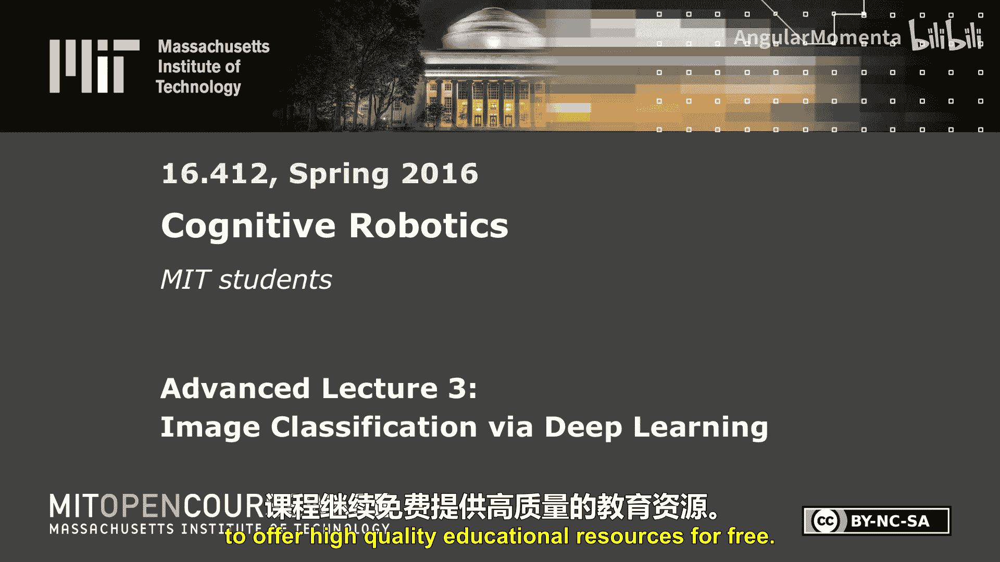

All right， so as this XKCD comic kind of points out in CS。

 it can be very difficult to figure out when something is just really hard or something is virtually impossible and until a couple years ago people thought this idea of image classification would be something that was closer to the impossible side but with the advent of deep learning technology we've made significant drives image classification and now the problem is actually quite tractable so today we'll be going through how the process of image classification with deep learning works so we're first going to talk about what deep learning is and then we'll move into some of the image processing techniques that researchers use followed by the architecture of the convolutional neural networks which will be the main focus in our presentation we'll also talk about the training process and then go through some results and limitations of CNNs and image classification。

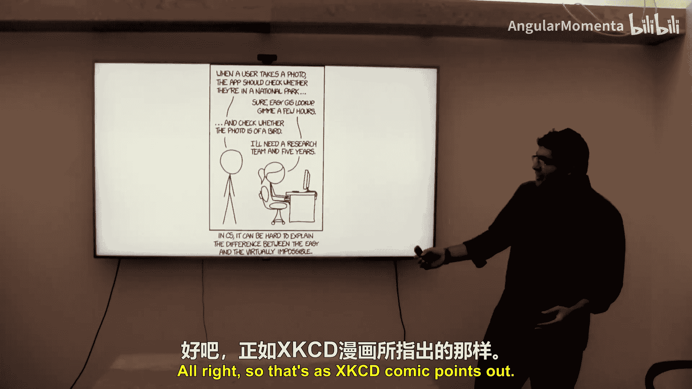

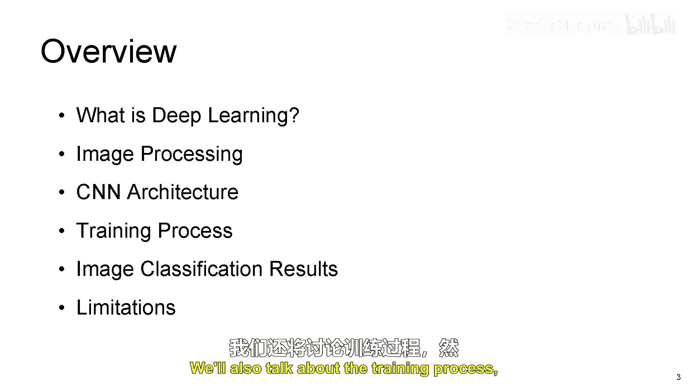

So what is deep learning Well the term is particularly vague and it's purposely so for a couple of reasons the first is mystery is always good for marketing。

 but the second reason is that deep learning actually refers to a pretty wide range of machine learning algorithms they do have some commonalities they all seek to solve problems of a complexity that previously people thought only people could solve so these are more sophisticated classification problems then traditional conventional machine learning algorithms can do so how do they go about doing this well all of these deep learning programs tend to take all the processes that need to happen and split them up they've got different parts of their program working on different things all in performing calculations and then at the end it all comes together and we get a result。

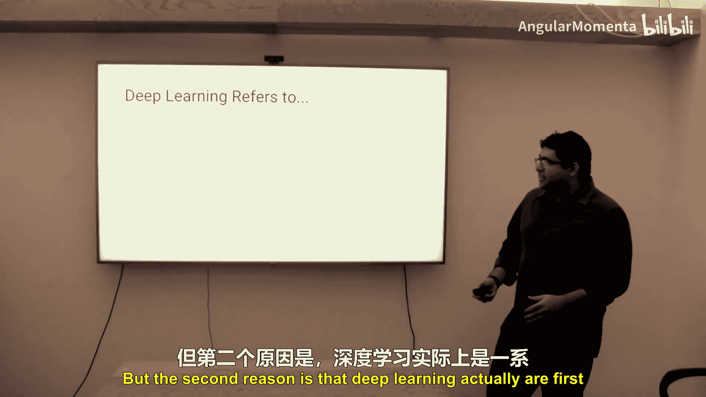

Of course， this isn't unique to deep learning and lots of distributed systems decentralize their calculations。

 but the key thing about deep learning is that every part is performing these calculations。

 the calculations are not simple calculations， they're not。

 we'll do this oneup operation over and over again on a lot of data and then we'll get a result at the end。

 each part is performing some particularly complicated process on all the little parts before they come together。

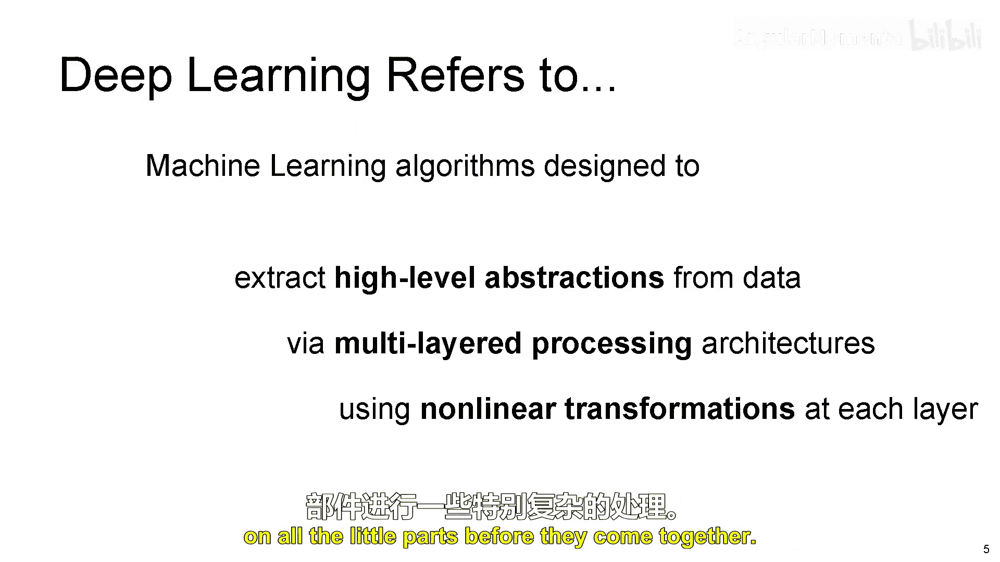

So why is this architecture a good idea， why did engineers come up with this sort of decentralized multilayed complex process Well。

 if you take the example of image classification， it turns out that the human brain does a pretty similar process。

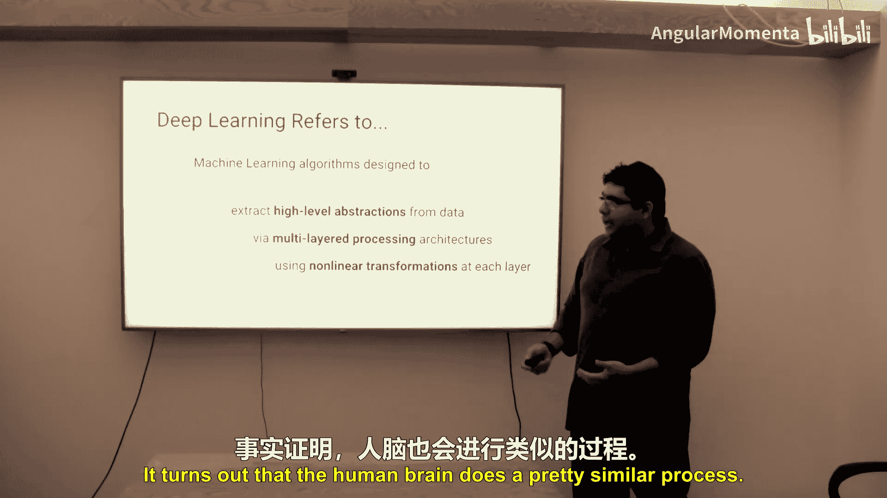

So here's the human visual system and it's very much a hierarchical process so you begin by moving from the retina into the first areas of the brain and as the information gets processed it moves from one region of the brain to the other and each spatial element of your brain is performing an entirely different calculation for example the V1 area over here is picking out edges and corners and then over here a couple steps later in V4 you're starting to group those sp together and so the brain kind of operates in a way that is very similar to the way these networks operate。

So let's talk about how to classify a face if I asked you guys。

 how would you classify a face what is the first thing you might do Well as I mentioned before the first thing our brain does is it finds these edges right the first thing to do is identify where the face is versus everything else now does anyone have any ideas to what we could do with the next step。

you an idea maybe you could group these edges together right we could maybe identify some of these features that we're working with so these are things like noses and lips and eyes right and then what would we do after we have these you know individual features。

Steve， well maybe we can hoop some of those together exactly yeah we can organize them into what we know the pattern to be right we know that a face has to have two eyes above a nose and then above the mouth right so that is precisely what a neural network actually ends up doing and we'll walk through the process of how it does this later on in that talk but as you can see the intuitive way that we would classify face and the way our brains are wired to do it is pretty similar to the way that we've gotten these neural networks to operate。

So like I said we're talking a lot about these convolution neural networks。

 there are other types of architectures involved， like we mentioned before declararing is a pretty wide variety of algorithms。

 but we're going to focus on these CNNNs to give you kind of a precursor idea of how good these CNNs are this is results from the imagenet competition so the image competitions basically exactly what it sounds like a bunch of clear scientists get together and see how many images they can correctly classify and you know their error rate was pretty high you almost a third error right over here in 2010 2011 and then in 2011 these CNNs are introduced to the topic and the error rate plummeted as you can see over here in 2015 we've got a significant improvement in these imagenet competitions so clearly these CNNs have been very effective and it's definitely been something that is exciting the field them happening right now。

All right， so next we're going to move into image processing。Okay。

 so Ryan gave us sort of a nice overview of where we get this concept of neural networks。

But let's take kind of a time travel and going to a quick history lesson。

 so suppose I had a chair and I wanted the computer to classify this chair right I have some a priorary knowledge about what sort of things make up a chair so I might be interested in looking at arms in corners of the chair。

 legs， things like that。So I would go ahead and sort of feature engineer my discovery scheme to be looking for specific things。

 so I'm going to talk about some techniques that are traditionally used， for example， chairs， doors。

 these things have corners so I might use an image crossing technique called the Harris corner detector where we basically look at large changes in intensity as groups of pixels move from an image should an image that indicate the presence of corners and you can use common corners to say that okay all of these images are chairs or doors or whatever。

Similarly， I want to say I have a bunch of pictures of chairs of different sizes。

 but they all must have so many cos or something， so typically we use a sift algorithm。

 which is scale imvari feature transform basically says across different sizes I still should be able to extract information about the placement of cos say。

嗯。Another common technique that's used in image processing is what we call hog histogram of gradients So basically。

 for example， in this image， if I want to say I want to find all the images that have faces in them or consist of faces and say I might come up with a template of a face that basically assigns gradients to groups of pixels that form an outlinelet of what sort looks like a face and then scan it across my sample images and say a faces present in this image。

 obviously there are some errors a needcap and a logo back here have become a face。

This is sort of the traditionalbrich。But here's the problem。

 what if I don't actually necessarily know what features are the most critical depending on the data that I get。

 I want the system itself to figure out what techniques to apply without having any a prior knowledge about the data。

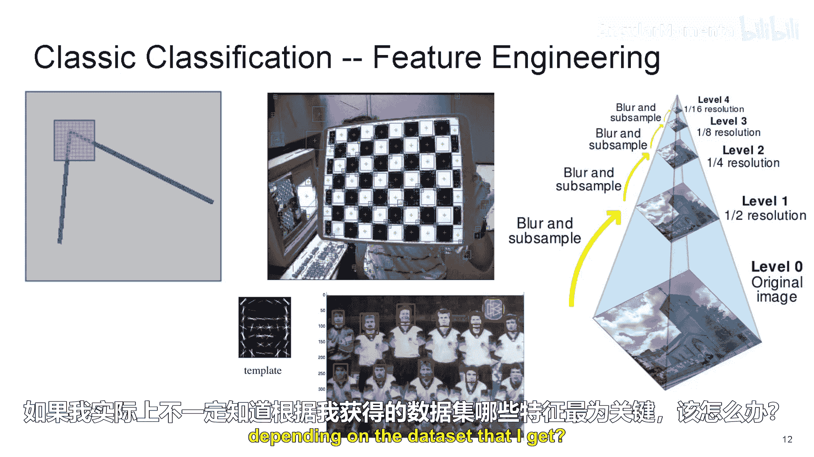

So this is exactly the idea of CNNs， the convolutional neural networks。

 we want the techniques to be learned automatically by the process by the system。

 so if I'm trying to classify faces， I want the system to figure out that eyes and ears and nose。

 these are the most important things or if I'm trying to classify elephants that ears and trunks are the critical features without me having to say。

 okay， we're going to do coronary detection， so on and so forth。

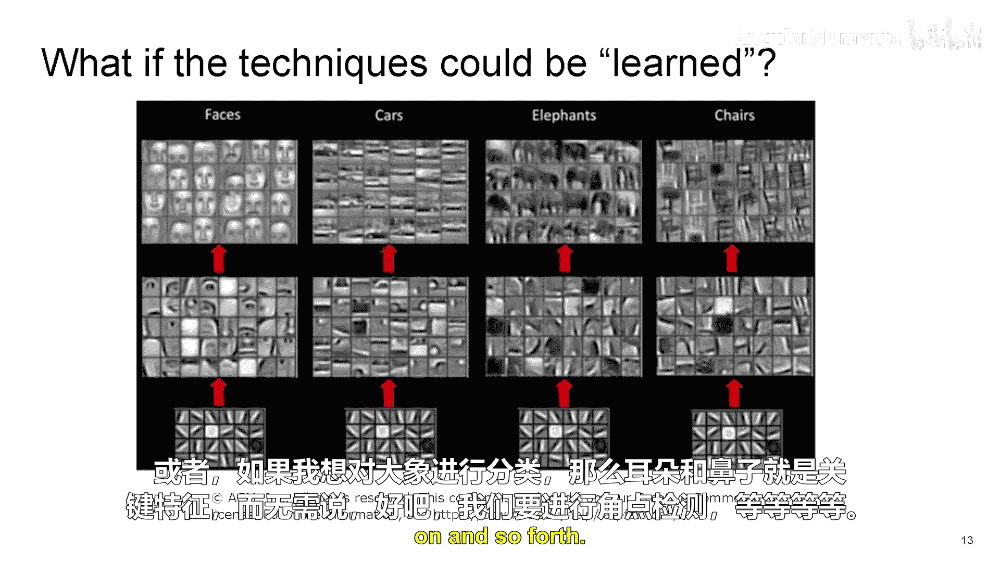

So this is the idea， so to be able to understand this process in greater detail。

 I'm first going to go into a little bit of math and the idea is to present the most fundamental operation here which is the convolution。

So this is a formal definition of the two dimensional convolution。

 and since we're working with images we we're only considering the two dimensional case。So。

In a more graphical presentation， which is a little bit easier to understand than just seeing the formula。

 the idea is that we have a kernel or a convolutional filter that we seek to apply on another image。

 and that extracts some information about that image that we can use to help us classify the final。

So assume that this is our kernel or this is our filter。And suppose this。

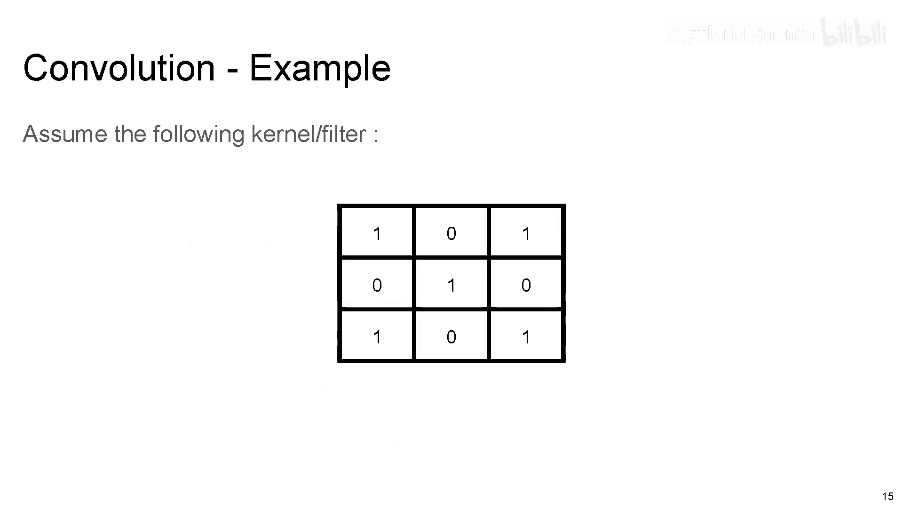

大没しょか。Others。So suppose we're applying the kernel shown here to the image that's in green So the idea is we want to slide this filter across the image and what we're basically doing is a succession of doc products。

 so at each placement on the image we multiply the overlayid numbers and the sum becomes that output image on convolt the convolt output so this is basically the way the process works you probably notice that there's a reduction in dimension and Henry will talk a little bit more about why this is。

When we get to it the your level session？

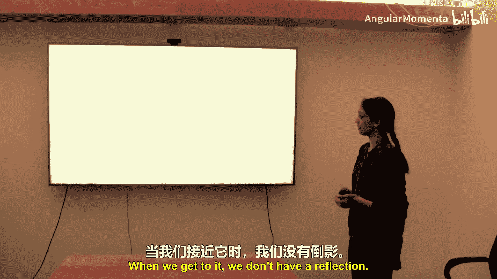

So let's see some examples of what information we get by applying a convolution。

So you see the image of a tireger on the top left when we apply a filter that's low pass filter basically it's a Gaussian。

 then we get low spatial frequency information about this image。

 so basically we blurd it and this tells us something specific that we might want to learn so the kernel actually looks like a two dimensional and Gaussian function that's been distributed across the three by three kernel。

Similarly， we might be interested in high spatial frequency information。 So in this case。

 we're looking at sharp， sharp features， so edges， horizontal edges or vertical edges。

 So a question for you is if I have this kernel which of these outputs？

When this kernel was applied to the original image， which of these outputs do you think it produced？

The third one。Yeah， that says I， and it's probably pretty easy to see why that's the case given that the numbers are all horizontal bands here。

Lastly， we also might be interested in extracting information at a particular frequency so we can take the difference of say high best filter in a low pass filter and at a particular frequency。

 you can extract information about that as well。Okay。

 one last sort of helpful piece of information is that there's another way that you can think of the information that's learned at each stage because a convolution can also be thought of as Fourier transform in the frequency if you think of the image transformation that way so from an image perspective what Fourier transform is is basically a sum of a set of sinusoidal gradings that differ say in frequency and orientation and amplitude and in phase so you can think about the zebra image here that's actually a composite of。

of different gradients that might look like this and the coefficients。

 the Fourier coefficients would be how much of each of these pieces come together to make that final image。

So just to get a sense of what kind of information this could convey。

 we typically take a Fourier transform and break it apart into magnitude and phase representation。

So you see magnitude and you see phase。So those images weren't particularly clear。

 but this is a really good example for this， so if we take the Fourier transform of all the horizontal text here。

 you see how the magnitude reflects this you can go back to the maths to understand why it's reflected in a vertical marking but similarly if I were to take the same image and rotate it and then ask for the Fourier transform you see how that information is contained very clearly in the magnitude spectrum so these might be things that a network would learn at each stage to identify this as as a text or body of text that's tilted one way or the other。

 so on and so forth。😊，So with that， we can now go into what the actual architecture of a convolutional neural is。

So as was said earlier， in order to classify or detect objects， you actually need certain features。

 you need to be able to identify these features and the way you can identify these features is using certain convolutions or certain filters in many cases we don't know what these features are and as a result of that we don't actually know what the filters are to extract these features and what convolution neural networks allow us to do is actually determine what these features are and also determine what the filters are in order to extract these features now the idea for convolution neural networks or the idea for replicating how the brain works started in about 1960s or 1950s after some experiments by bihubble and measles and what happened in these experiments as can be seen here is a cat was actually shown a light band at different angles and the neural activity of the cat was measured using a electrode and the outcome from these experiments show that based on the angle at which。

light was shown， the neural response of the cat was different， as you can see here。

 the number of neurons as well as the neurons that were firing were very different based on the angle。

So what you can see also here is really a plot of the response versus the orientation of the light。

And what this led hub and measle to is the idea that neurons in the brain are organized in a certain topographical order。

 and that each neuron fills act a specific role and only fires when a specific input is shown or when the angle or the angle is specified。

Now the first step to actually replicating how the brain works in code is really understanding how the building block the neuron works that's a quick reminder of 7012 here。

 so the neuron is actually a cell with denanddrites， nucleus。

 axon and a terminal and what the neuron actually does is aggregate the action potentials or the inputs it gets from all the neighboring neurons that are connected to it through the dendrites and it sums these action potentials and then compares them to a certain threshold that it has internally and that would determine whether or not this neuron with fire and action potential。

And that very simple idea can actually be replicated in code。

 so an artificial neuron looks very much like like a natural one。

 so what you would have is a set of inputs here we have three inputs that are some inside of a cell or a neuron the sum here is not just a regular sum。

 it's a weighted sum so the neuron specifies some weight。

 which you can think of as how much it values the input coming from a specific neuron。

 and then the input is multiplied by its weight， and then the total sum that the neuron computes is then fed into an activation function that produces the output that the neuron then basically produces。

Now what we just saw here is really a simple neuron， a single neuron。

 you can't really do much with just one neuron， so what you would do is really combine these neuron in a certain topography or in that case we have a network with seven neurons organized in three different layers and what you can think of that is really as one big neuron with 12 inputs and one output。

So for example， in the case of the chair that was previously mentioned。

 if you're trying to identify whether a specific image has a chair in it or not。

 these 12 inputs here could be some subimages or some small areas of the initial image that you feed into the network and the output here could be a yes or a no。

 whether the image has a chair or doesn't have a chair。

And that is really the concept behind convolution of neural networks。

 which we'll go into details in a bit。So what each neuron would be doing in that case is really just performing a dot product。

 which if you aggregate that with the dot products computed by each of the other neurons you would you would obtain a convolution so what we have here is three inputs if the input in that case is an image or a subimage then the inputs would be pixels。

 the weights that you would be using here would be the filter weights which is the filter that you use in the convolution and then the sum here would be the dot product of the weights and the inputs。

And that sum would be computed by a specific neuron in your network。

Then that would be the convolution step。And then that convolution step will happen at the first layer in the networks so you'd be applying this to the input。

 but you also will be applying this at the second layer and third layer。

 that case we're only showing what happens in the first layer。

The next step after the convolution would be the activation step。

 so the dot product computed here would be there's a function that would be applied to the sum。

 and then that function would produce the output of the neuron。

And this is where the activation layer is， you also have another activation layer here and the final one here。

what we just went through now are convolutions and activations。

 but this is not the only thing that actually happens in a neural net。

 what we also have is a step called subsampling which we will be talking about next。

For now we will dig deeper into the activation and specifically what activation functions to use in that case we can see that that's a neuron and what the neuron is doing here is the weighted sum that we talked about or the dot product and then the output from this should be fed into a certain activation function common activation functions or sigmoid 10h or rectified linear unit and we will go through each one independently so here we can see the sigmoid activation function so what this function essentially does is map any input to an output in the range of0 to1 and is defined as one divided by one plus each to the minus x。

The other common activation function is1 H and maps any input to an output between minus1 and 1。

 and then finally it would be the rectified linear unit。

 which maps an input to itself if it's positive or to zero if it's negative。

Now in theory you could use any function as an activation function in your network。

 but that's not what you want to do in practice， you want your activation functions to be nonlinear for one main reason that the goal of the activation function is actually to introduce nonlinearity in your system and if all your activation functions or linear。

 then you would essentially be having a linear system which prevents you from achieving the level of complexity that you would ideally want to achieve with a neural network。

And there's a formal proof as to why you need nonlinear activation functions。

 they don't all need to be nonlinear， but you need to have at least a few nonlinear activation functions in your network and the proof is available in the appendix or the link to the paper that has the proof。

So after we've discussed what happens at the activation layer now we want to talk about convolution。

 so as I said earlier， an image is obviously a two dimensional image but we're using RGB images so we actually need three channels。

 so what this means is that an image is actually three dimensional and each 2D matrix representss one channel。

 one of them corresponding to R one of them corresponding to G， one of them corresponding to B。

So a 32 by 32 image would essentially be represented by a 323 by 32 by3 matrix。

That's going to be seen here。So what happens at the convolution layer so here we have a nice animation that shows what is happening at each convolutional layer。

 so assume we have a5 by5 by3 filter so what this essentially would be doing is covering a certain patch in the original image which is 32 by 32 by3 so what we can see here is that for that5 by5 by3 patch in the original image。

 we have a neuron that is actually performing the dot product on all the pixels in that specific patch。

So what is happening here is the pixel values， which in that case。

 we have five by five by three pixels， are being multiplied by the filter values。

 and this operation is being performed here。Then after that dot product is performed。

 it's fed into an activation function as can be seen here。

 and this reduces the output of this neuron。Now this is what this single neuron is actually doing。

 it's just covering that area of the original image。

What you would have in a neural net is many neurons each covering a certain area of the original image。

And if you aggregate the output of all of these neurons。

 what you would be doing or performing is essentially a convolution on the original image。

And to formalize what happens here or what's the output that's being produced from that operation。

 we can look at that from a more mathematical perspective。

 so if you have an input of size H1W1 d1 and you're performing a convolution with a filter。

 then the output W2 would be related to W1 with the following formula so W2 is W1 minus filter width plus1 and the same formula applies for the height。

 and the depth would actually be the same because in that case we're using a filter that has the same depth or3 as the original image。

So what this would produce in aggregate is if you have 28 by 28 by one neurons。

 each one performing a dot product on some pixels in the original image。

 the output would be an activation map of size 28 by 28 by1。

 and the output of each neuron would be one pixel in the activation map。

Now if we go back to the points that we made earlier。

 one thing we said was that the reason you using a neural network is because you don't know exactly what features you want to extract and you don't actually have specific filters that you want to apply to the image so ideally what you want to do is have multiple filters being applied to the first image and perform multiple convolutions and this is what you can do with multiple neuron layers so what we described before was just for one neuron layer in that case we can assume we have five different neuron layers。

 each one performing a different convolution on the original image。

 so in that case we would have 28 by 28 by one neuron per layer and then if we aggregate all these neurons together we had need to multiply it by five and that would be the total number of neurons we have in that specific in that specific network。

So this actually leaves us with a pretty complicated system， we would have many parameters。

 the neurons have weights， the number of neurons is also a parameter。

 so how do we actually formalize that if we have an input volume of 32 by 32 by3 which is our original image and a filter size of 5 by5 by3。

 then the size of the activation map that would be produced would be 28 by 28 by one。

Then in that case， we also said we have five different neuron layers that perform five different convolutions。

 then the total number of neurons would be 28 by 28 by5。

And then the weights per neuron are5 by5 by3 which is 75 in that case we're assuming that the neurons independently each track of their own weights。

 this could be simplified to each layer having their own weights which would tremendously reduce the number of parameters。

 but in that case just to get an upper bound， this leaves us with a total number of parameters of 294000 and this is just using a 32 by 32 by three image。

 you can think of this is a pretty small image so if you have a bigger image you you will have many more parameters。

Great， so what we just saw now and describe were convolutions activations and these steps happen sequentially in a neural network convolution neural network specifically as can be seen here。

 one step that also happens occasionally is subsampling and we'll discuss that step in details here so there are two main reasons why you would actually subsample your input。

 one is to obviously reduce the size of your input and your feature space。

 but also because you want to keep track of the most important information and get rid of everything else that you don't think is going to be relevant to your classification。

And the common methods used in subsampling or either max pooling or average pooling we will describe max pooling here so what happens in max pooling is essentially you're dividing the image into different subimages。

 non-overping subimages and you would perform an Max operation so in that case if we consider two by two filters we would split the image which in that case is4 by four we' split into four subimages and for each two by two square we would take the maximum in that case for the first square it would be six then8 and three then4 and the reason that actually works is because what you want to do is really keep track of the response of the neurons or the highest response produced by your neurons and that case。

 for example the highest response in the first square is six and that means that if you get that highest response means that something's been detected in the image or it hass been detected and this is something you want to keep track of as you。

Mo forward in your network。And。Although this moves around the location of pixels because you can think of that as sub samplingling an image。

 it does keep track of the information you care about because you only care about the fact that something has been detecting in the image。

 at this point， you don't really care about where it's located in the image and you want to keep track of all the features that your neurons have detected in order to be able to eventually classify the input correctly。

So if you have multiple feature maps， so in that case if you have 224 by 224 by 64。

 what your subsling operation would be doing is reducing reducing the height and the width so the depth would remain unchanged。

 so in that case you would go from 224 by 224 by 64 to 112 by 112 by 64 and that would be reducing your output size by a factor of4。

And formally， what this would look like is if you have an input of size H1W1D1。

 your output the size of your output would be related to your input in the following way。

 so W2 would be W1 minus the pool width plus1， the same applies for H2 and the depth would remain unchanged。

Right so these are essentially these are the steps that happen in a convolution neural network then what you could be doing is repeating these steps on a certain number of times in your network。

 but eventually you would have to make a classification and decide in our case whether our image has a chair or doesn't have a chair so how does that happen so after you perform all these steps there's a step that happens here that would allow you to make that prediction and that step is usually called a fully connected layer or a multilayer perceptron and what this essentially is is layers that are very similar or exactly the same as what you had before。

 except that every neuron in a layer is connected to all the previous neurons so what it allowed you to do is really consider everything you currently have about your input or everything that's left about your input and compute at product and that rather than rather than focusing on a subsample of your input？

Like like previous layers do。In that case， if you're actually trying to classify your input into four classes。

 you would ideally have four different neurons in your Apple layer。

 each one corresponding to one of the classes that you have。

 and then you would perform the same operation as you would in a previous layer。

 compute the product and then once you obtain values。

 the values at every neuron you would perform a normalization operation on all the output。

 the normalization operation is called softmax or normalized exponential and what it does is really put more weight on the highest value and by computing the softm at the output。

 you're able to compute the posterior probabilities and this will allows you to make a more informed or basically make a classification decision on your input。

Great， so that's everything and now the next step we'll be talking about back propagation。Okay。

 so now that Henry's given us an overview of the entire architecture of a CNN。

 I'm going to quickly spend some time and talk about standard preprocessing tricks and tips that people might use on the image data set before they actually feed it through a neurallet to classify the images。

So let's imagine that suppose we have a data set X。

 and there are n number of data points in the data and each point has a dimensional LD。

 so they have D features per point。So in this example we use these graphs as an example。

 basically our original data here has just two dimensions and it spans this range of values。

 so for example， if we want to center this data what we would do is the mean subtraction so you basically subtract the mean across all the features of all the points and we basically center it and you can see that transformation here and then we might again go for normalizing the dimensions so that you have the data points span the same range of values in both dimensions so you can see that transformation and how it's taking place here and we just divide by the standard deviation to do this。

Something that's very commonly done is called PCA or principal component analysis and the idea here is sometimes we have a data set that has a very。

 very high dimensionality and we would like to reduce that dimensionality。

 so basically what our goal is is to project a higher dimensionality space onto a lower dimensionality space by taking the subset of those features and if you see a little bit of 1806 or linear algebra。

 the way we do this is by generating a covariance matrix and doing the single ular decomposition and I'll sort of gloss over the math now but that's the idea。

And you can kind of see here how the original data span two dimensions and delate it so that it spans a single dimension and even with this data。

 you might want to ensure that it's whitened， which is the same deal。

 you want the values to span the same range in both dimensions so then you would just divide by your itemenvalue to get the whitened data。

This last bit is something that's very commonly done as a preprocessing trick。

 though people aren't entirely sure why it works very well or that it really does help。

 but it's something that people do and it's called data augmentation so basically if I have a data set that contains a a bunch of images of chairs。

 a bunch of images of tables and then a bunch of images of say trees I might want to intentionally augment that data set further by introducing a few variations on these same images so I might take the chair image。

 rotate some reflect a few more scale crop remap the color space or just kind of have a process that does this randomly to create more variation on the same data and this is kind of a good illustration of why this makes a difference I've taken an image here of what looks like a waterfall or some spotted in nature and simply just inverted the colors and what I see if I were to just see this image alone it maybe looks like a curtain or a bit of texture or something。

The idea is even to a human perception， these images have two very different meanings。

 and so it's interesting to see what effect they would have on a neural network。And with that。

 we'll go over to image classification results。So so far we've seen。

How convolution neural networks are built and certain image processing techniques we can use on the input images to get them into formats that。

Are better for the classification process， but so far it seems a bit abstract， it's good to know。

How CNNs work， why CNNs work， but why don't we take a look at some of the practical results from CNNNs and what they're used for so that when you're watching the lecture you can go home and try stuff。

 try classifying images on your own time。With that。

 let's first revisit the Inet competition I hope you remember the graph at the bottom from the beginning of lecture where we sort of use this to motivate the use of CNNNs CNs came on to the picture in 2012 but the winning CNNN from 2012 was used on the 2010 Inet competition as well and it managed to bring down the top five area to 017 which is pretty much on the same level as how it performed in the 2012 competition when it was first used which was at 016 so this just goes to show you that composition neural networks are the stay of the art when it comes to image classification and that's why where it currently focusing on that but you might be wondering what the Inet competition exactly looks like what the images look like so let me take a look at that。

As you can see here these are certain images from the image in a competition underneath each image is a bold caption which is considered to be the ground truth or what the competition believes to be the correct classification of the image underneath that ground truth you see a list of five different labels now these five labels are produced by a convolutional neural network and the different bars。

 the different length bars some pink and others blue represent how confident the CNN is that what it sees in that image is that specific label as you can see in certain examples。

 the CNN is pretty confident in that it has a correct answer， for example。

 when we look at the container ship it's pretty confident that what's in that image is exactly a container ship there are certain cases when it doesn't get the correct label on its first try but does have it in its top five labels。

 for example we can see in grill and mushroom now the funny thing about the mushroom image。

what thinks the image should be classified as is agarreic。

 and if you don't know agaric is actually a type of mushroom and in fact it's a mushroom in that image。

 and it makes sense that their confidence levels are pretty much the same。

 agar is it' slightly more confident that what seasoned image is agaric。诶。One。

 but there are certain cases when the CNNN fails to classify the image correctly its top five labels。

 this would be registered as a top five error as you just saw in the previous slide about the top five error rate one example here on this slide is chrry now the image of competition。

Believe that this should be classified correctly as chair。

 even though there's also a Dalmatation in the background， the CNN on the other hand。

 is pretty confident that what sees in this image is a dalmatian。

But if you look at some of the other results within the top up although it doesn't get cherry at all。

 it does get certain fruits that you may think look sort of like cherries like grape or elderberry。

 so the CNNN does actually pick up on two different distinct objects within the image。

 but as a result of how it's built or its trading set ends up classifying it as a doalmmination。

 but it goes to show you that CNNNs can also be used not just as image classification but also as object detection。

 which we do not touch upon in this lecture at all， so I'm not going to go further into that。

Now this is all fun and all， but what about some real world applications？

So this is a study that they did at Google with Google Street View house numbers where they use the CNN to classify photographic images of house numbers as you can see here of certain examples of these house numbers what they look like now so what the CNN was ask the task of doing was that was supposed to recognize the individual digits within the image。

 and then understand that it's not just one digit that's looking at。

 but it's actually a string of digits connected and successfully classify as the current house number。

This can be quite challenging even for humans sometimes when the image is quite blurry you might not exactly know what the house number exactly is。

 but they managed get the convolutional neural network to operate around human operator levels so that corresponds to around 96 97% accuracy and what that enables Google to do is that they can deploy the CNN such that the CNN automatically extract the house numbers from the edge from the images online and uses that to geocode these addresses and it's gone to a point where the CNN is successfully able to do this process in less than an hour for all the street view house numbers in France in all of France Now you might be asking where this could be useful for。

 if you don't have access to a lot of resources。To actually do this geocoding process where you match platitude and longitude to street addresses。

 then you might want then your only resource might be actually photographic images so you actually need something hopefully not human but some sort of software that can do this successfully and so this is for example。

 a place in South Africa bird eye of you I'm not sure if you can exactly see but there are these small numbers on top of each of the houses。

 all these numbers were extracted and correctly classified using this previously seen CNN。

Another example from robotics is recognizing hand gestures so obviously robots come equipped with a lot of different part where they can send sounds。

 they can also capture images of their surroundings and if you're able to classify what you see if the robots able to classify what it sees they can actually act upon it and take certain actions that's why it becomes really helpful to successfully classify images so this is what they did using hand gestures where there were five different classes each class correspond to a number of extended fingers so ABCD to top row corresponds to the same class they all have two fingers sticking out the bottom row has three fingers sticking out so that's another class and they actually get down get the error rate down all the way to3% so 97% of the time the convolutional neural correctly classify the hand gesture and you can use these hand gestures then to give certain comments。

I'm sir robot and you can。If you train a CNN to act upon something else besides hand gestures。

 for example， if it's in some sort of terrain and you train it on certain images that you might find in nature。

 then it can take those classifications and act upon it once it sees， for example。

 a tree or some sort of body of water， it's all things to image classification。

Now obviously gestures are not necessarily static， you could be waving your hand and so that would require a temporala component so it's not just an image you're looking at。

 but a video。And so it follows that we can probably extend image classification into video classification after all。

 videos are just images。With an added component specifically time。

 obviously this the added temporal component comes with a lot of additional complexity。

 so we're not going to dive into any of that， but in the end it comes out to the same thing you extract features from the videos and you attempt to classify them using convolution neural nets。

 so when we look at a study done again at Google where they extracted a 1 million videos from YouTube sports videos。

With。Or somewhere between 400 to 500 different classes。

And they use CNNNs to attempt to classify these videos， and now they use different approaches。

 they use different approaches， different tests， different types of CNNs that I'm not going to go into。

But as you can see here， these are sort of stills from these videos where the caption highlighted in blue is what the correct answer should be and underneath it the top five labels that the commal neural network producers。

 the one highlighted in green is the correct it's supposed to be correct answer so you can see on。

All of these it gets it within the top five and use and for the most part， within the top two。

 and it's pretty confident when it does get correctly now when I said that they use different types of classifiers。

 some of them were more stack classifiers where they just were they were just trained on stills within these images while others were what they call fusion ones where they sort of add the temp component by fusing in different stills from these footages together it。

Now the current accuracy rate， the best one they've achieved so far has been around 80% accuracy within the top five label now 80% accuracy is nowhere near what we saw with the image and classification where in 2015 they had managed should get it up to 98 or 99% accuracy。

 but obviously there's way more complexity involved in this so it makes sense that it's not quite there yet。

 but it does provide good benchmark and something to improve upon in the future as well。

 now that being said convolutional neural networks do come with certain limitations they're not perfect and so Julian will now talk about the limitations。

Thanks， Ollie。So Alley talked about the INe competition and talked about how the recent winners have been convolutional neural nets。

So before the best was about 26% top five error rate， but now they've actually gotten it down to a 4。

9% top five error rate， and that was the winner of that competition。

 the 2015 one was actually Microsoft。They've got the current state of the art implementationation。

 and so because it's the imagenet competition， that means they can identify exactly 1。

000 different categories of images。So there are a few problems actually with the implementation。

 or just in general， with convolutional neural nets。So one of them is that a thousand categories。

 while it may seem like a lot imagenet is actually one of the largest competitions that's not actually that many categories。

 so it doesn't contain things like a hot air balloon， for instance。

 so these things that children would be able to classify。

 the neural nests actually aren't able to even in the biggest competition。

 and each of these categories also requires thousands of training images whereas you could show a child a couple examples of a dog or a cat and they'd be able to generally get a feel for what a dog or a cat looks like it takes thousands of images per category for the neural nest to learn them。

 which means the total number of images you need to train for the imagenet competition is over a million。

And so this leads to very long training times， even with all the heavy optimizations that Iwari was telling us about how efficient convolution is。

It still takes weeks to train on multiple parallel GPUs working together to train the net。

There's actually a more fundamental problem with neural nets as well。

 so here on the left we have a school bus， some kind of bird and an Indian temple and all of these images on the left side are actually correctly identified by convolutional neural nets but when we add this small distortion here in the middle that doesn't change any of the images perceptibly to the human this actually。

Causes the neural network to misclassify these images， and now all three of them are ostriches。

So that's a little weird how does this work， how did we find those distortions so here on the left side we see how a neural network typically works you start with some images。

 you put it through the different layers of the neural network and then it tells you a certain probability that it is a guitar or a penguin so it classifies it。

And so we can use， I guess， a modification of that method by applying an evolutionary algorithm or a hill climbing or gradient acent algorithm。

We take a couple of images， and we put them through， it classifies it。

 and we see what the classification is。And then we can do some crossover between the images。

 so we take the ones that look a lot like what we're training for the guitar or penguins in this case and we。

We take the features of those that identify very strongly as a guitar and we combine those together in the crossover this is for the evolutionary algorithm。

 and then we mutate the images which is making small changes to each one。

And then we reevaluate by plugging it backing through the neural network and only the best images。

 the ones that looked the most like a guitar or penguin are then selected for the next iteration。

And this continues until you get to very high identification rates。

 even higher than actual images of the objects。So using gradientian ascent。

 these are some of the images that you could produce if you start with just a flat gray image and then you run it through this algorithm。

 so here on the side we have the backpack and you can actually see the outline of what looks like a backpack in there and over here we have what looks sort of like a windsor tie。

Right here， but all of these objects and perhaps there are things in these other images。

 but they seem to be lost in the LSD trip of colors here。

So that's kind of strange that's definitely not how humans do it so let's try a different method what if instead of directly encoding which is where we change individual pixels。

 what if we change patterns in the images like different shapes。

 then this is the kind of output that we get so on the upper left we have starfish so you can see that it has the orange and blue the orange of the starfish and also the blue of the ocean that would be the environment that typical images of starfishes are taken。

And you can also see that has the points， you know the jagged lines。

 the triangles that we associate with the arms of a starfish。

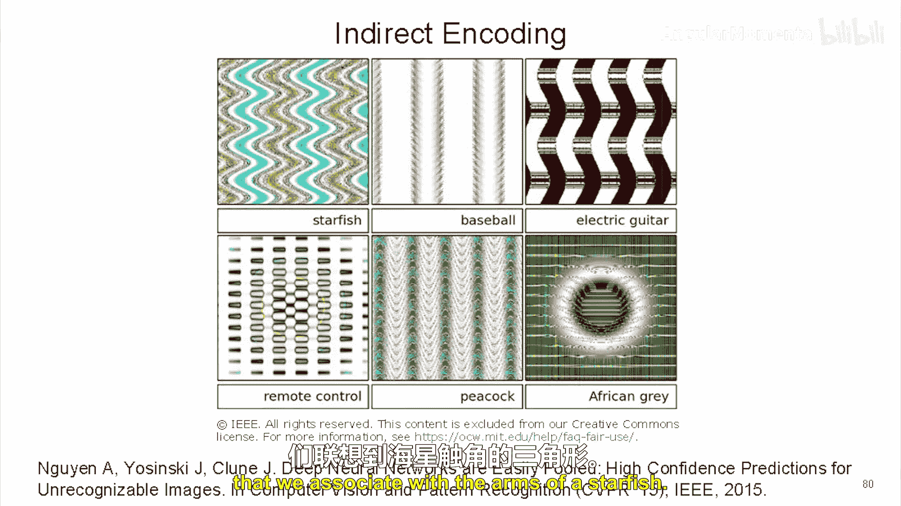

But the strangest thing here is that they're not arranged in a circular pattern。

Pointing outwards like this like we would expect of。Theernational starfish。

So clearly it's not latching onto the same large scale features that humans do。

 it's actually just looking at the lowdown features， even though it's a deep neural network。

 it doesn't grab onto these more abstract concepts like a human would。So the reason for this problem。

 or at least why we think neural networks aren't as good as humans， things like this。

 is the type of model， so a human would have more of what's called the generative model which means if we have examples here。

 these dark blue dots， say of lines， a few examples， like images of lines。

 then we could construct a probability distribution and say that images that fall somewhere in this region。

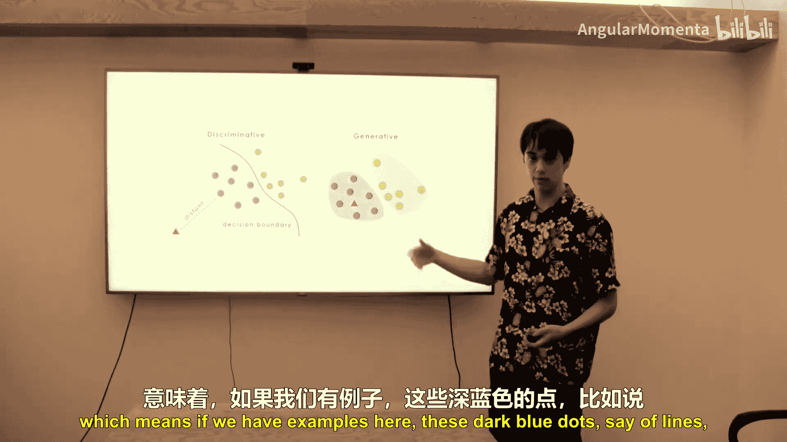

Our lines。Over here we have a few examples of giraffes say。

 and so anything that falls in this region would be a giraffe and so if you had a red triangle in here。

 that would be a line， but if the red triangle was instead over here。

 it actually wouldn't classify at all we wouldn't know what that is you might say that's something other than a line there a giraffe。

But neural networks don't work the same way， they just draw a decision battery。

 they just draw lines between the different categories。

 so they don't say that something really far away from the lion class is necessarily not a line。

It just depends how far away it is from the ocision boundary。

 so if we have the red triangle way over there， it's very far away from giraffes。

And it's just generally closer to lion， even though it isn't supposed very close to it at all。

 and that will still be identified as a lion。So that's why we think we're able to fool these neural networks in such a simplistic way or in such a really abstract way。

So the main takeaways from our presentation that the salient points。

That deep learning is a very powerful tool for image classification。

 and it relies on multiple layers of a network， so multiple processing layers。

Also CNNs outperform basically every other method for classifying images and that's their primary use right now。

 we're currently exploring other uses but that's。Generally， where it's headed。

And this is because convolutional filters are just so incredibly powerful。

 they're just very fast and very efficient。Also back propagation is the way that we train neural networks。

 normally if you were to train a neural network that has a lot of layers。

 there would actually be an exponential growth in the time it takes to train because of the branching when you go backwards because each neuron is connected to a large number of neurons in the previous layer。

 you get this exponential growth in the number of dependencies from a given neuron。

 but using back propagation， it actually reduces it to linear time to train the networks。

 to allows sort of phsion training。And even with back propagation and convolution being so efficient。

 it still takes a very large number of images and a long time with a lot of processing power to train neural networks。

Also， if you'd like to get started working with neural networks。

 there are a couple really nice open source。Programing。Platforms for neural network。

 so one of them that we used for our PSAT was actually TensorFlow。

 which is Google's open source Ne network platform and another one would be Cafe。

 which is Brkkeley's neural network platform and they actually have an online demo where you can plug in images and immediately get identifications so you can get started very quickly with that one。

Thank。

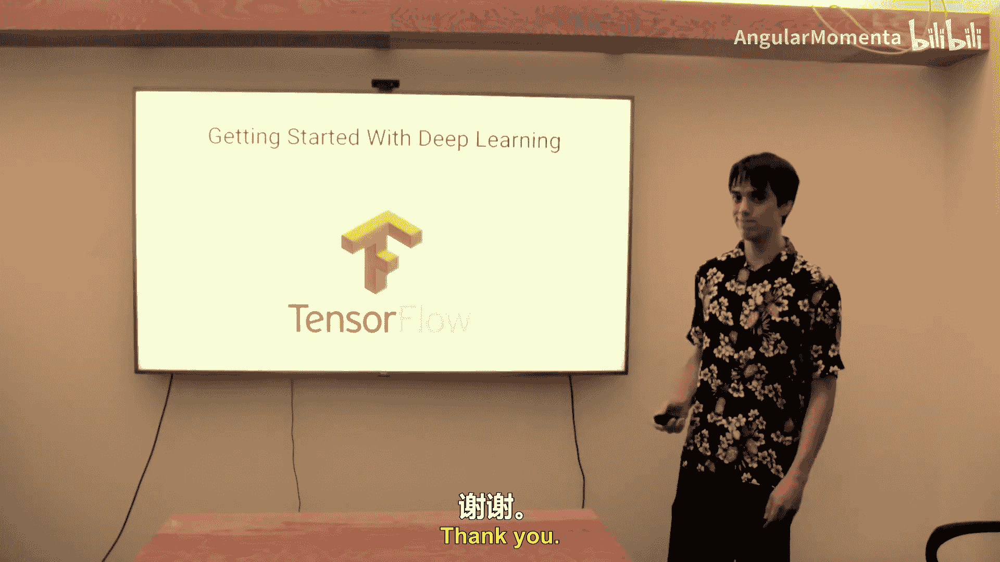

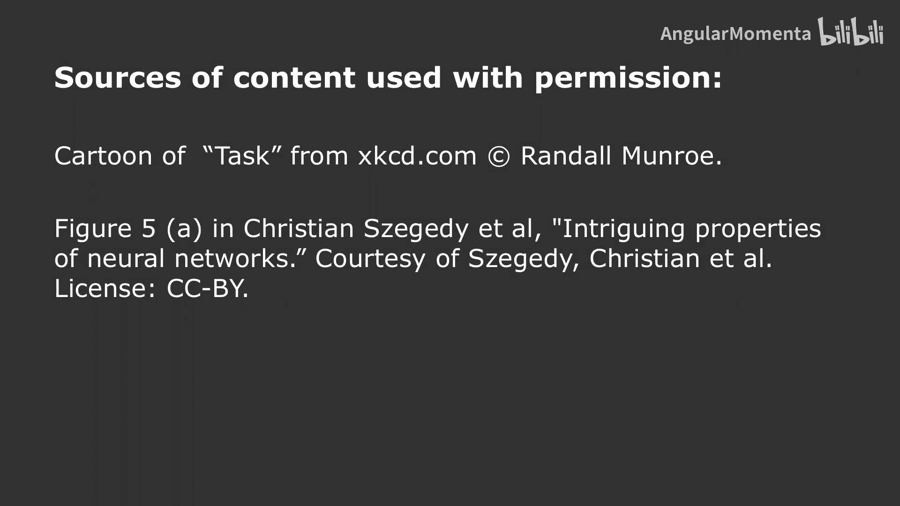