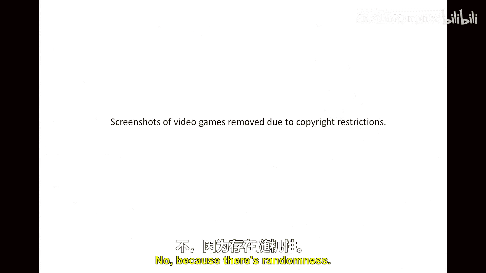
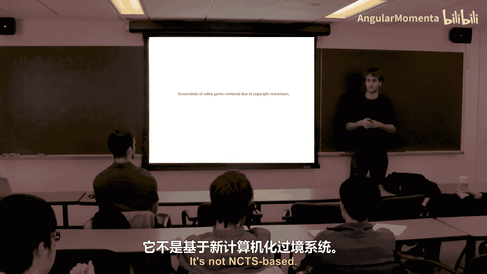
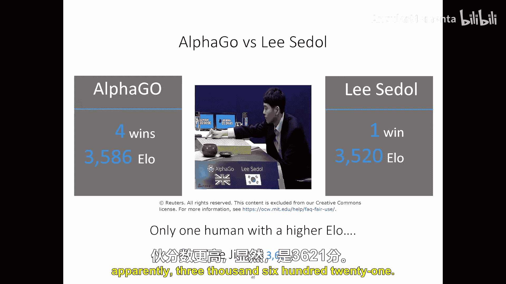
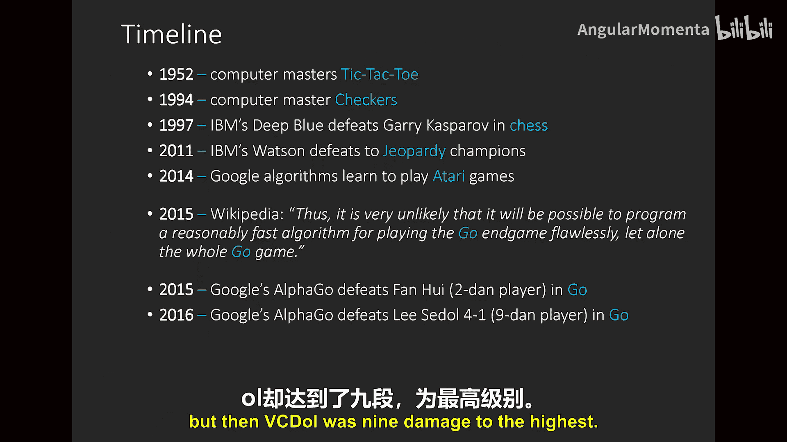
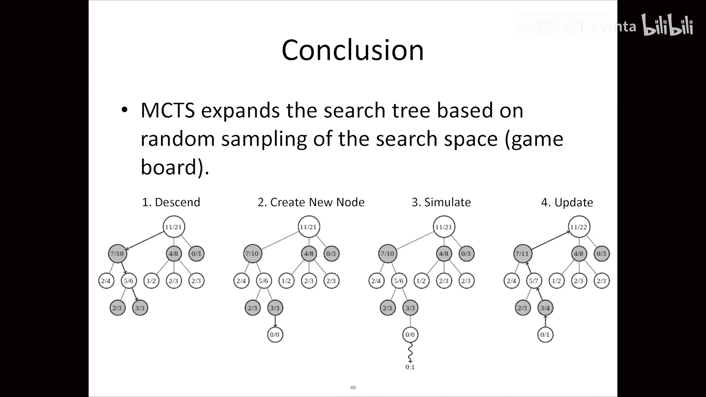

# 【麻省理工】认知机器人学-｜-MIT-16.412J-Cognitive-Robotics,-Spring-2016-p04-高级4.-蒙特卡洛树搜索--BV1eEtTzhExj_p4-

The following content is provided under a Cative Commons license。

 Your support will help Mi T OpenCourseware continue to offer high quality educational resources for free to make a donation or to view additional materials from hundreds of MiT courses。

 Visit Mit Opencourseseware at Ocw。 Mt Eduu。

Okay， so today's lecture right is relevant for a couple of reasons but we're going to be talking about probabilistic planning later。

 right and in these cases where you're doing and planning a large state spaces is very difficult and one of the main things you can do it could be MDP planning。

You know stress style activity planning or the， but you have to be able to figure out how to deal with the case spaces。

 so Monte Carlo's researches is one of the techniques that people kind of identified over the last five years is having an amazing performance improvement over other kinds of sal based。

T is very interesting to that standpoint， and then it we linked to the last lecture。Right。

 then the combination of something which is trying to learn about you obviously combining with search。

Is very colorful in this case through the state of art。

My techniques were that is how we research searcheded the。Some later know that。Okay。

Good morning everyone， as Professor William just said we are going to be talking about Monte Carlo tree today my name is Dan and I'll be leading the introduction and the motivation。

嬉し？By the end of this presentation， you will know not only why do we care about Marty Car's resources。

 as Professor Williams said， there's so many algorithms out there。

 why do we care about this specific one。And second we have we'll be going through the pros and cons of MCTS as well as the algorithm itself。

 and then lastly we will have a pretty cool demo on how it's applied to Super Mario Brothers and the latest alphaphago。

AI that built the second。LeLeing go player in standard。

So the outline for today's presentation is first we're going to talk about prencCTS algorithms。

 the other algorithms that currently exist out there and just a few of them to lead into why we do care about MCTS and why these other algorithms fail。

And second， we'll talk about Monte Carlo research itself with you， and lastly。

 Nick will tell you more about the applications of Monte Carlo research。So the motivation of。

Of these kinds of algorithms is we want to be able to play games and we want to be able to create programs to play these games。

 but we want to play them optimally， we want to be able to win。

 but we also want to be able to do this in a reasonable amount of time so these three constraintstrain itself lead to different kinds of algorithms in different algorithms with different complexities and time。

😡，A ties to search， and so that's why today we're going to be talking about Monte Carlo T and you'll figure out in a few slides why we do care。

So these are the types of games we have， you have this chart where there's fully observable ofservable games。

 partially observable games， deterministic and games of chance。

 and so today the games that we care about are the games that are fully observable and deterministic and these games include games like chess and checkers and go and we'll also be talking about another example with Tit。

😡，So these free MCTS algorithms include。Deterministic， fully observable games， like we said earlier。

 and the idea of this and the nice thing about these games is that they have perfect information and that you have all of the states that you need and there's no opportunity for chance。

And so the idea is that we can construct a tree that contains all possible outcomes because everything is fully determined。

And so one of these algorithms to address this is the algorithm minimas。

 which you might have heard before and the idea of minimas is to minimize the maximum possible flux now it sounds a little weird in the beginning。

 but if you take a look at this tree this red do for example。

 it a computer and so in the computer's eyes it wants to beat its opponent and we're assuming the opponent wants to win also so they're playing their best game as well。

😡，And so the computer wants to maximize his or her。Points。

 but also think also knowing that the opponent or the human wants to maximize their own win as well。

 and so in the computer's eyes it wants to minimize the maximum possible box。😡。

Does that make sense to everyone？Okay。And so in the example of mini maps。

 we're going to start with a connect or a T ta to board where the computer is this board right here。

 and the blue T ta to boards are the states that the computer climate chooses。

It's anticipating what the moves the human could play， so if you take a look up here。

So if you take a look up here， here's the current state of the board。😡。

Current state of the board and the possible options for human are this guy。😡，This guy。

No possible options for the computer we have three different options and so you'll notice that this is clearly the obvious winner。

 but in the state of mainm it goes through the entire tree which is different from depth per search it goes through the entire tree until it finds the winning move and the。

😡，Max minimize of the maximum possible。Coins they can win。So is there a way we can make this better。

 yes， I'm sure you thought you've heard about pruning， where in our human intuition。

 it makes sense well， why don't we just stop when we win or when we know we're going to have a game that？

😡，That allows us to swim and so is the idea of simple pruning and so when we combine mini Maxs and simple pruning。

 we have anyone know。Alphabe， yes， our 6034 head T about this。

We have alpha beta pruning where we put away any ranges that cannot influence the final decision。

 so in other words， you wouldn't keep exploring the tree if you already knew that a previous term would allow you to win。

And so this idea in alphabeta pruning， we have the alpha and the beta。

 and so the details are important for you to know right now。

 but the idea is that we stop whenever we know we don't need to go on in further。

So in the games ofticktk toe and Pen forward and chestess， we have relatively low brching passes。

So in the case of T tech show we have two to the fourth branching factor。

 but what if we have really large branching factors like alphago in alpha go we have two to the 250 do you think that mini Maxs or even alphabeta pruning would be。

And optimal algorithm of this。 The answer is。No， and this leads us to our next presentation to our next section where Joe is going to talk about how we can。

Use the Monte Carlo tree search algorithm for games with really high branching factors and using the。

Random expansion to allow us to see ultimately how。Alphago。

 which is Google's AI was able to beat the leading go player in the world。그。So。

This is the part where we explain the algorithm itself and so before we dive into this。

 I want to make something really clear， which is that because these are technical details and because we actually want you to understand them and because I definitely didn't understand this the first like three times out of the paper。

 I really want you to feel free to ask any questions on your mind。

 with the knowledge that as in my experience it is very rare that someone asks a question in the class that someone else is。

Okay， so really， whenever you have them。Okay。So。Why are we doing this Well。

 the ideal goal behind NCTS is that we want to selectively build out different parts of the tree so sort of the depth first search kind of way。

 the exhaustive sort of search would have us exploring the entire view of the tree and that our depth is limited by looking at all the possible nodes of that level。

But what we want is we want because like that thing the amount of competition required for that explodes really real quickly。

 you know with the number of moves that you're basically looking into the future。

 we want to be able to search selectively in certain parts of the tree and so for example if there are less promising parts over here then we care less about looking into the future in those areas but if we have a certain move in chess。

 for example there's a certain move where in two moves I'm going be able to take the opponent's queen then I really want to search that region and figure out whether that's going to end up being。

Like a significantly positive move for me， and so the whole goal of our algorithm is going to be growing this sa entry。

他 was是喷摄这。Okay， great。So how do we actually do this we're going to be going over a high level outline。

 but before we do that， let's talk about our tree， which you are going to get very familiar with the it's a little bit washed out can people see that this is red and this is blue？

Okay so this is our game state when we start when we start our game。

 you know it can be a given a Ttact toe board with a few moves place a game of chess with the moves configure in the circle way and so our player。

 which is the computer has three separate moves that they contain and so each of those moves are represented by a node and each of those moves have response moves by the opponent so you can imagine that if one of these is atic ta toe board with just a circle that one of these is with that circle and an X place red by it and as you sort of go down this tree。

 we start you start an understanding that okay basically it's the way that humans think about salt about playing these games know if I go here。

 well then what if they go there and then if I go here。

 you're trying to think through the set of future moves and trying to evaluate whether your move will be good in a long term sets。

Okay， so the way that we are going to expand our tree， as we said， to create an assymmetric tree。

Is first of all， we're going to descend through the tree。

 We're going to start at the top and we're going to basically jump down some sequence of branches until we figure out where we're going to。

Where we're going to click our new node， which seems like kind of the key operation here。

 right to create an esymmetric tree it's all that how can build this。And so for example。

 in this case， we're going to pick this sequence of nodes。

And once we get to the bottom and find every location。We're going to create a newode。

It's not very hard。When。We're going to simulate a game from this new node。

 and this is sort of the key part of MCTS is that once you get to a new location。

 what you're going to be doing then is you're going to be simulating a game from that new location。

 we're going to talk about how you go about simulating a game from this like this more advanced game state than you know what we started out。

So anyone have any questions right now， we will be going in depth into all of these steps。

 but just let highlight to makes。Yeah， that new node is a this a new as the most problem we No， no。

 you're creating some new node， we'll talk about how we think that new node。

 but we're just making a new node and we're not。Okay。

 the next thing is that we're going to update the tree。

 so whatever the value of the simulation Delta was。

Was we were going to propagate that up and basically add that to all of the nodes that are the parents of that node in the tree and update some information that those nodes are storing。

This is going to be good because it's going to mean that it's a lot like， you know。

 in search algorithms where you have trees， then the entirety of the tree remains up to date with the information from every given image。

And we're just going to repeat this over and over and over again。

 and slowly our tree will grow out until。Whenever we feel like stopping。

 this is actually one of the nice things about OTTS is that whenever we decide that we're out of time。

 like for example， if you're in a competition playing a champion go player。

 you can stop the simulation and then all you have to do is pick between one of the best。

First moves that you're going to make。Because， you know， at the end of the day。

Afterre doing all the simulation， we're still right here。

 and we're still only picking between the moves that go from immediately where we start。Yeah。😊。

The first separation of the sense group tree， is that dependent on some initial language？

that's kind of like arbitrary how you begin to create your so we'll go through how you pick wherere to send right now。

But I guess it's any possible move that starts at your starting game State。什れ。Great。So。

Before we move on to the algorithm itself， let's talk about what we store in each one of these notes。

So now we've added these numbers and what these numbers represent is that NK as in the value on the right is the number of games that have been played that involve a certain node。

 so for example， if I look at this node that means that four games have been played that involved this node。

 a game that has been played that involves this node just means that one of the states of the board at some point in the game was the state of the board that this represents。

And so like for example， if I have a game that was played here。

 if I know that I played this game once， then that gear trust to me that I played this game once because this is a precursor state to this game。

没 sense次。Yeah， how can the two ends below that node not add up to the value？AhOkay。

 that'll come when we start expanding our game， but that's a great question and like intuitively beginning you should so you're saying you're storing data from past games。

About what we yes I' the report。And so basketcades outside of this current， no， no。

 passcade is in this currency。Yeah and then the other value is the number of wins associated with a certain note and these are going to be wins for player one which is red in this case okay it would get confusing if we put both of them but they're complementary right so for example three out of four times that the red player visited this node。

 they won in that node okay so and these are the two numbers that we're going to store and we're going to see why they're significant to store later。

So first， descending the key part of our algorithm that we're talking about and when descending there are these two sort of counterbalanced desires that we have。

 the first of them is that we want to explore really deeply into our tree we want to think about you know okay。

 if they do this then I'll do this and then all'll do that and so on and so forth and we want to think through a long-ter strategy but at the same time we don't want to get caught in that。

we want to make sure that we're not missing a really promising other move that we weren't even considering because we were really going down this certain rabbit hole of the move that we had thought about before。

 this is illustrated by the XKC SBC。The SMBC comic about academia and how if someone tells you that a lot of really great work has been done in an area that means nothing about how promising the future work will be。

嗯。Okay so it's all that expansion exploration and the way that we're going to balance expansion and exploration in order to create a really nice assymmetricmetric tree is the following formula。

 and it's fine if that looks really confusing and messy。

 but actually it breaks down quite nicely into two parts。

This formulam is known as the UCB you don't need to know why it's an upper confidence bound。

 let's just talk about what's inside so first of all you have this term on the left and this term on the left is the expansion term。

It's basically proportional to the likelihood， the expected number of times that you're going to win。

 given that you are in a certain node。And that you were a certain player。

And so that it's basically the quality of your state in some abstract level。

 if we knew this perfectly， then we would be doing great because like that's the thing that we're looking for on some grand level。

 great。The expected likelihood of winning from a certain statement， On the other hand。

 you have this exploration term and you might not be able to read the font there。

 but what this is basically saying is that it looks at the number of games that I have been played through。

 and it looks at the number of games that my parent has been played through。

 and it tries to preserve that those numbers have a certain ratio， a log ratio。

And what that effectively means is that the number of times that that if I have been visited relatively few times and if the denominator is small。

 whereas my parent has been visited many times which means that my siblings have gotten much more attention。

 then the likelihood that I will be visited again， actually increases。

 so this is biased on the one hand nodes that are really promising， and there on the other hand。

 towards nodes that haven't been explored yet， where there's a gold mine and all you need to do is dig a little bit attention。

嗯。And we don't actually have an analytical expression for this。

We can approximate it because you can think that the expected value from a certain node is roughly speaking。

 approximately the ratio of wins at that node to the ratio of times that that node has been visited at all。

嗯。Okay， so let's talk about actually applying the stigma right because what the stigma is going to give you is it's going to give you a value like some number for here and some number for here and some number for here and so on So when we start descending through the tree。

 we're going to start to the top node。And then we're going to look at the three children of that note。

And we're going to compute this UCV value for each of these children and pick whichever one is the highest。

So just as a thought for a moment， what if we ignored this one and what if we're just computing the UCB of these two？

Does anyone have any intuition on whether the UCB would be hired for this node or for this node？这か。

The leftner。Okay， so why is that？唔系有。Yeah， it has a win that both exactly and so clearly the exploration term is going to be the same because you know it's not that one child has been loved less than the other。

 but the expansion term is going to be different and so it's definitely going to pick this one。

 although in this case what we're going to say is actually that this is so much more promising than the others。

 that it's actually going to pick this left node and so it's going to expand and it's going to look down。

And now when it looks down， it's going to compare between these two， and this time。

 remember that this is our opponent， and so our opponent wants to minimize the number of wins that we have。

 right？Which means that our opponent is going to want to。

To pick the one that we're less likely to win in and they're more likely to win。

This is the idea of mini Maxs， you know， and minimizing how well life enemy does in these kids。

Anyway， so now， although again， the exploration term might counterbalance it a little bit。

 because technically this has been explored more。But we're going to， anyway。

 we're going to pick the one on the left again and we're going to get to that location that we got to originally。

Now。When we're comparing between these two between a node that has been visited once and a node that has never been visited。

 can anyone guess which one of these is going to pick？いや、なですね。Yeah。

 exactly because this number is zero and so if the parent has ever been visited， but the node hasn't。

 this is going to be infinite and it's going to have to pick the node that it has never seen before。

Okay， so that's how we descend through the tree Does anyone have any questions on that really it's totally fine like we're going to be talking about this stuff for a while。

Yeah， the left node then is the core for ends sub K。我 is在。

Be three because it's two and one below So no because of the way that we're going to be updating the tree full thought of mess。

Yeah， so I mean， I like the concept， but it is a deterministic game， why couldn' it。

That's a great question that's really up to computer memory limits as I think I mentioned。

 the number of states in a game of go it's a 19 by 19 board and you can play something in every state It something like two to the。

What 250， it gets kind of you could never explore the entire search。

the first few layers or sense you're trying to do this real could have done something off So it's definitely true if you know a state that you're going to arrive at ahead of time then you can totally do that but in a game that's sort of large enough that you know to do that for all of the possible stakes would take that much more time and take that much more memory it doesn't end up making that much sense and also something to point out here is that for most of the games that we're talking about simulating a single run through of a game。

Really fast。So if you think about it， you know how long- well。

 let's actually get to that in the next piece， but the point is that building up this many levels of a tree for a computer takes probably on the order of less than a millisecond。

Great， and so doing this for a really， really huge tree is also just。

KindIt's peanuts because they're such simple operations。

 but it would get expensive when we start building up the tree to like serious deaths， I mean。

But a game like go， how many nodes would you have？So on each level in the beginning。

 we have something on the order of 400 nodes and we have a depth of about I think most came that after 250 steps or something like that so like just to build if you go in there blank without any node build you a computer like you said if it has a visited a node it has to go there before it descends further right basically like breath first so it's sort of like breath first but not quick and there's an important distinction here。

 which is that that it doesn't have to build up this or this node or it doesn't have to build up all of the nodes at a certain level。

 all it has to do is if it branches down to a certain like subregion that it can't descend in that subregion below one of its siblings without having at least look once that all its subs after it looks once it can do whatever it wants and the point is that it doesn't mean that the tree has to be kept in an equal level。

 all it means is that the tree like is that in order to descend on a specific part of the tree at least have visited the direct neighbors。

막 그。Great， any more questions on this before？Yeah， what's the advantage necessarily of having to visit every single？

嗯。Well， one of them is the this is。The advantage of having to visit every sibling。

 the way that I think of it is that you don't want to be missing out on potentially being interested in some siblings and not。

and not others， and it sort of comes back to the exploration versus expectation distinction that you know we do want to descend into the region of the tree that is really valuable to us。

 but like，At least having explored a little bit， at least maintaining some baseline。

 which really isn't that costly compared with the size of the tree。

 rate 400 moves is not that bad compared with 400s of the 250。Are these simulations。

 they're just random simulations， so we're going talk about that in a minute Any more questions bring on that。

O。So。The next step is expanding and this is very simple。

 you just create a node and you set the two initial values and the initial values are you the number of times that it's been visited to zero and the number of times that someone is one from there is zero。

I that。Yeah， it's like the easy part to out all right now I'm simulating so simulating is really hard you can imagine that if you get to a certain node and you've never seen that node before and you don't know what to do from this node onward that you know if we knew how the game was going to play out that is exactly what we're searching for and we would have be done but we don't and in fact we have no idea like how to go about simulating a realistic gain and a game that will tell us something meaningful about the quality of a certain state。

And so as you correctly guessed， we're going to do it randomly。We're just going to pick。

 we're going to be a certain state， and then from that state。

 we're just going to pick random moves for each of the players until the game ends。嗯。

And if we as player one win， then we're going to add one。

 then we're going to say delta equals plus one and if we don't win or yeah if we tie or lose。

 then we're going to call it a zero you can see in this graph we' just sort of descending randomly not thinking better it turns out that this is actually great because it's really computationally efficient you know if you have a board even if it has 400 open squares populating it by like a bunch of random movesose doesn't take you very long it's like on the order of not that many machines。

That's why you don't store like， I mean， if you go down a tree randomly。

 you already have simulations for node when you get to it sometimes。

This actually store it because So you're totally right actually in this case。

 I've thought through this and I can't come up with a reason why you wouldn't store the sort of temporary values that you find all the way down the tree。

 but they don't think most of the literature that I just， but you're totally right about that。

help understand that prediction， the fact that we only hold on to the result here and don't theoretically make notes for every place down in the tree just because we could just because we've seen them before。

 we don't， and it doesn't really matter in this case but it's theoretically a slight speed up that you can do。

You reduce that question general out。いや不分。嗯。O。So。We can look at an example of simulating at a random game and get maybe some intuition for why a random game would be correlated with how good your board position。

So for example， you here we have the Tiecto game， circle is going to move next。

 but as hopefully you can see because youve played Tiectoe before。

 this is not a particularly promising board for X because no matter what circle does。

 if X is an intelligent player， X can win right now。

 it has two different options will win and so if you simulate this forward。

 randomly what you'll get is that two- thirdds of the time X will in fact win even if the players aren't really thinking of that。

Yeah， then why not do end simulations add it out instead of just a single totally can't do that。

 that's in fact something that makes sense to do and that some people do。

 although what you'll find somewhat soon is that considering that we're going down the tree and that you know sometimes soon we're going to explore all of its children。

 there's a good question of why do end simulations now when you can just do descend through the tree and times and thereby do end simulations by going through the thing and also building up the children。

O。Now this case is， oh yeah， this gives more importance to why you do breakfast first because if you're doing random simulations。

 you would ignore possibly the best one if your first random simulation here was that oh win。

Like ignore this go right absolutely good which is why it matters that we do this so many times that we sort of drown out all of the noise that is associated with playing a game randomly and actually let's talk about that if if there's a lot of distance between where we are right now and our end result like for example in this game if I were to tell you like how good is this board position if you are one of those people who's played out every game of tech T toe you'll know that this is great if you want to be or actually I don't remember。

Anyway， the point is that that is not easy to do if you are doing random simulations from where you start that the correlation between your current board state and the quality of that state actually sort of drops precipiously and this for me is one of the hardest parts of the stomach about Montecarage research although as niple explain to you it actually works quite well and one of the reasons that it works correctly quite well in practice for more complicated applications is that they sort of do away with this assumption of random simulation because even the random simulation does allow you to explore all the states。

 if you have some idea of you know what a reasonable quality approach would be then using that as long as it's not that much more expensive like computationally can help you in your simulation but right now we're still talking about total randoms。

Okay， are people doing with that？All right great now we're going to update the tree with the result of our simulation so given that we had some result lamb up we're going to propagate up the parents and for each parent you know we're going to add that the game has been played there once and that the。

That the result of that simulation gets added if it was a one。So for example。

 if there was a win in this game， then this becomes one one because now it's one once and it'svised once。

 and these two get incremented by one and these two get incred by one。And that that in itself。

Comprises a complete iteration， a complete single iteration of running Montetreello research。

 which means that。That now we can keep doing this over and over again。

 building out the tree and slowly making it deeper and making it deeper in selective areas。

 and having these numbers increase and increase and be more and more proportional to the actual expected value of the quality of the state。

Until does anyone have questions about this idea？O。So until we terminate。

 you need to come up with a way of termating。Now again。

 we said we're going to pick what the best child is going to be， right。

 what the best immediate move from the dark state is going to be。

 and that is what we're going to that's the move that we're actually going to play。

And so how do we determine what the best is， well， the trivial solution is。

Just the highest expected win given K， right and so of what that in our case is going to be is the ratio of number of times that I won from a given early state to the number of times that I visited today。

However， this doesn't actually work as well as we might hope。

 let's propose the following scenario which is that you know you have the T To game like this and you have been exploring the tree for a while and you've been really mostly like looking at these two nodes and one of these nodes have if you sort of think it through this node is quite promising and you've been exploring it for a while there is a winning strategy from the node it's that circle goes here and the Xo goes here and then circle loses because it access to options the way。

However， however， it's explored this a bunch of times and for some reason due to the randomness。

 this is at 11 out of 20， whereas this state， which is inherently inferior。

 is it3 out of5 because of a bunch of randomness and because it hasn't been explored as much。

 and if we had looked at this one as exhaustedively as we have at this one。

 then it probably would you probably would actually state that this state is better。And so。

You can create an alternative criteria， which is that it's the highest expected win value of one of the children。

 but also that value has to be with the node that has been most visited so that they aren't explored by different amounts。

What this sacrifices， however， is that this means that we can't terminate on demand， you know。

 this is not always going to be true and therefore we're going to have to let the algorithm run until that's true for some start state。

 which means that maybe it's not a criteria that we want to apply even though we know that it would be wise to do so。

Great right， are there any questions about how we pick the training？Okay。So that was the whole thing。

 and now we're going to do it lots and lots of times until you guys are sick of Mon the garlicilla tree。

So this is our tree， it's more or less what we had before and the first thing we're going to do is we're going to look at the top and we're going to pick one of these children now let's say that we looked at this and it turns out the one on the left is really valuable I think he's the one no damn never man it's wrong。

So that one of the left has been explored a whole bunch of times to remember that this term starts becoming larger for the ones that haven't been visited as much and so we're going to descend from this one and now we're going to descend and we have these two options now given what you know。

 would you expect that the node that this is going to pick is going to be the one on the right or the one on the left？

呃心。On the right because it's never been visited before and so this term is going to explode and so we're going to build a node there。

And then we're going to simulate a game and the result is。Away。Which is bad for this player。

 that means that they probably didn't want to make that move。

 and so we're going to propagate that value up。And we're going to start the algorithm again。

And it's going to compare it between these three and now it's going to pick the one on。

The left and now that I picked the one on the left it's going to compare between these two states。

Wch of the two is going to have a higher expansion factor？こ？

don't you inverted them because this is the opponent exactly you do because know two out of three is actually better because it's one out of three for the opponent who's currently。

So the one on the left is going to have a higher expansion factor and the one on the right is going to have a higher exploration factor。

 that makes sense for people， it's a paper doesn't。どれ。

So we're actually going to pick the one on the right because the other one is student three and it has lots of nots a lot of the nos and else see a drink and so we're going to expand that note。

 it doesn't matter they're both equally likely to be expanded。

 we're going to simulate forward and it's going to be one which means that that was probably a wise counter。

so when it's the opponent's term versus your turn， the exploration factor is the same。

 but we invert or like complement the expansion。Yes。

 so the key here being that this takes in in both the state that you're talking about and player that you're talking。

 but regardless of the player， the exp factor will always be like this because it's only the number of visits and it has nothing to do with the resistance。

Yeah。So when you're。And you have the cross swn， local crossworn， you prop to get it up。But。

 I'm wondering。はい。So if you opponent win， you also you're like prop up the your yes。Oh。You are like。

 why I was like， you pointed me if you want to be a fight don want to milk you？Yeah。

 so if the opponent wins， then what you do is you propagate up by zero， which means sorry。

 that WK is not incremental。But N is as in so you know， I think we actually， have we seen a zero yet？

there's one here， but yeah， but the idea is that rather than subtracting or anything。

 all you do is propagate up the result of the game， which in this case is zero。

 which means that all of those states seem to become more valuable to the blue and less valuable to the red because of these numbers are lower than the other。

嗯。So， yeah， so we propagate this up。And you know this becomes better what we've sort of done here is we've figured out a theoretical countermo to blue moving here right that's how you should think about this whole tree it's really a lot like the way that humans think about these things you know if I do this。

 then what if they do this， well then I'll do this and I see that I'm sort of successful in。O呃。

So now we're going to look again at the top and we're going to pick one on the left because it's really promising out of six is like a good number。

 and we're going to look at both sides and which one is blue we'm going to pick now。

Well it's going to pick the one that it's going to be more successful in which is true out I realize that this is actually not the kind of thing where I can necessarily ask people because I'm the one who's decided which no it's not but anyway so then we go down here and there's an equal likelihood of picking either of those notess and so we're going to pick my random and that's going to be a lot of one。

And we're going to create an empty node and we' going played out and it was a successful blue which is amazing because what this means now is that suddenly in this tree of you know this really good move that red could make that blue wasn't finding any response to suddenly there's hope because we're going to propagate this back and that means that blue actually has a response move to that sequence of red's moves and so it's going to propagate up and this states going to be more promising for blue and less promising for red and so that region。

 the tree that we had dug into is a little promising so we're going to look back up and this time instead we're going to evaluate the thing that is both promising from you know the expansion factor and also promising because we haven't looked at it very much。

We're going to pick between these two which one is going to be fixed here？

Because the exploration factor is the same but the expansion factor is higher on the for one the left。

 and we're going to look down and it's going to show us a node and the result is going to be a win for red。

 which means that red has found a good countermo to the thing that was previously promising flu where' probably get that back up。

And finally。We're going to pick the one farthest on the right because even though it's terrible for red and even though it's never one when it's private it。

 it has to obey this idea of the exploration component to find out whether maybe there isn't something constant in there。

 so it explores and it goes down and it has to pick the one on the right。And so it does。

 and it plays this game out。And it's a loss again。Whi sort of goes to show you that you know blue has found yet another superior move to this really bad move with red where probably this move of red you know if this is a game of chess is I like my coming directly in front of the opponent's row of ponds and I just leave it there and like there's nothing good that's over going to come of it but we have to explore it just to find out whether know there isn't some magical way that that actually works out。

And as you can see， we've built up this tree over and over and over again。

 and it's starting to look acidsymmetric， and we're starting to see that there's really this disparate disparity between exploring the regions that are promising this tree and exploring the regions that are not and that don't really matters。

Veryry much and that this is exactly what we wanted from Moncur trees。

 that was like why we starting the whole endeavoruring the first place。はい。

The next thing I'm going to talk about is pros and cons， but before I do that。

 does anyone have any more questions about the algorithm？Yeah。

 so it's still not clear how we're getting notes with different binno。Okay。

 so the reason for that is that because of the way that we're simulating it through。

 we actually we're not holding on to the results of the simulation as we're going farther down the than the lowest number。

And so for example， when you simulate from here， you're going to propagate that value here and here and so on。

 but then when we expand below， even if in the course of this guy's simulation。

 it happened to go through one of the states that we expand through below。

 it will not have incremented the value for that state because we weren't giving track of it yet。

And so theoretically， if we were keeping track of all of the simulations that we had， in fact， run。

 the numbers beneath these things would be higher。You' simulation already run a simulation from that webn you first built it and then when you created those two ones。

 each of those had simulation so would the denominator always be one more than the some of the children in？

い嗯ん。So， when you're。Yeah， I understand how you built that， but how can you。

Is it like a rule of thumb， like it's time to choose a move and it seems like you have very low numbers here to make it' is there a rule of thumb on you know given games like this two to fourth the2 to the 350。

 whatever what kind of numbers do you need in that first row before you doop？So。

What we'll get to soon is that there isn't， and that's one of the problems with MCCTS。

 but that in terms of which of the moves you will choose。

 there are actually variants of MCCTS that suggest that you more selectively aim towards certain children based on something more than just the sort of blindness。

Look right now in terms of like， you know， if I'm here， sorry。

 if I'm here and it's you know creating my next children is is equivalent。

 then there are some intelligent guesses that you can make in terms of which one。

But although it' particularly not yeah， I'm just saying like computational time mean what it is。

 you might say， okay， if this is the timeline of this game。

 yeah I can expect to do a million simulations which will give me if there's 400 nodes you know I'm going have so much each node is that enough time to say that I could play through a game I couldn't play through a game 400 options if I got like five out of of three out four absolutely and I would say that that's so far as I know that's something that's basically for high experimental they don't have to so let's get the first columns because that is to do the relevant so why should you use this algorithm。

Even though we've seen tremendous breakthroughs in this algorithm and you're going to have to ignore everything that I tell you and remember that this does actually work quite well in certain things。

Should we use it or not？Okay so what pros are that it actually does the thing that we want it to do。

 it grows the tree assymmetrically， it means that we do not have to explore。

 you and that it doesn't explode exponentially with the number of moves that we're looking into the future and that it selectively grows the tree towards the areas that are most promising。

Okay the other huge benefit if you'll notice from what we've just talked through。

 is that it never relies on anything other than the strict rules of the game。

 what that means is that the only way that the game has factored in is that the game is what tells us what the next moves we can make from a given state are and whether a given state is like a victory or a defeat。

And that's kind of amazing because you know， we had no external heuristic information about this game。

 which means that if I took a completely new game that someone had just invented for and I plugged MCTS into it。

 MCTS would be a like slightly third somewhat competitive。you know playerer for this game。

 which is a powerful idea， it leads to our next two pros。

 the first of which is that it's very easy to adapt to new games that you know。

 it hasn't seen before or even that people haven't seen。And the other- and I mean。

 this is clearly valuable， but the other nice thing about it is that even though heuristics are not required。

To make MCTS Dave make MCTS。Can work blind there are a number of places in the algorithm that you can actually incorporate heuristics into Nick is going to talk about how Algo uses this very helpful Algo is not vanilla go it has a lot of external information that's built into the way that it works but MCGS is a framework you can imagine your heuristics you can apply in the simulation the heuristics you can apply in the UCB and way that can choose the next node There are places that it can fit in and that this serves as a nice infrastructure to reduce it。

All right， the other benefit is that it's an on demandd algorithm。

 which is particularly valuable when you're under some sort of time pressure when you're competing against someone in some competitionmatician or when something is about to explode and you have to make a decision on which react have to shut down。

嗯。And lastly or not last actually， it's complete， which is really nice because you know that if you run this game for long enough。

 it's going to start looking a lot like a BFS tree for actually know you start looking like an alpha beta tree。

 it is what it cons to， which means that know it's a nice property to have。

 although this property something that does slightly get compromised if you remove the red in this idea and if you only sit like using specific。

O。Oh， yeah。Firstly， you made an interesting comment when you said， oh。

 it looks like another beta tree， so it would looked like a mini Maxax tree。Right。

Have they also incorporated notions of pruning into MCTS which would make it look like an alpha tree So you're completely right that it does look I think I've seen variants where they do employ pruning。

 but I hadn't looked at but yeah I would imagine that they conver or whatever you know。

CertainBut people have explored incorporating pruning into MCPS I think so。I can't say exactly。Okay。

 and then lastly， it's really paralyizable if you'll notice none of the none of the regions of this tree other than you know the original choice ever have to interact with each other。

 so if you have like 200 processors and you decide okay I'm going to break up this tree in the first like 200 decisions and then have each one of those flesh out one of those decisions that actually means that you know they can all combine the information right at the end and make a decision them which is a really nice powerful principle as you。

Okay， it does have a fair share of problems， the first problem being that it does sort of break down under extreme true death and one of the main reason for this being that that as you increase more moves between you and the end of the game。

 you're increasing the probability that or you're decreasing the correlation between your game state and whether a rent and playout would suggest that if you're in a good position for a bad position。

 the same sort of goes for a branching factors， one of the things that people sometimes talk about is that MCTS。

AIs cannot play firstperson computers because the like distance between the number of things that you can do at every given moment and the what would be a successful approach you know in the long term after making many。

 many， many moves that each have many branching factors is that it never even begins to explore the size of the search it's not like for the most part it's not really coming up with a longterm policy right it's really thinking about what are the sort of next sequence of movement that I。

O。Another problem is that it requires simulation to be very easy and very repeatable， so for example。

 if we wanted to tell our AI to how do I take over on。

 there's not a particularly good way that you can simulate taking over Ontario if you do it once。

 or if you try it once you're not going to have an opportunity to just try again。

 at least with the same set of configurations and actually one of the things that we really take advantage of is that random simulation happens really quickly in the order of microses。

And the other hand， it does require the bigger your computational resources that you have access to。

 the better the algorithm algorithm works， that means that I can't run it off my Mac particularly well for like large games。

It relies on this tenuous assumption of random play being weakly correlated with the quality of our game state。

 and this is one of the first assumptions that's going to be thrown out the window for a lot of the more advanced MCCTS approaches。

 which are going to have more intelligent playoffs。

 but those are going to lose some of the generality that we have。嗯。

Another sort of something that goes off of that is that MCTS is a framework。

 but in order to actually make it effective for a lot of games。

 it does require a lot of tuning in the sense that there are a whole bunch of variants and that you need to be able to implement whatever flavor is best suited for you。

 which means that it's not quite as nice and black boxy。

 as we would want it to be as far as give it the rules and like how magically come up with a strategy。

And then lastly， as you mentioned， there is not a great amount of literature right now。

about the properties of MCCPSS and its convergence and you know what the actual proportion of time to quality of solution is I mean this is sort of true of all modern cutting edge machine learning things is that there's certainly a lot more work that could be done。

 but right now that's sort of a gap in terms of using this for something that's supposed to be reliable。

Okay， anyone have any questions on the pros and thoughtss？All right。

 before we jot and dive into applications， let's talk through a few examples of what games could be solved and could not be solved by NCTS。

 so do you guys think that checkers is a game that could be solved by NCTS？Okay。

 it's completely deterministic， it's two player， it satisfys all of the criteriait that weve played out before。

 checkers is definitely a game that can and has been solved I yes but not solve to the extent that you know can defeat the thing that actually has the solution to effect。

Okay， how about settlers of Kaong this was a little bit trickier。

 do you guys think that MCGS is likely to be able to play settlers with pat？If not。

 let's throw out reasons why or why not being determined。Yeah， no because there's randomness。

So yes， that is absolutely the criticism and that's why we can't apply it vanilla。

I sort of put this on here as a trick question， though。

 because it turns out that the MCTS is robust around this。That you can actually play。

 and I realize that's just me and me you。You can actually play through games and if you think about the simulation。

 the simulation is actually applicable， even if the game is non deterterministic because it does give you a sense of the quality of your position。

 and that the NCTS based AI to play settlers is， I think it's like 49% competitive with the best AI。

To a place at least at this time that is not as。

So it does sort of work。Let's talk about。The War Operation Planner response。

 we're here to see the movie War gamess。Okay， well， it should be more of you。

 but the idea of more games is that one of the core characters in this world is this computer that has been put in charge of like the United States National Defense strategyategy with respect to Russia and that it needs to think through possible future scenarios and decide whether it's going to launch the nukes or not。

 and so do you think that Whopper can be MCTS base？No， I could， it just wouldn't be very good。

Absolutely， you know once you try moves you're not going to get another chance and so you can't particularly simulate through what the possible scenarios you're going to be like so what if you' had。

 I agree you can't like simulate it in the real world but what if you was a really good model and you dis simulated based on that model。

So。In that case， it probably depends on the quality of your model。

And if you have a good model for how World War III is it。对。

But it is the case that the military does have simulators and they do war gamess and simulation。

Right。Yes， they could certainly try and run into as if they， and that's what happened in the movie。

They went the， and then there you're putting your money in the simulation。

 not in kind of got CTS prime Cl so often。Yeah， it's definitely it's definitely about putting money into the simulation and get really good simulation if you have a really good simulation。

 then play Walk in fact to settlers for a second， I'm curious that there's like a way to code the whole like player training and resources thing or like would it have to be only purely like like？

Orencies。That's a good question。 I haven't looked closely at whether they do that or not。

 I would imagine that they。If it's playing a two player game then I would imagine that they wouldn。

Right because you don't do the trade game but if they weren't I bet you can incorporate on the is it to player No not at all In fact。

 there are of that you only won games where you think what's the best move that you can make player I'm not how they computer I'm not sureess by by traditional。

かでし？So the thing about the way that deep blue is implemented。

 which is the AI the end of being Keperrov a bunch of these chest grain methods is that it has a tremendous amount of heuristic information。

 there's a lot of external stuff that's incorporated into the system that makes it able to explore the best paths。

And so what I would say is that knowledgeless MCTS based on randomness would take a very long computational time to even become。

With those kinds of algorithms and probably feasibleasibly never would。

 but if you incorporate here and information mission。

 I think that there's a bunch of hope in terms of getting MCGS to start performing finding better and you can look at what Nick is going to talk about alpha go to take some inspiration for how we go aboutcorporating music。

So only that's because this out a very big topic。It definitely seems like if you have a really good heuristic model for what good states in the game are。

 that if it's a smaller search space that some other models could perform better again。

 although I'm probably going to eat my foot because this is going to be on aW that some going come out。

that's they're just playing algorithm sometimes。一个是。Anyway，And so one last game。

But does anyone know what this game is？Yes， this is Rome Toal War II It's a simulator for like this tremendous realtime strategy game where you play。

 I think the Roman Empire and you you're controlling armies and huge infrastructure systems that move and conquer states and continents and meet in the field and manage resources and do all of these incredible diplomacy feats and so do you think that this game could be solved by MCCTS？

Let's say no， but I guess I put it on here， so。Let's get on you the way that the AI in Bro Total War II is built is that it's built on an MCTS structure and it in fact does do research allocation and like a lot of its political maneuvers based on Montlo research moves there are a bunch of reasons that they explain in the game for why they do this or the paper is released about the game。

 but one of the nice ones is that it's random which means that you're never going to play against the same kind of AI twice because every time the set of decisions that it's going think about is' completely different。

So if I want to model any game the FS， is it have to be that the actions I play in a game has been able to discretize。

Yes， so so far as I know， I haven't seen many continuous variant in MCGS and so I think that it is about choosing discrete actions。

 which on the its most narrow level it does actually break down to here。

 I think one of the reasons that this is is that there are so many different decisions that could be made that MCGS is really the only approach that can even begin to handle the massive French factor that's associated with a Daniel broker。

Yeah。It's also a consequence of the fear that community play。那这。That's interesting。

 that's probably totally it， that's cool。Okay， so that's everything about how the algorithm actually works now's I'm going to pass it up to Nick and he's going to talk to us about some actual limitations for this game Dr Res。

さら。有了。So as you have said， I'm going to start dive in some applications here and not only applications but。

Also some modifications or augmentations of MCTS， it should hopefully clarify some of the side questions you' all been having on slight tweets to MCTS。

And with that， let's get started oh wait for it now let's get started so quite three applications first thing we're going to look at is an NCTS based Mario controller。

😊，Andbar it might seem like。Some weird thing to test AI on。

 but there actually is a Super Mario bro AI benchmark which is used to test a lot of AI on how well they can play this platform game。

And in case any of you don't know what Super Mariari Rose is， this is a screenshot。

 basically you control this one character， it's a single player game。

 and you can do the ultimate goal is to reach this flag at the end。

 but along the way there's enemies， there's some bonus shrooms。

 you can get if you break open some boxes， you might get coins， things like that。

But first lets just to highlight some of the modifications that need to be made or some of the differences between Vinoa MCTS and an MCTS that's going to be able to work for Mari。

First thing is that single player， the second is we use a slightly different simulation strategy than the initial just vanilla simulation and someone actually hinted at doing more than one simulation of theseU you're like whyhy can't we just do n simulations I think yeah so we touch on that then this also introduces what I would consider to be domain knowledge。

And then finally there's a 50 to 40 millisecond computation time and that's do with the frames per second of the game。

 so you would think that Mario is a continuous game， but if we dispattize time into these shuns。

 then we can use MTTS。All right， now let's just think about how we could possibly formulate this problem。

 can anyone think of what each of these nodes would be if we're playing Super Mariio？So okay。

 that might be a way to formulate it， but I think that could be。Oh。

 it's not your controlling inputs for each of them them。Right。

 so the node itself isn't going to be an action。Yeah。

 basically so it's going to be the state of a game。

 what we'll call a state so it's basically just a screen grab and it takes it in this case it's a 15 by 19 grid screen grab of the game and it'll have information about in those Mario's position it knows the enemy's position position of the blocks。

Et cetera。 And then as Yo was saying in FPS， we have values associated with our nodes。

 and so it'll also have a value， but we'll get into。The value in the next slide because。

I can't really the fifth all in here， but with that being said for our note being the state of the game。

 what would make sense for the edge？So how do we transition from one state to another state？这样。Yeah。

 exactly， so this really jump in alllects and play so the actions that you can take。

 but I't list all the actions you can also have like jump left， jump right， all those things。

But basically the actions are what takes you from state to state。

 so that is drew out what could possibly what a node might look like if you used the jump action you might have mar love in the sky。

All， does it just run the rest of it， like because that little thing's moving right and things move well？

Well， I mean， it's not moving in this moment in time， like we're disparetizing to talking。Yeah。

 but I'm saying like if your action is jump。You would get。

You have 1 thousand0 meows because if you didn't plan out where that thing's moving， left or right。

 then it would be right so in each state we have the enemy position and we know the speed and direction and so we know when we go from this node to one time step later。

 we'll know where the fan's moving。All right， you on。Oh sorry。

 let me just preface this part real quick， so in our other simulations at the end of the simulation we would get either a one or a zero if we won Ti Tectto or we lost Ti Tecto。

 right？But that won't really work too well here because there's a lot of other factors that go into play when you're playing Mari and also if you're doing a simulation。

More than likely you're going to end up hitting an enemy and dying or falling into a gap and dying。

 so a lot of these simulations might all return zero and that is you can't really distinguish between them。

So this is why I say this version of MTTS introduces what I would consider to be domain knowledge。

 basically they're assigning scores to potential things that could happen along the way。

 and this is basically telling the AI that collecting a flower。

Is a little bit better than collecting a mushroom。It's telling you that getting cur is bad。

 right off the bat， all these things into the store are getting the AI some sort of domain knowledge about Super Mario Rose that is helping it calculate the simulation results。

And as it says here it' just doing a multi objectivejective weighted sum of all these things。

 so throughout the simulation it's just adding up your score。

 and then that's the score that is going to be propated。Other questions not the store。

You said that it adds up all these values in their propertyates and upward it's possible to a property input。

The multi part some， as opposed that EV individual factors as opposed to propagating one value that you。

い。Like are you essentially propagating all what is this 15 values upwards at every node or are you propagating one value what that you make by like adding getting each of them to some factor？

Y， all right。And also just one thing to note here is distance you get 0。

1 and these are all parameters that have been tuned so in the initial version distance was I think a reward of like five but probably realize that that made Mario skip past a lot of coins and things and so you tweaked the score for that and also time left is two so there's some weight there you want to get to the very end of the game Yeah if you're pushing up this like score it's no longer like a win over loss of w over n is it what is you can just use the score Yeah so in MTTS you have this idea of。

But you're propaggating like your Q value and so you could have01。

 but like sum of all the scores and the nodes below over the number of games you so basically what you would be getting when you divide by the number of simulations is like your average score。

は没。It public like kills by fire。If you have by fireOh this is killing an enemy by like Mario。

 if you collect a certain flour or mushroom flour then you have like fire bread and so Mario's status is Mario No。

 Mario's status is like， I believe Mario's status is the fact that you can upgrade Mario by consider muroom you become like a fire Mariio。

So that gives you a lot of points because if you've become a fire Mario。

 then you're you're more likely to not die by running into enemy。You have fighterkeewing。

You said they spend a lot of time tuning these parameters sort of。

 isn't it generally though just a optimization framework and that's some formula。

 so they tune the parameters。Make it be the way。ビて。It's nice。

 but if you change the values like don't do the right thing for that they were tuning this to make it play how they wanted it。

The reason these values can't just gain reflection of the point values they actually can be the game。

I mean， that's a scratch you could choose that't see why not yet。That my。

Affect certain things I mean obviously you can change these to whatever you want it'll slightly tweak which simulations us to work any better。

 which will in turn change which nodes you have to choose your adapt。All right， so we'll move on。

So the next we know about scoring simulations， and now we're going to look at exactly the simulation type that's used to play。

This MCTS controller so the regular version that Yo talked about is just choosing a random node at each level in your simulation。

But there are some other strategies and someone brought one up。

 but first let's look at best of end so in this one。

You choose three random nodes at each level except you stick with the best of those three so choose three random nodes。

 you stick with this one， go to the next one， you would choose three， like any random three。

 take the best one and then go to the next level and you're able to do that with this game because you can because of the way the scoring works。

 you don't to get to the end of the game for your score you actually could collect a coin along the way so。

This if I jump and it gets me a coin versus moving left and right， I don't see any points。

 then this is the node that would give me the highest scores， so I would choose that one side it。

And then the final one， which is the one that's actually used for this controller。

 is multi simulation。This was brought up by。but basically you run multiple random simulations from your node and then you propagate up whichever of those simulations gave you the highest value and the reason to do multiple simulations is to attempt to increase the accuracy of your simulations。

If you just do one simulation， you might just get really unlucky， but if you do three， then。

You can take the highest value and use that as your value and then since the whole point of this is to try to make moves that get you the highest values。

 then that'll make your random single value more accurate。Quions about So about。

 How do you choose how。拍の。So there's a trade off here， So the more simulations you do， the more。

Accurate your simulation， the more representative your simulation will be at the a game。

 like you could technically do every you could run like two to whatever simulations just trying to get every single possible action and then take the act of that and that would give you the maximum value。

That would be ideal， but obviously that takes more time so there's a tradeoff between computation time and the numbers of simulation you run and that's just something that they' probably use playing around which time。

最前那个。ちゃんとすレビ。decision was a a couple minutes or 10 minutes。Yeah， so in this competition。

 there's different computation time budgets。And I believe the reason for the different computation time budgets is the frame per second。

Oh okay， so I told you all all about how the setup we went over the scoring， the node。

 what the edges are， what the simulation strategys used。

 and so you probably want to see it in action， so this is always a risky move。

Trying to video play it's actually in the background Oh hit Kate Okay。

 got it and now I guess we drag it over again。呃。R this that hit。えう気のご。All right。

Here's this MCCTS based Mariio playing controller you can see he's actually wrecking he's doing some serious damage here but those lines that you see。

 the reason they're different colors it's not showing it's not showing like different players or anything like that is' just using different colors so you can see the different layers of his research and so you can see he actually went backwards there and that's because in his simulation but one of the backwards ones landed on an enemy and that gets you points from our scoring system versus if he had just gone forward he would have gotten some distance points but。

Also heres just tons of enemies， to simulation， the simulation is quickly being able to figure out that he can jump on all these enemies。

 so he's just wrecking all of these guys。Getting lots of points here， collecting the coin， et cetera。

 you get the idea。It's pretty awesome to watch there's that flower we were talking about so Na's actually a fires sing Mario demon。

He's doing some serious damage with that。Step on the missiles。

 I didn't even know you can step on the missiles， all right。You could watch this for a while， but。

What are good now。So it looked super promising in this video， I don't know how to close Mac stuff。

 just click on back。There it is。O。So the demo looks really cool， looks really promising。

 but let's take a look at the charts here。We all want some quantitative stuff。This is a chart。

 the score on the Y axis， the bottom is Comp budget， which is something that you were talking about。

And I just want to highlight to make this a little more。Visually appealing here。

 all of these things that I highlighted are using this it's labeled as UCT that's upper confidence Bo tree。

 remember you talked about upper confidence Bos that's just essentially what's used in NCTS for guiding your tree search。

So these are all the methods， but then UCT multi， which is this purple square。

That's saying it's using FTS， but it's doing the multiple simulations。

 and you can see this multipl chair is also in the top。

So both these use the multiple simulation technique。

 and then the plus car is actually they added an extra scoring mechanism for carries。

I believe that's probably like hearing a shell。And that actually made it do better。

Then these ones that aren't highlighted are using plain Astar in then a refined version of A star。

 so with increasing time they do increase score。They're even worse than just your UCT with just random simulation。

 no multi simulations， so I guess we're kind of running long time， which is not ideal。

 but another thing I want to point out is down at the bottom here， these are the multi simulations。

 they actually they have the lowest maximal search depth， which at first would seem like what light。

I have the lowest search depth， but my score is the most。

 but that comes into play with what you were saying about the trade off between the simulations and the。

The amount of time it takes， so because I'm doing multiple simulations。

 I'm taking more time at each node。But that's giving me a more accurate value assessment。

 and so that lets me choose my action more carefully or with more information。

 and so that's what's able to give me this better score。O。That's all of Mario。

 so we're going to move on to Africa I guess I have questions about Mario before I go to Africa。

人我是都状嘅。Yeah that's a good question I have a feeling is because if you're doing best of N。

 that's really heavily relying on your scoring metrics。

Let's say at one step I a like if I jump and collect a coin versus if I go left right like I'll get what points I get that coin。

 but maybe like a missile is going to hit me in the face if I do that so get rid of some of the it's kind of like forcing you to do certain moves as they start here if it's using the same value same。

Vue that you get better simulation。Yeah， so I'm not exactly sure what the a star sheuristic is。

 the whole reason that A star is。Difficult is because coming up with a heuristic to these types of games is sorry。

Yeah， but he this is not his version of AA， I believe this is the Astar that was used by。

 I forget the name of the guy， but it won the AI competition like a couple years ago。Okay。

 but I'm going to try to move on to Alphago。Does someone have how many minutes I have left？

okay we're have power so years go hopefully you all know the rules just in case I'll just go through 19 by 19。

 you alternate black stones， white stones， you collect enemy stones by completely surrounding them。

 you can surround up single stones， groups of stones。

 and your score is your territory plus the number of captured pieces to your territoryies just the area that you're surrounding。

 and then you just add the stone you collected。The main emphasis here。

 the rules aren't super important， the main emphasis is。

There's very few rules so you would think it's really simple。

 but the complexity of the game is quite extreme。At each level， at each turn。

 you have about 250 options that you can play。Each go game lasts about 150 turns so they can do a total of 10 to the 761 games approximately。

 and to put that in comparison here's chess and read those numbers， chess is also pretty complex。

 but there's 35 options for turn， deep blue。It would actually。

 I think you were talking about building out the whole tree。

 so deep blue would build up the tree for six levels and then use this park or chs master inputted like heuristic evaluation that it used to find the best move。

Except with go， you have 250 options， which's already is adding a lot more complexity。

And so that strategy won't work。Quite as nicely。So。What do we do， we use a modified version of MTTS。

 well it's not what we do， what that's what Google's DeepMd team did with Alphago。

 they combined neural networks with MTTS。Coincidentally， we learned about neural networks last class。

 probably not a coincidence but it's not a good and we ordered two policy networks in Alphago and one value network and another big coincidence here。

 the two policy networks are actually CNNs， which we learned specifically about last class convolutional neural networkss。

And the reason for that。The input to the policy neural networks is an image of the game and remember convolutional neural networkss work really well with images。

And so what it outputs though， is a probability distribution over the legal moves。

 and the idea is that if a move has a higher probability。

It'll be a more promising move for you to take。Another key point is that it's not deterministic。

 it's not telling you to take this move， it is assigning a higher probability to this move。

And this network was generated by doing supervised learning on 30 million positions from human expert games。

Apparently there's a giant database of go expert games， so that came in handy。

And there were two different networks trained。One of them was a slow policy。

 the other was a fast policy， the slow was able to predict an expert move with 57% accuracy。

 which to me was mind blowing， like using this neural network 50%% of time。

 it could pin where the expert would place his move。But that took 3。

000 microseconds versus the fast policy， which suffers a bit in the accuracy， but it's 1。

500 times faster and we'll see where they use each of these different policies later on。对。Yeah。

 it can predict the expert move with 57% accuracy。The Alpha Go team is like that's not our goal。

 we don't want to predict an expert move， we don wantt to predict a winning move。

 and so to do that they took their policy network and then they would use reinforcement learning。

 so that's where you played the network against iterations of itself in order to hone a better policy that's geared towards winning moves。

And then they tested this against Patti， which uses。For the camera。

 I have no idea if that's how you pronounce Pay， it might bepy， I'm not sure。

 but there's 100000 MTTS simulations at each turn， so this is purely MTTS okay？

They been' playing just the Alphago policy network。The policy Network won 85% of the games。

So without any sort of tree search or anything involved it1 85%， which is pretty great。

 and that suggests that maybe intuition wins over long reflections in go and interestingly if you talk to expert go players and you ask them why they did a certain move let' just say like it felt good or I had a hunch for this and so that's kind of indicative there。

Hopefully not going over time， sorry， but then those two policy networks。

 there's also a value network， what the value Network does is it takes in a board and it'll give you a value of like how good is this board。

 a win it'll give you a win probability number so 77% it would say like 77% of the time you should win from this board。

And so that's similar to the evaluation function of deep Blue。

 but rather than a gomaster coming in and telling you like， well if these are connected in this way。

 and like down here we have this certain thing， then here's the sort of score we should expect。

 white and chess they have chess mastersters， like the Knightight is here and the queens。

 all these specific things， this was actually learned from the reinforcement learning that was happening when the policy networks were playing other。

 the value out with learning about those positions during that time。

And the predictions get better towards the end of the game。

 which I think Yo mentioned in his talking。All right。

 so how do we combine all these into NCTS well the slow policy number remember is slower but should give us stronger moves。

 is used to guide our research in order to help us decide which nodeA to expand next。

When we expand that node to get the value。The value of the state is the simulation like before。

 like normal MTTTS except it's not a completely random simulation。

 we use our fast policy network to give us a more educated simulation here。

 but we're using fast one obviously to save some computation time。

 so it's giving us a more probably a more indicative random simulation of what's going to actually happen。

And then we also combine that with our value network output。

 so we run our value network on this node as well， and we add that to simulation value you can propagate it。

Interestingly， the Algo team tested out just using the fast policy simulation value and scrapping the value network and they also just used the value network and scrap the simulation value。

 and those both performed worse than if they had these。

 and another added interesting point here that these two factors in our value have about the same weight they were both about equally important。

诶。I think I'll give it that later， but first he test a quick question， yeah。

 quick anybody if anyone want。So when you said the policy network is used。

 is that used when you're navigating to the tree to get to OD or is the policy network being？

Use to do the simulation once or so the fast policy so the slow policy is using is done for this part。

 then the fast policy is used for the simulation because the slow policy does take 1。

500 times faster than sort the slow takes 1500 times。Longer than the fast policy。

 you don't want to sign your simulation that it just did way too long。

So it's basically just a way of making it so our simulation isn't completely random。

 it's has some sort of educated moves。All right， so why use policy and value Network energy。

 why can't we just use the policy network， why can't we just use the value network。

 well if we have the value network alone， well actually I guess here's a side point。

 remember the value network to learned from the policy network and then also later on the policy network has improved by our values。

And so they kind of work hand in hand， but if we have the value network alone。

 when we're deciding on a next move， we would have to evaluate every single move which would take forever。

 and so what the policy note does is predict basically predicts the best move with this probability distribution and it narrows our search base。

And then if we had the policy network alone， we'd be unable to compare nodes in different parts of our tree right so the policy network is able to tell us a distribution over which movie should take from a certain node。

 but then if I ask it if I'm in a better position here then in some other place it won't know and that's where the value network come in because it gives us a。

Estimated number of a value assignment of an evaluation of that node。

 and then these values are later used to direct our tree searches based on。

uppdating the policy once it realizes， oh， like I thought this would be a good path。

 but the value is this， so update all that。Then why do we combine neural networks with NG， remember？

The Policy Network alone played against Pachi。Which was purely MTTS and it did pretty well， right？

So how does ITTS improve our policy number？Well， remember， MTTS did win or 15% of those games。

 so already that means you think there's something there that maybe the policy network is missing。

 also the policy network is just a prediction， so by using this tree structure we're able to use these Monte Carlo rollouts to adjust our policy。

To move towards those that are actually evaluated。And then having neural network prevents the TS。

 this point should probably be clear by now that we're able to more intelligently lead our tree exploration。

 our simulations are more reflective of actual games and the value network in the。

The value network and our simulation value are a complementary， which I mentioned before。

And just to sort of highlight that basically the value Network is going to give us a value that is reflective of as if we played the slow policy the whole time and the simulation is if weve used the faster policy so they kind of are。

Complementary。And I know I'm over time， so just want to skim through the statue a quick alphaphago。

All right， distributed Alphago won 77% of the games against regular alphaphago。

So it's the only thing that beat Reggo Alphago and then distributed Alphago won 100% of the games against all these。

 so in a rematch against Pachi now that we've added MCTS to our policy network and we have our value network。

 we slaughtered Pachi 100%。Then we decided to see how we fare against humans and by we。

 I mean not me， I mean Google， and they won four to one and V to all grading was 3。

520 and so nowgo's rating is estimated to be about 3586 to like， who。

 we beat the best dude except we did it because there's another dude who has an even higher score apparently 30。

621。

I think。ThisOkay， this should be the left part， here's just a timeline。

Basically T factO checkers were conquered in 50， so like about 40 years later we conquered checkers。

Chess， then we scroll down to 2015 is when Alphago was able to beat F McCe。

 who was a two damn player， which is considered lower down in the tier of professional go。

 but then at these it all was nine damage the highest and who was able to beat him like literally last month。

So good job， we're done。

