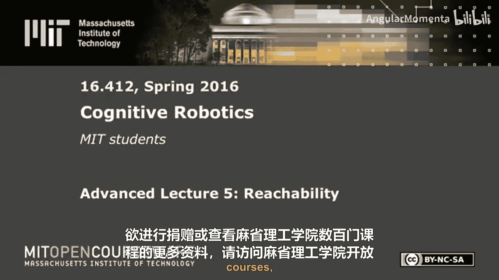
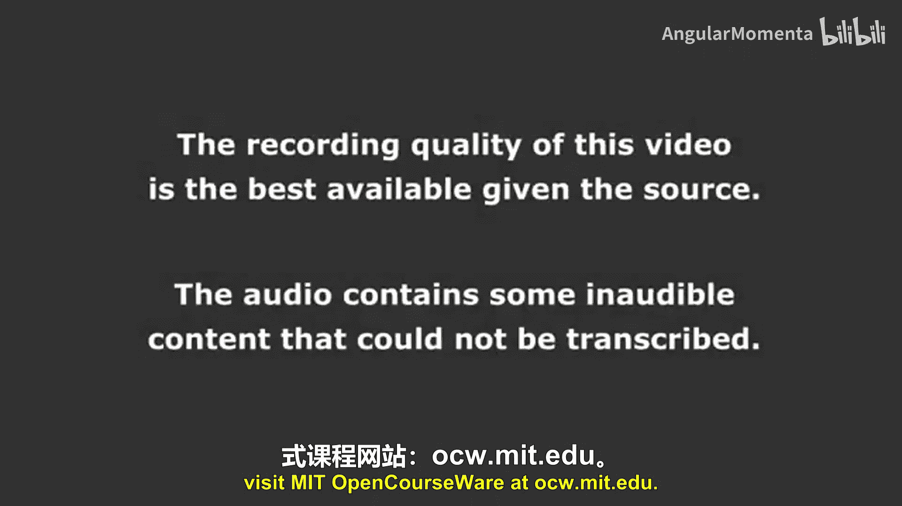
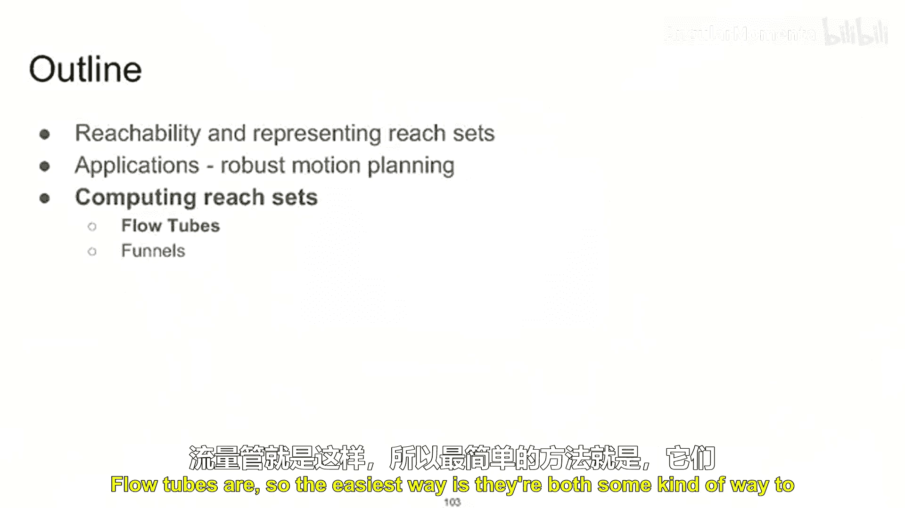
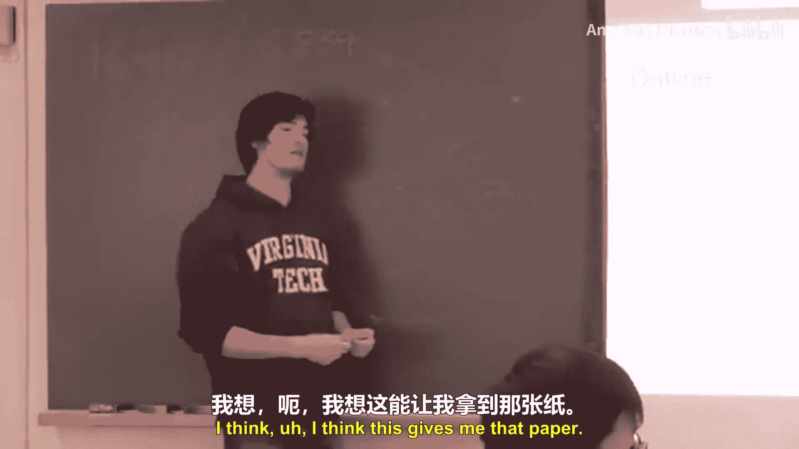
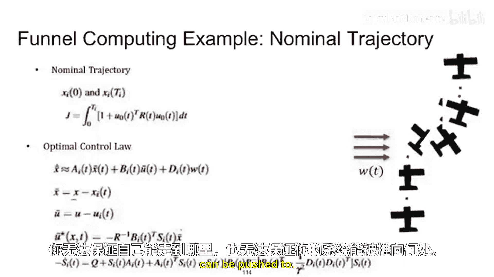
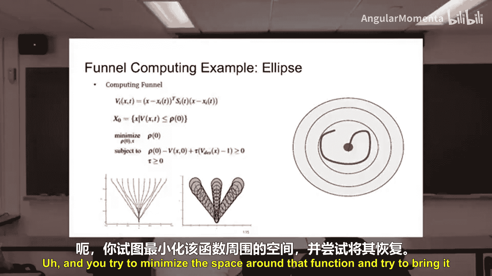
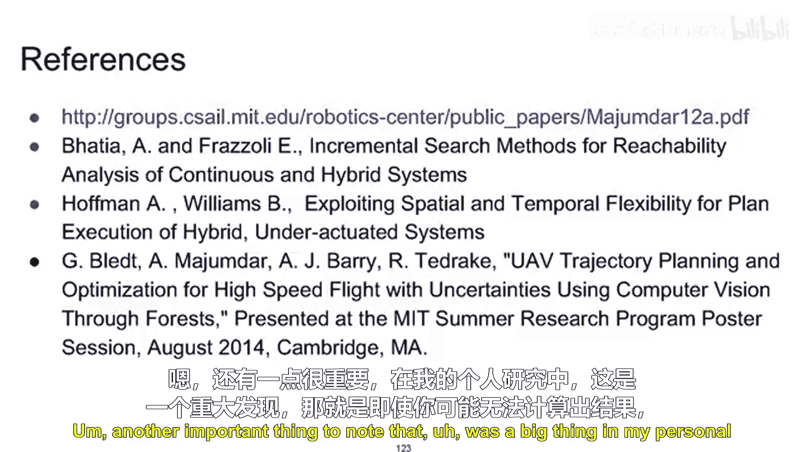

# 【麻省理工】认知机器人学-｜-MIT-16.412J-Cognitive-Robotics,-Spring-2016-p05-高级5.-可达性--BV1eEtTzhExj_p5-

The following content is provided under a Cative Commons license。

 Your support will help Mi T OpenCourseware continue to offer high quality educational resources for free to make a donation or to view additional materials from hundreds of MiT courses。

 Visit Mit Opencourseseware at Ocw。 Mt Eduu。

The basic concepts of bridge ability and talking about how we can represent bridge sets in continuous spaces。

 then Givanna is going to take it over and talk about some applications in robust motion planning。

 and then J is going to talk about how we compute bridge sets and focus on this to unfold the。はい。

So reachability is a task of figuring out what states a dynamic system can possibly reach or be at at a certain time。

So for example， if we have these two systems， we have a financing aid machine， a discrete system。

 and a continuous system， and these are the starting things。Then and these are our actions。

 we can move east or north here and we can move east or with this fellowies。

So after one second or one sentence。We can get either of these two。States。

 or we can be anywhere in these spirit。U two seconds， three seconds and so on。Okay。

So this is my freetyity。And the motivation for this。

 one of the applications for reachability is for verification。

 verification is just the task of making sure that we are never going to reach any bad states。

 so for instance let's say we have a microwave， a bad state is，The microwave being open on。

We want to make sure that these fat states are never reached。

So what we do is we compute reachable sets and we check for intersection with the bad states。

To see if we the microwave on and open or。Like over here， let's say we have these obstacles。

 let's say we have a wall。Or someone else at Clburnner。This is bad， right。

 because we can reach this state and it's the same as the wall。Any questions for far？

Feel free to improve。Another motivation for inability is for robust module planning。

 like you talk more about。And I have a video on this。So what we can do with reities。さ会です。对で。

So this is done using in floats， which use reachets which really。

Gard is will then talk more about this example。Okay。

 so now before we talk more about these cool examples， let's just formalize concepts。呃。

Let's define something， so let's go back to the same system that we have this state machine with a finite set of states X。

 a finite set of inputs to you。in this case our eastern north and the transition function。

 and let's say this is just the term thing simple， and we have a set of initial states x0。

 which I labeled spread。So。The rich set is defined as the set of states that we can possibly be in at time T。

So more formally， there is this sequence of T control inputs that will take us from this initial state to the corresponding register。

So let's say， for example， we have that state。It's in the ring set of13 because there exists sequence of three inputs。

 in this case， this is in one such sequence， there's two more。

That will take us from the initial state。Okay。And then the reachable set， set， reachable set。

Is it defined as the Union of all reset sets for time less than or equal5？So。

The reachable set of times here is just the initial set of states。咁制安会。啊等于。あその。

So the reachable set is what we use to test for interession with bad sticks because that's all the stakes that we can possibly reach。

あそ。From time zero to time， something。え。Now， as some of you may have figured out right now。

 there's a simple way for financing same I so we can compute reach sets。So for example。

 let's say we you wanted to reset a time to。呃。One the easiest way we can do this is to break this up into time steps。

In single pan sex。So instead of computing it straight for time two。

 let's first compute it for time one。And now we can use these two states as the set of initial stake。

And computer the reach it for one more tank。And that gives us the this ritual。Any questions？

And the reason why this works is because rig sets are semigroup and semi groups satisfy this。ぱ。

So we can not just break it up into single times， we can break it up into any two times。

Okay so all of this was for financing machines， but for continuous systems。

 things get a little more complicated， it's a lot of the same concepts。

We need to handle a very important issue and that is how to represent grids or just sets regions in space for continuous systems。

Because in a finally say machine， we could just。And nu the list of states in the rich set or ritual set in a con system we need some other way。

 we can' just say it's every point。For which theres exist。

Ss of control inputs because there can be infinitely many points。So what we do。

 we have two types of representations that we like， one is convex polytopes。

That's just the generalization of a comics polygon。Into end， into N dimensions。

we have two basic ways that we can represent these from politics。What is with list of vertices？

Like this， A B to F。啊。And then the the comics poly is defined as the comics hole。

And in case someone is。Doesn't remember what it happens always？

Let's say we have just a list of points。The Comx hole。

 imagine you have a rubber band and you're going to straight it up and then put it up。

And what that's going to do is this。And the comic hole is just the polaria inside。Inside this。The ro。

And then another way we can represent。Convexpolitop is with a set of inequalities。So for example。

 here。We have four lines。Here's the equation for each slide。So。Let's say this red line。

 we want anything below the red line。This wood line we went anything to the right。

 so anything greater than and so on， so this area is just the intersection of all this scenic public。

And each of these representations has an advantage over the other very are good to taste for emptiness because。

With our settled verrices is empty， then our convex poly is going to be empty and these inequalities is very useful for testing membership。

Because for any point we can just plug it into every inequality and if it's true for every inequality。

应个保证。Okay， andm convincing I'll just make。Explain frankly， conveity means that。

Any two points inside our region？呃。Our region is going to become complex。For the line。

 when I think it's two points， all the points in that line are going to be in the region。

Here you can see that this is complex and here this red area is outside the region。

 so this other region is non complex。And perity is going to be important for the algorithms later on。

Gardo will talk more about it。Okay， other than complex polytos。

 we can also use eoids to represent wingig cells。So es are just the extension of ellipes to n spaces and dimensions。

And the conve polyton is defined by this， X is just solid points inside the polytons inside the ellipse。

We use the center and they just tells us about this。How they form the ellipes。Okay， any questions？呃嗯。

One of the reasons why we like Comvicx polytos， why we like ellipsis。

And is because of the flow under linear operator。So let's say we have pe that is a conx hotop or an eide。

Then if we have a matrix egg。Then A times P， which as we find that way。

 is still going to be a convex palto or an a。So if we have something like this。

 then this can maybe get informed， but it's still going to be economic。诶他没错的。嗯。

And the reason why this is nice is that if we have a linear system。Like if we this way or this way。

And then if we start with basically if we start with a combat set of states。

Then where each sixs are always going to be complex because words as multiply by eight。

And this is very nice to this tells us that our representation is going to be good because we can just use convex polytops。

ipide and stick with those。なんでした。定手。Okay， and so even though the reach sets were a bit complex the。

Reachable set might not be Comvex， but it will always be a union of Comvex polyose or eips。

For example， let's say in the previous example， we started here。Then we need after one timeup。

 we were here。So these are two things and then our reachable center is the Union of both of them。

 and this is clearly not complex。But it is a unit of complex。All it those。

So we can represent everything with them。Okay， any questions before I move on to Shana？えは。Okay。

 so now that you have understood what your is and how diverse represent present and before we draw into more theoretical aspects。

我感び。Good applications are virtual。There are many applications of visibility to robots and like complex systems and systems applications。

the before it' a long mission planning， you the idea you feel like more。But来色。就就攞些 box西工食。

The person of uncertainties and disadvantages， you know crash getting the obstacles even they。

Theres also applications of reach to control complex systems like biproduct。The want。

呃 here can see that。이제 그런 걸。And more importantly， reachability is like used for very safety properties for the safety vehicle systems。

A explanational work。So in this lecture， we'll go into more detail a lot of the leadership that as robust social planning。

If you other there I。So the goal of Mo learning is to find a set of control inputs that take you from the thestar state to the whole state。

So in this example， without without colllating with one the obstacle。

Here this is like one possible part from the start State and the Bo state。

So it does looks nice so it doesn't co with any of the obstacles。

But if you get a control to this product。基做你一老。You might find it going doing something like this。

So this is because the part that you algorithm that you is prop this part is does not take into account any of the uncertain areas in the environment or uncertainities anymore。

So there are different kinds of facilitiesators。One of them is environmental disasters。

 like theres wind cures and I can movie over half of time five。嗯。They can be modeling areas。

 the model that you use to represent your complex system。So the real world is different。

stayed on soと youと。Things that you use for measuring your position of velocity or also like approximate。

 so there are uncertainties。For can on random in the initial condition say youre thinking of starting a robot。

That xenocom， but in practice， you might actually be studying up excellenteno doesn same smoke。

There was running was in ancient。你高咯。Ro motion planning is to。

It to have some guarantees that some conference the system will reach the goal without creating with the obstacles。

 even if person of uncertaining。小得都是房的。So let's look at some of the solutions that have come up for solid enrollment motion。

有个都是台湾。F of us ourselves like all of them have。C concept where they comparative use some representation to。

To to represent the reach set of possible states of the system can be。

 And then instead of searching for a single trajectory through the state。

 they search for these representations。If you find a set of surfaceations that you go from the sta。

 you go， you don't take any of the obstacles。So。So earlier and now。

 as previously came up this concept on Blue tubes， it's available for present with the sense and you will learn more about。

じゃあ。So what is watching this。We have a set of finished safe and we have a set goals safe。

So recordinging is an combination of all of those possible parts that can take you from any foreign dimension student anything。

So this was kind of focusing about possible places he came。

So I like you search for this bookings to be applied to get your portion final。

And in two thousand six opened the use。Temporal constraints that it can also reason about complex systems that requires spatial and temporal coordinations like the walking robot that。

对。And I was also loved by Ro Big School。We using the funnels for Russian planninging。

 so finals is also a similar concept to your float use。It's kind of like。

Like a sal degree region around your past， so that if you are inside the funnel。

 you're guaranteed to inside the funnel。So in this lecture。

 we'll going into more details about motion planning， these funnel。

I gave there are lot prices for the other people so。

So that's the idea of Facebook final for every part。如と经生知我哋。てとできや。Learn more about how on。否则是。

For this part of the lecture show be that she let me know how the computer and follows。You see。

How do you use these funnels to do approachmatic？So the previous example you see the product for line five。

Other other things like these funnels are。So I sorry more。You do not know everything about your。

咗新嘅三保月。诶你如佢真确量。questions十发。黑色一点感觉。呃。So it's kind of something ingredients。Inient thoughts。

If you have a problem that like something in the future。实。I think Gerard to on about it。お。I said。

 if you're inside the funnel at the point， when you exit， if can come over of it at some time。先理さ。So。

It's like，呃Yeah标的。So。So funnel is basically。It's kind of like a reset around a certain point。

 so usually the way that you。I？sub nominal trajectory。according that trajectory。

 you compute some kind of reachable set。At that load point and so you blow it off and it becomes some kind of ellipoid and as long as you're within that ellipoid no matter what disturbance you get。

 you're going to go back towards the normal。And then so when you join all of those gloid over the trajectory。

 then you get certain。But as long as you're inside that funnel appear to stay on that funnel you're going to be。

With some disturbance where to stay。So that the great would be。い前。As long as you're in the funnel。

 you're going to stay。So is this considered the control or is it only？

It's the dynamics what the control， so it's the closing。And so you learn more what those might be。

let me just quickly add， so a funnel is a type of flow tube right。

 I mean just different people use the same terminology。

 use different terminology like each of the applications of flow tubes has some endurion which is different。

Right in the particular invariant on this one， right is that。If you are in the。

But if you apply an RFQR component right in the city done。

 then you're guaranteed to stay within that too。对他的 food就比30多 like。That smaller人。只能把我们都。

Not necessarily in general， photo tube is simply a bundle of trajectories which capture some common feature。

And then maybe that they move to a limit cycle and maybe that they stabilize to a point。

 maybe that they move to a goal and maybe that they。Alway is maintain。Very stable。In a funnel。

 they focus particularly on stability to disturbance and staying within the two。

So thoses a good other example of kind of useful do。頑張てのでの食材。到。高分三千。So please， my love。嗰就快在个程里边。

This plant looks kind of risky。Veryty close to the blue trees。I think。So。So individual。

 the first one since we spend a second one seems like say。Maybe that's not。

 so that's why we need my reachability with question time。If you combine that， you might find that。

Looking for the first one。かい出そうけれね。It's safe。And it might happen with the second part thats more susceptible to the disturbances and it can actually be going。

So。そういう味私こさ。WorkIn a smart actually。So so far it's all about complaint planning。

You share that you know everything over whatever。let's not all this true。と要个。食咗啦。

You a report and you get to know them as you move to them。So one father was doing one leg money。

You cannot do any expensive computationgregs to your。

And all of these funnel healths are a very expensive request that solving an optimization problem and takes a couple of hours to fit。

So you can have compute files on the slide。So the idea of you want to to like compute the funnel offline。

 and the all possible funnel。State United States and then use this library to as you move through a space。

So。the same thing then stay on that。We felt set of possible parts from our。

For each possible trajectory， you come through the panel。

The idea of online planning is to now find a sequence of these funnel that you can composecourse that takes you from。

Don'll start super。So a foreign con here。Ping a sequential composition of funds。So why plant。

 you're doing a search with funnels， why use funnels instead of something like iron？呃。

I actually don't know what。Can I guess at the answer？呃。

Why use funnels instead of R artts well or why use funnels well is opposed to anything else I guess Rts。

 you have like the classical example where you want to go through a very。Well。

 if you want to go through a very narrow region。Well， first of all。

 I guess artists started to have kind of a hard time finding that narrow region because you need like a point。

合是的。And then。R by themselves don't for account for。For errors。Maybe some extension。

 but funnels you can make sure that you're always going to stay inside the funnel so this is for our boss just to make sure that we。

我在打事。answerYeah， I think of what he just said。You know it's the point of the funnels is that they provide a control policy。

 the actual reference trajectory that you have on the left is the motion planning with the funnels you get a control policy because when you start executing the motion plan there's always going to be a disservance。

So you want a control policy that。Teach you on that trajectory chapter。

there's all sorts of control policies， you could use simple PID controllers to work in some cases。

 but funnels provide better guarantees for complex dynamic success。So。佢你呢就粹其他嚟上得非常嘅便狂伤因。優せです。

It con proposal to find your。班就个自成。So。So theres so you cannot always compose panels like some con that are。

And some of those are not legal， so for this example if I'm going from left to right。

So you have a situation where。发咯嚟叫低呢个高成俾佢快咯。Smaller粉。

And you have another situation where you're going to comp the smaller funnel of the bigger。So。

So what a final is it's for the condition of stability。

 so like which of these compositions do you think it' like a legal composition？这是一。我要呢个落你呢个嚟现在。

whichch are these gal have。好吧。actually work。Or with the top one if here on like the very top edge of the help。

さ。Yeah， that's true。翻出嚟几噶。我生。So。Why is that so if you're inside a funnel。

 what just guarantee that you will stay inside a funnel？it could happen that you can go the phone。

我使讲。And after the7 came going。所要。是。But you excited second please？After you to first follow。

 you still inside the second follow and。使细先。So dont just actually look at the school仔 and like them。

我都是说。This of your fighting which also this three these with likeconics， ors。

 it makes sound analysis easier。So those are the algorithm that going through each of the staff one by one。

So so iss online planning。beforeは windowござ。But you still have the condition grind follow sequence that takes you from the South state State。

Then you check for an interview ofcyclles information that you got from your sensor。先冇。えに預けてかしているけど。

Thoses also said their concern in the guess。应该你经。You check if your current follow path cos with any of the obstacles you've through so far。

しさそしよ。So。So then you apply the card correspondinging to the funnel， corresponding the location。

Its your。上。在いここち。So。For of information。もしてたますよ。彼しやけど。You check as the transplant co。同じでや。

So so本来就 없어嗰是么通 나오。So how do you leave that is you have all this library of files。

 so you can go through each of them。Find one。可能。对。That has a。

You find a set of problem that starts with your current location。

That's not anything of the obstacles。Does was like possible。W not two place。

And then again your five controls first。喜关。啲ポ商这。こ来。最緒にされ。唔快。要快 the control to that。More information。

エと like soやてたば。So now you reach the goal。我这时嚟关你难。using翻 letter。他し什。

Can you say more about the con of the final letter so did they generate a set of？F switch。

Covered the complete。SYeah， so it's like。Because every possible in point here every possible this time。

回归。So then you can make you or or have it forever。印象性て多い。Compose all these kind so that。

If you're doing for a secondary。So you don't have a photo that exactly starts to grow。你在从朋来我下。お资了か咯。

그을 여행欢 보仔。暂几少。这算。Yeah the motion。What guarantees like。If it really isnt an online problem。

那原来跟他关来那个发廊。I like that you won't reach a dead end， but be adaptable enough to make a U turn。

At all times you think that there's some like latency。Perfectly timeless。

And the robustness that you'll always do a fun path。

 even if we have guarantees that you'll always stay within the funnel。

So are you asking what the situation？有关人的在。Yeah， just because these obstacles come out of nowhere single。

We don't have to guarantee that the funnel is safe for the entire duration of。Execution。Yeah。

 so that's。That's important point that everyone I just I to her I， I think we can easy get out。下学。

Even for robots， I can't actually back。If the robots cannot come back or。I mean。

 I guess this like a UAB。I was say like what？What guarantees do you need to have about？でアト直説のあ内。さら？

Maybe you have like some initial information。変学したい感じ。You can find a on doing。

You cant find a therapy that goes from the statements。所以你就就我。明在这多。Well。

 other'm just just say if you're in some kind of glider that can't necessarily like a quad or the stop。

 go backwards stuff like that and then don'll have funnels it。Backwards。

 or if you're in some kind of glider and you go straight at the wall， but there's no game。高い？

I mean even humans， they make errors， there's like situations that humans can't dynamically get out of。

 so if your system is dynamically not going to be able to make a short upturn。

G straight into something， no matter how smart your any algorithm is。

 no matter if you're like there's a wall up， there's staff。Aly situation。

Hopefully you're in a situation where you're not。It's also that based on how far away your sensor conceive。

 your sensor you're going to be exceed five meters ahead that anywhere go five meters per second。

But if your sensor has perfect information about the environment。

 then what seems like the initial best path may not actually be you wants to know。

So it depends on dynamics in sensors。かし。Okay， so finally have some。有我税先你唱咗。これた今のいこです。你そす。

So this is I publication so we have seen。We have seen how to use modelss to do roco planning。

We have seen how to often planning and comes to do online time。

A sequence of funnel on the funnel libraries。然会到头吧。These follows and flooriers other kind of pizza。

So I'm going to talk about how to actually compute them how of compute for two and funnels generally。

I'm going to give an example。OfWhat each one is used So we have a question before like how are flow tubes and funnels different flow tubes are。

So。The easiest way is they're both some kind of way to energy their robustness。To say。are here。

You want to be here。They're both most planning algorithms。

 you get some kind of path from here to here， but say there's some disturbance that pushes you down here or something。

You don't know if you're going to be able to reach there or not， what a flow tube is。

Is this some kind of？さ。They'll basically go from some initial states。

W are here to some gold cities over here。And basically if you're within this flow tube and you get pushed down to a different trajectory。

 you know how to get here and here anyway， so you don't really care if you're pushed as long as you're still within here。

A funnel。位。So final is， say you could。Some novel trajectory around here。

Using the system theory and stability theory， you know that with your control outputs。

You're going to stay at each of these points and you're going to stay within a year。

Within these circles， so if you get pushed down here。

 you know you're going to be able to get back off。And you're going to try to merge back to your number。

So you have some sort。Yeah。I have a question， how complete is the funnel。

 it sort of relates to what Brian was saying is completeness of in？These are well。

 if you have a high dimensional state space， does the funnel cover it completely？这 is7。Sa方。

So the question wasn't about the individual funnel about the particular andance right when you generate to set of oh funnels does the set funnels completely covered in the space it depends how much time you want to put into it generally if you only compute two funnels one of them goes over here and one of them goes like here and you're not going be covering into state space so it depends on how much computation。

You want to do offline previously so you can do a set of funnels that's here。

 another one that's right here， another one that's here。

 and you have your big library of photos and cover level space I think。

They I skip that paper and yeah， I think it is probable。Yeah。诶嗯。Yeah， but I mean。

 as far as computing where you're going to go， it you compute that path。But yeah， you're right，啊。去了。

So here's what I explained normally you have your optimal trajectory， but if you get pushed off it。

 you may not get back to the goal state。If you have a set of trajectories that go from some initial state to your goal state。

 and you stay within that， you know how to get to your goal state。Okay。

 so some ways to approximate flu tube， you can use some kind of polytoe， which is。

As G was explained previously as long as conve a polyte。

 you can take that cross sectional area and you can propate it down here fully you you can also useippsoids or rectangles。

As cross sections， an important point is to know that they're inner cross section approximations。

 so as you see here， you may this would be your actual flow tube where your approximation has to be an inner one because that guarantee that you're within the flow tube。

 but it means you may also miss up with the outer trajecties。哦 sell you want to。

A better approximation to。こ中。Okay， so。Robust planning， you plan a trajectory for here。那是一的呃。

But then you get disturb serve， you're still within the trajectory， so you're still good。

But some work on my professor Williams。啊，好。showshows that so what do you do when you're actually outside of CEO？

Outside of the funnel now we you can do is temporal planning。

 so using the algorithm that we pre consider in class， you can take your goal state and。

Move the timeline back into a different time so here this flow tube is if you're here in a certain amount of time can you get to here and if you get outside of it then you can't do that anymore but you can just use our algorithm。

Move back to the goal time and then when you move the goal time。

 the whole funnel shifts because now you can be over here and you don't care about getting here at this time you get here at this time now。

So then you move over and now where you were。You can get back and into it because you're now inside the fluid again。

一段す。Okay， so one example is a humanmooid footstep planning。

 so this case it complex is then you have a bunch of different par system。

 you have like center mass dynamics， you have your leg dynamics， wood dynamics。

So what you're trying to do here is plan your footsteps up。Forward and through time。

So you have your original plan of where you want your footsteps steps to be for different parts。

 so there's discrete things that happen。It really produces you in the lecture so one thing that can happen is your left foot hits the ground and then your right foot lifts off。

But it's very direct things figure out。所以是这些。So you have a certain temporal constraints。

On the system that you want to adhere by。So as you start planning。

You have flow tubes to get you from one step to another step and that guarantees that you're going to stay within those。

 even if you get disturbed and the get pushed you're feet still。One one step to the other。

 but then also with the thing that we saw in the previous slide。The timeline。Back and forth。

 as long as you're within your temporary of experience that you had。

And then so those are flow tubes for the feet， and that will guarantee that your feet go up。

Where they want to， but you can decompose the system to also have flow tubes for the center of mass。

 So the center of mass does is。Can be broken down in a separate flow of tubes。三年三次。

So this was the human step planning that we saw previously and now you understand how the feet are planned to go to each of the blocks。

 let's see if。I have a quick question you said you have like a separate flow tube for the center of mass。

 but aren't they really just the same flow tube and like a high dimensional。

 but that's the when you decouple a system and you you maybe a flow tube has a full system of like high dimensionality I it hard to reuple them How do you know the？

Well， it still adheres to the dynamics of the system so you can couple how you want。

 how you want it to move any basic constraints， but eventually like as you said。

 you move your feet your're second。You like that forward you're。You can add def analysis of it。

Can I make a comment about that yeah， there's a technique called feedback linearization。

That can be used to decomp。Complex nonlinear dynamics isoo into a set of linear ones。

And that allows you to treat the center of mass。Separately from the control and the code through computation San while guarantee theyre all taxes。

This is work done by Professor。这个词还是。This is a。The robot doing the same kind of thing on Mars。

I was walking on sails and planning its footsteps through a pretty complicated。般ね。

Stones are not exactly on path where normally。Moving them around。

 clock here with some two you'll get where every year。強政です。し。老是。So that was how to can be flow tos。

Oh， and another way that you can also compute flow tubeubs is by learning so you have some kind of example。

Move through trajectory。One thing to the other。Estimateator a float to baseline on where the two are。

 as long as the fluids it's all possible to take。好的。Thiss the dynamic always linear here？

Because I felt like if you're。Polyto and if you like hang up get a complex poly and you like use a nonlinear dynamics and you move a little bit。

Not be in the complex shaper well you can plan non nonlinear systems too， but as far as I understand。

还是有人题。So。Yeah， the polytes generally require linearization of the system and there's a limit to。

唔埋呢啲嘢到。A range of urban utilizationization。That's included and you know that's one of the things that women exercise will be。

The polys。But it is the case that I mean， it's kind of the standard thing that you do for nonlinear your system。

 which is you're making the piece by linear。But you are linearizing them at every step。

And there's other techniques that people develop with flow teamss where you do。

Require the input system to be there。Right here at Kendy Mountain。The price。哦。Okay。

 so funnel's goal is basically to find a region that guarantees your safety underbound uncertainty。哦。

So there are regions of front time variance throughout all time during that trajectory。Deine。の。

So in practice， there's a tri off between computation time and guarantees， so if if you're direct。

 you can view more nodes then you're going to be able to fill these little gaps。

You should go a electrodeoid， whereas if you less them it's going to take them less time。

以所系 it's also in。And this especially important when planning。

 so if you're planning some kind of point cloud， then some of the points may be right here where one ooid doesn't intersect with the other。

 and you might think that's a bad point it actually is。Yeah， so an example is a silk glliider。

 which is given in the paper by Anynie and Rus。And on。

So what you start doing is you create your system， your function。

 and this is dependent on your state time。W， which is some kind of bounded uncertainty。

 and you choose the bounded uncertainty， which means that。You choose some kind of reasonable。

Estimate of how much can happen。It's your system that you didn't account for。So you started。

Your velocity can be different from what you want， say your nominal velocity is 10 meters per second。

 you can have some kind of drag or you can have some inconsistency in your voters。

So what you expect is that there's a plus or minus 0。5 meter per second to your nu。

So when you start running your equations。嗯。This is what you expect your robot to do。

That can vary forward and backwards， depending on what you're actually going to eat。

But then you add some kind of wind on your system， which。Some kind of cross that away gas direction。

 which we see there。So what that ends up doing is pushing your system。

Away from where you want it to actually be。So now you have some kind of。

Some kind of the last certainly， and you also have a wind that can push you one way or the other。

So how do you deal with that？啊。Well， you start with pre nominal trajectory that has a plane flight。

Pfly straight， everything， there's no uncertainty， everything is deterministic and it acts like you want to。

嗯。So and then。So right there the wind hits it， so when you do， you have to have some kind of control。

 some kind of controller to bring you back to your noal trajectory and try to control you around the system。

So a standard way to do that is to make。To have a cost function and create your optimal trajectory and this cost function basically it kind of mirrors a QR control。

啊。And by solving all these equations， which is a pretty standard process。房家还是比在。

Get a controller that trusts to bring back to your optimalal trajectory。一点半。

But you don't have any guarantees just with the controller。

 you don't have any guarantees on how far you can have pushed。

 you're going to have any guarantees on where you're going to go and where your system can sequence push you。

So。嗯。So when you compute the funnel， what you do is you choose a the Aov function。

I'll explain what that is in the next slide。And you try to minimize the space around that function and trust to bring it back so what this is is。

So you have some kind of your initial state and I guess this would be the initial state and the whole region。

 what you're trying to do is minimize it around it。实在没 sense错一的。

So your trajectory is basically going to go anywhere around here and what you're trying to do is find the region of space that minimizes that encompasses all of the places that you're。

system is going to get to。So that's easy to do when you draw it out。

No exactly where your system's going to go， it's easy to just shrink your ball around it。

But how do you actually compute that？So when you have that for each point in the trajectory。

 you know that you're going to stay with me here because you're going to have some kind of from your nominal trajectory。

 you're going to have different places where your system can go under the given conditions of velocity and wind uncertainty。

 you're going to go anywhere within that， but as long as you know you're still in that ellipsoid then you're going to stay within those ellipsoids as you go down your path。

そ为。这す。Okay， so the reason they use the App andO functions is there's different ways to measure stability。

Soよ。So there's different ways to measure stability in nonlinear system。

 so in a linear system you're either unstable or you're globally exponentially stable。

 so you're going to converge back to whatever stability equilibrium point you have。

Exential rate but there's also in nonlinear systems， there's global exponential stability。

 there's asymptotic stability and there's stability in the sense of liopum。

 which is what we care about so the difference between that is。谁最常？

And globally exponentially stable means that no matter where you start anywhere on the board。

 you're going to be converging back to this equilibrium point at an exponential rate。

 so that's the best case scenario， that's what you want。嗯。

Asymptotic stability means that you're going to be going from。

Somewhere on the board within a certain region， back to snowal trajectory。

 but it doesn't have to be an exponential rate so you can do something like that。

As long as eventually you start converging back to it。

And then there's stability in the sense of laugh and， which is。Let's say you're here。

 your assistant can be doing anything。Anything crazy as long as it stays within。Some certain thing。

 which in the 1D case we saw was the little ball。So， imagine。

There's like a fall for each of these and this is where your trajectory can possibly go。

 as long as the states haveve been that， even say your system is stable in a sense of way out enough。

那六三0。All right， so knowing this does I just have a basic question。

The viopa function is around a stable set point， but the trajectory has non zero velocity。

 so what is the。The point that it's stabilizing around。

You can stabilize around its trajectory which is also what a ethans do。So。

You have your little point here。This is your novel check。して。Your wind can knock you this way。

 your velocity difference can knock you this way or this way。

 but as long as you're still within that。Converge back to it。

And so is the value for the Abut function， and these are the different states you can have。

An important thing to notice is the derivative is negative definite or negative semi deffinite in this case。

 and that means that basically all your trajectories don't matter where to go。

 they're going to be going down this，And eventually they're going to go down to some value。

So does that make sense that's like pretty nice not by your sister stuff？All right。

 so once you know that， it makes sense to use layout Opoff functions as Can for。For computing funnel。

So an ellipoid is actually defined by a quadraically optimal function。What's done here？isし你。

The  equation for an ellipsoid。把三逼。あります。So that was the equation for looks that April showed previously the quadra of the app function has the same same structure where you have this being。

Ex to live， which is basically the error of your state。Some kind of呃。

Ex being the state that you're actually in as exterior。

 which is the nominal point that you want to reach so this defines the region around your。

The nominal point which would be somewhere in there and the ellips is computed by doing that minimization that I showed you。

Re size？And then you can figure out the region inside of it by solving that equation。

If it's less than one I believe you're inside。And those are all the dos which show that you're in inside it。

 so that's used when computing trajectories， you solve you solve for say that you're inside of point of。

 you know which points you're going to get inside of thissoid， so in your planning。

 you solve that equation for each of the ellipsoids and you know if you're going to hit something or not。

So this is a video。あで。And this is using the funnel libraries for collision woods。

 this is showing for just one funnel， the glidder dynamics were shown in one of the previous slide。

 they were pretty simplified glidder dynamics。But。So you see right there that。There's objects。

Ader plans a path around them。嗯。So the funnel is this is one possible one right here I'm pretty sure they tell it where objects are。

 even though they're not actually there and it finds that funnel being one of the better ones。

And you see that throughout the entire path， the glidder will stay within the funnel。嗯。

And then when you're searching with the online planning algorithm that shown previously。

It goes through all of these funnels。Eventually finds the best safe one you won't always find a safe one is。

This in this case you did， but it finds the best one by。

Around the path so one way that it finds the best one is by finding all so if you're playing a point cloud。

 you find all the points that lie with it theoids and the one that believes it un。せ。

So here is a bunch different。obstaclebss。成分。And there's some pretty dynamic。这。So within that。

 there's。对。Is there a way to like get back to？投資元。都谢。那よ。你来先ical。あ了。

So with the online planning algorithm， heres one of the possible paths you have your points。

And those were shown。Previous。F thing。Foxy区。Using a sensor model。

 you get point thought back and as you're going。Plan your path and the way that this works is every five meters you play a path。

As you're flying to through it， you get new sensor information and you can re the tasks using the algorithmer。

知道。That'll guarantee that you're safe and when you're flying， obviously you don't see the phones。

 but right here you can see there's。Probably one funnel here and then another funnel that plans this way。

 another funnel that goes to here。goes there and that's a full path and there's also a cool one because it shows that you go through the treaty and that's where one of the funnels is rather than going around。

Poss you start the computing new funnel where you start searching a new library here。

 and you may not be able to make it out of way in time to get it into what speed you're going at。

Does anyone have any questions。And this is the online planning out。S the right now。

Some of the references， the paper from the video that we just saw that's given here and that also goes to the example of death for Zs。

was one of the original。People could be to flow tube hop and will did a temporal playing。Whatstep。

Dealed of the cuoid system and I did most of the。呃。Stuff on the card copyright right to that。

2 years ago。Another important thing to note that was a big thing。

My personal research was that even though you may not be able to compute or that you may not find a funnel that necessarily goes finds a safe cat。

 you can shift that funnel around。It's slightly up and down as long as the first ellipsoid is still within as long as your initial state is still within better ellipsoid。

that's easy to do。Guys you can just give it a simple。Transformation between one state and the other。

If you transform this S matrix， then it'll transform your entire tunnel and will shift it around so you can find your best funnel even though it may hit something。

 if it was slightly shifted to the left， you can just shift it using that transformation。つまだ。对。

Unders and with if you want to give it some ridiculous wind like a thousand miles hour then you're going a huge funnels but that's under some kind of reasonable。

No in this Reg。Wor or something。Mopower。いや， that's based a lot on。What your poundss are。

So do you have any like any algorithm in your mind that is like not using offline？

So this like mostly you do the offline end online search， but if you're like in a wild environment。

 you know。Do you have mind I mean， there are algorithms that will well just a basic controller will try to get you back to novel trajectory。

 but there's nothing that I know of at least that will guarantee you safety and' will give you an all encompassing region like a blow tube or a funnel。

ISo flow tubes， you find there's an infinite number of paths that will get you from here here with your system。

 basically like every little minute machines that you have and that obviously takes a lot of compute to approximate and the funnels。

構回る。一个。Regions where it can go， so I don't know anything that'll online compute this region。

 but online you'll be able to compute some trajectory and then。Like you're controlable。

Take your state error。但求了。我れも。With the funnels， how do you compute your initial set of states or the allowed initial set of states。

 you have these uncertainties like for the wind and velocity。

 but what about you know the initial state is sort of before those disturbances happen？

But you probably want more than one initial state。Okay嗯。Theres some memories we keep out here。

 get I begin。给没次。So with the funnels。Take谁 you。当中取得之间。看才。Your website is around it。

So when your system starts， you have your initial state and your initial state is going to be here at time T0。

 but over the time computed，Go over here。I just mean that。

You want to apply the funnel multiple times and your initial state may not be exactly the same。So。

It should be possible to use the same funnel。You know even though the initial state is off by a little bit Yeah okay so say that you chose this funnel first and eventually like what actually happens is you do this you get pushed around and then you end up here instead of a nominal1 as long as your next funnel that you plan so you can start a new funnel at any point in this trajectory as long as the next funnel is also。

As long as you have the intersection with。The next funnel。And if you're within this。This region。

 as you find the next funnel。What you do is you play the next funnel with this game。

Original exterior。So as long as that's your next x0。

 and then this will take on a new nonbel trajectory。I'm just saying asking how do you。あ。

Hows it like for the one all the way on the left？ThatYeah。

 how do you define how big that initial region is？So that one say个。

If you start say not moving or something and you get the push， is that what you're asking for？Well。

 I mean I understand that you're using the uncertainty and B and W that essentially defines how big those funnels are。

 do they also define how big the first one is， they do。

So what you're doing because what you want to do is use the funnels and have some funnel library and be able to use those throughout all time and so you don't want so I guess what you if you're asking。

The first funnel you're going to start at some initial states here with no velocity， stuff like that。

 and so you're not going to have any uncertainty on the first thing。

 you know where you start in the state。Yeah， I'm just asking you know independent of the wind and stuff like that。

 you might just be starting at a point other than what that nominal point is。

 so you may want to define that initial funnel size by some other criteria besides wind。

Because sensor。How sure you are。しょ。Yeah， and I mean there's sense or uncertainty， but you know。

 you just may happen to be in you know， if you're doing the glider experiment 10 times， you know。

 you may not start it from exactly the same position every time Yeah well you should your' funnell at every time then you funnell。

You start at the novel trajectory of that new funnel so you don't you're not going to have this funnel and you not you're never going to start over a here on the first one you're always going to start at this point well I thought the point of the funnel was so that you can reuse it without having to re plan。

Yeah， you can move the funnels around you can move that was so yeah。

 so every time you start a new funnel， you start at this9 trajectory。

 but the next time you use the same funnel you could be over here。

Shi the funnel down do exactly the same way so the initial state is never going to be anywhere starting at。

四三。Some other than the no victory， but at team1， it could be over here and you just ship the whole ball around。

As long as you're T zeros。あの。And as long as t0 is within the funnel above。不反荣。Just shift it around。

 you can also like turn it。As long as we get a multi business。

It seemed like the shifting and turning is a really。Complex search problem in itself。第在。

Is that a hard problem， No， that was actually the。I't get rid of this slide， how many got that？

I should have because I was the work that I did to do something。still。嗯。But yeah， there's， I mean。

 there's a bunch of different ways to do it。 I did a pretty。啊。

Smart search where I just looked for the funnels， the safest funnel being the one with the least number of points in the point cloud within that kind of funnel。

And。啊咩来的。あ。嗯。But basically what I did was find the safest funnel and if there still was a collision within the safest funnel。

 then I made a minimization problem as you shipped it back here。

And there was a cost function that didn bring it up。

So you're doing an optimization of the online running。Yeah。

That was implemented in real time simulation， but that wasn't implemented on the actual gllider as of two7。

是啊。SeeAll right啦。And you also want， I also made it so。

You minimize the amount that you shifted to so you don't want to shift it completely somewhere else。

It won't be your path and you'll end up doing some dynamic。

Be flying and then if you compute a funnel that's here that's kind of safe but you shift it all the way down to here。

Glaidderers can be doing something。That你。哦，唔家是意见。But I mean in my at least on the ship。在。Yes。

 so does anybody have any questions on？Ca one so you've given us models of bounded uncertainty in your dynamics。

 so if you use probilistic models， then your funnel will start looking like risk allocations。

Is there an interpretation of one in terms of the other？No， but I'm sure。そとすで。明麦。那俩。ですからなるとな。じゃ。

Talk a little bit about the interaction between the。

T selection or the for the tunnel selection and the underlyingd path manner。

 so you have something that's planning the reference trajectory right that's separate from。

Flow tube selection for your final selection， and then you have to select the funnels or flow tubes。

Allow you to follow that trajectory the best you can or how do they interact like say if you have a flow or don't have a safe flow of follow the fit reference there。

Okay， so you're asking basically。The difference between planning with like a funnel library and a trajectory library。

Yeah， kind of sort well because like I know like the checkout planner that uses like an income。

Halfline right so the plan half or something like that and then that。

Because are you fitting flow tube so the reference trajectory you do that offline so you compute like they're called like funnel libraries or usually they're trajectory libraries。

 so' even computing a trajectory in real time for a fast。Dmic system is going to be expensive。

a funnel on top that it can be more expensive。Keep the library offline for a trajectory and plan using that。

 but on this one you compute your trajectory， compute the funnel around that trajectory offline。

 and then you search through the funnel library， you don't search through trajectories and then try to fit a funnel around that。

You just search through the fun you don't have a very good library that you。Also。

 a cool thing about files versus trajectories is a lot of trajectories will be discretized for。

So you have your nodes。And so say this is what your trajectory does。

You have node points here and you're trying to fly past a wall or something。

 but if your wall goes here， your algorithm is going to search these points and it's going to say。

 okay well， this is a safe path it none of the node points intersect with this wall to fly。

But a funnel since we have this region around it。bad job aren that。When we search。

The algorithm in Steve is less than a greater than one。You're going to find all these points being。

这好。Although I guess that depends on how well you want to discretize it if your trajectory is。

Small points that you're。It seems like you could when you're building a normal RRT without funnels。

 can't pay points， if you say yeah they're illegal。

 it seems that if you're automatically adding on that funnel instead of generating an entire trajectory and then making the funnel。

 you could save computational time。thatDo you know if that's done？じじ。

I do know that I mean commut you obviously want to minimizeize computation time。

 but it's not critical。I funnels and bulletune because you do that all offline。You want to。

 I don't think it's even close to the point where you get an online computer funnel it takes like。

Depending on how many dimensions your state has。Yeah， it's not like you're flying。

 you compute one of these。crashly。ちょっと？かけこれ。