# 【麻省理工】认知机器人学-｜-MIT-16.412J-Cognitive-Robotics,-Spring-2016-p06-高级-6.-时态逻辑规划--BV1eEtTzhExj_p6-

The following content is provided under a Cative Commons license。

 Your support will help Mi T OpenCourseware continue to offer high quality educational resources for free to make a donation or to view additional materials from hundreds of MiT courses。

 Visit Mit Opencourseseware at Ocw。 Mt Eduu。

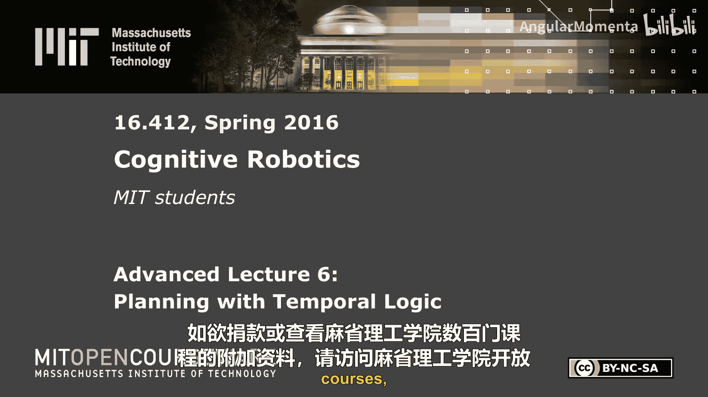

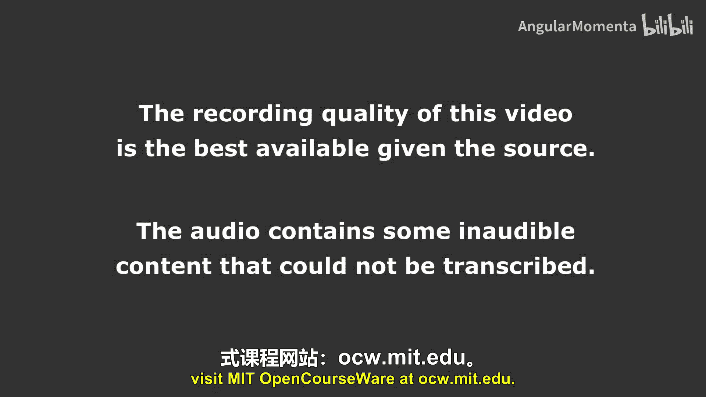

So turns are pretty cool， pretty hot nowadays， so we're going to use this as an example。

And in the past， we have seen how we can give。autoomous vehicle of goal。

 some condition we wanted to reach， for example， we might have a car that wants to pick up some passengers along the way。

 get to some destinations。And maybe navigate some worlds。

But let's consider that for something like a self- driving car。

 we also have a number of other goals or requirements that are sort of implicit along the way in that we want our self-diving car to obey the rules of the road as it's driving and these aren't just。

Gal conditions， which is a sort of single goal that you're trying to reach。

 but these are sort of goals that you're trying to maintain throughout the path that you're traveling。

So one example of this is。A traffic light。

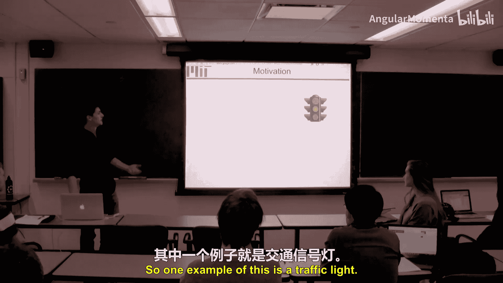

So maybe you guys can help me out with this， just in plain English， how would you describe？

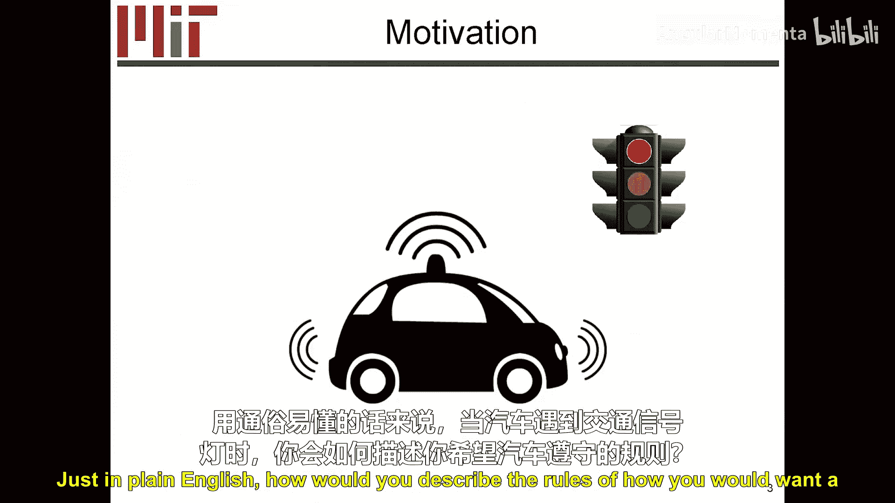

The rules of how you would want a car to behave when it goes across a traffic light。Very simple， y。

 slow down and you see yellow。よや so。Pretty much stop if you see red， go up。

 you see green and specifically if you see red and you stop。

 you're going to want to stop until you see the green at which point that sort of condition that you're stopping goes away。

No板。And then in addition to things like O traffic lights。

 there might also be some other rules of the road that we want to follow， for example。

 we might want to always stay within the speed limit。

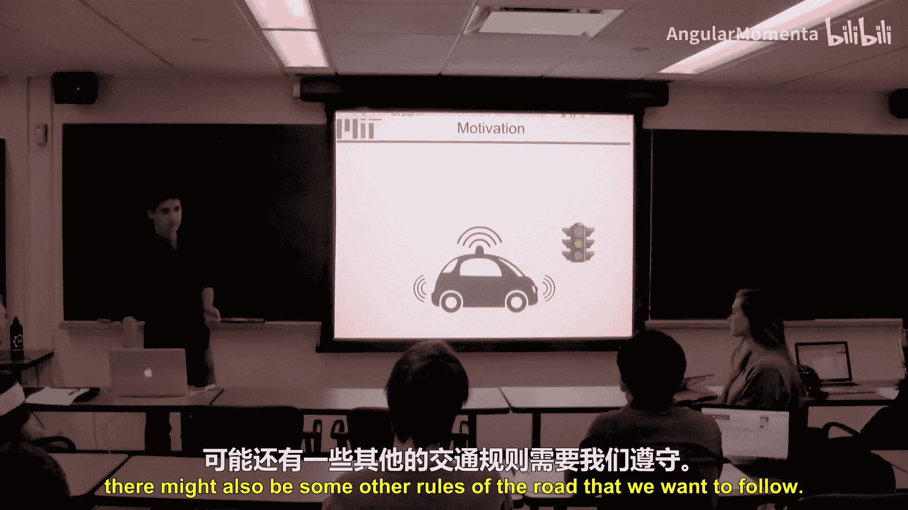

嗯。And then there might also be some other practical conditions of driving on the road。

 which is that at some point we're going to need to refuel and if we consider a car that might be driving for a really long time。

 one statement， logical statement we could say about the path that this car takes and the sequence of states that it goes through is that at every point in time。

 we want a plan to have some future state when we are going to visit a gas station。

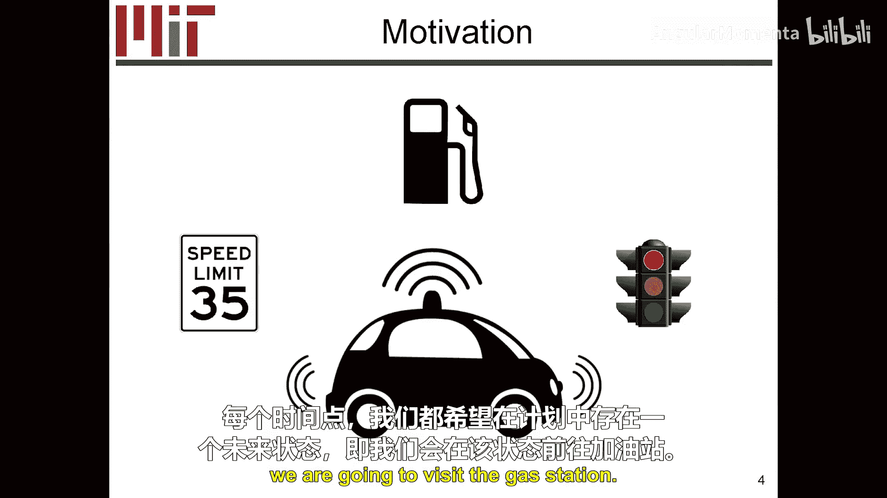

So this isn't just like a single goal that we're trying to reach， but over a very long time。

 even if we consider this part a driving an infinite amount of time， at every point in a time。

 we're going to need to be thinking ahead that there's going to be some time when we reach a gas station。

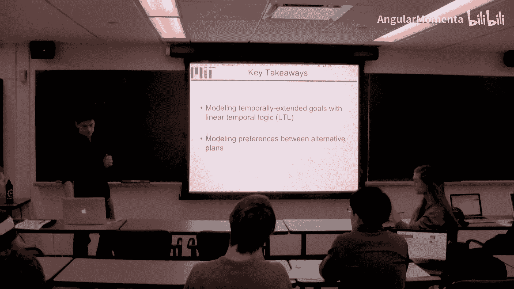

So。These types of conditions， things like staying on a red light and militarylitary drain。

Always staying within a certain speed limit or always having some path in the future。

 some state in the future when we reach a gas station are things that we can express with a type of logic called temporal logic。

There are two things that we hope you're going to be able to do by the time you leave this lecture。

 the first is to be able to model these temporal extended goals using a specific type of temporal logic called linear temporal logic or LTL。

And secondly， we're going to hope that you'll be able to actually apply this to planning。

 create plans with these temporal extended goals， and in addition to just sort of this regular planning we've been dealing with actually incorporating this idea of preferences into your plans。

 so a preference basically is not a required condition but a desired condition。

that you can use to select between alternative paths。

 so you know you might have many different ways that you could reach your goal。

 but we can use some of these temporary extended goals。

 like maybe you prefer to break as few of the rules of the road as you can and you can use those as preferences to choose between plans。

So just as an outline， first， we're just going to do a little introduction to linear temporal logic。

We're going to talk about what this is， what LTL is， why do you want to use it？

And we're going to go through the syntax and this amazing。Different L operators。

Then we're going to walk you through some example LTL problems and actually talk about applications to planning。

 how you create plans with these linear temporal logic。Several goals。Finally。

 we're going to incorporate preferences into this， talk about how you express preferences。

 and specifically talk about a language called LPP that allows you to plan the temporal logic。

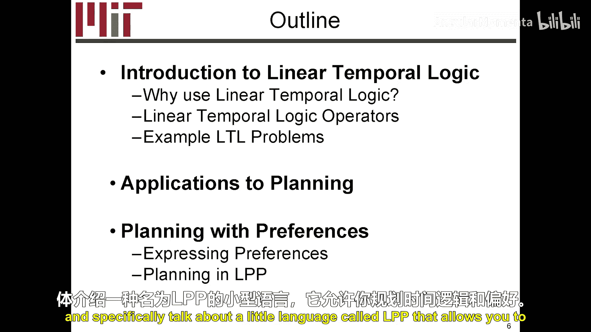

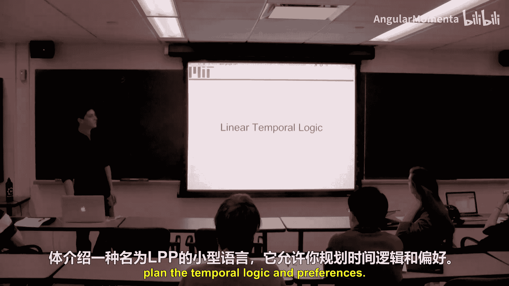

So now the sort of introduction to linear temporal logic。

Tempal logic at its for is a formalism through' specifying properties of a system that vary with time。

 so these aren't just conditions that are true at a single state。

 which is what we've mostly been dealing with prepositional logic so we've been saying things like condition。

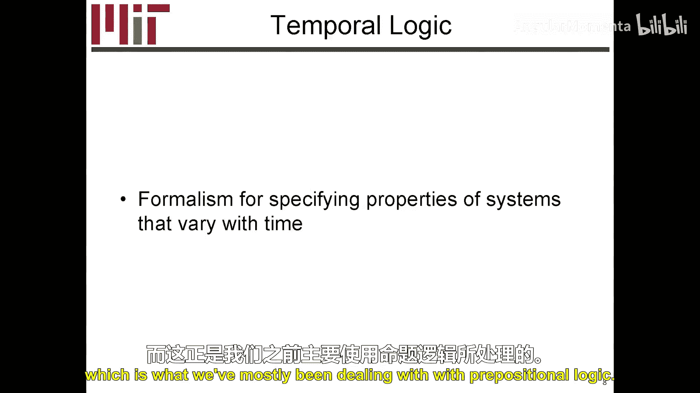

A and B， but not C are true at a given state and that's prepositional logic。

 temporal logic is sort of a layer on top of that when we're dealing not just with what's true at a single state。

 but actually extending that over time as a system moves through a sequence of states and it' expressing properties on a temporal level。

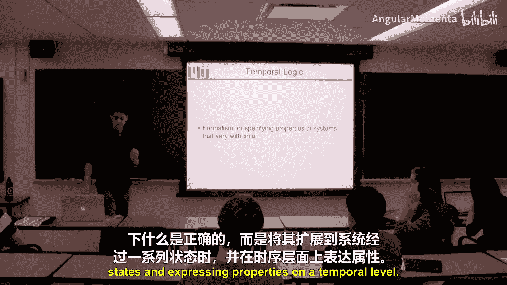

So you might have a system that can be represented as a state machine atmaha。

And it can go through a sequence of different states。

Well you might be able represent the whole system like this， if we actually execute the system。

 we're going to get one path to remove the system and we can that that's often call it traces of the system。

 I can also think of it as a timeline of the system。

 so one example timeline of the system is it might start in state A and go to state C and then go to D and keep looping around a D forever。

So that's one trace or one timeline of the system， and that's really just a sequence of states that it goes through。

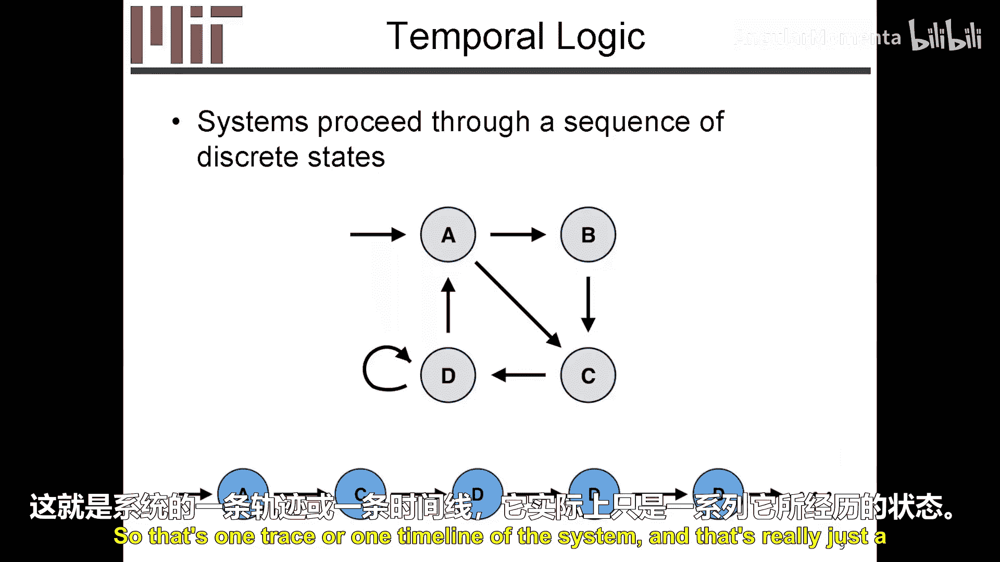

And in the past， we've seen these in some of the problem sets， for example， when we were modeling。

The war reactor， we've had the valves， like could transition between opening closed states。

 can also be the whole system of a starship going through different planets。

 transitioning through a larger。Set of locations， picking up passengers， dropping them off。

 so these could be quite complex。嗯。And so as I said， previously in our。

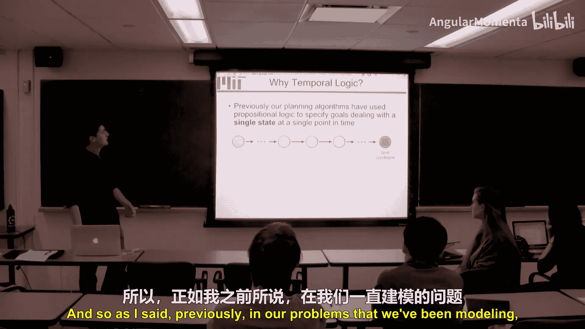

Problems that we've been modeling。We've been going through a system and we've been searching for a single state that satisfies all of our goal conditions。

Like maybe we want to reach Lavinia and save a certain number of people。But with temporal logic。

 we can actually express goals that are satisfied over a number of states。诶。

And this allows us to do some more expressive goals than we could capture it just by looking at a single state at the end。

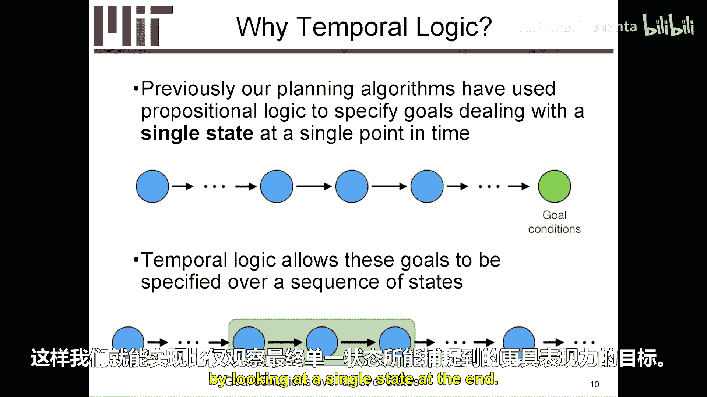

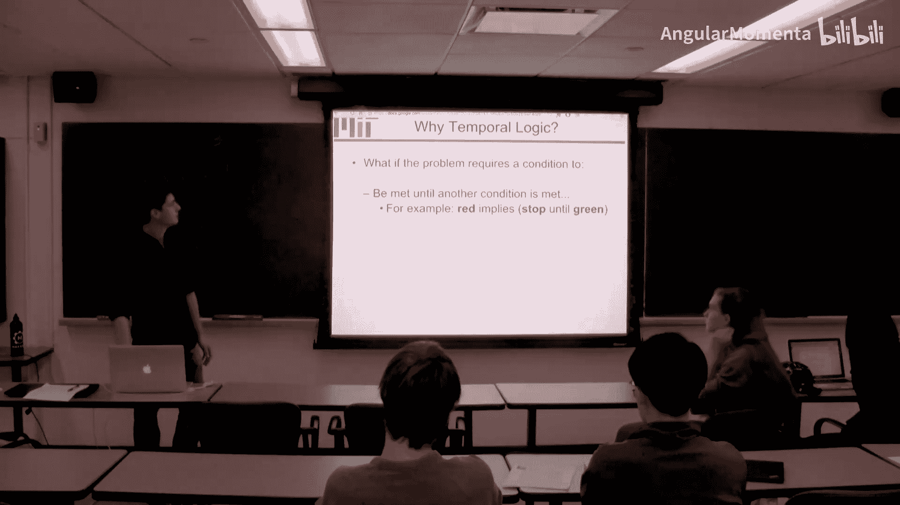

So for example。What if a problem requires some condition to be met until another condition is met if for example。

 when you see a red light， that implies that we should stop until we see it by green light。

And if we look at a timeline or a trace of one of these systems， that might look something like this。

 so we're going along through our system and at one of the states we see the red light so that adds this condition that we should stop。

And then that condition will hold forever until we see a green life at which point that condition is dropped。

全ぜと。Another example where we might want to use temporal logic is what if our problem requires a condition to always eventually be met。

 and this is what I was talking about with a gas station。

 so we might be going on forever and there should always be some point in the future when we do have a state where we're at a gas station so we might start at a system。

 start our system at a certain state。Our plan says that at some point we do reach a gas station。

 so that's good， but then when we get to the next state。

 we also want it to be true that from that point on we're going to reach another gas station。

And after that， going on and on and on into the future。These are things that you can't。

Express very easily with the types of logic that we've been dealing with before。

So one important distinction that we should clear up before we really dive into the syntax of how these linear temporal logic work。

Is the difference between branching time and linear time， there are really types。

 two different models of time that we can see working with and there's two different types of temporal logic that exist to express these different types of time。

So linear time is。More similar to the world that we live in unless you're living in some sci-fi movie where time is branching into different realities and all sorts of crazy stuff is going on。

 you can think of time as just this linear timeline so right now there's one future today that's going to happen for me and regardless of how many options I have。

 there's one realization of the time。And what happens。

 what this lets us do is that it gives us a single path for our system and we can。

Reason very exactly about the。The conditions that are met within that path。 And this lets us use the。

Lets us describe what will always happen in our system， for example。

 know we can guarantee that we always stop at a red light until we see a green light or we always stay within。

的s蒂even们。This is contrasted with a different model of time。It's called branchning time。And。

In this modelto of time at each time instant， we consider all possible futures。

 so if we have multiple actions that we could perform at a given state。

 we're going to consider different timelines that branch off from each of those possible behaviors and this results in。

Alternate courses of time。that we can reason about as a set and instead of thinking about this as always conditions。

 so our path always does this， we can think about this more possibilities if we're using branching time。

 we can say know at this state and time there exists a future path in which we will always stay under these speed limits。

At this point in time， all of our future pads satisfy a certain condition。

So whereas linear temporal logic is more about guaranteeing what will happen on a given path branching time。

What might possibly happen？So for our purposes with planning。

 in part because it's more practicalable and in part because it gives us an exact analysis of a given path。

 we're going to be dealing with linear time and for that reason we use what's called linear temporal logic there's a different type of temporal logic。

 there's one called CTL and CTL star that deal with branching time and those are sort of an extension of linear temporal logic that add a few other operators that allow you to reason over。

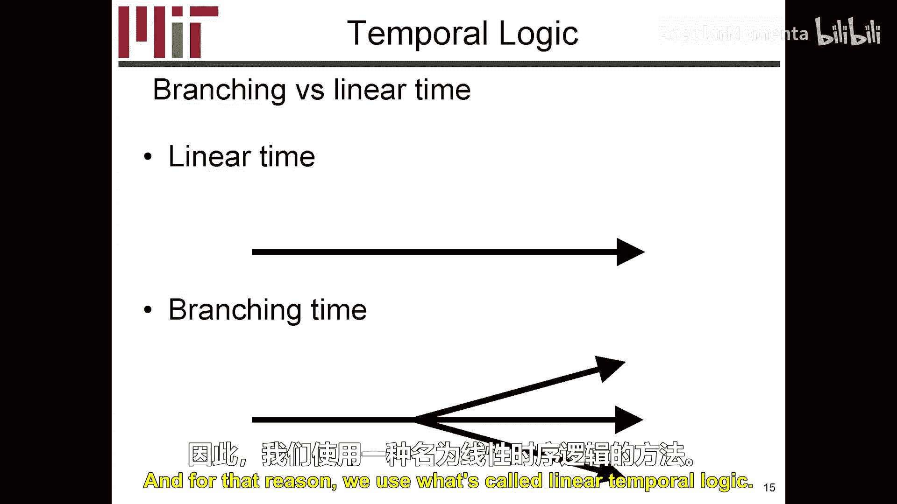

But for our purposes， we're just going to be using the linear time。

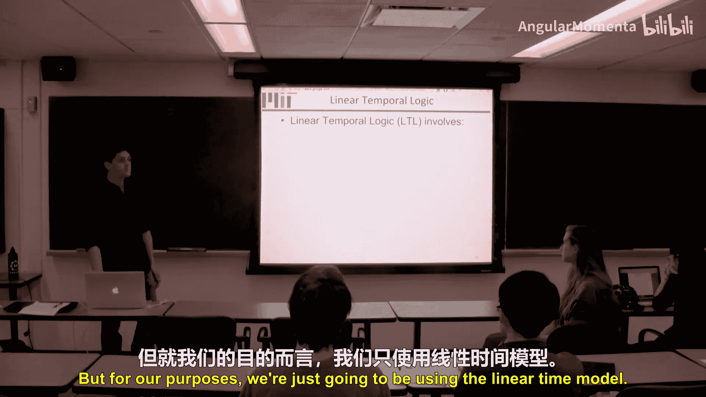

So it kind of as a recap。What linear temporal logic ands， we're using this linear time model。

Another important distinction is that we're actually going to be talking about infinite sequences of states。

So instead of us just reasoning up until a certain goal condition is met。

 we're thinking about systems that could theoretically keep transitioning over time over and over and over into the future。

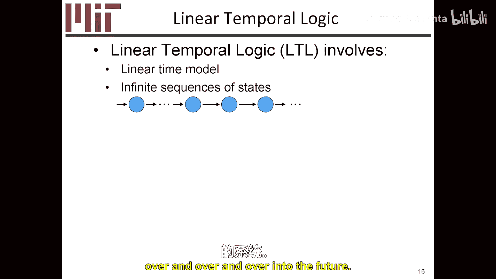

So if you have one of these state machines， you can think at each time step it's going to visit a new state and if you give it enough time。

 it's just going to generate an infinite sequence of states and we can actually express properties that can hold over an infinite number of states。

 not just the discrete number of states that we might usually think of to reach a goal。And。

Linear temporal logic can actually be modified to work with discrete set of states。

 it just requires an additional operator。But the ability to reason about infinite sequences estate gives us a lot of power。

Talking about guarantees for， regardless of how much time。Finally。

 all of the operators we're going to be looking at in our logic system。

We what we call forward looking conditions， so this is when we're given a state。

 we're going to be reasoning about what's going to happen in the future。

For potentially a tremendous amount of time in the future。

 there's sort of a symmetric version of this logic that reasons about the past。So for example。

 we could say。Talk about guarantees that something will eventually happen in the future。

 there's a sort of a symmetric version where we could talk about it。Given a certain state。

 we can guarantee that something had eventually happened in the past， for us。

And that we're going to focus on planning， where we're typically planning about what to do in the future。

 it makes more sense for us to use this future looking set of operating。

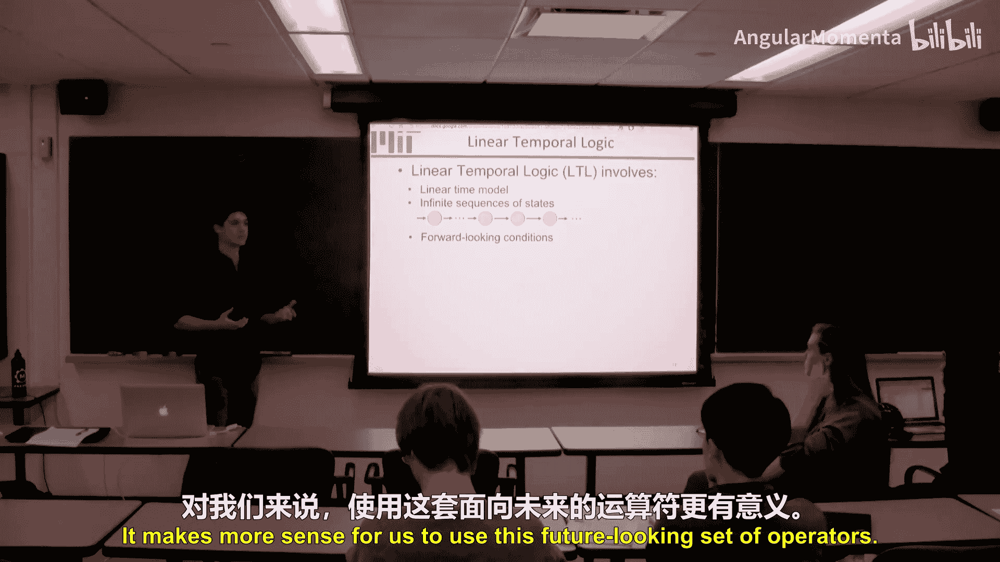

And so I guess one little nuance here that I sort of pointed out in the previous slide is that because we're using a linear model of time and not a branching model of time。

We're going to be expressing properties that happen over a single path of states and not properties that happen over separate pathway。

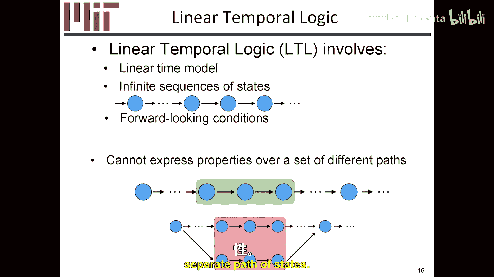

So finally， I'm just going talking about it。A couple of the main applications for linear temp logic。

 before Ellie will dive in and actually talk more about the semantics and the syntax of how we use this logic。

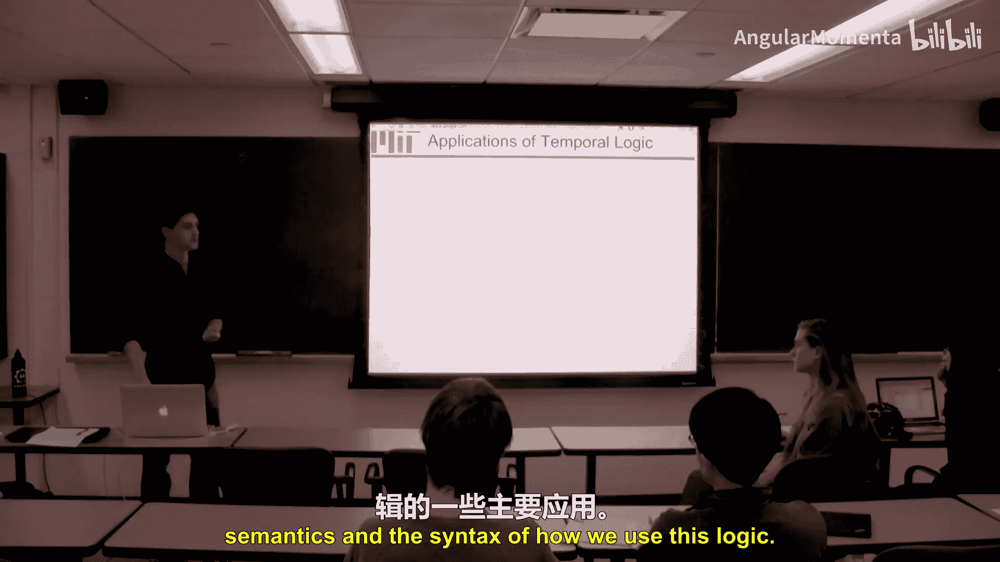

So the first main use is verification and model checking。

 we can use this linear temporal logic to create guarantees about a system。

 informally verify it for a couple different properties， for example。

 we can talk about the safety of a system， we can say， over the course of the system。

 we guarantee that it will never enter a state with a specific condition。

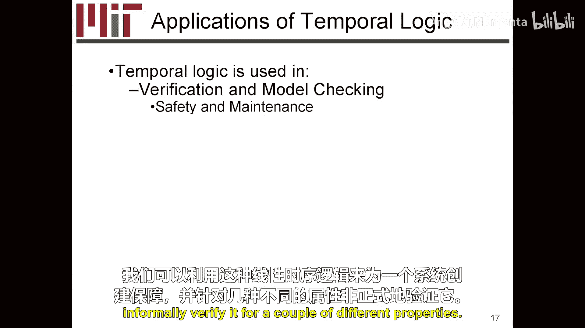

We can also talk about the maintenance of properties， so over the entire lifetime of this system。

 we guarantee that a certain condition will always hold。The other main application for Chro logic。

 one that we're going to be focusing on is for planning。

 and this is planning using these temporal extended goals that I've been talking about and it actually extends nicely to talking about temporal extended preferences so this is。

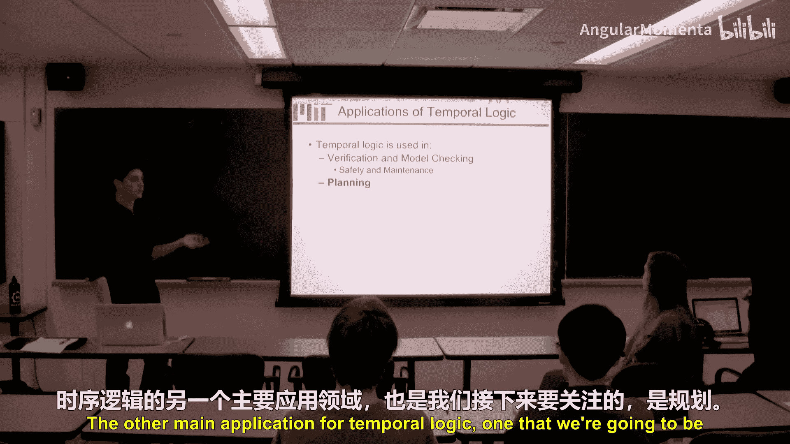

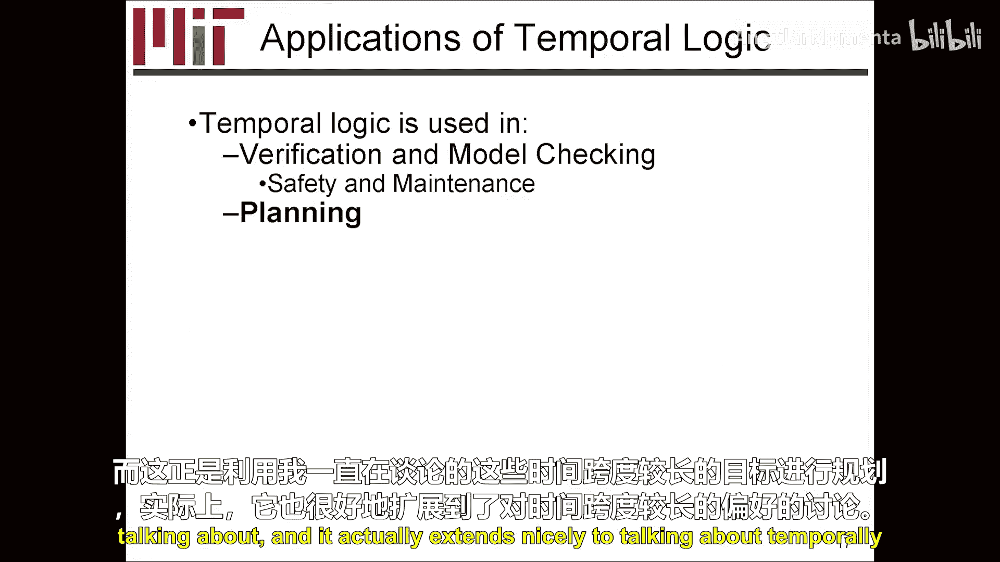

Given that we have a number of different paths that could reach a goal。

 we can actually look at all of those and see which paths satisfy certain。

Certain conditions over the center。Over the sequence of states and use those conditions as a way of choosing which ones we prefer。

So with that， Ellie is now going to talk about some of the syntax of。看到は。My name is Ellie。

And I would have the syntax of LTM。So an LTL formula is a series of states。And at each state。

 you can have various propositions that can be either to or false for。Is it okay about a racist Yeah。

 go ahead？

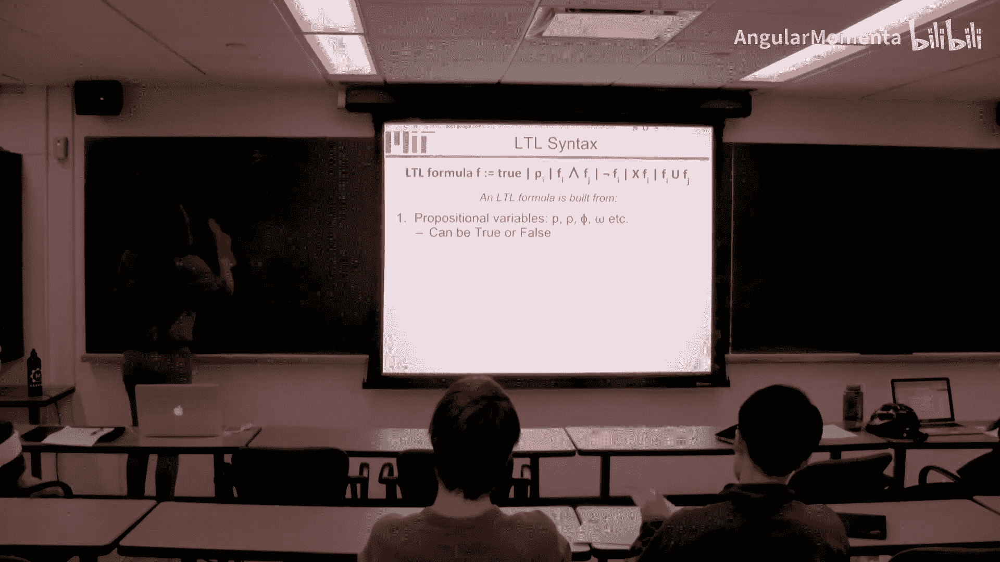

So， for example。You can have。Then then。A few of Steves。你佢讲清水。And at each state， you can have。

Propositions that are aject true or false， so if the traffic light could be red。

 could be an example of a proposition， we could be stopped。在这。

And there's various logical operators that we can apply to these formulas， these sets of states。

 and we can determine if these logical operators are either true or false about each。

Each set of state needs formula。So there's the not operator， the or operator， the and the applies。

 it's an only if。And like I said this week， each proposition at this week might be true or false。

So just to go at some examples of these。The logical operator， true， says that there is。

Essentially what the operator truth says is it's not saying oh， the state is true。

 the operator just truth says that there are states for all infinity。

 so true is always true so no matter what you had for your state here， the logical operator truth。

However， when you talk about the logical operator true with respect to a certain state or a certain composition。

 I mean then it can either be true or false so for example here。

The logical operator red light is true at the first state。If this was green。

 then the logical operator read would be false at the first date， does that make sense？2。

One important thing to note about the logical operators is that they just apply to the very first state in your sequence。

So when we're discussing logical operators， we haven't gotten to the point where we can express temporal。

Information about our sequence of states。The next operator is not。So as you can see here。

The traffic light is red at the first date。So covered light is not green holds because the proposition green is not two at different shape。

I go watch operator。Great， at this first stage。We're at the red light and're emit gas。

Both that were at the red light and they' were getting gas holds for the fri state。

And then the operator board essentially says。I guess a lot of this is tell you were with you guys。

 lot of operating。Essentially， if you have red or green。

Then you could either have tropical light be red or the tropical light be green at the first state。

As long as one of those two holds or both of them holds， then it's true。And one thing to note about。

Or it applies and if and only if these can be rewritten with just the watch of operators and and not。

 so another way of expressing red and green is to say that you can't have a scenario where both is not red and it's not green。

And I'm not going to go over that for flies and if only just for the sake of time。嗯So。

That's just a review of the logical operators and now we're going to go into the temporal operators。

When we're talking about her。What are some useful temporal operators。

 because up until now we just are describing the first state new sequence。

 which is really useful as we want to。The entires。Sator Stevens。咁食都 see。

So what do you guys think are some useful things that we want to be able to describe， I know。

 Ben touched on some of them at the beginning， but if you guys could account some of them again to the state transition。

See questions。Exactly， so if I'm in a state right now。

 might I be concerned about the next state is that kind of like what you're saying？Yeah yeah。

 so next is one of the things that we might be concerned about。next week。

Are there any other things in this？Als are global Yeah， me always。So。Yeah。So like Ben said。

 we always want to follow this speed them， we always want to be under 35 miles an hour。

 whatever the speed limit is， anything else？别他。AndYeah。So like he said。

 we want to be stopped until the light green。Yes，本あ本。So we eventually。嗯 want to get gas。

Any other things access？At this， yep， and so at this state is kind of what the lots of operators are doing at the beginning。

 but I agree that's something we have to be able to express。

 so that's not a specific temporal operator but it's included the logical as well I'm just write it up here。

好，拜拜。So the logical operators are interacting on。So they're acting first aid in。二一。Exactly。

 the app first date and so if you just wrote the logical operators by just by the definition of LTL。

 it means let's just announce analyze first date and see if it's true。

And so it won't tell us anything about the third state or fourth state of a second state。

 which is why we have to look at like the next state， so yeah。見なかし。Okay。So like you said。

 next is an important one。But here we consider， okay， the next light will be green。

And Intel is the one that she mentioned， so the light will be red until it becomes green。Eventually。

So。The light will eventually at some point in the future turn green。

 so we might be waiting at the red light for a long time。

 but eventually it's going to turn green for us。The light will always be red。

 so I guess you're stuck at the traffic like for a long time or globally that's another new for always。

And must。One is a little bit。A little bit less intuitive。

 so what this is saying is the light will always be red。

Until another circumstance coincides at the same state。

 so the light will be always red until the car gets gased and then after。It gets its gas。

 then the red is released and the light can be either green or red after that。So we have red， red。

 red， red， red， until we have both red and gas。And then it can be green or to be right off then it's not pd to being red。

Does that make sense that was a little bit less intuitive。这个。All right。

 so now I'm going now that we've gone over just the intuitive understanding of that。

 I'm going to give you the actual syntax for that。So。X is your representative vote next？

So in the first state， we don't care if P is true， P could be not true， if he could be true。

 it doesn't matter， but in the second state。The next one after the first date。

 P has to hold in order for Xb to be a true statement of other sequence states。

So what do you guys think？If I wrote this。我问男回。So this one over here。Yeah。Our gaugeHL operator。

 gaugeHL operator essentially says。Like Ben said we're stopped until the light is green。

So if you have P until W， you just PS featured every state until W。

 and after that point P can be whatever you wants to be。The eventually。

 or future operator says that at some point in the future， we will get gas。

I always worth to note I know when we talked about getting gas we said oh we have to always give gas at some point in the future but the future eventually operator just is just at one point in the future so once you get gas you don't have to get into gas Yes on the previous slide you have a note at the bottom。

That在。W is required to become true because that mean an mental operator also requires a future operator on the W。

Yeah。要。But it's just the added condition that P will be true and tell the like whenever you use that till you say。

做够啲嘅你个生诶。は。系习规嘅地。いや。はい。It could yeah， but then if your system that'd be totally fine if you had your system just be P。

 but then the operator P and CalW wouldn't hold unless you had a W at some point in that sequence of P's。

Do there reason here You mean， I guess it that's the way to do it。じま。So I。

So you're saying that we can have a bunch of trees， right every safe？And I'm saying。对。

s like this is a fine state tag， you can have whatever you want use your state and we're just analyzing if a sentence is true about it。

So this statement its not true or sorry， like I'm saying that it's not。然后。And so W。

 because there's no W in our。But if we add an W somewhere。And we keep all the peas。

 then it's true because it's has tea。I'll do how to get to a。

Does that make sense it it makes sense that that's the rule， but it doesn't make sense to one。オッケー最。

Do you never agree。You have P until WH。Yeah， if you do you never have them， then it won't be true。

I mean， when youically English language， it would be true。

I guesss if you have Pfinity and you never have Ws。P收。要走诶。

Like if you say that I'm hungry until I eat and you never eat then you'll always be hungry see so that doesn makes sense on logical hunt but that's not how it's describing there's also an operator that's sort of like unofficial called the weak until and that's sort of saying like P until W or always P so that kind of like gets rid of the condition that it reaches W at some point more but just the until operator on its own it sort of like a strong。

いや so。いや that'sそそ。や。Sometimes yeah， I get can be sometimes feel like why I didn't necessarily chosen things。

Okay， and then the global we want。As we said， this is the one that you could sub exactly we have to have every single state in the future。

And then the release operator。Is you have to have P until you have W。

 but P and W also have to share the same state when they switch。So it's like it's in until。

We don't have to have the pe here。If released， you have to have the P&W occur at the same stage。等一下。

Yes。So just like the or operator can be described using they not。

 and and the future release and globally operators can also be described using other。

Using other temporal operators， and so just as an exercise。

 can any of you guys tell me which these are not in order， which are these line up with the other。

 like whichever one they line up with？And I'll give you guys like like three minutes just think about it。

 and then we'll walk through it together。And you guys like come up。ます。ただ。🤧。All right。

 so have many of you guys。One was my acrylic boyfriend。Any suggestions。你不是从。

This one is a top one that's exactly right。許っているや。So，2。The Sig true says。

It doesn't say anything about what the propositions are。

 it's just something that's true for all states， right？So if we're saying true until P。

 that means that you can have whatever you want until P returns。

So does that make sense that at some point in the future P has a crew？

Exactly because we had the strong tilt， right？ダめ看下分。cool all right。

 and now what about this one we have。That's not。So this is aimed that。At some point。

The case that at some point in the future， you don't have。

So what do you think that would correspond to？If at some point in the future。

 you can't have the situation where it's not。ってる。いせ、います、どゴです。はい、すみませ。いい。

You have tea at everything single street。You've never had a situation where you don't have to eat。

 right？And so that leaves this last one， we have。You don't have a scenario。 Do you have。

Not P if I not。这里。So。You have not。相当なあい。But嗯。I'll come back to that one。

But it's just important to remember that you can。This drive。Operators with。

Similar terms that your planner doesn't have to deal with it。

The global operator nearly operating event operated can have less。次。So yeah， you guys right， perfect。

And then this is just a recap of the different operators。The other way questions。

And so there's two more really cool things that you can do combining these different elevators。

And the first is。remember when Ben was describing that we need to get gas and we need to get get into the future。

But even after we dig gas， we might have to get again sometime in the future。

So it's important that we can describe something that happens infinitely。

And the way that we describe it is saying that we've always had the scenario where。

You will eventually reach。So。Ihy didn't go another way to describe that。

 but does that makes sense that。But right now in the future I'm going to get gas and even after I get that gas。

 I will eventually in the future also need to get gas again because your car will always be needing to get。

食べます。Yes。And then eventually， forever is another scenario that's important to describe。

So let's say that the traffic light will eventually drain green forever。

We need to be able to say that at some point in the future。

 although we don't know when the traffic light looks feel great。The future operator。

But at some point in the future。You will have something come true。And so at this stage。

P becomes true。But the global operators that happened from the state。Afterwards。

 which is saying that you eventually had you eventually。We'll always have the stage be future。

You来さ questionかな来。It's weird to me that the gas sign is becoming this like occasional temporal operator instead of just like this state that we actually have。

just be攞全目嘅。う。why is the act of getting gas。Showing up here like that versus just we always need some quantity gas That's true we do always need some quantity of gas and you would describe rather like you said just would be always operating but I guess my action of getting gas is I was thinking of actually driving up to the gas station and was like。

And filling it up with gas if you didn't do that。You wouldn't。

You wouldn't be able to like always have gas。I there reason。Right。

 so like I would think that always have gas。我。以十。Yeah。

 and depending on how you make your model that you definitely could do that and that definitely would satisfy the condition I was your way to deal？

Well， it depends on the situation， maybe maybe you will set on to say at some point in the future。

Light will always be green because you want to ensure that cars can go through and if it with red。

 at some point， it will be green in。So it really depends on your model and how I think the weight you're taking where you always want to have gas。

The proposition of gas is。How much gas you have in your tank and if you have in your don。

 then I think that that would be a minute good bit。This is this， I mean。

 if you said I have to get gas， I' applied it for next week but I' run out of gas。

You have to somehow be tracking。Yeah， I agree， I agree。

 I was just using it as an example to explain the concept， but I agree that that definitely probably。

I think in both cases of what it represented as having gass all the time。

Were explicitly saying that you're going to be in gas stations。Eventually。好位这边。

That depends on how it was making even you going to always have a guest from a station。

Well you're getting gas from that， so they've been how you growing one tomorrow。

 but I think both will work。So infinite often， it doesn't really cares called， all frequently。

't but robot about this is， for instance， know， something hasn every 60 years。

 My system lifetime started 30 years， So which means something I happened only once。 So in this case。

 you know if and up。Have the a future operator who they safe？

So for instance something happened60 years my system life time goes to 30 years after 30 years have to get a read the system。

And then so during this period making only one thing。As it happened often infinitely。

 but in the lifestyle cycle of system only happen once and therefore in this condition。

 the event often it should be exactly the same as the future right at the current state。

 something happened in the future of system it could never happen again。看着。

So when you're don't have a system that's dying after 30 years。嗯。

The LTO doesn't actually model something that。It models from this infinity。

 although there is an extension to LTO that can incorporate that into it having it。

Having it had the natural end goal， I think in that case then。

In generally really often would be different and would。I could't。

 I don't know exactly how that would find the situation， you know， Ben you know you would kind of。

So there'ss something called metric temporal logic which associates like a time scale with each of these operators。

 so I think you have to use that and we're trying to express that youve had to always meet this condition still within your lifetime time。

Som sort of qualified to these operators is specified right actually in time。

that operate very high features so what we do while we use this even often some scenario is something a little bit more frequent in unit system by time。

Right not like something know happened0 years ago。Yeah。

 you know it's important that LTO is only dealing or the alsoTO we're explaining here is only dealing with infinite states。

 and so I agree it's a little bit， I have to think about that process of how do you apply something that goes on forever to a real system that doesn forever there have be a way to I mean the future thing like if he has a system that lasts3 years when you say future B。

Somewhere in your design of the system it's going to okay that the constraint of future B is that it happens to happen within 30 years because like future P here for getting gas has to happen before I run out of gas。

 it's not just this representation says it just happens in the future but somewhere in your you know constraint checking it's going to say。

 hey we didn't get gas in this plant sooner enough right Yeah， that's definitely true and these。觉得。

Youre just told the what you on， but it's it's definitely not。

your obviously and so I agree that like we definitely would have to incorporate that in and for finite systems。

You have to。And that's why they have the extension ability of two finite systems。

Which we can certainly like。papers。Where we got the information possibly like that。Yeah。

 I think you guys have done a very good job answering the question。

 the three extensions to LPO that I found to be the most relevant。

 the kinds of things that we're doing is，Is Me temporalologic。

 which is the first one that you mentioned also to be able to have an over bounded time。

 which is related you mentioned， and then the last one is to deal with uncertainty and is then a problem with linear temporalologic。

不。お？And meant to have this is two separate slides。う。我哋心。OTO that you guys can。

look at this or do and explain why if you look at it。Okay， so why is the next red？そね一解すね。

Why is it that in the future they breathe？We have true in the future is green and why is it true that there's red until green？

So it makes sense that if all of these are true that this c。

The an which between all of them you also youre right。

 and so you can do that with four as well or you could do that with。If you had sequences behind here。

 you could put a future around this whole thing and it would be true that at some point in the future。

 all of this would work。再那个。Yes。What do you right there？Y， I was just think if you had more。

That's what you were considering from。All right， so now now you going to talk about expressing LPLs in PDDL3。

呃。So better an L has guide you through how， how expressive LPL population is。

 I'm going to formulate the。L in a classical planner like PDDL， now I'm using PDDL 3。

 which is an extension proposed extension of PDDL 2。2， which supports some of the LTL rigrs。

So these are the basic operators that you can use to express the constraints and goals of your plan。

 so you have at aids always sometimes within at most one sometime after， some time before。

 always within and holding during， so the nu here is a numeric controls that you can specify。

 and these are the in sensor already existing。Pre goal goal description precate so some of the operators may look familiar to you because they can also be used to express the constrain in STN。

 the simple temporal network， that learning class and there are some operators that are unique to the LTL or other kinds like matrix。

 temporal network like always， for example。So now we are going to take a look at。

How you can express the operators using the。必然对。PDR3 language so next we can use within one occurrence to Moneck because there is no explicitquiite next in the PDR3。

And you can use always untiltil to expressunt。And in the future， you use sometimes after。

And globally， you can use always and for least， since it can always be be。

Omega or always until omega when you see P。All boss tool though is police。Okay。

 let's see some example， so if you want to if your goal is to have the tropical light turn rate in the next state。

You would want to。You want to form you先。Within one occurrence， traffic gl return rate。

And let's take a look at a more complicated example。

 so if you want to model a goal saying that the traffic light would turn red。

It will be green until it turns away at which point？At which point it would be Ray forever。

So this is the temporal logic。Pretty kids have expressed this。攞， and then。If you want to model that。

 using the video。呃。There is a direct mapping。 You can see the direct mapping between the prediates and the。

So this is basically saving。It we always。Be green until your turns rate。

Turning red implies that it will always turn red。So next。

 please will tell us how to map between the LTL toDDL via Guia autota， which is specialized autota。

Cool， so I'm my release。First the gap to N the fun world。

So this is kind of a framework for how you would go from taking the problem with temporal extended goals all the way to a plan。

 so as you can kind of imagine from whatM and Elie we're talking about LTL is pretty express and we can express a lot of different types of goals that include more temporal properties than just a time window for goal to be completed。

So once you have kind of a defined problem with these temporary extended goals。

 then you want to model it in a language like LTL or PDDL。

So if you have a language like PDL and you have a planner that can do algorithm called progression。

 which I'll talk about a little later， you can go directly to a plan basically how progression works is it's kind of an algorithm that tells you when you're analyzing a state and you're analyzing LTLed formulas that are true specific state how to。

Push formulas that you need to evaluate later on to the next thing and how to keep track of things that you need to continue to evaluate for satisfaction in future states。

Another way you can do this is by taking LTL formulations and translating them to Boia Atmata。

 so Bouchia automata are basically finite state machines that are extended to handle infinite sequence of states and I'll get into more about how Bouchotmata work after you have a Bouchia automata you can then translate that into PDDDL2 which you guys are all familiar with and then that PDDL2 can you comes from with a classical planner and get a plan。

So a little bit more about Lucia Tomta， again， like I said， it's an extension of fire state machine。

 oh guess sir， why would you go with？バイぞ。PD free is straight to the plan I guess it just depends on how what kind of planners you have access to。

 what our systems you have， it's done both ways so PDDL free is still kind of new so there's not a lot of planners that actually have progression that can handle the。

it's also the case that。The particular algorithms that are trying to either do verification or planning maybe exploiting particular properties of the Bushit Tamaan。

 as opposed to the properties of the naval language。嗯。

So you guys are all familiar with regular state machines。

 we show time has a very similar formulation with some slight differences， you have a set of states。

 you have an initial state， you have a transition relation。

 and then you have a set of accepting states， these accepting states are essentially what replaces finite states in the state machine。

 most of a set of symbols that are basically the transitions between states。

So what an accept state is is abuia time that can only be valid if the sequence of transitions visits an accepting an infinite amount of time。

So I'll get into a couple of things。So let's say you want to model tick talking to a clock。

 this is just a regular final stage。As you can see。

 after some number of ticks and talks you get into S2 and you're in S2 because you can transition is only a self so you're in S2 basically for everyone to get to S2 so we can model this as a boier trauma by making S2。

An accepting state。This example， maybe an Thompson doesn't really do anything for you。

 it's just kind to illustrate what the Acing S does。

The accepting words or a sequence of transitions in this case would be。

Theres infinite combinations of ticks and tos that would make this Lucuchette comes with a。

Does that make sense？把手子当半。嗯。Here's another example。

 for example if I changed what my accepting state was so my accepting state was S1。

 I not to visit S1 in infinite amount of times for this theio time testpy valid that means the only valid sequence of transitions I could have is talk tick tick tick tick for an infinite amount。

So you can kind of represent different things and different sequences of inputs you might want to have based on which accepting state you use。

啊。This is another example， if you wanted your clock to be TikTok， TikTok， TikTok。

 you can have more than one accepting state， and now I have to visit SR and S1 an infinite amount of times if I want the Spia Tom test to be valid。

So then the sequence of transitions I get is TikTok Tik。

I don't have any questions generally but I don't know。O啊。

It might help to see how we model LTL has been shared time。

Here's an example of one of these LTL formula modeled as Buia Tta。

 you just take a few minutes and see if you can get which one this one might be。Yeah。

 just so everyone can kind of see that in future and I remember that means that eventually P has to be true at least one so from any sort of kind of input state you go into S0 and then I do have not P for some amount of time but as soon as I have P I have to get to P because I have to be in my accepting state and it amount of time so I have to execute P at some point to get to my accepting state for this Bu at time set to be valid and then once I'm in S1 I can have any other amount of inputs I'll always be an S1 Im sure its true label me。

And it's also somethings stronger， which is it's eventually globally？Yeah， so actually。In this case。

 after I get here， my input could be anything， so this basically leader says that or my initial state。

 I have to execute Kate at least once to get to this accepting state and once I'm there I can be there。

I'm always there， any input will lead me in SY。So just to make this clear of myself。

The thing that's being executed that that。The state is something that's on the loop。

 so if you go from S0 to S0 that's essentially saying that like one of the notes does not。

Investors as wanted to think that one of the notess just repeat。I to think whatever。

Because you said the truth。So if you put P where the truth is right now。

 then you will have the gold root。Right， that's what I miss。By the way。

 you guys have 25 more minutes。啊。So you guys are exactly the right at this to the future。

 so an accepted sequence of propositions would be not he not he， then could he。

 then it could be anything that do get。And in this case， from blue Sha tota states。

 which are kind like L pointed out are slightly different than the LTL states we've been talking about。

 in this case you're in S0 and then once you get to S1 or forever in S1。

So globally looks pretty similar to this for anyone I'm going to take a few minutes to think about how I might change this Vi Harta to。

This is globally awkward。Sle seconds day。Exactly。As that we said。

 so you have initially your first state that you're in because P has to be true forever after you get to this first state。

 you have an accepting state P you all can also model that P。If you want to。

 you can also just have this single state which would encapsulate exactly what globally is。

This is kind of how to go from LTL to Bouchia Tomta in kind of a real work scenario where you have multiple LTL formulas I kind of all combined your Buuchia Tta are going to look a little bit more complicated than this。

 you can have multiple accepting statess， like I said。

it's kind of an echo way to model what an LL tried to do represent。So this is a guess I。

We have the notP transition out of there。Like you had possibly come into S0。

 you would accept the bush at top of that but then you would go to S1。

So accepting a Boier timea it's a little confusing。

 a boostia timeta is only valid if the infinite sequence of states satisfies it， so if I were to go。

And my sequence mix。Transitions with PPP MP， then that may not be a valid。

Ss of transitions from this Bu timeta because I'm transitioning out of my accepting state。

 which I need to have been in for an infinite amount of times and there's no way I can get back to。嗯。

So there's also a more defined algorithm mouse， just like an intuitive way to build a glciia Tomta。

 there's an algorithm。The one that's most popularly used was developed by Gth。

 this is kind of a pseudoco version of the algorithm。

You go from LTL to Boie as you notice it actually uses progression。

 which is something that planners that directly take PVDL use to generate plans an important thing to note which I don't too much to detail this algorithm generates a generalized boy automata which you then need to change to a simple boy automata the difference is a generalized Buia automata has a set of set of accepting states so for a generalized boy automa to be accepted。

 you need to have you need to visit an accepting state in each one of those sets of accepting states at least one of those states。

For a general， a simple Buuchia Tmpte， you only have one side of accepting states and you can visit any one of those states for the Buuchia T to bega the translation between those two is a little bit more complicated and we'll have papers in our reference that we' walk through how to do that。

This is a progression algorithm。Basically， it just tells you how if you have an LTO formula F and some current state N。

 and some usually they involve some time step because we're in a real world and we can't really model infinite amount of time and to make it discrete so if you have some time set between success and states。

How do you push sort of LTL formulas onto next states to be evaluated later。

This next F as an example， so if F was the next F of some LTL formula you would need to append that formula to the next state to be evaluated in the next state to see if that's going to be true or not similar more things for untiltail。

And。I won't go through this normally but it's here for reference。

So the next step to this process is going from Buiaat timea to PDDDL2 this process is kind of confusing me this is confusing for me to understand so the first thing I'll say is that Buhi states are not equivalent to traditional PDDDL states in a PDdDL state if you have two states that have the same number of the same propositions that are sure and false。

 those states are identical。And the because you have talkedma about， that's not necessarily true。

Andbuia Ta also have to enulate which transitions you can make out of each state。

 so S1 and S2 could have the same set of propositions I that hold。

 but out of S1 I should put that this is the Lucia T for future globally。

 which is what President Glen was talking about so if I enter in S1。

 the stars I have any sort of transition I want on S1 and then at some point I make the transition P and when I'm in S2 I'm in P for I had to take transition P forever。

嗯。However。If I get a sequence of input hooks， let's say I get P and then B， and then P again。

And then P again， it's not clear if I'm in S1 or S2 because in S1。

 I can execute any kind of state that I want and in S1 I can execute any transition I want and S12 I have to execute only P so if I got a sequence of P's。

 I could be in either state。So you need something else to add PVL2 to basically determine which state you're in and which transitions you can make from that state。

嗯。So I kind of make some similar。嗯。Okay so there's two ways you can kind of transform PDL2 kind in Caulate what Mu the Caslate the first thing is you can create new actions center calculatesulate the allowable transitions in each state this would basically mean that for every action you have in your traditional PDDL you have to create an action for basically repetitive action for each one of these states so you know exactly which transition you can take out of that state this could get long。

You have to make a new action for every single one of these states。

 for every action that you want to take， but that is one way you can do it。

Another way you can do it is introducing direct press。

Derriive predates or predicates that don't depend on the actions at all and just depend on some other formula in your plan。

 so for example we could have a derived predicate that explicitly tells you whether you're in S1 or whether you're in S2 and you can use these predates in your actions from PDL2 to make sure you know which date S1 or S2 and you're in and you be should time to and then in your formulation that you're plan。

 you set your final state to be one of the exceptions。

So I guess that context is one of the questions about how you go from infinite kind the accepting state is usually what you place as your finalacy。

 and then the derived prediicates appear purely in the preconditions。

 or do they appear in the they also appear in the effects。Because we need to know。

Pat your envision out of S1 test2， so you likely have a drive creditdi kit for both S1 and a drive credit for S2 and that is also kind of a lot of work to add to a PDDLT problem but it's definitely shortened in the first way and it definitely calculatesulate everything。

在个现场。Do have any questions拜 by。So you are changing the action then。Yeah， you're changing the action。

 but you don't need to make a new action。For every state。And the first formulation。

Let's say I have some traditional action like move block or something。

 I'd have to create a move block action for each one of these states because I need to know exactly which transitions I can take out of that action and then the second one I can just have one move block but in my move block I'll have a derived creditdicate that tells me which date I'm in which date I'm in when I execute that action。

嗯。So。The number of actions you have to write is less because you explicitly have credits that are telling you which state that you're in each time。

Now I'm going to hand over to Martin more questions， coming over to Mark。

 and I'm just going to talk about private。Allright， so。We're getting a little low on time。

That's okay， so now our transition is talking about。

 we've talked about temporal extended goals and we've said that goals are things have always happening。

So now we've talked about preferences preferences are things that don't necessarily have to be true with the things that you'd like to be true。

So in the classical planning problem， we formula able to formula like that， you a set of states S。

 which is say S zero， set of operators and a states。

And the problem is to transition from the initial state to any state that fills your goal state using the operators。

In preference based planning problem， we introduce this additional field R。

She is a partial or polar relation expressing preferences between。And this is a little reference。

すごれ there。So that basically tells you if there are multiple plans to get to accomplish your goal。

 which one do you want to use？And again， preferences are property。is I but not necessarily required。

So there are two to of different types of preference languages are quantitative and qualitative。

 as you would expect in quantitative languages， we actually assign an numeric value to the different plans in order to compare them。

 so this plan a no way of four and way of two and that tells you what one to prefer。

Some I is to do that。For qualitative languages， you actually just have like this type of plan this plan with this property is preferred to this other planet with this property。

But we don't actually know any sort of information about how much we prefer one to the other or something like that。

An important outcome of this is when you have quantitative languages， you're totally comparable。

 so if any two sets of plans， you can determine which one is preferred。

Whereas in qualitative languages， you put up a situation where plan one is preferred to plan two and plan one is also preferred to plan three。

 but that doesn't give you any information about whether plan two is' preferred to plan。

There's a little bit it message。So to go into how you actually express preferenceice in PDDL3。

 like we talked about with temporary aesthetic goals， there is some PDL3 syntax to do this。

 there's a label， the preferencelate with U put on influence to represent things that you。

And then there's a function called is violated that essentially returns a number of times that any fluid has a preference label was not satisfied in your。

For example， if you had the preference tri light is green and fill turns red。

 so here's our5203 template extended in this case preference。

And we label it with the preference label here。And then our metric。

 our plan basically tries to minimize a number of times this。preferenceference is violated。

 so that's one way to actually express preferences directly in Pd3。All right。

 so now we' going talk about LGP。LPP is a different language that is quite expressive in terms of types of preferences we can represent。

 it's quantitative languages， language which means we're going to be expressing we're going to have weights for each of our plans to express that preferences and way we can actually express kind of the strength of the preference whole is is preferred twice or three times as much。

It's an succession of all language N。And here's the whose paper you want to actually check out。理解。

The formulas are constructed hierarchically， so I'll go through quickly how we actually construct。

你直开始。So the lowest level is called a basic desired formula or BDF。

 and that just expresses our temporal extended proposition。

 so this is just straight up LTL basically that we saw in the first section of the presentation。

 so I'm going to use kind of a cooking dinner example。slides。

 so in this case we always are just using future operators so at some point I might want to cook as part of my plan。

 maybe I want to order takeout， to eat dinner。And then I have some eatings together you can pizza。

 those are two different things， two different options that I could have in my plan。

 I don't have to have either of those with。Let's just a。That's the lowest level。

 the next level is called atomic preference formulas or APFs。

 and these are where we express our preferences between the VDFs that we formula previous slide。

 so in this example I'm using a weight。present preferences with lower weights being preferred so here we're saying a prefer to cook over ordering takeout so this is this is a PDF for Cook。

 this is PDF for ordering takeout we can apply weights to those to express which one is preferred and how much is preferred to。

で、すね。And here's forK。We're eating pizza。So that's the second level。

Third level is called general preference forpos or GPSs。

 and these are where we can do conjunctions or disjunctions or qualification of our previous appointments。

 so for example if we want to say，On our previous slide。

 we had two Apis we had we preferred to cook and we preferred to eat spagheti。

And here we can express that we really don't care which one of these we want to satisfy。

You can think of this as waste we try to satisfy this EF the lowest weight。

 so if we have this or operating here， that means that our planner is going to try and satisfy the lowest weight among all these different options here which in this case。

re to cook， that's its first goal。You can also。Uses an andop printer， for example。

 that's going to minimize the maximum weight across both of those options。

 basically what it's going to try and do。What's going to try to do is minimize。

highestighest weight among these two options， so it's going to try and。sorryrry。

 I was going to try and cook， and I's going to try and eat spaghetti versus doing these other options。

Okay， so those are GPS。And now moving on to aggregated preference formula which are the highest level with ABFs。

These define the order in which our different preferences are relaxed。

 you can of course express a lot of different preference for your planner。

 but not all of them may be achievable， especially if you're trying to achieve a large number of preferences at the same time you may not actually be able to achieve all of those so how do we reduce our set in the correct order and the preferred order so that our planum end up with isn't indeed the most preferred。

That's what A allow to do， it's basically you can express using this preference operator。

I want to satisfy both of these and at first I want to try and satisfy both of these in the previous slide。

And then if I can't， I want to relax it so I only satisfy G2。

 and then if I can't do that and I want to relax it so I only try and test G1。

 so that gives a kind of the order in which things are relaxed。

And it's important here that if you have two situations you can't distinguish from one another where you don't really care。

 you establish some orders so at the very。Lance type of level。

 we can just like sort them alphaically or something just provide some sort of order。Okay。

 so this is just a review of what I've been talking about。

 so PDFs the lowest level which express temporal extended propositions。

Apped preferences to those using APS， then we can combine or join APS。

Use general preference formulas and finally we can aggregate those preference formulas to show。

And' determined the order in which you already reported in which you should relax about。

To allow yourself to find。So using this kind of scheme at MP， we're using both the LTLs。

TlCL to access the rules that we talked about in the first section to express temporary extended preferences。

 the plan that's actually used to。Solve these types of problems called P plan and P plan can actually handle template standard preference and a goal at the end as well。

 and it does basically a。B for search among all your different options。

 but actually is one of the planners that uses the left branch Mar least show to use this progression to take LTL if you own formulas at each point in the plan and determine whether you've satisfied those formula lawss or not。

 and if not it will push them to the next state to determine so so that the next date can evaluate what you've satisfied those points。

那下午他。Crunes the search space and tries to always find the most preferred planets mutual goal。

All right。So。That's a presentation。Any questions anyone？I have a question the rug guys。Believe。

Would you say that。我你嘅系好以下。等一会儿问你。很觉顺的是吗？そそメカ。我叫手机。Oomega difference the hold at the last stage。

So essentially what I'm saying is like omega releases P。 So once omega happens。

 P has to happen at the seat and then omega has like。You students's like， okay， now if haven so P。

 you can do whatever you want， you can be true， you can be false like and so sorry。

 so P has to whole。make that happens so the definition is just switch。So this is an not patient。

 did this inter leave have P？Are aomega， like。But but like just the definition。Oh。

 I that's all I was wondering because then I was saw that was。SoO， sorry。

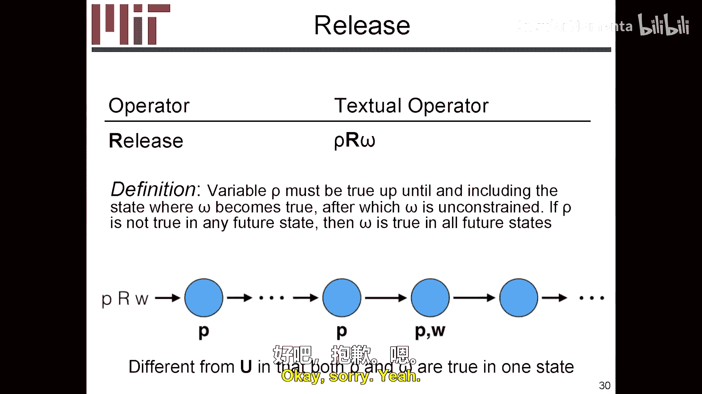

俾人系。Any other questions？Yeah， on the same star。Moreful ways to express the same。感就是个。

Is there any notion of canronical form？At least complicated former。Yeah， there is typically。

They actually。On this slide， so on the simplify the algorithms。

 they typically apply the kind of reductions that we showed in the slide to reduce the release the globally in the future down to just the until in the next that allows your algorithms to be。

To handle fewer cases。And then they apply the usual rules trying to push knots out to the left hand side。

All right， thanks everyone。