# 【麻省理工】认知机器人学-｜-MIT-16.412J-Cognitive-Robotics,-Spring-2016-p07-高级-7.-概率与无限时域规划--BV1eEtTzhExj_p7-

The following content is provided under a Cative Commons license。

 Your support will help Mi T OpenCourseware continue to offer high quality educational resources for free to make a donation or to view additional materials from hundreds of MiT courses。

 Visit Mit Opencourseseware at Ocw。 Mt Eduu。

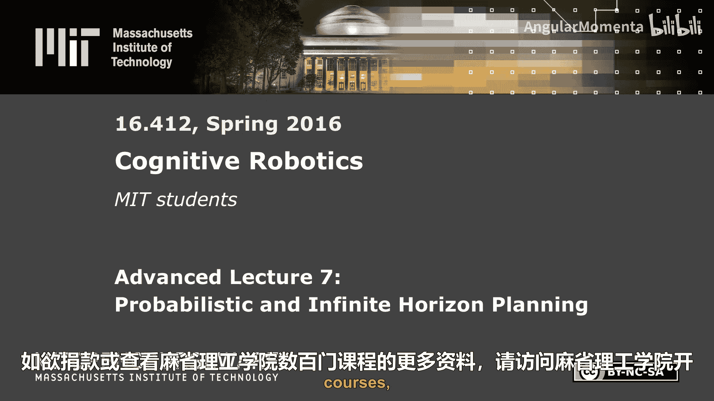

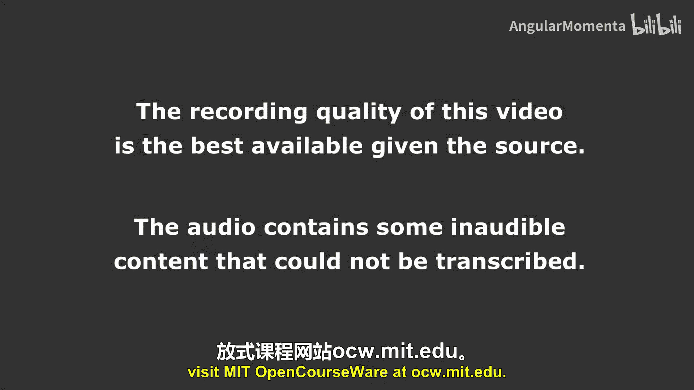

So Steve， give us an introduction myself。David， you call and Cha。他せ。YeahYeah。

To give you a brief overview of what we're going to talk about we're going to start with a broader motivating example。

 we're going to move into planning with Markov decision processes give a little bit about value iteration before discussing hoistic guide solvers so there we're going to go into the more stochastic case。

 partially observable Markov decision processes in operating in cool space。是。

We very often now see water motion planning as a problem。For example。

 with Amazon fulfillfiment Center， we start with a Google configuration， start configuration。

 a set of actions we can take and some type of reward function or。So for instance。

 if we have a coator starting at the Amazon Foment Center and we want to get it to 77 mask。

And let's say we want to take the short path to get there， we would follow the red dash line。

 but as we can see it comes very close to these obstacles。

So we're looking at very high risk fors failure crashes if there's any uncertainty in this path。

We're going to have a problem so one of the ways we can。

So of context for that is we follow something like greenhouse。

 which is adjustment to give us a little bit more space。Anybody any questions？So as you can see。

 the level of uncertainty sort of allows us to determine how easy or difficult problems can be to solved。

In the side， we have theistic dynamics。ensiveors in this case。

 our actions are going to be executed as commanding and our sensor is going to tell us exactly where we are。

 this would be something like de reckoning validated throughensing。

Veryry redundant if we moved to a little bit more difficult case。

 we have deterministic dynamics are maybe still executed， but maybe we have a noisy camera。

 so we have some uncertainty in the sensors。These are the cases where we would see dead reckoning。

 but we would compensate with common filtering to sort of get rid of that noise level。

Now down at the bottom， yep， sorry， what？It's essentially。

 you are saying I want to execute this action and it's going to execute it exactly。2。

Then towards the bottom we have surpaive dynamics and deteristic sensors。

 so in this case maybe there's some uncertainty in our actions， but we can validate through sensing。

 this is where we're going to spend the next section on Markov decision processes。

And then briefly later in the lecture， we're going to talk about this most difficult case。

 which is the stochastic dynamics and stochastic sensors。Our execution， maybe， maybe not。

 our sensors， maybe a little bit of noise， and this is where we see partially obable mark opposition processes。

Let me me just a quick clarification of the so De reckoning is where you estimate your position using a publicistic model but you don't use any observations stuff。

Okay， so we talked a little about action and certainly Oregon focus， and this is the case where。

 for instance， even if you tell a plot author。Cd rotor to stay in its place and Augusta wind comes by。

 it's not going to stay in that same place right， It's going to have a little bit of。

And we can see this causes things this disparity where you have a commanded trajectory in your actual trajectory and the kids are dissociating。

So in order to compensate that。We want to model things with that uncertainty。

 or else we have these higher situations where we can to follow online。

 we don't incorporate the uncertainty and we see a crash。そよ。

This allows us to introduce planning with Markout decision process。So MDPs have a set of states。

 a set of actions you can take， a transition model。

 so essentially what's the probability of reaching some state if you take an action？

Immediate reward function。And a discount factor， this discount factor is important because it allows it to prioritize gaining immediate reward as opposed to an uncertain future reward。

 so the concept of burden hands with to and blush。Now we want to find an optimal policy that will essentially map an action。

 the best action for each state。And what we hope to get from this is maximize expected lifetime reward。

 so we want to maximize the acculative reward we get over the time。

So let's walk through an example if we have a qua room perfect sensor and let's put it in this environment。

还たない。Our set of space are obviously here in space。Can anybody tell me what some of the actions might be？

怪有。Up down left right， in this case， we call the north south， east westernnoll。哎。

And next thing we for this example， arbitrarily gave ourselves a transition probability。

 so we said that you have a 50% chance of following your commanded action with a 25% chance of moving to the left or the right。

Next， we have the reward function and again we arbitarily decided that we want it to be a reward if you get to the state 65。

 that shouldcrement a reward one。you is that clockwise and  o'clock where you to's you that many have 7 25 up they' like it be this way in 25 we said clockwise counterclockwise from the intended direction action。

And finally， we give ourselves a discount factor of course。下。

Let's assume for a second that we have our optimal policy and let's say that our optimalim policy says from this state we want to take the action north as we discussed we have a percent chance of going north and 25% chance of going to the left right。

So。After that time， sir。These are possible states that we end up in。so now let's do it for a second。

We became our next action and our next action says go north。Again。

 we have the same probability distribution。And of these are the states we could end up in noting two tax steps。

You can see that this starts getting very complicated。

And there are increasing amounts of monster servingy meat。So。

Does anybody have any ideas on how we can sort of collapse this distribution？

Keeping in mind that our sensors are the splener determinants。Yeah， fly to a corner， I sorry。

 fly to a corner。You could do that。You just have so far away the。一起来。

Qu comment so the blue state is not add you one'm sorry so the problem is you're not at one。Yeah。

 the issue is if you went to13 in a you train sentence left， that's really the expert。

625 this came first。But a bit shouldn't shouldn't those numbers always add you one I mean your problem distribution always as you edge so is just at some point should so we would add another section to the screen and just move the grid over。

We just kind it offer。go some graphics。2。Y， so those are all great points。

The easiest way to do it is just to take an observation。

So at this point we say after our first time set， we weren't sure which of these three states we arranged。

 so we took an observation and said， wait， we're actually here with complete certainty。

So to make this a little bit clear， we're going to look at it from a tree view， right。

 he said that we started in the state， we took an action and this is our possible state we could event up。

We're going to fl this by taking this observation。And now we have a complete start here and we take our next action。

And see that me。Haveve moved out here。So this allows us to basically ignore the history of state。

 we have the same percentage probability from each time step。This will be really。

 really useful in completely collsing the distribution every single time you take an observation。

Anybody have questions about that？So let's go back now and figure out how we came up with this optimal policy。

The way we do that is through dynamic programming， there's two different ways you can do it either through value iteration or policy iteration for this lecture。

 we're going to focus on value iteration。So let's take the same example we had。

 we still want to maximize the expected worth。And so to start。

 we're going to initialize the values of each shade to zero。Let's， for example， start T0。

 we're going to focus on S65 and we're going to say that we're going to take the null action to start with。

From there conceived with a probability distribution 465， we have  a few% of staying。

 we have 25 chance of going to 55 and a 25% chance of going to 75。

The next item of information is the values at each of those states that we can end up in。

 and currently they're all set to zero out。And finally。

 the most important part here will be the reward being 65。

 taking the all action regardless of what state Vienna is going to be on。

 as we defined in our initial setup。呵。笑。Let's see how we would calculate the next time step value。

We start our different the probabilities， right？And from there， we would add the reward game。

Because we said that the reward is not dependent on the state we end up in。

 one is it should be across all three probaabbilities。From there。

 we're going to add in the discounted value。That we have them before。

So a way to look at this in a more generalized form is to say that across all the states that you can end up in。

 you're going to look at the probability of ending up in that state。

 and you're going to multiply that by the sum of the reward and the discounted lifetime value that it has。

So。We want to make sure that we're getting the best possible value。

 so we need to incorporate all the other actions that we can take from that state。

So what's going to happen is we're going to take that general formula。

 we're going to repeat it over all of the possible actions， and then we're going to take the maximum。

So， for this example。This state is very easy。All of them are the same for this case。

But we go across it and we see we get a value of one， and we update it as shown on the back。

This gives us what's called the volume the developmentman backup or update equation。

 this will be really important because it reaches across the entire state space and allows us to provide a history。

So what this would end up looking like is we're going to inter calculateulate the values across the entire state space。

 so at T0 we determine that all the values are zero。At T1，65 gets a value of one。And at T2。

 we see that value start to propagate out。三次。So the way it works is you would repeat those iterations until your changes in value become what you consider small enough。

 which would indicate that your approximation is close enough to the real value from there you would extract the optimal policy from the lifetime values so you see the CM bone inclusion and you're now just taking the action from it and you would map those actions to your speeds。

An example of what this might look like propating out if you say blue is the reward。R is an obstacle。

 et cetera， you can see as that volume propagates out， you start seeing your policy by the arrows。

Anybody have any questions？So one last thing we mentioned about this though。

 is that the complexity for reiteration is dependent on the size of the state space squared and the number of actions you can take。

 so you can imagine as your state space expands or you gather more actions。

 it starts getting very complex in which case value de becomes very time intensive and costly。

So this allows us to move into。It added its solvers。そういう感じ前。

quick question so how many I just going to show hands。

 how many of you have learned valuation before versus how many you have seen it for the first time。

 so how many have seen it before？Okay， and then how many is this the first time？さスタッ。

Any questions on value duration before we jump in， it's going to be an essential part of how we're going characteristic at this all。

他我まずそ。好。So the most important thing we said about value iteration is that it's super slow。

 it's going to have to go over every possible state and every possible action we could take our state space is multidimensional and we take a lot of different actions。

Really costly re。So what the approach for her' probably going to want to take is using some sort of best first search outfit。

Who can tell me some example out of those that already did that？彼此。

so that's very good and that's exactly what we're going to base our stuff off。

The start for deterministic graph。啊。we have a graph， we can use a heuristic。

 and we walk down it and search the space that we're most interested in to get to our goal very good。

So we're going to introduce two new algorithms focusing on the last one AO star。

An algorithm we can use to search for graphs that have this sort of and public AO stands for and or graphs。

As opposed to the simple simple graphs that we increased。

The end is kind of a way to express callistic coupling between metrics。

 so if we explore one thing we might have to explore other optionss。

 we'll discuss that a little bit more in the next slide。LEO is a bit more of a generalization。

 what it does is allows us to search loopy graphs and deal with the probabilistic coupling and allows us to。

Search and find the best patent with a heuristic Iode algorithm over and from the time horizon。

 possibly revisiting states and using the tools we just had in value duration to understand what the next us need to do。

So we'll talk about exactly how to get from MDPs that we just saw these biro examples。

Two these sort of hand graphs。We'll talk about two cases。

 one simple one where we could apply the AOR algorithm。

I where you have a quad doctor and if you command an action north you have a high probability of going north。

 but you might go east and vice versa if you go east， you might go north。This is expressed here。

With this growing tree and these an edges that connect。

 that despite the action that we might command from00， we might end up in 10 or 01。

RightAnd as we propagate outward， you can see how we're never going to loop back to a state that we've been into or we have to be moving in the northeast are actually constantly our tree expands。

And our probability distribution across this tree experience。

And that's the coupling of the edges because as we explore down the tree。

 we have to explore all the edges together。Anyone have any questions on just this kind of conversion of this population？

I have a broader question， we mentioned that MDP deal with finite states。

Do we always just discretize and continuous world into a set of politics Yes that's kind of a priority for searching over the States and can do that as fine as possible。

Yes， this was。So now let's look at this case instead of the Northeast。

Let's say it's not deterministic whether we command an action order south。

 whether we go to vote south。Here we see this loopy structure。We see that we might。

 on our first action commanding north， we might go to plus one。And then going to north again。

 but we have our end edge and our probability distribution like say not this zero。

What this does it creates this movie structure， this is exactly what we're going to be about。

 this is a very real world scenario where it's very likely we might return into somewhere to read。

We just came from just because of the uncertain dynamics we have， so this is the type of product。So。

We're going to use the LES start algorithm。We're going talk about the three main things that it's good for。

It has a heuristic guided envelope and what that means is that we have our large state space here。

But we're only going to with that portion of it。Great out portion。あ。

We're only going to look at the portion that is interesting to us。Prodes us with the biggest rewards。

 a portion that's reachable if we follow an optimal policy。

We figure this out with some themiss jurisdiction with re costs or reator rewards just like they start。

The idea here was that we'll keep the problem small。

 so we don't have to search with valuation or a giantants。

What we'll do next is have the state space expense， we get a bigger pay。していすた。We're interested in。

 we're going through Januaryary， we're going to figure out what the best action is。

And in the ideal case， the actions that the states that we would never reach using an optimal policy are never going to be explored because our policy is going to say。

 no， don't go over there， that's a dead end。That's getting you farther away。

So we're going to be searching in a very specific part of the state space that is useful to。

That will get us closer and give us a higher goal。あ。So。た。So what's important here。

 the L stands to groups。It's an extension of the AosT algorithmri。

 which but itself is an extension of the At algorithm。

 and it can handle infinite horizon problems that can transition in different ways。And。

Really models kind of the real world to for。Any questions so far on kind of the bronze scope of what other Fs going to do。

あでよ。Sure， the AO stands for Panor graphs， so that's graphs that。

We have here edges that are coupled that if you took time to do this transition。

 you might end up here or you might have enough that。So that's the notion this problem was couple。

We'll see in action as we start looking video go。But all what we're going to do。

 we're going to input this maybe an MDP or an Agraph。

With transition probabilities or reward functioning heuristics。

 these are all things that we kind of defined prior to figuring out。

What we're going to come out with is an optimal policy for every reach state。

 it's a little different than what value is， which is an optimal policy from every possible state。

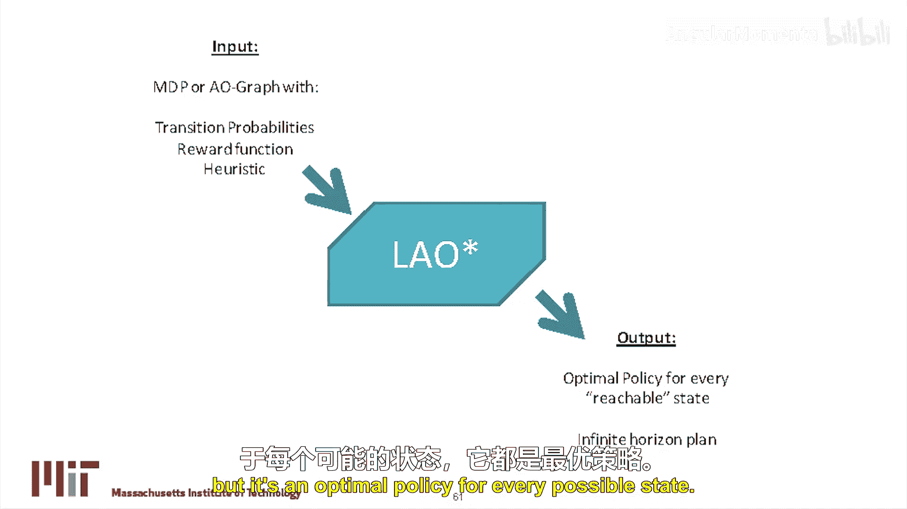

We argue that that's all we need， but if we know where we're starting。

And we follow our optimal policy， we're only going to explore a certain portion of the substance。

 and we're going to exploit that together。Infr H plan a little bit more efficiently than iterating。

A high event sense。

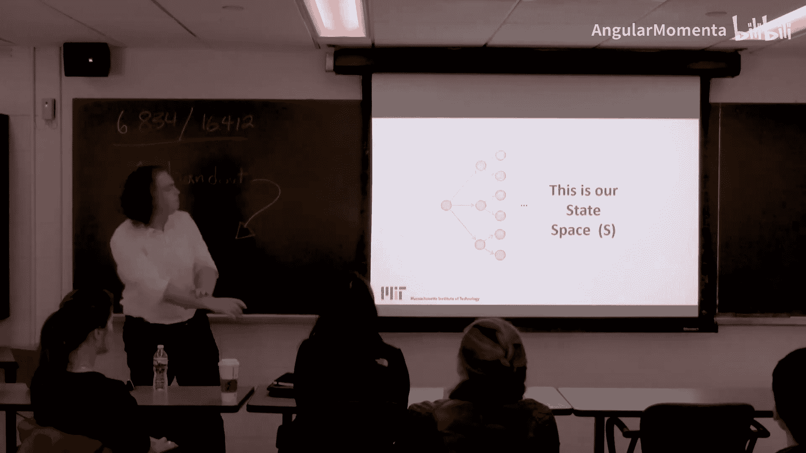

Any questionsしまょ。So we'll define some terms that we're going to use throughout those。

 we've already talked about our state space， and this is just a small portion of it that we're going to work with as we're going to walk through this example。

Next ring going define something called that。And that's the sub portion of the estate。

You're going to initialize that to just as zero the standard set。

But as we progress through the algorithm it's going to grow and it's going to grow only to get areas that we' interested in it。

A subset of this envelope is the terminal states now these aren't goal states。

 these are just the limitss of our space that we've added to our envelope so this is what it would be。

Extended。It's just a node that haven't been expanded yet here we haven't drawn anything further。

 but you can imagine。The states space goes out for because the some guys。

You can imagine that this goes out further？We're keeping track of the nodes that we haven't expanded yet。

Likewise， we show that we're going to initialize that to just mess。

The other few things that we're going to define。We already defined the state that in error。い。

We're going to define。Cost like he are work。P。Transition probability matrix a set of matrices。

All right， we're going to use。What's important here is that our reward function and transition probabilities are slightly altered to account for the fact that we haven't explored the entire things of。

We see here that the that node is an ST， in other words it's one of those terminal edges we' going say we cant transition out of it because we don't know what's being obvious so far and we're going to set it for to be the heuristic whenever we think that the reward is going to be when we need to explore and。

And like I said， we're just going to feed this into a policy search。

 just like we discussed with value iteration and on this subproblem and we're going to search for an optimal policy on the。

So far second。We are the general steps， so it's very texty。

 but we're going to definitely walk through maybe single step。

 we're going to do two full durations of the other。So like I said， we're going to create our R and。

That's our reward function and transition to all those using put out the definitions we showed。

We're going to need evaluation to find the up policy on the subspace that we're interested in now。

And then this is probably the most important step。Knowing this optimal policy。

 we take a look at what new states that are in our terminal states。

 those that we haven't explored yet。New states we might visit。

So let's say we have our policy and it says they go north and we know that we haven't explored the North state yet。

 we know this is the state that we're going to reach following what we consider now to be already an optimal。

So that's the states we're going to expand next， want going to do some bookkeeping。

 adding them to a terminal state settlement they the once we expand it， and adding them to our。

What's important here is that we're only going to add states that we haven't visit。

To our envelope and this is basically the little act that allows us to deal with。

We're not going to continually explore nodes that we might reach a second time probabilistically we're going to let value iteration kind of handle that。

Very hope that those for us。I it there。Ill be first。I'm looking for something that like。

 are you saying that you're going to just repeat until there are？清吹度我得。the difference the key。

还会在跑车跟的问。Sure， so you can imagine we'll talk about termination and depth。

But you can imagine that as we have these terminal states。

But you have a policy that guides you to a part of the state space that you've expanded。

 imagine you reaching your goal， your up policy is going to safe sta put， right？

And it's not going to say you work again。Essentially with the Girl stage deaf in example。

the more to case that there's nothing else you can do。the idea is that。

That your policy on your subspace never tells you to go to a terminal building。

Theyre inherently worse。Find optimal policy means running value。Entirely， yes。

 we're going to treat a section of the black box。But the trick here is that we're doing on a smaller portion of space。

All right， I I put the steps up there， hopefully you can sort of see those。For now。

 we'll just kind of walk through from the beginning already。

So we said that our envelope and our terminal notes are。Are just as zero to start。So very simply。

 we use these definitions and say， okay， the transition probability out of as zero to any node right now is zero because it's9。

さ。That's just so that we don't transition out of it we can develop a policy。

Based on only the portionless space that we have。And our reward function we're just going to apply it to be the heuristic me that say that's 20。

I where I move up。Pa that to evaluation。On this down。

 this is a very very basic case we're just going to have reason to kind of build up the machinery and understand what we're doing。

It's a very basic case where the only note we have is S zero， we can transition out of it。

 all we have is some heuristic， so the only thing we do is nothing。

So the actual intake from has to go。Very simple case just to kind of get us formed up to understand what's happening。

So using this policy in London， knowing that has zeros in our terminal。三。

We're going to take the intersection between this terminal load set and the knows that we might reach our policy and we know we're at S zero and we know the only the action that our。

That our optimal policy has to take is not， so we know we're there， we know it's on our terminal。

Not so that's the only thing that we can reach so far on using our household policy so far so good。

Where是。So that's exactly what going expanding just to1 S0， to A， B and C on those two。

So that's up' there to symbol book。Weve that zero from our autumn terminal loans added its children。

 and we added the children to。Now here we go， we're a little bit more interesting。

 we're going to do the same thing again， but now we obviously have more node and a bigger subspace to explore。

So reading these definitions。We see our reward function。Yess。

Here's a tuple of the note that we start from。0。Hes one of these three actionss would say a18 three。

Let have。Inst the board functions， six more。Its being our rewards from taking those actual threat。

From A， B and C， no matter what action we take， it's just be heuristic。That's hard right。Likewise。

 we're going to take a look at this transition probability。

 and this is transitioning from the state as there we're saying if we take action A1，82， and A3。

 what's the probability of the end of？啊 there这。If we look so far here。

 we're going to look at something that deter us take an action。

 we'll end up where we say we're going to end up， and we'll see how this algorithm sort of collapses down to a star if everything's。

We're also obviously going what equity be probably is the case where we say moving well if there's a small probability that we might end up with。

That's going to necessitate that we're going to have to look at and expand being together。

If we were have decide we want to try it。Likewise is if we tried to take action A3。

 we had to spend all three minutes， so the tighter the problem is the coupling the more the students we' have sports。

So just off this， assuming that if you take actually the1 be2。

What can someone tell me what the policies would be？The rewards here。

We're interested in the policy from S。Take a minute to take a look at the rewards and sort of just judge what the best action you in the purely these during sense。

工作。Sinces15 or two just a bit。You have the reward that you have gotten so far。

Does that help you answer the question？到底や。是。So the policy deficit says from a zero。

 take action a one。Thats join this state。キ。You can see there's an option to takes。

What that means is that the nodes that we might reach that are in our terminal state set using our policy is no day。

So that's the no Air expand， and this is where you really really see all we've done is collapse down to AR Institute。

A start would say， okay， let's look at the best mode using some heuristic。

Action81 takes us to that best mode。just that。So when everything's deterministic。

 basically this algorithm collapses down。start。Nothing super interesting。

The interesting case does come up when we start doing。More hoist。

 and that's where nodes are holististically puffd in this band。So now we have our policy。

 and the policies likely to never remain the same because theyre very go。あんな。And action。系大。

And no of that。So。What I want to take a look at is what terms are now reachable following policy。

So we talked about that if we were to take action。有三加多嘢呢个。So taking action A3 is NA C and A。我机会。

What's reach but if and take actually a one？你呀咩。And that's where we get the notion of。

This probably is the help and we're going to have to expand things together。

Explore the part of the state space that we reach both our optimal policy and that we might accidentally end up in。

Still policy this is what guarantees that we'll have。

An action to take from any state that we intended to go to or that we might end up in problems。

that's how our state space expands， our envelope expands to encompass as only the reachable and interesting states that we want to look。

It's not as simple as。Just explain the download of the heuristic with the they because we have to problem with sleeping。

And you can see that if you have。啊齐着客观。Then you don't get to exploit this optimization as much。

 so for example， A3 we would have had to expand all three。As opposed to A1。

 you can just stick to A&E and ignore expectency for now because our policy breach is there。

This is应该 body know门。the key statistics right they have about a good significant at the level。

 so in this case you need attention to action A equal to A and B and B， the property is derebrial。

 using it's a good finish diversity that we can clonee the B let you search for A。你嗰啲一个班系画面。

So in the complete sense of running this algorithm， you should print it。

what if we do and we have that 2% chance me to end up there。We need to have a policy for correct。

So we end up the couldn imagine that these on trying to push back to whatever path。

I suppose that the probability is low enough you can have some sort of cutoff of separation。健构部嘅。

So just a quick point， so I think that's an excellent point and an excellent answer。

 we're going to talk about next week exactly what's going to happen if you can prune sort of lower probability events and actually paperver right here we'll be lecturing on that。

Good question That sort of also gets us into the sense that if kind of every state in the world were probabilistically coupled。

 let's say we had some transporter to go with the Star check examples。

But if we have this transporter that non deterterministically put us in any state in the world。

 we have to explore the whole world because we get end up it。

So how luckily that's not the K yet and we can kind of take advantage of the fact that we might open it up。

More most likely where we command and with some probability than this。

This is exactly what we just talked about couple these。Nos with this hand edge。

 let me expand those teeth。Does everyone understand the both intuition and the logic of why both of them have？

Even if there's only a small problem。So this is what we're going to repeat until during those stages。

You can imagine that the next time we run our evaluation。

 we're now running it on all of these colored folks， both the blue and the red。

 we can imagine that next time now that we have a little bit more information what lies beyond a。

But our policy might say， oh， you know what， actually from a0 C， like action A3 was the best to take。

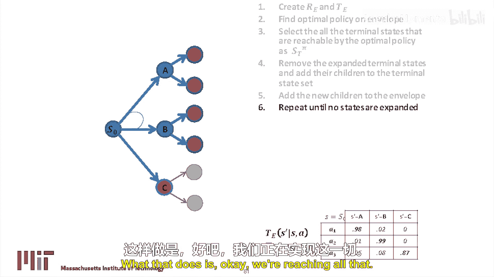

What that does is that， okay， we reach it home now。ます。

We expand those votes or we've already expanded AMB。

 so we kind of moved into the next part of the subspace that as we gain more information。

 we run value duration。Everything stand on。Steve asked a good question when we did our driver run about whether there is sort of a way to save on the computation you did prior with value iteration and at least United states。

And have we've looked at it a little bit there， I've seen some stuff but not。

 I haven't had a paper that specifically deals with， but you can imagine how。

You can imagine how you've already run value iteration on your previous iteration this。

And you add a new terminal， I just want you expanded and you run them again until it stabilizes。

 and that way you've saved the company。Having to run valuation multiple times on the drugs they basically。

So I'm trying to think of how this is different from something like enforced total climate before FF so look FF based jurisdiction。

I think。I don't know enough about that， but my kind of basic understanding says that what's useful here is kind of the。

It's this explicit always。I don't know how much that feels。And also。

 as long as your heuristic is admissible， its guaranteed optimalphality would be。能让我更快面 on这东西。

 just like A star is optimal as long as you've got to consistent。あ，大家。All right。

 so that's definitely the idea here。

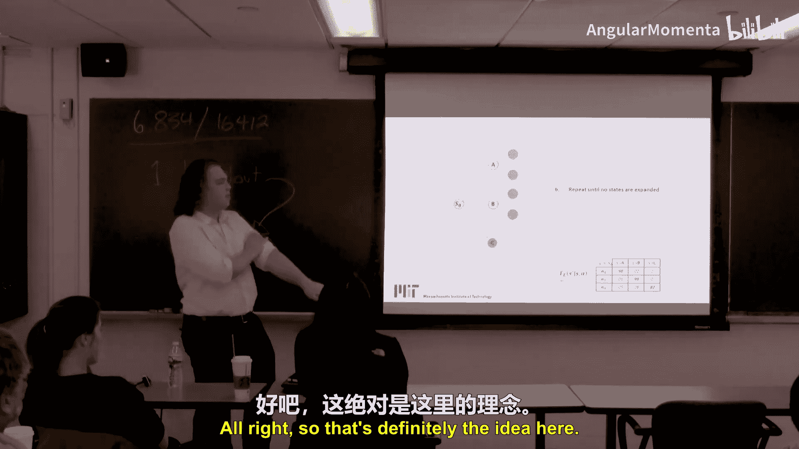

Take for。a couple these， and we only explore the portion of the state space that we'll reach using an optimal cost。

 and we do not some guaranteed that the。we'll talk about quickly kind the determination we've touched on most of this。

So， it。Most likely when there are no more states to expand when we've breach our goal。

 it's when our policy that we run on our entire envelope from value variation doesn't say that we should go to any more。

P。haven大都 haven。We would said that those are only the things that are reachable and needed。

 both reachable because for're following upal policy and needed。

Only if we might accidentally end out aism， this gives us the sense of inness that we have policy on the entire state space that we can end up in following an optimal。

AndThe third bullet here kind of touches on。We don't expand the states that are probabilistically coupled and we do accidentally end up there。

 we risk getting lost and not having a pulse。We can compute this all offline and have a plan before we even start applying。

To know exactly where we want to go。Even if our dynamics are。We come back to this。This an example。

And so we show that these real platforms can be modeled scastically。

 and then we can pretty easily deal with。Search our school space and deal with those probabilities and expand the notes that we might end up right？

And a heuristic allows us to not have to explore this area of the space space because we might never actually end up there。

 we'll always be commanding towardr 77。And as that。

 we're never going to try to prevent that but sure if there's a gust of wind and we have some probability there。

 but you can imagine that ultimately for a small portion of this because don't always be trying to correct。

To get back to the out。And with using our reward function。

 we get to determine if we want to fly a quick path or if we want to fly a safer path， for example。

 our time and times are a probability。Perhaps reduce that。

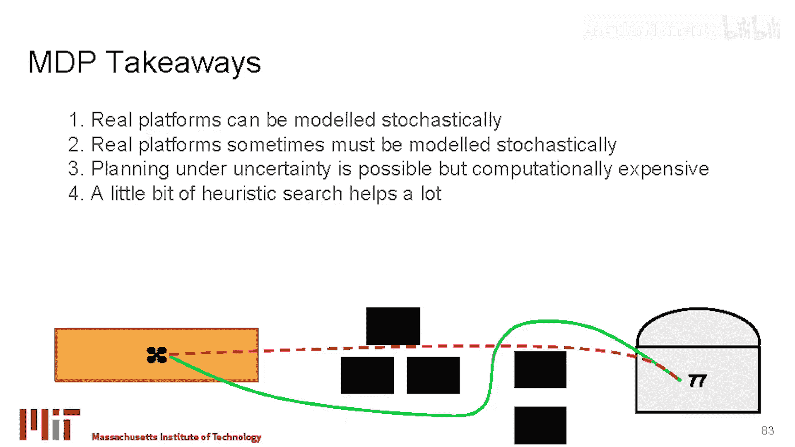

All right。Are there any questions about planning with MPs？Any like that。

I love this stuff and more questions and I get to top。Okay。はい。

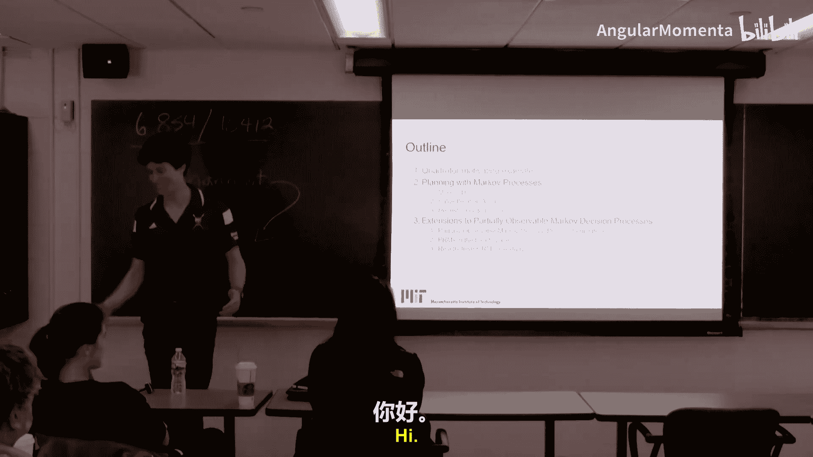

What I'm going to be talking about for the rest of this lecture is extending beyond MDVPs to a broader class problem called P VP。

Partially we observe both of our cognitive statement processes， I love this stuff。

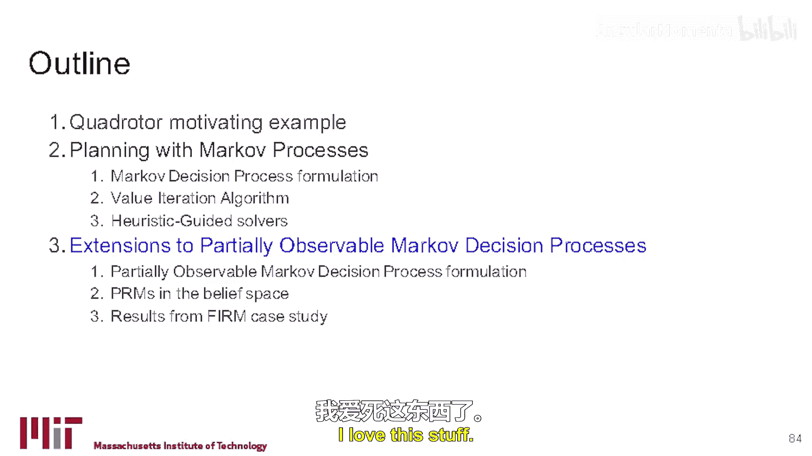

I think it's really cool， they're really fun problems。

 We're going to talk about about why they're so much harder to plan with and execute。

 but why they're important to at least know about so that you can model real world problems with。

And then we're going to delve into a case study of a specific PogiP solver。

 we're not going to go into as much detail as we did for MDPs。

 but we're going to look at what powerful results you can get by planning with PogiPs。

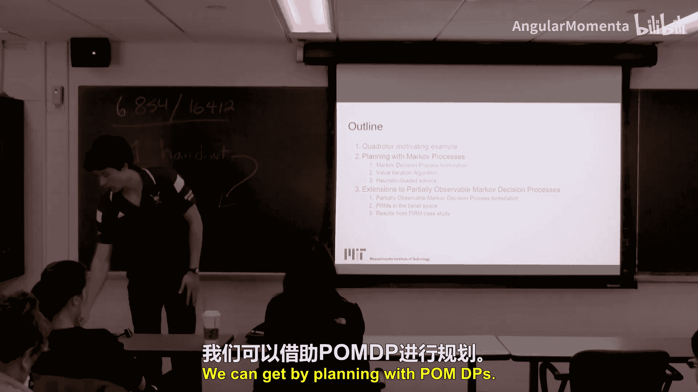

So first， I want to reframe it。In the overall。Right we had this spectrum of uncertainty in coupled with uncertainty is difficulty of planning of solving of executing a problem and we killed these first two cases that was really easy and then we just discussed the body。

安理。What I'm going to talk about is the case when both your dynamics and your sensors are sacastic。

And why is that important？It's because when we first saw this slide or our motivating example slides。

 we only saw the left hand side。We said our actions are uncertain， but good news。

 we have a perfect sensor， we have a perfect camera。But that's unrealistic。

 I think we've all to some extent experienced the fact that no sensor is totally perfect。

 your camera might have fluctuating pixel values， your laser range finder is going to never read out exactly the right number all the time。

You can have a camera in different lighting conditions that'll behave differently。

You might not be able to observe your full state that's in a way an imperfect sense right。

 if I'm in this room， I have imperfect eyes， I can't map out all of MIT's campus because I'm blocked my walls。

 how do you deal with the fact that you can't see all your obstacles all the time。

We've already talked about some cases， that there are some algorithms that could help us with that like D star light。

 but can be reason about these things probabilistic。And then finally。

 you might be in a non unique environment where you cannot resolve your state with circuitty。

 no matter how good your sensors are。Imaging you're in a building with two identical hallways。

 you're dropped off in one of them。How can you resolve can you figure out where you are unless you start exploring？

And so。We've got to deal with this uncertainty， right。

 it's part of every single problem but when observational uncertainty is small， you maybe ignore it。

 but it's there。And so we're going to formulate this as a podie。

 a partially observable Markov decision process。This next slide is just like the MVP slide， Perry。

 but important。Right。We can formulate a upon DP with seven elements and MDDP took five right。

 most of them or all of those are carried over here， we've got our set of states where we can be。

 we've got a set of actions， what we can do， we've got our transition model which says。

 given that I started in one state and then I took an action。

 what's the probability I end up somewhere else。And like David was talking about hopefully that distribution is pretty local。

 we're not teleporting all over the world。We've got a reward function。

This is exactly the same as for MBVPs and we've got our discount pack down here。一点。

Is these two elements， we've got a set of possible observations。

And a probabilistic model for the probability of making an observation。

Given your state and the action you just took。Now， it's important。

 I think it matches up really well with real road sensors having this probabilistic model。

If you have a laser range behinder， for example， and you're standing one foot away from the wall。Now。

 a perfect sensor would always say you're one foot away from the wall。

 you're one foot away from the wall， one foot away from the wall。Every single reading is constant。

But realistically， there might be gouging noise， for example， or at a more extreme case。

 it says you're one foot away from the wall， you're two feet， you're right there。

There's this distribution， and so you would ideally characterize that distribution and you plug that into this model and that formula you want。

This sounds really hairod， but if you work through just sort of a sample iteration of living in a upon the EP world。

 it's not too bad。You start at some state S， you take an action edit。With some probability。

 you're going to end up in a bunch of different states based on your transitional。At that point。

We can use the lessons we learned from MDVP La where we said we make observations。

 we reduce our uncertainty collapse into a single state， so we would say， let's take an observation。

But this time， observations aren't guaranteed to resolve all our uncertainty。

So we make an observation and that observation is probabilistic based on our current state。

And we actually we just took。And again， obviously it depends on your current state because if you're one foot away from a wall。

 hopefully you'll get a different characterization of observations than if you're 20 feet away from a wall。

 otherwise your sensor is totally useless。Are there any questions about this formulation Yeah quick question so way you'll take an observation early observation and then affect you for worse stay you're in is it just kind of a clustering problem for instance know I the multi cluster usus in the PMN？

So I mean class A， class B， class6， which your state， and taking an observation。

 there's a high probability going to care versus lower property going over there。

This is what they're trying to do for each operation over here。

 so trying to find the cross terrain in the word is this operation but to。So you could。

 I imagine implement an algorithm that where yeah， every time you make an observation you then try to say。

 all right， what's my most likely estimate or maybe my base and least cost estimate。

 but inherent with that is the risk that you're discarding a lot of information right。

 because you're going to generate a probability distribution over your state。And so yes。

 you can say I'm going to stick with the maximum likelihood estimate， but if you can。

You probably try to maintain that distribution as long as possible。Okay。

 and we'll see that this is really computationally expensive unless you start making some assumptions in the case study we're going to look into。

 that's exactly。But I've seen a lot in the literature that as much as you can。

 you want to maintain these distributions for improved a。Any other prospects？

What we're going to compare now the execution of a poverty piece to the execution of an MDD piece。

We start out， we're living in the same grid world， we've got a same transition model。

 everything's Pe treat， we take action one， we want to go north。Right。

 we have this distribution that we generate。And at this point， what did we say。

 we said we hate the fact that we have to deal with three cases， three is two too many。

 so let's make an observation to collapse this distribution。

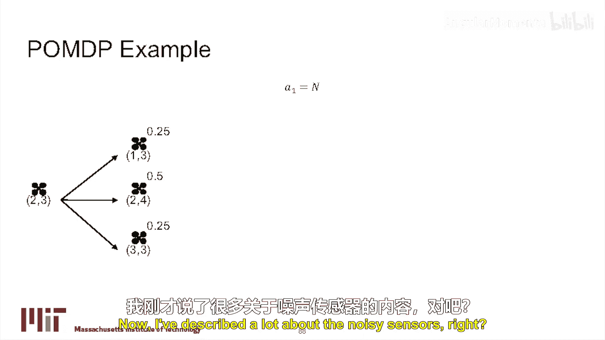

Now， I've described a lot about noisy sensors right where basically it's a true measurement plus sun noises。

 maybe Ga distribution。There's another sort of partially observable sensor you can have in a PodiP。

 which really feeds into an in partially observable。What if you can only observe part of your state？

For example， if you're living in an XY grid， maybe you can only observe your Y dimension。

This could match up in a real worldor example to a quadtor flying down a hallway。

 Catherine was working on a project on a darkRPer project with quad rotators flying down hallway。

 if the hallway is too long， your laser rangefiner isn't going to be able to determine where you are along one axis。

 but it can tell where you are along another。And so that's what I've said， I've。

 pretend this quad rottor has that sensor， it can only observe its wide component。

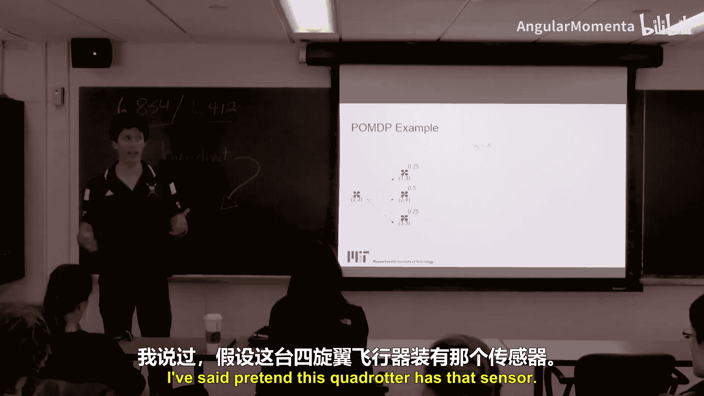

And it says my Y component is three， no idea what my next component is。Well， this sucks right。

Because we got rid of this state， but then we couldn't decide， are we at stage one3 or three free？

If there's no way of resolving this so we can renormalize。

 we can add in the effects from the observation probabilities saying maybe in fact I'm far more likely to observe state three or a y component of three if I'm at13。

 but in this case， we say it's equally likely to make that observation for those two states。

And so now we've got to deal with these two cases， and so when we take our next factor。

 instead of resetting to a single state， we've got to keep growing this tree。

And what's the key difference between this and when we were executing our MVP？

It's that we didn't manage to collapse back to a single state， we didn't manage to reset the problem。

And this is annoying because you can't execute the policy and say。

 I'm certain that this is my configuration so your policy can't map from exact states。

tracts because you never know your exact state。Is is like senseus everyone lost hope in planning right。

 yeah， just so in here because。So from the left to the right。

 you're basically mapping from one belief state to another belief state。

 that's kind of like a one arrow thing， but yeah and then from that second layer。

 you should have two arrows。One with probability 0。

5 that observes three and it gives rise to that leap data just showed and one with probability 0。5。

Where the sensor is being four because if you have noise you're probably opening a two4。

 you might as well just observe four as well as your Y So in this case。

 I mean I'm not sure if you if you were just trying to show one branch，Of of your pony deing。

But basically what you have to do is you go this to the second layer you have a branch with 0。

5 probability on either one giving you three， one giving you four。For the one that you showed。

 you get the belief state， but the other one， you get2 the state24， and probably won。

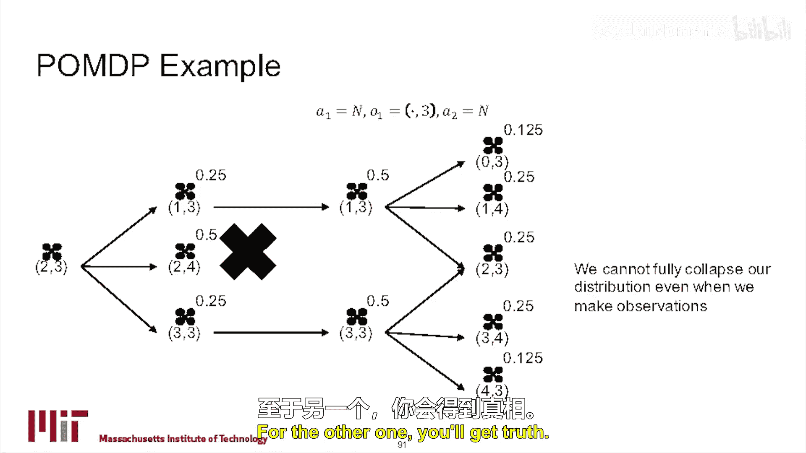

So you were perfectly describing planning right I should have made this more clear this isn't planning。

 this is execute， we have this policy that we're going to execute and so if we were planning we would have to consider all these branches and say。

 well yeah I could take like there's a 50% chance' end up here and the why value is going to report we're going to have to grow this whole thing I'm saying no this is real-time execution。

Yeah， great question。

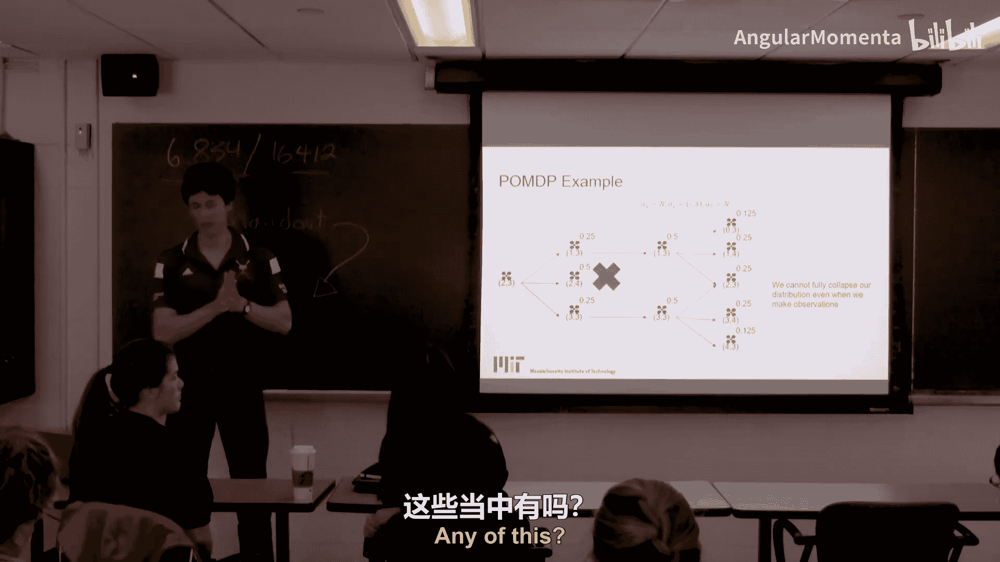

Well， this is a great time to transition to， well we can't just magically be handed these policies。

 how do we actually generate them， how do we start planning in the belief space， the belief space。

 is a space of distributions of possible configuration。

Because I'm going to talk about some sort of general classic algorithms， of。

In Palmland in the belief space plan with probabilistic roadmaps， PRMs。

The goal is to generate a policy that maps from a belief state。To an action。

 and I'm going to go into a little more later what I believe statement is。

But the general algorithm and this graphic illustrates these four steps is we're going to sample points from the configuration space。

 as if everything was deterministic。We're going to connect through those points to nearby points define nearby。

 however you want， if you can be your closest neighbors。All neighbors have a radius， whatever。

 as long as those edges don't collide with obstacles。

Once you've done that somehow and there's some magic in this。

 you're going to transform your configuration space probabilistic roadmap to a probabilistic roadmap in the belief space。

 great once you've done that you can just do shortest path depending on whatever cost function you use and what's really cool is you get different shortest paths for when you stay in the configuration space and when you go to the belief space so the green path to that bottom right。

Fig seems a lot longer than the red path， and the reason is the green path was planned in the belief space and followed a lot of landmarks that the quadator could take measurements off of。

 which was really confident about its position whereas the red path is so short。

It had a higher likelihood to a different collision。

And we're going to look into that figure more later。

I'm going to segment this algorithm into two parts， the first part is first two steps。

 it's just probabilistic roadmaps。Who here has heard about probabilistic roadmaps？Raise your hand。

5050， I'm so excited for the 50% who haven't heard。One of the top algorithms， in my opinion。

 is it's really simple and it's really powerful。Here's basically almost a complete implementation of probabilistic roadmaps。

 we'll see if goes copy paste， but it's almost there。You're going to construct the graph is' empty。

You're going to add your goal or your startk configuration and maybe the green dot and the gold can configuration from the red dot。

Then you're just going to keep sampling nodes from the free space， you say， how about two three。

You're going to add that to your graph， you're going to connect that node to a bunch of other nodes and nearby。

 and then you're just going to keep sampling， keep sampling。

Until maybe you have enough nodes or maybe until you have your complete path。

 which should be that the there。And then once you've got this whole graph。

 you can just find the shortest path among that and there's some really cool results that if you sample think in a good way and so on asymptically as you start sampling more。

 you're going to asymptotically approach the best path in a completely continuous space。

 the power of probabilistic roadmas in a bunch of randomized algorithms though。

 is that they scale pretty well to high dimensions。

 so you don't need to actually consider continuous space you can just sample a bunch。

Are there any questions about probabilistic roadmps？

They're really cool if you're interested and youve just heard about PRMs you probably haven't heard about RTs。

Those are also really cool。Yeah， question。 so for any note。

 you I want to sample and this uniform is sample the note on them， just spend choose one uniform。Un。

Sorry， when you're choosing where to place a dot or there's a dot there。

 Im decided to take expand an assemblysembling right so when I do assemblysembling I just bring business note I just uniform choose one of them around it。

Or there something。So诶。In general， probabilistic programs。

 you can throw in whatever sampler you want。The this particular one the way I implemented this is you sample points uniformly from the entire space。

 if it's inside an obstacle， you remove it。Once you place it， this was connect to the K closest。

 I think K is7 in this case， I don't know， and if there's an that edge collides with an obstacle remove it。

I'd be happy to go into more details of that。All right。But that's not enough。

Because what we described as PRMs in the configuration space。

 what what we need to do is somehow elevate a PRM from the configuration space to a belief space。

This is really hard。We don't have access right to these raw configurations。

Let's imagine we were in this really simple world where the quad rottor could be in three possible states。

 one， two， three， really， if you write， sample of bunch points， they're going to end up in one。

 two or three。You could pretty quickly cover the entire space。

But this simple configuration space was transformed to the belief space。Itcomes infinite。

 you have infinite possible distributions to consider there is the distribution where you have 100% chance probability。

 100% probability。Then during state one， 100% probability that during state two。

 100% probability here state three， and then everything in between。Right。

 we went from three to infinite。Is not voting well， and even if you start saying well。

 I'm not going to consider the whole distribution I just care about。The mean， the variance。

It's still not pretty， right？Well， this is where。This is where we have to start making approximations。

 and this is where you start getting differences in planet and Pggiep Planners。

 where they make assumptions， where they make approximations。

So these images are from the belief roadmap paper， from the robust Robics group a couple years ago。

 but I'm going to talk about a different planner soon。But。The idea。

Behind a lot of these planners is maybe we can start saying what these distributions are going to look like based on our models。

 right？To our planning problem， if we know we started23 and we know our transition distribution。

 we can start saying， well， this is my probability distribution。And then when I make an observation。

 I can build distributions off that。And so if you could exhaustively just sort of propagate these distributions forward。

 that would be great。Done real。And I just want to point in terms of the visual。

The visual way to represent these distributions， a really nice way is say in the deterministic world。

 right， you have these dots and edges in the probabilistic world。These sort of circles。

 these ellipsoids represent the uncertainty typically。

 it's like one standard deviation and three standard deviations away。

And so you can start building into the math， these sort of distributions and the variances that can see at these networks。

Are there any questions about this sort stuff？All right。

 well we're going to delve now into a specific case study。

Feedback based information state roadmaps firm， that's all only way I'm going to refer to it。

Refer to it。The idea behind this is you're going to sample mean configurations from your configuration space。

Then。You want to build an LQR that's linear quadratic regulator controller around these mean points。

And that will generate what variant you can tolerate， right so LQR controllers， if you don't know。

 they're really nice， they around in a small region， around a point， they can drive a quager。

 for example， to that configuration。And so if you build these LQR controllers around points。

 you can say， all right， anytime I end up in this cloud， right？This cloud in the belief space。

 so any sort of distribution， I can bring it back to that mean。

And so now what we've done is we've generated every point， we just need to connect them。

 and the idea is if you have a feedback controller。明白 based。

They can get from one cloud to another anywhere in the clouds， then you can get from point to point。

All right， this is how you generate the graph and what's cool is the way they formulated the problem is I said。

 well， to set up the cost of executing an edge， we switch from rewards to costs because we're pessimisticists now。

 hey， well the cost is going to be a linear combination。Of the expected time to execute that act。

And the uncertainty along that edge。Now this is actually really cool to play with。

What do you think would happen if I set beta to zero？有。Like what sort of mixture would you get？

I will cold call because I know a few names here。なかで。

Sure we don't want to quote call someone in my room。You're going to get a short respect。

Shortest path， that's right， right， this term goes away。Because cost is a function of the time。

Toorge cotton now what's cool is one day I was messing around with this code。

 I'm like I wonder what happens if I said alpha is zero？So cost is purely a function of uncertainty。

 turns out what the quadinator does is it just hangs out where it starts he says。I'm in no hurry。

 I know where I am， I'm just going to stay here。And so you know like but I find this amazing right because this almost models behavior。

 you can start saying like do I want to be a risky quadra or a safe one。

 like how important is it for me to get somewhere on time or you know be safe and it's just those two parameters。

Or you could even make it one like out value and one minus alpha。I think this stuff is really cool。

All right， the one detail that I'm really going to go into for firm is the cost equipment。

 which is based on the Belman backup equation that we had。The cost to go， right。

 the expected cost from a belief state。啊了咁都。Is well。

 you're going to take the best action so you're going to take the mid of this whole thing。

You're going to say it's the cost。Of executing a specific action。Plus。

 the cost of colliding with something， an obstacle times the probability of colliding。

That's this term。等等。You've got to say， well， okay， and then once I reach the state。

 what's the cost from there and then I should weight that by the probability of ending up the。

Does this equation make sense to people？Like there are a lot of symbols and honestly a hate notation。

 but it works， you just plug it because the cost is I'm going to take the best action。

 it's going to be the cost of using that action， the cost of colliding times the probability of colliding。

 given that I use that action。And I started where I started， and then the cost from where I am met。😔。

And since you end up， enough probability is to be right， you need to consider all those cases。

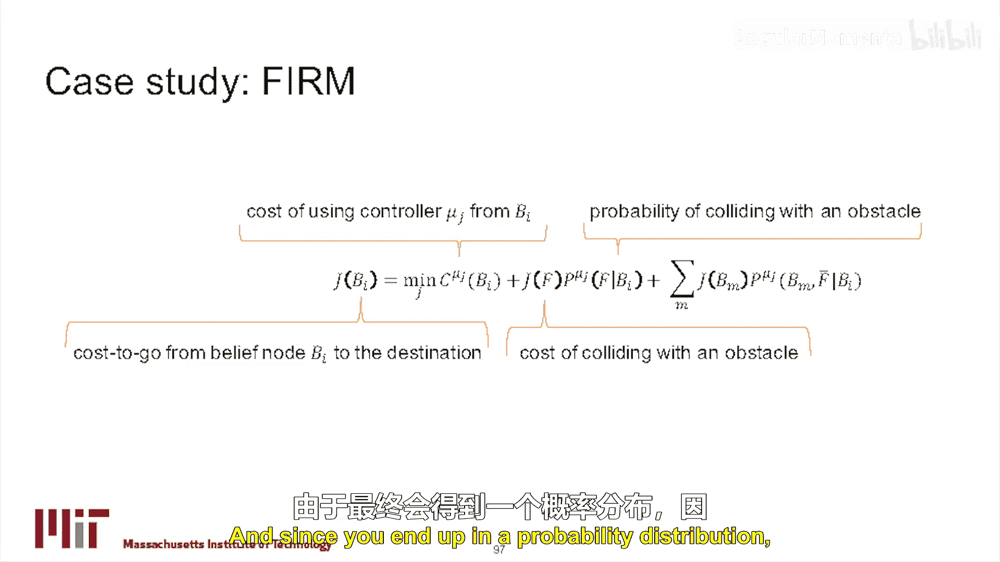

When you define like an action from one place or another。

 you always think of it as starting from the mean that you've sampled or from anywhere in there。

So it's the formally it was from the belief state， which is the mean plus， yeah。

 the variance once it's stabilized to that point。And the way that variance is generated。

 I should have said， is you're going to have models of these quad rots。

 and so you can I spent a good time in the ACL with John Howwell or 16。

 and you just let the quadtor hover， you measure its position for a long time and you get a distribution over where it goes。

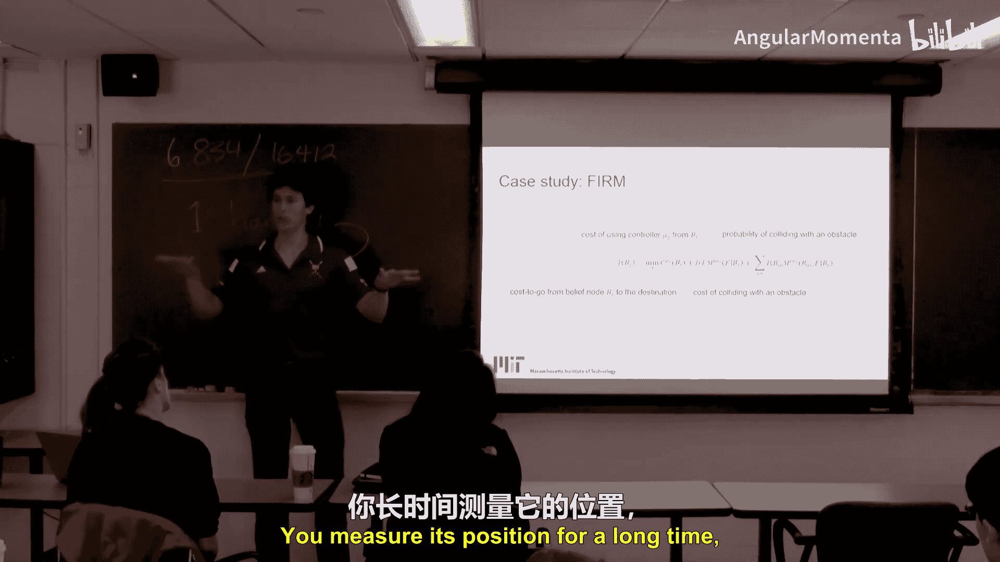

This isね I accident。What is the letter M right， so you're summing over。

 these are the belief states that you could end up in。So if everything were deterministic。

 this would just be ignored to some， it's where you end up。Realistically。

 you could end up in some other statement。すれ。Just refresh so。

we're operating on conciena space and you have coninas observations， so those。

A sums over the observation samples that I generated when so that is a finite sum over the possible infinite observation space you might have Yeah。

 so there's definitelyurg in terms of。Where you could end up and even the action space。

 there's a set of feedback and that you're allowed， I think the observation。

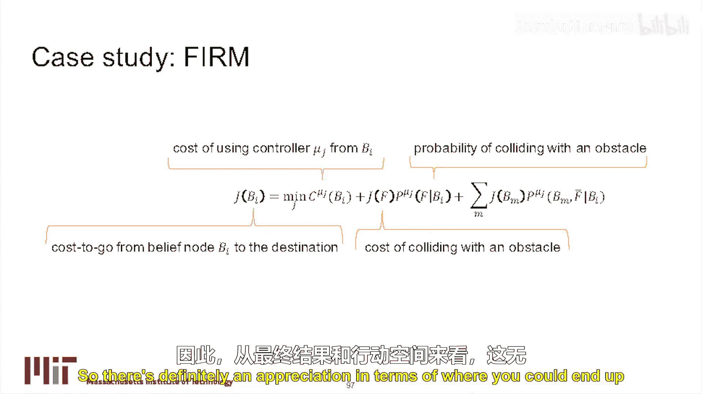

If you model it as like Gausian， you made some nice assumptions。

continuous I just want so if you start So if you start with Gaussian noise and you have a linear model。

 then your prediction is going to be Gausian but then if you have Gausian observations which is great because your update is Gausian but the observation space is infinite so basically not only have to sample position but you also have to sample potential observations that you might get as you go along so that you can basically would but basically it's great but you would be basically reducing a possible infinite。

Branching， which is your Gaussian to kind of likemark more caral research up you generate a whole bunch of meaningful symbols。

Those are the ones consider so is that where the some coming and the fun fact the theorem that I read and trusted was that if you just sample randomly right from your configuration space。

 you have zero probability of constructing a graph that without any assumptions will be connected。

 whereas for PRMs right you sample enough。Things have turn out nicely。

 not the case in the beliefs state， that's why we need to make these assumptions。

Okay we're killing it， we know Po thes， now we get to look at some really fun graphics generated from real flights。

Using firm。

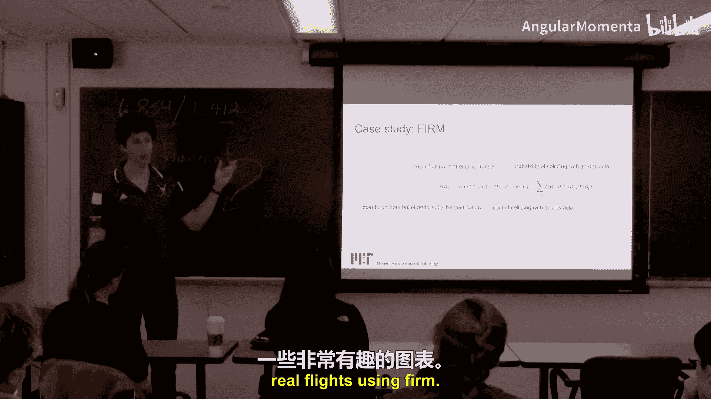

Okay。The big takeaway is that firm prefers safer patents。

We've got two images that look really similar， we'm going to talk about one and then show why they're slightly different。

The test flight that we put this quadruver under was we said we're going to start at this configuration。

 we're going to go to this configuration。And there's this big blue obstacle。

And there are landmarks that you can take measurements of because those are these red dots。

We want to compare two planners， right， a PRM。And a firm planner。The PRM fanner said， right。

 I just want to minimize time， and so we kind of the shortest path is stay to the left of the obstacle。

But that's actually a really narrow path between the obstaclester and the wall。On the other hand。

 the firm planner said I want to minimize the linear combination。of time and uncertainty。

 and so if you ramp up the term the weight for uncertainty。

 at some point the path sort of hops over the obstacle， it's really cool it snaps。

And then you get this safer path， but that's longer。And how do we know it's safer？

Because these ellipoids that we've drawn。Are the 3D versions of what we saw for the PRM elevated for the belief space version？

It's the uncertainty that the quadrutor has over its true state。Why is the PRM planner。

 why does it have such big electrodes， its because when it's behind the obstacle it can't make any of these measurements。

Because it can't see the landmarks， so it's basically using dead reckoning and the transition model right is non deterministic。

 so as uncertainty grows。And so we can see these ellipsoids are bigger for PRM than firm。

And then the reason I have two images is they are slightly different， it's that these landmarks were。

Fictitious landmarks that we just said and we would generate fake measurements off of them。

 and so we could tune the noise of the landmarks， maybe a little bit of p。

 but it allowed us to say when we increased the noise from some dimension was number 。05 to 0。15。

You can see the uncertainty ellipsoids for PRN grow。When we increase the noise。

 whereas referringring they stay about the same。And importantly。

 these  ellipsoids grow enough that they start overlapping with the obstacle。

That represents a very high probability of collision。Whereas for firm。

 the way it managed to keep these electrodes so small is protect the cost function the weight of uncertainty。

 same way all the time， but the uncertainty was so much higher and so it would decide。

 well I can sacrifice a little bit of time I can take a slower path I can just hang out by a landmark really make sure I know where I am before continuing and so path the duration of the flight took a lot longer for firm as time would increase but the uncertainty would stay about constant。

Do people understand these graphics？Great。All right。

We've got a graph that just represents a little more formally that growing uncertainty as noise increases。

The variance along a single dimension， Z， Y and x， for PRM， which is that and firm。

The variance for PRM is always higher and it grows， for firm， it's lower。

 and it stays about constant。That's the big takeaway。The firm minimizes this uncertainty。能的。

finalal image from these results that I want to show is in simulation， they said， well。

 let's actually measure how often it crashes， we didn't want to do this in the real world。

You don't want to craft your quad under that many times。

 the kiss of it is comparing a reactive planner and a deterministic one。Crackpy as noise increases。

 noise was simulated with wind strength。The number of crashes increases for PRF basically and for firm。

 it stays constant and low， the reason there are two planners。

 there are two lines is there were two planners with different time horizons。

The important thing is firm is low and constant hereM growth。Allright。We've talked now。

Throughout all probabilistic planning you ever need to know， right， now， not'm quite。

 but we have covered a lot of stuff。What are the big takeaways。

 we've learned that real world problems are surpaive。

 right quadruators are not these perfect machines that we wish they were。

But it's important to model them as srcastic。The problem is once you start modeling them astoastic。

It becomes a lot harder to solve。But if you make some assumptions where even if you don't。

 if you're just smart， then you use heuristic。You can resolve this complexity。

And so I hope you remember these three points， you remember like this graphic or that graphic。

 the idea that if you take uncertainty into account you can have fundamentally different paths in both things。

 then that can be a good thing。What questions do you have and if you yeah two so far think people have 50% on the IRA problems so how do you？

You could already argue something into your fur。 So for instance， you know we suggest， okay。

 this is the maximum amount。Is it possible to integrate our constraintstrain into your own message and problem and solve it or the same it？

So， I imagine。One thing that I would like to test is if we go back to our。Right。です。

Really crude version。A cost equation。You can imagine saying like if you want to come up with a ballot。

For uncertainty that we can tolerate， you could imagine maybe like setting the intercept for this to be that bound and then just ramping this up。

I see me multiqui and software elements something like that。 Yeah， exactly。

 So it only comes into effect。はい。Possibly what I said is a terrible idea。

 you know think it's especially in simulation， you can just try it out。

And just another question but said you know probablyag the probabilityag the distribution on the networks so hard。

 I don't going to get it because you have a state ABCs it discrete great。

 so it's more like a ma normalmal distribution。So therefore you can assume like a de barrier and then in a di barrier and material with normal distribution they are counter between each other。

 therefore you can by adding to an observation and then updating the barrier from post distribution。

Sure， so。I think that might be making some assumptions that you might not be willing to make about the nature of the distribution that you're trying to propagate。

 I'd need to think about this some more。But I think intuitively。

 we can understand that anytime you're propagating a distribution versus a single discrete value。

Definitely not going to be easier。As。Your distributions become more complex。

 perhaps if you're modeling a real world stochsastic sensor。

 you might not be able to perform these efficient updates using conjugate priorities things like that。

Any other questions otherwise we yeah， so all these firm examples are showing this is all playing down off on。

Therere in this offline and have you expanded this at all into like an online case recruit that all require replanning and right？

It's not good， I can tell you that much， but nice is firmerm generates a policy。

 so if you construct your PRM to say don't just find the shortest path。

 like keep sampling points until you're confident that you're always going to end up near some point。

You can construct a policy and then just online， look up。Whats my belief that matches most closely？嗯。

It took for， I think we sampled。600 nodes in a what are the？To my team's on this， so two。

 it's a three meter by eight by three meter thing。It took about 15 minutes， it was really slow。

 granted it was a virtual machine。But it's not something you want to replan on the flight with Pm。

Typically a lot faster， good wins a lot faster。

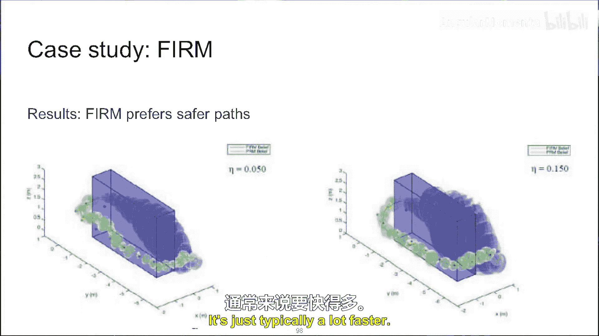

So when we just did PRM， I think it was one minute or something。

At least in order of magnitude you could。You could use other planners as well， like RTs。

 and there are RTs。There are pumping keepers for our teams that have。All right。

 I'm going to turn it over to Steve so we can learn about this project。とた。さ。

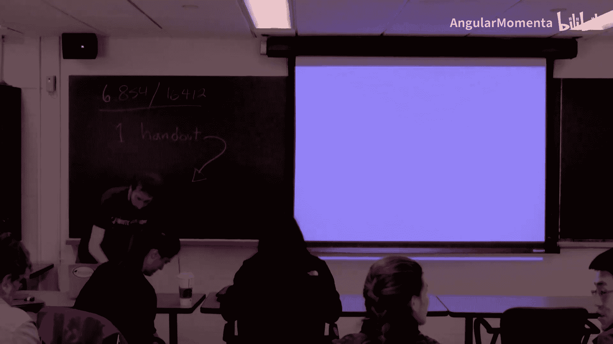

这。ど。好嘞。OkayI'm just going to say a few quick words about the grand challengellenge。

 so the final again the final assignment will be released tonight for this and as Professor Warrens mentioned。

 it's going to be decopted from what we originally had in the syllabus due to time and phase。

 but here's a preview of what you'll be doing。So for an overview it will be a class wide collaboration so what we're going to do you guys are going to stay in your advanced lecture teams and each basically apply what you've done。

 the great work we've done on that onto our hardware robot that we have so it's not a competition where each team will be competing against each other and so again when we're telescoing the syllabus originally said 20% of your grade is probably going to be more like 10 or 15%。

So this is the robot you guys are using， it's called an Xware robot。

 usually it has sort of a robotic arm on it， but we're actually not going to be using it for this fetch stuff。

Face made by a company from Spain about an exical robot。

 one cool thing about it is that it's actually onni directionional。

So there are wheels on your wheels here， what that means that you can drive sideways， left and right。

 but being parallel parking your car very easy we're not going to be driving it probably this fast because it's actually super heavy and we don't want anyone to yeah。

 we forgot to screw in。Wecr in in competition。But it's a pretty fun robot so you guys should be working on this。

嗯。And so the actual challenge itself， as we've mentioned many times throughout this class。

 will be a modified orientering challenge， so there's going to be a few different challenge stations that you have to subscribe to。

And at those stations there'll be small computational challenges and those computational challenges will be a subset of the advanced lecture teams。

 not all of them， and the goal is to complete as many of of those as you can and try and sort of do that as quickly as possible。

 and it's also going to be held indoors in our lab space where we just showed you so that way for grains。

 we can still have the grand challenge at the end of the semester。So。

This is sort of how it's set up as of last night， actually。

 so basically as a robot to be able to drive around a small little Lego maze that we've set up and there's going to be sort of different things that you have to do with the different places。

So what are you actually going to be doing， what assignment are you guys going to be doing well it's actually a little flexible since each of you did different things for your advanced lectures。

 you're all you know each team is going to have a bit of a different assignment applying it to this I have some proposed ideas that I'm going to talk about in the next slide here。

Like the big thing is that these are just ideas you guys have a lot of flexibility in this。

 you can talk to you'll be probably working with the COTs a lot to have access that to the robot。

 you know we can arrange extra office hours for you guys to come use the hardware to test things。

 so we'll be arranging all of that things and sort of on an as needed basis if you want to basically you know it'll sort of depend on your team。

And the people will be hoping to over you me and Tiago who gave an lecture earlier in the semester and possibly also a few other people from our lab will be the main contact points for it。

So of course I should go without saying but all the team members should contribute equally within your team。

 so it'll be a little bit maybe less structured than an advanced lecture。

 but just make sure that everyone is contributing equally for the assignment。嗯。

And it's going to involve using this thing called the robot operating system or Ros。

 which is basically a software for framework for communicating and it's used a lot in robotics。

 it's a quick show of hands how many of you have used Ros before oh wow so a lot of have you used Ross。

 how many have heard of Ross if's not used it so okay so a lot of people so that's a good starting point。

So here are these the proposed the tasks for each group and of course all of these are up for change if you guys want to change this let me know you know basically so some of the groups it's very clear how it would immediately apply to the grand challenge so incremental path planning well we have a mobile robot so maybe we can actually put that on the robot and get it to change your plan if something gets in the way the semantic localization group obviously very applicable to the grand challenge you know you need to know where you are so the robot that we have now can actually do normal metric localization so we can sort of know where it is but what would be interesting to see is compare the semantic localizations to that one。

But how would you do setic localization， well， we can use a camera and you can use the visual learning through the visual classification through deep learning group。

So I think these two groups would have a really nice synergy and a really cool way to work together so the MCTS group very cool but I had a little trouble thinking about exactly how that would apply so maybe you look like you have an idea maybe so I clarify all these are separate runs of the robot so we're actually probably going to run all of them and like so this would be probably one run of the robot we're going to decouple these so that if one or a subset of these don't work super well。

 the other groups will still be able to run so carefully planning now too。So the MCCPSS group。

 I was thinking maybe could solve， that could be a really nice way to one of those computational challenges。

 maybe you have to play against a human and if it wins great。

 you can go faster and you get more points so you could implement it on a different game other than connect4 or possibly and sort of wrap it around Ro to call it that。

The reachability group， I think would also be a great place to do at one of these challenge stations so we could give you guys sort of a puzzle。

 say maybe sort some sort of maze like state space and you have to see could you even reach the goal there and if you get the answer right well you can move on to the next stage or get more points or something like that。

But think again these are the suggestions， so for example， I can do the reachability for it。Yeah。

 so if you guys have other suggestions on how to implement your team stuff into the band challengellenge。

 definitely send me an email preferably today or as soon as you think of these things and we can we change。

 these are just suggestions from right now。The last two are sort of more planning related。

 so planning with temporal logic， which was Monday's lecture。

I thought would be a cool way to sort of control the robot's high level action。

 so maybe that could involve modeling our grand challenge with PDDL and maybe with linear term logic goals。

 model as a beauty e， then you could compile that and call a pleasure on it and execute that plan on the actual robot be should following the high levell actions of the robot that's a possibility and for today's group。

The In Horizon Probil planning maybe you know you could do something actually sort of similar but instead of modeling the domain as PDDDL。

 model it as an MDP and solve it with LAAO Star and get sort of a policy on how to control the robot maybe we can change it a little bit to certain squares can be more risky than others or so on so again there flexibility and all of these here so these are just some of the suggestions does anyone have any questions before we this is all I have so anyone have any questions。

か。嗯。So it's basically up to you guys really to divide up the work amongst yourselves。

 it's really different for every team was developing。Right yeah。

 each cheap developing in their own separate package for for example， these two teams。

 there's probably going to be a common interface where the output of this one goes to the input of that one so for that one we're going to give you sort of the interface naming a Ros message time package for that but other than that if you're providing up the work you guys are really on your own。

Soは。Your players is looking integration if you're trying to get in all the pieces that the group is doing to the heads。

系 we睇。Thing that uses software engineering skills， not kind the skills that' using here。

 it can be really unpleasant to do it can take a lot of time so we don't want。It great so that's why。

喂呢个。If not what we want you to do is to be able to gain your own capability， every know。

if you guys choose to integrate with other needs because you are really excited by that and because it looks like there are people are today。

このにす。Then that's purely your。确。Any more。Okay诶。

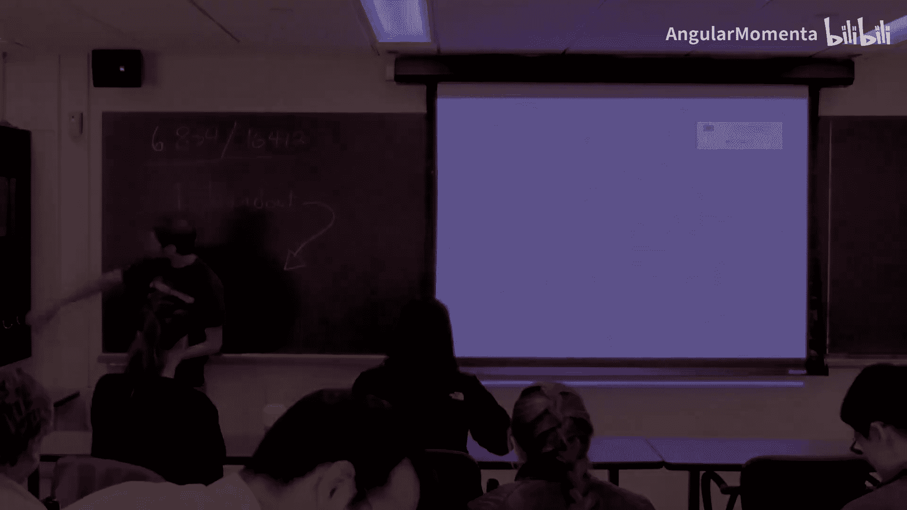