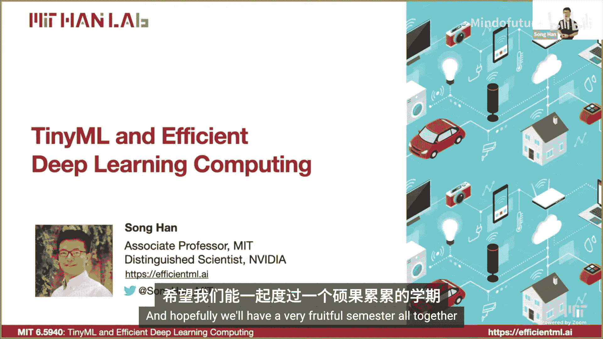
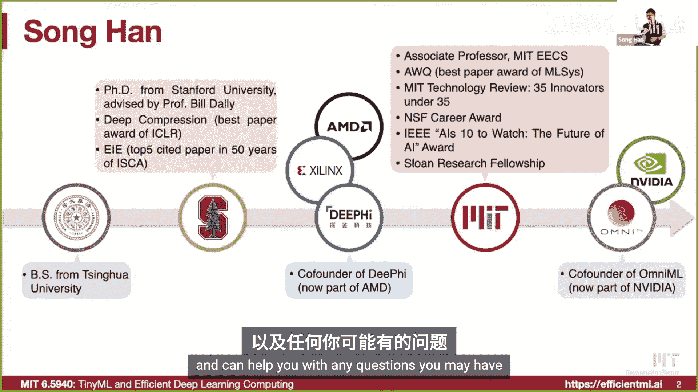
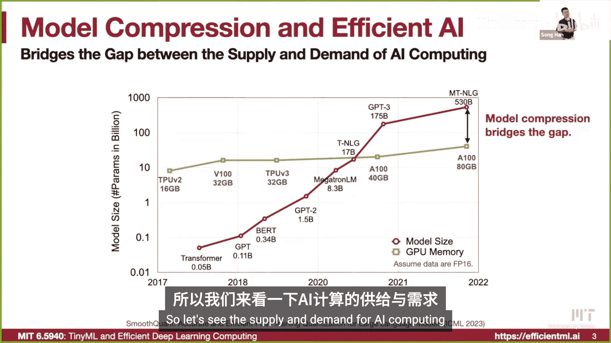

# 【麻省理工】高效机器学习 MIT 6.5940 EfficientML 2024 年秋季 p02 P02 Lecture 1 - Introduction -BV1o7jzzwEST_p2-

Welcome to tiny ML and E deep learning computinging，2024， and'm Professor Song Han。

 very glad to teach this class again。 This is the third time we offer this class。

 We're going to learn efficient deep learning computing， how to make neural networks run faster。

 train it faster and influence faster。I remember two years ago when we first opened this course。

 only 30 students last year it was。90 this year is more than 200。 so welcome all。

 I'm very glad to have you all here and hopefully we'll have a very fruitful semester altogether。

So this is a brief introduction of myself， I graduated from Jinghua University and got my PhD from Stanford with professor Bill Daddy。

 I worked on model compression and efficientffient deep learning computing during my PhD。

 published a deep compression paper which set the foundation for modern neural network acceleration compression and published a paper called Effient inference engine which is actually a top five excited paper in 50 years of ESAP。

During my PhDI co foundunded a startup called DI T for Eicient Air chip。

 which was later acquired by zings and later zings is acquired by AMD。

 that's a very popular story in Cityticon Valley。So in this course we will teach some of the how to make sure the research is very fundamental。

 not only fundamental， but also practical。So I joined MIT about six years ago。

 a very exciting journey we've been working on from tiny ML to large language model。

 acceleration and compression。One of the most exciting paper we did in the past few years is the AWQ for large language model quantization。

 which got the best paper award M O and also is having already more than  six million downloads and hug phase。

 So if you want to deploy a large language model， make it four times smaller than AWQ is the technique to go。

 And we will learn that in this lecture。 you're going implement that not only implement that。

 but also deploy a large language model locally on your laptop。Which is will be pretty exciting。

So at MIT I also formed on a startup called OmniML working on efficient independent computing model optimizations。

 so in this lecture we'll learn all the secret sources from those two startups so those five homework will be very very helpful if you learn the mastery the model。

So we very carefully created five assignments by five homeworks， they're all hands on homeworks。

 so we try to for you guys use the minimum effort to learn the most amount of knowledge。

 the best to utilize our time， so please do those homework very well。Yeah。

 we'll have five labs and each TA will be responsible for one of them and we have office hours every Tuesday and Thursday and feel free to come to our office and can help you with any questions you may have。

Okay let's start by motivating why do we need efficient deeper computing so let's see the supply and demand for airI computing this chart shows according throughout different years the model size of larger language model in red versus the GPU memory in green。

we can see the large language model size grow from 0。05 billion，5 billion parameters。

 the initial transformer in 2018，20172018 to about 1。5 billion parameter in GB2， roughly in 2019。

2020。And recently， there is even trading parameter models being trained in the world。

 right is growing super fast， even much faster than the amount of GPU memories that is available in the single GPU。

 right， which is showing showing green。😊，So this big gap， the gap is getting larger， actually。

 with recent years。 And if you see the supply and demand curve that is driving up the price， right。

 making deep learning super expensive to train， super expensive to serve right So we are going to learn techniques to bridge the gap using efficient model compression techniques so that we can improve the utilization of the hardware and also reduce the models size。

 memory requirement， computation requirement to bridge this gap。

So rather than a train a model and directly run inference on the top。

 we now can train a model compress it before deploying the compressed model for inference。

So in recent years， the amount of publications in model compression and acceleration and uncompressed。

 the sparse model is。Getting a lot faster number of publications is increasing very fast in recent years。

 and we are going to learn these techniques。 How do we utilize compression and sparsity to accelerate neural network inference。

So。In this lecture， we are going to start with three sections from vision to language to multiple modalities。

To understand that the computation demand。Of this AI workload and see where we are among the frontier。

 So let's start with region tasks。So talking about computer vision。

 we have to mention imagenet and also Alexnet， right， So Alexnet， this is actually the image net。

error rate， which is decreasing across the years。 And if you can see carefully in 2012。

 that's the year where we have the biggest improvement。

 that is actually the year when I started my PhD at Stanford where Alex and I just came and just so amazingly along the way。

 a lot of the traditional techniques and later throughout the years。

 the accuracy is just decreasing and decreasing even surpassing the human performance。

 which is the last bar。So it is really the big data and compute and algorithm that is driving up the performance。

Of these workloads。But that is no free lunch， as we can see in this figure， the X axis is the max。

 the model of computation。 We are going to learn what is a Mac in detail in the next lecture。

And why axis is the accuracy。 We can see a trend。 the higher accuracy want actually。

 the larger the amount of compute that needs to be through to run the inference， right。

 and the larger the circle means the larger the model size。

 which means the accuracy doesn't come at free as a free lunch。But you need through a lot of memory。

 a lot of compute to achieve such memory and such accuracy。

And what we are going to learn in this lecture is to push the frontier okay。

 to reduce the amount of computation， but doesn't sacrifice the accuracy or even increase the accuracy。

 We can drastically reduce the amount of max to the left corner。

To the left corner and then maintain even higher accuracy by neural architecture search techniques。

 which we are going to learn in a few months。And such amazing efficient AI techniques enable running these deep neural networkss locally on the edge。

 For example， running on the phone。 we can tag our photos， For example， summer。

 the trips dining different locations， lakes， cliff geyers right and also can do people recognition locally on the phone on the right hand side is our from our lab to do on device pose estimation。

 everything is running locally。 You don't have to worry about your data get transmitted to the cloud。

And we are going to learn those techniques。Not only on mobile phones。

 but we can even shrink the model such that we can deploy them on I O T devices。

 even smaller microconts。 That is only a couple of dollars。 They are much， smaller， much cheaper。

 but in the meantime is more challenging because we have to make sure the model is small enough。

So that it can fit a microcontroller。 and the inference library is efficient enough so that it can run different workload。

 not only classification， but also detection， like phase and mask detection in person detection。

 This project was done during Covid。 So we are showing this demo using a microcontroller with only 2。

56 k of memory。 We can detect phases with mask or without a mask。Not only on device inference。

 but also we are going to teach on device training。

So AI systems need to continuously adapt to new data collected from the sensors。

 we want to process this new data locally on device so that we can have better privacy。

 lower the cost， enable customization and also enable lifelong learning okay。

But training is much more expensive than inference。 And why is that。

We have to store those intermediate activations。 We have to calculate the gradient。

 We have to do the back propagation， etc cetera。 right， So it's even harder to fit for edge hardware。

In this lecture， we are going to also learn those on deviceized training techniques that can drastically reduce the amount of memory。

For example， in this project called on device training under 256 kiloby of memory published two years ago。

 we can reduce the training cost from a few hundred mebyte to only 141 kiloby。

 That's three order of magnitude saving by using quantization。

 wire skating sparse update and tiny training engine。

 and we are going to dive deeper into such topic in about two months。And with that technique。

 we can have a demo here of on device training under 256 kiloby of memory。

 iss running on the open am cam microcontroller right here。

 We attach two buttons with with it to input a class and we have a green class indicating there's no person。

 We have a red class red button indicating there is person。So initially。

 the model is didn't have any training for these two classes。 so it's。

The classification result is wrong。 You can see the top right corner。 See。

 there is a red of green showing on the top right corner of the screen。Before twinning。

 it cannot recognize distinguished person versus no person。

And then we apply on device training to press the button green for no person， read for person。

To manually input few labels。And the back propagation is done locally on the device。

And we have to do a couple of iterations。And then let's see the classification result。

No person in red， no person in green。And classify them perfectly。And there's no wfi。

 there's no Internet， Everything just done locally on this microcont。快顺序。they要那。Vi what repeat it。不是。

都就是实几了。嗯。And that's why we are showing later using a real world setting。

 the last in the real world setting， we're showing it's not overfiing。Prompttable image segmentation。

 right So let's talk about another interesting stuff segmentment， anything。 right。

 So this is demo from Matt， where you can have a prompt dot。

And then you can segment whatever you are looking at， for example， here， looking at the person。

 and the person will be segmented。But this is very computationally heavy。Previous。

 people store those features， extract the features， store them offline。

 and then only run the head on the browser。But one technique we introduce in this lecture。

 Eff VIT can actually reduce。Imrov the throughput by 48 times more than an order of magnitude faster with even higher accuracy on this chart。

448 times speed up on a 100 GPU。So here is showing before the acceleration and after the acceleration。

 So before the acceleration on the first row， the model is running at only 11 images per second。

 And after using efficient VIT Sam， we can accelerate it to 182 images per second。😊。

So zero hardware investment， just using existing hardware and making the model much more efficient。

 we can make the quality match， because exactly with the baseline model。

 but make it run a lot faster。 And this is done by Zoyang。

 who made this project even before joining MI I T， which is pretty amazing project。😊，So no so far。

 we introduced the discriminative models。 So as the algorithm of advancement。

 people design these generative models that can not only recognize images。

 but also generate new images。 right， So these are several examples like tidy bears， a bowl of soup。

 a photo of astronaut riding a horse on the Mars。So diffusion models can create realistic images from natural language description。

 and we are going to learn how diffusion models work。 in order to accelerate it。

 we want to first understand how diffusion model works。

But such amazing property come at very heavy accounts at very heavy import cost。

So the training stable inffusion cost 606000006 a 100s，150 K GPU hours， which is pretty expensive。

And this is a figure generated by Mu Yang， showing that this image or video generation model is is actually much more expensive。

 like three times more expensive， just running a single step of the diffusion model on a 1 k to generate a 1 k by 1 k image。

Not to mention the videos， which is the red bar，5。6 billion parameter model to generate a video。

 not not even 1 k， but it's just 400480 by 720。Genrate 49 frames just a few seconds with a single diffusion step。

 It takes nine times more flops。 So it's very expensive。

To run these image or video generation models okay。And also， as the resolution grows。

 the amount of compute also grows quadraly with the resolution。

So that's a big problem we want to solve。We did a couple of projects we' are going to introduce in this lecture。

 such as the gun compression。 We can reduce the computation by 21 to 9 times。

And this is before compression after compression， turning a horse into a zebra previously is' running about 12 frames per second。

 Now we can run 40 frames per second。 We' are going to introduce techniques to achieve that。And also。

 using this any cost again technique。 For example， previously， we want to do photo editing。

 For example， make the lady smile。 It takes quite a while or make her look younger。

 We can just turn the sliding bar to the right。 But first， projecting the image to the hidden space。

It takes quite a while。 What we did and we're going to introduce is first train this once for all network。

 just a super network that contain many different subnet。 So during the editing phase。

 we can use a smaller sub network running at low cost or fast prototyping。 And finally。

 when we are satisfied with the result， we can run the large sub network only once。 And as a result。

 you can see you can make a smile almost instantly。Or make her look younger。

 We can slide the second bar to the right。 change the hair color is almost instant。 Okay。

 by running this using this once small technique， we can derive many different sub networks very quickly。

Okay， and using this one for technique， we can reduce the computation showing this yellow bar from 100%。

78%，50%，30%， even 19%。 But you can hardly tell the quality Qua， the quality is still well maintained。

 despite that we are reducing the max by up to five times。

This is not a technique we' are going to introduce later in the later part of this lecture to accelerate image a generation when we are doing the photo editing。

 So here we are doing image in painting what is in painting out painting in painting is basically saying that we have a part of the image。

 say the black part in the rectangle we want to add a horse to that photograph of a horse and a grassland and initially stable diffusion takes like 1855 max causinging 369 meiseconds and after the compression acceleration。

 we can make it right only 514 gigga max at a 95 milliseconds。

Similar on the right hand side to generate add a coconut tree to the image。

 we can accelerate it by 4。8 times。Since previous methods， you need to generate all the pixels。

 even though you're only editing a part of that。But with the the s method， we can do spars as update。

 only update where youre gonna only update the pixels。

 only generate the pixels that needs to be updated。 and the the remaining pixels remains the same。

We are also going to introduce how to accelerate image generation by parallel parallel processing。

So with four GPs， okay， can we generate even larger images even faster。Originally with one GPU。

 it takes about 12 seconds。 right a natural thought would be if we have four GPUs， can we use like3。

3 seconds， four times faster。Unfortunately， naively doing this will introduce。

The artifact with a duplication using four GPUs is actually generated four distinct images。

The reason is that these four GPUs didn't communicate with each other。 And as a result。

 they each generated an independent image。But communication will lead to the networking latency。

 right， And the way we deal with that is to overlap the computation with the networking。

 such that we can use a sta step to communicate the sta input。To the next step。

 we are going to learn that in detail in the later part of this lecture， this is just for motivation。

 And as a result， we can generate on the right column， the image that is three times faster。

 but the quality is very well maintained。Also， people are interested， customize image customization。

 right create a personalized images based on user specified input。 for example。

 we want to generate something like Song Han riding a horse。

 but it doesn't look like me riding a horse。 right It's very generic。

So we are going to introduce techniques like FAA composer， which from Guo Quam。

A training free method that can blend different people together。 Like here。

 we can have Johnson and Lady Gaga sing together。And this efficient image generation has a lot of applications。

 This is just mo why we need to learn these techniques。 like on the iPad。

 we can hand draw a a picture。 And then after a while， you see take several seconds。

 We want it to be faster and to immediately render a very good looking image。

 and we hope such method can run locally on the edge device。Not only image generation。

 but also 3D generation。 That's also a very hot topic and require a lot of compute。

 So this is diffusion models creating 3D objects from a reference the image to the first row is the reference image。

 and the later rows are the generated the 3D object based on just one image。

And this is using text prompt， using natural language as an input and create the 3D objects。Oh。

And also， video generation， that's adding another degree of freedom， they are pretty big。

It's even harder task requiring much， much larger model size。

And this is from last year and this year。 So is there。 So it's pretty exciting。

 just give a text to prompt a stylish woman walking down the Tokyo Street and then is generating high resolution photo really。

 realistic videos from natural language description。 But again。

 this is consuming a huge amount of compute。😊，And we are going to learn techniques to bring down such tech such computation。

And so far， we talk a lot about 2D vision， right， but in reality，3D vision is also very exciting。

 like autonomous driving， self driving cars， They have not only camera sensors。

 but also Liar sensors that send those point collect those point cloud and to understand these 3D world。

😊，Unfortunately， that require a lot of compute here is showing a whole trunk of workstation in the back of the seat。

 you don't want that to hit。The whole cars is are uncomfortable。

 So we want to make self driving more efficient to fit everything in a smaller GPU。

So this is what we did fast LiDar net to accelerate 3D perception with algorithm and system co designPrevious it runs only five frames per second after the optimizations we're going to learn this lecture about 3D point cloud acceleration。

 they can run 47 frames per second。This is another group project we are going to introduce from Zhijian from our group。

 He's now going to be a assistant professor at UC UCST very soon。This project is called BV fusion。

 but combining not only just one sensor， but also combining multiple sensors very efficiently here we are showing six cameras in the front。

 in the back， front left， front right six cameras and also one Liar sensor on the top and we want to combine these features to fuse multiple sensors to do the segmentation and also detection detection means finding the bonding box。

3D bonding box of the cars， the pedestrians and everything and on the right hand side is showing the BV map segmentation BV means the bird eye view there's no map is completely mapless maps in the new city you can run such algorithms to find the lanes。

 find the divable area and the pedestrian walkway， etc。

And on the top right corner is showing that this algorithm is runable on adjacentson Or。

 which is a mobile GPU for self driving tasks。Okay。

 so that is the first part about the amazing progress of computer vision and the implication for computing。

 right， Why do we need efficient computing and these applications， although amazing。

 they are they come at a high cost of computational resource。😊。

And now let's switch gear to the second part and talk about the advancement of natural language processing。

So this is the second year when after tryGPT， it is very computationally heavy。 actually。

 when tryGPT just came to the world， usually it's at a capacity prevent user from have a cap of 50 messages every three hours。

 etc cetera。 We are experiencing exceptionally high demand。 please hang tight。

 we we work skating our systems。 Those are the bottlenecks。But they're really helping us。

 for example， Co pilot can make very meaningful coding suggestions based on the context。

 We just give it some prompt， some comment。 And then it's going to automatically generate the code very quickly。

And also， neural machine translation to bridge the language barrier using OP techniques。

So we are going to introduce technique to bring down the model size and also reduce。 now。

 maintain the blue swirl， which is the quality。 So here we are reducing the model size from 171。

76 MBbys to only 9 MB。 If it is only like 9 MBby It' very easy to fit on your phone。And recently。

 with the advancement of large language model， new capabilities begins to emerge。 for example。

 zero short learning and also few short learning。 So what is zero short learning。

 it can the model can predict the answer， given only a description of the task。 There's no gradient。

 no training， given a new task。 You just tell you what is the task and then it's going to give you the answer。

 say translate from English to French when not we are not training a separate model for English to French or English to Chinese just the same model using different prompt to describe the task and zero short means there's no example and directly translate from cheese to French。

 right。And also， the large language model have the capability called a few short learning。

 So we just see a few examples。 We just give it fitted with a few examples of the task。

As part of the prompt engineering， they translate to English to French。

 And then we are going give it three examples。 And then finally。

 give the result for to translate cheese。 right。 So again， there's no gradient。

 There's no fine tuning。 I just use。Design the prompt smartly。

 the model is capable of doing such zero shot or few shot learning。

This seems very exciting capability， however， like we can expect， this comes at very high cost。😊。

So this is the few shot， one shot or zero shot learning accuracy， So to achieve higher accuracy。

 the model size has to grow very fast。From 13 B to 175 billion parameter。

 every small percentage of accuracy improvement comes at a high cost of much larger model size and requiring more GPU resources to serve such models。

 You see that the curve is very flat means every small percentage of accuracy improvement can comes at a very high cost。

Large language model also have very， another very interesting emergence capability。

 which is called a chain of thought。So let's see what is train of thought， standard prompting。

 sayy Roger have five tennis balls。 buys two more cans of tennis balls。

 Each can has three tennis balls。 How many does it have。 It's 11。seemss five time plus three times 3。

 two times 3， Thats 11。 And then if we ask another question， given the same prompt。

 the cafeteria has 23 apples。 If they use a 20 to make lunch and6 more how many apples they have。

What should be the what should be the correct answer。Mine， right。

 But the answer given by at that moment， given by Cha B 27， obviously， that's wrong， right。

What do we prompted in another way。所。Roer given the same question of Q1。

 The answer in blue showing Rogeror started with five balls， two kinds of three tennis balls。

2 three tennis balls each is 6 tennis balls and 5 plus 6 equals to 11。

 It describe the entire thinking process。 How the answer 11 it arrived。

I'm prompting this way to show not only the result， but also the chain of thought thinking process。

And given another Apple question， the answer， the model can output a new answer here。

 the cafeteria had a 23 apples originally， They used a 20 to make lunch。 So they had 23-20。 That's 3。

 step by step thinking step by step。 And then they bought6 more apples。

 So they now have three plus 6 as equal to 9。 The answer is 9。 Now we can answer。

 understand it correctly。So we are going to introduce some of such prompt engineering techniques so that it will be very practical you can interact with these large language models more effectively。

Again， such。Accuracy comes at a cost of very high computational cost。

 So this is the accuracy with the GSM 8K middle school math world problems。

And then versus the access is the model size in order to achieve high accuracy。

 the model has to be pretty big。Like175 billion parameters or 500， even have a tri in parameter。

Which is leading to the figure we showed initially。

 The model is growing much faster than the hardware。

 And on the right hand side is a a server in the basement from our lab to train these models。

 We actually purchased it about 2，2，2 and half years ago。 At that time， we have 200 gigbit。

In Finninni band。 But the moment we purchased it， the moment it becomes outdated。 Last year。

 I when I gave the lecture， the sota was set up the R was 400。 Now its 800。

 So this area is just moving so fast。 So it's very timely to learn these techniques to catch up the wave。

😊，We also designed a couple of techniques to reduce the computation。

 and by finding the redundancy in natural languages。 Actually， in natural language。

 there is a lot of redundancy。 say given the sentence。As a visual treat， the film is almost perfect。

 That's the example on the left。 We can trim it。 The task is to classify the sentiment。

So we can trim the sentence to be as treat film perfect or even triming to fu perfect。

 They can still classify this is positive。 This is positive sentiment。

So showing that human language has a lot of redundancy here。

 we can take advantage of that redundancy and do a sparse attention。

 So this is a project we did about four years，3，4 years ago。 called spa。 Sprse attention。

 We can actually remove those redundant tokens that doesn't have heavily attend to other tokens。

 like in this example， I bet the video game is a lot more fun than the film。

 video attend very heavily to game。 but the word I the doesn't attend to any words very heavily。

 so we can safely remove those tokens。So those are the some of the technique we are going to dive deeper in later part of this lecture today。

 we are just giving overview for you to get a taste what we are going to learn。Okay。

 so these large language models are pretty exciting。 How can we deploy them on the edge？

Deploying large language model on the edge would be super useful。

 We can run code pilot services like code completion like office or game chat。

 everything locally on the laptops in the cars， in the robots。 we don't have to worry about latency。

 networking， wfi or sending our private data to the cloud， right。

So deploying this large language model locally on the edge is super demanding。And in this。

 this class， we have two lecture tool labs actually dedicated to how to deploy large language model locally on the edge by using large language model quantization techniques so that you can。

Run 7 billion parameter or even 13 billion parameter model locally on your laptop。

 So this is a demo showing this is a pretty outdated MacBook is only MacBook with M1 chip。

 not only not even M3 chip， but still it can run reasonably fast to write a C code given the prompt to sort and array。

And we are going to introduce techniques to quantize these large language models from 16 bit to only 4 bit。

 okay， were actually from 16 bit to 8 bit using smooth quant and to even4 bit using AWQ activation where Wei only quantization actually the smooth quant paper actually comes from this lecture two years ago as one of the course project with Guang Xan。

So maybe in this year， some of you may come up with even exciting even more exciting projects that may lead to even a publication in the future。

 And the key idea is that we find a lot of outliers。

 very big values on the right top right corner in the activations。 and we want to make it smooth。

 make it smooth。 Since matrix multiplication is linear you can scale the weight ingredient so that they can be equalized and smooth。

 such that itll be much easier to quantize and utilize the full dynamic range。😊。

We are going to implement such algorithm in lab 4， in lab 4。And also。

 we are going to introduce the inference library， an efficient inference library in lab 5 so that you can implement both the algorithm。

 the quantization algorithm， and also the inference library on your own。

W which actually require pretty deep understanding of how computer systems work。

 You must be able to write a C program， not just Python， but low levell C program。

 very comfortably manipulating pointers， single instruction， multiple data familiar with cash。

 how cash works， what is locality， what is multi threading。

 We are going to implement those techniques， using multi core processors using CMD techniques。

 very and also registered level parism。 So that's why we enforce discreterequisites。

So that you can complete the labs。So here we have a demo called tiny chat。

 which is fast In library by Ha Tian Shaang。 We can deploy a large language model。

7 billion parameter large language model on a Jasonson Or nano， which is very small mobile GPU。

 3D printed this tiny chat computer to interact with the input in real time。

 And this is showing we can actually run large language models on resource constrained edge GPU。

 So this is a Jasonson Or。 We can use tiny chat to run large language model on this Jason Or very smoothly。

Even 13 billion parameter model。And this is comparing with quantization without quantization。

 itll be much faster if you can use the activation of where quantization。

 the AWQ So on the left hand side is showing running this large language model without quantization is slow。

 and on the right is showing with the4b quantization is faster from450 tokens per second all the way to166。

 tokens per second。And running low large language model on the edge device can have a lot of applications。

 So， for example， iPo intelligence here can do summarization to summarize some of your emails。

 smart reply or emails and also writing tools to help you correct the the sentiment to make it more professional。

 etc。All right。So far， we talk about vision language。 And now let's jump into multimods。

 So what is multimod， So can we combine image， language， audio， action， different modalities。😊。

Into project them into the same space and understand and process all these different modalities of input。

And output different modalities。 Can we take image， language， audio。

 video action in and then output potentially not only text， but also image， video， even actions。

 Okay， So that's a multi model problem。And the challenge here is how do we align the representation。

 the embedding from different input modalities。So one example is this Ro called lava。

 who can understand the images and take language prompt with the input image and output the description in language。

 So here， do you know who drew this painting and Lava is gonna say the details about this Mona Lisa。

And here in showing with quantization techniques， we can also quantize them to only for bit without losing accuracy。

 Like in this example， this is an input image and some text description together with that with naive run to nearest quantization It's going to say something weird。

 like there are small pictures of the earth and other planets placed on top of the food。

But with AW AWQ quantization， it says the meme in the image is a lighthearted and humorous take and the concept of looking at pictures of the earth from the space。

 right， so with proper quantization techniques， we can not only accelerate the the large language models。

 but also the visual language models。Later， we designed this we like the visual language model。

 We are also going to cover how do we train and run inference on visual language models。

 So the key idea is to produce the visual tokens。Okay， so now only language can be tokenized。

 images can also be tokenized。 And how do we tokenize images is by using the visual transformers。

 We're going to have a a dedicated lecture just to introduce what is a visual transformer。

 and also how do we design efficient vision transformers。 So with a vision transformer。

 we can project the input image into several tokens。

And can candidate the image token with the text token。But basically。

 we can expand this idea to other modalities as well。

 So people are realizing everything can be tokenized。 Everything is token， token in， token out。

And we find this in this lecture， we are going to learn those training recipes like data and training recipe actually matters more than the architecture itself and why visual instruction tuning is not enough and why we need visual language pretrain and why image text is not enough。

 but we need to have interde image and text and how do we bind them。

 how do we set the proportion of how much of each。Viual。

 we are also going to talk about visual in context learning。hich is pretty exciting capability。

 And how do we expand it from images to videos， which require much longer context length since each frame will take about 200 tokens。

 If you have an overly long video， you want to understand like a film that require very long context。

 So in this lecture， we are going to introduce。Long context techniques。

 How do we handle the linearly growing memory if na rather than rather than naiveively using the linearly growing K cache。

So here are some of the capabilities modern visual language models such as Villa can achieve given this video。

 please tell me what happens in the video and Villa can say the video shows a soccer game where our player scores the go and the crowd cheers as the player celebrates with his teammates。

So we have a demo link here at Milla。 MT。D free to to play with it。Given this video。

 according to the video， what will happen， likely to happen next。

 Villa says the Vita video shows a blender with strawberries inside and is likely that the blender will be turned down。

 blend strawberries into a smoothie。 So it has the word knowledge。

 knowing that given such a few frames， what's going happen in the next。

 That's also called a world model。 world model with the word knowledge understand how the world works。

 given some frames predict what's going happen next。Similar in this case。

 what will likely happen next， Vla says the next step in the video is likely involve the person grinding the spices in the motor。

A very interesting capability is the visual in context learning。 Okay。

 so what is in context learning， We're not tiing what is the task。

 but we're just showing some examples。So here the prompt is image， Boston， I， Toronto， an image。

And it's going to say San Francisco。 We are not explicitly telling that。 Please tell me。

 what is the city in this image。But we're just showing some of the examples。

 And then the model is going to understand that， okay。

 the task is to tell tell the user where is the city。 Okay。

 so that is enabled by using the interlib image text training。

 So data blending this training recipe matters a lot in the area of large language models。

 And we are going to introduce visual language model in this lecture。Okay。

 next one about world knowledge。So anybody can guess， where， where is this？Given this picture。Oh。

 very nice， very nice。 Phpei， right It required world knowledge we have seen lots of places to understand that。

 but true in language model can also tell where a Pacific image is。 actually。

 when I was traveling in Europe earlier this year but I clear I took a random picture to my surprise。

 it can tell me this is actually a particular place described very very accurate。

 So I was quite amazed by the world knowledge it may have。 So feel free to play with it。😊。

Or even implement it in one of your homework。We' are also going to learn this technique。

Can we bring this large language model， vision language model。Lally to our laptops， right。

 so that we can play with it， interact with it， have full control with it。

 compressrise all the world knowledge into the laptop。 So here is what we can do。 for example。

 describe。 We can describe the painting in details。 It's running locally on a laptop。

So our lab 5 in lab 5， we are implementing a language model alone。

 So we can also implement the visual language model as extra bonus， extra credits for extra credits。

 So feel free to talk to me if you w to do a visual language model for lab 5。

Something like this demo。Okay， so another modality would be the action， right。

 We can use the visual language model also to output another other modalities like actions， right。

 So here the instruction is bring me the rice chips from the drawer。

 And the current step is opening the drawer。 it helps do the planning things using the the large language model contains a lot of word model。

 It understand in order to bring the chip。 you first need to open the drawer and then take the rice chip out of the drawer and then place it and then close the drawer。

 etca， right。But unfortunately， this is accelerated by 4 x speed right It rise only 3 Hz。

Due to the high computational cost and networking latency。

 because the the images are transmitted over Internet to a works station and then transmitted back the final result。

 Okay， so this is the R T1 from Google。 is's also already pretty amazing， but。😊。

Highlights how important it is to learn these efficient deployment computing techniques。

 like in this lecture。Similarly， deep learning for games。

 Algo beating Li So do is taking 1920 CPUU and $280 GPU，$3000 electric bill per game。

 That's super expensive。For the alpha fold require 16 T P U V3s。

 which is 1 hundred28 T P U V3 course，2 for a few weeks。

 So all these amazing capabilities comes at a high cost。Okay， so。

Let's switch gear from visual language to multimodality。 Now we talk about these three pillars。

 algorithm， hardware and data。 in particular， we want to highlight the advancement of hardware that is the driving force for this cabbrian of of efficient deep printing computing。

So this lecture， we are going to introduce some of the hardware。

hardware in system techniques as well and philosophy is that we want to do the whole full stack。

 full stack design on the software part， full stack design from algorithm part。

 the demand of computing to the system part， which is the supply of computing。

 we want to close the gap by reducing the demand and increasing the supply okay。

So the risk and trend of modern hardware design is that the microprocessor， the frequency is plateau。

The single core performance also plateaued more slots skating down。

 but the number of core is increasing， and the number of transitionors is also increasing。

 so parallel computing。Specized computing is the new trend in this context。

And also precision matters with people the community keep advancing the low precision arithmetic from floating。

32 floating。16 to integer 8，8 integer to FP 8，8 bit floating point。

And also even to F 44 bit floating point， which is to appear in the latest blackwell GPs right。

 so the precision is keep decreasing in this lecture。

 We are going to learn all the details about what is the floating point， What is F 8 what is E5 M2。

 what is thea。 So what is F 4。 Why blackwell is so amazing It can have a such high peak performance in the quantization part of this lecture。

😊，And on the right hand side is showing the single chip inference performance 300 times in eight years。

 This is from the slide from my PhD advisor， Prossor Bill Ali is showing that from scalar 32 to F 16 to H M HM M A ten core in V 100 in Tops increase to 125 and again。

 it doubled using in8 in8 IMM A ten core to using a structure sparsity 2 to4 sparsity in a 100。

Like 300 performance improving in eight years。 that's like pretty amazing improvement。

And in along this line of innovation。Software is actually playing a very critical role in。

 especially the advanced technology node。 So this is from 65 nanom，28 nm，7 nm，5 nmeter。

 You can see the purple part， which is the software component。

Is getting a very big chunk of the total advanced design cost。

And that's always also creating the mo for a good city to be able to attract a lot of good customers。

 It has to be programmable， has to be easy to use， especially the large language model。

 this generatedative AI。 The models are changing， iterating very fast， changing every day。

 how to make it flexible and super important。 So in this lecture。

 we have a lot of focus on the software part of efficient deep learning computing。

 we don't design new hardware in this lecture。But how to wow。

 utilize existing hardware and what is the implication to design new hardware。

So here we show from 2016 to 2024。The advancement of GPUs。

 we put them into four different benchmarks。 You know。

 the dance FP 16 in performance measured in terror operations per second。

 We' are going to learn in the next lecture， what is TOs per second。 What does it mean。

What is dance with is Spe， which is at P 16。 So we are going to learn dance and Sps in the pruning lecture from next Thursday。

 and we are going to learn quantization precision a week after。

So from P 100 to B 100 is actually100 times100 times more TOs per second。In particular。

 from H 100 to B100， it even doubled the TOs per second。

 which is super amazing and even didn't consider FP4。 if we add F4。

 it will be way higher in this chart because it is showing just at PS 16。

And here is the memory bandwidth， Computation is cheap。

 memorym is super expensive from a 100 to H100， it almost doubled and then more than doubled from H 100 to B100 with respect to the memory bandwidth。

 and we are going to introduce these concepts like why data movement is expensive。

Why energy is dominated by moving data。And here is true the power， unfortunately。

 the power is also growing pretty fast。From a 1004400 w to 700 w in H 100 and B 100。

 If you have8 GPUs in a node， you can calculate how much power you have。So8 node。

 all the GPSUs will take maybe 4005000 W。 and all altogether， the whole node will have 10000 W。

 You have to prepare 10000 W just for a single node。 And as a result。

 during the space will not be the constraint， But the power。

 power supply the energy and cooling is the new bottleneck。Previously。

 when we are having the a 6000 g B， so we can have two two cables serve the entire rack。

 But now two cables can only serve four node of a 100， and only two node of H 100 so。

Power efficiency is super important。And in this lecture， later part of this lecture。

 we are going to organize a lab tour， so we'll show you onto to the basement to our server so that you can see how these models are trained what is like a mini data center。

 What does it look like， What is the coat aisle， hot aisle， the rack， the switch， infinni band。

 the cables and modern GPU， What does it look like。And next is the memory。 So unfortunately。

 memory is growing at a slower speed compared with the compute。

 So currently what we have in our lab is 80 gigte A by 100 GPUus。😊，H 100 pretty much stays the same。

 And B 100 give a pretty exciting leap to almost 20019，192 gigbys。

 So this is for the cloud for training and serving。😊，So let's also look at the edge。For example。

 on the phone， we w to have those low power chips。 here is only 10 ws，10 ws， S 8。

55 all the way to S Hgen1 S agentgen2 is also there， but we didn't find the public numbers。

 So we didn't put it there。 The performance is also increasing pretty fast。 like a couple of。

Like almost like half a00， like 500ops per second， and memory is roughly 8 to 16 gigytes for quantum DSP。

Apple also offers this Apple neural engine energy efficient and highput for machine learning applications。

Similarly with the Qcomm DSP 35， he helpss per second。 However。

 we should not just look at the peak performance like 35 or 52。

 Can you make a conclusion that Apple or Qcomm， which one is faster。

 I sure cannot because it's a multiple dimension， the peak performance doesn't in indicate doesn't directly translate to measured speed。

 There are so many factors we're going to learn this lecture。 like the activation， data movement。

 weight， data movement， memory bandwidth utilization all matters a lot。

And also there is the mobile GPU people very widely use in the cars， for example。

 this is the Json Orin， which is used in many EBs， delivers a couple of hundred TOs per second。

 consume about 60 wts， 64 gigy of memory， and there's going to be a new four coming up。

 which is the next generation of AJX Orin。And also。

 there is microcontrolls for many I O T devices like the smart home camera might have one of these small devices Ar devices。

 just a couple of hundred meWts， but the memory is are also super small。

 just a few hundred kilobys of S Ramm， maybe a few mebytes of maybe D Ram or even no D Ram。

 some micro controllers has completed no D Ram。 So we have to manage the memory super carefully。

So from cloud AI to mobile AI to tiny AI， theres actually a big gap between the model memory that you have tens of gigabytes versus couple of hundred kiloytes。

 So each AI device still have a huge gap to cloud processors and what we learn in this lecture is going to try to close the gap by using smaller models。

Okay， so those are the three pillars， the hardware， data and the algorithm。

 An hour ago is rather than using a lot of compute， emitting a lot of carbon。

 using many engineers train a lot of data。10 M L go will be how to use less computation， less carbon。

 fewer engineers automated are train on less data。So this is a course overview。

 let me use the remaining 10 minutes to cover some of the logistics。

So the lecture is every Tuesday and Thursday from 335 to 455 in this classroom。

 and we will record the classes。The office hour will be after directly after this lecture on every Thursday from 5 to 6 PMm。

 the room number is 38，344， that's where where our office is located at feel free to ask questions during the office hour or go to the Pazza make sure you sign up on Pazza and also we use Cans like other classes to submit the homework。

And you can email us at efficient Ml staff I。 EDu if you have any external inquiries。

 we are also going to create a meetinging list。 You do make sure you take care of the meetinging list so everybody is welcome to join that meetinging list so that we can broadcast some of the news project ideas。

 Some company even wna have those internship openings or full time job openings。

 We can disseminate through that meetinging list so stay tuned。

 Yougene will send a notification for the mating list to sign up。And the prerequisites。

 so this year we enforce two prerequisites， one is the 61，91。

 which is computation structures since the lab 5 and La 4 require a deep understanding of how computer systems work like what is cache。

 what is locality， what is parallelism， five stage pipeline page table。

 since we are going to talk about the page attention。Speculation。

 we're going to talk about speculative decoding。 and most importantly。

 you have to be familiar with comfortable with how to write C programs。

Since the last the lab will be written in C program and also multi threading techniques。

The second prerequisite is 6。t 3，90。 the introduction to machine class。

Make sure you are familiar with how to use Pytorch since all the labs will be using Pytorrch。

So we are going to cover roughly three sections。 First section is about efficient inference technique。

 with pruning， reducing the number of parameters， quantization。

 reducing the precision for each parameter， and also neural architecture search。

 how do we design efficient neural network architecture and also distillation。

 how to use a teacher model to distill a smaller model。

 We' are also going to talk about efficient training technique。

 how to do gradientding compression on device training。

 and also further retail learning and parallelization， including data parallel， auto auto parallel。

 Paa and parallel and also sequence parallel for large language model。

We are also going to introduce applications to specific optimizations。

 the most important one of course is transformers and large language models。

 we are going to introduce the entire architecture。

 how transformer work from the position encoding all the way to what is QKV， what is attention。

 what is different context extension techniques， what is rope， etc。

We are also going to introduce diffusion models， how diffusion model works， video understanding。

 point， cloud understanding， etca。So a key concept is system on algorithm co design。

 which is covering actually combining a lot of knowledge we learn from the E E side， the C S side。

 and also the AI plus E side。So hopefully it'll be a class you can take in later year of your undergrad or maybe in the first couple of years of your PhD to do such interdisciplinary research on the E side。

 the6191 or micro computer project lab， hardware architecture over deep learning。

 those are very related classes， the S side， computer architecture， software。

 performance engineering， mobile sensor sensor computing， AI plus D side， Intro to machine learning。

 deep learning advances in computer vision， natural language processing， are all related classes。

We will have five labs over the course of this semester。

 We are going to use Google Coabab for the first four labs。

 so you don't have to worry about hardware。First one is about pruning。 second one about quantization。

 third one is about neuro architecture search。 fourth is about large language model compression。

 and the fifth one does require hardware， which is your laptop。

 hopefully all have a laptop that is more than 8 gig of memory。

 make sure you have more than 8 gig of memory， and available storage should be at least to five gig。

So unfortunately， we don't have the budget to buy everyone on laptop。

 but I'm assuming everyone already have a laptop， either X 86 or arm， either Mac， Linux or Windows。

 we have carefully debugged so that it can fit across different platforms and Johai will be the T A if you have any questions related to right 5 and hardware。

So reading， we will have five labs， each one is 15% followed up followed by a final project。

 25% is open ended， we give you some project ideas to start with it is done in a group of three to four students consisting of a proposal a presentation poster presentation and also a final report 20%。

We also give4% for participation bonus and all the assignments are due on the 11。

59 PM on the due date。And the late policy is that we have six total late days without penalty for the entire semester。

 given the large number of enrollment， we don't have any exception for the six late days。

And the lot of days are counted by day。 Each new day will， the penalty will be 520% 50%。

 So homework is worth zero credit two days later。So prerequisite over this is quite important。

 So students who don't fulfill the prerequisite will be deregistered in the second week of the class。

 So if you believe you have equivalent prior experience。

 including both computer architecture and also the machine learning。

 please make sure to send us the petition on this form。

 make sure to take a photo of this form if you don't meet the prerequisites to submit your petition form by this Friday。

11，49 PM okay and then you our TA will review these petitions and student who don't doesn't fulfill the prerequisite will be dereg next week。

Okay， so these are the five labs。 and also together with the final projects we did last year。

 is pretty exciting。😊，So hopefully you can learn a lot about these amazing。

 efficient different techniques， and we'll see you next Tuesday。

