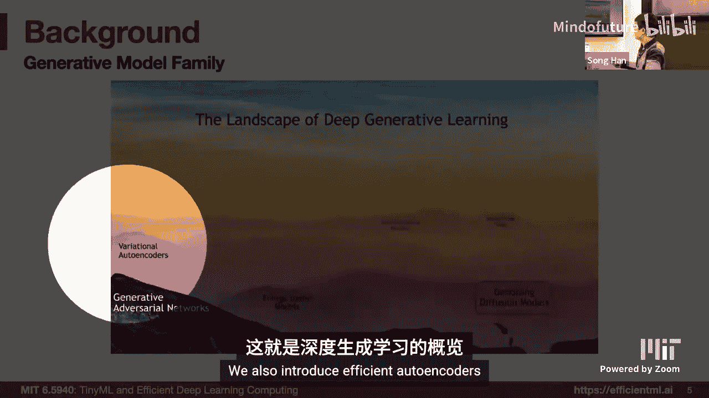
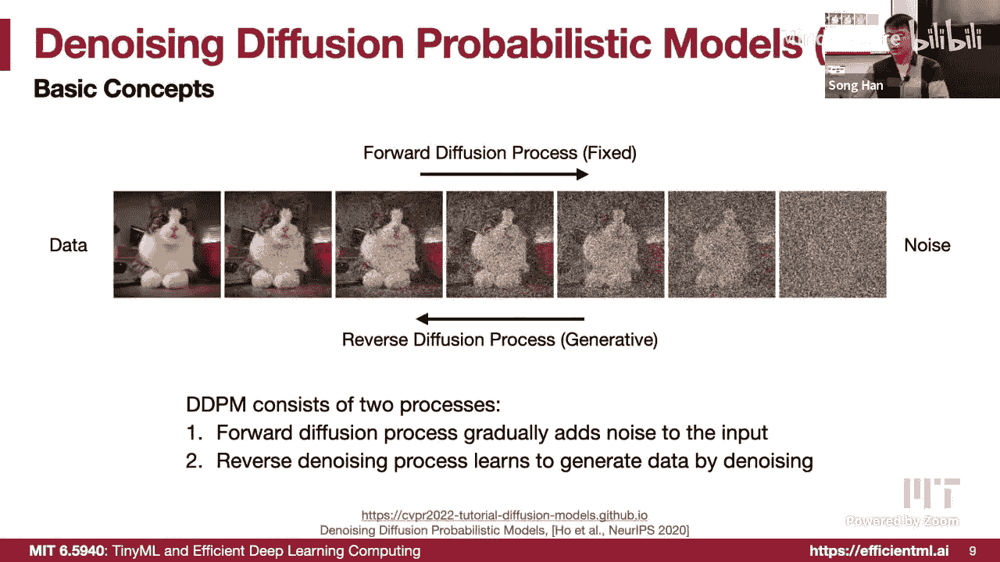

# 【麻省理工】高效机器学习 MIT 6.5940 EfficientML 2024 年秋季 p28 P28 Lecture 18 - Diffusion Models -BV1o7jzzwEST_p28-

Welcome to lecture 16 of efficient M of AI。 So today we are going to learn about efficient diffusion models。

 how to accelerate diffusion models。In the previous lecture。

 we've briefly talked about deep generative learning so first。

T a model and then can predict the data distribution， so different from discriminative model。

 which is to predict the decision boundary， the geneative model tries to predict the distribution of the beta。

So there are lots of applications for geneative model， for example， photo editing， image generation。

 you may use mid journey to generate images。open IO app can generate videos as well。

 but all these generations are pretty computationally intensive so in this lecture we are going to learn about how to make these algorithms more efficient much cheaper to run on the hardware。

This is the landscape of deep generative learning we've covered previously already covered generative adversial networks。

 weve also talk about the heart， auto regressive model using aken token in token out approach to model that。

Today， we are going to talk about diffusion models。 We also introduce efficient auto encoders。

 So this is the landscape of deep geneative learning。

So here's the agenda for today， we are going to first talk about the basics of diffusion model in order to accelerate it。

 we need to first understand how diffusion model works including denoizing。

 conditional diffusion models， latent diffusion models， image editing and personalization。Next。

 we are going to introduce fast sampling steps to BDM method， dissination method。

 and also acceleration techniques using sparsity quantization and also multi GPPU parallelism。

And the figure right on the right hand side is the model Sanana developed ourselves。

And showing a cyber punk cat with a new sign that says M T。Okay。

 so let's first introduce how diffusion model works and diffusion model basics。

So there is a two concepts。 One is the forward diffusion process。

 The other is the reverse diffusion process。

Forward diffusion process。We try to add noise to。そのデタ becomes smallです。In a reverse process。

 we graturbate heoids。And release and reveal the datata。

So this can be illustrated in this image the first。It the full of the pass。

 the second one is through the worst pass and seeing the full of past。

We are trying to destroy the data by gradually adding a small amount of coffee noise。The image is。

Two different distributions， now they become an。During the reverse process。

 we are trying to create data that where gradually the noise in the noise from an installation stationary distribution that the finally converge。

At revealed the original image。So this is the multiifier stack。Process。And forward the process。

 it's basically adding the money。た from。My name is。他。

But the F is actually dependent on the previous staff。

So it's a caussian distribution with mean is it the mean which's related to xt minus-1。证据3。

There is is the Belian noise。So this v key is crazy fine。Contro the if human speed。

 So this is the relationship between T and data。So that's the forward process to add noise。

 look at the relationship between Xt and Xt minus1。

And then what about sampling Xt directly from x0 from the original clean image， how do we get it？

The noisy image at the step time S T。So this is a voluntary mission， but I raise quite synsosis。

c is linear related by t minus1， we can define alphapha t to be minus beta t so we can rewrite equation like this。

This is a relationship between I and I minus-1 we can expand。

This equation by inserting the same relationship between xt minus1 versus xt minus2 so that we can represent xt with xt minus2。

你提供退满了错了，你供退满了算。So I two different Gaussians we have this property so that we can combine these two terms。

 noise terms together。So we get a relationship between XT and XT2。啊，难受啊。

All the way get the relationship between x x minus1 minus2 minus3， all the way to x0。W north。

We can shorten that by defining the Ar t bar to be the product of all the alphapa I， as a result。

 we can represent Xt as a with respect to x0 plus an noise。哎说的是证明。This is the virusracks。

So now we have a the relationship between。The original claim image， which is x0。

 each times that T or is xt。So we define this relationship between c and x0 as a diffusion kernel。

So for some point， I see go to the relationship if we have zero and the noise。

And so beta is designed such that when RF T is close to zero。

 the distribution is close to the normal distribution。So given at any time that T。

 we can represent that as a function of x of zero。So that's the forward process gradually I noise。

He find any time step respect to the first time step zero。

Now we're going to talk about the reverse process， the reverse dennoizing process starting from Xt。

 we want to obtain x0。So when beta T is small， the relationship between t minus1 and Xt。

 so the adjacent tool steps is also a Gaussian。So this is the meanme。Which is a learnable。

 that's what we are trying to predict。Consuming the majority of the flps。Given I see。诶边同 is早做诶 a高兴。

So let's see in practice how do we finish the training， so given the twin image。

 this is a clean image。Which is x to0， since we have the relationship between x0 and Xt。

 so xt basically equal go to at0 plus the noise。I to zero， which is getting back her positive noise。

但是。衰 root of r t衰 root o minus minus r t。Exactly the same here。

TheF seeta is the neuralnatural model predicting the noise。So we add them together。We we get back C。

 and then we pass it through the model into from beta。To prevent the noise。Predt the out of noise。

And this is our predicted noise， this is a noise that we originally added it to x to zero。

 and then we try to match the predicted noise with the original added noise so that we can have a lot。

M I see log right here。try to try to慢。So that's basically the training process。

Although the equation is pretty complicated， if we join in， the figure is actually quite simple。

We sample tea sample tea。And then， we can。哦。Some call x0， some for image， and maybe be a path。

 maybe a dog， and then sample pull a noise。From the高 distribution。And then we add them together。他这个。

Some up together， together X T。Predt the noise。诶所要送要上必啦。

It's given the XT to try to predict the noise。And try to match the noise that will be original sample。

 so that's how we add noise to the training process。

So basically the training part is trying to predict the noise。

 make sure the noise match the noise we inserted。处的可能意位起。就他个处理啊。What about inference。

 what are we doing during the inference time？啊So。Given a noisy input。

so weve pass it through the model it in repeat。So what are we trying to predict。

We are trying to predict。T minus1 so we already have the relationship between xt minus1 and xt。

 so this is the mean， this is the variance， the mean we are trying to predict。Predict that by。

U this equation。 And so new data is a combination of XT and Ion X T。

So it's a combination of XT and external X。So each tool I see is basically predicting the noise given this input。

So given this input， the model each has predicted the noise， what is the noise inside this image。

We subtract the noise， we should subtract， we subtract the noise from the image。

TheseThese are s factors， these are tread noise from the image to get a cleaner image。还有推er里。

With a noise and then。The Dno is image xt minus-1。So in that way。

 we complete y iteration from a noisy input image， a noisy image Xt to get a cleaner image Xt minus1。

the rule of thumb is the noise。 we first predict the noise。

And predict noise using the EC level datata， this is the model is that the majority of the where the computation goes。

Predict the noise subtract the noise。Here， it actually added Illinois。Another course内 since。

I see this is the man， this is a variance。You have to add back this noise because get a the noise image。

So that is just one time staff。One set of theno from a noisey image to a cleaner image。

 And then we can repeat this process to get X T-2 X T minus-3 all the way to x to 0。

So that's the entire dennoizing cost。Different from the previous models where it's just one time now we have to run the same model iterateative。

 so this is where the majority of the computation goes。So it stands prediction。

 you have to make pixels of wireless prediction。Not just a class， not a bond box。

 but you have to make pixelized prediction。That's why this model is pretty heavy and taking the majority of the time making it slow。

Another reason it is slow is because we cannot do it using a single step or very hard doing it in a single step。

 but Im sure if we need a lot of steps， that's why it makes it slow。So this is these are generated。

Images actually outperforming dances。E datata3就。Pretty good result。 Pretty good stuff。Okay。

 so now let's。Talk about conditional diffusion models。 We don't want to just give a random image。

 but we， we want to。Condition the generation on either a cru， for example。

 we just only want to generate a cat or a dog。taxax condition。For example。

 a sequence of texts like a photo of a moon gate。Sometimes we also want to add the pixelized conditions。

 which is pixelized conditions， so given this spatial map。Se patient now。Or padty edge。

So we not only need to provide a timet， but also a condition and a condition。To the model。

So let's see how do we perform conditional image generation using di models。

So one idea is to use this scalar condition， a very simple spatial addition。

 so this is the original feature now。Conition。How do we condition that。Given the class I D。

Maybe ID number 776。And then， we encode that by。Hsing it through several modulated perceptions。

And then we get an embedding batch size， and CC is a channel versus the original future map。

HW so we brought。Sing added。To age times value。Perform this broadcast ad ad。To add them together。

 to get condition。So that's how we added this class condition。

We can make it a little more complicated。Example。Possive for long though。two parts B times2 C。

AnyWing the skate of scooer。The bias。So we scale the future map。I also add。To the feature map。

 to at the condition feature map。 That's another way to add this kind of。Scal up condition。

How do we add to the tax condition？Now we have two modalities。 One is image modality。

 The other is text mod。The German visual language model。

 like the Villa we discussed in previous lectures。We find its possible to project image and language。

Both of them into tokens， right。And as a result， we can use cross a engine to combine image and language。

 for example， the input feature， we divide it into several patches， each patch its a token。

 so we can tokenize them。So for the text， we also pass it through the。The Q kv matrix。

 so we get a Q token， primary token， P token and vital token。代そ。In refer to QK transposed。

 so QK transposed， and we use that through the weighted sum for the alpha co。

So the final dimension co dimension is still the same。It the clarity rate。

 which is the number of image fulls。The powerful result is still an image。

But that already included the information from。あ等な。

so that's one way to have text condition insert the text condition into our image generations。

There is another way to do join才开始所 in the previous method。Are theysymmetric？

I trade language and image， they are not symmetric。So the image is treated as the query。

The language is treated as the key and the value。So the language and image， they are not symmetric。

But in the joint potential。The language and the image。

But the image feature and text feature are actually symmetric。

So theyre passed through independent QQD transformations。QKV transformation for the image。

 this is the QKV transformation， for the language， for the text。

And then we contaminated them after the transformation， okay。

 so this is the query from the image feature。The query from the language feature。

 we caned them together to get a combined image text feature。

For the query combined image text feature for the P。the image text feature。来理。feed them together。

 put the attention。And after we get the output， we exclude it by passing them through different output transformations。

 so as QKDO for O， we also have independent WO for the image feature and also for the text feature。

So on the hard right hand side， there's another diagram where I'm show you in this relationship。

Certain major impact。Paked through independence to kidney transformations。But're having edit。

Togeers perform form joint tension and then split it to separate WO matrices。

To perform MOP And for the next day。What about totally combining the together early？

So this is another approach。A single self attention to combine the image feature and text feature。

And so token's are fairly competitive。Before we feed them to the QKD。

Since the image feature and text feature are concateninated already。

 so we can fit them to the same QKV transformation。And after we pass them through the attention。

 we have a single output transformation。So this is the early fu for the image and the text。T feature。

We can also perform pixelized condition then we talk about class condition using a class。

 we talk about language text condition using a sentence。To describe what we want to generate。

Now we want to do pixelsoized condition， for example。

 we want to generate something that follow the edge。Describe the here， this is using the hat。

kind of actually packed her to find。As a result， the generated image。嗯。

Together with a pack of problem and you exactly follow。The the edge。We can also use input human pose。

还以后就能po。Dive from here。啊。他就这个。The body， the hands。generate several images。

Ive been the teacher following with exactly the same。

Human pose or human beings statuteual following the exact。Input cuicle。

And that is by using Control ads， which is new technique published with last year。

To add the control by。Conditioning on pixels。How does that work？This is how control networks works。

Previously， we have a neural network given。No as we can predict the image。

 now we freeze the original。That work。we make a trainable copy。你个听都不可。

And we insert the condition from other trainable cultureul。

Starting with a zero coal so that when the trading starts。This branch has no effect。

This is zero con before。And during the twin they start to change and we make the twinable copy we call this part control map。

 so this part is controlling the main branch。They have two branches until that controls the main branch。

 and the main branch is locked。Con that is a trainable copy of the。Original branch。

These are zero initialized of1 by one con， such that。The training is very smooth。

 the starting point is basically nothing is on this branch。手は？His long portray model。

So let's dive one step deeper to expand that。So we added these pixelized conditions from here on the right hand side。

 it could be either the semantic mass。And you add whatever pixel wise inflammation you want to observe。

And we keep the original condition。Including the pack across and also the pine stack。

So that's the original condition， when we copy these down host stages， so these are down homeage。

 we copy it。The condition control branch from the original branch while we are freezing。

All the layers of the original branch。And then for the upsble part。

 we just pass it through zero convolution， we only copy it half。Only calculate the first。

Ecoder blocks， but not a decoder block。So this is how we had。Pixelized the。

Beyond tax division and some time。啊对对。The original branch。不zen。This condition is also inserted。

The the stage of the control of that。So there's another technique classifier our free guidance。

 which is try to。Tat to trade off between the diversity and also the fidelity。So。

To condition on some class。We are trying to give this class， we try to predict what is image。

But we can also choose another classifier given the speech how to predict the class。

 we want to make sure。The class is exactly the one we want to generate。So and。

And the classifier break it during the sun。So make sure。Sample is classified as C。

So we not only want to run this generation model， but also we want to run this discrimin model to make sure the generating image is exactly belong to。

So new sample distribution is defined the。Given this class， we want to sample an image。

And also the predict of this image。Its also predicted as。Be belonging to class C。

And we add omega to the power of omega， which is a guidance stress。You know lot the space。

The modification becomes the sum。And to the power of omega becomes omega times now P。

And so that's whatゴが the power。So， this is basically the。

哪ive comparison between哪 commissional somebody。Condition here versus classifier guide this on plane。

And case adding another term。Given this image， we want to to classify the class and make sure that belong to see。

So this is the classified gradient。Strong is controlled by the guidance。ラスピ。Cifier I somebody。

So this is comparingium。A small oomega versus a larger。There is small omega。

 the generator image is sometimes confusing。落到。On the right hand side， the identity is much better。

So。Larger items of W due to better quality but less diversity。Diversity is very poor。

 versus here has many diversities on the ground。みんますのいますの。I field of diversity。

So what is the limitation here？By using such classifier guidance。We can only work on class condition。

There's no past or pixelized ambition。Predt8。And we need to train an additional network。

 which is a classifier network。We just cumbersome。Can we just use one network？

No and don't have to train a separate classifier network。So that's the classifier free guidance。

 very widely used active these days。To support diverse conditions。Clas condition， tax condition。

 pixel wise condition。Without using an actual classifier network。

So this is the original term defined in the classifier guidance。

ATer is multipled together when is given conditions。Prege the image， the other same of the image。

 make sure it's belong to5 C oromega is the strong。我看到化月风俗。Such that this term， given the XT。

Was probably the condition， what I provided to be A andC was probably double XT versus PS。

So this is a condition model， this is unconditioned model， and putting them together that' phase。

啊、非酒。So basically we can run the inference fly， one is a conditional model。

 the other is the companyy。So。And that way we can readwr。The equation of the column。

 by inserting the Pc given Xt， it could be Pxt given C divided by Pxt。And to the power of 米ga。

 we still put it here。AndWe find these two terms can be combined together to the power of omega plus  one。

money年。To come together is that the same。Oomega parts1。

 if we normally only need ever to just move them。Move them to the right we part of Oomega。

So in the log space， this division becomes a minus and itss subtract。

So we have omega plus1 log of PXT given C minus omega log of PXT plus。八。

So what does that mean to the original model， okay。

Previous we are having the condition and the T right here。Now we've just replaced it in two terms。

inference them twice and one is given the T and C， the other is given only the T， no C。

 so we have to run inference twice。combinebine the results of the conditional and also the unconditional forward。

我 does上 mean。We need to double the flos， okay。Do it once with。

The condition and do another time without the condition。

So that's basically the classifier of free guidance。Let's see how that works。湾分晒。There's no guidance。

Doesn't look like a dog。系晒。走我拉去开。W is also leading to better quality， but less diversity。

But the advantageage is that it can generalize to any conditional forms， not just a class condition。

 can generalize to different conditions。Like pixel condition or text condition。

And we don't need to train a separate network， we don't need to train a classifier。

The same diffusion model， we just need to write a diffusion model twice。

So all the techniques we learned so far are graduate a。Complexity。

 making it more computationally expensive， like having the condition， etc cetera。 And later。

 we are going to talk about how to reduce， reduce the computation of loss。

Starting with latent distribution model。E might think you have a pretty high resolution image。

Which means when we are predicting the noise， we have to make pixel wise prediction that's a lot of pixel noise pixels we predict。

Can we pass through an encoder。And then dens a at a smaller resolution。

 like1 eighth or one fourth a resolution so that you can have a much smaller。Actually。

 that is a very widely used technique these days， con。

Rather than directly to diffusion on the high resolution image。

 we first pass through a encoder to some example， by four times eight times even 64 times。

Our recent work called deep deep compression output encode。

 so we have a much smaller latent space and you do diffusion in this smaller space。

 which is much easier。And after the de noise， we pass it through a decoder where it construct the original image。

So the diffusion only need to run in a smaller resolution latent space。

Rather than on the high resolution original image space。

So that's a way it will compressrise the image。And only re in a compressed space。And that is called。

Lnt distribution。Any point of bio on a small resolution。

To enable centernoing and also faster citizens。And let's see how that changes our。Road map。

 so this is the original configuration in the。The difference is that the image。Fad to an encoder。

 and we feed the encoder's result as z。So I'll be first。I was the noise。That his space had pointss。

Some pause through the model and predict the noise and try to match。The noise。

So the learning target is exactly the same， the only difference is that。

Add another term rather than theoretical right by feeding x to0 to here。F x0和 in code的z。ゼロ。フゼロ。と思です。

It easy though is in thelinnt space as a much smaller。So this is during the cleaning the forward。

What about during the sampling。At some time。So everything is actually the same。

 except for the last one， we want to feed it to a decoder if we code the original image。Previously。

 we have this XT and then it pass it through the model of predict the noise。

So trying tonoy us from this XT。To B noise， D noise。

 we added a lot of noise could get a final D noise at Zt minus1。From Vp to zt minus1。

 all the way to z0。And as we getting Z0 in the latent space at a smaller resolution。

 we pass it through a decoder and writtenstruct。うちのイメー。So the only change is the right。

To deco passes through a decoder from low resolution。他月这不是。Everything else stays the same。

 but we can now generate。Complicated and higher resolution image。Here， astro in Zanggle。

Cd color patterns。这 is big。F were f。This is stable execution Excel for high resolution image generation。

As you can imagine， the more we can price。The less the workload。

 the smaller the number of resolutions， smaller the number of tokens。

So recently we invented a steep compression of。Rather than compress。We total them by eight times。

 so we can compress it by 64 times。我大三边。It means eight times more compression in each side。

 and altogether we have how many fewer tokens。6ix4 times fewer cop because each time double。拖是土啥。

64 times less focus。How does that impact the attentions。快次。4 thousand times。Iスポ。Sinceす。

The attention computation complexity is quadratic。R quaraically related to the number of tokens。

 We are using each side by eight times altogether 64 times less tokens。409 or six times。

So this is original stable diffions。Myrational and VAAE reduce the resolution by eight times as it a distribution model pretty slow。

This is our proposed approach is deep compression up putting COD。

see all times compression on each side as it would be driven model and make it much faster。However。

 this is not straightforward， my evil approach， for example， I see theE ands 64 times of compression。

 the quality is very poor， but use a deep compression BE。The quality is much better。On the back side。

 we have the tariff compression ratio， the higher the compression ratio。

More preferable but the harderter。Based on methods， IDAE， the FID PTTware rates very rapidly。But。

Deep compression alter encode studies。Very stable F even given 128 times compression ratio。

And how did we achieve that。So reducing the resolution。You have a very打击 approach。

You can directly move the information from spatial dimension to the channel dimension。

Say every two by two pixel， four pixels。You can change it from two times two times 1 into one times one times 4。

So that's the explicit transformation from spatial to China。And so by explicit spatial to channel。

 we can add this explicit spatial to channel branch。嗯。to地当山后宝。

And I this explosive channel to a spatial branch for the Up power block。

We call it residual auto encoding。So rather than using the weight by the weight to learn such stuff。

 we use this。Zero weight is French。の位。Do with Ruch。As a residual bypas。To learn this。

 and we find adding this residual output coding makes it a lot easier。For example。

 the RFID without residual auto codinging will deter with very fast。You have 64。

 but it remains very stable under a high compressionion ratio。

The second technique is three stage adaptation to high resolution。

 so we want to deal with high resolution like 4K by 4K image generation。

 so how do we have an ongoing encoder to support so much higher resolution without requiring a lot of training blocks。

So we decoup it into three phases， the first phase we just performed low resolution between the whole。

 both an encoder and decoder， and given an equal image encoder encodecod into a latetnt space and decoder reconstructed to the original image。

 and so this is lower resolution full training。the second stop， the all to of the computation。

We perform high resolution latent adaptationration only to the middle layer。

So the middle layer correspond to like classifiers last layer。Only tune he's made the middle layers。

And phrase。Reme。And finally， we added this kind locks。Further polish。

To do some refinement only to the last layer of the decoder。

 since that's only related to the low level features。

 The low level feature is actually refined in the last stage。We do such layer by sparse tuning。

 not tuning all the layers， but sparsely tunening the middle layer or the late stage to save a computation and make it very fast to train such a auto encoder。

So using this auto encoder， we can greatly accelerate。The image generation比是 model。

So this is using the original latent space。I see the AU， which is eight times reduction。

So it's pretty slow， it generates only 17 images per secondhand。right喷。啊， we are using。Before啊。

Times compression。I have 64 reducing the number of。Poken is from。

'reRed the resolution from512 to8 by8。So we can be I always think before COs。previously。

 we have to produce。4K total， so it's a lot faster， 19 times faster， actually。

Pgraph using in the original。Ato encodeder， so auto enr matters a lot if you can apply such deep compression auto enr。

 you can have much fewer tokens。Coratic reduce。The computationplication fls for inference of distribution models。

And another benefit is that now we can。Achieve high resolution and image generation without using a lot of computes。

For example，4K image generation。多开的是。不看始 detail。This is 4K by 4K generation。Comparative with one pay。

The astronaut in the jungle， the 4K has about more details。

But a lot more computation if you don't use。Techniques， like deep compression also encoder。

So based on deep compression auto encoder， we build a efficient image generation。

 diusion model called Asa。Which takes advantage of several factors。One is the。Vinear EIP module。

Using the linear attention that we previously described for high resolution， we have a lot of tokens。

Computation complexity grows for drastic with the resolution。

 so linear attention will be very feasible will be very helpful to generate high resolution which you speed up。

熟其时就益要。开始。They're using the vineyard BIT， module， using the deep compression out encodeder。

And here is's using a modified complex human instruction， which we are going to talk about。

So previous dedion models are。Using an encoder decor model， like T 5。As text encoder。

 So we think recently there's a lot of progress of Er only a large language model like。哦。

LikeGPT model G2， GP3。Comp everything after that。我 Googleoglesjama。So。

And we use this decoder only bottleized。For example， given an input to the Emma。 a man is walking。啊。

Jama's output focus on conversation。This is a good start。Make this more interesting。

 tell me about the map。And as you walk， for example， where is he walking？A business what is。The。

 the more details the give， the more vivid and engaging the story can be。

 so this is not quite related to the image generation if we na feed our prompt to drama。

It is not basic related to unit generation， but a focusing on conversation and story addingty。呃，银行卡。

A comp human instruction，end it's fixed。Before the actual prompt。

A man is walking to know then I can give correct。So a man in the war。

 matter jacket works brieflyly down a。Call stone straight， his head。刚看。

Seeilette framed by the sight of the sun， he wears a fade blue scarf along his neck。

Itcept' give very detailed description。Beyond the simple。

Instruction we give and how will we achieve that？In the prompt engineering we discussed in the previous lecture。

It help to a infrastructure of the。啊第个。嗯。Not only the example or not only the pro financial的 example会。

Given a user prompt generate and enhance the prompt that provide detailed visual description suitable for each generation to evaluate the level of detail in the user prompt。

 if the prompt is simple， focus on having specifics of color， its shapes， size， its texture。

Sciial relationships。It vivid and conflicting if the crop is already a very detailed， refine。

 enhance existing details， likely without overcomp。We also give some examples。

Theres a problem a cat sleeping be converted to enhanced version。

 a small fluffy white hat curled up in a wrong shape。P过了行。windows  surrounded by。

Porks of blue red flowers。By using the income tax learning example。To use the pump and finally。

 please generate only the enhanced description for the prompt below and avoid。

 including any additional comments on。Followed by our real。walking。And in that way， we can let this。

Decodeder only language model who。You have the output that is preferable for the deion models to consume。

All right， and how does an echo with the visual language model that we previously discussed。

 for example， the Vla visual language model。Actually。

 we can use Vla to the image given the image we want to。This is original cap。

 which is actually a case。2是初二。Top will return happy Valentine。超出费。布就带块，但是胸口来。But using Vla。

 our visual language model。It can be a very detailed caption。The up 13B。

 the image captures a new Iful scene of a Valentine's Day celebration at the center of the image it's around chocolate cake。

 rich and invitingbi。The cake is adorned with a red heart on the top。

 symbolizing love and the faction the words happy Valentine's are elegantly written in red icing on the cake。

 adding to the festival atmosphere。The cake is placed on a wooden table。

And if you see the wooden table， which provides。charmharm。

So you can tell it's a very detailed description that is unlikely to be labeled by the human labeler to give such。

哦。De and。F label without without hallucination。 So this is the 13 B， this is 3D。

 We feed it to different sides of Va to vote based on the clean score to prevent hallucination and try to find the best match。

Clip score basically measures the singularity， the relationship。

 how well does it match between the caption and the image。

So now everything begins to converge by using our visual language model， the Villa。

 we can generate more data， we can use the data to train better saa so Sa and Villa can grow together so that's the beauty of such co design。

All right。Now we have to build a saana based on the above techniques， we can saa。

 we can accelerate 1K image generation by 25 times。

 accelerate 4K image generation by 100 times compared with the flux。また？

He's a popular diffusion model these days。Flogs。SD3， H'sR。

Where is this 106 times acceleration come from， so it comes from deep compression， autoenr， linear。

 DIT， kernel fusion， and also using the。Flow based of TpM solve。And the quality wise。

Jhan Mao previously。这 is。The for the flux model， this is for the data model。啊就系按冇现来承担。

I see some generated results from Sana 1。6B。The tax logobos。And there actually a lot of details。

And here are some more examples like a blue porch，3，5，6 park in front of a yellow brick wall。Yeah。

 this one is probably more interesting in avocado wearing a royal pra。

And the rolled seated on thethrone in the grand。Ocular deciding。

The scene is surrounded by other avocados。Also adorned with crosss。So highigh resolution， low cost。

So let's continue to talk about image editing。So image editing with theus model is pretty powerful。

 so for example here we are doing some stockokes。Power。room。

 and now we will gradually recover and generate a power and a room。

By thenoing and it shouldy match the input is stroke。How do we do的。So these are separate spaces。

 one is a stroke， one is the image， they are indi。PatientsSo what we do is。

can perturb them with noise。Add noise to the stroke， such that the noisy image。

Can have some overlap with the original space。And then we do the reverse process to graduate tinoids。

 we can move this blue。Dot closer and closer the center of to the green region， which is the image。

 re image fixed。So that the output output look like a partial in this。So this is some example。

 given as original。Its drawn power by a human。problem the fantasy in the landscape fighting the art。

We generated the image given the input to stop。We also want to personalize the model。

not only adding the model， but also personal model， say given a dog。

 we want to generate some dog swimming， sleeping in the bucket for this particular dog，G hair。

Mouch be and white， black。fo exactly the same down Fo follow exactly the same down。

And a ahead of cars， this is not a random dog， but we wanted to be able isolate these dog。后续都咧。

Actually， this is pretty challenging。For example， we input a few images。Oh。Sim in different settings。

The generation image。I have very poor but。好，我翻过你。他的复印书据。我哋 one。And also， very few contacts。でや僕はアイコら。

那就。But able to generate new contexts。The free I change versus both I good but editing and also diverse comments。

最 both achieved by the。あの分。Ex for image model， give a few pictures， like three to five images。

Of the of不刀。F stop itself， the languagestock encompasss through the dream rules to find human that。

And a new personalized text image model。You make identifier we。

And say a dog it's in the beach we can it。这le到。Without working on a colorful。It generate socialized。

啊，遇到这个 car。So a limitation here is that why find Q in the model？Its specific is to only one subject。

 so if you want to generate。a person like a friend playing basketball。

 you have to do the fine tu again for your friend， which is cost。

If you are interested in training free methods， there's plenty of publications later using training free methods to customize to perform personalized image generation。

Okay， now let's switch to reach here to talk about fast something technique。

Ennoing diffusion inlicive power， so henoing process。Use interesting。From lawyers to data。

 the idea is that can we use fewer staff？lot stride。To reduce the number of inerations。

So previously the method is Macobi。XT is only dependent on the previous time。

T in the model such that we only use these properties to the training， but at inference time。

 have we find numbmicium power process to accelerate it？By reus the same model就能 trading。

So we want to make sure the XT minus1 is not only related to Xtd， but also related to zero。

 and we find in such a setting， we don't have to change the between the model but just change it at the inference time。

还是有权多 that。This is the conclusion。So previously， Xt -1 is related to Xt。

 but now it's related to not only Xt。You know that it keep。I see， but also related to x of zero。

we can estimate zero because gives the equation。所以家。I have a larger slide in times。231000。

Privi would just make one time that increments， now we can make the increment of 10 to accelerate the noiseing process。

And the original VPM， if you reduce the number of stats from 1，000 to 20 to 10。The F will explode。

 but using P the ion。The that being is very stable。I feel what I on money that。

T0 is not stupid old10。This is on S Part 10 data， this is the C A data set。thank do years。

Both well maintained。Having much fewer where soft。2 that so后到赛。

Another approach to reduce this number of steps is by using inselation。

This is a four stack model where can you do that， such that a single staff from the student network？

To do the same as two staff in the teacher。We can do another generation of isolationiliation。

student student。Which can directly one step to model with the teacher。How got to enforce that？

So we still a deterministic software for the same model I。each staff， the student model is learned。

So dis still from two edges and samples from stack from the。

Every new student will reduce the number of something steps by two。So this way。

 we can reduce the twining back。But I this today is much lower compared。

The speed the original nine was state with the version。Okay，Chapt three。

 now let's talk about acceleration techniques， forfusion models， let's start with using sparsity。

We can exploit spatial sparsity to accelerate the inference of theion models in particular of photo editing。

The vanilla diffusion models waste many computations when we have to recize the entire image。

 even if we only edited a very small portion of that。Say in this case， we only added the 1。

7% of the pixels。Do think how where can be added？We only added a sun right here。

And the sign right here。And occupied less than 2% of the pizza。

But the original stable diffion has to go through。The entire。冇到 and。run。

On on do conclusionvol on entire input image。But。Spatial response inference is basically a interest。

确利 whatever。For the not I the region， which has reused the feature map from the original body。

Since we only added to the sun， we only written computer。不算。

You grade here and reuse the feature maps for the rest of the areas。

Previous done with the image and as a result this。So eight times the patient。

So this is Colleague Brooks。We build this spatially incremental generative engine size。

 incremental means only change the pixels that have been edited for those pixels that has not been edited。

 we just reuse whatever it was from the previous。From the previous equation。

So given the original image， and we drew some。He's a cloud and a call and visiting a New。

We disccrtize that to。4 by4 grade in this space and highlight the areas that if we had。

So this is original image。This is an adequate image。So we only gather these pixels。

These chunks that has to been edited。And then only pass it through the conversion for this edited part。

And we' scatter this to the original feature map。Updated feature map。

 so that's the Y layer of the site， which only do compute， which only do conversion on additive。

We call it effective drugs。And we stack them to the batch dimension， so it's easier。

To paralyze no spark terminal is needed。That this can also apply。To confusion based transformers。

And we are pilotd to image in painting， So which what is image in painting？

We can draw a box in the image inside the image and we can paint whatever we want with the box。

 now we want to paint a horse， a photograph of a horse and a grasssla。Previously there's no force。

 and now well do a box。playslays a horseplay。Without this approach。

 we need to put energy in entire output image。It's a lot of compute。Pretty slow， please set。

300 million seconds。Now， we only added。的ma的为真。Time faster， four times faster。

 and the quality match matter well with our original people。So this is another example hole。

Threee% of the pixels added a coconut tree， so this is the baseline model。

 this is our model the generated quality is pretty much the same while being more fors。

So this is a real time demo showing that this technique can enable this interactive photo editing。

 for example， adding a。Some called的。的イメージ。Okay， now let's switch here to talk about applying quantization to accelerate diusion models。

 So we talk about quantization using quantization to accelerate large language models。

 But large language model and diusion model have a lot of difference。 For example。

 a single batch inference， large language model is bottleneck by the memory bandwidth。

 Well the diusion model is bottleneck by the。So those methods like wait only quantization cannot accelerate diusion models because theyre compute bonding rather than memory bonding。

If this memory rebounded， a large hundred model can benefit from W4A16 weight only quantization。

 but in order to achieve measure the speed up for the future models。

 we needed W4A4 quant contents both the weight and activation to only forbitit without losing fidity。

 which is even more challenging than W4A16。And let's see， how do we solve that problem？

So we observe the weights。At commission both have a lot of outers。Indiution models。

 we have seen this figure sister figure in a smooth qua。So this is the distribution。

 so the green is a 50% percentile， the yellow is 99 percentile。

The remaining is the rest to 1 percent。The red part is the outlier。

 so the activation has a lot of outliers right here， and the weight also has a lot of five outliers。

Making both difficult contact。So we can apply a smoothing like we did in smooth quas to migrate the quant difficulty from the activation to the wave to the activation。

 it's much smoother， and a lot less red compared here。But the has more outli。

Previous thing there only one off in。This is real distribution， a lot more rest。看 of。But luckily。

 the acquisitions out is migrate， so we just need to migrate the waste out。

We can do that by decomposing。Uing a side branch， which is a low rent？

To absorb those outliers using full precision， but this is very low run。rank。

 so this is rather cheap。做下 migrate。The all playersers migrate quantization DVD。

Thiss side the branch， such vast。as we， the weight has a lot less outlier compared bit before。

 so finally， both the weight and activation are four bit， but it's very easy to quantize。

 it's no outlier。An associate bit of a low rank cyber branch。

And the good thing about this approach is that if you use lower fine tu。

 you don't need to recontize the。啊， wait。But you just need to hand。A few more。

Or 32 more rights in full precision by whatever laura you want to add。To this module。

Since a lot of people are using picus bottles with Lora， so this is very compatible with the primer。

Before that， despite that， we actually observed naive communication to a lot of overhead。

You know and the red region for this up and down project。You to a low around branch。

This is the main branch。This is an lower up branch。We fu such overhead。But it is the overhead 40%。

 but it is the overhead。And we'll achieve that by actually using this thumb projection with the previous kernel since we shared the same input。

And me field this up projection to the next layer。Since they share the same output。单位。reuce为此。Overha。

嗯一楼。So this is the current future。This is the speed up and the model size in action。

 so this speed up 16 we can reduce it by 3。6 times。The August 14th。

 16 method from National4 Council reviews the model size。

And also reduce the memory and kind of reduce a bit more since the aal point has in the activation。

However， this。so this exciting part where the conventional other 4A6 work can only reduce the memory。

 but it doesn't lead to an， it's actually slower because we still need 60 bit arithmetic。

 but here we can use four bit arithtic。Either E4 or F4。

And actually more than three times measured the speed on 149。And this is a single step urge。

 the baseline method is out of memory。F we can make it at 3。5 times faster。4。

So this is a visualization comparing the baseline approach。Its all memory on4 package。

And this is anM4 a high fidity。It doesn't have I mean。It's still more than a second。

's pretty slow can。Just how to say。This is the Iif in the fourth con， the quality is really poor。

 actually the quality already start to degrade from IP16 to NM4。But our approach to well maintained。

嗯。Alpo quality pretty much the same as the original input。Well， the memory is reduced。

Previous the 23 gigbytes now it's only six。5 gig。Half a second。关块啲。

And this is showing that asV Qua is very compatible with the existing Laurara。

 we can just add a Laurara branch without having to do any reization。其实先。4回。Is a different laura。

model。声。Imy， children are in different kind of styles， well maintained。A fiity for different。Laura。

Finally， by parism。To exploit multiple。To accelerate if models。

For language model we talk about we can use tensor parism to accelerate it by throwing multi Views。

 we can just make it faster， what about diusion models。

 how can we throw multi viewss to make it run faster？So these are two devices。

 we have one GP on the call， one GP on the account。

 and we wanted them to work together to generate the image fast。However。

These two models have to communicate。えと？To do的排选的探图一 other。Which will be too large。Eiccation over。

What it will also。Yougate the savings we may get from multiple GP。

So we want to reduce the number of communication。The inside here is that。

The input across adjacent time steps are actually very similar。You in cohere。

 they are very similar to each harder， so rather than you right vector to。

Using the old the sta activation。For this communication， when we are attending to each other。

 we can attend to the previous time set。都发。来附印啥。Ex that。

reduce the communication over and also enable the communication to overlap the computation since we areusing the old timeap determined。

So originally the latency in 12 seconds， with four GPUs。

 not even doing such hybridization indeed makes four times faster。

 but it will four separate images due to a lack of communication and a duplicated subject。

This is naive paraization across4 GPP， but using the distributionion， distributed the diffusion。

 we can make it four times。Three times faster about the dynamic image qualities。

Very good competitors。Broadwood in January4， separate believedly separate。

So theres the speed out across。One，2，4，8 devices。All the clients for devices is here。

On higher resolution， the speed value is even higher because the communication overhead is safe。

With up to80 GPPUs。So， at the three K generation。这か。All right。

 so here' is a summary for today's lecture we first introduce the basics of the models。

And then we talk about health added condition。How to be using the maintenancent space。

 it will be using deep compression， auto to encoder to compress the focus。

 how to perform image editing and personalization。告 something。

And peace sedation together with ateration techniques。Sage， the spatial sparscity。

 the is qua quantization technique。And also distribution distributed。你比是把于。

Thanks all for today's lecture hope you have a happy long weekend。

