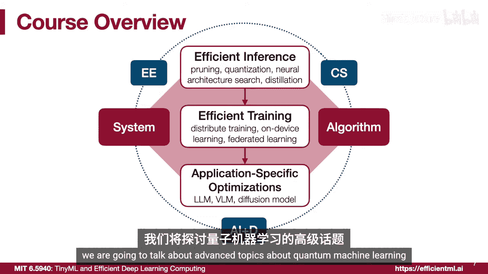
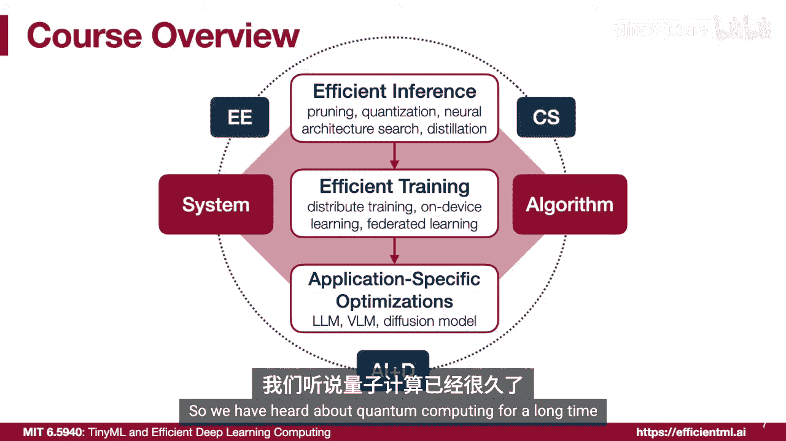
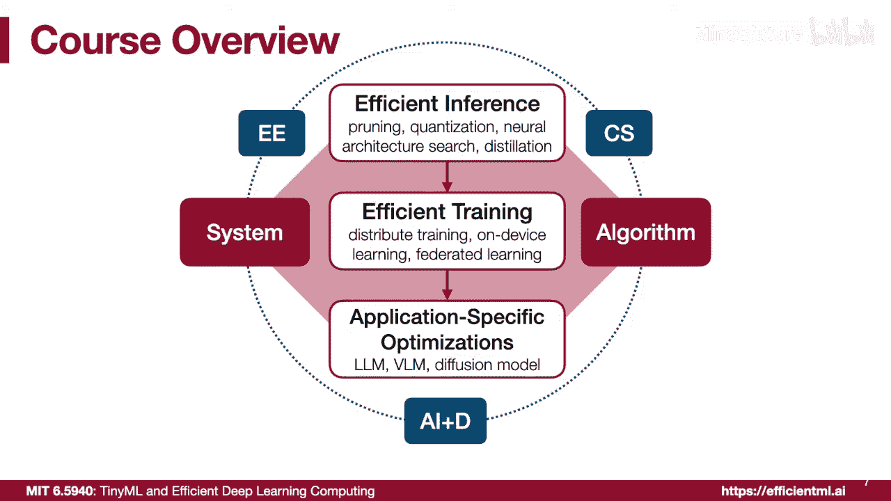
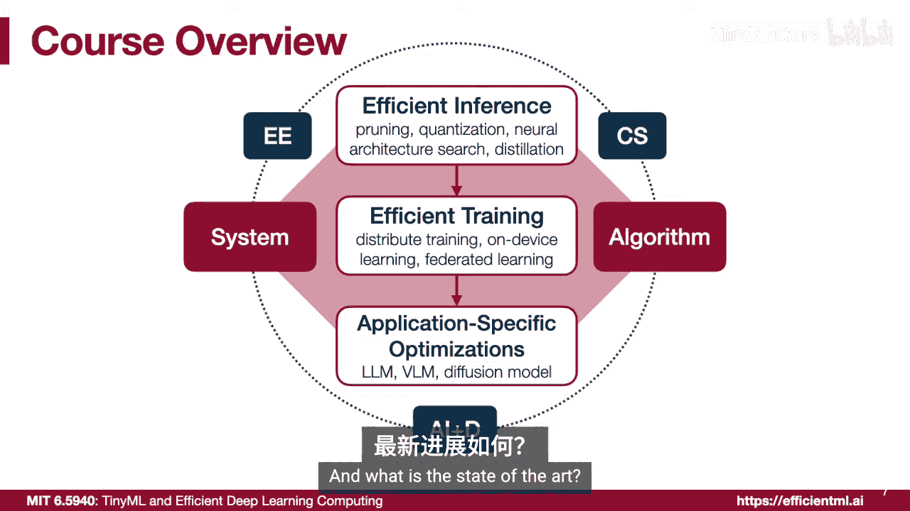
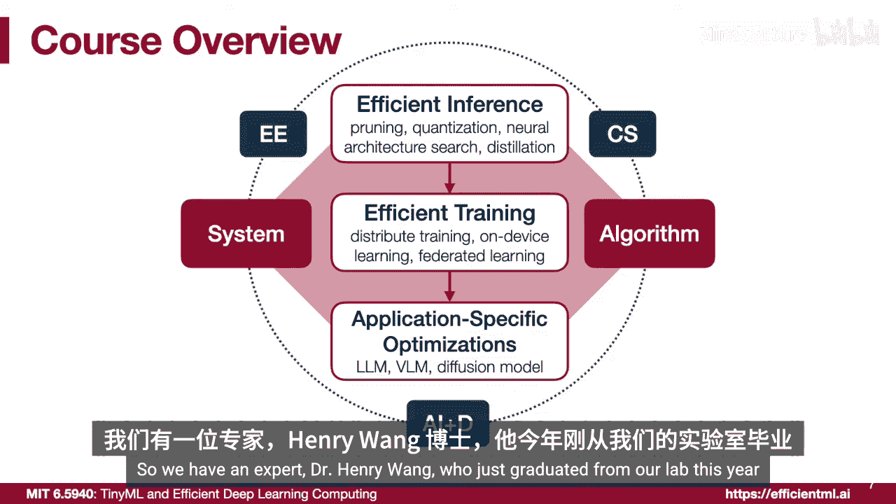
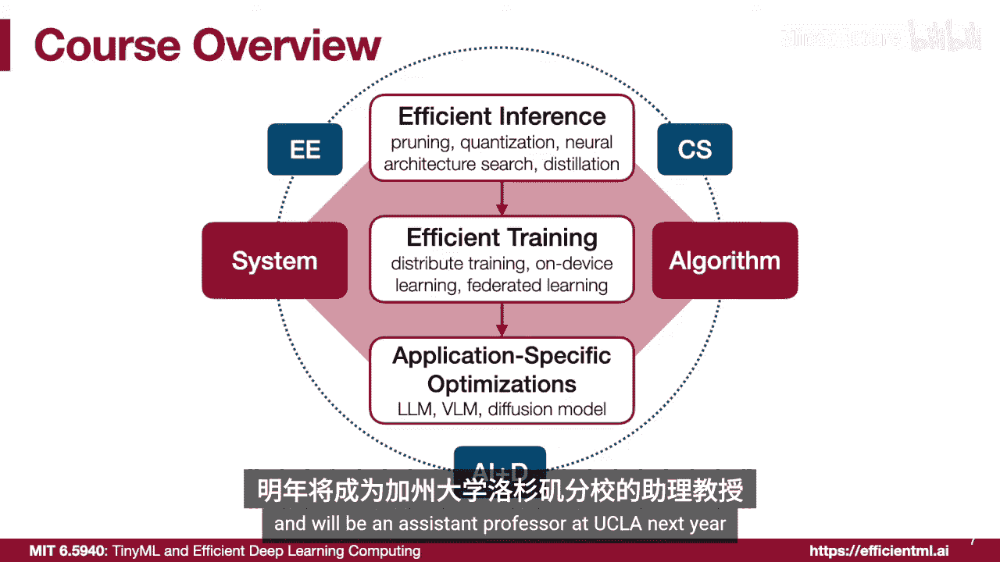
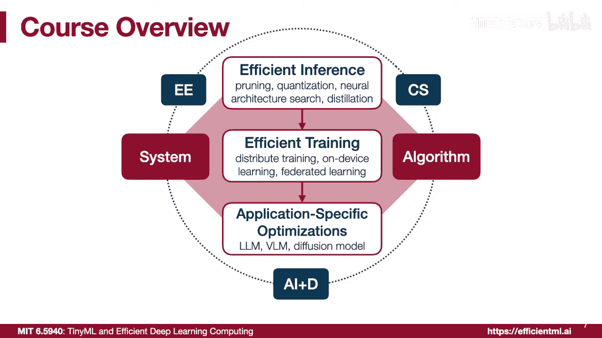

# 【麻省理工】高效机器学习 MIT 6.5940 EfficientML 2024 年秋季 p34 P34 Lecture 22 - Course Summary + Quantum Machine Learning Part 1 -BV1o7jzzwEST_p34-

Then we are going first to a summary and then talk about a new chapter。

 which is about quantum machine learning。So let's see how far the journey would have gone so far。

 So we talk about10 AML efficient between computing。

Deploy these powerful machineary algorithms on resource constrained devices and also we did a project deploying our Mark7B on a laptop。

 so these are some of the stuff we discussed。Vi your language model on laptop。Pny chat computer。

 Pan ML microconroller。B fusion， multi sensoror fusion on the Jackson orange board。

So we covered from efficient inference with pruning quantization， neuro architecture search。

 distillation， and then we talk about efficient training。

 how to paralyze distributed training on device training， and also gradient compression。

 fed learning。Finally， we talk about applications， specific optimizations from large language models to visual language models to diffusion models。

 to point cloud to video understanding。So the principle is we want to open up the stack。

 we want to full the stack designI to make AI more efficient。

Across both the systems and also the algorithms with such co design can open a much larger design space。

And住。But more optimizations。So this course basically covers knowledge from EE to CSS to AI+D。

 it's an interdisciplinary subject。So these are the three chapters to learn about from inference。

 remember about pruning， quantization， what we used。If you share computing these days。

 you run research， to have a lab for that。Knowledge of e is still the model。For trading part。

 we talk about different trading paraization strategies。We talk about data parallel， FSDP。

 tensor parallel， pipeline parallel， and also the sequence parallel。

On device training and also timing training， engine or microcontrolls。And in particular。

 for application side， we talk about larger language models。Long context Co trading。

We talk about diffusion models for image generation， video generation。

 and also it's an auto aggressiveive approach， multial approach。Token in， token out generation。

And also autonomous driving for with point cloud applications。We completed it。

5 plus one labs from prudent quant to NA。To LO M quantization and also LO M deployment。

So we are growing。 We have a doubled。The registration compared with last year and tripled crop across the date of the year before。

 So across the three years， actually eight times lot larger。It's our box。

numberumber view on YouTube also are more than double from 2000。22 2023 right， with that。

 that's pretty much the court summary。

And for the rest of this lecture， we are going to talk about lot topics about quantum machine learning。

So we have heard about quantum computing for a long time。

 it's a very hot topic and what exactly is that， what's the foundation of that and how is that applied to machine learning and what is the state of the art and how far are we from quantum machine learning。

 so we have an expert， Dr。 Henry Wang who will become just graduated from our lab this year and well be a assistant professor in UCLA next year。

 so let's welcome Henry to talk about quantum machine learning。

OkayThank you professor for the kind introduction。 Thank everyone for coming。 So my name is Henry W。

 I'm an incoming assistant professor。 and I just graduate from MI this year。

 So I'm going to talk about something about the intersection of the machine learning and also quantum computing the two were of this。

 So you must heard a lot about the recent advance in the quantum computing actually yesterday。

 the alphaqubit was released from Google's team。 So basically they tried to use some advanced AI models the transfer models to decode the quantum error correction code。

 So and also several years ago， the Google Google quantum team also have the quantum sumacy demonstrated which means that the quantum is available。

Have performed better。Quantum can have a better performance compared to the best classical computers and also IBM。

 they are also a big player in the field。 they have this quantum utility demonstrated。

 which means you can do some computation on the quantum device。

 which is very difficult on the classical computer。

 but maybe not generating some real values because those computation may not be very useful。

 but at least for those computation it's very difficult to perform on classical ones。

 and we are trying to find some useful applications for them。

So in this today's lecture Im going to just give a very brief introduction of the basics of the quantum computing from what is thequbits quantum bit and also how can we perform different gates how to operate those qubits how to apply different computations on the quBs。

 and also we are going to introduce quantum circuit。

 which is the basic building block for the quantum program which means we can have a bunch of qubits and also some quantum gates to manipulate the states of the quantum bits。

 and also we are going to introduce the current era which is the noiseisy intermediate scale quantum era or called Ni which means we are still pretty at the early stage where we have a lot of noise and also not large number of qubits available and finally we also introduce some example workflow to compile a basic quantum machine learning circuit to the available quantum devices。

 especially for the superconducting and also the neutral item quantum devices。

So here is a figure showing the number of qubits that is fabricated in the recent 10 years。

 so back to 2017， we have five  cubits on the superconducting chip which is showing on the left side and we are placing those chip in the refrigerator which is called dilution fridge。

 which is like a large chandelier on the roof of of a room and then basically the temperature of the inside this big fridge is going lower and lower as we going down to the layers and all the way down to several mill kelvin。

 which is very close to the absolute zero temperature so in that case the qubits will have some superconducting effect and the energy will have discrete levels so we can represent information in zero or1 degrees and after that we also take several years for the scientists to further advances field to build a larger and larger qubits。

 for example back to。2019 we have 27 qubits and also in 2020， we have 65 qubits。

 and last year actually IBM released this condoor chip， which has over 1000 qubits。

 and on the bottom side， we also see a lot of demonstration on the error correction side。

 which means we not only care about the size of the qubbits chip。

 but also we care about the quality right So because even if we have a large number of qubits。

 for example， in terms of the machine learning scenario。

 you may have a 10000 GPus or even 100000 GPs， but how to fully utilize。 It's a large problem。

 That's also the case for quantum。 So now we have 1000 qubits， but for many cases。

 we cannot fully utilize the computing power within those 10 qubits because of the large noise when you have use all the qubits altogether。

 the final results will be very noisy and the correct answer cannot be retrieved from the computer。

 So in that case， many of the recent advancement。Also goes to the logical quantum qubits which leverage the error correction code on the bottom side we can see around like 4 48 of the large of qubits demonstrated on the neutral item device at Harvard and they try to leverage the basic ideas that you can add more redundancy for each qubits so say we can have 25 qubits physical qubits to represent one lot of qubits。

 and in that case we can tolerate a larger amount of the errors and still obtain the correct answer。

So for the fabrication of the quantum device， I like the classical device we are all using the CM most。

 the semiconductor technology roadmap， actually for the quantum device。

 there are many different technology roadmap which differs significantly to each other， for example。

 and the superconducting。They are fabricating the artificial chip with the superconing trans devices。

 hardware device， and the qubits are fabricated our artificial ones are not the natural ones。

 So the first you can see the IBM on the left and most side。

 which has over 1000 bits and also Google， the second one is from Googleware machine。

 they have 53 cubits。 and also there are other technologies like the trap ion。

 So we can use the ions as the as the  cubits to control the space of the ion。

 And also we can have a neutral item device where we use the charge neutral items as the  cubits。

 and we can use the laser to control the space of those items。 And besides those。

 we also have the other match such as the photonics quantum device and also some of the others like the semiconductoror based quantum device based on the spin  cubits。

So in the recent years， as we see the number of qubits actually increase exponentially so we can see it actually doubles every year in terms of the number of qubits and also the computing power inside the qubits actually also increase exponentially with the number of qubits。

 The reason of that we introduce later but intuitively when you have more qubits is not like in the bit you have one more bit。

 you have just one more bit of information。 but if you have one more qubits， the states。

 the size of the vector the size of information you can represent with one more qubits is actually doubled so we can imagine the computing power also increase exponentially with the available number of qubits。

 So that's increased the computing power actually increase with this double exponential rate。

 how can we leverage this large space。 So we know that every day we are generating around the three extra bits of the information from all over the world and actually we can just represent。

All of those information with only 64  cubits because we have a two to the power of 64 of the length of the state vector that we can use inside those 64  cubits。

 so if we have a 100  cubs machine。And then the size of the information we can store inside those 100 qubits is actually pretty pretty huge。

 which is one1 to the power of 30 bit of information。

 So that that is equivalent to 1 billion years of the information generated by all the human being at the current rate。

So you can imagine that we have this large space and we have the enormous power to control those qubits。

 but in order to obtain some meaningful results or SQ some of the meaningful algorithm。

 we still need to carefully manipulate those space and also design specific algorithms for the quantum device So the history of the development of the quantum algorithm can be separated to multiple stages back to 1980 to 1990s people are actually developing a lot of novel quantum algorithms。

 So actually one of the pioneering pioneer of the quantum algorithm of Professor Peter Sho is also professor here at MIT and he developed the factor algorithm which is a famous algorithm to find the integer number the prime factors for large integer numbers So as we know actually for the encryption domain。

 so we are using the RA algorithm So the fundamental foundation for the。

Say is that it is very difficult for the classical computers to find the factors of large interval numbers。

 It is easy to compute the product of two large internet numbers。

 But once you have the large inter number， you cannot easily find what are the two original。

Original numbers to start with。 So in that case， quantum device actually provide there is a algorithm called a short algorithm to do this with exponentially speedup compared to the classical ones。

 So you can imagine that's a very huge impact。 So actually back to 2018。

 there is a national quantum initiative started by the by the US government trying to replace all of the this vulnerable R algorithm to the quantum safe protocol。

 So recently from the lease， they have already narrow down the encryption algorithm to only four。

 So in that case in the future， if if there is no hopefully no new quantum algorithm cracking those encryption encryption schemes protocols。

 and then we can switch to those quantum safe ones。

 So So back to 980 very excited about this quantum algorithm because for the first time。

 you can do something that is very difficult on the classical。

 but with exponential speedup on the quantum。However， they have a large assumption。

 which is that the quantum device is very good， so there is no noise at all。

 so all the things operate with the pure noiseless scenario and also they assume they have a very large number of  cubits right so maybe millions of  cubits that we can use at hand。

 but actually those are not realistic back to 30 years ago because people are not fabricating any of the quantum device。

So after 10 years around 1995， people also start to realize that actually we don't have to fabricate the perfect quantum device because there's the theory called quantum error correction theory。

 which means that we can we don't have to fabricate those perfect qubits。

 we can just fabricate some some good enough qubits and then we can use the redundancy from large number qubits to build hierarchy of qubbits which means we can get the logical qubits from the physical ones that can crack some some errors。

 so that give us a very large very large confidence that we can just fabricate qubits as many as we want as many as we can。

 and then we can use those qubits to build some to for trade redundancy for better reliability。

And then in the last 20 years driven by this concept。

 many of the research teams and also Sundays from industry and also from Kiemia。

 they try to build those new quantum devices and try to push the boundary of the number of qubits。

 So， for example， Google is building this superconducting device and also IBM they are trying to build a larger and larger number of qubits and also from USTC。

 they are building photonics ones do their photos quantum device。

 and with with this recent progress in the quantum device。

 we are seeing some of the breakthroughs like the utility demonstration and also the supremacy demonstrated by the Google quantum team。

 So there those are some of the practical。 So there is a question mark on the practical one because we know that those algorithm may not have a real applications。

But we do know that if we have some of the quantum device。

 we can continue increase the size at one day we can achieve the practical usage on those factorization algorithm or some other quantum simulation algorithm。

So nowadays five years later， after the demonstration of the quantum supremacy， right now。

 the whole domain actually is having an agreement that people we have to continue to push the boundary of this quantum error fraction because we still need to make sure the quantum device not only have a large number of qubits。

 but also each qubits have to perform very well， for example。

 the error rate should be lower than 10 to the power of minus-8 to perform the meaningful RSA 256 of the factorization algorithm。

Alright， so that's the basic the current status of the quantum device。

 A lot of the researchers are trying to demonstrate what is the best part of error question scheme。

 For example， the quantum alpha qubbits paper from Google release yesterday is actually trying to do the error correction decoding process using the transfer models and also some other researchers also trying to use the available device because available device。

 they should have thousands of qubits。 and whether we can find some meaningful application from the existing domains to do that。

 So that's the D trend or roadmap to do the needs computing。🤧So。

 so now let's step a little bit deeper into the basics of the quantum device。

 So just like in the classical device， we are using the bit to represent information。

 So you can you can have a 10 bit to represent 10 bit of information。

 either all zeros or all ones or some combinations of one and zeros。

 So the basic component of the quantum device similar to the classical one conceptual。

 which is that we use the quantum bit to represent information。

 So So we also called those quantum bit as qubit in short。 So inside the qubits。

 even wondering what is the mathematical formation that we can describe the system of the qubits。

 So actually， we are using a vector called state vector to describe。Sorry。

 all the information inside the quantum system。 So just like imagine in a classical system。

 So now we have we are driving a car on the road， and then we want to tell another another people our friend。

 where is our location， right， So we can say， hey， were at the location at the mile 100 mile on the on the highway。

 So that's like we can use a number to represent the state of our current location on a linear1 day system。

 So this is a very compact formation so we can just use one number to represent all the information in terms of the location of the car。

 So however， we can imagine we can also use another more redundant way to represent the location of our of the car。

 for example， we can say there are discrete for example， in total 12 different locations。

 and then we can use a vector with the length of 12。

 and all the other numbers are just0 and then we use one。

Top representation to say we are we are at the fourth fourth places， only one。

 and then all the other places are zero。 So we can also send this whole vector to our friend to say。

 hey， we are at this location。 So that also represents all the information inside the system。

So this is very inefficient。 You can imagine originally we just need one decimal number。

 And right now we are using these 12 binary numbers。 So however， for the quantum device， actually。

 this representation is pretty efficient because in the quantum device we are not the car can not only not only can be placing at one space。

 but also there is a probability of the car being at any of the locations。

 So there will be a combination of different locations。

 a superposition of the locations of the car on the whole road。

 So that's the the magic or the special point of the quantum device。

 So which means with only one qubits， we can represent many different states。

 not only just a0 or one but but all the different combinations between the zero state and also the one state。

So more rigorously， we can use the the qubit notation。

 the bracket notation to represent the state of a qubbits。

 So classically we have a either the bit in0 or one。

 but in the quantum we can use this direct notation or the bracket notation。 So for the zero state。

 we are using the10 and for the one state we can we can use the。

We can use the01 as the as the state for a very complicated state。 for example。

 this  Q 0 is the superposition between the1 and 0。

 So we can have the numbers on both this0 state and also the one state。 So in that case。

 you can imagine for one qubits。 We are not only able to represent just one bit。

 but also two numbers， two complex numbers。 So that has a much larger representation power compared to the classical bit。

So we can also write this state in the form of the combination of the two basis state right So for example。

 the  Q0 here can be a square root of2 of1 over square root2 of the0 and also plus i over square root of two of the one。

 So that means we have a sum of the energy of system is sitting on the zero state。

 another part of energy is on the one state。 So this form， the superposition of the two basis state。

 which is a linear combination of those two。So however。

 when we are actually doing some measurement or the observation of the qubits。

 we are still need to go back to Class1。 so the qubits can stay there for a very long time。

 but but in order to read the information from the qubits。

 we have to perform a process called measurement So the measurement actually for example。

 we can sign some microwave pulse to the qubits to retrieve the information or we can take a picture of the qubbits to see what is the state。

 So the important or the non intuitivetu thing about the measurement is that when we actually measure the qubits there。

 the qubits will collapse to either a0 or1。 So there is no way to directly measure the overall information。

 all the information to of the qubits and also during the this measurement process。

 the collapse of the state will be randomly randomly processed So for example。

 for the original state， this between the zero and1 after we do the measurement。

 there will be some possibility that we get one。From the qubits and also another possibility to get zero from that。

 So you may wondering how how can we on earth to do some meaningful computation with the  Qbits。

 So the answer is that actually we can do the computation for many types right So say we can prepare the qubits for 100 times and then we measure 100 times。

 and then you can get a distribution of the one state and also the zero state。 So in that case。

 you can obtain the meaningful results from the distribution of the classroom state out of this out of this quantum bit。

So specifically if you wondering what is the probability of distribution。

 how can we know what will be the measuring results。

 what is the probability of measuring zero or measuring1？

So mathematically the probability to measure a0 can be computed with this dot production。

 So basically the x here is the save we just introduced。

 and also the the side here is actually the save we want to measure。 So here we can use this x。

 for example， if we want to know what is the probability of measuring measuring a0。

 and then we can directly compute this process， which is the dot production between the zero vector to the target vector。

 and then we can compute the。Ner two of this process。 So， for example。

 the combination process can looks like this。 We can compute this overall value to around to one over2。

 which means that we when we measure this state inside this zero00 dimension。

 There will be a half of the probability that we we obtain a zero state And also， of course。

 there is another 50% of the probability that we measure the one state right So in that case。

 intuitively the qubits that we prepared has half of the energy on one and also another half of energy on0 right So in that case。

 when when you do the measurement， the  cubits must collapse to one of the discreted state。

 either a0 or1。 And this process， this adult production can help us to compute。

 will be what will be the，Probity distribution for this measuring process。Alright。

 so for the measurement process， theres actually one restriction。

 which is that when we measure the state in itself。 for example。

 we want to measure poses here with itself。 So the state must be one because the measuring state is the same as the state we are preparing。

 So in that case we know that the do production between the row vector of the poses to the column vector should be one。

 and in that case， we know the two coefficient for those two a state will should be the norm two of them should add up to one。

 So the alpha square to beta square should add up to one。So as we mentioned。

 there will be observer effect， which means that when we measure curious。

 we know certain with the probability that we obtain each of the agencies， either a zero or1。

So the quantum state is called a collection to the classroom state。

 so we don't know what is the exact state before we do the measurement。

 so that is very intriguing effect because for example。

 if we know that there is a very very famous this conceptual experiment which is called Schinger's cat so you are putting this short cat in a box and then there will be some of the some of the itemer counter to count the number of items from this specific device and then after a certain point when you measure when you open the box。

 you know after a certain count of the counter and then there will be a poison released to poison and then the cat will die so but before you open the box。

 you don't know what is the the state of the box or the cat will be triggered right so that means when you do when you do the observation you decide what is the state of the current of the cat。

But before you open the box you don't know what is the state。

 so that is the superposition of the live or dead of the type。

 so that's a very interesting mind experiments to do so actually that is also observed in a real experiment so in the cus after you measure you prepare the state in the superposition and then you do the measurement you will see sometimes you measure zero。

 sometimes you measure one， but you do have a distribution of the zero and one during this process。

Okay， so in order to have a very intuitive and also visual understanding of this understanding of the state of the cubits。

 So we can also use another powerful tool， which is called the block sphere。

 So here we know the mathematical representation for  cubits is alpha0 plus beta 1 and alpha beta are the complex numbers。

 So we can also represent the beta as the E phi beta with this polar representation。 So in that case。

 we know we can change this complex number representation to the real number。 So in that case。

 we have this alpha beta and and also the phi those are the degree of the freedoms。

 And also we know because alpha square plus beta square， they also need to add up to one。

 So in that case， we also further eliminate one degree of freedom。

And that willtrain us all the all the country all the degree of freedom will be just two real numbers。

 which is， which is the theta and also the fine。 So we can actually represent the state of arbitrary bs。

 a single  cubits on the sphere on a sphere， which is called a block sphere， right， so the。

So one of the one of the this degree of freedom will be theta and also another will be5。

 so we can see that any of the of this point on the sphere will will be uniquely represented by one of thequbs state。

 So this is very useful for us to understand where is the qus， for example。

 the north pole of of this velocitypher will be0。 and if we are applying a node gate。

 we are doing this revert of the zero to one。 So that is essentially doing calling this direction from this north pole to the south pole。

 So in the later slide will show what is the how we can use this block sphere to better understand the operations on the qubits。

So now we have this cu state， we know that we can use the vectors to represent the state。

 and we also want to do some operations or the computations on the state。

So one thing that is very different from the previous classroom computation is that all the quantum gates are reversible。

 What is the meaning of that， So reversal means that after you do the computation。

 you get the results right And then from this operation and also the result。

 youre able to 100% to retrieve the original input state so。So for example。

 if you are doing this node gate with the one qubits。

 so say we want to do this flip of the zero state to one state and then because the not get here represent in this in this matrix is actually a reversible gate and then we know if the final result is one and then the original one original input would be zero so that process is the reversible process。

So one， one question for you is that what is the simplest reversal gate in the classical competition。

 So we know that the not gate and also a lot of others like the the actualor or the C do gate。

 So what would be the simplest one。For the reversal gate in the classical competition。

Based on the knowledge you learn。Any ideas？It it simple than not。Identity yeah， exactly。

 yeah exactly。 So the simplest reversal gate is doing nothing right。 So it search identity。

 it's mapping the input to output right So in that case。

 you know the input when you get output because the identity doesn't change the state at all。

 So in that case， all all the gate in the quantum are the reversible gate because we have to make sure the energy of the system stay the same as the original state。

 So reersible gate can all be represent as these matrixrices or the rotations around this block sphere。

 for example， the not gate can represent with this two by two matrix right So for example。

 in this case， when we do the node gate on the quantum state we we can， for example。

 starting with the quantum K0 with the zero state and then we apply this node gate and then the zero will be flipped to one。

 So in in that case， the pointer will pointing to the source pole of this block sphere。

 So also if we are apply in this node gate to one。We also rotate back this vector to the North port。

 which is the zero state。So besides this node gate， there are also other poly gate， for example。

 the y gate announced the z gate， right So the y gate is in the form of this0 minus0 state announce the G gate。

 which is 100 minus-1 gate。 So basically when we have this different basis gate。

 the X gate announced the y gate and z gate， we can have a look at what is the what happens when we actually apply those gate to the different states。

 For example， we if we are applying the z gate to the zero state， we know that after computation。

 we are stilling the zero state right So if we are applying this G gate to the one state。

 So what will happen。 So finally， we get the-1。 but physically actually the-1 vector is not distinguishable with the one state because minus1 here and one only different with this global-1。

 So when we do the global phase， actually。Caed the global phase。

 which is not cannot be measured during with the normal physical process。 So that case。

 we also consider that the Z get。To the one state will also be the same as as the original state。

 right So in that case， we know that the 0 and1 actually the eigen state of the G matrix。

 because after we apply in the C， the original state will not change right So in that case。

 the all competition basis formed by the0 and also one state are also called this G basis competition basis。

So you can imagine that also we have this the the some state that is stay the same after weing the not gate。

 which is the x basis， right， for example， the if the original state is the。Its the plastic。

Plus here。 And then we can apply this X gate to the plus。

 And then we can see the the final result will be still the same with the original one。 And also。

 that's also the case for the minus minus state。 So that case。

 we can we know that the basis gate of the x base will be plus and minus。

 which is in the form of this one。And also similarly for the y basis。

 we also have the left and right， which is this0 plus i1 over square root of two。

 So for the right and left states。 So those are the actually the several different poles on on the sphere。

 So for example， we know the0 and one states are the north and soft pole and also for the plus one。

 they actually the the front one and also the back one and for the right and left。

 they are the the left most and also the right most pole for this block sphere。 So that case。

 you know what are the several anchor point on the block sphere that we can easily understand the gate when we have the understanding of this different locations on the sphere。

And then after this several polygates， another very interesting gate is actually the Heer gaze。

So the hammer gate is actually a very different one from the classical ones because starting from a classical state。

 which is the pure zero state， after applying this hardmark gate。

 we are actually creating some superposition right。

 for example initially we can have this pure zero state and then after applying the hammer gate。

 we are obtaining the plus gate， which is the superposition between the zero and also one。

That's also the case for some other gates， for example， here。

 we are introducing several of the very commonly used single cubic gates， for example， the face gate。

 the S gate and also the S dagger gate。The most general form of the single qubic gate can be represented with this U gate。

 right So here we have a three parameters inside this U gate。

 So basically when you applying this U gate to any of thebbit state on the sphere。

 you can perform the rotation from arbitrary arbitrary location to another arbitrary location。

 As long as you configure those three parameters according to condition you want to do。

 So in that case， the three parameters you gate is a universal transformation gate for a single qubit。

All right， so in that case， in the second one， we basically introduced the single qubits and also how we can manipulate those gates。

 so that's say in the class of computation， we are applying those node gates and also those syn node or X gate or x gate。

 we have a different kinds of gate inside the quantum device to manipulate the space of the quantum bit to perform the computations we want。

Alright， so in the second two， we are going to introduce multiple quantum bits。

 So because we know that we cannot just use 1 qubits or even 1 bit to compute any of the meaningful computation。

 So we we have to perform the computations on multiple qubits。

 So here we here the interesting part comes that for two bits actually we have the length of the vector will increase exponentially to the number of qubits。

 right So for example， if we just have a two qubits。

 And then the vector to represent all the possible state for the two qubits will be of the length of two of the length of4。

 which means we have the energy energy on on the 0，0 state0，1，1，0 and also all the way to 1，1。

 So in that case， we have to represent Nqubits with this。

To to the power of n of the vector and also the normalization principle that we introduce。

 which means the norm two norm of the of all of the coefficient for each each of the bases will add up to one。

 So that that still holds。So in that case when we have a n qubits。

 actually we have to use this two to the power of n of the complex amplitude in the state vector to represent all the state so you can imagine that when we have a  three qubits。

 the size of the vector will be two to the power of three which is 8。

 and then if we have 10 qubits and then the size of the vector will be to the power of 10 which is over 1000 so it is very difficult to simulate a large number of qubits as you can imagine because when we have 20 or even 50 qubits and then the size of the vector that we have to store in the classical memory will be to the power of 50 so that is too large to do the simulation so that also give us actually give us the advantage of us to store the information or do any computation in the quantum state。

So here we can give an example for a complicated case which is the collective state for three qubits。

 so basically all of the qubbits will adding this hammer gate we introduced in the first section and then the collective state for the three qubits will be one to the one over root square root of eight and then there will be a equally distribution of energy and also the probability on all of the possible basis gate。

 which is all eight1s here。So you may imagine you may wondering what is the effect of the single qubit gates on a multiple qubit system right？

 So what happened if we just apply one node gate on one node qubits in a three  QB system So actually when we actually doing that。

 we can do this computation for a chronic product between multiple gate for example。

 we have this hammer gate on the first qubits and also the node gate on the second qubit。

 In order compute the overall effect of this H gate and also x gate。

 we can perform this Ch product between x matrix and also the hammer matrix and we obtain this overall computation matrix in the size of the four by4 and then we can compute what would be the final state after applying this two gates to two qubits。

And also we have this joint inter matrix， which means when we have this。For example。

 the not gate only on the cubebbit1， which is similar to the previous case。

 we can also compute the chronic product between the x and also the I。

 and then we can obtain this 4 by4 matrix for the multiple cubB system。

So here I'm going to introduce one very interesting gate， which is the seaout gate。

So Cn is actually the short for controlled node gate。

 The control there are two qubits as input in this syn node gates。

1 is the input1 is the control qubits。 Another is the target qubits。

 So the control is the Q0 here and also the target is  Q1。

 So the control node means that when the original qubits， the control1 qubits is 0。

 And then we don't do any computation on the target qubits。However。

 if we have a one on the Q1 Q0 here， and then we have to perform a not gate on the Q1。

 which is E flip， the state on the Q1。So in the middle here， we can see the true table for this gate。

 So if the target and control are both 0 and then the output will be also 0，0。 However。

 if we are doing the control qubits will be one， as in the second row here。

 And we know that the target qubits have to also be perform this flip operation。

 So the final output will be 1，1。 all the way to the to the bottom row， which is the input as11。

 and then we need to flip this target as the flip from 1 to 0。 So the output will be 0，1。

So in that case， we can construct this true table for the signal case， right。

 so we can know that all all the input are in the in the yellow representation。

 and also the output will be green。 So when we actually input this 0，0 state。

And then the output would be also0，0。 However， very put is1，0，1，16。

 and then the output would be 10 because of this flip of the target  cubits。

So in that case we can imagine that the signal actually performing performing a swap of those Tuesdays right。

 So when we actually input this age state in in this format。

 and then the output will be simply swap the location of this a a11 coefficient and also the a01 coefficient as shown here。

So how can syn this create one very important concept in the quantum computing。

 which is the entanglement， So imagine that if we are doing this hyper gate on the Q0。

 and then we can obtain this zero plus state。So if we' are performing this synout case to the from  Q0 to  Q1。

 after we apply in this case  Q0， we can actually obtain a very interesting interesting state。

 which is the superposition entanglement between the qubit 2 qubits because the state here is actually one over square root2 of the 00 plus 11。

 So what is the implication for that。 So that means the two qubits are either in the all in the zero state or in the one state。

 right， So for example， if you preparing the state for 100 times。

 And then you measure that for 100 times。 you can see that 50% of the times you obtain this0，0 state。

 and also another will be11 state。So let's imagine a very interesting scenario。

So say I prepare this entangled pair of two qubits within a 00 and 11 state and then I give one of qubits to you and you get on the starship and then you can go to another side of the universe and then you can measure the qubits right you measure qubits and then you say hey。

 we obtain a zero and then if I measure also measure qubits at the same time。

Or just one one second after you measure Qs， I will obtain the same state with you Your seat。

 no matter how how long it distance between us。So that is because two qubits is already entangled。

 So that case even the distance between those two qubits are far longer than than the traveling distance of light in one second。

 we can still obtain the same result。 Either you measure 0。

 and then I also measure 0 or you measure one。 And then in that case my measure result will also be one。

 So that is called actually a spooky interaction interaction in the distance。

 So which means somehow there there seems to be some power that the conducting those two qubits。

 And then if you measure this in the one side of universe that also impact the result of another side。

 right So that case you may ask whether we can do that using this entanglement between the two qubits to do some communication that case。

 we can achieve this。Faster the light of the communication between two places， right。 So however。

 unfortunately， we cannot do any of the communication with this process。 Actually。

 that's the no non communication theorem。 So the reason for that is that， for example。

 you measure one on your side。 And then actually， you are not able to configure the qus。

 So it's a purely random process。 You just measure one。 And then I know I measure one。

 But you cannot flip the qubits to to communicate one bit of information because all the process is random。

 So that case the only thing we can guarantee is that the two states are the same。

 but we cannot send even if one bit of information through this process。

 So that is the non communication theorem of the quantum communication。Alright。

 so let's back to the entanglement here。 So actually， besides syn gate。

 there are also some other gates that can create some entanglement or performing this interaction between two qubits。

 For example， one gate is C gate。 So C means that we can use the Q0 to perform a Z gate。

 which is the the Z gate we introduce in the first section to the second qubits。

 that is equivalent to perform a hammer gate first on the target qubits and then perform a syn node and finally perform another hammer gate。

And also we can perform a swapage， So what is meaning of swap。

 so say if I have something and then I can swap this to you。

 that means we can swap the information of two qubits right so swap means we can totally change the information of two qubits with those swaps and swap can be also implement or decompose to three syns interleave to each other。

And also beside this swap gate， we also have the controlled rotation X gate and also other many of the other syn gates。

 many of the other2 gates， so control control RX or the CRX artery is in the format at the bottom。

 which is that if we have this one state on the first  threebits。

 and then we can perform this rotation X of the arbitrary degree on the target qubits。All right。

 so now we， yeah， please。So that's a great question。

 So the actual implementation differs for different kinds of technology roadmap。

 So on the superconducting chip。 for example， we are fabricating the artificial qubits and then the gate is implemented with the microwave pulses microwave pulse signal。

 So we have this transmission line to the qubits。 And then we can compute the shape for the pulse。

 and then the area under the shape will determine， say the determine the rotation data here。

 the angle here。 So we can change the shape of the microwave to perform different gate on the supercon qubits。

 and for the say another technology roadmap like neutral item device we are placing the neutral item in the vacuum chamber。

 And then we use lasers to to illuminate the items。

 and then we can determine the length of the laser。

 So how how many seconds or microwavesecond we illum laser So in that case。

 we also apply those gates to the actual qubits。 So that differ based on different kinds of the。

テノロジす？Any other questions？好K哭。呃。So now we come to the third section which is the quantum circuit so the quantum circuit actually now we already learn which what are thequbits and also what are the basic gates on the qubbits right so the next step will be construct a quantum program that we can do some meaningful computation right so we don't just want to manipulate one qubits we want to manipulate a set of qubits to perform some meaningful computation and also obtain the result。

So here we can firstly have a look at the overall component of the quantum circuit right so firstly。

 we have this initialization and also recite part of the Qbits。

 which where we want to initialize the Qbit state with our with our problem formulation， for example。

 if we want to do some quantum machine learning task and then we want to encode the information。

 say maybe it is the image or some of the sentence we want to encode em to the QBs。

And then we want to apply some of the quantum gates， for example。

 the hammer gate or the syn gate to perform the manipulation of the states。 And then finally。

 we have the measurement of the qubbits to obtain the final result。

 So that's like we can we can just like in the classical CPU right So in the CPU。

 you can fetch those different information from the D to Sri and then use A to perform operations。

 And then finally， we need to load we need to store those different computer result to the Sra or to the cache as the final result。

 So that's also similar here， we need to initialize qubbits and then do the computation and then finally do the measurement。

After the measurement direction can also be some of the classical post processing of thequbits。

 for example we can based on the measurement outcome。

 we can do some classical controlled quantum here。So here let's just have a very quick look at a very simple circuit。

 which is the either circuit。 right So this is also the。

 I believe this first class we learn in in the digital circuit design So we want to design either circuit。

 So what can we do in the classical digital circuit design we can add those x four right So because when we actually doing the adding of those two inputs。

 we have this true table on the bottom right。 And then for one of the bit which we can directly use that as the flip this first bit。

 And then we can do the see note of the Q0 to Q1 as soon on the bottom left So in that case。

 we can create this quantum circuit， which is basically performing this either circuit。

So what happened if we also want to perform this half now we have this half item So what happen if we also want to perform this full error。

 which means we have to calculate this carry bit right So in that case。

 we can also use this controlled multicontroll signal to based on the state of the  Q0 and  Q1 to flip the  Q3 right So for example。

 if we are inputting1 either of the  Q0 or  Q1 is1。

 And then we know the carry bit should be should be also one in that case。

 we can obtain this number on the Q3。 But if all of the two all of the Q0 word the Q1 or the0。

 And then we don't have to perform any of the flip on the Q3。 So that case。

 we can see the basic operation to get。割で割ミですなんて突り返す。is it。I literally ate the green boxes。

And I know that blues are the CNnots。But do you need the green boxes？

So you mean the first state here。Okay， so let me see。Is that the initial state yeah。

 So here is the initial set to， you can see the two separation line here， right。

 So the first one is the the initial state that we we want to add a one to a one， right。

So in that case， we need to perform an X gate to perform the initial state preparation。So。

 and then we the all the calculation in the middle between two dash lines are the provider we are we are using。

 and then for the two measurements， we obtain the final result。Okay。

 so that is the basic process of the。 So here we can have a look have a look at the very quick example of a very simple quantum machine learning circuit。

 right So for example， if I want to do some m classification。 So in that case。

 the first one we need to do first thing we need do is to encode the m image to the to the quantum bit。

 So there are many of the process to encode the classical state to the quantum bit。

 So here we are just using a very simple one， which is the phase encoder。

 which means we are encoding those values of the pixels。

 So here we can roughly see there's a down sampled number two right So in that case we can use this four by four image。

 and then we have the pixel values for each of the pixel here in the gray scale。

 and then we can encode the value of the pixel grayscale number to the rotation angles for those different rotation case。

 So here we can use four by four of the array of the encode。encoding process。

 but also there are many of the other encoders that we can use some of them are using using this amplitude encoding。

 which means you directly encode the state of the image to to the qubit state or you can use this binary input where where you can basically just use large number of qubits and each of them is either one or0。

 So there are many ongoing research to trying to find what is the best encoding process to encode the classical state to the quantum state。

 So after that we can also have this trainable quantum layers in the middle in the color of the gray and also yellow。

 So those values those are the U3 gate and also the controlled U3 So those states actually can perform the desired manipulation of the input state for example。

 you can twin those values based on this back propagation process to make sure that the state are performing on。

ActuallyThe final say you are doing the computation represents some of the unique aspect or unique information about the number or the digit that we are in the input image。

RightSo in that case， after this computation or of the input state， we can finally do a measurement。

 So the measurement we can obtain four numbers， right， So imagine if we are just doing， say。

 four number four digit classification， we can simply do some post processing。

 Maybe just adding one soft maxs as the post processing。

 and then we can obtain the values for each of the digits here。😊。

So that is a basic workflow of the photo machine process。

 So we have this encoder to encode the classroom input， and then we have a。

Different layers of the quantum device to perform the manipulation， yeah， question。はや。Mmhm。Yeah。

 so the question is what happened if the output dimension is different from the input or the number of classes we want to classify。

 right？So the answer is that actually the post processing here。

 one thing is that we can perform the measurementment on many different basiss。

 here you can see we are just measuring on all Z basiss right So we can also measure on the。

 for example， all x basis or X basis。 So the actual number we can obtain from this four qubits is at least to the power of four。

 which is a 16 numbers So in that case we can we we can later on adding a post processing like a fully connected layer to classify as 10 class or like a another number of classes。

 So important thing is that we can doing different measurement to obtain the information from the quantum device。

 and then we can adding one more layer of the final post processing to match the dimension of the information we have to the number of class we want to classify。

Other questionsions。いやで生業で。一系。like， all right。嗯。Yeah， so the question is。

 what happened if we have a5 by5 image。 Yeah， that's a great question。 So actually if we have a5 by5。

 So the encoder here， first of all， is actually only one example。

 So there are a ten of different kinds of encoder。 So the quick answer is that we can just adding one more qubit and then we can encode the 5 by5 gate to this where we can also use like maybe 25 qubits right and then we can just adding one gate to each of the qubits to encode state So it's just like the neural architect search in the classical machine learning in the first layer。

 you can use know three by three combination。 We can also use a 5 by5 can either we can even do a flat of the image and then just adding the just adding the the fully connected layers or we can use transformer models。

 So there's a tenth of probability or a very large design space to encode the information to the quantum gate。

 But in this scheme typically we can just increase the size to 5 by5。To store information。够。

All right。Okay， so this is a very basic scheme for the quantum Sch circuit。

So basically we have this idea of how we can use the qubits right and also how we can construct a circuit to compute the meaningful result obtaining from quantum state so you can imagine that actually for this quantum quantum circuit。

 imagine that we have a very large input for example。

 a very long documents for long context learning So in a classical device we are suffering about this project increasing of the attention if using the transfer models so however。

 on the quantum side， we can easily encode we can easily use relatively the log logithmic number of the qubits to encode the very long context because with this four qubits。

 we can store the two to the power for of the information and with say 100 qubits we have extremely large space so you can imagine if we are able to find very efficient way to encode the information to the quantum state and then the processing power will be very。

And also， the number of  cubits required is a very small number compared to the classical device。

 however。In order to encode the information to the quantum state， actually。

 there is a large difficulty。 So typically in order to encode a state very accurately to the quantum state。

 you also need to pay the cost of the exponential deep of the encoding circuit because typically all the qubits are initially to to the out zero state。

 And then if you want to say if you want to encode to an arbitrary state And then the number of gates you have to apply in the initialization state is also very large。

 So that's actually the current bottleneck or one of the challenge for the quantum training community is the encoding data encoding or data uploading process。

 How can we efficiently represent the state in the quantum device with the very small cost。

 So that's ongoing research efforts to trying to reduce this reduces cost and also fully leverage the available number of qubits。

Alright， so now we have the idea about on the algorithm side what we can do to manipulate the state of the quantum base and also what are the gate we can perform。

 and also what are the quantum machine learning basic models。

 and on the device side we are going to just introduce some basic idea of this noise intermediate scale quantum era。

 So as you know in in the machine learning community people also want to for example。

 classify these different several different train of the deep learning or machine learning learning and currently we are staying in in the third third train of the machinening。

 right So that's also the case in the quantum。 So we are actually have several several large waves for quantum。

 And right now we are actually in this nice era。 So this that we are have a noiseisy qubits。

 So that means the quantum are quantum base are very sensitive to the environment。

 So when we actually doing the computation on the classical device。 for example。

 you are open the laptop。 and then you you just use。I think this one plus one。 And then you are。

You you enter the equation you want to compute。 and then 100% of the time you obtain a correct answer。

 However， if you are doing this on the quantum device， right。

 So you are doing this full on the quantum device 1 plus one as we just introduce in the last section。

 there will be a pretty large， non significant probability that we obtain obtain a wrong answer。

 That is all because of the noise on the quantum device because all of the operations like the node gate and also the syn gate cannot be faithfully implemented。

 because of all kinds of noise， for example， the control wave。

 the microwave pulse are not are not this perfect shape and also there are some interactions between the bits to to the environment。

 and sometimes the。The cosmic ray from from the universe and also some from the sun。

 they also will impact state of the qubits。 So it's a very vulnerable and also very fragile process to compute on the qubits。

 So that's why we are calling this noisy process So typically you can see that the error rate for for the single qubit single  poly。

 they are on the range of the1 power of minus-3 and also for the syn there are1 power of minus-2。

 So that means when you compute 100 times of1 plus one on the quantum device you will get one run answer wrong answer right So that is actually not very very good result because we we want to when we actually do a more complicated communication。

 say you want to execute some quantum models。 So there will be tens or thousands of days or even millions of days。

 And then if the device is not reliable enough。 And then the result will be also not correct。An also。

 besides this noisy， we also have limited number of qubits right。

 so typically we have a tens to hundreds or up to several thousands of  cubits in the available device。

And also， we have a limited connectivity between Cs。

 So here is a figure for the IBM Washington device。 For example。

 we had this this brick like the shape of the quantum quantum base。

So it is called a heavy hexagon because on each of the ring here there are 12  cubits and also theres six vertices and also there will be one additional  cubs on each of the edge。

 so it's called a heavy hexagon topology for the IM device。

So right now there you can if we are placing those available devices from superconing IBM。

 Google and also Tri ion， those INQ Con devices on this two dimension grid we can see one dimension is the system size and also another dimension is the error tolerance right so we can see it's better to have a very large device and also have a very large error tolerance on the top right corner。

However， we can see on the top right corner there are actually the requirements for several quantum algorithms。

 So one of them is the short algorithm to do the factorization large number of factor factory and also the grow search for the structure database search and also several others for quantum chemistry task we can see that there is still a pretty large gap between the available devices and also the requirements from the hardware side right So our idea is that whether we can do some computation。

 especially for from the computer system background and also the architecture background。

 how can we do some of the optimization on the middle layer to close this gap right So for example。

 one of the very important task and also one thing that we can contribute from not only the device but also the C computer system side is that we can do the qubit mapping process to choose those good qubits to star with right So for example。

 in the。IBM device here。 We have 127  cubbits， but not， not all of the  cubits are created equal。

 right， You can see that some of cubs。Have a darker color and some others， they have a lighter color。

 So that actually indicate the error rate for each  Qbits。

 So one in very intuitive way is that we can just choose those very good qubits， right。

 We can choose those  cus with very high reliability of the operation to do the computations。😊。

So that's also the case for all the intuition behind this cuD mapping process。But also。

 there is another difficulty。 So， for example， here we have four qubits Q0 all the way to Q 3。

 And we have the topology on the right hand side。 So if we want to do the first gate。

 which is in this red dash line， and we can simply perform a a direct interaction between the P 0。

 physical qubit 0 and P1 physical qubit 1。However， if we want to perform this gate between the Q0 and Q3 right so you can see that the p0 and p3。

 they are not directly connected to each other。 So in that case。

 there is no direct control direct gate that can be performed between those two qubits。

 So what we can do is that we can perform a swap case between the P0 and P1 P0 and P2 right so we can swap the information of the p0 and also P2 right So after this swap case。

 you can see that the p0 right now is locating in the center of the grid。

 And that has a direct connection to the P3 on the top right corner。In that case。

 we can later on apply this direct between P0 and P3 to finish the computation according to the quantum program on the left side。

So you can imagine that in this process， we are adding one additional gate。

 which is the swap case between the P2 and P0。 So how can we actually reduce this overhead。

 So you can imagine that because of the large error rate every swap gate we insert to a system。

 we also introduce a large error So in that case， we want to minimize the error that we introduce to the whole system So that is actually one of the very studied widely studied topic。

 So how can we reduce this swap insertion overhead during the cube mapping process。

 So here I'm going to introduce this one example， which is called a sub cube mapping process which is also used in the IBM key framework So basically the idea behind this is that we can have a look at all of the swap candidates so we can see for example。

 we can do the swap for the p0 P2 and also p0 P1。 So there are six available。

Samp in the candidate list。 And then we can see each of them to see what what happened if we performed the swapamp between those two。

 and then there will be an H， which is a heroistic function to compute the score for the topology after this。

 For example， if after this swapamp case。 there are many of the direct gate can be computed。

 And then we have a high score for that swapamp。Right so we can do this to compute the swap for the score for each swap case。

 And then finally， we can find the swap case with the minimum score to perform the swap。

 and then we can perform that at the end of the of this comparison process。

And then with this there is a interesting curiosityistic also to do this firstly。

 with this initial mapping， right we can perform the swap insertion case。

 and then we can obtain the final mapping。😊，And because all of the quantum circuit。

 they are reversible。So the here here is that we can just reverse the original circuit and then we can do the mapping from the start。

 and then we can all the way going to to the to the initial one。

 right So which is the updated initial mapping。 So in that case。

 we can update the initial mapping and then do the completion to the end and then to the reverse one to go all the way to the first。

 So in that case， it's like a bootsstr process to always improving the initial mapping of this process。

 And then we can always have find a way to reduce the number of swaps。

 We have to insert to the system。So this is the curiousbased period mapping process and later on we also introduce the quantum NA framework which we develop in our lab。

 which is actually basically trying to use some of the machinery based method like the evolutionary search or the patient organization or reinforce learning to find the best initial mapping so the basic idea is that we have this evolution search engine on the left hand side and then we can generate a lot of the initial mapping candidates and compute what are the actual overhead on the real device and then we can provide feedback to the original search engine。

Alright， so finally， I'm going to introduce a very simple example on the neutral item device compiler。

 So as we introduce and also。😊，The questions we discuss。

 we have the superconducting device and also another very popular device that we have on hand is actually the neutral item device。

 So for the superconducting one， a neutral item and also some type device。

 we actually can just access them on the Amazonaz Web service or Microsoft Azure so we can just log into AWS and then you can just directly access to those quantum device to play with。

So for the new type device we can see the number of  cuBbits inement is also very significant right so back to 0 around 15 years ago we have two qubits demonstrated and then last year over this year。

 the startup of this year there's already been over 60。

000 of qubits demonstrated by the contact team。So in the neutral item device。

 we are actually placing all of the item， all of the item inside this vacuum chamber， right。

 So we are placing those items in this 2D grid， and then we can do some eumination of the of the later to those items to perform the necessary gates。

So this kind of device is important is very important because several aspects。

 first one is because all of thequbits are just items right so the items are prepared by the modern natures。

 all of them are are identical to each other， so also they have a very long cubit lifetime compared to the serverconing。

 they typically have a 10 seconds which around like 1000 times longer of the cuic lifetime and also within a very small area。

 one millim square we can fit over 10000 of qubbits。So here inside this quantum device。

 this new charging device， we actually have different types of thequbs array。

 One type of the array is controlled by the spatial light modulator work called SOM lasers。

 right So basically we have this later to create this light pattern。

 And then we can place those different items on this grid。

 And during the computation of the whole process， we cannot change the locations of those items。

And also， there is another very interesting kind of the neutral item array。

 which is called this moable item array。 right， So the mobile item array means that when we actually change the locations of the laser and then。

Those items st on the crossings of the grid will also change the corresponding locations。

So in that case， you can imagine that the topology of this neutral item device is actually pretty flexible。

 for example， we can perform the movement of those items during the computation。

 and then there will be some new pairs of the items can be performing this eligible tocbic gates right so here we are showing that all of the cubits within a certain range of the distance。

 which which is called river radius can perform the eligible gate。

So in that case you can imagine that that gave us a very large design space to start with。

 but also some of the challenge to perform in completion。

 So here one of the framework is the atomic framework for this kind of device so the goal of this framework is that we can provide the software framework to perform to decide which item to use to start with and also schedule the movement and also provide this insight and also guidance for the future device right so because we want to understand what is what is the best mapping between the items to the specific locations and also what is the scheduling of the movement of those lasers during execution。

So here I'm going to give a walking example。 So basically the top the circuit on the top is the quantum circuit we want to execute right so in that case we first map those items to the corresponding locations and then we can move those items to the corresponding positions and then because we want to perform the gate between the Q0 and  Q1 and also Q2 and  Q3 So in that case we can directly illuminate the global laser to perform all the gate between them right so in a second step。

 we can also perform the illumination of those。Those two gates。

 So all the gates within those distance， the the pair of the one and2 and also a pair of five and7。

 they have to perform this gate altogether。So in that case。

 we can perform this the movement for each step until we finish all of the gate indicated by the quantum circuit。

So this is the basic compelling process for the neutral item device。

 So there is also some of the recent progress on on this device to try to minimize the swap gate that have to insert during this process。

 So the basic intuition is that for all of thequbits all of the items inside of the array。

 So if we have a look at the one array here， for example， the blue one on the top left corner。

 we know that we can always perform the movement of other arrays to make sure any item in another array can be very close to this one。

So in that case， we can formulate this copy map of of this device as a complete multipart graph。

 So the reason for this is that for any of the item pairs as long as they are in different sub different subgraphs。

 we can always perform a computation between them because we can always perform movement right So in that case。

 one of the strategy to reduce the swapwa overhead is to perform directly construct those2 gauge frequency graph and then we can find the mass cut mass K cut of the graph so that we can find the separation of those abits to different subgraphs。

RightSo that is one of the compiler optimization we can perform to make sure we can reduce the overall number of swaps we have to insert to the completion process。

Alright， so we also have several other organizations， for example。

 how to perform the mapping inside this process and also how to perform the scheduling。

 But here I'm going to skip this。So the basic intuition is that we can always perform this part by part。

 for example， we can firstly find the gate in the front side and then do the completion for this process and then to eliminate the lasers and then we can do this process for multiple times to make sure we can finish all the gate combinations。

Okay， so here going to just briefly show the result compared to the previously previous work。

 So basically there are some works on this compiler trying to formulate all of the completion process as the S S problem。

 and then they can use a S solve to find the outcome solution。

 so we can imagine the S solve can always provide the outcome solution。

 but the difficulty for that is is's not able to scale to a large number qubits large number of  cus because of the cost of the S solve。

 So in that case， compared to the solve based method， the compiler here。

 the atomic can always be a very scalable So basically for a large number of qubits over 1000qubits we can also use this compiler within the 2260 seconds of completion time。

 we can find a feasible solution to run available device。

So this is very important because imagine that we already have access to those large devices。

 so we need to find this very specific compression process for us to run those different compression。

 and lots of different algorithms on this device。And also here。

 the compiler here can also provide the guidance for the movement speed。

 So basically we can say what is the time per movement and also analysis the the error rate for each of them。

 So in that case， we are able to provide this a very important insight and also the guidance for the future development of the initial item device。

Okay， so this is the overview of the compiler process for the new item device。

 which is see another very popular available device nowadays。Alright， in summary， in this lecture。

 we introduced some basics of the quantum device to give you a big picture of how can we copy manipulate those devices and also qubits。

 We introduce the single qubic gate and also multiple qubic gate to manipulate this large exponential size huber space and also we introduce introduce the quantum circuit to perform the either process and also the quantum circuit and also we introduce the ni era。

 which is the current era and also the combination for the supercon device and finally。

 we also give an example for the neutral item compiler and in the next lecture we also continue our introduction of the quantum sh。

 So we' will introduce more advanced models of the quantum and also how can we incorporate the noise of the real device to improve the robustness and also scalability of the quantum machine models。

 So with that thank you very much for the attention happy to take any questions。 Thank you。要开始。

多万的 idea。哦后。So your question is how what is the specific process they fabricate the device？Thats how。

LikeIBM design。这う证你は。Okay so one of our work actually influenced the software stack of IBM so basically they try to for example。

 after the fabric device and then they need to have a software framework to do the compilation So one of our color is actually one of the default process or the ecosystem process in the IBM device to do the quantum machine process so and for the device we do have some of the work and also the community have some work to do some code design of the device to the quantum algorithm right so I think right now the IBM device is still mainly the same strategy as they fabricate in the first place so they didn't change much of the heavy hackxon device but I think in the future we do have a lot of work to try to implement the quantum error crash code on the device so in that case we propose some of the best topology of the device to implement those code according to the structure。

The error crash code， the checkings and also you know the interactions， and I think in the future。

 the device must be co designed with the error crash code to implement the most efficient error crash for tolerant computing。

I think there's a questionnaire there。And also for the Google they have this alpha qubit paper right So they are using the transformer based models。

 So actually before that we also have a paper which is a transformer QEC。

 So actually we also proposes transform based decoder for the surface code。

 So I think we have also this influence on the algorithm side。 So how to design this decoder part。

 So I think for the hardware side is So we try to find some more impactful way to collaborate with them。

 So one example is we collaborate with doctor we Olivers group here。

 So we try to do the placement of the qubbits with some of the automated process。

 and then we try to in the future， we try to have some possible takeout of the qubits that will be fully automated design with the machinery method。

