# 中英软字幕《从零开始用Python搭建LLM｜Create a LLM from Scratch with Python – Tutorial》 - P1：Create a Large Language Model from Scratch with Python – Tutorial - GPT中英字幕课程资源 - BV1vp421o7Ys

学习如何从零开始构建你自己的大型语言模型。本课程深入讲解大型语言模型背后的数据处理、数学和transformer。

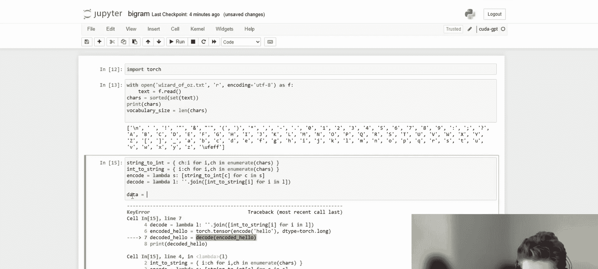

Elliot Arledge创建了这门课程。他将帮助你深刻理解LLMs的工作原理以及它们在各种应用。

中的使用方式。那么，让我们开始吧。欢迎来到语言建模入门课程。在这门课程中，你将学到很多疯狂的东西。好的。我只是提前告诉你一声。我们在这里学到的东西会很疯狂。然而，这并不会非常难。

我不指望你有任何微积分或线性代数的经验。很多其他课程假设你有这方面的知识，但我不会。我们将从零开始建立。在数学和机器学习中涉及到的新基本概念上，我们将采取，循序渐进的步骤。

一旦事情变得相当清晰且容易理解，我们将迈出更大的步，伐，这样我们就不会花费太多时间。通过每个小概念都采取渐进的步骤。这门课程受到Andrej Karpathy关于从零开始构建GPT的讲，座的启发。

所以向他致敬，是的，我们不假设你有任何经验，也许有三，个月的Python经验，只是为了语法有点熟悉，你可以，你能，够这样跟着进行，但不管你有多聪明，学得多快，愿意投入，时间是最重要的。

因为这是你通常不会遇到的材料。只要你能够保持持续的努力，坚持这些讲座，即使很难，稍，作休息，吃点零食，无论你需要做什么，喝点水，水很重要，是的，希望你能坚持到最后。你可以做到。由于是免费的编程营。

一切都将是本地计算，没有付费数据，集或云计算的范围。我们将把数据扩展到大约45千兆字节的整个训练数据集，所以我有90个保留，这样我们可以下载最初的45个，然后将，其转换为一个更容易处理的45个。所以。

如果你实际上没有保留90千兆字节，那没关系。你可以只下载一个不同的数据集，然后按照我在这个视频，中所做的相同的数据流程。在课程中，你可能会看到我在Mac OS和Windows之间切换。

这段代码仍然能正常工作，支持两个操作系统，而我将使用，一个叫做SSH的工具。这是一个服务器，我可以从我的MacBook连接到我正在录制，的Windows PC上，这将允许我执行、运行、构建，或者做任。

何与编码相关的事情，在我的MacBook上与命令提示符相关，的事情。因此，我将能够在那里做任何我在Windows电脑上能做的事，情。只是录制时看起来会有点不同。那么为什么我要创建这门课程呢？嗯。

正如我之前所说的，很多初学者，他们没有基础的知识，比如微积分、线性代数，这些知识可以帮助他们入门或加，速在这个领域的学习。因此，我打算从基础开始，然后逐渐深入，当处理起来相对，简单时，再迈入更大的步伐。

我将使用逻辑类比和逐步示例来帮助概念化，而不仅仅是，向你抛出大量的公式。说了这么多，让我们开始深入了解一下有趣的内容吧。为了逐步开发这个项目，我们将使用一种叫做Jupyter 。

Notebooks的东西，你可以在Anaconda提示符中尝试一下，或者至少从这里启动它们。所以Anaconda提示符非常适合任何与机器学习有关的事情，所以确保已安装这个。我会在描述中放置一个视频。

这样你就可以按步设置并安，装它，其中有逐步指南。从这一点出发，我们可以着手设置项目并初始化所有内容，我要做的就是转到我想要的目录。它将是Python测试。

我们将创建一个名为free code camp GPT course的目录，然后，从这一点出发，我们将创建一个虚拟环境。所以虚拟环境，最初在你的桌面上，你将拥有所有的Python，库，所有的依赖项。

它们只是漂浮在周围，而虚拟环境的作，用是将它们隔离开来。因此，在这里，你有这个孤立的环境，你可以随心所欲地玩，弄它，而且它是完全独立的。所以，这不会与你拥有的所有全局库交叉，当你不在虚拟环，境中时。

所有这些库只会影响系统，如果这样说得通的话。所以，我们现在将使用Python dash M进行设置，然后我们，将使用VENV进行虚拟VENV，然后是CUDA。

所以我们在这里提到CUDA的原因是因为当我们尝试加速我，们的学习或模型的学习时，我们将需要使用GPU。GPU将大大加速这个过程。基本上，CUDA只是GPU中让我们做到这一点的一个小特性。

所以我们要创建我们的环境，称之为CUDA。它会继续按回车键。它会为此执行，这会花费一些时间。现在完成了，我们可以继续进行CUDA，基本上我们只是激活，这个环境，这样我们就可以在其中开始开发。

我们将使用反斜杠，然后输入scripts，然后是activate。现在你可以看到它说的是CUDA基础。所以我们在CUDA中，然后是次要基础。所以它会优先考虑CUDA。从这一点上。

我们实际上可以开始安装一些库。所以我们可以输入pip3 install matplotlib numpy。我们将使用pylmza或lzma，还有其他一些是什么？我们将执行ipy kernel。

这是为了实际的Jupyter笔记本和能够将CUDA虚拟环境引，入这些笔记本。所以这就是为什么这很重要。然后就是实际的Jupyter笔记本功能。

所以继续按回车键。这些将会安装。这将需要几秒钟的时间。所以实际可能发生的是，你会遇到一个关于pylzma的构建，错误，这是一种压缩算法。别引用我说的话，但我相当确定它是基于C++的。

所以你实际上需要一些构建工具。你可以通过Visual Studio构建工具获取它们。所以你可能会看到一个小错误，基本上访问那个网站，你会，得到这个页面。所以继续下载构建工具。它会下载到这里。你会点击它。

它会设置，然后你可以继续点击“继续”。

然后在这一点上，如果你看到这里，你可以点击“修改”，然，后你可能会进入到一个小的工作负载部分。所以一旦你在工作负载，就很好了。你要确保的是你已经勾选了这两个右边的选项。只要确保你已经勾选了这两个。

我不确定桌面特别做什么。这可能有所帮助，但在你的电脑上安装一些构建工具总是，有好处的，即使是为将来的项目做准备。所以现在先获取这两个。那就很好。然后，如果你想修改，你可以点击这里的修改，就像这样。

然后你应该可以重新运行那个命令。所以从这一点上，我们实际上可以做的是，我们要安装 ，Torch，我们将使用 PIP 安装，使用 PIP 3 安装 Torch。我们不会像这样做。

我们实际上要做的是使用一个单独的命令，这将安装 CUDA， 与我们的 Torch。所以它将安装一个 CUDA 扩展，这将允许我们利用 GPU。所以就是这个命令。如果你想找到一个好的命令。

你可以去 PyTorch 文档，只，需进入入门指南，然后你就能看到这里。所以我们有稳定版，Windows，PIP，Python，然后是 CUDA ，11。7 或 11。8。所以我刚刚点击了这个。

由于我们不会使用 Torch Vision 或 Torch Audio，我基，本上只是运行了 PIP 3 安装 Torch，然后使用 CUDA 11。8， 的这个索引 URL。

所以这基本上就是我们安装CUDA所做的一切。

这是我们Torch的一部分。我们可以继续点击这个。非常好。我们安装了很多东西，很多库，已经完成了很多设置。现在我想检查的是确保我们的Python版本是我们想要的。所以Python版本是3。10。9。

很好。如果你在3。9、3。10、3。11之间，那就很完美。所以如果你在这些版本之间，应该没问题。在这一点上，我们可以直接进入我们的Jupyter笔记本。所以命令就是Jupyter笔记本，拼写就像这样。

点击回车。

它会把我们带到这里。而且我在我的VS Code中创建了这个小bigram。ipynb。所以基本上，你需要在里面输入一些东西，并确保它具有，ipynb扩展名，否则它将无法工作。

所以如果它只是ipynb而没有任何内容，我无法阅读那个文，件，原因我也说不清楚。所以确保你在其中输入一些内容，打开在VS Code中，输入，类似于a = 3或str = banana这样的内容。

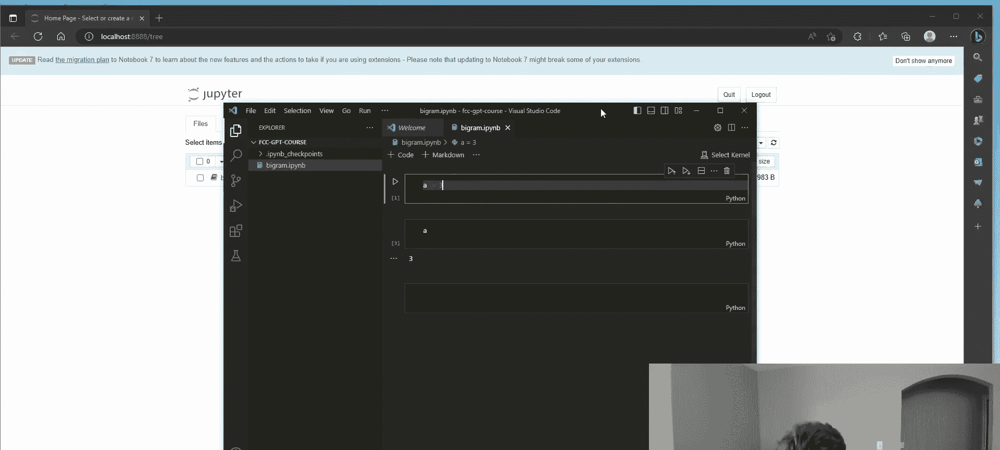

我不在乎。在这一点上，让我们继续并进入这里。这就是我们的笔记本的样子。在整个课程中，我们将会频繁使用它。那么接下来我们需要做的是确保我们的虚拟环境实际上是，在我们的笔记本内。

并确保我们可以通过这个内核与其进，行交互，而不仅仅是通过命令提示符。那么我们来检查一下。我这里有一个虚拟环境。你可能没有。但我们要做的就是基本上进入这里。我们将结束这个。

我们要做的就是执行 Python dash M，然后 IPY kernel ，install user。你会看到我们为什么要这么做在第二个用户名等于 CUDA，这是在我们之前初始化的虚拟环境中。

所以那是虚拟环境的名称。然后显示名称，它在终端中的实际显示方式，将是显示名称，我们就称它为 CUDA GPT。我不知道。听起来像个酷名字。然后我按回车键。它会为我们创建这个环境。很好。已安装。好。

所以我们可以再次运行我们的笔记本，看看这是否改变。

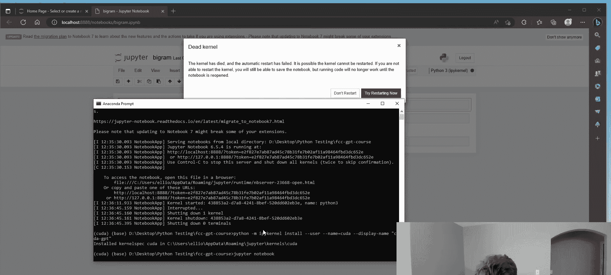

所以我们可以出去，再次进入我们的二元模型。内核更改内核。嘭。CUDA GPT。让我们点击那个。甜。所以现在我们实际上可以开始做更多的事情，试验一下笔，记本的工作方式，以及我们如何从头开始构建这个二元模。

型，学习语言模型的工作原理。所以让我们继续做这件事。所以在我们跳进这个实际的代码之前，我想要做的是删除，所有这些。很好。所以现在我要做的是获取一个小小的数据集，对我们来说，很小。

我们可以试着从中构建一个二元模型。所以我们可以去这个名为Project Gutenberg的网站，他们，基本上只有一堆在知识共享许可下许可的免费书籍。所以我们可以免费使用所有这些。

那么让我们使用绿野仙踪。在绿野仙踪的结尾。很好。

所以我们要做的是点击这里的纯文本。很好。所以现在我可以按Ctrl+S保存这个，然后我们可以只是去，绿野仙踪。绿野仙踪。好。现在我要做的是，我们应该把这个拖到，我们应该把这个拖，到我们的文件夹里。

我只是把它放进去。好东西。这样做行不行？好的。现在我们在这里有了我们的绿野仙踪文本。我们可以打开它。我们可以开始这本书。好的。我们可以继续往下走，找到开始的地方。好的。也许我们就在这里剪切。

这是一个开始的好地方。就这样。我会加入一些空格。好的。现在我们有了这本书。来到底部，去掉一些其他许可证的东西，可能会在整本书的，上下文中干扰我们的预测。让我们快进到开始的地方。书的结尾。好的。好的。

我们已经得到了所有的东西。搞定了。去掉那里的插图。完美。现在我们有了这个可以操作的绿野仙踪文本。让我们关闭，关闭它。203千字节。太棒了。非常小的大小。我们可以处理这个。

这太好了。那么我们有这个奥兹巫师的TXT文件。我们要做什么呢？嗯，我们要尝试在这个文本上训练一个transformer，或者至少是，一个后台语言模型。为了做到这一点，我们需要学会如何管理这个文本文件。

如，何打开它等等。那么我们将继续打开这个并像这样制作奥兹巫师。然后我们将以读取模式放入，并使用UTF-8编码就像这样。这是您可以打开的文件模式。有读取模式，写入模式，读取二进制，写入二进制。

对于这个视频，我们真的只关心这四个。如果您愿意，您可以在业余时间查看其他内容。但是我们现在只会使用这四个。然后编码只是我们使用的字符编码类型是什么？基本上就是这样。我们可以简单地将这个作为F打开。

F代表文件。我将执行文本等于F点读取。我只是要读取存储在字符串变量中的这个文件。然后我们可以打印一些关于它的东西。所以我们可以打印出这段文本的长度，运行一下。我们得到了文本的长度。

我们可以打印出文本的前200个字符。当然。所以我们有了前200个字符，很好。所以现在我们知道如何玩弄字符，至少看看字符实际上是，什么样子的。所以现在我们可以从这一点做更多的事情，即编码器。

在我们深入讨论之前，我要做的是把它们放入一个我们可，以使用的小词汇表中。所以我要做的是，我们要创建一个叫做chars的变量。所以chars将是这段文本中所有字符的集合。

所以我们将在这里创建一个排序的文本集合，然后打印出，chars。看这个。我们有一个包含所有这些字符的巨大数组。所以现在我们可以做的是使用一个称为分词器的东西，分，词器由编码器和解码器组成。

编码器的作用是将这个数组的每个元素转换为整数。所以也许这会是零。这将是一个一，对吧？那么换行或回车将是零，空格将是一个一，感叹号将是二，等等，对吧？一直到它们的长度。

然后我们甚至可以打印出这些字符的长度，这样我们就能，看到实际有多少个字符。所以整个《绿野仙踪》书中有81个字符。所以我写了一些代码，在这里为我们完成分词的工作。我们只是使用一些生成器。

在这里使用生成形式的for循环，并根据词汇表创建一个小映射，从字符串到整数，从整数到，字符串。所以我们只是枚举每一个。我们将第一个元素分配为一，第二个分配为二，等等，对吧？

基本上这就是我们在这里做的全部。我们有一个编码器和一个解码器。所以假设我们想将字符串"hello"转换为整数。那么我们就进行编码，可以像这样输入 hello。然后我们可以继续打印出来。完美。

让我们运行一下。嘭。所以现在我们有一个从字符到整数的转换。然后如果我们想要可能将这个转换回去。所以解码它。我们只是把这个放进一个小的、也许是解码的hello等于，那个。

然后我们可以继续或者编码而是编码的hello。然后我们可以去解码hello等于我们去解码，我们可以使用，编码的hello。我们将继续将这个编码成整数，然后将整数解码回字符格，式。所以让我们继续打印出来。

我们将继续打印解码后的hello。完美。所以现在我们得到了那个。所以我要给你一些关于这些标记器的背景信息。所以现在我们正在使用字符级标记器，它基本上将每个字，符转换为一个整数等价物。

所以我们有一个非常小的词汇量和大量的标记需要转换。所以如果我们有40，000个单独的字符，这意味着我们有一，个小的词汇量可供使用，但有很多字符需要编码和解码。如果我们使用单词级标记器。

这意味着我们有很多，就像英，语中的每个单词一样。我是说，如果你在处理多种语言，这可能会涉及到大量的标，记。所以你可能会有几百万、几十亿甚至几万亿的标记，如果，你在做一些奇怪的事情。但在这种情况下。

你要处理的数据集会更小。所以你会有一个非常大的词汇量，但要编码和解码的标记，量却很小。如果你使用子词标记器，那意味着你会介于字符级别和单，词级别标记器之间，如果这样说得通的话。所以在语言模型的背景下。

高效处理数据非常重要。仅仅拥有一个巨大的字符串可能不是最好的选择。而我们将使用一个名为PyTorch或Torch的机器学习框架。我已经在这里导入了它。基本上，这将为我们处理大量的数学和微积分工作。

以及涉，及一种称为张量的数据结构的大量线性代数工作。所以张量基本上就是矩阵。如果你对这些不熟悉，没关系。我们将在课程中更详细地讨论它们。但基本上我们要做的就是将所有内容都放入一个张量中。

这样PyTorch更容易处理。所以我要继续删除这些。我们能做的就是创建我们的数据元素。我们可以把这整个《绿野仙踪》的文本数据都放在这里。所以我们可以继续将这个数据设为 Torch 的张量，然后进。

行编码。我们要把文本放进去。所以我们要对这个文本进行编码。然后我们要确保我们有正确的数据类型，即 Torch 的长整，型数据类型等于 Torch 的长整型。这基本上意味着我们将拥有一个超长的整数序列。

是的，让我们看看我们可以用这个 Torch 的张量元素做些，什么。所以我刚刚写了一个小的打印语句，我们可以打印出这个，数据的前100个字符或100个整数。在处理数组方面基本上是相同的。

只是在PyTorch的上下文中，这是一种不同类型的数据结构，以某种方式更容易处理。PyTorch 主要围绕张量展开，对其进行修改、改变形状、，改变维度、相乘、进行点积，听起来确实是很多事情。

但我们将在课程后期详细介绍一些内容，关于如何进行所，有这些数学运算。我们将实际演示如何将这个矩阵与另一个矩阵相乘，即使，它们的形状不同，甚至进行点乘、点积等操作。

接下来我要讲的是一种称为验证和训练拆分的东西。那么为什么我们不只使用整个文本文档，并且只在其中进，行训练，整个文本语料库呢？我们为什么不对此进行训练呢？嗯，我们实际上将其分成训练集和验证集。

我将在这里向您，展示原因。所以我们有这个巨大的文本语料库。这是一个超长的文本文件。把它想象成一篇文章，但有很多页。所以这是我们的整个语料库，我们将80%用作训练集，大概，是这么多。

然后其他的验证集就是这20%，在这里。如果我们只是在整个东西上进行训练，在一定数量的迭代，之后，它将只是记住整个文本片段，并且能够简单地写出它，只是把它写出来。它会把整个东西记住。

但实际上并不会得到任何有用的东，西。它只会知道这份文档。但语言建模的目的是生成类似训练数据的文本。这就是为什么我们把它分成了几部分的原因。所以，如果我们在这里运行我们的训练部分，它只会知道整。

个语料库的80%，并且它只会在那80%上生成，而不是整个东，西。然后我们有另外20%，只知道整个语料库的20%。我们这样做的原因是确保生成的文本是独一无二的，而不，是实际文档的精确副本。

我们试图生成类似文档的文本。比如，在Andrej Karpathy的讲座中，他训练的是莎士比亚，文本，整个莎士比亚的作品。重点是生成类似莎士比亚风格的文本，但不是完全一样，不，是那个确切的，你知道。

整个语料库的40，000行或几千行，对吧？我们试图生成类似的文本。这就是我们使用训练和验证分割的全部原因，或者至少是，大部分原因。所以你可能会想，你知道，为什么这个被称为二元语言模型，呢？

我现在要向你展示这是如何工作的。所以如果我们回到我们的白板这里，我画了一个小草图。所以如果我们有这段内容，单词hello，就假设它，我们现在，不需要将其编码为任何整数。我们只是用字符在工作。

基本上我们有两个，对吧？所以by的前缀意味着两个。所以我们将会有一个二元组。所以也许，我是说，在这个内容中H之前没有任何东西。所以我们假设那是内容的开头，然后那将指向一个H。

所以H是最有可能出现在开头之后的。然后也许给定一个H，我们会有一个E，然后给定一个E，我们，会有一个L，然后给定一个L，我们会有另一个L，然后L导致，O，对吧？所以也许与这些相关联一些概率。

所以这基本上是它现在将如何预测。它只会考虑前一个字符来预测下一个。所以我们有了这一个，我们就预测下一个。所以有两个，这就是为什么它被称为二元语言模型。忽略我这里糟糕的写法，但实际上我们要讨论的是如何训。

练二元语言模型以达到我们的目标。我们要讨论的是如何将这个应用到神经网络中，一种人工，神经网络，并对其进行训练。所以我们要涉及一种叫做块大小的东西，它基本上只是从，整个文本语料库中随机取出一小部分。

我们将进行一些预测，我们将从中制定一些目标。因此，我们的块大小只是一堆编码字符或整数，我们有预测，和目标。假设我们取一个很小的大小，也许是五个。好的，所以我们有这个小小的包含五个整数的张量，这些是。

我们的预测。所以在给定一些上下文的情况下，我们将对这些进行预测，然后我们有我们的目标，它将偏移一个。所以请注意，这里我们有一个五，然后这里的五在外面，然，后这个35在外面，现在它在里面。

我们所做的就是从预测中取得那个块以获得目标。我们只是将其偏移一个。所以我们将要访问相同的索引。所以索引零将是五。索引零将是67。所以67在背景语言模型中跟随着五。所以这基本上就是我们所做的全部。

我们只是看看目标与预测相差多少，或者预测离目标有多，远？然后我们可以优化以减小这个错误。所以在字符级标记器或字符级标记方面，这的最基本的，Python实现就是简单地这样。所以我们会取一个小片段，随机的。

它基本上就是从片段的开始或一些地方，只是片段一直到，块大小。所以是五。再次忽略我的糟糕的书写。然后这个将是，它只会是一直到块大小或五加一。所以我们有到六。对。这基本上就是我们所做的全部。

这在代码中会看起来就是这样的。所以我在这里写了一些代码，完全按照我们刚刚在Python，中讨论的做。所以我已经定义了这个块的大小等于八，只是为了让你能，够在更大的尺度上看到这是什么样子，稍微大一点。

而且就是我们在Jupyter笔记本中写下的，从位置零到块的，大小，然后偏移一个。所以我们将其设置为位置一到块的大小加一，稍微有一个，偏移。我们基本上只是在这里写下X作为我们的预测，Y作为我们，的目标。

然后用一个小循环来显示预测和目标是什么。这就是在Python中的样子。很好。我们可以进行预测，但这还不够可扩展。这是顺序的，对吧？顺序是描述CPU做什么的另一种方式。

CPU可以非常快速地执行许多复杂的操作，但它只是按顺序，进行。是这个任务，然后这个任务，再然后这个任务。对。但是使用GPU，你可以做一些更简单的任务，但非常迅速地，或并行进行。

所以我们可以进行大量的非常小或者计算上不复杂的计算，并在许多不太好但有很多的小处理器上进行。所以基本上我们可以做的是，我们可以取这些小块的每一，个，然后我们可以堆叠它们并将它们推送到 GPU 以大幅度。

扩展我们的训练。现在我将为您说明。那么，让我们假设我们有一个块。好的。块看起来像这样，我们之间有一些整数。好的。所以这是一个块。好的。现在，如果我们想要制作多个这样的块，我们只需将它们堆，叠在一起。

所以我们要做另一个，另一个，另一个。那么我们假设有四个批次。好的。或者，对不起，四个块。所以我们有四个不同的块，它们只是叠在彼此上面，我们可，以将这表示为一个称为批量大小的新超参数。

这将告诉我们实际上我们可以并行处理多少个这样的序列，因此，块大小是每个序列的长度，批量大小是我们实际上同，时执行多少个这样的序列。这是扩展语言模型的一种非常好的方式。没有这些。

你不能真的期望任何快速的训练或良好的性能，所以我们刚刚讨论了如何获取批次，或者说如何利用批次，来加速训练过程。而且，实际上只需要一行代码就能做到这一点。所以我们只需要调用这个小函数，判断一下torch。

cuda是，否可用。我们将检查GPU是否可用，基于您的CUDA安装情况。如果它可用，就像它说可用一样，我们就将设备设置为，CUDA，否则是CPU。所以我们要打印出当前设备。这样程序将运行。

我们会得到CUDA。这意味着我们可以在很多处理中使用GPU。而且在这里，我要把这个超参数块大小移到前面。块大小，然后我们将使用批处理大小，即我们同时处理多少，个块。我们暂时将其设置为四。

这是我们训练非常重要的两个超参数。当我们扩大数据规模并使用更复杂的机制来训练并学习根，据我们提供的文本学习语言模式的时候，你会看到为什么，这些参数以后会变得更加重要。所以如果一开始不起作用。

如果是一个新的Jupyter ，Notebook一开始不起作用，我建议只需按下控制C取消，多，按几次，可能第一次不起作用。它会关闭，然后你再打开Jupyter Notebook，然后输入。

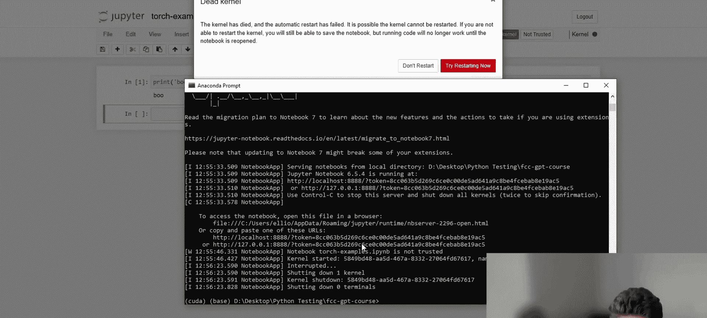

然后，完成这个步骤后，你应该能够重新启动并且它会工作，希望如此。好了。那么我继续重新启动并清除输出。然后我们可以运行它。看，我们得到boo。所以，很棒。现在。

让我们尝试做一些真正酷炫的PyTorch操作。所以我们继续在这里导入Torch。然后让我们尝试一下这个randint特性。所以你输入randint，我们将等于Torch 。randint。

然后让我们说我们输入从负100到100。然后在括号里，我们输入六，就是这样。所以如果我们想要在这里打印出来，或者我们可以直接输，入randint。首先运行这个块。很好。嗯。所以我们得到一个张量类型。

而且这些数字都是，我们有六个。所以1、2、3、4、5、6，它们在负100到100之间。所以在我们从这个巨大的文本语料库中获取随机批次时，我们需要记住这一点。那么让我们试试一个新的。我们只是试试。

我们可以创建张量。我们以前做过这个。所以我们做张量等于Torch 。tensor。然后我们可以写成 0 。1，1 。2。这里，我将复制并粘贴一个在这里。所以我们这样做，砰，我们可以做张量。

然后我们会得到完，全相同的结果。所以砰，我们得到一个三乘二的矩阵。现在我们要尝试一个叫做zeros的不同的东西。所以zeros就是Torch 。zeros。然后在这里，我们可以做这个的维度或形状。

所以二乘三，然后我们可以做零。然后去运行它。所以我们得到一个二乘三的零矩阵。这些都是浮点数，顺便说一下。也许我们现在可以试试ones。我知道ones是一个相当有趣的东西。所以我们去Torch 。

ones。这基本上和zeros一样。我们可以做三乘四之类的。然后那个就出来了。所以我们有一个三乘四的全是一的矩阵。太好了。那么如果我们将输入设置为Torch。empty。我们可以做成两行三列。

所以这些很有趣。这些基本上是一堆非常大或非常小的数字。我还没有找到特定的用例，但这只是PyTorch具有的另一个，功能。我们有一个范围。所以我们去一个范围等于Torch。aRange。

然后我们可以做像五这样的。然后我们就做范围。所以现在我们有一个张量，从零开始，直到四。就像这样的五。我们做线性空间等于Torch。linespace。拼写很奇怪。做三，十。然后步数，例如，等于五。

这一切马上就会有意义。我们运行一下，我们得到一个线性空间。所以步数等于五。所以我们有五个不同的。咻，咻，咻，咻，咻。然后我们一直从三到十。所以基本上从三一直加到十，分为五个步骤。

所以你正在每次都添加相同的数量。所以三加1。75是4。75，再加1。75是6。5，然后8。25，然后是，10，对吧？所以超过五个步骤，我们想要找出那个常数增量是多少。所以这是一个相当酷的例子。

然后我们有，我们将使用对数空间，这很有趣。对数空间等于Torch。logspace。然后我们将开始。开始等于负10，结束等于10。这两者都是开始和结束，所以你可以把它们放在这里。

你可以将开始与它们一起放置，开始等于，或者你可以不这，样做。这完全取决于你。然后我们可以再次放置我们的步骤。所以步骤等于每五个。所以我们将运行它，或者，哎呀，我们需要在这里放置对数，空间。

这样我们就能得到它。所以我们从负10开始，然后我们做这些小增量。所以它变成10，负五，零，再加五次，超过五个步骤。这非常酷。还有什么我们在这里有？所以我们有I，Torch。I。

我只是在我的第二个屏幕上写下所，有这些。所以有一堆例子只是写出来的，我们只是在想象这些可以，做什么。也许你甚至会有自己创造性的一些思考火花，也许你会发，现其他可以用这些东西的方式。

用于你自己的个人项目或，任何你想做的事情。所以我们只是在尝试这些，看看我们能用PyTorch的基础知，识以及一些非常基本的函数做些什么。所以Torch 。I，我们在这里打印出这个I。

所以我们基本上只得到一条对角线，是在五里。所以你得到一个五乘五的矩阵，是的，基本上只是减少了每，一行的长形式。我不知道怎么发音，但这基本上就是它的样子。所以很酷的东西。让我们看看还有什么。我们有空的。

就像，我们有空的Torch 。empty A，然后我们，只是说，也许让A等于，我们让它成为一个Torch 。empty。然后我们可以去两乘三，然后数据类型是Torch 。int64，64，位整数。

然后让我们看看这里会发生什么，空，嗖。所以这很酷。我们还有什么？是的，我们也可以计时。所以我要抹掉所有这些。你可以，我的意思是，你可以在视频中往回滚动，只是看一，下，也许尝试一下这些。

试一下比我做的更多一点，也许稍，微修改一下。但是是的，我实际上要删除所有这些。所以我们只需，然后我们可以继续执行设备等于CUDA。然后我们将继续切换到CUDA GPT环境。所以如果Torch。

CUDA下划线存在，CUDA可用，然后其他情，况，切换到CPU，在这里打印出我们的设备，继续运行这个，CUDA，很好。所以我们将尝试使用GPU做一些与CPU相比的工作，真正看，看当我们改变形状和维度。

并对许多不同的张量进行不同，的实验时，CUDA或GPU将会在比较中对CPU产生多大的差异，为了实际测量GPU和CPU之间的差异，我刚刚导入了一个叫，做time的库。所以这是随操作系统或抱歉。

与Python一起提供的。你实际上不必手动安装这个。基本上，当我们调用time。time然后括号时，它将只获取当，前的时间片段。所以开始时间就是现在，然后结束时间，可能是三秒后，你，知道。

就是现在再加三秒。所以如果我们减去结束时间，开始时间，我们会得到一个三，秒的差异。那将是总经过时间。然后这个小数字在这里，这个四只是我们有多少位小数点，所以我可以继续在这里运行。时间未定义。

让我们首先运行那个。这将花费，你知道，几乎没有时间。所以我们实际上可以把这个增加到10，然后再运行一次。同样，你知道，我们几乎是在制作一个一乘一的矩阵。所以只是一个零。

所以我们不会从中得到任何重要的东西。但无论如何，对于实际测试GPU和CPU之间的差异，我们要关，注的是那个迭代的过程，通过网络进行前向传播和反向传，播的过程。这主要是我们试图进行优化的地方。实际上。

将所有这些参数和模型权重推送到GPU并不是真正，的问题。这可能需要最多几秒钟，比如可能需要30秒左右。而这在整个培训过程中将不会占用任何时间。所以我们想要做的就是看看。

在CPU上使用NumPy还是在GPU，上使用CUDA的Torch哪个更好。所以我有一些代码在这里。所以我们要在这里初始化一堆矩阵。或者抱歉，张量，我们基本上是随机的。所以我们有一个10，000乘以10。

000的全是随机浮点数的矩，阵。然后我们要将这些推送到GPU上。我们有两个这样的，对于NumPy也是一样的。所以为了实际上用PyTorch相乘矩阵，我们需要使用这个@，符号。所以我们将它们相乘。

我们得到这个新的，我们得到这个新，的随机张量然后我们停下来。然后我们在这里做同样的事情，只是我们使用NumPy ，multiply。所以如果我继续运行这些，初始化这些将需要几秒钟，甚至，不到几秒钟。

然后我们有，瞧，看看这个。所以对于GPU来说，这需要一点时间。然后对于CPU来说，时间没有那么长。这是因为这些矩阵的形状并不是很大。它们只是二维的，对吧？所以这是 CPU 可以非常迅速完成的任务。

因为没有太多要，做的事情。但是，假设我们想要提高一下水平。如果我们设置为 100、100、100，然后可能再加入另外 ，100。希望这样能行。然后我们可以做，我们就做同样的事情。所以让我们粘贴这个。

现在，如果我们尝试再次运行这个，你会发现 GPU 实际上，所花费的时间不到 CPU 的一半。这是因为这里发生了很多事情。有很多简单的乘法要做。所以这么重要的原因是因为当我们的语言模型中有数百万。

或数十亿个参数时，我们不会在所有这些张量之间进行非，常复杂的操作。它们将非常类似于我们在这里看到的内容。维度和形状会非常类似于我们现在看到的，可能是三四个，维度。而我们的 GPU 很容易做到这一点。

这不是我们需要 CPU 做的复杂任务。它们一点都不难。所以当我们将这个任务交给并行处理时，速度会更快。所以你会在课程后面看到这为什么很重要。你会在我们即将使用的一些超参数中看到这一点，我现在。

不会深入讨论。但在接下来的一小段时间里，你会明白为什么GPU对增加迭，代过程的效率很重要。所以这很棒。现在你多了解一些为什么我们在训练效率上使用GPU而不，是CPU的原因。实际上，还有一个术语。

我们可以称之为百分比时间。我不知道这是否是你应该这样称呼它，但那就是它的含义，基本上它会计算执行一个块的时间。所以在这里我们可以看到CPU的执行时间为零纳秒。N代表纳秒，是一秒的十亿分之一。

然后是墙上的时间。CPU时间是在CPU上执行所需的时间，即进行操作的时间。而墙上的时间则是实际花费的时间。你要等多久？你必须等到它完成吗？唯一不包括在CPU时间中的是等待。在整个过程中。

将会有一些操作和一些等待。墙时间将包含这两者，而CPU时间只是执行。那么，让我们继续一些基本的PyTorch函数。所以我在这里写了一些东西。那么我们将会讲解Torch 。stack，Torch 。

multinomial，Torch 。tril，triu，我认为这不是正确的发，音，但我们会更深入地讨论这个，转置，线性，连接和，softmax函数。所以让我们首先从Torch 。

multinomial开始。这本质上是基于您提供的索引的概率分布。所以我们这里有概率。我们说0 。1和0 。9。这些数字必须相加为1，使总和为100％。100％是1，整体是1。所以我有10％和90％。

这是在索引0处，所以我们有10％的机会得到0和90％的机会，得到1。所以如果我继续在这里运行这些，让它做它的事情。所以你可以看到最后，我们的numSample设置为10。所以它将给我们10个这样的结果。

1， 2， 3， 4， 5， 6， 7， 8， 9， 10。而且它们都是1。如果我们再次运行它，我们可能会得到稍微不同的结果。你看，现在我们有一些0在这里，但是0的发生概率非常低。事实上，确切地说。

有10%的概率发生。所以我们将在后面使用这个来预测接下来会出现什么词。让我们转向 Torch 。cat，或简称 Torch 。concatenate。这将基本上将两个张量连接成一个。

所以我在这里初始化这个张量，Torch 。tensor，1， 2， 3， ，4。它是一维的。而我们还有另一个张量，它只包含5。所以如果我们连接1， 2， 3， 4和5，那么我们得到1， 2， 3， 4。

 5。我们只是把它们结合在一起，这就是最后的结果。所以我们运行那个，1， 2， 3， 4， 5。完美。所以当我们生成给定上下文的文本时，我们将实际使用这，个。所以它将从0开始。

我们将使用我们的概率分布来选择第一个。然后基于第一个，我们将预测下一个字符。然后一旦我们预测出来，我们将新的与我们已经预测过的，连接起来。所以我们有这大概100个字符在这里。

然后我们要预测的下一个字符在这里。我们只需将它们连接起来。到最后，我们将拥有所有我们预测过的整数。接下来，我们有torch。trill。这个代表的是，trill代表的是三角形下降。

所以它会呈现出一种类似三角形的形状。对角线。它会从左上角到右下角。这就是为什么后面在这门课程中会更清楚。但这很重要，因为当你尝试预测序列中的整数或下一个标，记时，你只知道当前历史中存在什么。

我们正在尝试预测未来。所以在未来给出答案并不是我们想要做的。也许我们刚刚预测了一个，其他的我们还没有预测。所以我们将所有这些设为零。然后我们又预测了另一个。而这些仍然是零。所以它们在历史中彼此交流。

随着我们的预测累积，我们有了越来越多的历史可以回顾，而未来则越来越少。对。基本上，这个的前提只是确保我们不能与答案进行通信。我们不能在知道答案的情况下进行预测。就像你参加考试时，不能使用答题纸一样。

他们不会给你答题纸。所以你必须根据你的知识历史来预测答案。这就是这里正在发生的一切。而且我们有我是说，你可能猜到这个三角形上面。所以我们有所有上面的。这些在下面的下面，然后这些在上面的上面。

所以同样的概念在这里。然后我们有一个掩码填充。所以这个以后会非常重要，因为为了真正到达这一点，我们，所做的就是对这里的每个元素进行指数运算。所以如果你对零进行指数运算，它将变成一。

如果你对负无穷进行指数运算，它将变成零。这里发生的一切就是我们在这里的每个元素上做了约，2。71，这是我们在点EXP函数中使用的一个常数。然后我们将其提高到当前槽中的任意幂。所以我们这里有一个零。

所以2。71的零次方等于一。2 。71对一等于2 。71。然后2 。71对负无穷是，当然，是零。所以这基本上是我们从这里到这里的方式。我们只是简单地将这些遮盖。所以这很棒。我展示了EXP的作用。

我们只是使用这个。我们使用这个输出，然后将其插入到这里。所以它将从负无穷到零，然后从零到一。这就是我们从这里到这里的方式。现在我们有转置。所以转置是当我们在张量的维度之间翻转或交换时。在这种情况下。

我初始化一个torch。zeros张量，其维度为2，乘3乘4。我们可以使用transpose函数来翻转我们想要的任何维度，所以我们正在查看零维。虽然不说第一维听起来很奇怪，但我们基本上是在交换零。

位置和第二位置。所以0， 1， 2。我们正在将这个与这个交换。所以最终结果，正如你可能猜到的那样，形状将是4， 3， 2，而不是2， 3， 4。所以你可以简单地看一下这个，看看哪些被翻转了。

而这些就是维度，那就是输出。所以希望这是有意义的。接下来，我们有torch dot stack。这就是我们实际要去的地方。我们会做更多这样的事情。当我们获取我们的批次时。

我们很快会使用torch dot ，stack。所以记住之前当我谈论批量大小时，我们如何把一堆这些，块放在一起然后堆叠它们。一串整数或令牌的巨大长度。我们所做的一切就是把它们堆在一起形成批次。

这基本上就是我们将要做的。而这就是torch dot stack的作用。所以我们可以拿一些一维的东西然后堆叠它们使其二维化，我们可以拿一些二维的东西并堆叠它们多次使其三维化。或者我们可以说三维的，例如。

我们有一堆立方体并把它们，叠在一起。现在它是四维的。所以希望这是有意义的。我们所做的一切就是按顺序传递我们将要堆叠的每个张量，所以这是我们的小输出，基本上就是这样。接下来的函数对我们的模型非常重要。

我们将在整个过程，中一直使用它。这非常重要。它被称为nn点线性函数。所以它基本上是nn点模块的一个函数。这非常重要，因为后面你会看到nn点模块包含任何具有可，学习参数的内容。所以当我们对某物进行转换。

当我们应用权重和偏差时，在，这种情况下，它将为false。但基本上当我们在nn点模块下应用权重或偏差时，它将学，会这些，并且会变得越来越好。它基本上会根据这些参数的准确性以及某些参数将其带到。

期望的输出的接近程度进行训练。所以基本上任何涉及nn点线性的东西都将非常重要，并且，它是可学习的。所以在这里我们可以看到，这是torus点nn，在文档中的一，个小部分。所以我们有容器，许多不同的层。

比如激活，层，基本上就是，层。就是这样。所以这些很重要。我们基本上要从这些中学到东西，你会看到为什么。我们将使用一种称为键和值的东西，稍后还有键、值和查，询。你会看到这些为什么很重要。

但如果现在还不清楚，让我现在为你说明一下。所以我在这里画了出来。所以如果我们回顾一下我们的例子，我们初始化了一个张，量，它是 10、10 和 10。我们要做的是进行线性变换。这个线性代表线性变换。

所以基本上我们只是要通过这些层的每一层应用权重和偏，差。所以我们有一个输入和一个输出。X 是我们的输入，Y 是我们的输出。而且这是大小为三的，这也是大小为三的。所以基本上我们只需要确保这些是对齐的。

而且更多的背景，nn 。sequential 在某种程度上是建立在， nn 。linear 的基础上的。所以如果我们现在去搜索一下，一会儿这就会有意义。这在机器学习中也是一些很好的先修知识。

那么让我们看一下，nn 。sequential 在这里没有显示出来，但基本上如果你有，假设有两个，你有两个输入神经元，也，许你有一个输出神经元，在中间有一堆隐藏层。假设我们有一个，两个，三个，四个。

然后一个，两个，三个。所以基本上你需要确保输入与这个隐藏层对齐。这个隐藏层与这个对齐，而这个对齐与这个对齐。所以你会有一个从两个到四个的转换。所以两个，四个，然后这个将会是四个到三个，四个到三个。

然后你将会有一个最后的。所以这是两个到四个，这里是四个到三个。然后这最后一个，将会是三个到一个。所以你基本上只需要确保这些对齐。所以我们可以看到我们有两个，四个，然后这个四个是从这，里的输出传递过来的。

基本上这将确保我们的形状是一致的。当然，如果它们不一致，如果形状不合适，数学就不会奏效，所以我们需要确保我们的形状是一致的。如果那不太明白，我知道我不太擅长解释神经网络架构，但，如果你真的感兴趣。

你可以使用Chad GPT，当然。那是一个非常好的学习资源，Chad GPT，在GitHub讨论中，或者只是查看文档。如果你不擅长阅读文档，那么你可以从这里取一些关键词。

比如一个sequential container。那么，什么是sequential container？你可以问Chad GPT这些类型的问题，并且只是反向工程文，档，一步一步地弄清楚事情。

如果你不知道所有的数学和所有的函数在进行什么操作，那么很难知道你在做什么。你不需要记住它们。但在与它们一起工作时，了解它们在幕后真正做什么是很，重要的，特别是如果你想要制作一个高效和正常工作的神。

经网络。所以就是这样。而在这些线性层中，基本上会发生的是我们将从一个简单，地转换到另一个，从输入到输出，没有隐藏层。而且我们只会学到做到这一点的最佳参数。稍后你会看到为什么这很有用。

现在我们有softmax函数。所以听起来有点吓人。而且softmax函数实际上和听起来的完全不一样。让我现在为你演示一下。所以让我们继续改变这里的颜色。假设我们有一个数组，我们有一个1、2、3的列表。

我们将，它们变成浮点数，2。0、3。0等等。对吧？浮点数，随便。所以基本上如果我们把这个放入softmax函数中，会发生的，是我们将对这些进行指数运算，然后除以它们的和。对所有这些进行了指数运算。

所以基本上会发生的事情，比如我们对1进行指数运算。好的。那么会发生的是，这在代码中看起来是这样的。会是1。exp。我想我在这里谈到过这个。这是当我们有2。71的幂时进行指数运算。所以如果我们有这个1。

我们将对其进行指数运算，这将给，我们，它将给我们2。71。然后我们有这个2，这将给我们任何2的幂。2。71的2次方。好。所以我们要得到7。34。所以我们要得到7。34，我的书写很糟糕，2。71的三次方。

所，以是19。9。所以基本上要发生的是，我们可以将这些重新排列在一个，新的数组中，7。34和19。9。所以如果我们把这些加在一起，把这些加在一起，我们会得，到2。71加上这个加上那个。

所以让我们快速做一下这个数学。我只是要带领你理解softmax函数在做什么。7。34加19。9。这将给我们一个总数是29。95。很好。29。9。所以我们要做的就是将这些元素除以总数。所以2。

71除以这个可能会得到x。好的。然后我们将7。34除以这个，它会给我们y。然后我们将19。9除以这个，它会给我们z。所以基本上你要对所有这些进行指数运算。你要将它们加在一起得到一个总数。

然后你要将每一个指数元素除以指数总数。所以之后，这个x在这里只是，我们只是要再次将这些包起，来。而所有这个 softmax 函数所做的就是将这个 1、2、3 转，换成 x、y、z。这就是它所做的一切。

是的，这并不是很复杂。有一个奇怪的公式。Softmax 函数。所以如果你去维基百科，你可能会被吓到，因为这里有很多，术语。还有很多数学，你知道，高中水平以上的。但是，就像这个公式。

我相信这就是它的标准单位 softmax， 函数。就是这样。所以基本上它所做的就是这样。这就是它的简单解释。所以你以后会看到为什么这很有用，但知道正在发生什么，很重要，这样当这些背景知识变得重要时。

你就不会落后于，课程。所以如果我们来看一下 softmax 函数在代码中的一个小，例子，它看起来像是这样的。所以我们导入 torch。nn。functional as f，f 是 。

functional 的缩写。然后我们基本上只需使用 f。softmax 然后插入一个张量，和我们想要的维度，输出的维度。所以如果我们将这个插入到这里并打印出来，我要打印出，来。这可能需要一点时间。

Torch未定义。那么让我们从这里重新运行。嘭。然后让我们再试一次。嘭。好了。所以如果你把所有这些值拿出来，让我们实际上从头再做，一遍。所以如果我们计算2 。71，2 。71除以29 。95。

我们得到0 ，09，0 。09。好。然后如果我们计算7 。34除以29 。95，我们得到0 。245，0 ，245。嗯，那差不多了。嗯，实际上非常接近。然后66 。52。所以如果我们去，嗯。

那是最后一个？19 。9。我们计算19 。9除以29 。95，得到66 。4。所以66 。5相当接近。再次说明一下，我们在四舍五入，所以它并不完全，它并不，完全准确，但正如你所见，它们非常接近。

对于只有两位小，数的情况，我们做得相当不错，这只是说明softmax函数的，功能以及在代码中的样子。我们有这个，嗯，形状在这里。零维意味着，我们只是取，你知道，它只是一条直线。就是这样。

那么现在我们要讲一下嵌入，实际上我还没有相关的代码，我们要一步一步地通过Chat GPT来解决这个问题，因为我，想向大家展示一下，嗯，逆向工程一个想法或函数，或者只。

是理解机器学习中的某个东西需要什么技能。

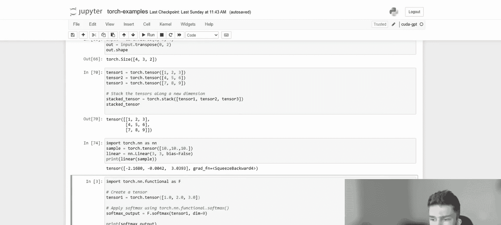

所以如果我们进入Chat GPT，在这里说，什么是nn ，embedding，nn 。embedding？这是PyTorch库中的一个类。好的。自然语言处理最大化，将每个离散输入映射到一个密集的。

向量表示。好的。这是怎么工作的呢？让我们看看。所以我们有一些词汇。那可能是我们的词汇量大小。所以我想我们之前谈到过，词汇量大小，数据集中实际上有，多少个字符，有多少个唯一的字符？那就是词汇量大小。

然后这里有一些嵌入维度，这是一个超参数。所以让我们看看，这对我来说还不太合理。也许我想学习一下，这实际上是什么样子？你能向一个八年级的学生解释一下并提供可视化吗？当然可以。好的。

代表单词含义的一些小秘密代码。好的。那有帮助。所以如果我们，如果我们有cat，好。所以cat，cat是一个词。所以也许我们想知道在字符级别上会是什么样子。在字符级别上呢，又会是什么样呢？

所以它可能看起来会很相似。我们有这个小向量在这里存储一些关于这是什么的信息。所以，a，它意味着这里。好。所以a是0 。2，这真的很有用。所以我们基本上只是学到了嵌入向量做什么。如果你跟上了这个。

基本上它们会存储关于这个字符的一，些信息的向量，而且我们甚至不知道每个元素的含义。我们不知道它们的含义。这可能是积极性，或者应该是一个词的开头，或者它可能是，我们甚至无法理解的任何信息片段。但是重点是。

如果我们实际上给它们向量，并将这些馈送到，一个网络中并学习，因为正如我们之前看到的，nn ，embedding就在这里是nn 。module的一部分。所以这些是可学习的参数，这很棒。

所以它实际上会学到每个字母的重要性，它将能够产生一，些惊人的结果。总之，嵌入向量本质上是一个向量或情感的数字表示。在我们的情况下，它是字符级别的，不是子词，也不是单词，是字符级别的。因此。

它将表示关于这些内容的某种含义。这就是嵌入向量的作用。让我们来看看它们在代码中是如何工作的。我们有这个小的字符级别嵌入向量，它包含一个列表。这里有五个元素。一，二，三，四，五。

并且它是按词汇表大小排列的。因此，我们的词汇表由每个嵌入向量的长度组成。所以这实际上是有道理的，因为我们的词汇表大小由嵌入，维度确定，这是实际存储在每个字符中的信息量。所以现在这很容易理解。

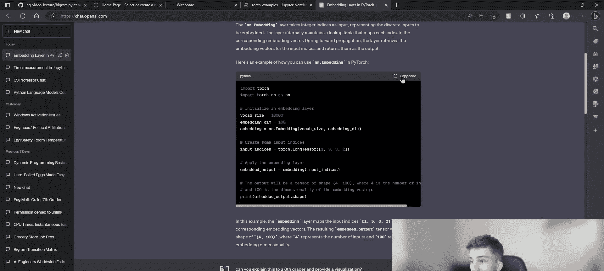

我只是要从这里复制这段代码，然后粘贴到这里，让我们把，torch。in去掉，因为我们已经在上面初始化过了。所以如果我们运行这个，实际上，让我们把字符数降到一千，试试看。但它没有被定义。我们没有初始化它。

所以让我们回到这里看看。所以这个点形状基本上会显示出它的形状，是这么多乘以，这么多。所以是四乘以一百。是的，我们可以使用这些，并且我们可以在其中存储有关字，符的信息。你将在下一堂课上看到这一点。

我们实际上如何使用嵌入，向量。所以如果很多东西现在还不明白，不用担心。那没关系。你会在课程中学到更多关于我们如何使用这些的知识。你会在自己的项目中更加自信地使用它们。所以现在不要太担心。

一开始学习嵌入确实有点棘手。但现在不要太担心。但我还有几件事想要讲一下，以便让我们为神经网络中即，将进行的一些线性代数和矩阵乘法做好准备。我记得以前我们提到过这个小草图，这实际上被称为多层，感知器。

但人们更喜欢称其为神经网络，因为这样更容易说，但这就是它的架构，一个多层感知器。但基本上正在发生的是我们在这里有一个小的输入，我们，有一个白色矩阵。一个白色矩阵看起来是这样的，看起来是这样的。

而且我们有一些，在X1、Y1和可能的Z1之间有一些值。所以一堆权重，也许还有一些偏差，我们要加到它上面。那么棘手的部分是我们如何实际将我们的输入与这个白色，矩阵相乘？我们只是在做一个矩阵乘以另一个矩阵。

嗯，这就是矩阵乘法。我现在将向您展示如何做到这一点。首先，我们必须学会一种叫做点积的东西。点积实际上非常简单，你可能以前做过。所以让我们说我们继续，我们继续拿这个数组。在这里。一，二，三。

这将是A的内容。然后我们有四，五，六。所以如果我们想找到这两者之间的点积，我们只需要简单，地取这两者的索引，第一个和第二个，第三个，将它们相乘，然后相加。所以我们将继续执行一次四，乘以五。

然后加上二乘以五，然后加上三乘以六。所以一乘以四是四，二乘以五是十，三乘以六是十八。那么我们就继续将它们加在一起。我们得到14加18，我相信是32。所以这个点乘的结果将是32。这就是简单点乘的方式。

就是取这两个数组的每个索引，将它们相乘，然后将所有这，些乘积相加。这就是点乘。实际上，我们需要矩阵乘法中的点乘。那么现在让我们继续深入研究。所以我将创建两个矩阵，这样操作起来会比较简单。

假设我们有矩阵A，我在这里有一个矩阵。它将是1、2、3、4、5和6。这将等于A，然后B将是另一个矩阵。所以我们将有7、8、9、10、11、12。忽略我的糟糕的书写。基本上我们要做的就是将它们相乘。首先。

我们需要确保它们可以相乘。因此，我们需要查看它们的行数和列数。这个右边的是三行，一、二、三。三行和两列。所以这将是一个3乘2的矩阵。而这个有两行三列。所以这是一个二乘三的矩阵。所以我们只需要确保。

如果我们将A与B点乘，这是PyTorch，矩阵相乘的语法。如果我们将A与B相乘，那么我们必须确保以下条件成立。所以如果我们使用三乘二，然后点乘二乘三，我们必须确保，这两个内部值相同。所以二等于二。

所以我们划掉这两个，然后留下的是三乘三。所以结果的矩阵将是三乘三。然而，如果你有一个三乘四乘以一个五乘一，那是不行的，因为这些值不相同。所以这两个矩阵无法相乘。有时你实际上必须交换它们才能使它们有效。

也许我们将这个值改为三。我们将这个值改为三。按照这个顺序，它们不能相乘。但是如果我们把它们调换一下，我们有一个三乘五，再乘以，一个五乘三，再乘以一个三乘四。所以这两个数字相同。那就可以了。

结果的矩阵是一个五乘四。这就是确保两个矩阵兼容的方法。那么现在要实际将它们相乘，我们要做的是，在这里插入一，个新行。所以我们要重写这些。现在我们不必重写它们。让我们在这里划掉它。基本上我们要做的是。

将这两个与这两个进行点乘。然后一旦完成，我们用这些与这些进行相同的操作。这些和这些。所以我们从A矩阵的第一行开始。然后我们遍历B矩阵的所有列。完成后，我们只需转到A矩阵中的下一行，然后依此类推。

那么让我们现在就开始做这个。这开始可能听起来有点混乱。但让我演示一下，这是如何工作的。所以我们有1乘以7再加上2乘以10。所以1乘以7再加上2乘以10。这等于27。这就是1和2与7和10的第一个点积。

那么在我们的新矩阵中，实际上会是这个样子，让我们写下，来。这就是我们的新矩阵。这个27就要放在这里。让我们继续。接下来，我们要做1和2，然后是8和11。所以我们要计算1乘以8加2和11。

那么1乘以8是8。然后2乘以11是22。所以我们的结果是30。而30就会放在这里。所以27，30。你可以看到这是如何工作的，对吧？在A的第一行，我们将得到这个结果矩阵的第一行。让我们继续做下去。

所以我们有1和2，然后是9和12。1乘以9，2乘以12。1乘以9是9。2乘以12是24。所以如果我们计算，那就是33，我相信。所以33。我们可以写在这里。现在让我们继续下一个。我们有3和4。3。

3和4与7和10的点积。所以3将乘以7。然后我们将把它加到4乘以10。3乘以7是21。然后4乘以10是40。所以我们的输出是47。我们可以写下47在这里。接下来是3和4与8和11的点积。

所以是8加上4乘以11。完美。我们得到3乘以8等于24。然后再加上44。所以24加上44，得到68。因此我们得到68。我们可以继续写在这里。接下来，我们有3和4与9和12。所以3乘以9等于27。

然后4乘以12。那就这样吧。我不是在脑袋里算的。27加上4乘以12。所以是48。27加上48得到75。我们继续写下我们的75。然后我们可以下滑到这一行，因为我们完成了那个。

然后我们进行5和6与7和10的点积。所以这个的结果，5乘以7是35。然后6乘以10是60。所以我们得到95。我们可以继续写下我们的95。然后5和6与8和11的点积。所以5乘以8是40。

然后6乘以11是66。所以我们得到104。然后是最后一个。所以5和6与9和12的点积。所以5乘以9是45。然后 6 乘以 12 等于，6 乘以 12 是多少？72，我认为。所以 6 乘以 12，72。

是的。所以 45 加上 72，117。这就是你如何将一个 3 行 2 列矩阵和一个 2 行 3 列矩，阵相乘。所以结果将是 C 等于那个。所以你可以看到，相比于我在这个视频到目前为止所讲的。

很多其他内容，这实际上需要很多步骤，而且相当耗时。所以你可以看出，让计算机为我们执行这些操作，尤其是在， GPU 上扩展这些操作是非常重要的。所以我会越来越多地强调这一点。

这就是 GPU 对于扩展你的训练非常重要的原因。但基本上这就是你如何进行点积和矩阵乘法。所以我实际上意识到我在那里的数学计算上有一点错误。所以这个 104，实际上是 106。所以我在那里搞错了。

如果你发现了那个错误，干得好。但基本上这就是在三行代码中的样子。所以我们刚刚讨论的所有这些，全部在三行中。所以我们初始化了一个 A 张量和一个 B 张量。这些每一个都是一行。这些每一个都是一行。

并且它将基本上将它们相乘。所以这个符号，这是一种简写，用于在PyTorch中将两个矩，阵相乘。另一种方法是使用torch的点矩阵乘法函数，或者简称为，matmul。然后你可以执行A和B。

所以这些将打印出完全相同的内容。所以我对它们之间的差异不太确定。我用A at B来简写。但如果你真的想知道，只需查看文档或与其中一个交谈，应，该能够从中得到答案。

但我要转移到一些我们在进行网络矩阵乘法时要注意的事，项。那么我们的网络在哪里？如果我往上走，想象我们有一些矩阵，一些矩阵A。而这个矩阵中的每个元素都是一个浮点数。所以如果它是一个。

它会像一点零或者只是一个点。这是它作为浮点数的样子。但如果它是一个整数，比如B被填满了带整数的1，它就只是，一个1。不会有任何小数点零，零，等等，对吧？它只是一个。所以在PyTorch中。

你实际上不能将整数和浮点数相乘，因，为它们不是相同的数据类型。所以我在这里展示了这个。我们有一个int 64。所以它的类型是整数和float 32。64和32没有任何意义。我们只需知道这是整数和浮点数。

所以我初始化了一个torch。rand int。我在上面涵盖过，并在这里设置，rand，也许不是。不管怎样，这几乎完成了。Torch。rand int正在进行。这里的第一个参数可以是任何东西。

这基本上是你的范围。所以我可以像零到五这样做，或者我可以只做一个。所以它将从零到一，然后生成的矩阵的形状。所以我说它是一个随机整数。这意味着它将生成一个数据类型为整数64的张量。所以我们有一个三乘二。

然后我初始化了另一个随机的关，键细节。我们没有整数后缀。所以这只生成浮点数。如果我们实际返回每个的类型。所以如果我打印int 64 dot dtype，然后float 32 dot ，dtype。

并保存那个。我现在只是注释掉它。我们得到一个 int 64 和一个 float 32。所以如果我们试图将它们相乘。试图将它们相乘。期望的标量类型是 long，但找到的是 float。

所以 long 主要是当你有一系列的整数时。而 float 当然是有小数点的。所以你实际上是可以将它们相乘的。所以基本上你可以对这个进行浮点数转换。如果你只是做点浮点数，然后括号，然后运行这个，它实际。

上会工作。所以你可以将整数转换为浮点数。然后我认为有一种方法你可以将浮点数转换为整数，但其，中涉及到一些四舍五入。所以对于输入和权重矩阵的乘法可能不是最佳选择。但是，如果你进行任何权重或矩阵的乘法。

它将使用浮点数，因为权重会变得非常精确。所以你要确保它们有一些浮动的空间。这基本上是如何避免那个错误。让我们继续。恭喜，你可能已经走得比很多人都远了。所以恭喜你。这是整个课程中最全面的部分之一。

理解在幕后发生的数，学。对于一些人来说，如果你对数学不太流利，这可能很难理解，但是，让我们继续讨论二元语言模型，然后在这里添加一些，代码。因此，简要回顾一下，我们正在使用CUDA来加速训练过程。

我们有两个超参数，块大小用于整数的长度，批处理用于并，行运行的数量。两个超参数。我们打开我们的文本。我们从中制作一个词汇表。我们初始化我们的编码器和解码器。我们获取对所有这些文本进行编码的数据。

然后获取我们，的训练和验证拆分。然后这里的下一个函数，获取批处理。所以在我深入讨论这个之前，我要在这里运行这个。所以这基本上只是取前面的小段，我不知道，我们有八个字，符。所以它取前八个字符。

然后从索引一一直到索引九。所以它偏移了一个，我们可以使用这个来显示当前的输入，以及目标。所以如果我们有80，目标是1。80和一个目标是1。80 和一个目标是 28，等等，对吧？

所以这是 bigram 语言模型的前提。给定这个字符，我们要预测接下来的字符。它不知道整个历史中的任何其他信息。它只知道它之前是什么，或者它只知道当前字符是什么，基，于此，我们将预测下一个字符。

所以我们有这个 get batch 函数在这里，而这部分代码是，最重要的一部分。这将稍后与我们的训练数据集更加配合，确保，你知道，我，将尝试用另一种方式解释，与我们的训练数据集。所以想象一下你上一门课。

就像你上一门数学课一样，好吗，你所有工作的 90% 只是学习课程的工作原理，全面了解数，学的一切。那就像你从中获得的信息的 90%。然后可能是另外的 10%，最后是那个期末考试，可能有一些。

你以前从未见过的问题。所以关键在于在这前 90%，你被测试的是你所知道的。然后另外的 10% 是你不知道的。这基本上意味着你不能记住所有的东西，然后只是基于你，的记忆开始生成。

根据您已经掌握的知识和在该课程中捕捉到的模式，生成，类似或相近的东西，占整个课程的 90%。这样您就可以成功地完成最终考试。所以这就是这里正在发生的事情。培训就是学习关于它的一切。

然后验证是验证最终考试。所以在这里我们正在初始化 IX，并且这将随机取一个整数，基本上在零和整个文本长度减去块大小之间。所以如果你得到的索引在数据长度减去块大小处，你仍然，会得到长度为数据长度的字符。

这就是它的工作原理。如果我们在这里打印出来，它将只是给我们这个。所以我们得到一些随机整数。这些是整个文本中一些随机的索引，我们可以从中开始生，成。所以打印出这个，然后用 torch 。stack。

我们在之前已经讲过这个。基本上它的作用就是将它们分批堆叠。这就是批处理的整个目的。所以这就是我们在那里所做的。我们得到 X，然后 Y 就是同样的事情，但是偏移了一个，就，像这样。

所以那里发生了这样的事情。而且让我们进入，实际上，我要在这里添加一些内容。这将是非常重要的。我们将进行 X 和 Y 等于模型点，或者我们将进行 X 点两，个设备。所以注意，不，我们在这里没有做。好的。

我们稍后会涵盖这个。但基本上你会在这里看到这是做什么的。两个设备。我们返回这些，你可以看到设备已经改变。所以现在我们实际上在 CUDA 上。这非常好，因为这两个数据片段，输入和目标，不再在 CPU 。

上。它们不再按顺序处理，而是在我们的批次中并行处理。这基本上是如何将任何数据或参数推送到 GPU 的方法，只，是点二。然后是您在这里初始化的设备。所以现在我们可以继续初始化我们的神经网络。

所以我要做的是回到这里，我们要导入一些其他东西。所以我要导入 torch 。nn 作为 nn。你会看到为什么这很重要，马上就会解释。我在这里要解释一下。我只是想先写一些代码。然后在这里。

我们可以初始化这个。所以这是一个类。我们将把它作为nn 。module的二元组子类。之所以在这里使用nn 。module，是因为它将接收nn ，module。我不知道如何出色地解释这一点。

但基本上当我们在，PyTorch中使用nn 。module函数，并且它在nn 。module子类，中时，它们都是可学习的参数。所以我将查看这里的文档，这样你就能更好地理解这一点，如果我们转到nn，好的。

所以基本上所有这些卷积层、循环层、transformer、线性层，就像我们之前看过的线性层。所以我们有nn 。linear。如果我们在其中使用nn 。linear，这意味着nn 。linear的。

参数是可学习的。所以那个权重矩阵将通过梯度下降而改变。实际上，我认为我现在应该讲解一下梯度下降。所以如果你们中有些人不知道它是什么，要真正理解我们，如何让网络变得更好是很困难的。

所以我将设置一个小图表来解释这一点。所以我将使用一个叫做Desmos的小工具。Desmos实际上很棒。它充当一个图形计算器。所以你可以插入公式并移动物体。你可以视觉化数学函数的工作方式。

所以我在这里写了一些函数，基本上会计算正弦波的导数，所以如果我移动a，你会看到它的变化。在我深入讨论这里到底发生了什么之前，我首先需要告诉，你实际上损失是什么，如果你不熟悉的话。所以损失。

假设我们的词汇表中有80个字符，我们的模型刚，刚开始，没有进行任何训练，完全是随机的权重。理论上，我们成功预测下一个标记的机会是80分之1。我们可以通过采取负对数似然来衡量这种损失。

那么似然是80分之1。取其对数，然后取负。如果我们在这里插入这个，我们将得到4 。38。所以那是一个糟糕的损失。显然，那是80分之1。所以就像，你知道，甚至不到2％的机会。那不太好。所以基本上。

目标是最小化损失，提高预测准确性或最小化，损失。这就是我们训练网络的方式。那么这实际上是如何工作的呢？你问，这在代码中实际上是如何运作的呢？所以基本上，假设我们有一个损失，好吧？从一个损失为2开始。

就是任意的损失，随便什么。我们要做的是减小它。随着时间的推移，如果我们朝这个方向移动，它就会变得越，来越小。那么我们怎么知道我们是在正确的方向上移动呢？嗯，我们取当前点的导数。

然后尝试朝不同的方向移动它。所以如果我们向这个方向移动，当然，它会下降。那太好了。我们可以达到那边的局部最小值，或者我们可以移动到这，一侧。然后我们可以看到斜率朝负方向增加。所以我们会不断调整参数。

支持这个方向。这基本上就是梯度下降的原理。我们沿着梯度下降。所以相当简单明了。这就是损失函数的作用。梯度下降是一个优化器。所以它是网络的优化器，优化我们的参数，权重矩阵等等。这些是一些常用的优化器。

而这只需要访问torch。optim，简称为优化器。这些只是PyTorch提供的一系列优化器。所以我们要使用的是一种叫做AdamW的东西。AdamW是什么呢，基本上就是。我只是要读一下我的小脚本。

因为我记不住每个存在的优，化器。所以Adam，没有AdamW的Adam。Adam是一种流行的优化算法，结合了动量的思想。它使用梯度及其平方值的移动平均来调整每个参数的学习，率。

学习率是我们也应该讨论的内容。所以假设我发现我需要朝这个方向移动。我移动，我迈出这样一步。好的，那是一个非常大的步骤，我说，好的，我们需要继续朝，那个方向前进。所以发生的是我这样走，然后我最终到达那里。

就像，哇，我们现在上升了，发生了什么？那是因为你有一个非常高的学习率。如果你有一个较低的学习率，发生的事情是你会从这里开，始。让我们迈出一像素的步伐或者非常非常小的步伐，咚。好的，这就是了。这样更好。

甚至更好。继续朝这个方向前进。这太棒了。你继续下降。你就像，好的，这很好。我们在下降。所以它开始变平了。所以我们知道我们达到了一个局部底部。然后我们停下来，因为它开始再次上升。

所以这意味着这是我们最好的参数集，因为损失是什么或，者这一特定点的导数是什么。所以基本上这就是学习率。所以你想要一个小的学习率，这样你就不会迈出太大的步，伐，以至于参数不会发生剧变，最终搞乱了你。

所以你想要让它们足够小，这样你仍然可以进行高效的训，练。就像你不想要像一百万分之一那样移动。那样太荒谬了。你甚至要做很多次迭代才能走到这一步。所以也许你会把它设置得相当高，但不要太高，以至于会像，那样。

所以这就是学习率。基本上就是学得有多快。对，就是这样。所以 Adam W 是 Adam 优化器的一种修改。它添加了权重衰减。所以基本上只是一些你添加到梯度下降的特性。然后 Adam W 也是同样的东西。

只是它有权重衰减。这基本上意味着它更加泛化参数。所以不是非常高水平的性能或非常低水平的，而是在中间，稍微泛化一些。所以随着它变平，权重的重要性会缩小。这基本上会确保你网络中的某些参数、你权重矩阵中的某。

些参数不会极大地影响模型的输出。这可能是正向或负向的。你可能会因为权重矩阵中的某些幸运参数而获得非常高的，性能。所以基本上的目的是最小化这些值，减小这些值。这就是权重衰减的意思。

为了防止它有着疯狂的或非常低水平的性能。这就是权重衰减的意思。所以这是梯度下降和优化器的一点背景知识。让我们继续把这个打字完。所以下一步，我们实际上，我们需要初始化一些东西。所以我们有我们的init。

self当然，因为它是一个类，vocab，大小，我想确保那是正确的。词汇大小。我可能会把这个缩小到只是词汇大小，因为听起来，这样键，入起来更容易。和词汇大小，很好。所以我们要在这里输出一些更多的代码。

这只是假设你有一些Python的背景。如果没有，也没关系。只要理解这里发生了什么的前提。所以我们要做的是制作一个叫做嵌入表的东西。我马上会给你解释这个。为什么嵌入表非常重要。请注意我们使用了nn。

我们在这里使用了nn模块。所以这意味着这将是一个可学习的参数，nn。embedding。所以我们要做的是将其设置为vocab大小乘以vocab大小。所以你有所有的，比方说你这里有80个字符。

你这里也有80，个字符。我实际上会马上给你展示这是什么样子，以及为什么这非，常重要。但首先，我们要完成，我们要完成输入这个背景语言模型。所以我们要在这里定义我们的前向传递。

所以我们打出这个前向传递的代码的原因，而不是只是使，用默认提供的内容，是因为，假设我们有一个模型的特定用，例，我们不仅仅是使用一些张量，也不是在做简单的任务。这真是一个很好的实践。

因为我们实际上想要知道我们模，型背后发生了什么。我们想要确切地知道发生了什么。我们想要知道我们正在做什么转换，我们如何存储它，以及，在幕后帮助我们调试的许多信息。所以我实际上问了这个，聊天 GPT 说。

为什么重要在 。

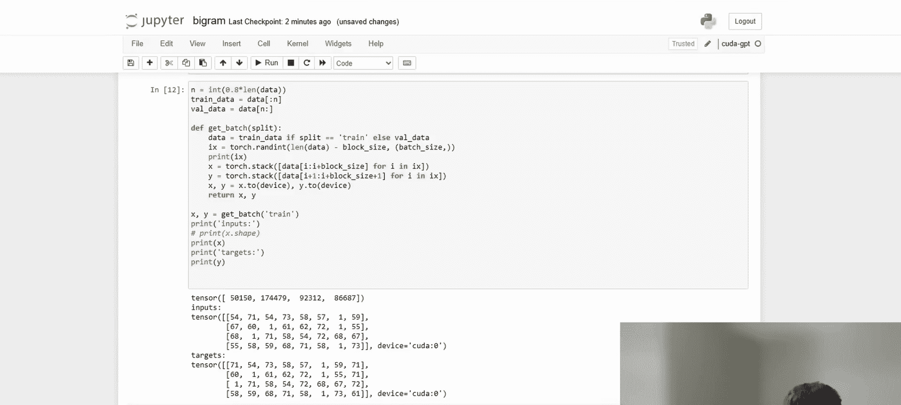

PyTorch 中从头开始编写前向传递函数呢？所以就像我说的，理解这个过程，所有实际发生的转换，所，有在我们的前向传递中发生的架构，获取输入，将其通过网，络运行，然后得到输出。我们的灵活性，调试。

就像我说的，调试会让你很头疼，如果你不遵循这些最佳实，践，因为如果你使用奇怪的数据，而默认设置并不真正用于，处理它，你会从中得到 bug。所以你要确保当你实际浏览你的网络时，你正确地处理了，数据。

并且每个转换都是正确的。所以你也可以在每一步打印出发生的情况。所以你可以看到，噢，这里情况不太对劲。也许我们需要使用一个不同的函数。也许这不是最适合这个任务的。所以它将特别帮助你。当然，定制。

如果你正在构建自定义模型、自定义层，对吧？当然也包括优化。

所以这基本上是为什么我们要从头开始编写前向传播。这也只是最佳实践。所以不写这个实际上从来都不是一个好主意，但让我们继，续。所以自我然后我们将做索引和目标。所以我们要进入一个新术语，叫做对数几率。

但在我们做这个之前，我有点乱了，在我们做对数几率之前，我会先向你解释一下这里的嵌入表。将其粘贴进去，返回对数几率。你马上就会看到为什么我们要返回对数几率。所以这个嵌入在这里基本上就是一个查找表。

所以我们要做的，我实际上要打开我的笔记本。我们有一个巨大的类似网格的东西，预测会是什么样子。这会看起来像什么，我能把它拖到这里吗？不行。那么请继续下载这个全屏幕。嘭。所以这是在我的想法里。

但基本上就是这个样子。我是从Andrej Karpathy的讲座中拍摄了这张照片，但这是，什么意思，它有起始标记和结束标记。所以开始是在块的开头，而结束标记是在块的末尾。它基本上只是在预测。

它显示了在给定一个字符的情况下，下一个字符是什么的概率分布。所以如果我们有，比方说，我不知道，一个A，总共有6，640次，出现在整个分布中。所以如果我们把这些全部加起来，如果我们将它们归一化。

并得到这种情况发生的概率，我不知道，如果我们把所有这，些加起来，我不知道那是什么，一些疯狂的数字，也许是，20，000左右，或者一些疯狂的数字。基本上，这个百分比就是字符A后面出现结束标记的百分比。

然后这里也是一样的。比如如果我们输入R，那么可能是RL或者RI，我不知道，我是，瞎了。那是一个RI。但我们基本上会对这些进行归一化，归一化意味着你考虑，它在整行中的显著程度。所以相对于其他元素。

这个就显得相当显著。因此，这个有相当高的概率是接下来要发生的。很多时候，你会发现I跟在R后面。这基本上就是那样。那是嵌入表。所以我们使它的词汇量与词汇量相同。这就是我们在这里做的一点背景知识。

让我们继续讨论logits这个术语。那么logits到底是什么？你可能正在问这个问题。所以让我们实际回到我这里的一个小笔记本。还记得我们的softmax函数，对吧？我们的softmax就在这里。

所以我们对这些值进行了指数化，然后进行了归一化。我们考虑它对所有值的总和的贡献。这就是归一化的含义。所以你可以把logits看作是一堆被归一化的浮点数，对吧？所以你在这里有一个总数。我会写出来。

所以假设我们有，那是一条糟糕的线。让我们画一个新的。好的，好。那么假设我们有二、四和六，我们想要对它们进行标准化，那么从总数中取出二。总数是多少？我们有六加四是十，再加上二是十二。所以二除以十二。

我们取这个二的百分比，二除以十二是0。16多一点，好吗？所以0。16，我们就取0。167。然后四除以十二就是这个的两倍。所以四除以十二是33。33%。然后六除以十二，那就是50。所以是0。5。

这就是标准化的样子。这基本上就是logits的样子，只不过更像是概率分布。假设我们有一堆二元组，比如，A后面是B，然后A后面是C，再，然后A后面是D。从这个分布中我们知道，A后面跟着D的概率最大。

这就是logits的含义。它们基本上是我们想要预测的概率分布。鉴于此，让我们回到这里。我们要稍微调整一下这些。我们有这个嵌入表，我已经给你展示过它的样子。看起来就是这样。这是我们的嵌入表。

所以让我们使用一个叫做，我们将使用一个名为点视图的，函数。这将帮助我们重新塑造我们的logits的外观。我将在这里过一会儿展示一个例子。我只是要输出一些代码。所以我们有我们的批次按我们的时间。

所以时间就是，你可以把时间看作是那些整数的序列。那就是时间维度，对吧？从这里开始，也许通过生成过程，我们不知道下一个是什么，我们不知道接下来的token是什么。这就是为什么我们说这是时间。

因为有一些我们还不知道，还有一些我们已经知道的。这就是为什么我们称之为时间维度。然后通道就是有多少不同的通道，词汇量是多少？通道就是词汇量的大小。所以我们可以把这个logits点形状。

这就是logits将返回的形状是B乘以T乘以C。就是它的形状。然后我们的目标，实际上不，我们还没有做那个。我们将执行对数等于对数点乘视图。然后我们会，这非常重要，B乘以T。

因为我们特别关注的是通道、词汇、批次和时间，它们，我，的意思是，它们在这里并不那么重要。所以我们可以将它们混合在一起。只要对数和目标在批次和时间上相同，我们应该没问题。所以我们将执行B乘以T乘以C。

然后我们可以继续初始化我们的目标。它将是目标的视图，它将只是B乘以T。然后我们可以计算我们的损失。记住损失函数，对吧？所以我们使用交叉熵的功能，这只是一种衡量损失的方法，基本上有两个参数在这里。

所以我们有对数和目标。所以我将在一秒内详细解释正在发生的事情。但首先你可能会问，这个视图是什么意思？这到底是做什么的？所以我现在要向你展示。我在这里写了一些代码，初始化了一个形状为2乘以3乘以5。

的随机张量。所以我的做法是，我基本上通过使用点形状来展开它们，我，展开那些维度。所以形状是二乘三乘五。我们得到 X 等于二，Y 等于三，Z 等于五。然后我们可以使用点视图，这基本上会生成具有这些维度。

的张量。然后我们可以随后打印出来。我们走，我们可以打印出，我不知道，打印 X、Y、Z。我们有二、三、五，打印，打印一个点形状。实际上我会在这里先打印一个点形状。这样你就可以看到这实际上是与点形状对齐的。

然后这里也是一样的。这就是 view 的作用，基本上允许我们使用点形状展开。然后我们可以使用 view 将它们重新组合成一个张量。所以你可能会问，在这个笔记本中，为什么我们要调整这些，形状？

为什么要这样做？嗯，答案有点落入了交叉熵中的形状需要是什么。它期望什么？PyTorch 期望实际形状是什么？所以我在这里查看了文档，它基本上说我们希望有一个维，度，即通道，或者两个维度，即N。

我相信N也是批处理。所以你有N，N个不同的块或批次。然后你在这里有一些其他的维度。所以基本上它期望的是B乘以C乘以T，而不是B乘以T乘以C，这恰好是我们从这里得到的。logits的形状是B乘以T乘以C。

而我们希望它是B乘以C乘以，T。所以基本上我们所做的就是通过乘以这些来使这个参数成，为一个。这就是这里正在发生的事情。然后这意味着第二个是C。所以你得到像B乘以T等于N，然后C，就像它期望的那样，对。

吧？就是这样。所以那基本上就是我们在那里所做的。而且很多时候，当将其传递到PyTorch中的功能函数时，你，可能会收到错误。因此，重要的是要注意PyTorch期望形状是什么，因为你会，因此而收到错误。

而且，我是说，重新塑造它们并不难。你只需要使用dot view和dot shape，然后将它们解压缩，一起重新塑造。对于初学者到中级水平的项目来说，总体上相当简单。所以在这方面真的不应该有太多麻烦。

但是要注意，因为如，果你在某个时候不注意的话，它会回来找你麻烦。所以我在这里添加了一个新的函数，叫做generate，这基本，上是要为我们生成令牌。所以我们传递一个索引，这是当前索引或上下文。

然后我们有max new tokens，这是通过这里传递的。所以我们有我们的上下文，我们把它变成一个单一的零，就，是下一行字符。然后我们基于此生成。然后我们的max new tokens，第二个参数。

我们只是把它变，成500第二个参数。很酷。在这里我们做什么？我们有一个小循环，基本上它是根据max new tokens的长，度或范围来生成的。所以我们将生成max new tokens个令牌。

如果这有意义的，话。基本上我们所做的是根据模型的当前状态，模型参数调用，前向传递。而我想在这里明确说明一下，说self 。forward而不仅仅是，self of index。当我们这样做时。

它将在这里调用self 。forward，但让我，们明确地说self 。forward在这里。所以我们得到了logit和从中得到的损失。我们专注于最后一个时间步。那是我们唯一关心的。

这是Pygram语言模型。我们只关心单个前一个字符。只有一个在之前没有上下文。然后我们应用softmax函数来得到一个概率分布。我们已经讨论过softmax函数了。

之所以在这里使用负一是因为我们关注的是最后一维。如果你不熟悉负索引，这就是这里以及这里的情况，想象一，下你有一个小的数线，好吗？所以它从索引零开始，一，二，三，四，五，依此类推。所以如果你在零之前走。

它将循环到该数组的末尾。所以当我们调用负一时，它将得到最后一个元素，负二，倒，数第二个元素，负三，倒数第三个元素，以此类推。所以这基本上就是这里的全部。在Python中，你可以对任何东西使用这种方法。

负索引是相当常见的。所以这就是我们在这里做的。我们已经对最后一维应用了softmax，然后我们从分布中取，样。所以我们已经讲过 torch 。molenomial。我们得到一个样本。

这基本上是下一个索引或下一个编码，字符，然后我们使用 torch 。cat，简称连接。它将前文或前面的标记与新生成的标记连接在一起。然后我们将它们简单地结合在一起。所以它们是一个整体。

我们在 V 乘以 T 加一上执行这个操作。如果这不清楚，让我在这里帮助你。所以我们有这个时间维度。假设我们这里可能只有一个元素。所以我们在零位置上有一些东西。然后每当我们生成一个标记。

我们将从零位置获取信息，然，后我们将其加一。所以它变成了 B 乘以 T。由于只有一个元素，它的长度是一。现在它是二。然后我们有这个二。我们将它变成了三。然后我们有这个三。我们将它变成了四。

所以这基本上就是这个在做的事情。它只是不断地将更多的标记连接在上面。然后在这个循环之后，我们只是返回这个索引。所以这是所有生成的标记，直到最大新标记。而这基本上就是它的作用。Model 。

toDevice 在这里。这只是将我们的参数推送到GPU，以进行更高效的训练。我不确定这在现在是否有很大的差异，因为我们只是在进，行背景语言建模。但是，有这个在这里是很方便的。然后，我是说。

这在这里是相当不言而喻的。我们基于上下文生成。这就是上下文，它只是一个单一的零或X行字符。我们传入我们的最大新标记。然后我们基本上只是解码这个。所以，这就是它的工作原理。让我们继续进行优化器和训练循环。

实际的训练过程。所以我实际上跳过了某些东西，可能让你有点困惑。但是你可能会问我们实际上如何从这里的logits中访问三，个维度中的第二个呢？因为logits只返回两个维度，对吧？

你有一个B乘以T或者你有一个B乘以T乘以C。那么这到底是如何工作的呢？好吧，当我们调用这个前向传递时，我们传递的只是这个索，引。所以这意味着目标默认为none。所以因为目标是无，损失也是零。

所以这段代码不执行。而且它只是在这里使用这个对数，它是三维的。这就是它的工作原理。老实说，如果你把你的输入和目标馈送到模型中，那么显然，你的目标会在那里，这将确保目标不是无。那么你实际上会执行这段代码。

而你将会有一个二维的对，数，而不是一个三维的对数。所以这只是一个小的澄清，如果有人感到困惑的话。在我们进入这个训练循环之前，我想迅速讨论一下这个小，的托斯塔尔长数据类型。

所以托斯塔尔长就相当于int64或整数64，它占据64位或8，字节。所以你可以有不同的数据类型。你可以有一个float16。你可以有一个float32，float64。我相信你可以有一个int64。

int32。float和int之间的区别在于float有小数。它是一个浮点数。而整数只是一个单一的整数。它不仅仅是那样。它只是根据它占据的位数而变大。那只是对torstall long的概述。

这与int64完全相同。就是这样。现在我们有了这个训练循环。所以我们定义了我们的优化器，我之前已经介绍过优化器，Adam W，即Adam权重衰减。所以我们在这里有权重衰减，然后是我们所有的模型参数。

和学习率。所以我实际上写到了学习率这里。所以如果你在输入的同时，我会添加这个，然后重新运行代，码的这部分。所以我有这个学习率以及最大迭代次数，这是我们在这个，训练循环中将要进行的迭代次数。

而学习率是特殊的，因为有时候你的学习率会太高，有时候，会太低。所以很多时候你必须尝试不同的学习率，看哪一个在时间，内提供了最好的性能和质量。所以有些学习率，你会得到非常快的进展，然后它会超过那。

个小的低谷。所以你要确保这不会发生，但你也要确保培训过程进行得，很快。你不希望等一个整整一个月才能让一个二元语言模型通过，拥有那样的数字来进行训练。所以这是对，基本上我们只是把这个学习率放在这里。

那就是它应该存在的地方。现在我们有了这个训练循环，它将迭代最大次数。让我只是给每次迭代一个术语"iter"，我认为我们现在还，没有使用它，但以后会用来报告随时间推移的损失。但我们要做的是。

我们得到一个与训练集相对应的批次。同样，我们只是在训练。这就是训练循环。我们不关心验证。所以我们会调用这个训练。我们会得到一些X输入和一些Y目标。所以我们继续执行模型。forward。

我们有我们的logits和我们的损失。然后我们将执行我们的optimizer。zero_grad。我马上会解释这个。这有点令人困惑，但再说一次，如果你对训练循环不熟悉，这可能听起来有点陌生。

我知道我可能会说得有点快，但这是基本模型的标准训练，循环架构。这通常是它的样子。所以你会得到你的数据，你会得到你的输入或输出，无论哪，种方式。进行前向传播。在这里定义有关优化器的一些内容。

在我们的情况下，这是零梯度。然后你会有一个损失 。backward，即反向传播。然后优化器 。step，让梯度下降发挥其作用。回到优化器 。zero grad。因此，默认情况下。

PyTorch 将通过累加梯度来随着时间的，推移而累积它们。通过进行零梯度，我们确保它们不会随时间累加。因此，先前的梯度不会影响当前的梯度。我们不希望这样的原因是先前的梯度来自先前的数据。

而数据有时候可能有点奇怪。有时候它是有偏见的，我们不希望它决定我们的错误有多，大，对吧？因此，我们只想根据当前数据的当前梯度来决定，我们只想，基于当前数据的当前梯度来进行优化。在这里的这个小参数。

我们将其设置为 none。这基本上意味着我们将梯度设置为 none，而不是零梯度。我们之所以将其设置为 none，是因为 none 占用的空间要，小得多。它只是，是的，它只占用很少的空间。

当你有一个零时。那可能是一个int64或者什么东西，会占用空间。因为我们可能会有很多这些累积，这会随着时间而占用空，间。所以我们要确保对于这种情况，设置为none是true，有时候，可能不想要。

那基本上就是它的作用。如果你确实在训练大型循环神经网络，并且需要了解先前，的上下文，它会执行，通常你只会在这种情况下需要它。我现在不会深入讨论循环神经网络，但这是不使用零梯度，的一个重要用例。

梯度累积将简单地取所有累积步骤的平均值，并将梯度平，均在一起。这样你就得到一个更有效的，可能是块大小，对吧？通过这种方式你获得更多的上下文，而且可以保持相同的，批大小。所以就是一些小巧妙的技巧像这样。

我们将在课程的后期更详细地讨论梯度累积，但基本上在，这里发生了什么。我们定义一个优化器，Adam W。我们迭代最大的hitters。我们获得一个批次的训练分割。我们进行前向传播，零梯度，反向传播。

然后我们迈出了正确方向的一步。所以我们的梯度下降就像魔法一样。然后在最后，我们只需在这里打印出损失。所以我已经运行了几次，随着时间的推移，我得到了一个，2。55的损失，这还可以。

如果我们基于那个损失生成，你知道，仍然是一些相当糟糕，的标记。但再说一遍，这是一个背景语言模型。所以实际上我可能需要在这里重新训练。它还没有被训练过。所以我实际上要做的是，让我们运行这个，运行这个。

运行，这个。然后我会做的，哦，看起来我们在这里打印了很多东西。所以那是从我们的批处理中得到的。所以我就注释掉它，或者我们可以完全删除它。好。现在如果我们再次运行这个，给它一点时间。完美。

所以我不知道为什么它还在这样做。如果我们再次运行它，让我们看看。我们在哪里打印东西？获取批处理。不。啊，是的。我们在更改后必须再次运行这个。我真是愚蠢。当然，10，000步是很多的。所以这需要一点时间。

它需要几秒钟，实际上相当迅速。所以在第一个之后，我们得到了3。15的损失。我们可以从中生成。然后我们得到了一些不那么垃圾的东西。你知道，它有一些下一行的字符。它更了解一点，你知道，将事物分开等等。

所以这比之前的垃圾略少一些。但是是的，这还是相当不错的。所以我撒了个谎。实际上之前并没有我谈论优化器的讲座。那么现在我们不妨谈谈它。我们有一些常见的优化器。而且老实说，你实际上不需要了解比这更多的东西。

因为大，多数都是基于这些构建的。所以你有均方误差，这是一个常见的损失函数，用于回归问，题，就像，你知道，你有一堆数据点，找到最佳拟合线，对吧？那是一个常见的回归问题。

用于预测连续输出并测量预测值与实际值之间的平均平方，差异。通常用于训练神经网络进行回归任务。所以很酷。那是最基本的一个。如果你愿意，你可以更深入地了解，但那是我们最基本的优，化器。

梯度下降是从那个点上升的一步。它用于最小化模型中的损失函数，衡量模型的好坏，梯度衡，量模型基于输入特征对目标变量的预测能力。所以我们有一些输入X，有一些权重和偏差，可能是WX加B。

我们所要做的就是确保输入或确保使输入变成期望的输出，根据它距离期望输出有多远，我们可以改变模型的参数。所以我们最近或之前讲解过梯度下降，但这基本上就是这，里发生的事情。而动量只是梯度下降的一个小扩展。

添加了动量项。因此，它有助于平滑训练并使其继续朝着正确的方向移动，即使梯度改变方向或变化幅度，它对训练深度神经网络特，别有用。所以动量是当你考虑一些其他梯度时。这样你就有一些可能从这里传递过来的东西。

然后它可能，包含一点当前的内容。就像90%，一个好的动量系数可能是90%的先前梯度，然后，10%的当前梯度。所以它有点像滞后，并使其以某种平滑的方式收敛。如果这有意义的话。RMSProp。

我从未使用过这个，但这是一种使用平方梯度的，移动平均来调整每个参数的学习率的算法。有助于避免参数更新中的振荡，并在某些情况下提高收敛，性。所以如果你愿意的话，你可以更深入地了解一下。Atom，非常流行。

结合了动量和RMSProp的思想。它使用了一个移动平均，同时考虑了梯度及其平方值来调，整每个参数的学习率。它通常被用作深度学习模型的默认优化器。在我们的情况下，当我们继续构建这个模型时，它将是一个。

相当深的网络。而AtomW只是AtomOptimizer的一种修改，它在参数更新中，添加了权重衰减。因此有助于正则化，可以提高泛化性能。但是使用这个优化器时，要根据在本视频中训练的模型的，特性来调整。

当然，我在这里是从脚本中读出来的。这些优化器的工作方式没有真正更好的表达方式，但是，如，果你想更深入地了解，你知道，像动量、权重衰减或者，你，知道，振荡和一些统计学的东西，你可以，但老实说，唯一真。

正重要的是知道哪些优化器用于某些事情。那么动量是用来做什么的？AtomW非常适用于什么？MSE适用于什么，对吧？只需要知道差异和相似之处，以及什么时候使用优化器是，最好的情况。所以，是的。

你可以在torch 。optm找到更多关于这方面的，信息。当我们开发语言模型时，在语言建模、数据科学和机器学，习中，非常重要的一点就是能够报告损失或了解我们的模。

型在前1000次迭代、然后是前2000次迭代和4000次迭代中，的表现如何，对吧？所以我们想要对模型随着时间的推移如何收敛有一个总体，的概念，但我们不想每一步都打印出来。那是没有意义的。

所以我们实际上可以每200次、500次打印一次。如果你运行一个非常庞大的语言模型，你甚至可以每1万次，打印一次。这就是我们要在这里实现的内容。实际上，这并不需要大量的Python语法。这只是。

实际上我只是要将其添加到我们的for循环中。这将做的就是，它将按照我刚才说的，打印每一次，你知道，的，每一定数量的迭代。所以我们可以在这里添加一个名为eval_iters的新的超参，数。

我会将其设置为250，只是为了让事情变得更容易一些。我们将继续在这里添加这个。所以我会写上 if iter，然后我们将使用取模运算符。如果您以后想要了解更多，请查看一下。

我们将执行 eval_iters 等于零。这将检查当前迭代除以我们的 eval_iters 参数的余数是，否为零，如果是零，那么我们就继续执行。希望这讲得通。如果您愿意，您可以询问GPT。

您可以询问GPT 4或GPT 3。5，无论您使用哪个版本，有关这，个模运算符，您应该能够对它的作用有一个良好的基本了，解。很酷。现在我们能做的就是，我们会说，我们会在这里添加一个占，位语句。

我们只需打印一个 F 字符串，然后我们会计算损失，损失，也许不会。或者实际上我要在这里进行一些更改。我们可以走一步，加上一个小冒号。然后我会说，我们会分开。实际上，不，我们只会说损失，然后像那样说损失。

然后我们会在这里添加一些伪代码。很快就会有些东西。我不知道。我所做的一切就是在幕后添加了一个小函数。你们没看到我做这个，但基本上，我不会详细介绍函数本身，但重要的是这里的装饰器。

这对你们来说可能并不常见。这是 torch 。nograd。这将确保 PyTorch 在这里完全不使用梯度。这将减少计算量。它将减少内存使用。总体而言，这对性能更好。因为我们只是报告一个损失。

所以我们实际上不需要在这，里进行任何优化或梯度计算。我们只是得到损失。我们将一些东西输入到模型中。我们从中获得了损失。然后我们就从那里开始。所以这基本上就是这个 torch 。nograd 发生的事情。

对于诸如其他类或其他外部函数之类的东西，比如说，我是，说，默认情况下 git batch 不使用这个，因为它没有将模，型传递给它，但是 estimate loss 在这里确实有模型传递，给它。

所以我们只是想确保它不使用任何梯度。这样我们就减少了计算。总之，如果你愿意，你可以快速阅读一下这个，整体上应该，是有意义的。像 。item、。main 这样的术语非常常见。这里的很多其他东西。

比如模型 X 和 Y，我们得到了 ，logits 和损失。这些东西应该是有意义的。应该相当直接了当。我想提到的只有两件事是 model 。eval 和 model ，train。

因为你可能还没有见过这些。所以 model 。train 本质上是将模型置于训练模式。模型从数据中学习，意味着权重和偏差。如果我们两者都有，有时你只有权重，有时你知道，有时你，有权重和偏差，不管是什么。

这些在这个阶段进行更新。然后模型的一些层，比如dropout和批归一化，你可能还不，太熟悉，它们在训练模式下的操作是不同的。例如，dropout是激活的。

而dropout的作用就是在这里添加的这个小超参数。它看起来像这样。Dropout会像是 0。2 这样。所以dropout的主要作用是随机在网络中去掉一些神经元，这样我们就不会过度拟合。

在验证模式或评估模式下，实际上是关闭的。所以这将帮助我们的模型更好地学习，当有一些噪音或事，物没有在正确的位置时，这样你就不会有网络中的某些神，经元优先并做出许多重要的决定。我们不希望那样。

所以dropout将通过随机去掉 20% 的神经元来帮助我们的，模型更好地训练。而这就是dropout的全部作用。所以我现在就删除它。然后，在这个阶段，是的，模型训练中dropout是激活的，在。

网络中随机关闭一些神经元。这是为了防止过度拟合。我们之前讨论过过拟合，我相信。至于评估模式，评估模式是在模型进行评估或测试时使用，的，就像它听起来的那样。在训练时，另一种模式是验证或测试。

而像辍学和批量规范化这样的层在这种模式下的行为是不，同的。在评估中辍学是关闭的，对吧？因为实际上我们正在使用整个网络。我们希望所有的东西都能够很好地协同工作。我们真正想要看到它的表现有多好。

训练模式是当我们只是，你知道，抽样，对网络进行奇怪的，尝试以挑战训练中的网络。然后评估或验证是当我们得到网络的最佳形式，然后我们，想看看它产生多好的结果。这就是 eval 的含义。

我们在这里切换到 eval 的原因只是因为我们正在测试模，型。我们想看看，你知道，它在任何给定的数据批次中的表现有，多好。我们实际上不需要在这里进行培训。没有培训。如果有培训，这将不会存在。

因为我们将不会使用任何梯度，所以，如果训练进行中，我们将使用梯度。无论如何，这就是为您估算的损失。这个函数，你知道的，通常在数据科学中很有用。您的训练和验证拆分之类的。而且，很适合报告。

你知道它是怎么回事。我们可以继续在这里添加这个。所以有点东西就要来了。我们将损失设置为估算损失。然后我们可以继续，其实我们不必在这里放任何东西。很酷。现在让我们继续运行这个。让我从这里开始运行。嘭，嘭。

嘭，嘭，嘭，嘭。完美。我们要运行 10，000 次迭代。很有趣。好的，是的。所以我要做的实际上是，你可以看到这个损失部分很奇怪，所以我要改变一下，我要切换到，我们要使用训练损失，我，们要使用损失。

我们要进行训练拆分。然后我们要在这里进行验证损失。我们可以进行验证，或者简称为 val。我要让它保持一致。现在我们这里有一个冒号，这里也有一个冒号，然后你只需，要运行 losses 然后做 val。

好的。所以我要把这里的最大误差减小到只有 1，000。运行那个，运行这个。哦，有些地方不匹配。

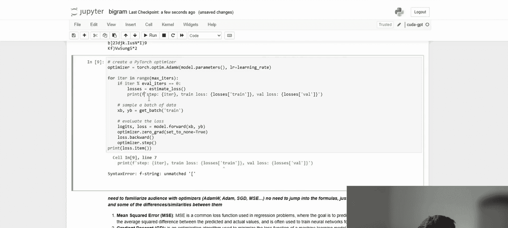

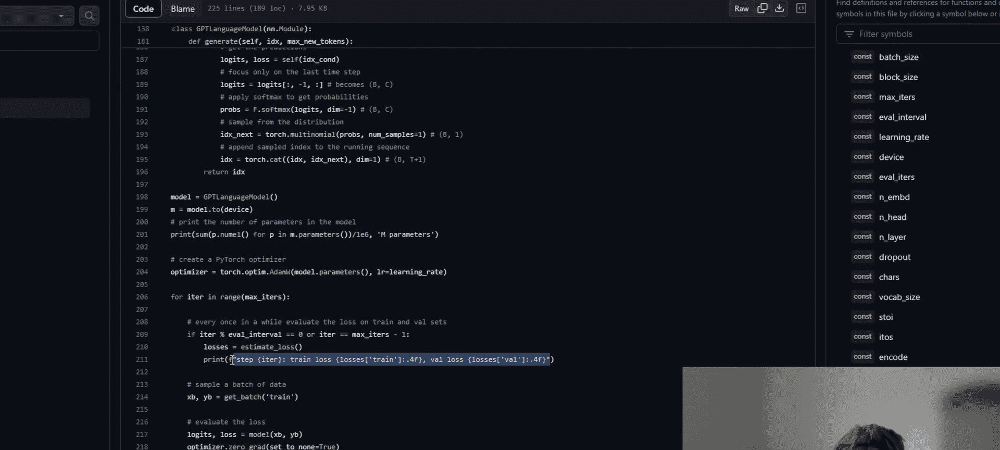

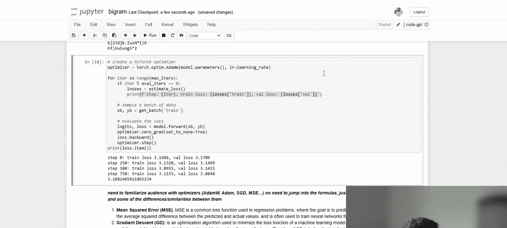

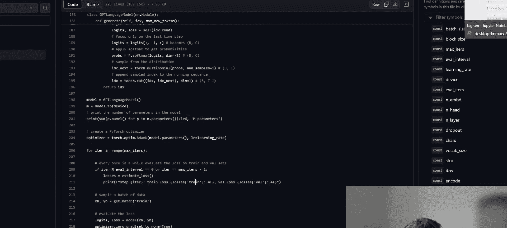

是的。所以这里实际发生的是，因为我们在使用这些小引号，发生，的事情是这些小引号与这些小引号匹配，告诉我们，哦，你，不能这样做。你不能从这里开始然后在那里结束并有所有这些奇怪的东，西。就像你不能那样做。

所以基本上我们只需要确保这些是不同的。所以我将使用双引号而不是单引号，然后用双引号结束它，正如你所看到的，这在这里起作用了。所以我会再次运行，这样你们就可以看到这是什么样子的，而且这很丑陋。

因为我们有很多小数位。所以我们在这里实际上可以做的是，我们可以添加一个小，格式化程序或一个小数位减少器，如果你称它为这样，你就，可以阅读它。这样它不会像一些奇怪的小数，你会想，哦，这个 8 重要吗。

可能不是。就像前三位数字一样。所以我们在这里能做的就是添加，我相信是这样的。我不认为是另一种方式。我们会找出的。Python中有一些东西对我来说非常令人困惑，但我们继续，所以我弄对了。冒号，然后句号。

正如你所看到的，我们已经减少了这些数字。所以我实际上可以将这个写成三个F。太棒了。所以我们有我们的训练损失和验证损失。做得好，你走到了这一步。这真是太棒了。这太疯狂了。你在视频中走到了这一步。

我们已经涵盖了所有基础知识，关于二元语言模型，优化器，训练循环，报告损失，你需要知道的一切。我甚至无法列举我们做过的一切，因为涉及的内容太多。所以恭喜你走到了这一步。你应该休息一下，给自己一个鼓励。

准备好迎接下一部分，因为它将是非常疯狂的。我们将深入探讨最先进的语言模型以及如何从头开始构建，它们，或者至少如何进行预训练。而且其中一些术语可能会显得有点晦涩，但我向你保证，在，接下来的这一节结束时。

你将对当前语言模型的状况有一，个相当好的理解。所以，好了，休息一下，稍后再见。有件事我想澄清，实际上我在这门课的前段时间有点撒谎，关于归一化是什么。

我记得我们当时在讨论 softmax 函数和向量的正则化。So softmax 明显是一种正则化的形式，但还有许多其他形，式。不仅仅有几种，或者说不仅仅有一两种正则化。实际上有很多种。

我在我的第二台显示器上列出了它们，但，我不想随便就把那一堆信息倒在你脑袋上，因为学习的方，式不是这样的。所以我们要做的是将这个输入到 GPT-4 中。

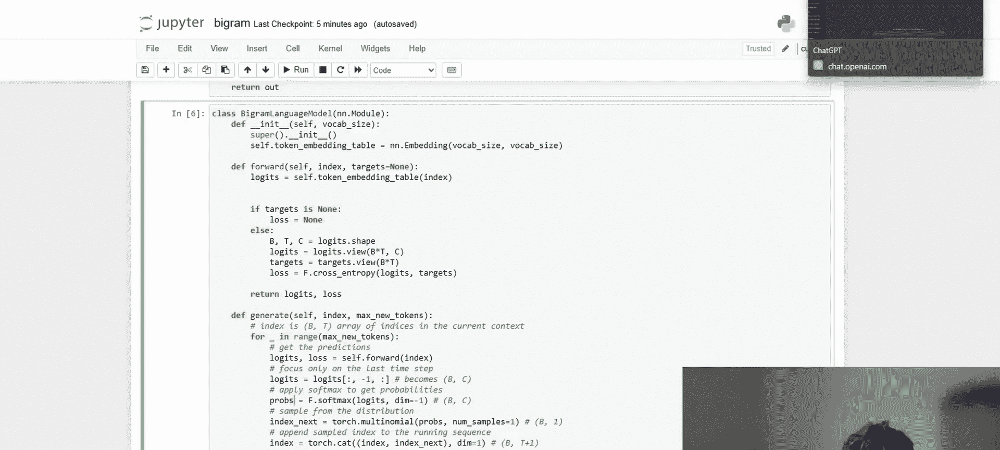

我们会说，你能列出机器学习中的所有正则化形式吗？它们彼此之间有什么不同？GPT-4 是一个很棒的工具。如果你还没有使用它，我强烈建议你使用它，甚至是 ，GPT-3。5，这是免费版本。但是。

这是一个非常好的工具，可以快速学习任何东西。然后，你知道，你可以让它，让它为你提供带有答案的实例，练习题。这样你就可以在几分钟内学到一些主题，而这些主题在大，学课程中可能需要你数个讲座才能学到。但是。

这里有一些。所以，最小-最大归一化，是的。Z-分数，小数缩放，均值归一化，单位向量或层二，稳健缩放，幂变换。好的。是的，然后softmax是另一个。softmax是什么？它属于数据类型归一化。

但通常不用于归一化输入数据。它通常用于输出层。所以softmax是一种归一化类型，但不用于归一化输入数据，所以，我是说，老实说，我们通过实际产生一些概率证明了。

这一点。这不是我们在前向传播中使用的东西。这是我们在生成函数中使用的，从我们的logits中获取一，堆概率。

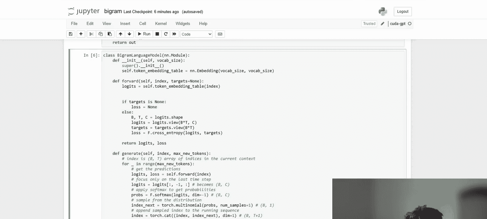

所以这是，是的，有趣。了解这些小事情对于未来在工程这类事物时更加深入了解。

是很有益的。好的，太好了。接下来我想要谈一下的是激活函数。激活函数在提供改变我们的输入方式时非常重要，而这种，改变并非是线性的。举个例子，如果我们有一堆线性层，一堆，让我擦掉这个。如果我们有一堆。

你知道的，nn 。linears 连续排列，实际，上会发生的是它们都会挤在一起，最终应用一种将它们全，部相加的转换。它们都会相乘，并给我们一个转换，这实际上是一种浪费计，算资源。

因为假设你有100个这样的 nn 。linear 层，除此，之外什么都没有。你实际上是从输入到输出，但你却要为一次乘法运算做100，倍的计算。这真的没有意义。那么。

我们能做些什么来使这些深度神经网络变得重要呢？我们能提供什么，超过了仅仅是线性转换呢？这就是激活函数发挥作用的地方，我将在这里快速介绍一，下。那么，让我们跳转到 PyTorch 文档。

所以我在这段视频中要介绍的三个激活函数分别是relu、，sigmoid和tanh激活函数。让我们从relu或修正线性单元开始。我们将使用functional relu，而不仅仅是使用torch。nn。

因为我们在这里不进行任何前向传递。我将把它们添加到我们的。我将添加这些。让我清除这个。让我清除这个输出。不，那没关系。实际上，我要把这些添加到这里，没有前向传递。我们只是简单地通过一个函数运行它们。

得到一个输出，这，样我们就可以看到它的样子。所以我实际上在这里从torch。nn导入了这个，import ，functional as capital F。这只是一种常见的PyTorch做法。

使用capital F。让我们开始使用relu。所以我们可以这样写，我不知道，x等于torch。tensor，然后，我们将其设为负0。05，例如。然后我们将dtype设为torch。float32。

我们可以写成y等于，f。relu(x)。然后我们继续打印y。哦，它没有relu属性。好的，让我们尝试nn。让我们尝试 nn，看看是否有效。好的，那没用，没关系，因为我们可以简单地看一下这个，这。

将帮助我们理解。实际上我们不需要，我们不需要在代码中写出这一点，只要，它在某种程度上是有道理的。在正向传播中，我们实际上不需要写这个。你不会在其他地方使用它。所以是的。

我不会因为在函数库中这样做不起作用而感到，太沮丧，但是，基本上这样做的效果是，如果一个数字低于，零，它将把该数字变为零。然后如果它大于零，它将保持不变。所以这个图帮助你可视化这一点。这里有一个小函数。

希望这对一些人来说是有意义的。我对函数不太关心，只要我能在某种程度上想象出这个函，数的含义，它做了什么，有哪些应用，通常已经足够涵盖任，何函数了。所以这就是 relu 函数。相当酷。

它只是为我们的线性网络提供了一种非线性性。所以，如果你有一百层深度，每隔一步就使用一个relu，那，个网络会学到很多东西。它会学到更多的线性和非线性，比起只有一百层全部相乘，成一个变换的情况。

这就是它的作用。这就是relu。现在让我们来看一下sigmoid。在这里我们可以使用函数库。sigmoid的作用就是我们取负X的指数的倒数，再加一。所以我要在这里加上。我们可以，是啊，为什么不呢？负0。

05，float32，当然。我们会用F。dot。sigmoid。然后我们只是用X，然后打印出Y。很好。所以我们得到一个张量0。4875。有趣。所以这里的小负0。05实际上是被代入到这个负X中。

所以1除以1加2。71的负0。05次方。所以实际上如果我们计算2。71的负负0。5次方，我们将得到，正数。所以1。05然后加一。那就是2。05。我们再取它的倒数，2。05。所以我们得到约0。487。

那么我们在这里得到了什么呢？0。487。酷。所以这很有趣。现在让我们看一下，这里有没有图表呢？让我们看看 S 型激活函数。维基百科。不要被这里的数学吓到。我也不喜欢，但我喜欢图表。它们看起来很酷。

所以基本上它在这里所做的就是这样。是的，它只是一个小曲线。有点像，是的，它有点像波浪，但它很酷看起来。这就是 S 型函数的作用。它用于对这条线进行概括。是的，S 型函数非常酷。现在让我们转向双曲正切。

双曲正切函数。哦，谷歌必应，或者微软必应给了我一个不错的描述。酷。完美。e 的负 X 次方。我喜欢那个。所以双曲正切有点不同。这里有更多的指数运算。所以你有，嗯。

我就说一下 X 的指数或负 X 的指数除以 X， 的指数加上负 X 的指数。这里有很多正数和负数。正面，正面，负面，负面，负面，正面。这很有趣。让我们继续将这个转换为代码。

我会使用torch dot examples或torch examples。这是我们的文件，我会直接使用tanh。很酷。所以是负0 。05。很酷。如果我们用一个呢？如果我们在这里用一个呢？那会产生什么？

哦，0 。76。嗯。如果我们用10呢？1 。0。有趣。所以这与S形函数类似，只不过是，你知道的，让我们向，ChatGPT询问一下它们的区别。

在什么情况下会使用tanh而不是sigmoid？让我们看看这里。Sigmoid函数和双曲正切函数是神经网络中使用的激活函，数。它们有相似的S形曲线，但具有不同的范围。因此。

sigmoid的输出值在0和1之间，而tanh在-1和1之间。所以如果你，你知道，如果你正在评估，例如，你想要它在0，和1之间，表示百分比或小数位。所以像0 。5就是50%，0 。87就是87%。

这就是 sigmoid 函数的作用。实际上，它与 softmax 函数非常接近。除了 softmax 只是，你知道，它优先考虑更大的值，并将较，小的值放在优先级之后。这就是 softmax 的全部作用。

它有点像是增强版的 sigmoid。tanh 函数的输出在 -1 到 1 之间。所以，你甚至可以开始理论构建，并考虑一些你可能在不同，用例中使用 tanh 函数和 sigmoid 函数的方式。

这就是对它们的一个总体概述。背景语言模型已经完成。我们在这里完成的所有内容现在都已完成。你结束了你的休息。如果你休息了，如果没有，也没关系。但基本上，我们现在将深入研究transformer架构。

实际上，我们将从头开始构建它。最近有一篇提出的论文，叫做transformer模型。这使用了一种称为自注意力的机制。自注意力用于这些多头张力的小砖块中。有很多事情发生。

所以在我们立即深入讨论这个架构之前，有一些我想澄清，的事情，不要立刻向你们的大脑中倾倒大量信息。但是，对于初学者来说，一开始很多这些网络可能会非常令，人困惑。所以我想搞清楚。如果一开始你不理解。

那完全没关系。我会尽力以最好的方式解释这个。相信我，我看过很多关于人们解释transformer架构的视频，它们，在某种程度上对我来说也有点令人困扰。所以我会尽量澄清所有那些小困惑的部分。那是什么意思？

你没有涵盖那个部分。我不知道这里发生了什么。我会涵盖所有那些小部分，并确保没有遗漏任何内容。所以你们会想耐心等待，专心听这一部分。是的，让我们继续深入了解通用的transformer架构以及它为什。

么很重要。所以在transformer网络中，有很多计算正在进行。你有一些加法和标准化。你有一些多头注意力。你有一些前馈网络。这里有很多事情发生着。有很多计算，很多乘法，很多矩阵乘法。

这里有很多事情正在进行。所以我一开始实际上有一个问题，那就是，嗯，如果你只是，将这些输入乘以一堆不同的东西，最终你应该得到一些随，机值，可能并不真的意味着最初的输入太多。这实际上是正确的。

在最初的几次迭代中，模型对正在发生的事情一无所知。它是毫无线索的。它正在随机方向上前进，只是试图找到最佳的收敛方式。所以这就是机器学习和深度学习实际上的全部内容，就是，有所有这些小参数在添加和规范化中。

前馈网络中，甚至是，多头注意力中。我们试图优化这些参数，以产生一个有意义的输出，这将实，际上帮助我们产生几乎完美的英文文本。所以这就是整个预训练的过程。你将一堆输入送入一个transformer。

然后得到一些输出概率，你，用这些概率来生成。而注意力的作用是为句子中的每个小标记分配一些不同的，分数。对于标记，你有字符、子词和单词级别的标记。所以基本上你只是将注意力的位分配给每个标记，以及位。

置的含义是什么。所以你可以有两个紧挨着的单词，但如果你不实际对它们，进行位置编码，它就没有什么意义，因为这两个单词可能相，隔4，000个字符。这就是为什么你需要同时对这些标记进行注意力分数和位，置编码。

这就是这里发生的事情。所以我们要做的是到达我们的输入。我们得到我们的输入。所以我是说，我们用图解语言模型解释过这个。我们输入我们的X和Y。所以X将是我们的输入，Y将是我们的目标或输出。

我们要做的是给这些小嵌入。所以我相信我们前段时间解释过嵌入。基本上，这意味着它将为该表上的每个标记有一行，并且将，存储有关该标记含义的某个向量。所以，比如你有字符E，例如。

字符E的情感或向量可能与Z的情感大不相同，对吧？因为E是一个非常常见的元音，而Z是英语中最不常见的字，母之一，如果不是最不常见的。所以这些嵌入是学到的。我们对我们的输入和输出都进行了这样的处理。

我们为它们提供了像我刚才提到的位置编码。而且有很多方法可以做到这一点。实际上，我们可以使用可学习的参数来分配这些编码。顺便说一下，很多这些都是可学习的参数。当你深入研究transformer时。

你会发现这一点。但是是的，所以在我们给出这些输入、嵌入和位置编码之，后，输出也是同样的操作，本质上只是向右移动了。对于输入，你有从I到块大小，然后对于输出，你有从I加一，到块大小加一，对吧？

或者我们在我们的双字语言模型中使用的任何小技巧。我记不太清楚了。或者我们是否真的使用过这个。不，我现在只是说些胡话。但没关系，因为一会儿就会有意义的。所以实际上我不会从这里读出来，因为这真的很令人困惑。

所以我要切换到一个小的，我想，我画出的小草图。而这基本上是整个transformer，考虑到许多其他因素，这，个初始图像并没有真正体现出来。所以让我们继续深入了解这里从基础开始发生了什么。

就像我之前所说的，我们有一些输入和一些输出，这些输出，被右移了。然后我们给它们每个一些嵌入向量和位置编码。所以从这里开始，我们假设我们有n层。这在一秒钟内就会变得有意义。n层被设置为四。

所以我们有的层数量设置为四。你可以看到我们有一个编码器，编码器，就像我们有四个编，码器和四个解码器。所以四实际上是我们拥有的编码器和解码器的数量。我们总是拥有相同数量的每个。所以如果我们有，你知道。

10层，这意味着我们将有10个编，码器和10个解码器。基本上会发生的是，在这个输入嵌入和位置嵌入之后，我们，将其馈送到第一个编码器层。然后是下一个和下一个。然后就在我们触及最后一个时。

我们将它们馈送到这里的，每个解码器中，每个解码器层。所以只有最后一个编码器会馈送到这些解码器中。基本上，这些解码器都会运行。它们都会学到不同的东西。然后它们会将所学到的东西转化。

它们会在最后应用一个线性变换。这不是在解码器函数中。实际上，这是在最后一个解码器之后。它将在其末尾应用一个线性变换，从而基本上简化或概括，所学到的内容。然后我们对这个新的张量应用softmax。

以获得一些概率来，进行抽样，就像我们在大二元生成函数中讨论的那样。然后一旦我们得到这些概率，我们就可以从中进行抽样并，生成标记。这就是这里的第一个小步骤。这就是正在发生的事情。我们有一些编码器。

我们有一些解码器。我们进行一个转换来概括。我们有一个softmax来获得概率。然后根据这些概率生成。很酷。在编码器中的下一个部分，对于每个编码器，它看起来就是，这样的。所以我们有多头注意力。

我稍后会深入讨论这个。在这个多头注意力之后，我们有一个残差连接。如果你对残差连接不熟悉，我可能之前提到过，但基本上它，的作用就是一个小连接器。所以我不知道。假设你得到一些输入 X。

你有一些输入 X 放在这里，然后把它们输入到某种函数中，比如某种前馈网络，无论是什么。一个前馈网络本质上只是一个线性，一个ReLU，然后一个线，性。这就是前馈网络在这里的全部。线性，ReLU，ReLU。

线性。你所做的就是将这些输入包裹起来，所以你实际上并没有，将它们放入前馈网络中。你实际上是将它们包裹起来，然后你可以将它们添加到输，出中。所以你有一些X值通过ReLU，然后你有一些包裹在周围。

然后在这里，你简单地将它们加在一起，并使用一种称为层，归一化的东西进行归一化，我们稍后会讨论这个。而残差连接在transformers中如此有用的原因是，当你有，一个非常深的神经网络时。

在前几个步骤中实际上会遗忘，很多信息。因此，如果你有前几个编码器层和前几个解码器层，这里很，多信息会被遗忘，因为它没有被传递。它的前几个步骤并没有被明确传递，并且在函数中被跳过，是的。

你可以看到它们会被遗忘。所以残差连接实际上是绕过这个问题的一种方法，不让深，度神经网络从一开始就遗忘东西，并让它们一起同等程度，地工作。所以残差连接在这方面非常出色。然后在最后。

你会把它们相加然后归一化。有两种不同的方法可以在这个规范中实现。有一个是在规范中，然后是规范和相加。所以这是transformers中可以采用的两种不同的体系结构，这两者都是一种类似于元体系结构。

但基本上pre -norm是，先规范化然后相加，post -norm是先相加然后规范化。所以在这篇由一群研究科学家提出的“关注是一切你需要，的”论文中，最初你想把它们加在一起，然后进行归一化。

这就是我们所谓的后 -norm 架构。然后前 -norm 就是将它们反转。所以我实际上对前 -norm 和后 -norm 进行了一些测试，原始的transformer论文结果实际上要好得多。

至少对于训练非，常小的语言模型来说是这样。如果你训练更大的模型，可能会有所不同，但基本上我们只，是按照这里使用的规则进行操作。所以添加一个规范，我们不会在这个视频中执行规范和添，加，因为它的效果更好。

我们只是不想违反任何规则并超出，范围，因为那样开始变得令人困惑。实际上，如果你观看安德烈·卡尔帕西关于从头开始构建，GPT的讲座，他实际上是以前 -norm 的方式实现的。归一化，然后相加。所以是的。

根据我的经验，我在我的电脑上所做的是后 ，-norm 架构效果更好。所以这就是为什么我们要使用它。我们将执行加法，然后进行归一化。然后我们基本上将这个输入到我们早些时候讨论过的前馈，网络中。然后。

它是如何进行的呢？是的，所以我们的编码器，在这里到这里有一个残差连接，然后在我们的前馈网络外部有另一个残差连接。所以每次我们在这里进行一些其他事情，比如一些计算块，我们都会有一个残差连接。

前馈残差连接也是一样的。当然，从这里出来的输出会馈入下一个编码器块。如果不是最后一个编码器。所以这个会执行所有这些，它会馈入那个。它会做同样的事情，馈入这个，然后馈入那个。

然后这个的输出会馈入每一个解码器，所有的信息都一样，是的，所以这有点被限定在这些编码器的外观。现在你知道编码器的外观，前馈的外观，我们将进入多头注，意力，这是transformer架构的前提。

也是为什么它如此重要的亮，点。所以多头注意力，我们称之为多头注意力，因为有很多这些，不同的头学习来自独特视角的不同语义信息。那么假设你有10个不同的人看着同一本书。如果你有10个不同的人。

假设他们都在阅读，假设他们都在，阅读同一本《哈利·波特》的书。这些不同的人，他们可能有不同的认知能力。他们可能有不同的智商。他们可能是以不同的方式成长的。所以他们可能以不同的方式解释事物。

他们可能会看着书中的小细节，他们的思维会，或者他们会，想象书中不同的情境，不同的环境。基本上，为什么这是如此有价值的，因为我们不只是想要一，个人，只有一个对这个的看法。

我们希望有一堆不同的头同时看着这段数据，因为他们都，会捕捉到关于它的不同的事物。请记住，每个这样的头，每个这样的平行头，这些不同的视，角，它们有不同的可学习参数。所以它们并不是都一样在看这段数据。

实际上，它们都有不同的可学习参数。所以你在同一时间有很多这样的东西学习不同的事物。这就是为什么它如此强大。所以这个比例点积注意力是并行运行的，这意味着我们可，以将其扩展到GPU，这非常有用。

涉及到这一点是很好的。任何可以在GPU上加速的与GPU有关的东西都是一个自动胜，利，因为并行在机器学习中非常重要。为什么不利用并行性呢？如果它只会在CPU上运行，那有什么意义呢？

这就是为什么我们喜欢GPU的原因。无论如何，是的。所以你将会有这些不同的，你将会有这些被称为关键、查，询和值的东西。我会在这里稍后涉及到它们，因为关键、查询和值有点指，向自注意。

这实际上是Transformer的整个要点。没有自注意，Transformer实际上不会有什么意义。所以我会在这里稍后详细介绍它们，一旦我们到达这个阶，段。但是，是的，你有这些关键、查询和值。

它们进入比例点积注意力。所以许多这些并行运行。然后你将所有这些不同的并行运行的头部的结果连接在一，起。你有所有这些不同的人。你将它们全部连接在一起。你概括它。然后，您对线性转换应用一个转换。

以基本总结它。接着，对您的加一个范数，然后是前馈网络。这就是多头注意力中正在发生的事情。您只是并行进行一堆自注意力，进行连接，然后继续这一部，分。所以，缩放点积注意力。那是什么？

那么让我们从这里从头开始。所以我们将从左到右进行。所以您有您的键、查询和数值。您的键有什么作用？嗯，一个键就是，假设您有一个句子中的令牌，好吗？所以如果您有，让我滚动到这里找一个好的例子。

所以自注意力使用键、查询和数值。自注意力有助于确定在任何给定句子中，这些令牌中哪些，更重要，以及您应该对每个字符或单词支付多少注意力。为了简化本视频的目的，我们将仅使用单词来理解。但本质上。

想象一下您有这两个句子。所以您有，让我拿出我的小段文本。所以您有，哦，这没用。所以想象一下，你有一个服务器，我可以结账吗？然后你会发现，看起来我把服务器搞崩溃了。所以我的意思是。

这两者都包含了单词“服务器”，但它们表，示不同的东西。服务器的意思就像是侍者或者在你餐厅用餐结束时为你开，单的服务员。而“看起来我把服务器搞崩溃了”就像是，哦，实际上在云中，运行着一个服务器。

不是像服务员那样给我开单的人，而是，一个实际上可能在运行视频游戏的服务器。而这是两回事。所以注意力的作用是它实际上可以确定在这里哪些词会引，起注意。所以它可以说，服务器，我可以结账吗？我能有吗？

所以也许你正在寻找某样东西，你正在找账单。然后服务器就像说，哦，好吧，在这个特定的序列或者在这，个句子的情感中，服务器特定地与这个意思相连，可能是一，个人，是餐厅里的某个人。然后“搞崩溃了服务器”。

“崩溃”会得到一个很高的注意力，分数，因为你通常不会在餐厅里让服务器崩溃。那没什么特别的道理。当你有不同的词语时，自注意力将学会识别句子中哪些词，实际上更重要，哪些词应该更受关注。

所以这实际上就是这里发生的一切。而关键K基本上将为每个单词生成一个不同的小张量，表示，我包含什么？然后查询将会问，我在找什么？所以要发生的是，如果是像服务器这样的词语，它会寻找像，检查或崩溃之类的东西。

所以如果它看到崩溃，那意味着关键和查询将相乘，它将获，得一个非常高的关注得分。但是如果你有像“the”和“the”这样的东西，就像，哦，这个，“the”在几乎任何句子中都是字面上的。所以那没什么意义。

我们不会注意这些词语。所以这将得到一个非常低的关注得分。而所有的注意力都只是将这些向量进行点积。所以你得到一个关键和一个查询，然后对它们进行点积。我们在这门课程中已经讨论过点积。然后在这里。

这可能有点令人困惑的部分是你只需进行缩，放，你通过对键或查询矩阵中行的长度取倒数来进行缩放，也就是称为 DK。所以假设我们有我们的键和我们的查询。顺便说一句，这些都将是相同的长度。

假设我们的键可能是 10 个字符长。我们的键也将是 10 个字符长。所以它会做 1 除以 10 的平方根，如果这有意义的话。那基本上是防止这些点积爆炸的一种方式，对吧？我们想要进行缩放。

因为随着长度的增加，结束点积也会增，加，因为有更多的这些要相乘。所以我们基本上只是想通过使用倒数平方根进行缩放。这将帮助我们进行缩放，确保没有不必要的方式爆炸。

然后下一个小重要部分是使用 tort dot trill，我想我们，在这里的例子中已经讨论过。Trill，对。所以你可以看到它是一个对角线，是一个左三角形的全是 ，1 的矩阵。

在我们的 self-attention 中，这些在我们的 tort dot ，trill 或掩码中不会是 1。这将是每个时间步骤的分数，每个时间步骤的分数的组合，所以如果我们只看第一个时间步骤。

我们不应该有其他事，物的访问权限，否则那就是作弊。我们不应该被允许提前看，因为我们实际上还没有生成这，些。我们需要在将它们放入透视并对其进行加权之前生成这些，所以我们将所有这些设置为零。

然后我们进入下一个时间，步骤。好的，现在我们刚刚生成了这个。我们还没有生成这些，所以我们不能看它们。然后随着时间步骤的增加，我们对所有这些令牌的上下文，了解越来越多。所以那就是它所做的一切。

掩码注意力基本上就是说我们不想展望未来。我们只想猜测我们当前在当前时间步骤中知道的东西和之，前的一切。你不能跳到未来。你只能看发生在过去的事情并基于此做些事情，对吧？生活也是一样的。

你不能真的跳到未来并说，嘿，如果你这样做，你会成为亿，万富翁。不，那将是作弊。你不被允许那样做。你只能看到你犯的错误，并说，基于我犯的这些其他错误，我怎样才能成为亿万富翁？我怎样才能尽可能接近完美？

虽然没有人可以做到完美，但这是我今天的小比喻。所以，这就是掩码注意力，基本上只是不允许我们跳过时间，步长。所以，这很有趣。让我们继续。在我继续前，我想再谈两件小事。所以这些键、查询和数值。

每个都是通过线性变换学习的，只需应用 nn 。linear，就能得到我们的键、查询和数值。所以如果你在想，我们怎么得到这些？这只是一个 nn 。linear 变换。至于我们的掩码。

实际上我们并不总是应用这个。你可能看到了，我们这里有多头注意力，多头注意力，然后，是掩码多头注意力。所以这个掩码注意力并不总是被使用。它实际上只在每层中的三个注意力中的一个中使用。

所以随着我们在架构方面的进展，我会给你更多关于这方，面的信息，随着我们对它的了解越来越多。不过，我暂时不会深入讨论这个。那么我们就继续了解正在发生的事情吧。我们有一个softmax。

softmax为什么重要呢？嗯，我之前提到过，softmax并不常用作规范化方法，但在这，里我们实际上是在使用softmax进行规范化。所以当你有所有这些注意力分数时，softmax实际上所做的。

是对所有这些进行指数运算并进行规范化。那么，所有得分高的注意力分数，比如可能是50%到90%或者，其他什么，这些都将在整个注意力张量中产生巨大的影响，如果你愿意这样称呼的话。这很重要。可能看起来不重要。

但实际上这只是让模型更有信心，知道，哪些标记更重要。例如，如果我们只进行了普通的规范化，我们可能会得到像，服务器、崩溃、然后服务器和检查这样的词语。然后你只会对这些了解相当多。因为它们相乘效果相当好。

所以它们会受到相当多的关注，但如果你对它们进行softmax，那么就像那些几乎是唯一重，要的字符。所以它正在查看这两者的上下文，然后我们在填充，就像我。

们仅基于这些注意分数的情感来学习关于句子其余部分的，信息，因为它们如此重要，因为它们相乘到如此高的程度。我们想要强调它们，然后基本上让模型了解哪些单词更重，要。所以这基本上就是softmax的作用。

它增加了我们对注意力的信心。然后进行矩阵乘法，我们回到这里的V，这是一个值。所以本质上，这只是一个线性变换，我们将其应用于我们的，输入，它只会有一些关于这些标记的确切内容。

在我们完成所有注意力、softmax等之后，它只会将原始值，与我们迄今为止得到的所有内容相乘，以便我们没有任何，信息丢失或没有任何混乱，只是我们对于这是我们实际拥，有的所有标记有一个大致的概念。

然后这是我们发现有趣，的标记的那些。 ，所以是的，我们有一个输出，只是输入向量数值的混合和对，每个标记的注意力。这基本上是在平行的缩放点积注意力中发生的事情。所以我们有很多这些都同时发生。

许多这些同时发生。是的，这就是注意力的作用。这就是前馈网络的作用。这就是残差连接的作用。是的，然后在这之后，当我们把这些输入到我们的解码器中，我们得到一个输出。

我们对softmax概率进行线性变换以进行总结。然后我们基于学到的一切生成。实际上，我没有写很多的是关于解码器的。所以下一步我要讨论的是我尚未填写的东西，那就是为什。

么在这里我们使用mass attention，而在这些地方却不使，用？那么为什么我们在这里有一个多头注意力，所有那些关注，点在这里，但在这里却没有mass attention呢？那么这是为什么？嗯。

编码器的目的基本上是学习现在、过去和未来，并将其，放入解码器的矢量表示中。这就是编码器的作用。所以，如果我们展望未来并以这种方式理解标记，那是可以，的，因为技术上我们并没有作弊。

我们只是在学习不同的注意力分数。是的，我们只是利用它来帮助我们根据句子的外观进行预，测，但并没有明确地透露，只是给它一个要寻找的想法。然后我们在这里使用质量关注，因为我们不想往前看。

我们只想看着现在和过去。然后，在后面，我们没有提供任何明确的东西。我们还没有得到任何东西。所以我们想要做一些原始的猜测。起初，它们可能不会是很好的猜测，但我们想要做一些原始，的猜测。然后在后来。

我们可以将这些添加和归一化的猜测馈送到，下一个未屏蔽的多头注意力中。然后我们可以使用由编码器给出的向量表示与这个最大多，头注意力。然后我们可以做一些更有用的事情，而不仅仅是被迫猜测，原始的注意力分数。

然后因此被判断。我们可以在这个解码器块中逐渐引入更多元素，以帮助我，们学到更有意义的东西。所以我们从这个大规模多头注意力开始，然后与我们的。然后，之后，我们对来自编码器的向量表示进行多头注意力。

然后我们可以在此基础上做出决策。这就是为什么事情会以这种方式发生的原因。如果你认为我解释得不够好，你完全可以问问 GPT-4 或 ，GPT-3 。5，得到一个相当不错的答案。但那就是事情发生的方式。

是的，还有一件事我想在这里指出的是你看到的这些线性，变换。我是说，在。是什么来着？缩放点积注意力。所以你有你的线性，用于你的关键值和关键查询以及值。所以这些线性，以及上面的一个，线性非常适合将大量重要。

信息扩展或缩小为更易处理的内容。所以，如果你有一个包含从这个缩放点积注意力学到的大，量信息的大矢量，你可以通过线性变换将其压缩成更易处，理的东西。这基本上就是softmax在这里发生的事情。

以及在我们的缩，放点积注意力中，用于我们的输入到键、查询和值的这些，线性变换。这就是正在发生的一切。是的，如果你想更多地了解线性变换，它们的重要性，你完，全可以自己去了解。但那只是一个简要总结。

说明它们为什么重要，只是在收缩，或扩展向量。所以这就是关于transformers如何工作的简要概述。然而，在这门课程中，我们将不会构建transformer架构。我们将构建一种称为GPT的东西。

你可能对此很熟悉。GPT代表生成式预训练transformer或生成式预训练，transformer，两者之一。基本上，它与transformer的架构非常接近，除了它只采用，解码器块。

并且去掉了这里的多头注意力。所以我们要做的就是移除编码器以及编码器连接的部分。所以我们剩下的只是一些输入，我们的最大多头注意力，我，们的后归一化架构。然后就在这之后，我们不会使用非质量多头注意力。

而是使，用前馈网络，然后是一个后归一化。所以就是这样。只是一，二，三，四。这就是它的全部样子。这就是所有的块将会是什么样子的。仍然很重要理解transformer的架构本身，因为将来你可能会需，要它。

而且在语言建模中，了解为什么在解码器中使用质量多头，注意力，而在编码器中不使用，这是一种良好的实践。总之，我们将继续构建这个。如果你需要回顾，如果有些地方不太清楚，绝对可以回到视，频的前几秒或几分钟。

确保你搞清楚到这一点为止的一切，但是是的，我将在这里额外解释一些数学和我们构建GPT架，构所需的其他一些小部件。所以让我们继续做这个。在我们真正开始构建transformer之前。

或者说在从头开始构建 ，GPT 之前，我想要做的是稍微深入研究一下自注意力，或者，说关注机制以及背后的矩阵乘法以及它为什么有效。所以我将使用白板来说明这一点。那么我们将继续画出一个。

我们将只使用这里的四个词的序列。我的狗有跳蚤。好的，所以我们将强调哪些词可能最终会相关联，或者说关，注机制将根据它对这些标记的学习而将它们相乘到一个很，高的数量。这就是这个。

所以我将帮助我们说明一下 GPT 将会从内部看到的，从内，部看起来像什么。所以我将在这里画出这个。只需在这里做一个表格。我们将给它四个并在中间画一条线。我的画可能不完美，但肯定比在纸上好。很酷。

我们有这个。我们有我的。哦，让我去这里。狗有跳蚤。然后我的狗。所以我删除那个。我的狗有跳蚤。酷。那么它们会互动到什么程度呢？嗯，我的和我的，我的意思是，它并没有透露太多。这只是开始而已。

所以也许这会以较低的程度互动。然后你有我的和狗。这些可能会以中等程度互动，因为这就像是你的狗。所以我们可能会像那样中等。然后我的和有，嗯，那并没有透露太多。所以也许那会是低的。然后我的和跳蚤，就像，哦。

那并不意味着太多。我的跳蚤，那并没有太多意义。也许我们会让它以较低的程度互动。然后这些将是相同的情况。所以我的和狗，这将是中等的。然后有和有将是低的。然后我的和跳蚤也将是低的。然后你有狗和狗。

所以这些可能会以较低的程度互动。它们是相同的词。所以我们就忘掉那个。然后我们有狗有。所以这些可能会以中等程度互动。狗有，狗有某物。然后狗和跳蚤。这些可能会有很高的相互作用，因为它们将狗与其他事物。

关联起来，意味着跳蚤。而我们有has和dog。这些会以相同的程度相互作用。所以是中等。然后has和has可能会有较低的相互作用。然后我们可以选择低，或者我们可以选择，什么是它？对于这个，也可以选择高。

跳蚤和狗。所以这些将有很高的相互作用。然后我们有has和跳蚤。所以这些可能会有中等程度的相互作用。中等。然后是跳蚤和跳蚤，这将是低的。所以你得到的，我会在这里用绿色突出显示这个。

所以你会得到所有的中等和高度的注意分数。你的中等在这里，中等在这里，高，中等，中等，高，中等，和，中等。所以你可以看到这些是对称的。这就是注意力图的样子。当然。

这里会有一些基于我们并行运行的实际关注头的数，量进行的缩放。但这并不重要。真正重要的是网络会学习如何放置正确的注意分数。因为注意力仅仅是用来生成标记的。这就是 GPT 的工作原理。

它使用注意力来生成标记。所以我们可以制定这些注意力分数，它们的位置，我们可以，通过整个嵌入使其可学习，就像我们在整个网络中拥有的，所有内容一样，可以确保我们放置有效的注意分数，并确保，它们被正确测量。

显然，我没有很好地量化这些，比如没有用浮点数，但这是，它是如何工作的基础，以及我们希望模型如何查看不同的，标记以及它们如何相互关联。所以这就是注意力机制在内部的样子。

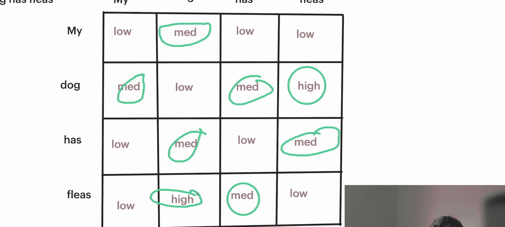

这就是实际的 GPT 或仅解码器transformer架构的样子。是的，我将逐步介绍这一步骤，然后我们可以希望深入了解，一些关于它是如何工作的数学和代码。所以我们有我们的输入、嵌入和位置编码。

我们只有解码器块，然后一些线性变换，然后基本上，我们，做一些 softmax 概率分布，我们从中采样，然后我们开始，生成一些输出，然后我们将它们与我们的输入进行比较，看，看它们离最优化有多远。

在每个解码器块中，我们拥有我们所有的数据关注、残余，连接、前馈网络，由线性、relu、线性组成，然后是另一个，残余连接。在每个多头张力中，我们有多个头并行运行，每个头都会取，一个键、查询和值。

这些都是可学习的线性变换，基本上我们将键和查询进行，点乘。将这些结果连接起来，并进行一些变换以总结它。实际上，在点积注意力中所发生的就是键和查询的点积，通，过缩放来防止这些值爆炸，防止消失梯度问题。

然后我们有，掩码确保模型不会提前看并作弊。然后进行softmax矩阵乘法，输出并在空白处填充。很酷。这有点，基本上是transformer架构，稍微简化了一些，复杂性较，小以便更好理解。

但这就是这里所发生的基本原理。

仍然实现了自注意机制。

所以，正如您现在所看到的，我目前正在使用我的MacBook ，M2芯片。我不会深入讲解为什么这很重要，但很快，我只会向你展示，我如何SSH到我的另一台电脑。所以我就像这样SSH。

然后输入我的IPv4地址，然后我只是，得到一个简单的密码，一个我已经记住的密码。很酷。所以现在我在我的台式电脑上，这是我用于它的命令提示，符。太棒了。我将继续进入自由编程营，我有一个小目录。

所以CD桌面，CD Python测试，然后这里我实际上会激活我，的CUDA虚拟环境，不是加速。我会去CUDA activate。很酷。然后我会进入自由编程营GPT课程的CD。太棒了。所以现在。

如果我实际上在这里像这样编码来打开我的VS ，code，它就不会这样做。所以还有另一种方法，我必须这样做，你必须进入VS code，但进入小的远程资源管理器，然后你可以简单地连接。

所以我只是要连接到当前窗口本身。这需要一个名为OpenSSH服务器的扩展程序。我想这就是它被称呼的，然后就是在命令提示符中使用的，相同密码。我可以正确地输入。太棒了。现在我们要SSH连接到我楼上的电脑。

然后我会在这里打开，小编辑器。不错。你可以看到它看起来就是这样的。太棒了。所以现在我要在Jupyter笔记本中打开这个。实际上在这里CD到桌面，CD到Python，拇指测试，CUDA脚本。

激活CD自由编程阵营GPT课程，然后输入代码，它就会打开，完美。多么美妙啊。我已经在这里做了一点，但我们将详细介绍如何在代码中，构建这个transformer或GPT架构。

所以我要切换到我的Jupyter笔记本这里。

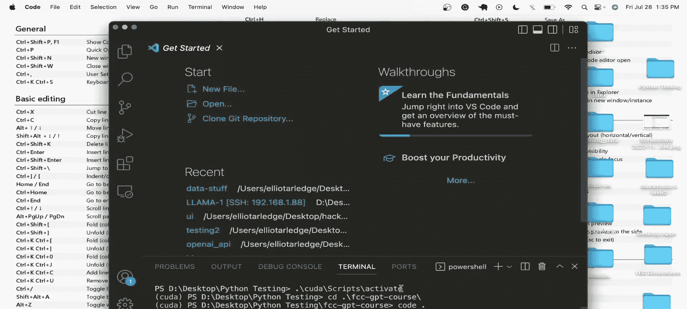

很酷。现在这个小地址，我会粘贴到我的浏览器里。太棒了。

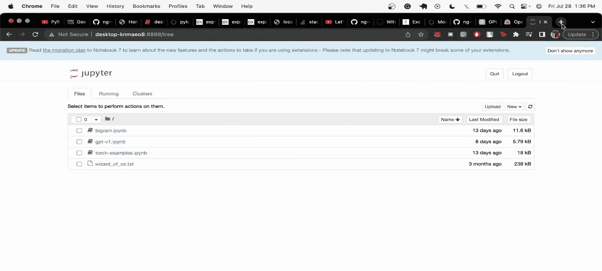

所以我们有这个GPT V1 Jupyter笔记本。

所以我实际上已经做了一些导入这里。我已经导入了所有这些Python导入，我们之前使用的所有，超参数。我导入了数据加载器。我导入了分词器，训练和测试集分割，获取批处理函数，估，算损失，所有我们需要的东西。

而且这都是整齐有序的小代码块。太棒了。现在怎么办？嗯，让我们继续从顶层实际升级开始。我记得我确实展示过，你可以回头看一下。我实际上展示了GPT的架构，以我画的一些小草图为例。

我们要做的就是从高层次开始构建，从高层次的总体架构，到技术细节，一直到我们要做的非常根本的点积注意力。所以我要开始使用这个GPT语言模型，我刚刚重新命名了一，下。我用GPT替换了bigram。

这就是我们正在做的一切。然后我将添加一些小的代码片段，并逐步讲解我们正在做，的事情。那么让我们开始吧。太好了。接下来，我们要讨论这些位置编码。

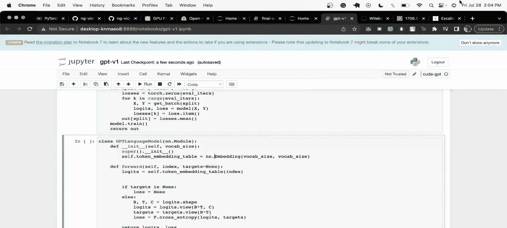

所以我回到这篇论文，或者说这个架构。最初，我们有我们的标记化输入，然后给它们嵌入。

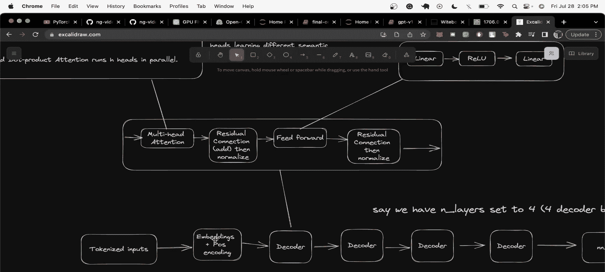

所以标记嵌入，然后是位置编码。这个位置编码，回到注意力论文，就在这里。所以它所做的就是在每个偶数标记索引上应用这个函数。然后，每个奇数令牌索引，我们应用这个函数。你实际上不需要知道它在做什么。

除了这是用于将位置编，码应用于标记化输入的不同正弦和余弦函数。所以在我们的第一个索引或其他什么地方，比方说我们有，你好世界。这里有五个字符。H 将是索引零。所以它将得到一个偶数编码函数。

然后 E 将是奇数，因为它是索引一。所以它将得到这个。然后 L 将得到这个。接下来的 L 将得到这个。然后，或者我不知道我是否弄乱了顺序，但基本上它只是迭，代，来回应用这些固定的函数。

而固定函数的问题是它们实际上根本不了解数据，因为它，们是固定的。所以我们可以使用 nn 。embedding 来完成这个，这是我们，用于标记嵌入的工具。所以我要在我们的 GPT -v1 脚本中实现这个。

所以我要在这一行添加 self 。positionembedding table， nn 。embedding block size。所以块大小是长度或序列长度，在我们的情况下，它将是八。

所以会有八个令牌。这意味着我们将有八个不同的索引。每个索引将是大小为 nn 的嵌入。这是我实际想要在这里添加的新参数。因此，nn 。embed 不仅将用于位置嵌入，还将用于我们的令，牌嵌入。

因为当我们实际存储关于令牌的信息时，我们希望它在一，个非常大的向量中。所以不一定是概率分布或者在大二元语言模型中我们之前，使用的东西，而是一个非常大的向量或者一个列表，你可以。

把它想象成关于一个字符的许多不同属性。所以也许 A 和 E 会很接近，因为它们都是元音，而 E 和 ，Z 会很不同，因为 Z 不是一个非常常见的字母，而 E 是字，母表中最常见的字母。

所以我们基本上只想要有向量来区分这些令牌，为它们赋，予一些语义意义。总之，这就是当我们添加 nn 。embed 时令牌嵌入表将要做，的事情的一点说明。然后，位置嵌入表只是相同的东西。

但是每个字符都有自己，的嵌入，而不是每个字母在输入中的索引都有自己的嵌入，所以我可以进去，在这里添加， nn 。embed，然后我们可以，把这个可能设为 384。所以 384 是相当大的。

这可能对你的个人电脑来说有点太大了，但我们马上就会，看到。所以这将会有一个巨大的向量。它会像是，我不知道，我们可以说是嵌入向量，然后它会是，这样的，你会有很多不同的属性。就像 0 。1，0 。2，0 。

8，1 。1。除了不是四个，而是 384 个元素长。而每一个只会存储关于那个标记的一个小属性。所以假设我们可能是二维的，我们正在使用一个词。所以如果我们有悲伤与快乐，悲伤可能是 0 。1 然后是 0 。

8 或 0 。8。而快乐，悲伤可能是它说的积极性。然后 0 。8 就是，它是否表达了某种情感，这是很多的，对，吧？是 80% 的情感和 0 。1 的积极情感。然后如果我们有 0 。9 会是快乐。

因为它很高兴，它是很好，的。然后 0 。8 是情感的，因为它们在情感水平上差不多。但是，所以这就是我们的嵌入向量基本上在描述的内容。所有这些超参数都关注的是这个向量实际有多长。总之。

让我们继续使用 GPT 语言模型类。接下来我想谈谈我们有多少个解码器层。

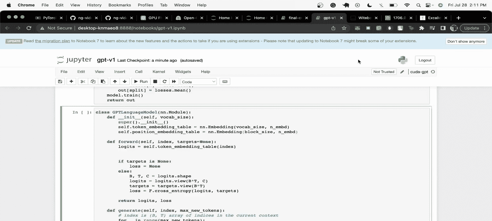

在这里，我们假设有四个解码器层。好的，所以我们有四个这样的层。它会按顺序经过这个、然后是这个、然后是这个、然后是，这个。所有这些都是按顺序发生的。所以我们实际上可以做一个有四个解码器层的小顺序神经。

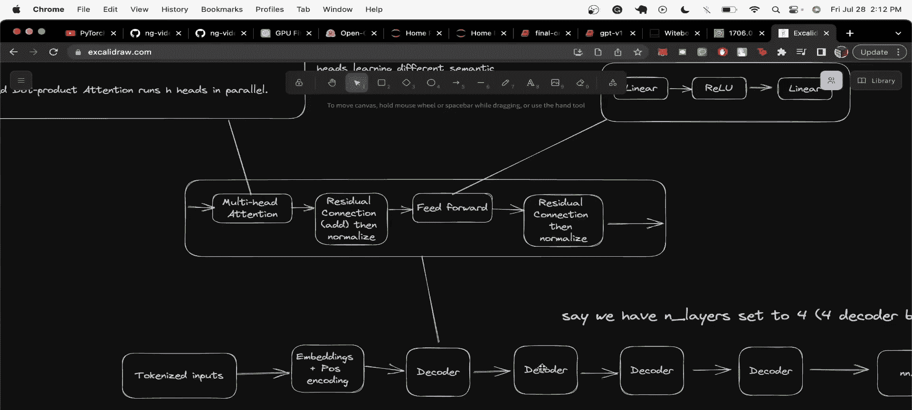

网络。所以我实际上要加入这个，然后再加一点额外的代码，我马，上就解释。所以这个 self 。blocks 就是我们有多少个解码器块在顺，序运行，或者在这个上下文中块和层可以互换使用。但是是的。

我们有一个 nn 。sequential，这个星号基本上，表示我们会重复这个右边的内容多少次，取决于 nlayer ，是多少。nlayer 是我们要添加的另一个超参数。我们设置 n_layer = 4。

好的，n_layer 等于 4。这意味着它会顺序地制作四个这样的块或层。它会制作四个这样的块或层。而这个小的区块，我们接下来会在这个基础上构建。我们会创建一个实际的区块类，并且我会解释它的作用。

但是现在，这将是一些临时的代码。只要你理解这是什么，这就是我们创建四个解码器层的方，法。现在你只需要知道这些就可以了。我会稍后深入探讨这个区块。至于这个 self 。layernorm final。

这是最后一层规范化，这一切都只是简单地添加到我们网络的末尾。

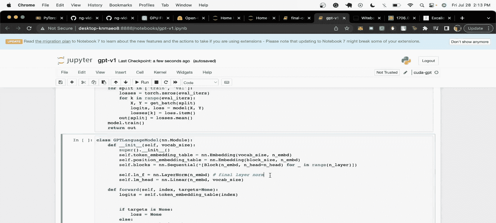

就在这里的末尾。所有这些只是会帮助模型更好地收敛。层规范化非常有用。是的，所以你会看到它是如何工作的。我稍后会将其移除。我们会实际比较并看看它的效果有多好。你完全可以去尝试不同的规范化方法。

看看层规范化在不，同位置对模型的性能或损失如何随时间收敛。

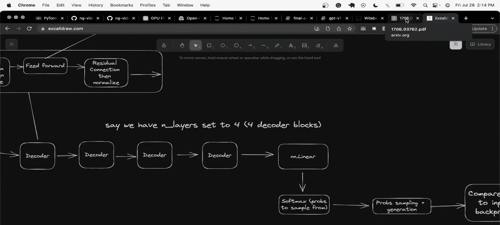

所以让我们回到这里。现在我们有了这个末尾，也就是语言。我相信这是语言建模的标题之类的东西。再次，这是安德烈·卡帕西使用的。我假设那意味着语言建模头。但基本上我们所做的就是投影或者做这个最终的转换。

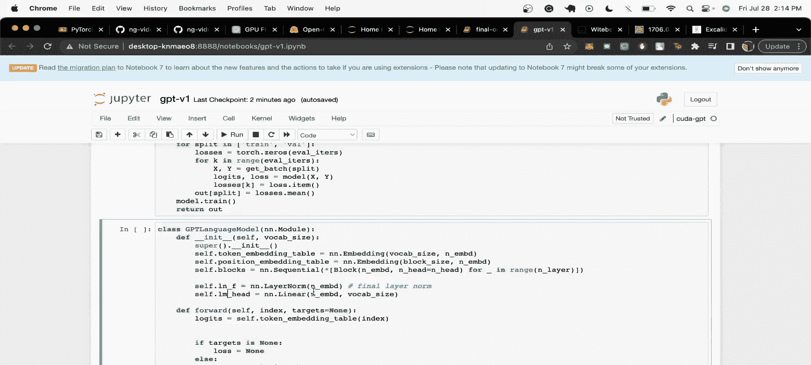

这最后的一个小线性层从所有这些顺序解码器的输出中。我们只是要将其转换成softmax可以处理的东西。所以我们之后有一个层归一化来规范化，帮助模型在所有，这些计算之后收敛。我们将把它馈送到一个线性层。

使之，我想，softmax可用。

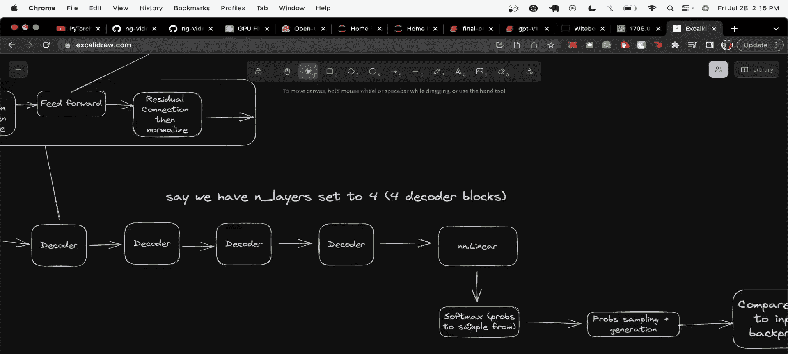

所以softmax可以处理它。是的，所以我们只是简单地将它从一个嵌入中投射出来，这，是我们从我们的解码器得到的向量长度和这个词汇表大小，所以词汇表大小基本上会在我们拥有的每个标记或词汇表。

上产生一个小概率分布。总之，我要把这个恢复成正常状态，然后我们就把这个应用，到前向传递中。所以我想要补充一点关于这个位置嵌入或者说嵌入的概念，与我们在这里使用的正弦函数和余弦函数的固定明确功，能相比。

这两者实际上在实践中都被使用。我说我们将使用嵌入的原因是因为我们只是希望它更加围，绕我们的数据。然而，在实践中，正弦编码被用于基础的Transformer模型，而像GPT这样的变体中使用了学习到的嵌入。

而我们正在构建一个GPT，所以我们可能会从可学习的嵌入，中找到更好的性能。这只是专家们做的一件小事。这是专家们在构建Transformer模型与像GPT这样的变体时，所做的一点小技巧。

所以这只是为什么我们使用可学习嵌入的一点背景知识。现在让我们继续进行前向传递。我将粘贴一些更多的代码，让我确保这是正确格式的。所以我们有这个令牌嵌入，这是我们的令牌嵌入表。我们拿到一个IDX。

我们在这里获得我们的令牌嵌入。然后我们用这个位置编码表，所以我们有这个torch ，arrange。我们确保这在CUDA设备上，GPU设备上，所以它是并行的。所有这些都只是为了看T有多长。

假设T是我们的块大小。所以T将会是八。所以它只会给我们八个索引。会是零，一，二，三，四，五，六，七。有八个这样的。我们基本上只会给每个索引一个不同的N嵌入向量，就是一，个小查找表。就是这样。

所以现在我们要做的就是非常简单的。这实际上是一个非常有效的方法，你只需将这两者相加。所以torch广播规则，你可能想要了解一下。

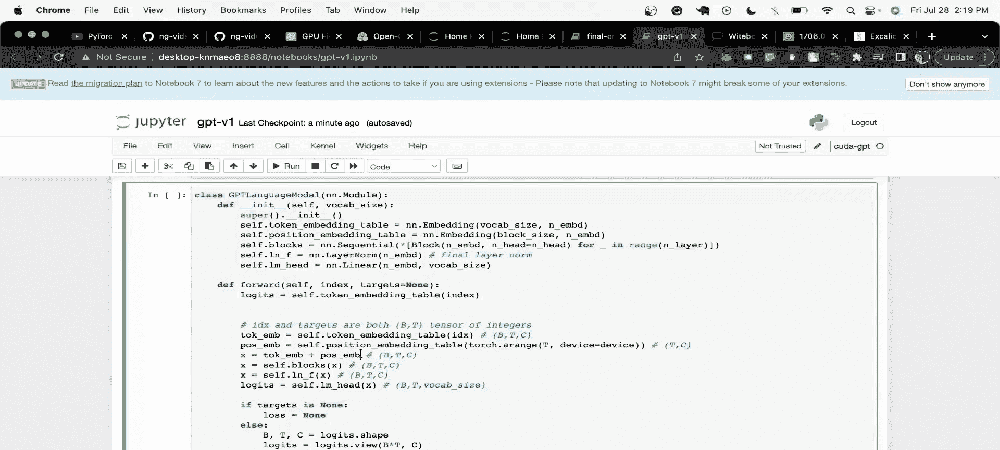

我现在就要查一下。Torch，还有研究广播语义，PyTorch广播，我拼不出来，广播。

语义。所以当你第一次看到它们时，它们可能有点奇怪，但基本上，这些只是关于你如何对张量进行算术操作和一般操作的规，则。所以张量就像矩阵，它们可以是一个二乘二，张量可以是相，同的东西。

但它们可以是一个二乘二乘二或一个二乘二乘，二乘二乘二乘二，无论你想要的维度有多少。基本上这只是关于你如何对这些奇怪形状的张量进行操作，的规则。所以这里有一些规则，我建议你熟悉一下这些规则，甚至可。

以玩弄一下，只是几分钟，只是了解一下，比如试着将张量，相乘，看看哪些会报错，哪些不会。所以了解广播规则是一个好主意。显然，这个术语有点花哨，就像，哦，这是一个疯狂高级的术，语。实际上，不是。

这基本上只是一些关于如何相乘这些形状非，常奇怪的张量的规则。所以，无论如何，如果我们回到这里，我们允许进行广播，我，们实际上可以将它们加在一起。所以，位置嵌入和标记嵌入，我们从中得到 X。

它是一个 B ，乘以 T 乘以 C 的形状。所以现在我们可以做的是将它们馈送到 GPT 或者我猜你。

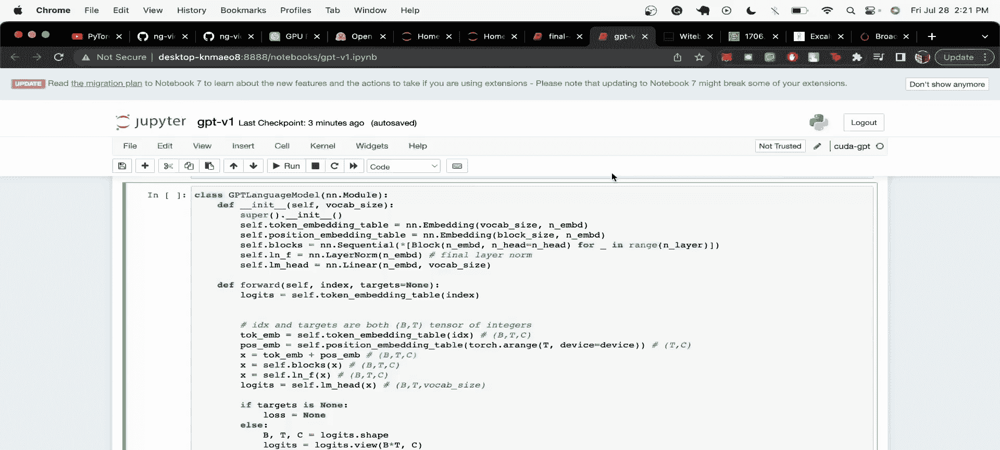

可以说是transformer网络。所以我们有这些嵌入和位置编码，我们将它们加在一起，然。

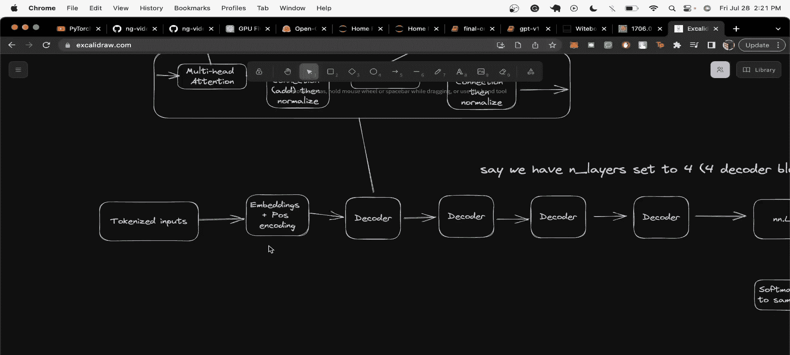

后将它们馈送到我们的顺序网络。那么我们是如何做到这一点的呢？好吧，我们调用 self。blocks，这里是它，我们基本上只是，将一个 X 馈送进去，这和这里发生的事情完全一样。

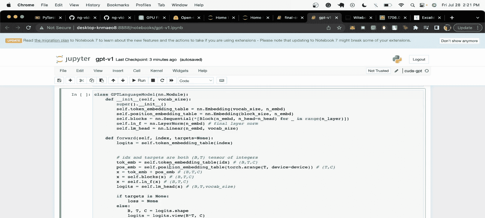

我们有我们的标记化输入，我们有我们的嵌入和通过可学，习嵌入的位置编码，我们将它们相加，然后将它们直接馈送。

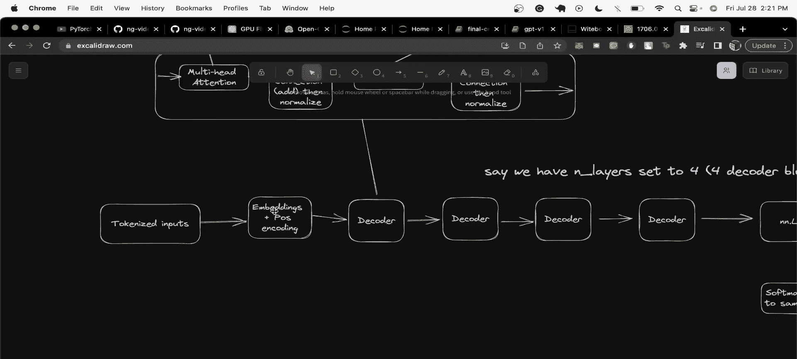

到网络中。所以这里发生的一切就是这样，这就是我们如何馈送一个 ，X 的方式，X 就是这些的输出。然后在所有这些 GPT 层或块之后，我们做这个最终的层归，一化，然后进行这个线性变换。

使其变为一个 softmax，基，本上是我们可以馈送到 softmax 函数中的概率。除此之外，除了这里的这个小代码块之外，这个前向传播完，全相同。所以如果到目前为止这都有意义，那就太棒了。让我们继续。

实际上我要添加一点，在实践中，一些小的权，重初始化，我们应该在我们的语言模型和模块子类中使用，所以我会在这里稍微解释一下数学，但这对于实践和确保，您的模型在训练过程中不会失败非常重要。这非常重要。

这可能会在概念上有点奇怪，但是，拿出一些，纸和笔，跟我一起做一些数学。我们已经建立了一些初始的 GPT 语言模型架构，在我们继，续构建更多功能之前，有些数学知识和脚本中的并行化正，在进行。

我想向您展示一些我们将要使用的数学知识，以初，始化模型的权重，帮助它更好地训练和收敛。

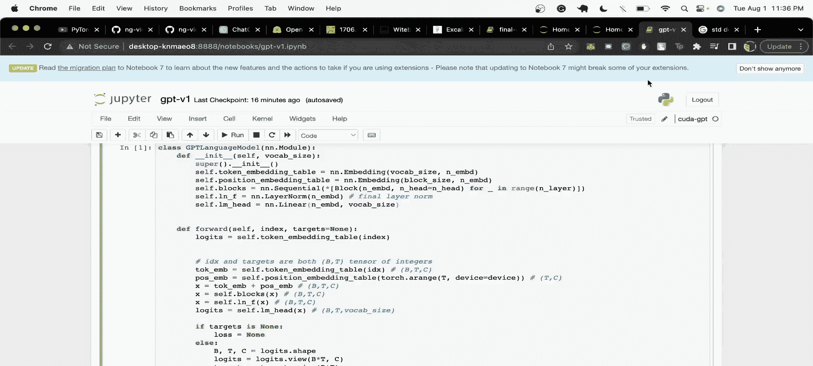

所以有这个新的东西我想介绍一下，叫做标准差，这在中级，数学中使用。这个符号的本质上看起来是这样的，是总体标准差。所以 n，尺寸，所以它只是一个数组，数组的长度然后 xi，我们对每个值进行迭代。

所以在位置零的 x，在位置一的 x，在位置二的 x，然后这，个 u 在这里是均值。所以本质上，我们将对每个元素进行迭代，我们将减去均值，然后将其平方，然后将所有这些平方结果相加，一旦我们。

得到这些和的总和，我们将减去或者我们将除以元素的数，量，一旦我们得到这个结果，我们将对其进行平方根运算。所以这个符号可能看起来也有点陌生，让我为您演示一下，所以我们去我们的白板，这个 e 看起来像这样。

假设我们要输入x和我们的数组，比如说，我们的数组是0。1，、0。2。那么这会得到什么结果呢？嗯，如果我们逐个元素地看，将它们相加起来，那么0。1加，0。2再加0。3，嗯，我们从中得到了0。6。

所以这本质上等于0。6。就是这个等于的意思。我们只是把这些加在一起，或者我们迭代地执行任何这个，操作。无论这个元素是什么，我们都会迭代我们在某个任意数组，、向量或列表中拥有的元素数量。

然后我们只是看看这里。

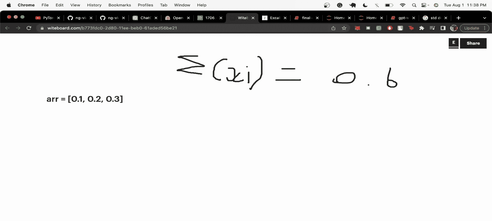

发生了什么，我们可以做一些基本的算术操作。所以让我们通过几个示例来说明一下，根据这里的输入，结。

果是什么样子的。所以我要回到我的白板上。我们要在这里画一条小线，只是为了分隔一下，然后我们下，去。所以我想要计算标准差。对负0。38、负0。38、0。52和2。48进行标准差。所以我们有这个数组。

这是三个元素。所以这意味着n将等于3。

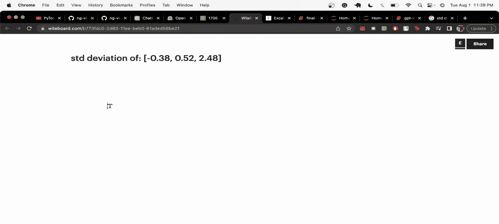

让我把这个拖到这边去。

所以n是元素的数量。所以n将等于3。我们的平均值，嗯，我们的平均值就是将它们全部加在一起，然后取平均值。所以我们的平均值将等于，比方说，负0。38加0。52加2。48，然后除以3。对于这个答案。

我提前算过，实际上是0。873的循环，但为了，简便起见，我们将它写作0。87。好的。所以这个的平均值是0。87，n等于3。现在我们可以开始做一些其他的数学运算了。我们有这个，我们有这个O。

有一条很酷的线，然后我们做，1/n的平方根，这里n等于3，然后我们将其乘以西格玛。就是这个符号。这就是西格玛。这是它的名字。然后我们计算xi减去我们的平均值0。87，再对结果进行平，方。对不起。

这写得有点潦草，然后我们将其用括号括起来，以，防遗漏任何东西。那么让我把这个拉长。很好。所以我们就逐步来做这个。所以第一个将是0。38，所以我们有0。或者负0。38，然后我们要减去这里的平均值。

所以减去0。87，我会把所有这些都用括号括起来，以防遗漏，任何东西。我打算用括号括起来，然后将其平方，看看我们得到什么。所以我要把这些都写出来，然后我们可以进行计算。接下来是0。52减去0。87。

我们将其平方，然后接下来是2。48减去0。87，然后我们也将，其平方。太棒了。这是什么结果？负0。38减去0。87的平方的结果是1。57。这一行的结果是0。12。再次强调，这些都是近似值。

它们并不是非常准确。我们只是这样做是为了理解这里发生了什么。只是概述函数，而不是为了精度。接下来的是2。59，如果你愿意，你可以仔细检查所有这些计，算。我已经提前做了这些，就是这样。现在从这里开始。

我们所要做的就是将这些加在一起。所以1。57加0。12再加2。59除以3等于1。57加0。12加2。59。所有这些除以3将等于1。42。然后记住，我们还需要对其进行平方根运算。所以其平方根将是1。19。

我们将这个加在前面。有点近似的事情。那么这就是这个数组的标准差。负0。38，0。52，2。48。标准差约为1。19。太棒了。让我们做另一个例子。所以我们说我们想要计算0。48、0。50的标准差，我猜。

这里有一个小模式。每次增加0。02。你将会看到为什么这与另一个例子大不相同。所以让我们逐步进行。首先，我们有n。n等于3。我们的均值是多少？我们的均值，如果你计算我们的均值，我们的均值是0。5。

如果你做0。48加这个再除以3，那将是0。5。如果你擅长数字，你可能已经能够在脑海中计算出这个结，果。但如果不行也没关系。接下来，我们将在公式中进行。那么这些迭代看起来像什么？所以0点。

让我们以老方式做这些，减去0。5的平方。下一个是0。5减去0。5的平方，我们已经知道是0。然后这个是0。52减去0。5的平方。所以0。48减去0。5的平方的结果，我们在这里写等号，将会，是约等于0。

02的平方。所以那就是0。004，就像这样。所以我会让这个实际上不重叠，0。004。然后这个我们显然知道会是0，因为0。5减去0。5，那就是0。然后你平方0，还是一样的。然后这个也是0。0004。

所以当我们把这两个加在一起时，我们将得到0。0008，就像，这样。然后如果我们除以3或者n是多少，我们最终得到0。00026循，环。所以我只是写266，就像这样。所以在这一点上。

我们需要做的就是找到这个的平方根。然后我们就做0。00026的平方根，大约是这样。那将等于大约0。0163。所以这就是我们这两个数组的标准差。所以0。048，然后5，0。5，然后0。52。

我们的标准差是0。0163，非常小。然后我们有-0。38，0。52和2。48。我们得到一个标准差是1。19。所以你可以看到这些数字是截然不同的。一个实际上是另一个的100倍大。

所以这是因为这些数字非常多样化。我想你可以用另一种方式来考虑它们，即它们远离平均值，这基本上意味着当你初始化参数时，如果有一些异常值，那，么你的网络就会出现问题，因为学习过程变得混乱。因为你有离群值。

而且它不是按照正确的方式学习的。而如果你的初始参数标准差太小，就像这里一样，甚至可能，更小。所以假设它们全部是 0 。5，对吧？那么你所有的神经元实际上都是相同的，它们都会学习相，同的模式。

那么你就不会有任何学习。所以要么你的学习非常不稳定，有一些离群值正在学习非，常独特的东西，而不是让其他神经元有机会学习，或者说其，他参数有机会学习。是的，如果你有很多多样性，你只会有一些离群值。

而如果你完全没有多样性，那么基本上什么都没学到，你的，网络就没用了。所以我们要做的就是确保我们的标准差是平衡和稳定的，这样训练过程可以学到有效的东西。所以每个神经元都可以学到一点点。所以你可以看到。

如果这些是一些参数的话，这个标准差可，能还可以，因为它们彼此之间有一点点不同。它们并不都非常、非常接近。而且，实际上，在代码中它看起来就像是下面这样。所以你实际上不需要记住这是做什么的，因为这只是专业。

人员在实践中使用的。但基本上，这是初始化我们的权重在某些标准差周围。所以在这里，我们将它设置为0。02，这几乎与我们在这里设，置的一样。所以是的，这个在我们这里设置的标准差有点偏离。但基本上。

我们只是确保我们的权重被正确初始化。而且你不需要记住这一点。这只是在实践中使用的，它将有助于我们的训练更好地收，敛。所以只要你明白我们可以在我们的权重上应用一些初始化，这才是真正重要的。那就很酷。

让我们继续GPT架构的下一部分。太棒了。我们完成了这个GPT语言模型课程。这里的一切基本上都完成了。我们进行了初始化，进行了一些权重初始化，并进行了前向，传播。太棒了。一切都搞定了。

现在让我们进入下一个部分，即块类。

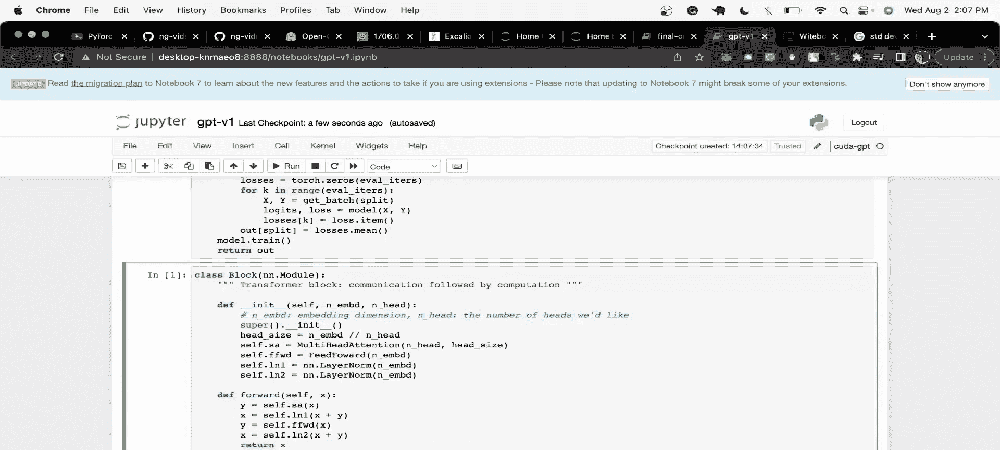

那么什么是块？好吧，如果我们回到这个图表，每个解码器块就是一个块。因此，我们基本上只需填充这里的空白。我们的GPT语言模型有这两个，我们得到我们的标记化输入，然后进行一些转换和softmax。基本上。

我们只是在这里填充空白。然后，我们将构建出来，直到完全建成。

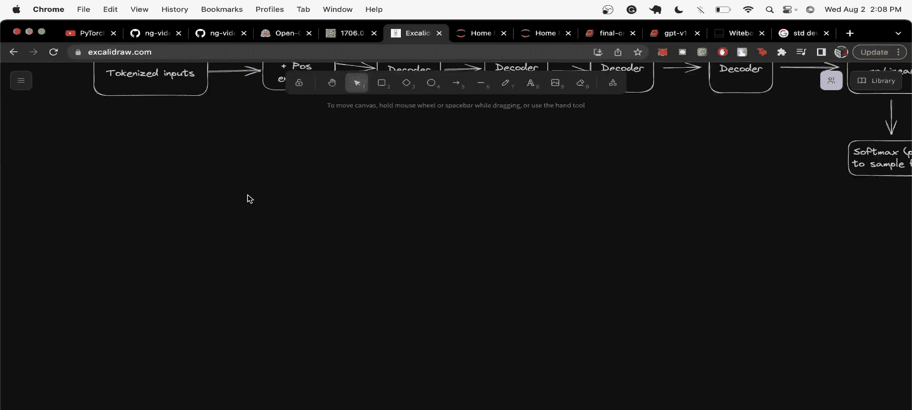

让我们开始构建这些块。这是什么样子？这就是它的作用。因此，我们有了我们的初始化，我们有一个前向传播，像往，常一样，初始化和前向传播，如GPT语言模型类中所见，尽管，它们都看起来像这样，前向和初始化。

因此，初始化只是初始化一些东西。它将初始化一些转换和我们在前向传递中要做的一些事情，这就是它所做的一切。那么我们首先要做什么呢？嗯，我们引入了这个新的头部大小参数。

头部大小是每个头在我们的多头注意力中将要捕获的特征，数量。因此，所有头部并行进行，它们每个都捕获多少特征？我们通过将 n -embed 除以 n -head 来完成这个操作。

所以 n -head 是我们拥有的头的数量，而 n -embed 是我，们拥有或捕获的特征的数量。所以 384 个特征除以四个头。因此，每个头将捕获 96 个特征。因此，头部大小。接下来。

我们有 self 。sa，它只是 self -attention 的缩，写。我们进行多头注意力。我们传入我们的 n -head 和我们的头部大小。一旦我们构建起这个多头注意力类，您将看到这些参数是。

如何适应的。很酷。现在我们有一个前馈，就像在这里的图表中解释的那样。

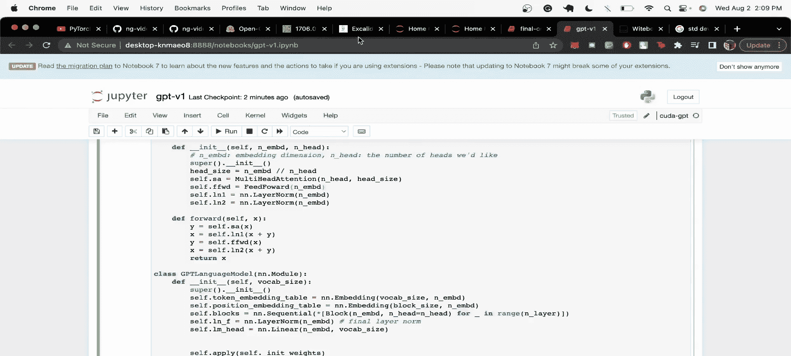

我们的前馈就是这个，我们接下来实际上将构建它。

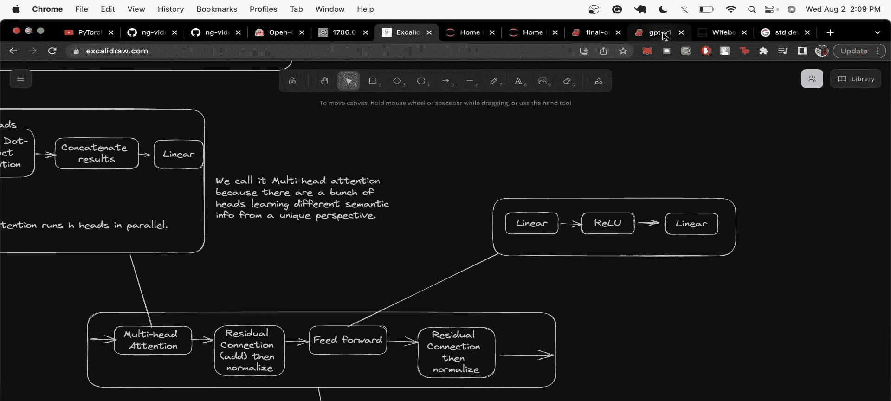

我们有两个层规范。这些只是用于我们在此处可以实现的后-标准/前-标准架，构。在这种情况下，它将是后-标准，因为我发现它对这门课程，以及我们使用的数据，还有模型参数等收敛得更好。它只是运行得更好。所以。

那也是我们在注意力论文中使用的原始架构。所以你可能已经看到，他们进行了加一标准而不是标准和，加法。总之，我们已经初始化了所有这些。很好。所以我们有头大小，自注意力，前馈，然后两个层标准。

所以在我们的前向传递中，我们首先进行自注意力。

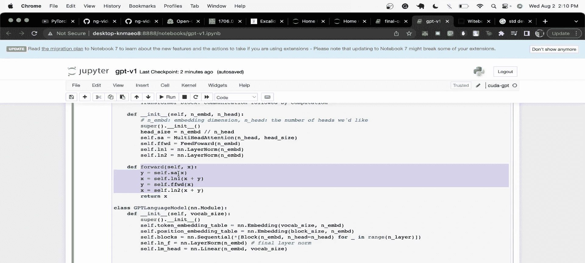

让我们实际回到这里。所以我们进行自注意力，然后加一个标准，然后前馈，然后，再加一个标准。

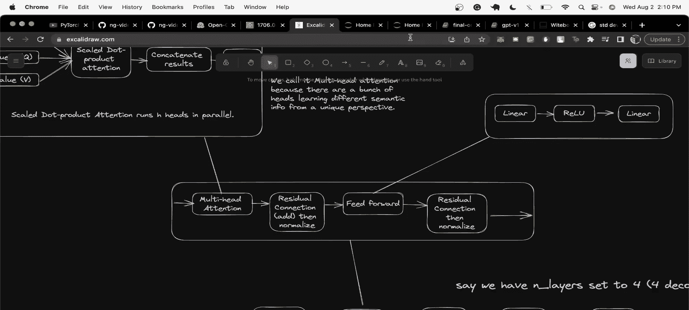

这是什么样子？自注意力，加一个标准，前馈，加一个标准。很好。所以我们正在进行加法。所以我们正在进行x加上前一个答案，这是将它们加在一起，然后我们只是对此应用一个层标准。很酷。

如果你想更深入了解层规范的作用以及为什么它如此有用，你完全可以特别去了解一下。但层规范本质上只是帮助我们平滑处理这里的特征。所以我们有这个。老实说，除此之外没有太多其他的东西。我们只是返回这个最终值。

这基本上就是我们块的输出。接下来，我要在这里添加一个新的小代码块，这将是我们的。

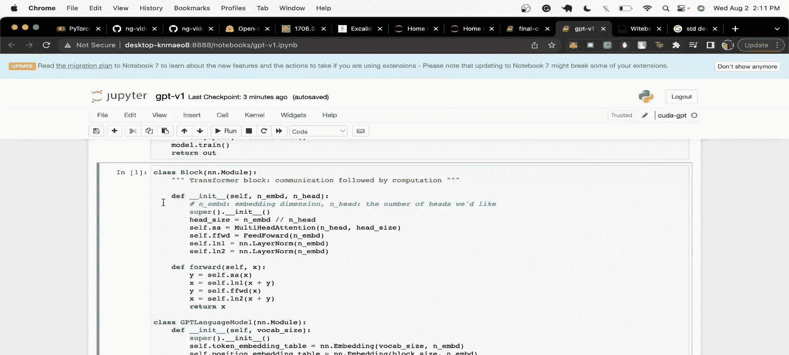

前馈。

所以让我们继续做这个。前馈看起来就是这样。实际上非常简单。所以我们所做的就是创建一个 nn 。sequential，torch ，nn。我们创建这个线性、线性、relu 和线性的顺序网络。

所以在我们的线性中，我们必须注意这里的形状。所以我们有 nembed，然后是 nembed 乘以 4。然后 relu 就是基本上。relu 将会是这个样子。让我为你们演示一下。所以基本上，你有这个图。

让我们把这整个平面都画出来。所以所有这些值都是小于0的，所有这些在x轴上小于或等，于0的值将被改变为0，就像这样。所以你有所有这些看起来像这样的值。然后一切大于0的值都保持不变。

所以你基本上就得到了这个奇怪的形状。它是直的，然后是斜的。这就是relu函数的作用。它查看一个数字，看它是否等于或小于0。如果是真的，我们将该数字设为0。如果不是，那么我们就让这个数字保持不变。所以酷。

非常酷的非线性函数。如果你愿意，你可以阅读相关论文。但基本上，这个形状并不重要。我们所做的只是确保我们只转换一些小于或等于0的值。这就是所有的事情。然后我们本质上是将这个值乘以。

我们正在进行这个线性变换乘以这个。所以我们必须确保这些内部维度是一致的。所以4乘以n-embed和4乘以n-embed。这两者是相等的。所以我们的输出形状应该是n-embed乘以n-embed。

所以现在我们有了我们的dropout。而且，如果你不知道什么是dropout，它基本上只是让我们，的神经元的某个百分比变成0。这用于防止过拟合和一些其他小细节，我相信你可以通过，实验找出来。

所以所有这些在参数形式上实际上就是dropout等于。我们就说0。2，为了简便。所以0。2意味着20%或者说0。2将会是。所以百分比形式的0。2就是要使我们的神经元掉落20%。将它们变成0以防止过拟合。

这就是那个在做的事情。很酷。我们有了我们的前馈网络。我们在之后进行dropout以防止过拟合。然后我们只是在这个顺序网络上调用一个前向操作。很酷。前馈网络相当不言自明。

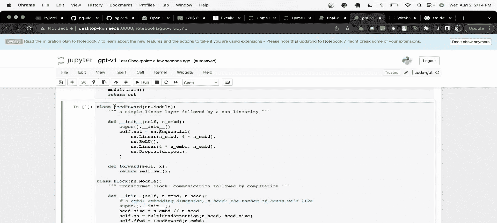

让我们进入下一部分。我们要添加多头注意力类。所以我们已经构建了所有这些解码器块。我们在解码器块内部构建了。我们构建了前馈和我们的残差连接。现在在这个块中剩下要做的就是多头注意力。

所以它看起来会完全像这样。我们现在会忽略键和查询，并将其保留给点积注意力。所以我们基本上只是制作一堆这些多头。然后我们将结果连接成线性转换。

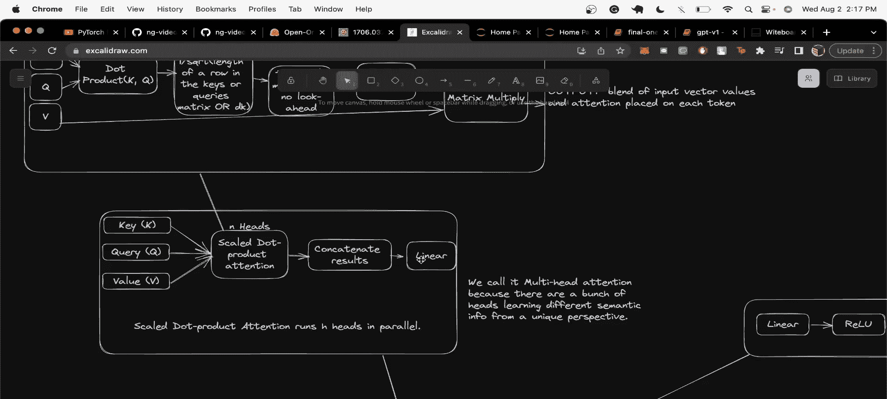

那么在代码中，这是什么样子呢？好吧，让我们继续在这里添加这个。所有的关注。很酷。所以并行进行多头注意力。我之前解释过这个，所以我不会深入讨论太多细节。但我们有我们的初始化。我们有我们的前进。

那么在这里我们做了什么？所以我们的self。heads只是一个模块列表。模块列表有点奇怪。稍后我会深入研究一下。但基本上我们正在做的是，为每个头并行地拥有一堆这些，头。所以numHeads。

假设在这个块中我们的numHeads设置为四，我们进行多头注意力。我们进行nHeads，然后headSize。所以nHeads，然后headSize。所以numHeads，基本上它是什么。

所以对于我们拥有的头数，也就是四个，我们基本上会让一，个头并行运行。所以这就是四个头并行运行的效果。然后我们有这个投影，基本上只是将头大小乘以头数投影，到嵌入中。你可能会问，这有点奇怪。

因为头数乘以这个就等于一个嵌入。如果你回到我们在这里做的数学。这样做的目的只是为了非常容易修改。这样，如果你确实想要改变它们，就不会抛出维度错误。这就是我们正在做的事情。

只是从这些值到嵌入的常数特征长度的一个小投影。然后我们只是跟着一个辍学，辍学掉网络神经元的 20%。现在让我们进入这里的前进。所以前进 torch 。concatenate 或 torch 。cat。

我们对于 self 。heads 中的每个 h 都这样做。所以我们要沿着最后的维度将每个头连接在一起。而在这种情况下，最后的维度是 B 批次乘以时间乘以我们，只说特征维度或通道维度。

这里的通道维度是最后一个。所以我们将沿着这个特征维度进行连接。让我帮你说明一下这到底是什么样子。所以当我们沿着这些连接时，我们得到了这个 B 乘以 t。然后我们就说我们的特征将会是 h1。

就像这里的每个头一样。另一个 h1，h1，h1。这些都只是头一的特征。然后我们的下一个将是 h2，h2，h2，h2。然后让我们假设我们有一个第三个头。走 h3，h3，h3，h3，就像这样。

所以我们可能每个头有四个特征，而且有三个头。所以本质上当我们进行这种连接时，我们只是沿着最后一，个维度进行连接。所以要将这个丑陋的列表格式转换成每个头特征按顺序排，列的格式，这样处理起来就更容易了。

这就是我们所做的。所以这就是它的作用。然后我们就跟着进行一次失活。所以我们做自己的投影，然后跟着一次失活。很酷。如果这还不是很清楚，你完全可以将这段代码输入到 ，ChatGPT 中。

获得关于它如何工作的详细解释。如果有些内容不是特别清楚，但基本上那就是前提。你有你的批次乘以时间，或批次乘以序列长度或时间，可互，换使用。然后你有你的特征，它们都只是以这种奇怪的列表格式列，出。

每个特征一个接一个地列出。很酷。这就是多头注意力看起来的样子。让我们继续实现点积注意力或者缩放点积注意力。所以在我们进入下一个缩放点积注意力之前，我想要覆盖，的一点小事情就是这里的线性变换。你可能会想。

如果我们只是将一个嵌入转换成另一个嵌入，那有什么意义呢？这样匹配似乎有点奇怪。本质上，这样做就是为我们添加了另一个可学习的参数。所以它有一个权重和一个偏置。如果我们像这样将偏置设置为假。

那么它就不会有偏置，但，它确实有偏置。所以另一个就是 WX 加 B，如果你愿意的话，一个权重乘以， X 加上一个偏置。所以它只是为了帮助我们的网络更多地了解这个文本，添，加了更多可学习的参数。很酷。

我要继续添加这个最后但并非最不重要的 缩放点积注意，力 或 头 类。所以会有很多这些头部，因此头部类会并行运行。在这里，我们要进行一些缩放点积注意力。所以这里有很多代码。不要被这个弄得太过分。

但我会逐步解释这个。所以我们有我们的初始化。我们有我们的前向传播。

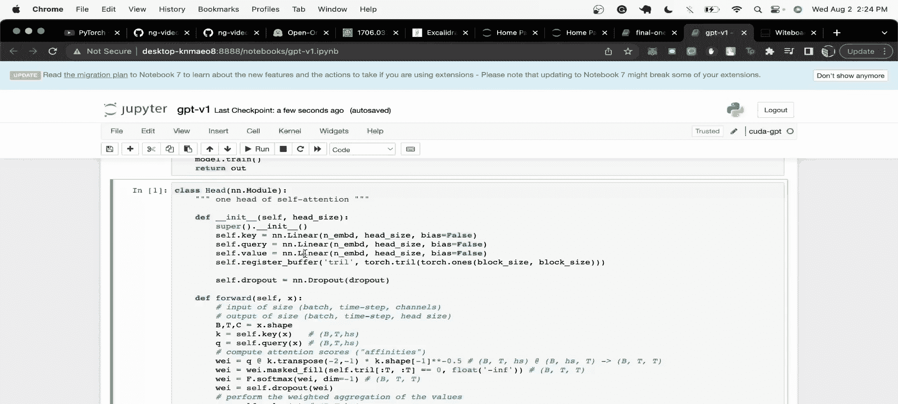

太棒了。那么在我们的架构中，我们做了什么呢？所以我们有一个键，一个查询和一个值。键和查询进行点积运算。它们乘以键或查询矩阵中行的长度的倒数。所以我们会说，也许是键，例如，键的行，键的行的长度。

然后我们进行掩码处理，以确保网络不会提前查看和作弊，然后我们进行softmax和矩阵乘法，从而在其上方添加这个。

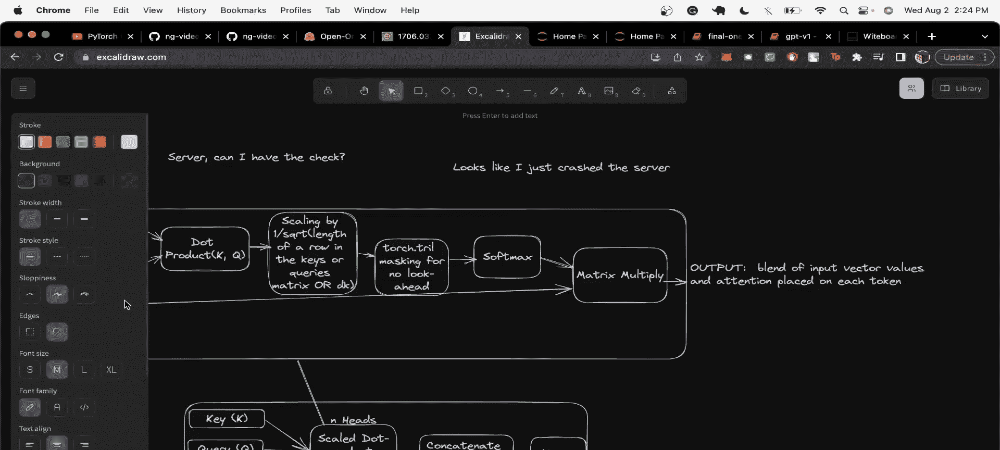

值的权重。太棒了。我们做这个键或保持在心里，这个初始化实际上并没有进，行任何计算，而只是初始化我们在前向传播中要进行的线，性变换。所以self 。key只是进行转换并嵌入到头部大小的偏差为，false。

然后，我是说，其余的都一样，嵌入到头部大小，因为每个头，部将具有96个特征而不是384个。所以我们已经讨论过了，但那只是在做什么。很酷。这只是一个线性变换，将从384转换为96个特征。

然后我们有这个self 。register buffer。那么，这是做什么的呢？你可能会问。Register buffer基本上只是要在模型状态中注册这个no ，look ahead掩码。所以。

我们不必为每个前向和后向传递的每个头部重新初，始化这个，我们只需将其添加到模型状态中。这样做将为我们节省很多计算时间。所以我们的训练时间将会减少，因为我们在注册这个。是的。

这只是为了防止重复做这个计算的一些额外开销。没有这个你仍然可以进行训练。只是会花费更长的时间。这就是它的作用。是的。现在我们有了这个dropout，当然。然后在我们的前向传递中。

让我们一步一步来分解这个。所以 B 乘以 T 乘以 C。所以批次乘以时间乘以通道是我们的形状。我们只是解开这些数字。然后我们有一个关键点，这只是在输入 X 上调用这个线性，变换。然后一个查询。

它也调用相同的变换，但在 X 上还，有一个不同的可学习的变换。所以我们得到的是，不是 B 乘以 T 乘以 C，而是 B 乘以 ，T 乘以头的大小。因此，这是从 384 到 96 的转换。那就是那个。

这就是这里的结果。所以现在我们实际上可以计算注意力分数。那我们做什么呢？我们就说权重是我们的注意权重。或者是的，我猜你可以这么说。我们有我们的查询点积矩阵乘以转置的关键。所以这实际上是什么样子呢？

我想帮助你们理解这里转置实际上是什么作用。所以让我们回到这里，并画出这将会是什么样子。所以基本上转置要做的就是，让我首先画出这个。所以假设你有，我不知道，也许A，B，C，D，而你有A，C和D。好的。

让我们画一些线来分开它们。太棒了。所以本质上这样做的话，转置就把它放到这种形式中。所以如果没有转置，那么这会是一个不同的顺序。不会是A，B，C，D，以及从上到下，从左到右的那种顺序。

它会是一个不同的顺序，这基本上不允许我们以相同的方，式进行乘法运算。所以当我们做A乘以A，A乘以B，这就像是直接相乘，如果你，愿意的话。我不知道你是否还记得小学的乘法表，但基本上就是这样。

我们只是按照乘法表的形式进行设置，然后以这种方式计，算注意力分数。所以这就是它的含义。这就是转置的作用。而所有这一切所做的就是将倒数第二维与最后一维交换。所以在我们的情况下，倒数第二维是T。

最后一维是头部大，小。所以它只是交换这两者。这样我们得到B乘以T乘以头部大小，然后B乘以头部大小乘，以T。我们将它们进行点积运算。也要记住我们这里的缩放，即采用这种方式，我们只是对键。

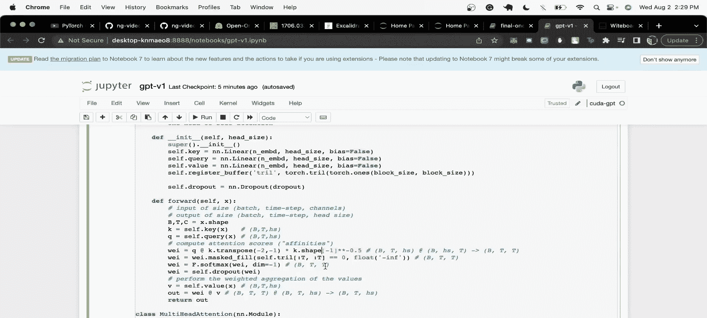

的行长度的平方根取倒数进行了缩放。

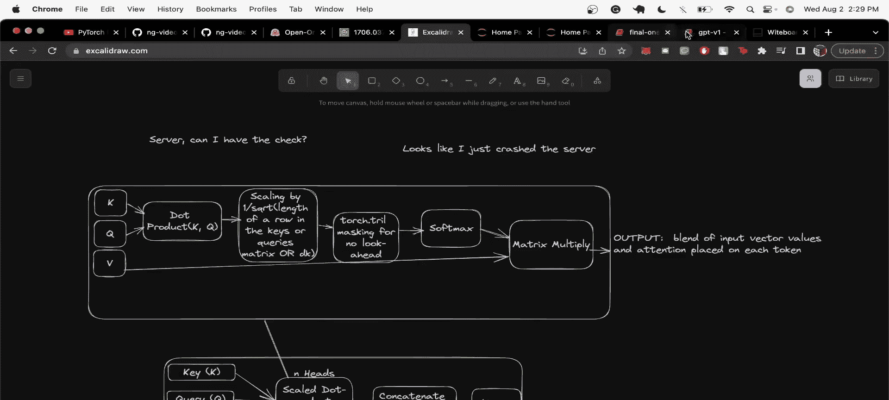

如果我们看看这里，现在我想提供一个关于这个缩放的小，类比。所以想象一下，你在一个房间里，有一群人，你试图理解整，个对话。如果每个人都在同时说话，要跟上说了什么可能会有挑战，如果能一次只关注一个人。

那会更容易处理，对吧？这类似于一个多头注意力在transformer中的工作方式。因此，每个头部将原始问题划分为理解整个对话的子问题，即，整个输入序列分为更小、更易处理的子问题。每个子问题就是一个头部。

所以头部大小就是这些子问题的数量。现在考虑每个人说话的声音是如何影响的。如果有人说得太大声或太小声，可能会淹没其他人的声音，这可能会让理解对话变得困难，因为你只听到一个声音或，大部分是一个声音。

为了防止这种情况，我们希望控制每个人说话的声音大小，以便我们能够均匀地听到每个人的声音。在注意机制中，查询向量和关键向量的点积就像每个声音，有多大一样。如果向量非常大或高维度，或者有很多人在说话。

点积可能，会很大。通过使用头部大小的平方根来缩小点积，以控制这个音量，这种缩放有助于确保没有一个声音太主导，使我们能够听，到所有声音。这就是为什么我们不按头数或时间步数进行缩放。

它们不直接影响每个声音有多大。总的来说，多头注意力使我们能够关注对话的不同部分，并，且缩放帮助我们均匀地听到对话的所有部分，使我们更好，地理解整个对话。希望这能帮助您准确理解这种缩放的作用。

现在让我们进入这里的其余部分。所以我们在我们的头大小维度上应用了这个缩放。我们在这里进行点积矩阵乘法。我们得到我们的 B 乘以 T 乘以 T。那么这个掩码填充在做什么呢？让我帮你解释一下这个。

所以掩码填充实质上就是，我们将说块大小在这里是三，好，吗？所以最初，让我们说我们有一个，一个0。6，然后像是0。4，好，吗？然后我们的下一个是，是的，我们就说所有这些都是一样的，好吗？

所以实质上在我们的第一个中，我们希望屏蔽除了第一个，时间步之外的所有内容。然后当我们前进一个时间步，让我们将这里的值改回零。当我们进入下一个时间步时，我们希望暴露下一个片段。所以0。6，我相信是这样。

然后再次是零。然后当我们在之后暴露下一个时间步时，我们希望暴露所，有它们。所以这只是说明在这种情况下，我猜垂直部分是每次步进，一个时间步，我们只想以阶梯状的方式暴露一个更多的令，牌或这些值中的一个。

所以基本上这个掩码填充所做的就是，它使得这个T乘以T，所以块大小乘以块大小。对于这些值的每一个，我们将把它们设置为负无穷大。所以对于每个值，即零，我们将使其浮点值为负无穷大。所以它会看起来像这样。

负无穷大，负无穷大，负无穷大，就，是这样。所以基本上在这之后发生的事情是，我们的softmax将取这，些值，并对它们进行指数运算，将它们归一化。我们之前已经讨论过softmax，但基本上它要做的是。

连接，或不连接，而是在最后一维上应用softmax，是在这种水平，方向上进行的。所以这个最后的T，就像是块大小乘以块大小。所以就像，我们将说T1和T2，每个都是块大小的长度，我们。

将它只是做给这个最后的T2。而这个水平的是T2。希望这样说得通。基本上这个指数运算要做的是，将这些值变成零，这个显然，会保持为1，然后将这些变成零，它可能会使这个更加尖锐，所以这个将会更显著。

它将会比0。6更增长，因为我们进行了指数运算，然后在这，里也是一样。所以这个将会比0。6或0。4非常尖锐。这就是softmax的作用。基本上softmax函数的目的是使这些值更为突出。

它是为了使模型更加自信地突显注意力分数。当你有一个值时，那就像非常大的值，但不是太大，不会因，为我们的缩放而爆炸，对吧？我们要牢记我们的缩放。但是当一个值很大时，当得分或注意力分数非常大时，我们。

希望模型能够对其进行重点关注。并且表示这在整个句子或令牌的整个部分中非常重要，我，们只想让它从中学到最多的东西。因此，这就是softmax所做的，而不仅仅是归一化机制。它对此进行了一些幂运算。

以使模型对其预测更有信心。因此，如果我们只突出显示在序列中哪些令牌和注意力分，数更重要，这将有助于我们从长远来看得分更好。然后在这个softmax之后，我们只是在这个新计算的方式变。

量上应用一个简单的dropout，这个新计算的方式是，scale。productAttentionMasked然后进行softmax。我们对此应用了一个dropout。然后我们执行我们最终的加权聚合。

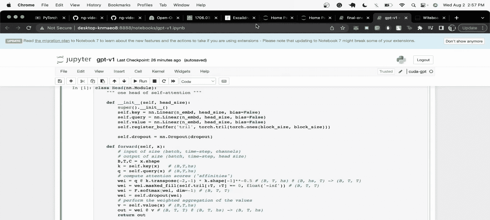

所以这个V乘以softmax的输出。

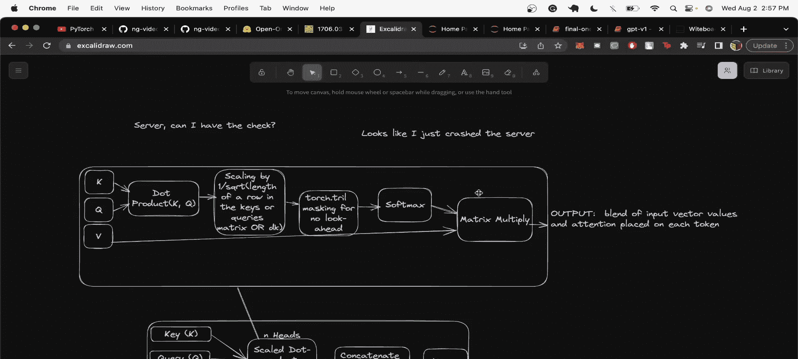

很酷。所以我们得到这个V自身。X的值。所以我们只是乘以那个。我想在这个模块列表中添加一个小提示，那就是，是的，模，块列表在这里。然后我们的，它到底去哪了？是的，我们这里有一个顺序网络。

所以我们有这个用于n层的顺序块的序号，还有我们的模块，列表。那么这里真正的区别是什么呢？嗯，模块列表在使用星号的用法上与n 。sequential不同。在语言模型类中。

模块列表不是按顺序运行一层或一头接，一头，而是每一层都是独立的，都有自己独特的视角。顺序处理是一个块依赖于另一个块同步完成的过程。这意味着我们要等待一个完成，然后再移到下一个。因此。

它们不是异步或并行完成的。在transformer模型中，多个头在计算上是独立的，它们的，计算可以并行处理。然而，这种并行性不是由存储头的模块列表引起的。相反。

这是因为计算的结构化方式利用了GPU的能力进行同，时计算。这也是深度学习框架PyTorch与GPU进行接口的方式。所以这不是我们需要太担心的事情，但你可能会认为它们，在某种程度上是并行运行的。好。

所以如果你想进入硬件领域，那就是你的整个领域。但这是 PyTorch。这是软件，与硬件无关。我不指望你必须对GPU、CPU之类的硬件有任何了解。总之，这只是对正在发生的事情的一个背景了解。很酷。

那么让我们实际上从头开始看看发生了什么。所以我们有这个 GPT 语言模型。我们得到我们的标记嵌入，位置嵌入。我们有这些顺序块。初始化我们的权重。对于这些块中的每一个，我们都有这个类块。

所以我们得到一个头大小参数，这是一个嵌入器384除以n，头，即四。所以我们从中得到96。那是我们捕捉的特征数。自我 -注意。我们进行两个层的前馈两个层的规范化。所以我们进行自我 - 注意层规范化。

在后 - 规范架构中，进行前馈规范化。然后我们进行前馈，只是一个线性的，然后是一个relu，然，后是一个线性的，然后是丢弃它。然后我们有我们的多头注意力，它只是以并行方式组织了，这些注意力头。

然后连接了结果。然后对于这些头的每一个，我们有我们的keys， queries， ，和 values。我们注册了一个模型状态以防止过度计算。然后我们就在这一行里进行我们的缩放点积注意力。

我们进行了掩码填充以防止向前查看。我们进行了softmax操作，使我们的值更加尖锐，使其中一，些值突出。然后我们最终在此进行了一次dropout，以及一些加权聚合，我们计算我们的权重。

或者说最终的权重变量乘以我们从，最初得到的加权值，即这个线性变换。如此酷。这就是在GPT架构中逐步发生的事情。了不起。给自己一个好好的鼓励，去拿些咖啡，做任何你需要做的事，情，甚至是睡一觉。

为下一部分做好准备。这将会非常有趣。实际上我忘记添加另一个超参数，那就是nlayer。nlayer 本质上我们就说等于四。

nlayer 本质上等于我们有的解码器块的数量。

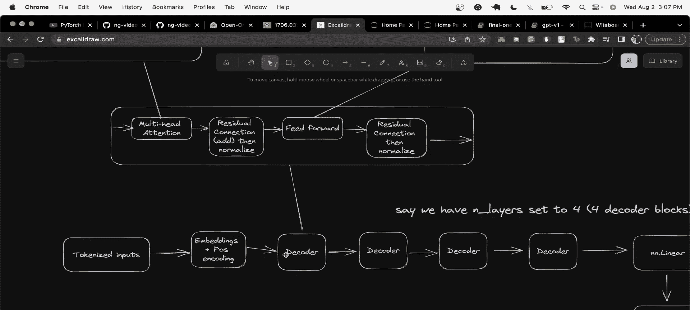

所以，不是像nblock那样，我们只说nlayers。它叫什么并不重要，但那就是它的意思。然后，头的数量是我们有多少个头在理论上并行运行。nembed是我们想从所有头连接在一起的总维度中捕获的数，量。

我们已经讨论过了。很酷。超参数，块大小，序列长度，批处理大小是我们想同时处理，多少个的数量。Max iters只是指我们想要进行多少次迭代的训练。学习率是我们在之前展示的Desmos计算器中讨论的。

只是，展示了如何根据损失函数的导数来更新模型权重。然后val iters，这只是报告损失。最后，dropout，即丢弃0。2或总神经元的20%。太棒了。这相当酷。让我们继续进行一些数据处理。

所以我要拿出一篇论文。很棒。让我们确保这里一切正常。然后我们实际上要下载我们的数据。所以我想尝试运行一些迭代，确保我们的。实际上，我做了一些更改。基本上这很奇怪，而且不起作用。

所以我只是把这个改成了使我们的字符为空，打开这个文，本文件，用UTF-8格式存储在一个变量中，然后只是使我们，的词汇表成为文本的这个已排序列表的集合。然后只是使词汇表大小成为其中的长度。

所以让我们继续实际运行这个。我将块大小更改为64，批大小更改为128，还有一些其他的，超参数在这里。所以说实话，块大小和批大小将取决于你的计算资源。所以只需尝试这些。我只是先尝试这些。

只是为了向你们展示一下这是什么样，子。好。看起来我们得到了IDX未定义的错误。那可能在哪里呢？好。是的。所以这是，我们只需更改那个。它只是说IDX未定义。我们在这里使用索引，那里使用IDX。

所以现在应该可以工作了。我们得到了在赋值之前引用的本地变量T。好。所以我们有一些，嗯，我们这里有个 T，然后我们在这里初，始化 T。所以让我们把它提升到那里。现在让我们尝试运行这个。哦。

形状对于输入大小无效，好的。让我们看看我们得到了什么。结果证明我们实际上并不需要两个令牌嵌入表，有点愚蠢，的错误，但我们不需要两个。所以我会删掉那个。然后我要做的是继续运行这个。我会看到一个新的错误。

局部变量 T 引用赋值。好的。所以我们的 T 在这里被引用。那么，我们怎么初始化它呢？我们可以这样做，我们可以取得这里的索引，形状为 B 乘，以 T，因为它是 B 乘以 T 加一，等等，一直在增长。

所以我们实际上可以展开它。所以我们可以去 B，B，而 T 就是 index 。shape。只需展开它。那么好。所以现在我们将运行这个训练循环，看起来目前它正在工，作。这太棒了。超酷。步骤零。

训练最后 4 。4。总体而言，这实际上是一个相当不错的训练损失。所以在这完成后我们会回来的。我已将其设置为训练，我已将其设置为训练3000次迭代，每，500次迭代打印一次。

所以我们将在整个培训过程中看到六次损失，或者我们应，该，我不知道为什么它要达到100。评估迭代次数，评估迭代次数。好。估计损失是，好。所以我们实际上不需要评估间隔。摆脱它。我们将只是做这个。当然。

为什么不是100？我们将保留那个。它将继续进行。我们将看到随着时间的推移，我们的损失有望变得更小。所以等它完成时我会回来。

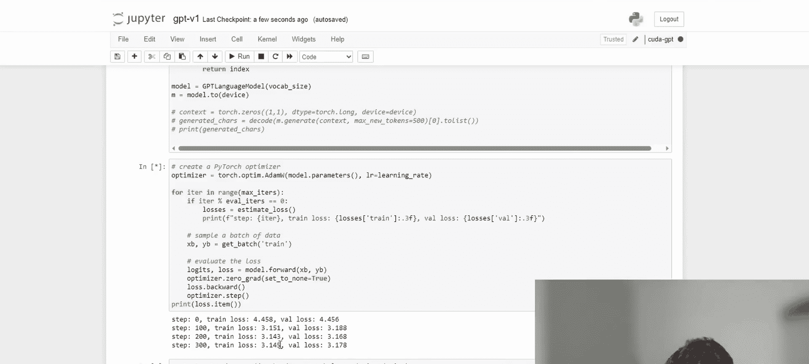

至于数据，我们将使用开放网络文本语料库。让我们往下走。这是，这是一篇名为“大型语言模型调查”的论文。好的。我将回到开放网络文本。无论它在哪里。这没关系。好。所以开放网络文本。

这由一堆Reddit链接或Reddit点赞组，成。所以，如果你上Reddit，看到一堆那些被高赞或贬低的帖子，它们基本上就是那些文本的价值很高，它们包含了我们可，以训练的内容。所以基本上。

网络文本就是所有这些被赞过的链接的语料，库，但它并不是公开的。所以有人创建了一个开源版本，叫做开放网络文本，因此是，开放的。而且它基本上就是这个的开放版本。所以我们要下载它。这里有很多其他的语料库。

比如common crawl，非常非常大，所以，比如说量级为petabyte的数据量，你有很多书籍，你，知道，所以这是一篇很好的论文可以阅读一下。它就叫做大型语言模型的调查。你可以搜索一下，就会出来。

你可以下载它的PDF。

所以这是一篇非常好的论文，如果你愿意的话可以阅读一，下。但无论如何，这是开放网络文本语料库的下载链接。所以只需点击这个链接。我已经放在GitHub存储库里了，你只需点击下载，它会带你，到这个云盘。

所以你可以右键点击这个，然后选择下载。它会说12 GB超过了它们能够扫描的最大文件数。所以就像，这可能有病毒。不用担心，它没有病毒。这实际上是由一位研究员创建的。所以并不是真的坏人负责创建文本语料库。

所以继续下载吧。我实际上已经下载了这个。所以是的，当我们的培训实际上完成时，我会回来的。所以我实际上会在迭代2000时停下来，因为我们实际上没，有取得太大的进展。而这是因为我们的超参数。

所以批量大小和块大小，我是说，这些还好，但我们可能想，要改变学习率。所以一些非常有用的学习率组合是3e的负三次方。你可以选择3e的负四次方。你可以选择1e的负三次方，1e，1e的负四次方。

所以这些都是我喜欢尝试的学习率。这些只是一些常见的。如果你想使用它们，那就由你决定。但实际上我可能会降级到3e的负四次方，然后重新测试一，下。嗯，我将增加头数和层数，以便我们可以在文本中捕捉更复。

杂的关系，从而使其学到更多。所以我会把每个都改成八。我们来八个。我要实际上改变内核，我们来重新启动。现在我们就从顶部运行这个，然后运行那个。那么让我们看看我们实际上从哪里开始，以及随着时间推。

移我们的损失是什么样子的。很酷，所以我们完成了第一步，4。5，与上次差不多。就像差0。2左右。所以非常接近。让我们看看下一次迭代。太棒了。所以之前我们得到的是大约3。1左右，或者在那个范围附近，3。

15。现在我们得到了2。2。所以你可以看到，当我们改变超参数时，我们实际上可以看，到损失有显著的变化。这太神奇了。这只是为了证明超参数有多酷以及它们对你有什么作用。鉴于此，让我们开始改变一些数据。

这里是绿野仙踪的文本，只是一个简单的文本文件。大小并不是很大。所以我们可以一次性将其全部加载到内存中。但如果我们要使用开放式网络文本，我们实际上不能一次，在内存中读取45吉字节的UTF-8文本。

就是做不到。除非你有64或128吉字节的RAM。这真的根本不可行。所以我们要在这里进行一些数据预处理，一些数据清理，然，后简单地加载数据到GPT中。所以让我们继续做这个。

所以模型实际上在预测下一个令牌方面变得非常出色。正如你所看到的，这里的训练损失是1。01。所以让我们实际上找出这个的预测准确性是多少。所以我可能会进入GPT-4这里，然后问它在损失1。01的情况。

下的预测准确性是多少。在预处理过程中，损失值是根据损失函数得出的。好的，让我们看看。交叉熵损失并不意味着模型准确率99％。好的，那基本上意味着模型非常准确，但我想找到一个值在。

这里。所以我们将转到沃尔夫拉姆阿尔法，然后我们将猜测一些。

值在这里。所以负自然对数，比如说，0。9。好的，可能不是那样。0。3，0。2，0。4，0。35。嗯，所以目前模型猜测下一个标记的概率约为35%。

这实际上是相当不错的。所以每三个标记中就有一个是准确的。

这真是太好了。这甚至更加收敛了。我们得到了0。89。所以现在大约有40%是被正确猜测的。尽管我们的验证效果不是很好，但我们稍后会详细讨论这，个问题。你将看到随着我们扩大数据规模，情况会发生怎样的变化。

但是，是的，我已经安装了这个webtext 。tar文件。Tar文件很有趣。为了真正提取这些文件，你只需右键单击它们，选择提取到，然后它就会创建一个新的文件夹。所以它会处理这个。

你必须确保你安装了WinRAR，否则可能无法完全工作。是的，所以我们等待这个完成。

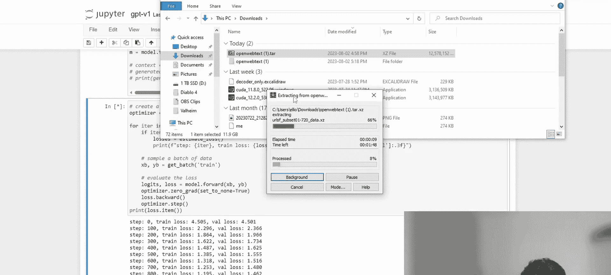

你应该得到类似这样的东西。打开webtext，在里面，你会看到一堆XZ文件。很酷。所以实际上有20，000个这样的文件。所以我们需要做很多事情，肯定会有一些循环在这里。那么。

让我们按照步骤来处理这个数据提取文件。首先，我们需要导入一些Python模块，并使用OS与操作系统，进行交互，使用LZMA处理XZ文件，这是一种类似于7-zip的，压缩文件。然后使用TQDM显示进度条。

因此，您会在终端看到一个从左到右的进度条，这基本上会，显示我们执行脚本的速度。接下来，我们将定义一个名为XZ files in dir的函数。它以目录作为输入，并返回该目录中所有XZ文件的文件名，列表。

它将使用os。listdir获取所有文件名，os。path是文件，用，于检查每个文件是否为文件，而不是目录或符号链接。如果文件名以。XZ结尾并且是文件，则将其添加到列表中。因此，我们只是有一堆这些文件。

每个元素只是那个文件的标题。所以，这基本上是它的作用。接下来，在这里我们将设置一些变量。文件夹路径只是我们的XZ文件所在的位置。因此，我实际上会在这里进行更改，因为那是一个不正确的，文件路径。

但就像这样，你必须确保这些斜杠实际上是正斜杠，否则你，可能会得到字节码错误。所以当它尝试读取字符串时，它不会认为它们是分开的，或，者反斜杠会对它们进行奇怪的处理。

所以你可以选择使用一个正斜杠或两个反斜杠，那应该能，够工作。这太棒了。只需确保你有正斜杠，你应该没问题。所以文件夹路径就是所有这些文件所在的地方。正如你所看到的，所有这些XZ文件都在那里。

输出文件是输出文件名的模式，以防我们想要多个文件。所以如果你想要200个输出文件而不是一个，那就像输出零，输出一，输出二，依此类推。然后，一个词汇文件是我们想要保存词汇的地方。请记住。

在这个庞大的语料库中，你不能一次性将所有内容，都推送到RAM中。所以我们要做的是在阅读这些小的压缩文件时，总共有，20，000个，我们将提取所有其中的新字符，然后将它们推送。

到包含我们所有不同字符的词汇文件中。这样我们以后可以处理它，然后基本上将其分类到一个包，含所有词汇的列表中。拆分文件。你想将这个拆分成多少个文件？所以这基本上与输出文件有关，只是这里的花括号。

我们想要多少个？如果我们想要多于一个，那么这将生效。很酷。现在我们将使用我们的X文件在目录中获取文件名列表，并，将它们存储在这个变量中。我们将计算总XZ文件的数量，即我们文件名的长度。现在，在这里。

我们将计算每个输出文件要处理的文件数。如果用户请求多于一个输出文件，对于请求多于一个输出，文件，这是总文件数除以输出文件数然后向下取整。所以如果用户只想要一个输出文件，最大计数就与总文件，数相同。

这就是它的工作原理。所以下一步，我们将创建一个集合来存储词汇，当我们开始，将这些新字符附加到其中时。集合是一组唯一的项目，以防你不完全知道什么是集合。现在，这就是有趣的地方。现在我们准备处理我们的。

XZ文件。对于每个输出文件，我们将处理最大数量的文件。对于每个文件，我们将打开它，读取它的内容，并将当前输，出文件的内容写入。然后将任何独特的字符添加到我们的词汇集。处理完最大数量的文件后。

从我们的文件列表中将它们移，除。最后，我们将把所有的词汇写入这个文件。所以我们基本上只是打开，将所有这些字符写入这个词汇，文件，就在这里，vocab。txt。太棒了。现在，老实说，我们可以继续运行这个。

那么让我们继续进入这里。我要输入CLS来清除那个。我们将运行python data extract。py。让我们看看它是如何发挥魔力的。你想将这个分成多少个文件？我们将选择一个。

然后我们会得到一个进度条，20，000个文件，然后我们就让，它加载。我会在大约30分钟后回来检查一下这个。好的，还有一件小事我们要考虑。而且这实际上是相当重要的，是我们的拆分。我们的训练和验证拆分。

仅仅是获取块然后在我们进行每，个新批次时创建训练和验证拆分，这将非常低效。所以反过来，我们可能最好的做法是只创建一个输出训练，文件和一个输出誓言文件。所以只有两个而不是一个。训练是我们数据的90％。

誓言是我们数据的10％，如果这样说，有意义的话。所以基本上我做的是取消了你想要多少个文件的那一行输，入。正如你所看到的，我在这里生成了相当多的文件，因为我没，有正确地执行那个操作。所以不要那样做。是的。

本质上我们只是，我们基本上只是这样做。所以我们正在处理一些训练文件，我们将左侧90％的名称与，右侧10％的名称分开。我们只是将这两者分开成两个不同的数组，文件名，然后根，据文件名处理每个数组。

所以我取消了那一小部分询问，你知道，你想要多少个文件，进行拆分吗？所以我取消了那个，并且这基本上是相同的代码，只是稍微，调整了一下。是的，所以我将继续运行这个。数据提取，所以我们有一个输出训练。

然后在这之后，它将，进行输出验证集。所以在这完成后，我会回来的。太棒了，我刚刚下载了两者，我已经获得了这两个分割，输，出训练和验证训练。所以只是为了确认它们实际上是正确的大小，它有38。9然，后4。

27。所以如果我们做这个除以九，大约是30，38。9除以九，我们，得到4。32，它与4。27非常接近。所以我们可以确认这些基本上是我们期望它们的长度。太棒了，我们有这个vocab。txt文件，太好了。

所以现在我们要专注的是将这个加入我们的批次。所以当我们调用我们的获取批次函数时，实际上从这个CD，出来，在Jupyter笔记本中打开这个，只需复制我的桌面，粘。

贴到这里，完美。所以它打开了带有这些文件的网络文本文件夹，太棒了，还。

有我们的GPT V1。

所以这个获取批次函数将不得不更改。而且，这些也将不得不更改。而这个也是，这些可能不会在这里，但基本上让我们首先，将这个vocab。txt加入进来。所以我要做的是，我只是要去，我们要去打开网络文本/ 。

vocab。txt，很酷。那就是我们的词汇表。文本读取词汇表大小，长度是那个，很好。这就是我们的词汇表。然后接下来我们要做的是改变这个获取批次的函数。首先，我将继续并摆脱这里的数据。然后。

我实际上为此编写了一些代码。所以我只是要回到我的，我只是要找到这个文件夹。好的，我实际上在这里编写了一些代码。

我是在摄像机关闭的情况下制作的，但基本上这将使我们，能够调用一个分割，好吧？所以我们有我们的获取批次函数。所有这里的内容都与我们的GPTV1文件相同。然后，这些数据只是会获取一段随机的文本。

就是一大块文，本。获取它的方式实际上非常有趣。所以我们获取这个文本的方式被称为内存映射。内存映射是一种查看磁盘文件或打开它们并查看其中某些，部分而不必一次性打开整个文件的方式。内存映射，看。

我不是一个硬件专家，所以我不能真正谈论，那个。但是，是的，内存映射相当酷，可以让我们一次查看非常大，的文本文件中的一小部分。所以这基本上就是我们在这里做的事情。我们传入分割，分割文件名等于训练分割。

这只是一个示例文本文件。如果拆分等于训练，那么这是我们的文件名，否则是文件拆，分。然后我们将以二进制模式打开此文件名。这必须以二进制模式进行。在二进制模式下，效率也更高。

然后我们将使用内存映射打开此文件。所以我不指望你记住所有内存映射的语法。如果你愿意，你可以查看文档，但我只是逻辑上解释一下发，生了什么。所以我们将使用内存映射库打开这个。我们将以mm的形式打开这个。

文件大小就是它的长度。因此，确定文件大小，从这一点开始，我们只是在找位置。我们使用随机库，找到零和文件大小减去块大小乘以批处，理大小之间的位置。因此，我们基本上有了这个巨大的文本文件。我们可以选择。

我们想要做的是从零开始，一直到接近结尾，因为如果我们实际上采样了最后一部分，它仍然会有一些，余地来进一步查找文件。如果我们只是从文件的最开始一直到最后，那么它会想要，做的是会想要查看超过结尾。

因为它会想要查看更多的标，记。然后我们会得到错误，因为如果有重复的话，就不能读取超，过文件大小的部分，如果这样说得通的话。这就是为什么我在这里设置这个小阈值。是的，所以这就是它的作用。这是起始位置。

它可以是在起始位置和离结尾有一点距离的随机数。接下来，我们有这个搜索功能。所以搜索会去到起始位置，然后块会读取。我们会到达起始位置。它会搜索到那里。那是它的起点。它会到那里去。

然后读取功能将找到一个文本块，其大小为块大小乘以批，处理大小。所以它会在起始位置找到一小段文本，其大小为。它会有与块大小乘以批处理大小相同的字节数，然后减去，一个。只是为了使其适应这个起始位置。

我们在这里不会得到错误。这就是为什么我放置了减一。但是，是的，所以我们将获得相当可观的文本量，我想你可，以这么说。所以这将足够使用了。当然，如果你愿意，你可以增加这个。你可以做，你知道，乘以八。

如果你愿意的话。你知道，像乘以八，然后在这里再乘以八。但我们不会这样做。根据我的经验，这表现得相当不错。所以我们将坚持使用这种方法。然后我们只是解码这段文本。解码的原因是因为我们是以二进制形式阅读它。

所以一旦我们有了这段文本，我们实际上必须将其解码为，UFA格式或UTF-8格式。然后我们忽略任何字节代码错误。这是通过实践学到的一些东西，当你开始处理非常奇怪的，数据或者它有一些损坏时，你会得到错误。

所以你想要做的就是，所有这只是在很大程度上表示，好的，我们只是要忽略这段文本的一部分，我们只是要对它周围，的一切进行采样，不包括那一部分。而且，由于我们进行了这么多的迭代，它实际上不会干扰太，多。

所以我们应该没问题。然后对于这个替换函数，在这里，我注意到我得到了关于这，个斜杠R的错误。所以这只是简单地用空字符串替换它。最后，我们有了所有这些解码的数据。所以我们要做的就是将其编码为标记化形式。

所以它都是以标记化的形式，整数或torch 。longs数据类，型。我们只是，这就是我们的数据。而不是一堆字符，它只是一堆数字。然后我们将其返回到我们的批处理中，这就是我们的数据，所以这相当酷。

我们可以获取训练或验证分割。这在实践中看起来是这样的。这就是我们如何从非常大的文本文件中逐步地以较小的比，特逐步采样的。所以让我们在这里实现这个。

我将获取整个内容并移至这里。我只是要替换掉那个。所以获取随机块，获取批处理，很酷。所以现在我们实际上可以继续并运行这个。

实际上，在我们运行这个之前，这里有一点我们需要添加。

所以我有这个train split 。txt和val split 。txt。

所以我实际上需要改变这些。全卷重命名，我们将训练分割 。txt 然后验证分割 。txt。

很酷。然后我们可以打开网页文本斜杠，这里也是一样的，很酷。让我们继续运行这个现在。我们得到错误。Mem map 未定义，好的。

这是另一件我们可能需要添加的事情。所以我实际上要停止这个进程在这里运行。我们要 pip 安装 mem map。Mem map 未定义。哦，我们实际上不需要安装这个。

它默认与操作系统一起安装。所以我们实际上需要做的是，让我关闭这个。

GPT -V1，很棒，一切。一切都好，没有损坏，很好。所以我实际上需要在这里做的是导入这个。所以我需要导入 mem map，就像这样。然后应该可以开始运行脚本了。Name random 未定义。再次。

我们必须做的另一个导入，导入 random。然后我们应该开始看到一些进展了。所以一旦我们看到第一次迭代，我会停下来，回到最后一次，迭代，然后我们将开始在我们的脚本上添加一些小细节，使，它变得更好。

所以我们已经进行了大约600次迭代，你可以看到训练损失，到目前为止实际上做得非常好。它从10 。5降到了2 。38。而且我们实际上可以看到我们可能能够得到比训练更低的，验证损失。因为请记住。

在训练模式中，辍学就会生效。但在评估模式中，让我来滚动到这里。是的，所以model。eval，它的作用是关闭辍学。这样我们就不会失去任何神经元，它们都在展示相同的特，征并提供它们应该提供的所有信息。

因为它们都是活跃的，但在训练模式中，它们中有20％是关闭的。所以一旦你真正看到在评估模式下，它表现得更好。这意味着网络已经开始形成学习的完整感。所以一旦它达到那一点，它只是稍微调整一下事物。

我们可能会马上看到这种情况发生，但到目前为止，进展非，常好。1 。8的损失是令人惊讶的。所以，在这段时间里，我只是会在这个脚本中进行一些小的，调整，以此来改进它。所以我实际上已经停止了迭代过程。

但我们已经进行了700，步，我们已经可以看到验证损失小于训练损失，这表明模型，实际上正在收敛并且表现得非常好。所以这个架构是令人惊奇的。我们基本上涵盖了这个脚本提供的每一个PyTorch部分的。

架构数学。我想要添加的唯一一件事，实际上是我想要添加的几件事，之一，其中之一是torch 。load和torch 。save。所以当你开始扩大你的迭代时，有一件事情会变得非常重，要。

你不仅仅想要运行一个执行训练循环的脚本，带有一个，架构，就此而已。你希望有一种方法来存储那些可学习的参数。这就是torch 。load和torch 。save的作用。所以你有一些文件，对吧？

而你可以相当轻松地，当你保存它时，将其放入序列化格式，中，你采取你的初始架构。在我们的情况下，它实际上将是GPT语言模型。所以你会保存这个，因为它包含了一切，还有这些其他类也，都在GPT语言模型中。

它们都在GPT语言模型中。让我们保存那个架构，你基本上将它序列化为一个名为，pkl的文件。所以基本上，我们不再使用torch，而是使用一个叫做，pickle的库，因为它们本质上是一样的。

Pickle使用起来稍微简单一些，或者至少更容易理解一些，它没有那么复杂。Pickle只能在一个GPU上运行。所以如果你同时有八个GPU，你可能需要了解一些关于硬件，的东西和一些PyTorch文档。

但基本上，如果我们想在训练之后保存这个，我们要做的就，是使用一个叫做pickle的小库，这个库在windows中是预装，的。我没有输入windows，导入pickle。

所以我们要做的是在训练循环之后实现这个，在所有这些，参数都已经更新并学到最大程度之后。所以在这个训练循环之后，我们只是简单地打开。我们要做的就是打开，我们可以使用model 01这样的方式，然后就是。

pkl，这是它的文件扩展名。然后因为我们要写入它，我们会用write binary as F。然后为了真正保存这个，我们只需使用pickle 。dump，然后，我们可以使用一个模型，然后就像那样F。

所以，如果我开始录制这个，如果我开始录制这个训练过程，它会让我的剪辑延迟。所以在我们完成之后，我会回来的，就说大约100次迭代。我们将进行100次迭代，我会回来给你们展示模型文件的样，子。

实际上我做的是改变了一些模型的超参数，因为它花费的，时间太长了，无法执行我们想要的。所以我改变了头到一层，层到一层，我将大小全部从64减少，到32。所以我要添加的是，只是为了确保我想要的，我喜欢在开始。

时打印这个，只是打印设备，确保设备是CUDA。让我们再往下走。实际上它确实训练了模型。所以我们完成了所有这些。是的，我不知道为什么我做了2 。54或者那个，那只是整个，损失。好的，模型保存，太棒了。

这实际上是什么样子呢？所以这个模型。pkl，106兆字节。这不是很棒吗？这就是我们的模型文件。这就是它们的样子。这只是一个序列化，基本上是整个架构，模型的所有参数，状态，包含的一切。

然后我们将其压缩成一个小的PKL文件，取出来，解压缩，然，后再次使用它，带有所有相同的参数。太棒了。而且，所有这一切所需的只是，我们只需像这样打开它，进，行pickle 。dump。

然后只是为了确保实际保存，我喜欢在那里添加一小段打，印语句。很酷。所以下一步，我想要添加的是一个小的权重，以便于我们，而不仅仅是一次性完成所有训练，然后保存模型，能够多次，进行训练。所以我要去这里。

去到我们的GPT语言模型这里。让我们看看我要做什么。我要打开，并且我们将会用 model01 。pkl。然后我们会以二进制方式读取。所以实际上会读取它。我们将把它加载到我们的脚本中。所以我会以F的形式。

然后我相信是 pickle 。load。你只需执行，是的，模型等于pickle 。load。然后我们将其基本上直接倒在那里。打印加载模型参数，点，点，点。然后只是放F在那里。然后一旦加载完成。

我们将打印加载成功。所以我现在要尝试一下。去做那个。嘭，好的。所以加载模型参数已成功加载，我们将看到它开始自行运，行。所以它是要开始还是不要开始呢？让我们运行。好的，完美。

所以现在我们应该采取之前的损失，大约是2。54，我相信。大致是这样。你可以看到我们的训练过程大大加速了。所以我们有一百。现在它只会估算损失，我们差不多完成了。1。96，太棒了。模型已保存。

所以基本上我们可以用这个做的事情是，我们现在可以保，存模型，然后加载它们，然后进一步迭代。所以如果你愿意，你可以在这里创建一个超酷的GPT语言模，型脚本，你可以让它运行一晚上，比如说10，000或20。

000次，迭代。你可以保存它，然后将其导入到聊天机器人中，如果你愿意，的话。所以这很酷。这其实是一件好事。语言建模非常重要，因为如果你不能真正使用和部署它，拥，有机器学习模型就没有意义。所以。

你需要保存这些东西以使其工作。好的。现在让我们转移到任务管理器中的一些内容，我想讨论一，下。所以这里是共享GPU内存和专用GPU内存。专用意味着你的GPU卡上实际有多少VRAM，即视频RAM？

所以在卡上，这将是非常快速的内存，因为电子不必行进得，太快。这是它的逻辑。电子不必行进得太远，因为小型RAM芯片就在那里。所以专用GPU内存速度更快。共享GPU内存基本上是如果这个负载过大。

它会使用计算机，上的一些RAM。因此，这通常是你计算机RAM的一半左右。我计算机上有32吉字节RAM。所以16。0是有道理的，是32的一半。是的，所以你要确保只使用专用GPU内存。

共享GPU内存的增加通常不是好事。稍微的也没关系，但是专用的GPU内存是最快的，你希望所，有东西都停留在那里。只需确保所有参数大致适应于这个，无论你的最大容量是，多少。也许是四，也许是八，也许是48。

谁知道呢。确定你的GPU上可以使用的最大RAM量，而不会出现内存错，误或使用共享内存的好方法是实际上尝试调整这些参数。所以块大小和批量大小，实际上让我调换一下。这些不应该按照这个顺序，但一切正常。

我们将批量大小设置为64，那就是128，好的。因此，批量大小和块大小是确定你将使用多少内存的重要，因素。学习率不是，最大迭代次数不是，评估器也不是，但这三个，是。所以这些是你存储的特征数量。

同时运行的头的数量，以及，N层的数量。因此，其中一些不会对你产生太大影响，因为它们更多地限，制在计算上，如果某些操作是顺序进行的话，它们将影响你，的计算速度。所以N层不会像批量和块大小那样影响你。

但这些只是一些，可以调整和玩弄的好东西。所以我找到了我电脑的最优超参数集，恰好是8，8，384，学，习速率一样，然后是64，128。所以那恰好是我电脑的最优超参数。如果你的显卡上没有八吉字节的内存。

你的情况可能会有，所不同。总之，这是你需要注意的一点，确保你不会因为错误而耽误，还有一种你可以使用的技巧，但我在这门课程中实际上不，会向你展示，但它非常有用。这被称为自动调优。

自动调优的作用是运行一堆这些模型，使用不同的超参数，集。比如它会运行批处理大小64，批处理大小32，批处理大小，16，也许批处理大小256。它会看哪些模型出错，哪些没错？

如果你正确设置了一个自动调优脚本，它会帮你找到最适，合你电脑的一组参数。最可能的最优超参数集。所以自动调优很酷。你可以深入了解一下。有很多研究在进行。

是的，自动调优很酷。让我们深入下一部分。我们在实践中使用的下一个小技巧，特别是机器学习工程，师，是一种叫做参数的小东西。所以你把一个参数传递进去，不一定是一个函数，而是进入，命令行。这就是它的样子。

这只是参数解析的基本示例。所以只需输入Python arg parsing，因为那是脚本的名字，然后我输入dash LLMs，因为这就是这里说的。这就是参数是什么。然后我们可以只传递一个字符串，比如说。

hello。提供的任何东西都是hello。很酷吧。你可以给这个加一些小参数。而且我甚至会改变一下这个。比方说批次大小。然后我们就这样写。批次，批次大小，请提供一个批次大小。我可以再做同样的事情。

看看它说的是需要批次大小的以，下参数。那显然没有起作用。如果我们实际上尝试正确的方式，arg parsing 。py，然后，我们输入dash batch size。我们可以将其设为32。哦。

那是因为它不是一个字符串。所以我们实际上需要做的是在某处用BS。好的。所以args，解析args。所以我们需要将这个改成BS，就像这样。然后我们可以设置batch size。

batch size 是32。好的。所以即使我对参数也有点新手，但当你试图每次更改一些，参数时，这是非常方便的东西。如果你添加了一个新的GPU或其他什么，你可能会说，哦，我。

想要将我的batch size加倍。就像，当然，你可以很容易地做到这一点。所以很多时候它不仅仅有一个，而是你可能会有很多，意思，就是可能有十几个或者更多这样的小参数。这就是它的样子。

然后我们将把这个实现到我们的小脚本中。

所以我将切换到GPT -1。

我将在我的第二个显示器上拉起这个。

关于这些，我将从加入importation， arg， arg parser或，arg parse开始。就是这个名字。然后我们去，parser等于，我就复制粘贴整个东西。为什么不呢？好的。

所以让我弄一个batch size或者什么的。然后我们将在这里添加第二部分。因此，args，解析这里的参数。然后我们就像这样批量大小。我们的批量大小等于那个。然后我们就 args 。batchsize。

很酷。我将运行这个而未定义。啊，是的。

所以我在这里有一个小小的未定义的东西。而我基本上错过的是我们没有返回这个。所以基本上这应该等于这个右边。

所以我将继续复制它，嘭，解析args，除了我们没有一个解。

析args的函数。那么我们需要做什么呢？嗯，实际上，这可能只是自行运作。

让我们试试。好的。看起来它实际上是在代码中期望一些输入。所以这可能正在起作用。如果我们将这个移植到一个脚本中，那么它将简单地要求，我们提供一些输入。我相信我们正在正确地做这件事。

让我们继续并实际上切换过去，将所有这些都倒入一些代，码。所以我将制作一个训练文件和一个聊天文件。所以训练文件将包含所有我们的参数，无论是什么，所有我，们的架构，然后是实际的训练循环。

我们会在其中添加一些参数。然后聊天机器人基本上只是一个问答的东西，只是复制文，本。所以它就像提示完成的类型。

是的，让我们在这里实施吧。所以在我们的GPT课程中，我要去training。py。然后我们要去bot。py，就像这样。

在训练中，让我们继续在这里拖动所有内容。

我只是将这个移到第二个屏幕，并按顺序复制粘贴所有内，容。接下来，我们有我们的字符，然后有我们的分词器，然后有，我们的获取随机块和获取批次的部分。很好。我们的估算损失函数。

然后是包含我们构建的大部分架构的这一大段代码。我会将它添加在这里。很酷，我们没有收到任何警告。然后是训练循环和优化器。太棒了。然后在此之后，我们将简单地有这个上下文。但这一点很重要。

我们希望将其添加到我们的聊天机器人，脚本中。所以我要做的是在这个training。py文件中，我要保持所有，这些都一样。我要保持整个事物都一样。去掉这一小块代码。然后我们要进入聊天机器人这里。

所以加载模型参数，很好。我们想要加载一些，再训练一些，然后将其存储。聊天机器人不会存储任何东西。它只会保存。所以我将带走我们所有的训练这里。而不是存储，将其拿走。我们还将去掉训练循环。好的。

我认为我们实际上没有其他需要引入的东西。我们不需要我们的批处理。我们不需要我们的获取随机块。太棒了。我们只是默认导入这些参数。太棒了。所以从这一点出发，我们已经导入了我们的模型。很酷。

那么让我们继续导入我们的小聊天机器人，这个小结尾部，分，它将使我们能够与模型进行聊天。所以它看起来是这样的。一个小循环。我们有一个提示。我们只是输入一些东西。提示下一行。那应该是相当不言而喻的。

然后我们有这个张量。我们将把这个提示编码成一堆整数或在GPU上使用torch ，dot long数据类型，其中设备是CUDA。然后在我们实际生成这些之后，所以模型点生成，我们要对。

这些进行unsqueeze。记住，它是一个torch点张量。所以它将以矩阵形式存在。所以它会看起来像这样。它会看起来像这样或其他什么。这基本上是形状是什么。所以当我们展开它时。

我们只是把它周围的这个包装拿掉，太棒了。然后我们只是做最大的两个令牌，例如，在这里是150，然后，转换成列表格式。然后我们可以将这些打印出来作为生成的字符。太棒了。所以它只是询问我们提示。

然后进行一些计算，给我们一个，完成，依此类推。所以这就是这里正在做的事情。我想指出的另一件事是，当我们加载这些参数时，至少在训，练时，它会最初给我们错误。如果我们没有一个模型可以从中加载。

我们将会因为模型，什么都不是而遇到错误，我们将无法导入东西。首先，这会给你带来错误。另一件你要注意的事情是确保当你实际训练了这个初始模，型时，它与你使用的所有架构和超参数匹配，以便在再次加。

载时能够对其进行正确导入。因此，在运行前向传播等操作时，确保这个架构与之相符，这样你就不会遇到任何架构错误。这些错误可能会让调试变得非常困惑。所以是的，我们可以通过在这里添加注释来实现这一点。太棒了。

我们能够保存和加载模型，并能够使用一个小循环来创建，一个不太有用的模型，因为我们没有对实际有用的数据进，行大量训练。所以另一个非常重要的细节是确保在所有这些类和子类中，都有NNModule。

NNModule基本上作为所有参数的跟踪器。确保所有你的 NN 扩展都正确运行，总体上是 PyTorch 的，基石，就像你需要的那样。所以确保在所有这些类中都有 NNModule。

我知道这个 block 有点出自 GPT 语言模型等等，但所有，这些带有 NN 或任何可学习参数的类，你都需要它。总体上，在所有你的类中都使用 NNModule 只是一个良好，的实践，以避免这些错误。

很酷。我在开始时并没有明确介绍这一点，但这只是一个提醒。你总是想确保 NNModule 在其中。很酷。现在，我想要强调的是当我们尝试生成超过 block 大小的，最大新标记时会出现的一个小错误。

所以让我现在向你展示这个。所以你只需运行 Python，聊天机器人，然后批量大小为 32，所以我们可以说你好，例如。好的。这将给我们一些错误。那么这个错误到底是什么意思呢？嗯。

当我们尝试生成 150 个新标记时，它正在做的是，它正，在取前面的，你知道，H -E -L -L -O 惊叹号，六个标记，然，后基本上在其上面添加 150。所以我们有156个标记。

现在我们正在尝试适应一个块大小，而在我们的情况下，这个大小是128。当然，156不适应128。这就是为什么我们在这里遇到一些错误的原因。所以我们要做的就是确保我们实际上可以做的是确保最大，新标记足够小。

然后在我们进行提示时要注意，或者我们实，际上可以在这里制作一个小的裁剪工具。所以这将基本上裁剪掉最后一个块大小的标记。这非常有用，因为它基本上不需要我们一直关注最大新标，记。

它只是基本上在那个128的限制周围裁剪它。所以我将在这里用index cond或index condition替换，index。然后我们继续运行这个。所以我可以说，你好，然后我们得到了一个成功的完成。

太棒了。我们可以继续询问新的提示。太棒了。是的，我们并没有真正遇到这些维度像架构适应类型的错，误，如果你想这样称呼它们，如果你想以这种非常花哨的方，式来称呼它们。但是，是的。

实际上没有太多其他的事情要做。是的，有一些要点我想要讨论，包括微调。所以我要演示一个小例子，说明微调在实践中是什么样子。

的。在预训练中，这门课程的基础是预训练，在预训练中，你有，一个巨大的文本语料库，对吧？你有这个巨大的语料库，里面有一些文本。基本上你要做的是取出一些小片段。这些被称为块或批次，你可以这么说。

你取出这些小块，随机取一些小块，然后取多个批次。你基本上有了这个，比方说H -E -L -L -O，然后可能是下，一个预测者，也许是输出或目标，E -L -L -O感叹号。所以它只是向后移动了一个。

因此，给定这个字符序列，你想预测这个，这只是输入向后，移动了一个。这就是预训练。请记住，它们的大小是相同的。这是一个、两个、三个、四个和五个。同样的事情在这里。这两个都是五个字符长。然而。

微调并不完全相同。所以我可以有hello，然后可能是一个问号，模型可能会回，答，你好吗？也许这只是它给我们的一个响应。我们显然可以看到，"hello"的字符数或索引数并不与"how， are you？

"相同。所以这本质上是微调和预训练之间的区别。通过微调，您只需在生成函数中添加一些不同的东西来弥，补输入和目标中索引数不相同的情况。而不是仅生成直到收到一个结束标记。所以他们这里没有明确说的是。

在这个问题的结尾，实际上，有一个小的结束标记，我们通常这样做。它通常看起来像这样。所以我们就像这样，或者像这样。这些都是结束标记。然后您通常会有相同的开始标记，比如S或者像这样的开始，这很简单。本质上。

您只需将它们附加在一起。结束和开始标记。开始标记并不那么重要，因为我们本质上只是看看这个做，什么，然后开始生成。开始并不真的重要，因为我们不需要知道何时开始生成。它就会发生。但是结束符很重要。

因为我们不想生成无限数量的标记，对，吧？因为它们的大小不同。理论上它可能生成一个非常非常长的完成。所以我们要确保的是它不会生成无限数量的标记，消耗无，限数量的计算资源，只是为了防止那种循环。

这就是为什么我们在这里将这个结束符附加到末尾的原因，所以我们有了这个小的结束位。实际上，一旦抽样到了这个结束标记，你就会结束生成。就是这么简单。而我们实际上并不是从标记本身抽样，而是从实际的编码。

版本抽样，我想你可以说是索引或数值，也就是结束的编码，版本，这通常只会是你的词汇量大小加一。所以如果你的词汇量大小在我们这种情况下可能是，32，000，你的结束标记将在索引32，001处。这样。

当你抽样到一个结束标记时，当你抽样到那个32，001，标记时，你实际上只是结束了序列。当然，当你训练你的模型时，你总是在末尾附加这个结束标，记。所以你获得了你的初始输入，然后在训练数据或者实际处。

理并将其输入到transformer中时，你有一种函数只是将那个小，小的32，001的标记索引附加到它上面。所以这基本上就是微调。这就是微调的总结。创建这些巨型语言模型的整个过程当然是为了帮助人们。

而要做到这一点，没有比直接拥有人类有史以来所知道的，所有信息更好的方法，这意味着像 Common Crawl、开放式，网络文本或维基百科甚至是研究论文，对所有这些进行预，训练。

所以只是再次执行相同的大小，然后为目标进行偏移。然后在进行了许多次迭代之后，你会转向微调，在那里你有，这些特别挑选出的提示和完成对，并且你只是在这些对上，进行长时间的训练，直到你对结果满意为止。是的。

这就是语言建模的内容。在你继续进行研究、开发和机器学习之前，我想留下几个，关键要点。首先，有一件小事叫做效率测试，或者只是找出某些操作需，要多长时间。我们将这称为效率测试，我会向你展示如何在这里做到这。

一点。效率，是的，我不知道我是否拼写正确。我不知道为什么它这样做。好的，无论如何，我们将直接进入代码，基本上我们只需要。

我们将导入时间，基本上我们将只是，我们只是会计算操作，需要多长时间。所以在这里你可以去，我不知道，你可以去开始时间等于时，间。时间。基本上，这个函数所做的就是查看当前的时间，就是当前的，毫秒数。

非常精确。我们可以做一些小操作，比如，我不知道，对于 i 在范围内，我们只是去，我不知道，10，000，打印 i，例如，打印 i 乘，以二。好的，然后我们可以在这里结束时间。所以我们将继续。

结束时间等于时间。时间再次，调用当前，时间。所以我们正在做的与之前的对比，那个小差异就是执行所，花费的时间。所以我们能做的就是，我们可以说总时间如果你想要的话，我们可以说总时间等于结束时间减去开始时间。

然后我们，就去打印结束时间或者我花了多少时间，就这样。只需执行此 Python 时间测试。酷，耗时1。32秒。因此，你基本上可以用这种方法计时你所做的每一个操作，你可以在自己的机器上尝试一下。

我鼓励你真的去尝试一，下。我不会去做，但我鼓励你尝试一下模型实际执行某些操作，需要多长时间。比如加载模型需要多长时间？保存模型需要多长时间？估算损失需要多长时间，对吧？尝试调整超参数，看看需要多长时间。

也许你会发现一些新，的东西，谁知道呢。但这是我们用来测试某个操作需要多长时间以及效率如何，的一种方法。而且，也可以看看是否值得探索一种新的方法来处理某件，事情，以防它花费了可怕的时间。

所以这就是关于时间测试和效率测试的内容。

我接下来要讲的是历史的一小部分。我不会详细介绍AI和LLM的整个历史，但基本上我们起源于，一种叫做RNNs的东西，好吧？RNNs被称为循环神经网络，对于规模化的AI系统来说效率，非常低。

所以RNNs有点，基本上可以将其想象成一个小循环，不断学，习和学习。这是按顺序的，对吧？它做这个，然后这个，然后这个，然后这个。它必须等待每个完成。这是同步的。你不能同时运行多个因为它们很复杂。

GPU不能运行复杂的东西。它们只设计用于矩阵乘法和非常简单的数学运算。所以RNN基本上比transformers笨一点，它们是在CPU上运，行的。所以RNN是我们上次讲到的地方。

我鼓励你去了解更多的语言建模和人工智能历史和研究，这些都是导致现在这一点的。这样你就可以了解研究人员是如何能够迅速创新的，考虑，到所有这些历史性的创新。所以你可以有这些东西导致transformer。

那么，他们是如何在那一点上进行哲学思考的？是的，这只是一种自信的好方法，即创新。作为研究人员、工程师和商人。很酷。RNN是我们上次结束的地方，现在是transformers和GPTs。

这就是人工智能的当前状态。接下来，我想讲一下量化这个东西。量化本质上是一种通过减少参数内存使用量的方法。

所以这里实际上有一篇论文叫做QLORA，高效微调量化的，LLMs。所以这其实就是，简单来说，不再使用32位的浮点数，而是，不仅使用16位的半精度，而且一直降到4位。

那实际上它看起来是在二进制码或字节码中会在这个位置，有一些它使用的数字数组。我找不到，但基本上它是一堆浮点数，它们都介于负一和正，一之间，总共有16个。如果你有一个4位数。

那意味着它可以容纳16个不同的值，从零到15，也就是16个值。你基本上所做的就是你有这个浮点数数组。你使用那个4位数的字节码来查找那个数组中的索引，那就，是你的权重。那就是你的模型中所使用的权重。

这样一来，不再使用32位，而是使用这些超长数字，它们非，常精确，你可以有超精确的数字，它们只是一般性好参数，表现相当不错或者说分布得很好，经过了广泛的实验，结果，表明它们运行良好。

你只需要16个而不是很多。所以现在另一个很酷的事情是四位量化。实现起来有点难度。我鼓励你尝试半精度，意思是16位浮点数。这意味着它占据了你的GPU上的16个开关或电容器。是的，所以量化很酷。

因为它可以缩小内存。这样一来，你可以扩大所有的超参数，并使用更复杂的模型，是的，基本上是使用更少的空间来拥有更大的模型。这就是量化，这是与之相关的论文。这是一个小链接，你可以搜索一下。

如果你想更熟悉这个，了解一下性能标准等等。我接下来想要讲的是梯度累积。所以你可能听说过这个，也可能没有听说过。梯度累积，它的作用是在每次我们设置一个变量 X 后积累，梯度。所以每 X 次迭代。

它将累积这些梯度，然后对它们求平均，这样可以让您不是每次迭代都更新，而是每 X 次迭代更新，一次。这样可以让您将更多的参数和更多的信息或泛化装入这一，个片段中。所以当您更新参数时。

它能够在更大的批量或更大的块大，小上进行更广义的泛化。当您将这些累积过程分布在许多迭代中并对它们求平均时，您可以将更多内容装入每次迭代中，因为它在某种程度上，在计算所有这些内容的组合。所以。

这是一个很酷的小技巧，如果您的 GPU 可能不够大，或者它的 VRAM 不够大，您可以使用它。所以梯度累积非常棒，在实践中被广泛使用。我想告诉大家的最后一件事是一个叫做抱抱阶段的东西。

你们可能已经听说过很多了，但让我简单地向你们介绍并，展示一下抱抱阶段对机器学习是多么地爆炸性。所以你有一堆模型、数据集、空间、文档等等。我们就拿模型来说吧，举个例子。那么让我们展示一下这有多酷。

你有多模态人工智能，可能是图像和文本或视频等，对吧？你有多种不同的模式。所以不仅仅是文本或仅仅是视频。同时有许多不同的模式。所以你有多模态模型，你有计算机视觉，你有自然语言处理。

而我们实际上在本课程中正在进行自然语言处理。我们有音频、表格和强化学习。所以这真的很酷。而且你实际上可以下载这些模型并在自己的计算机上托管，它们。所以这真的很酷。你还有数据集，这甚至更酷。

而这些基本上只是非常高质量的提示和答案完成数据集，至少对于我们的目的来说，如果你想使用的话。所以你有问答或对话。所以如果我去OpenOrca数据集，例如，它有9000次下载，500，个赞。

它有一堆ID、系统提示，所以你是一个AI助手或其他什么，然后你有很酷的东西，那就是你将首先得到一个任务的定，义以及任务的一些输入等。然后，响应就像，哦，我们只是给了它一个输入，并要求它以，一种格式回答。

实际上它做到了。所以，你可以训练这些模型，用一堆提示去训练GPT-4，然后，尝试让你的模型以这种方式执行。这实际上在训练集中有423万行，这太棒了。所以数据集非常好。

你可以在OpenOrca上找到最好的，fine-tuning数据集。真的很好。

至于预训练，我相信我之前在这份关于大型语言模型的调，查论文中提到过，我们只是通过Reddit链接放下了。是的，你可以使用像open web text、common crawl、。

books、Wikipedia这样的数据源进行预训练。这些都是预训练的数据来源。所以希望这让你更好地理解如何使用你自己抓取或下载的，数据，从头开始创建GPT、transformer和非常好的大型语。

言模型。是的，就这样。

谢谢观看。所以在这门课程中，你学到了很多关于语言建模的知识，如，何使用数据，如何从头开始创建架构，甚至可能还学会了如，何阅读研究论文。所以如果你真的喜欢这个内容，我鼓励你可能订阅并点赞。

我的YouTube频道，在描述中有链接。我制作了许多关于人工智能编程和计算机科学的视频。所以你完全可以随意订阅那里。如果你不想订阅，也没关系。如果你想的话，随时都可以取消订阅，完全免费。但是，是的。

我在描述中也有一个GitHub代码仓库，用于我，们使用的所有代码，不包括数据，因为数据太大了，但所有，的代码和《绿野仙踪》文本文件都在GitHub仓库中。所以这一切都在描述中的GitHub仓库里。

