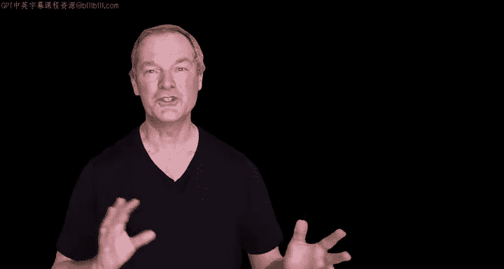

# 亚利桑那州立大学《AI基础：ChatGPT的提示词工程｜AI Foundations： Prompt Engineering with ChatGPT》中英字幕 - P2：1_欢迎来到ChatGPT与RACCA基础.zh_en - GPT中英字幕课程资源 - BV1TkTKzeE47

The first step to getting the most out of chat GPPT is to understand something about the underlying technology and both the capabilities of this technology and also the limitations and that is exactly what we're going to be doing in this module through a series of exercises。

😊。

And as you'll see as you get into these exercises and you're going to see this throughout the course。

 we're going to be using chat GT extensively to help develop your expertise here and to stretch and tone your prompt engineering muscles So by the end of this module you should be able to do a number of things you should be able to describe what chat GT is you should be able to describe what a large language model is You should be able to describe what GPT stands for and I'll give you a hint its generative pretrained transformer and this is the underlying technology behind chat GT。

😊。

You should also be able to describe some of the potential benefits of this particular set of technologies as well as some of the limitations of a technology。

 you should also be able to say something about some of the tips and tricks of using chat GPPT effectively although obviously that's something we're going to develop through the course so at the end of this module as well as having this basic understanding of the underlying technology it will set you up perfectly for module2 where we'll begin to get into the process of prompt formulation。

😊。

