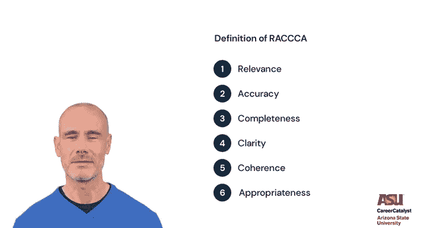
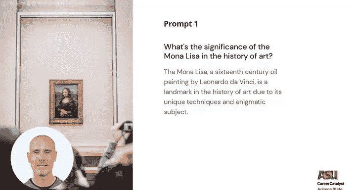
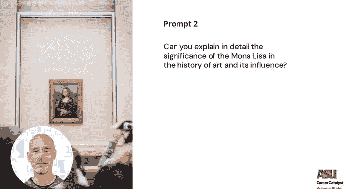
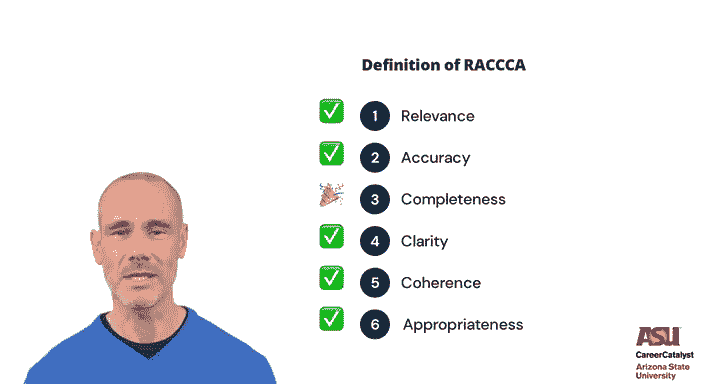

# 亚利桑那州立大学《AI基础：ChatGPT的提示词工程｜AI Foundations： Prompt Engineering with ChatGPT》中英字幕 - P3：2_RACCA框架体系.zh_en - GPT中英字幕课程资源 - BV1TkTKzeE47

Hello， everyone。In this video， we're going to dive into how to evaluate responses from large language models。

 specifically using the RACC， CC，A framework。

This framework stands4。Relevance。Accuracy。Completeness。Clarity。Coherence。And appropriateness。

Let's start with a sample prompt and response to illustrate this process。

Our prompt is。What's the significance of the Mona Lisa in the history of art。

The response that chat GPT returns is。The Mona Lisaa。

 a 16th century oil painting by Leonardo Da Vinci， is a landmark in the history of art due to its unique techniques and enigmatic subject。

Relevance。Does the response directly address the prompt？Yes。

 it discusses the Mona Lisa's significance in art history。Accuracy。Is the response factually correct？

Yes， the Mona Lisa was indeed painted by Leonardo da Vinci in the 16th century and is known for its unique techniques and enigmatic subject。

Completeness。Does the response cover all essential aspects of the prompt。Not quite。

It doesn't delve deeply into why the Mona Lisa is significant or how it influenced the history of art。

Clarity。Is the response understandable。Yes， the response is clear and concise。Coherence。

Is the response logically structured。Yes， it flows smoothly from introducing the Mona Lisa to detailing why it's significant。

Appropriateness。Is the response suitable for the audience and context， Yes。

 it's informative and respectful， fitting for someone one seeking knowledge about art history。

This analysis suggests the response could be improved in terms of completeness。

We might try a different prompt， like。Can you explain in detail the significance of the Mona Lisa in the history of art and its influence。

Let's see the response to this refined prompt。

The Mona Lisaa， created by Leonardo da Vinci in the 16th century， transformed the art world。

Its unprecedented realism and attention to human emotion introduced a new level of depth in portraiture。

 which had lasting effects on Western art。Its unique Fo moto technique。

 the enigmatic smile and the intricate detailing of textures and light became a model for future artists。

😊，Furthermore， the controversy around its theft in 1911 and its popularization in pop culture amplified its status as a universally recognized masterpiece。

Now let's apply the RACCA framework to this response。Relevance。

The response clearly addresses the refined prompt。Accuracy。

It provides factually correct information about the Mona Lisa。Completeness。

This was an issue with our first prompt。Was this response better。Yes。😊。

The response gives a more comprehensive account of the Mona Lisaa's significance。

 including specific artistic techniques and cultural impacts。Clarity。The response is detailed。

 yet easy to understand。Coherence。The response is logically organized with a smooth flow from the techniques used in the painting to its cultural influence。

Appropriateness。The response is still suitable and respectful and now provides more in depth information that aligns with the revised prompt。

The revised prompt improved the response， giving us more complete information。

By using the RACC， C， CA framework in this way， you can iteratively refine your prompts to elicit more effective and useful responses from large language models。

Remember， this framework isn't the only method for evaluating responses。

 but it offers a comprehensive method to ensure your prompts and the subsequent responses are of high quality。

