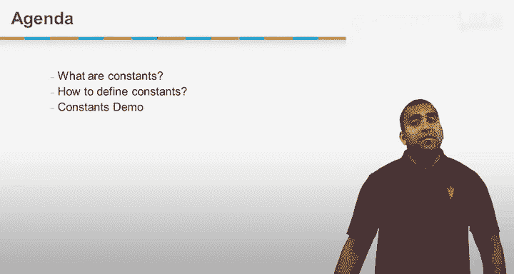
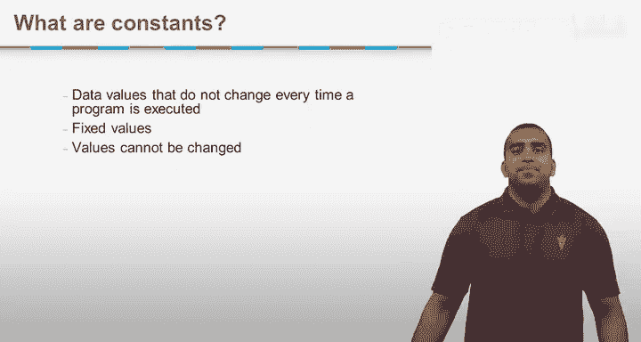
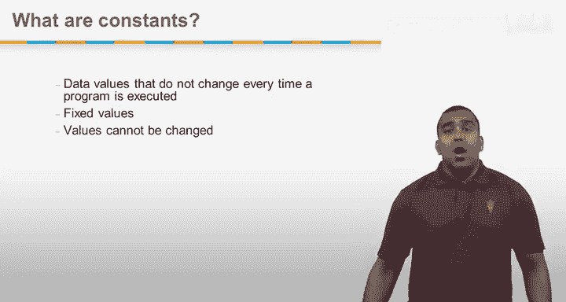
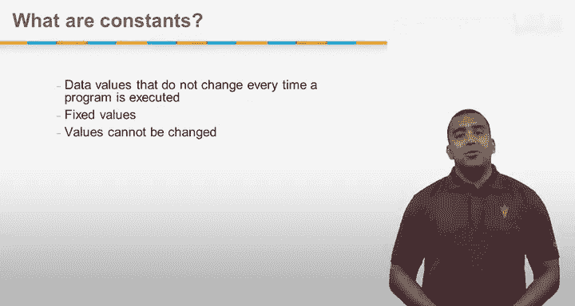
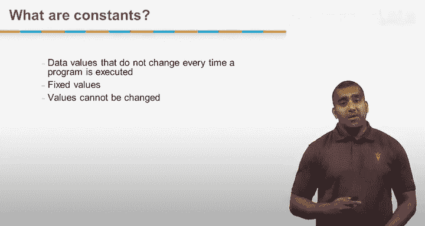
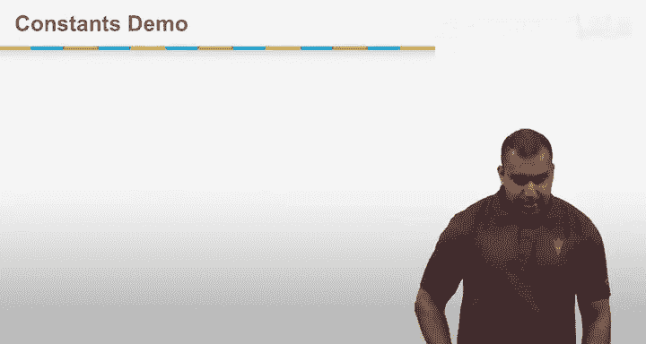

# 亚利桑那州立大学《Python： A Guided Journey from Introduction to Application》中英字幕 - P10：9_Python常量定义方法.zh_en - GPT中英字幕课程资源 - BV1J38GzbETT

Welcome。In this lesson， we'll be going over Conss in Python。

So in today's agenda， we're going to be going over what are constants， how to define constants。

 and we'll finish up with a demo on how to use Cons。

So what are constants。Constents are data values that do not change every time a program is executed。

Constents are fixed values， these values cannot be altered at any time in the program。

 when it's run or when it's created。

How to define constants in Python So in Python， constants are variables that are defined in all capital letters and are separated by underscores for multiple words。

The values of these variables should not be changed anywhere in the program。

There is no constant keyword in Python， unlike other languages。

So some examples could be a variable called constant name。

 which is in all caps followed by an underscore that splits constant and name equals five。

Everywhere that constant name is used throughout the program should not be adjusted whatsoever。

 should be used as a constant。Two more examples include X coordinate， X underscore coordinate。

 and Y underscore coordinate， which are set to floating point values that should not be altered anywhere in the program。

So let's go ahead and begin our demo。

So using that previous script that I use in data types， we're going to go ahead and cover constants。

So if you run this cell right here by pressing the play button or hitting control enter on your keyboard。

 you could see that we've defined a constant called pi underscore value and set that to be 3。14。

We've also defined another variable called radius to be equal to 3。

Here we want to compute the area of a circle we set that we create a variable called area of circle equal to our constant pi underscore value times which is denoted by the asterisk。

Radius， and I put that in parentheses just for sake of simplicity。And squared， our radius is squared。

 And when we're specifying squared， we're using two asterisk operators。

Here we could see that when we print it out， our area of our circle is 28。26 centimeters。

Then you have to keep in mind wherever pi value is used in a program， it should not be changed。

 the value should not be changed because it's a constant。In our next example。

We create a constant called gravity， and we set that to 9。

81 where our units is in either meters per second squared or nos per kilogram。

And we have a mass of a person variable， which is set to 62 kilograms。

Now we want to compute the weight of that individual， so we create a variable called weight。

 and we set that equal to the mass of the person times the constant gravity。

What that will do is it'll calculate the weight and store in the weight variable you can then print it out where it says and here when I run it。

 the code the output says the weight of the human being is 608。

22 newtons that's what happens when I run this。不要。Thanks for watching。

