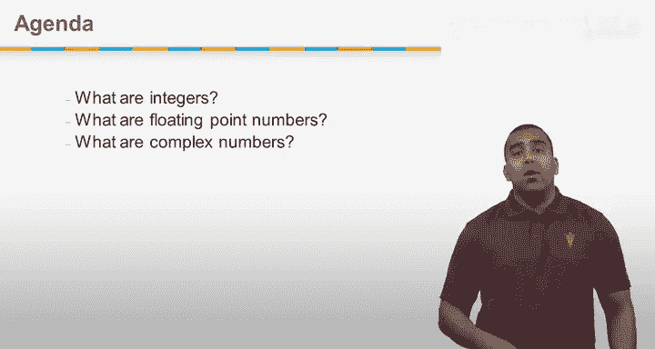
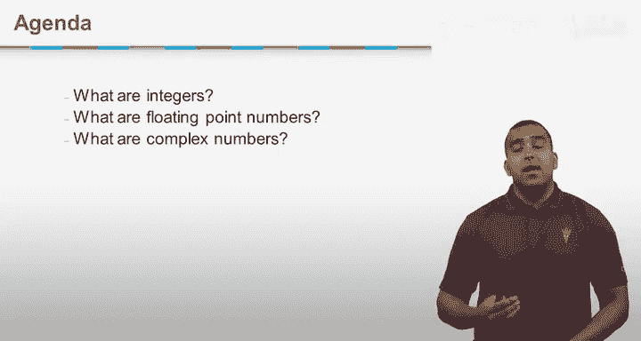

# 亚利桑那州立大学《Python： A Guided Journey from Introduction to Application》中英字幕 - P11：10_数值型数据处理技术.zh_en - GPT中英字幕课程资源 - BV1J38GzbETT

Welcome。In this lesson， we'll be going over numeric data types。

In today's agenda， we'll cover what are integers， what are floating point numbers。

 and what are complex numbers， which are all numeric data types。

So what is an integer？All integer literals are objects of the in class integers are numeric values without decimal places。

 leading zeros in non zero integers are allowed are not allowed， excuse me， such as 000256。

 That's not allowed in Python。Python does not allow commas as a number delimiter and uses underscore as a delimiter。

 so if we have a large number like 1234，981， instead of using commas to be able to read that number。

 we will use underscores to separate everything。Integers can be binary， ocal or hexadecimal values。

Some of these examples are within this slide， it could be 0b11011000， which is 216 in binary。

 there are a few more examples on here that show you the octovalue and a hexadeimal value of an integer number。

So what are floats？Floats represent real numbers and are written with a decimal point that divides the integer and fractional parts。

Flos are represented as 64 B double precision values。The max value is denoted by 1。

8 times 10 raised to 308， and any value that is greater than the max value will be identified by the string infinity。

Or INF。So examples of floats include 3。14， 242。31， and so forth。What are complex numbers？

Complex numbers are represented as the sum of a real number and an imaginary number。

The imaginary number is written with the J suffix。Complex numbers are real multiples of the imaginary unit or the square root of negative one。

Thank you for watching。