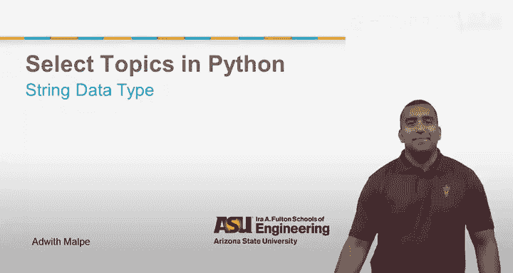
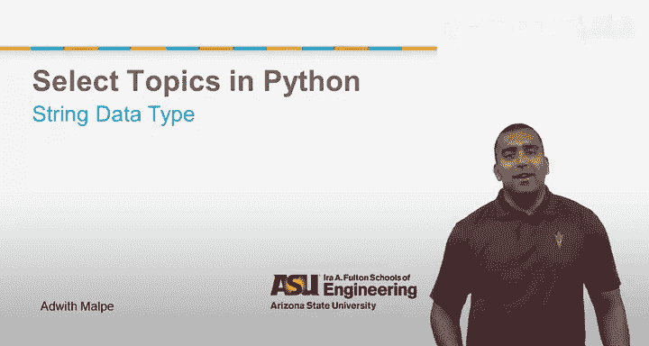
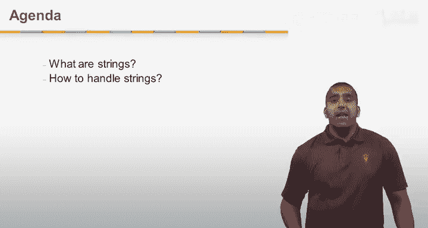

# 亚利桑那州立大学《Python： A Guided Journey from Introduction to Application》中英字幕 - P12：11_字符串数据处理技术.zh_en - GPT中英字幕课程资源 - BV1J38GzbETT

Welcome。In this lesson， we'll be covering string data types。

Our agenda entails what are strings and how to handle strings。

So what are strings， Strings are a collection of characters。Python has a built in string class。

 known as S R。In Python， strings are immutable， meaning they cannot be changed after they have been created。

String manipulation is performed by creating new strings and calling Python methods to perform an operation on the string。

You'll learn more about Python methods a little bit later in this course。

And you will see how useful they are on operating on different pieces of data such as strings。

 integers， or any other variable of a different data type。Now with strings。

 strings are represented using single quotes， double quotes。

 and triple quotes in order to contain them。Thanks for watching。

