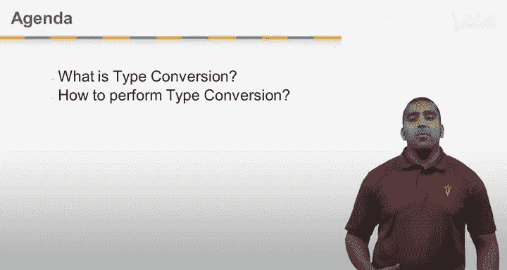
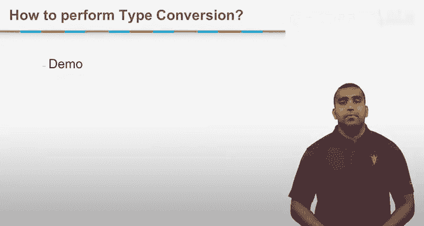
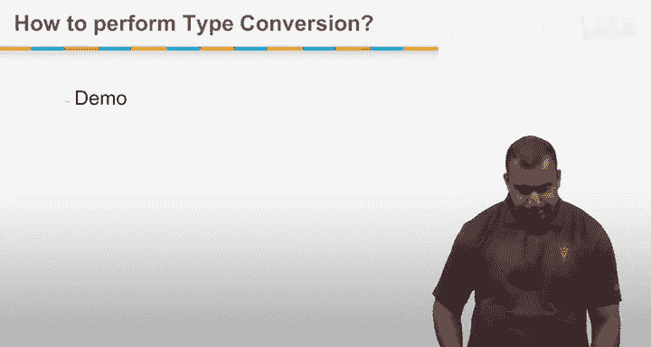
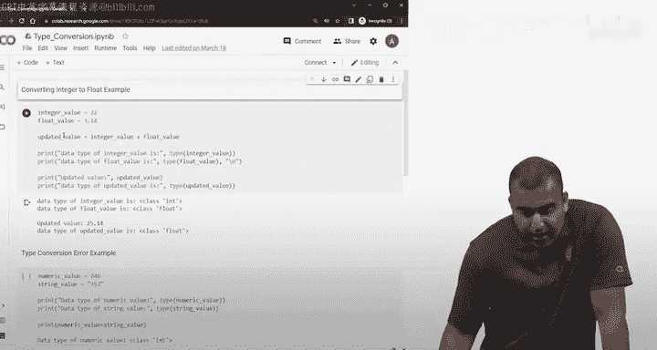

# 亚利桑那州立大学《Python： A Guided Journey from Introduction to Application》中英字幕 - P13：12_Python类型转换机制.zh_en - GPT中英字幕课程资源 - BV1J38GzbETT

Welcome， in today's lesson， we're going to cover type conversion。In this agenda。

 we're going to be going over what is type conversion and how to perform type conversion followed by demo。

So what is type conversion？Type conversion is the conversion of an object from one data type to another data type。

Explicit type conversion is also known as type casting。

 where the data types of objects are converted using predefined functions by the user。

The goal is to convert one data type into another data type， that's the goal of type conversion。

It's typically performed by the Python interpreter。

Now let's go ahead and go move into our demo。

So。In this first example， you can see that we have two variables created。

 an integer variable called integer value and a float variable called float value。

When we sum those two values variables together， the integer value and the float value。

 we will store that into a variable called the updated value。

So here what I'm doing is I'm printing out what is the type of the variable integer value you could see in the output。

After running the cell。The output says that the data type of the variable integer value is class int。

 that's how we know that we're dealing with an integer variable。

Now if we're out the data now here we're printing out the data type of the float value variable and it says that it is of the type class float。

Now， once we sum the integer value and the float value and we print that out。

 our updated value is 25。14 that's done by adding 22 plus 3。14。Now。

 when we print the data type or the type of the updated value。

 we can see that what is returned is of class flow。

So here we can see that whenever integers and floats。Perform are used to perform some operation。

A float value will be returned unless explicitly stated an integer should be returned。

 so here that we could see that the float value is being returned。

Now here we have a type conversion error example， so let's say we have some numeric value with a numeric data type of 246。

And we have a string value of 357， but it is of the string data type。

So if we print the data type of the numeric variable and the string variable。

 we could see that it returns the class in for the numeric and class stringing for the string value。

However， now if we try to print the two added together an integer variable plus a string variable。

And we try to print that out， we get a type error。Which shows that we have an unsupported opera type4 plus for integers and strings。

 so we can't do this。 That's why it's really important to be careful when you are converting different data types。

In this last example， we'll be going over explicit type conversion。So using the same variables above。

 we have a numeric value of 246 and a string value of 357。 When we print it out。

 we can see the types remain the same of those variables being in of the integer type and the string type now here。

What we're doing is we're explicitly converting the type of the variable string value and that will by calling the int function on that variable string value。

 what that will do is itll convert the variable string value into an integer data type， so 35。

7 will be converted to an integer type。So now when we perform the operation。

 numeric value plus numeric value2。We should get the sum of those two values， which yield 603。

 so it successfully performed the cast。And finally。

 we can print the data type of that new updated variable sum value。

 and we can see itself of the type int， just by casting or explicitly converting our string value variable into an integer value variable。

Thank you for watching。