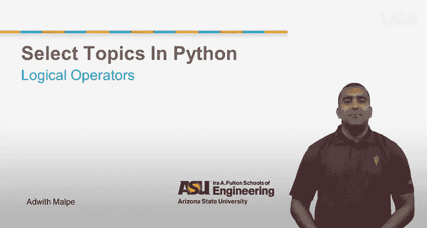
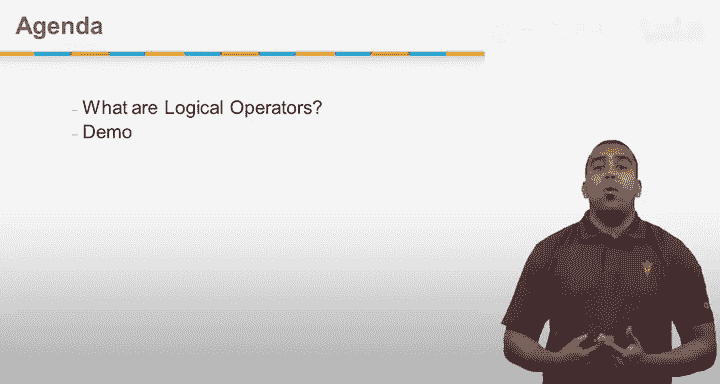
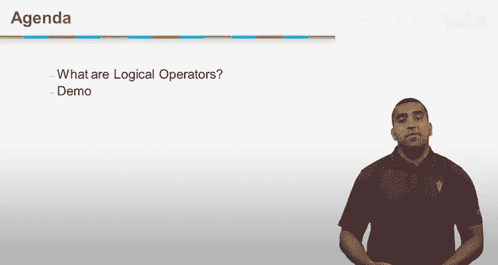

# 亚利桑那州立大学《Python： A Guided Journey from Introduction to Application》中英字幕 - P15：14_逻辑运算符（与-或-非）.zh_en - GPT中英字幕课程资源 - BV1J38GzbETT

Welcome， in today's lesson， we'll be covering logical operators。

We'll be discussing a little bit more about what are logical operators and how they're used。

 and in the next lesson， we'll be going over a brief demo。

So what are logical operators？Logical operators are operators that are used to perform logical operations on the value of variables。

Logical operators are used to return a true or false value。

 They are heavily used in conditional statements， such as if statements。

Now there are three main types of logical operators in Python that you should be aware about。

 which include logical and， logical or， and logical knot。Now， keep in mind。

 you will be learning more about how these work within our demo in the next lesson。

Some operators that you should be aware of also include less than or equal to less than greater than and greater than equal to。

 That's a comparison operator。 We also have is is not which are identity operators。

And then we also have in not in which are membership operators。

 and to complete that we also have not or and and which are logical operators。Thank you。

