# 亚利桑那州立大学《Python： A Guided Journey from Introduction to Application》中英字幕 - P16：15_条件分支语句（if-else）.zh_en - GPT中英字幕课程资源 - BV1J38GzbETT

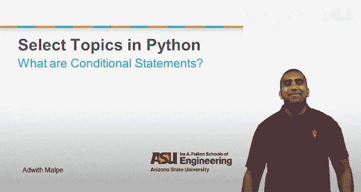

Welcome， in today's lesson， we'll be going over conditional statements。

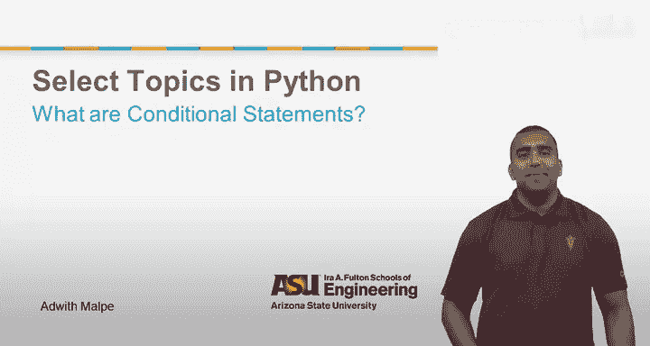

We'll be learning about what are our conditional statements and how our conditional statements implemented in Python we'll also be going over a brief demo where I show you how to implement a conditional statement and utilize logical operators from the previous lesson。

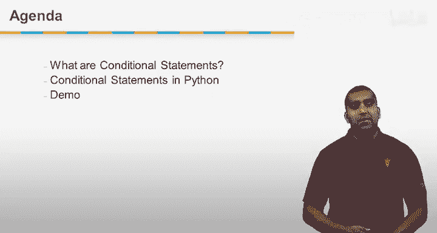

So what are conditional statements？Conditional statements are logical statements that are used for decision making on how to process data。

Conditional statements include conditions that must be met in order for an instruction to be executed。

The decisions are made only if the prestate conditions are either true or false。

So let's say we have an argument if this argument is true， then we can only execute that instruction。

 however， if the argument is false， then we cannot execute that instruction and we must do something else That's a conditional statement。

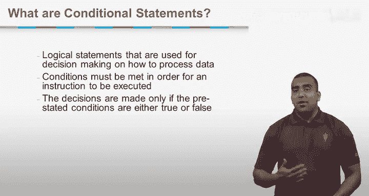

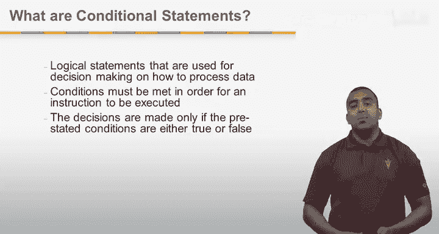

Conditional statements in Python。So conditional statements in Python are denoted by the following syntax。

 ifL if and else。If statements are the first condition that is checked by the parameterr。

LF is the next statement， check if the if statement conditions did not pass earlier。

 so if the condition didn't meet initially， then we go into the LF block。

 which will check the next condition。Else is the last condition which is executed if the conditions for the if and Al of statements were not met。

It's the last thing we execute。Logical operators can be utilized to determine the conditions that need to be met for conditional statements to execute。

Let's go over our demo right now。

So opening up a new Google Collab notebook， we can see that herere going to in this first example。

 we're going to be going over conditional statements。

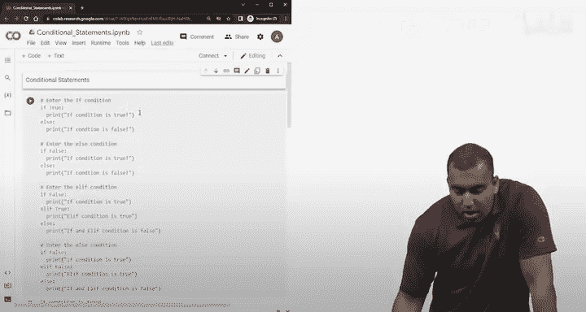

You can see that I've created an if statement that says if true。

 and keep in mind true is a boolean value， so and it has to be with a capital T。

 you can do it with lowercase and Python。

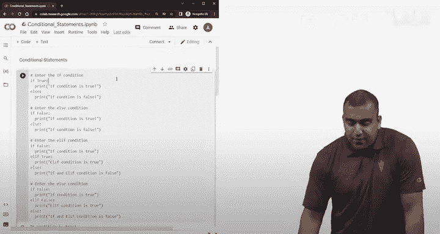

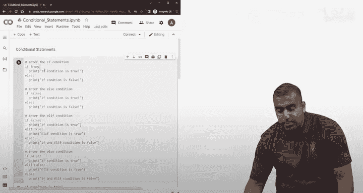

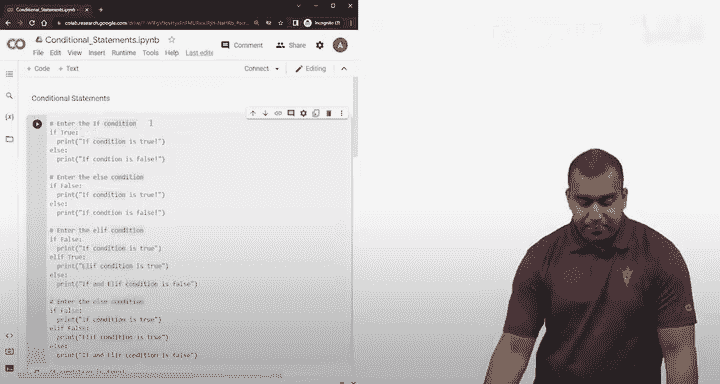

If true， print， if condition is true。Else print if the condition is false。

 Since this is our condition right here。 Since our condition is true。

 we're going to go ahead and print if the condition is true。 So when I run this line。

 run this cell block， you'll see。

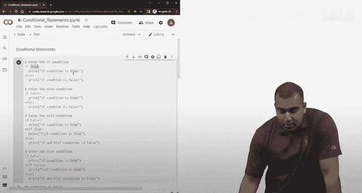

It'll print out if condition is true Now if I set the value of the condition to be false。

 if the condition is false， then it's not going to print out if condition is true instead it's going to go into the else。

 and since the else doesn't take a condition， it'll directly instruct to print out if condition is false。

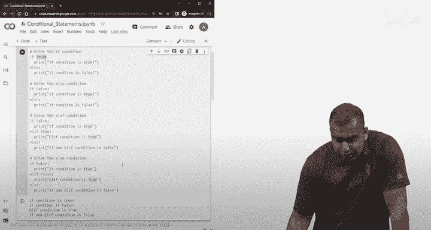

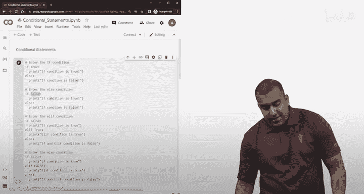

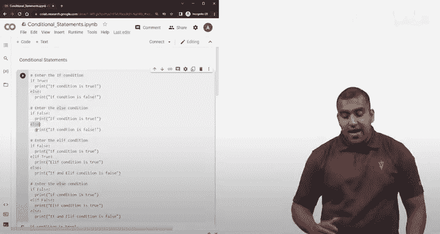

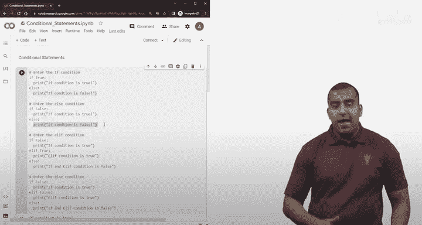

Which you can see right here when this is run。Here， when we want to enter the L condition。

 we enter the I condition by making sure that the if condition is false， So if false。

 we do not execute this print statement， and we go straight to the L if and we check what the condition of the LF is。

 Since the condition of the L if is true， we're going to go ahead and printLif condition is true。

 And since this is true， we don't need to go into the L statement。

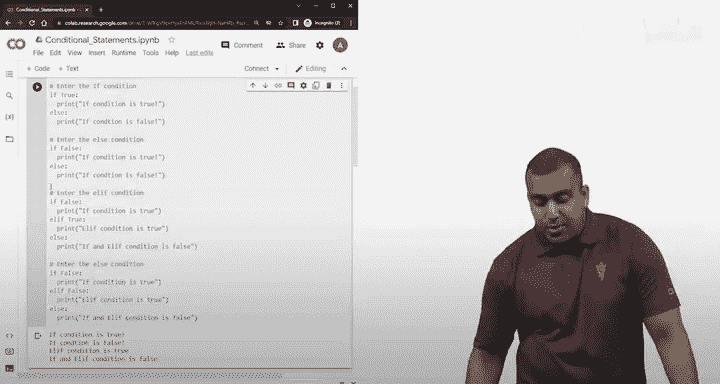

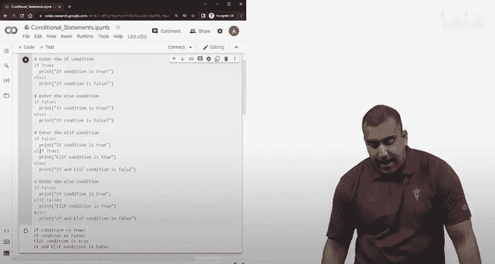

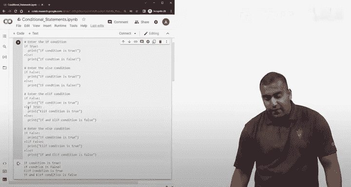

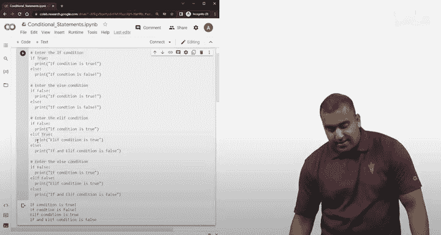

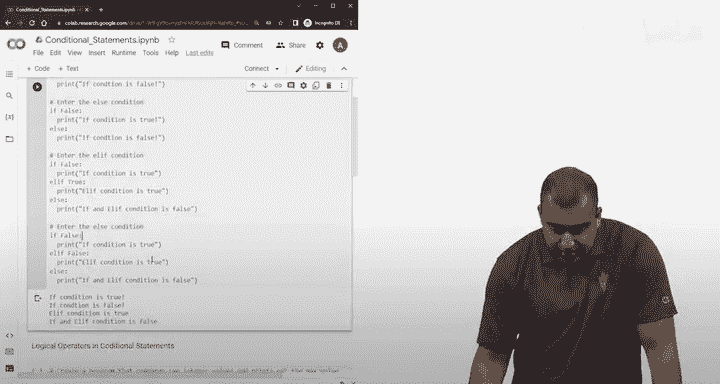

Now now when we enter the else condition。

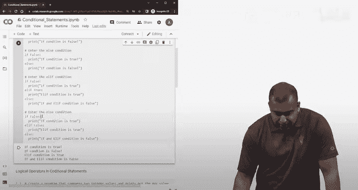

Using if L if and Ls， if our condition for the if statement is false and our condition for our L if statement is false。

 then we will enter the L statement which will execute the following print statement if an L if condition is false。

 as denoted right here in the output。

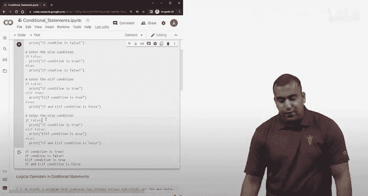

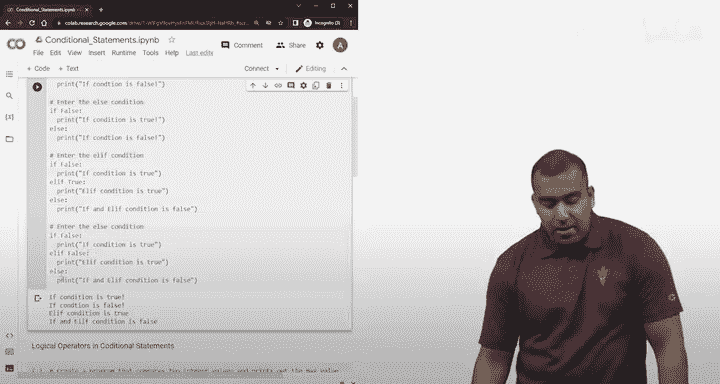

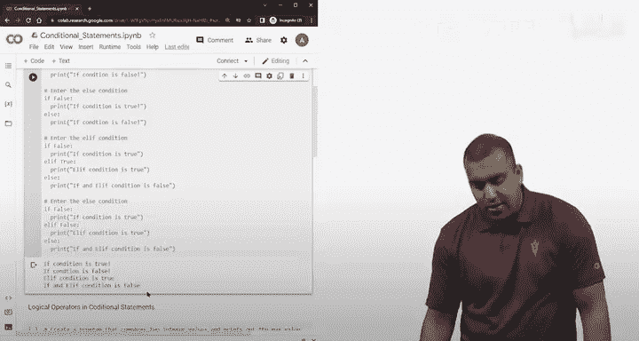

🤧う。In this next example， we'll be going over logical operators in conditional statements。

Let's say we create a program that compares two integer values and prints out the maximum value。

So we first create a variable called user input one that takes in user input when we're calling the input function。

And prompts the user to enter the first number。We'll then convert that to an integer to make sure that when we're processing that value。

 it's not a string and it's an integer value。We create another variable called the user input2。

 which does the same thing and creates an integer value。

Once weOnce the user inputs those two values and stores in the variables。

 then we can check if user input1 is greater than user input 2。

 then only can reprint user input1 is greater than user input2。Eith。

The user input 2 variable is greater than user input1。

 then we can print the user input2 is greater than user input1。

L if the user input1 is equal to the user input 2 variable。

 then reprint the user input2 is equal to user input 1。Else。

 if none of the conditions were met for ifLLF and ALF， then we execute the L statement。

 which will just print user input2 is greater than user input1。

Now I strongly encourage you to play around with this program， run it and input your own values。

 your own integer values in there and understand how it works and how it passes through each condition you'll see that how it works and you'll understand it a lot better then。

In this next example， we're going go ahead。And create a program that prints out what will happen if a student works hard and studies for long hours。

So here we create a Boolean variable called work hard， and we set that to have a value of true。

Let's create another Boolean variable called long study hours and set that to have a value of true as well。

Now， if the variables in our condition of our if statement。

 we're checking if the variables work hard and long study hours。

 we're just saying if work hard in long study hours， if this is true。

 we don't have to specify if it's true because the condition will only execute the statement if that condition is true。

 so we can see if true and true， print， you will do well in this course。Eith。

Work hard or long study hours Now orR is another logical operator that we discussed earlier。

 so if one of them are true， we will print out this statement you will have to spend more study hours or work harder。

Else you will print， you will have to work harder and put in long study hours。

 So what this is saying is。For and to be true。Both both parameters have to be true in the condition。

 so work hard has to be true and long study hours has to be true for this condition to return a true value。

And if both of them are true， then we can only execute the statement Now with or if one of the conditions are true。

 so in this case， if work hard is true and long study hours is false。

 then we won't pass the first if statement， but we will pass the L if condition。

 which will then print， you will have to spend more study hours or work harder。

You can go ahead and run this program and see what I mean by changing the values of work hard and long study hours and see what you get。

Just like this。 So if I were to enter false。And I run the code。

You will see that it'll print out you will have to spend more study hours or work harder。

 that's the print statement coming from the LF condition because we are using the or statement and we have a true value and a false value。

Now let's go ahead and go over our final example， our nested conditional statements。In this program。

 we want to create a program that allows a user to open a lockbox if the passcode is correct and the door is not jammed。

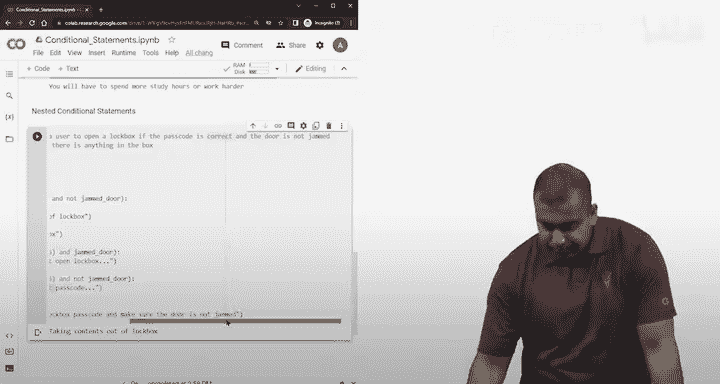

We will also want to take out the contents if there is nothing in the box。

So let's say we have some sort of locker or a lockbox with a passcode of 1，2，3。

45 just it could be anything you want right and we create another variable called jammed door to make sure that the door of the locker is not jammed if it's not jammed。

 it'll be set to false if it is jammed， it'll be set to true so that's a boolean variable for the jam door。

Now。And we create another variable for contents inside。

 we want to see if there's anything in the lockbox or locker or not。

 so what we do is we created another Boolean variable called Conts In and we set that to true to indicate that there are contents in the locker。

Or the lock box。Now。Here in this if statement， we're checking if the lockbox passcode is equal to 1。

2，34，5 and not jammed door， which states and the jam and the door is not jammed so that should return true and if this is true。

 then we're going to go into this if statement right here。

Which will then check if there are contents inside， which should be set to true。

 then we can go ahead and print。Taking the contents out of the lockbox Now if the content inside is false。

 then we can print out there' is no contents in lockbox。In the next e of statement。

 we're checking if the lock box passcode is 1，2，3，4。

5 and the jammed door stating that our door is jammed， but we entered the right passcode。

 then all we do is print doors jammed cannot open lockbox。 That's what will be displayed to the user。

E if the lockbox passcode is not equal to 12345 and not jammed door。

 which indicates that the door is not jammed and the locker。

 the user did not enter the correct password into the locker。

 then we can specify and print out to the user user must enter correct passcode。Finally。

 we have our L statement here where we print， please enter the correct lockbox passcode and make sure the doors not jammed if all else fails。

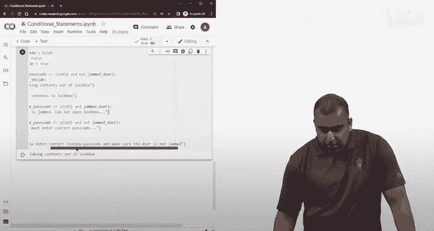

Now that's an example of what a nested conditional statement is。

 I'll go ahead and explain more about how this works in the next lesson for nested conditional statements。

Thank you for watching。