# 亚利桑那州立大学《Python： A Guided Journey from Introduction to Application》中英字幕 - P17：16_嵌套条件语句（if-elif-else）构建方法.zh_en - GPT中英字幕课程资源 - BV1J38GzbETT

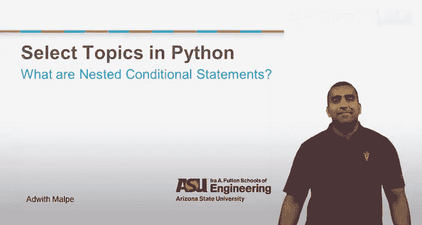

Welcome in this lesson， we'll be going over nest conditional statements。😊。

In today's agenda， we'll go over what are nested conditional statements。

 and then we'll go over a demo where I will show you how to create your own nested conditional statement。

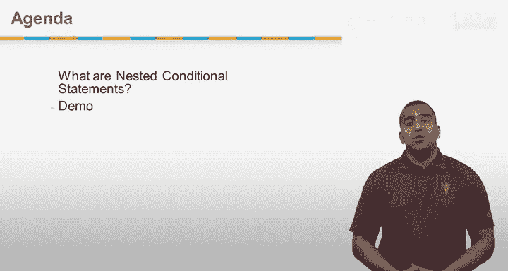

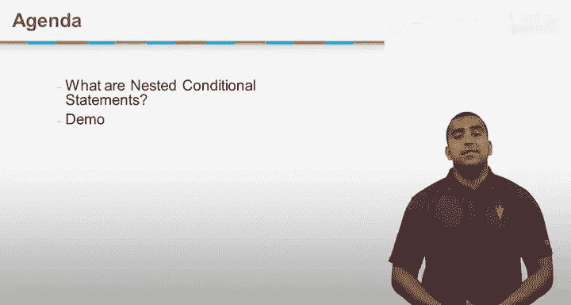

So what are our nest and conditional statements？

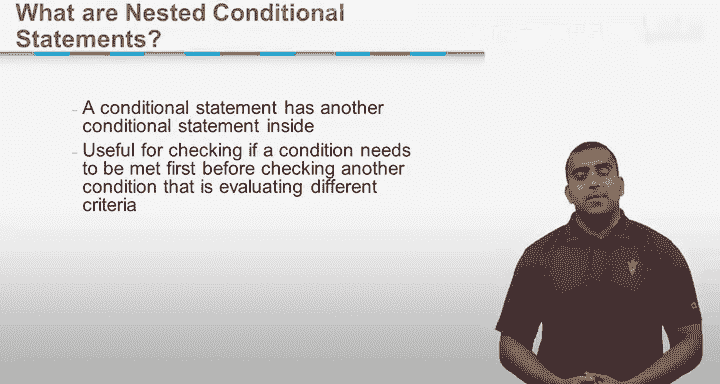

A essayA conditional statement is a conditional statement that has another conditional statement inside it。

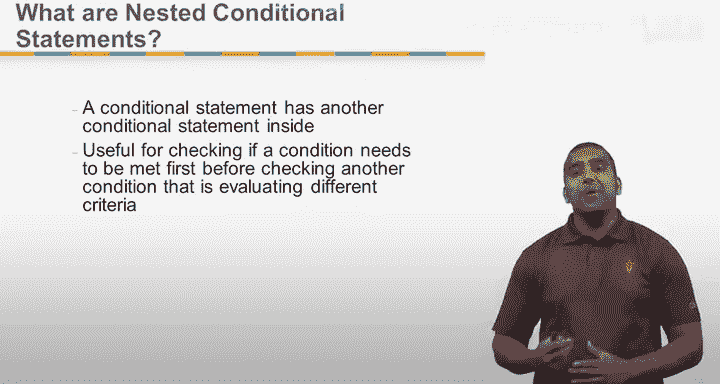

It's really useful for checking if a condition needs to be met first before checking another condition that is evaluating different criteria。

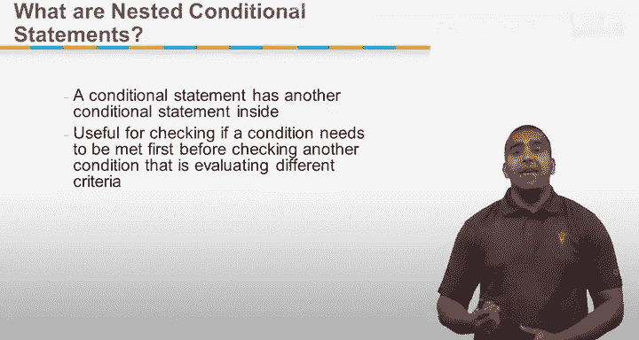

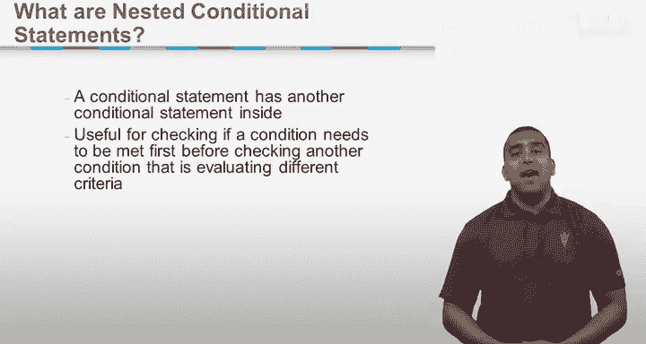

So for example， if we have one if statement that checks if something is true。

 then what a nestative statement or a nest conditional is where there will be another if statement within that block thatll only execute if the previous if statement is true。

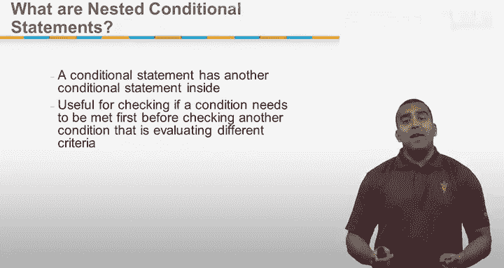

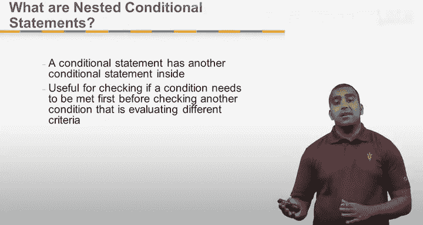

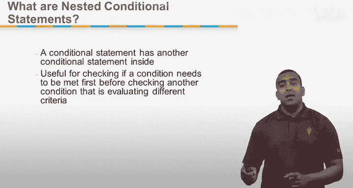

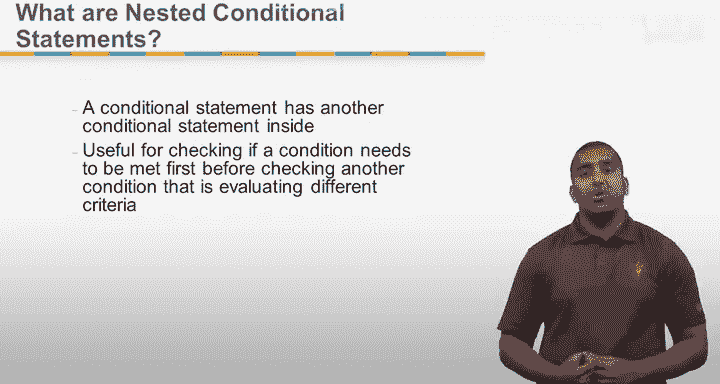

Let's go ahead into our demo and you'll understand what I mean to say。

So going back to that previous example that we covered before。in our lock box example。

We can see here that we have our lockbox passcode variable， which contains of integer value 1，2，3，45。

 a Boolean jam door variable， which contains a value false and a Boolean contents inside variable。

 which sets the value to true。Now here we're checking if the lockbox passcode variable is set is equal to 1。

2，3，45 and not jammed door， which means that the door is not jammed， then if this is true。

 then only can we check if the next if statement is true or false。If the contents inside。

Is true then we print taking contents out of the lockbox else we print no contents in the lockbox。

 So this right here， this code block right here is an example of a nested conditional statement。

This inner if statement orL statement can only execute if the previous outer if conditions are true。

Now， if I were to run this and I set my passcode is set to  one，2，3，45 and the door is not jammed。

 which should so and not jammed door， so that will return true because and not false， which is true。

Since these two conditions are true， Danna it'll go into the inner if statement well check if the contents are inside is true。

 then we'll print taking out context of lockbox， and when I run this you can see that it'll say takingking contents out of lockbox。

Now， you can really play around with this and see what happens。 Now if I set the door to be jammed。

 so I set this to true， I've got to make sure that T is capitalized。And we set that to be true。

 you can see what happens is our even though our lockbox passcode is 1，2，34，5， our second condition。

 not jammed door will be set to false because it's not true so that means it's false so when you have an one true condition and a false condition itll return false so this inner if and else will not execute or will not be entered because this if statement returns false so then itll go into the L if and itll check the lockbox passcode is equal to 1。

2，3，4，5， which is true and the door is jammed which is true。

we print the doors jammed and we cannot open lock box This is what our expected output is。

And here you can see doors is jammed， can open lockbox。Now， if I were to also。

 what I could do is this， if I were to set this to one， two， three， four， five，6。And now I run it。

You could see that the next LL if or the else is actually executed in this case， where we it says。

 please enter the correct lock box passcode and make sure the door is not jammed and that occurs because we could see。

That the lockbox passcode is not equal to 12，3，45 and our door is jammed so and jammed door。

 since those are both false， we're going to print out this LS statement。

Now what I highly encourage you to do is to go into the code， run it on Coabab。

 and you're going to go ahead， play around with these values。

 understand how the nested if statement works， and once you do that you'll be a master at nested conditional statements。

Thanks for watching。