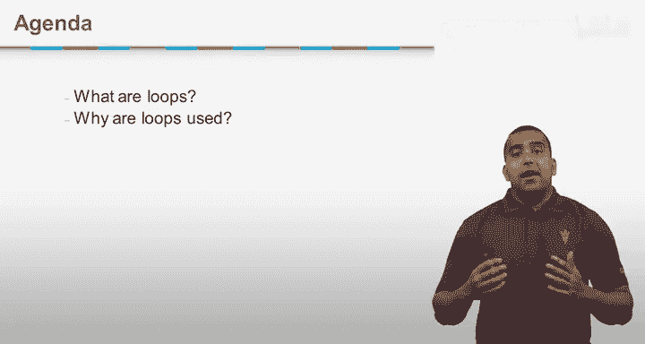
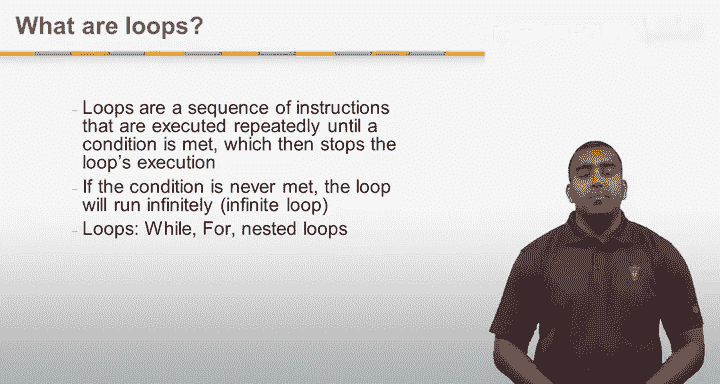
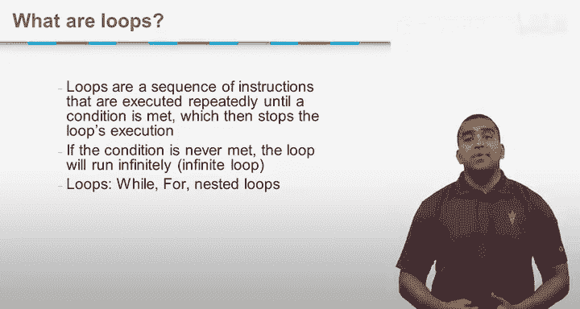
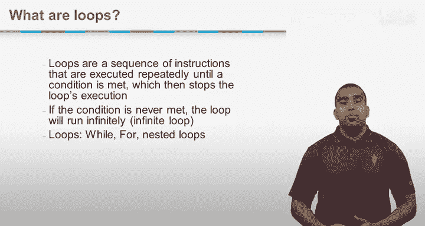
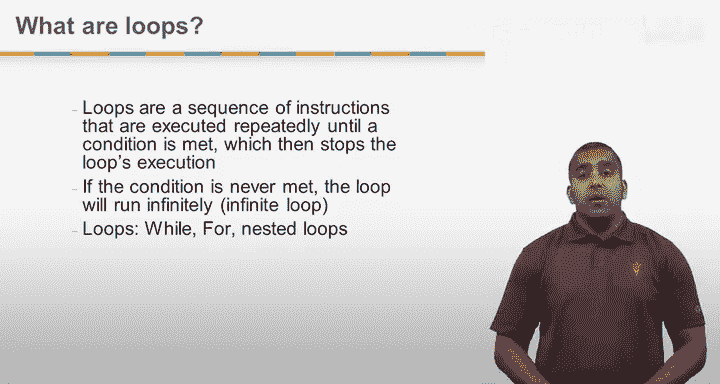
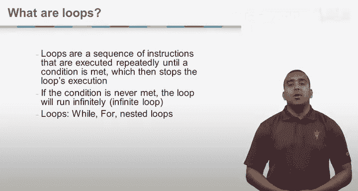

# 亚利桑那州立大学《Python： A Guided Journey from Introduction to Application》中英字幕 - P18：17_Python循环结构及列表功能解析.zh_en - GPT中英字幕课程资源 - BV1J38GzbETT

Welcome， in today's lesson， we'll be going over what are loops。

We're going to cover understand what loops are and understand why are loops used today in programming。

So what are loops。

Loops are a sequence of instructions that are executed repeatedly until a condition is met。

 which then stops the loop's execution。

If the condition is never met in the loop， the loop will run infinitely。

 which is also known as an infinite loop。

The loops we will be working with are wild loops and for loops。 will also be looking at nested loops。

 as well。

So why are loops used in programming today。Loops are used to perform tasks iteratively rather than writing redundant liness of code。

Loops can be used to execute the same instructions multiple times。

Loops can be used to apply the same instruction many times on different pieces of data。

 which makes it extremely useful。loops can be used to save time in minimize errors by eliminating the need to write many lines of code that perform the same task。

Thank you for watching， see you next time。