# 亚利桑那州立大学《Python： A Guided Journey from Introduction to Application》中英字幕 - P21：20_嵌套循环结构实现.zh_en - GPT中英字幕课程资源 - BV1J38GzbETT

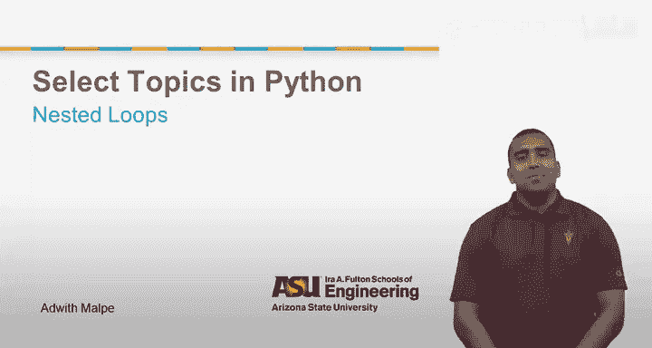

Welcome。In this lesson， we'll be going over nested loops。

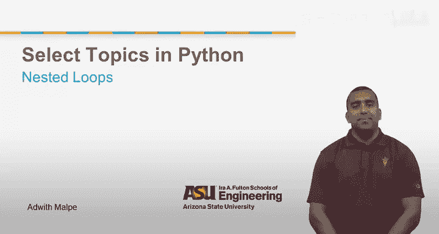

We'll be talking about what are nested loops followed by a demo where you will be able to implement your own nested loop。

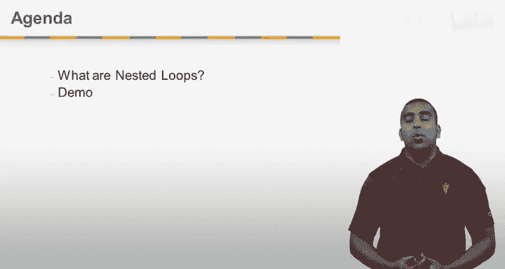

So what are nest loops a nested loop is an inner loop within the body of an outer loop。

The first pass of the outer loop triggers the inner loop。

 then the inner loop executes until it completes。Then the second pass of the outer loop triggers the inner loop again。

 and the process repeats until the outer loop completes executing。Now。

 that might sound a little bit confusing， but you'll see what I mean in the example。Now。

 keep in mind， brake statements can be used to stop a loop abruptly。

Let's go ahead and jump right into our demo。Nestty loops。

So let's say we want to iterate through a range of numbers1 through 10 in an inner loop。

 and we want to iterate through a range of numbers  one through5 in an outer loop。

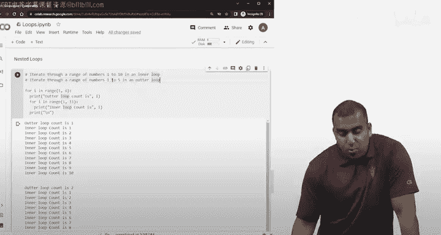

So we're going to say。For index I in range one to6， so it'll only go through one to five。

 we're going to print outer loop count is followed by I。

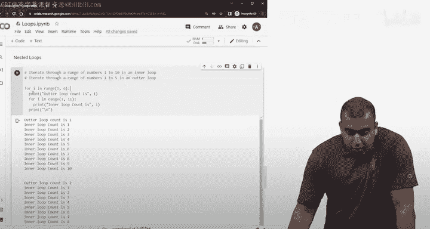

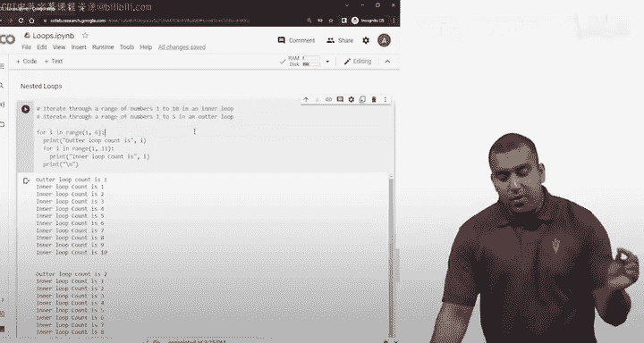

And then we have our inner loop here。For index I in range 1 to 11， so it'll only go from1 to 10。

 print the inner loop count is and then index I， and then we're going to print a new line after we've completed executing the inner loop so we can see what outer loop count we're at clearly。

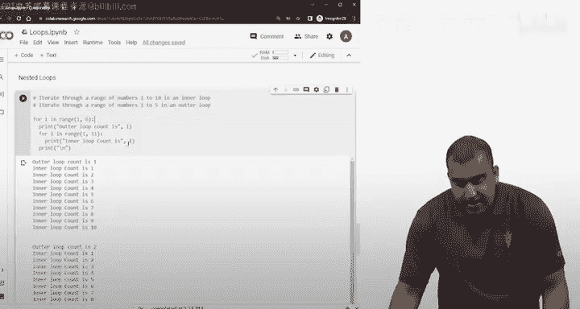

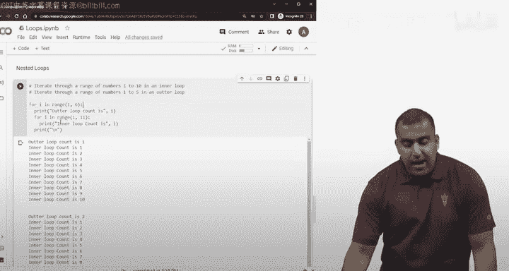

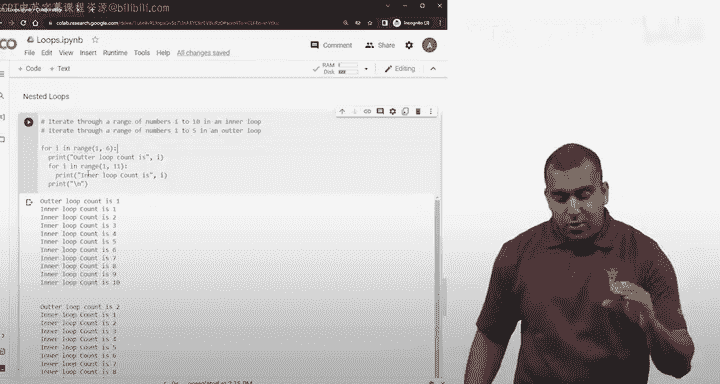

So you can see that after I've run this program and I scroll to the top。

 our first iteration through the outer loop is one。 So when we have。

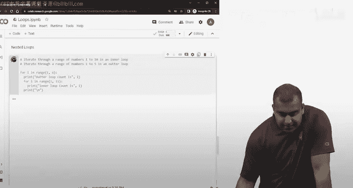

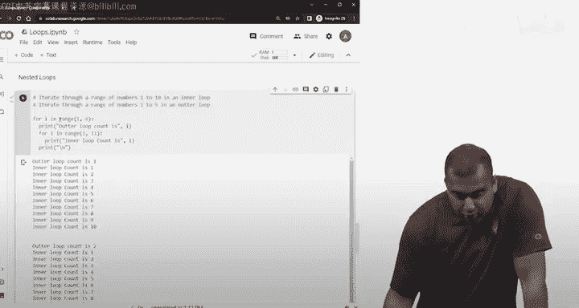

When we're going through our first iteration， we print outer loop count as one。

 Then we get to our nested for loop here for each index I in range 1 to 11。

 This will this inner for loop will。

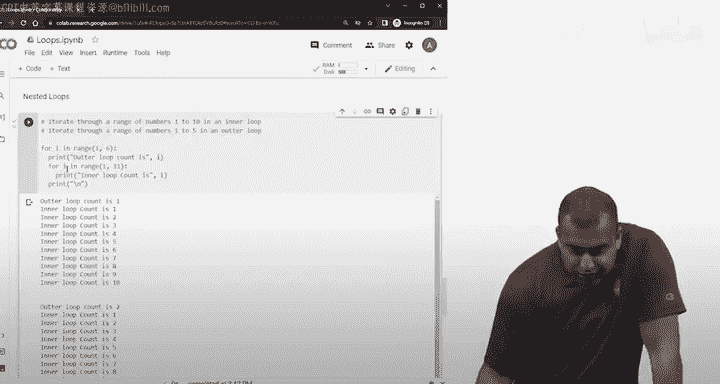

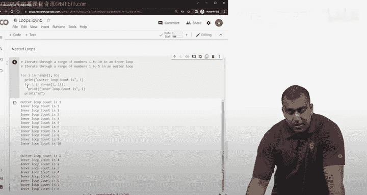

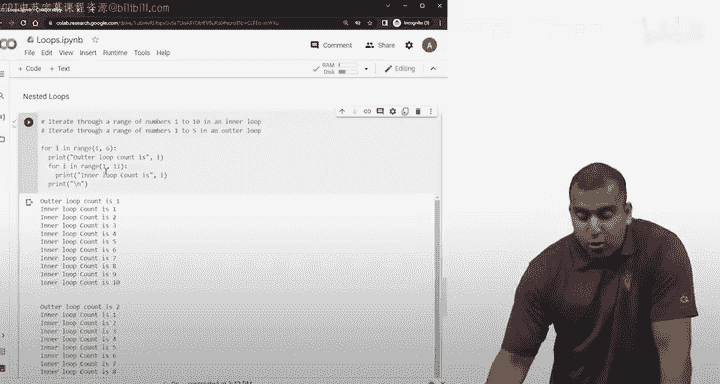

Keep iterating or keep executing range from one to 10。

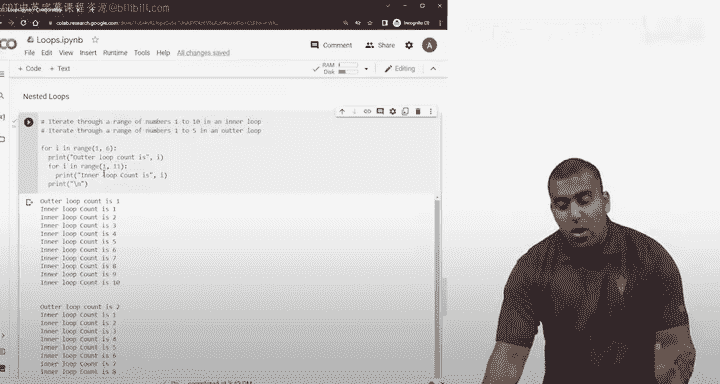

So here you can see it'll print the inner loop count as 1，2，3，4，5，6，7，8，9，10。

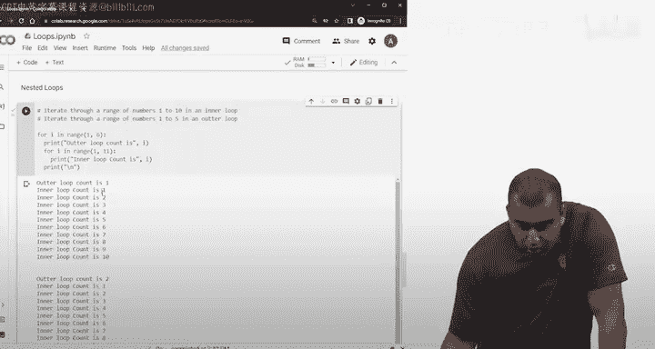

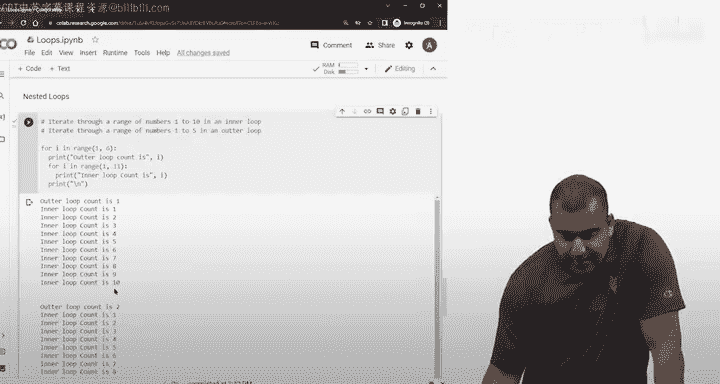

And then once the inner loop has finished executing， it'll go back to the outer loop。

 it'll print the new line because that's still within the outer loop and it'll go back into the second iteration。

 so now we are in outer loop count is two， so this is the second pass。

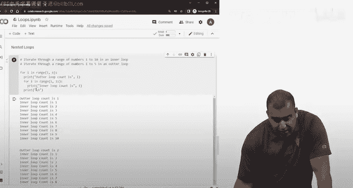

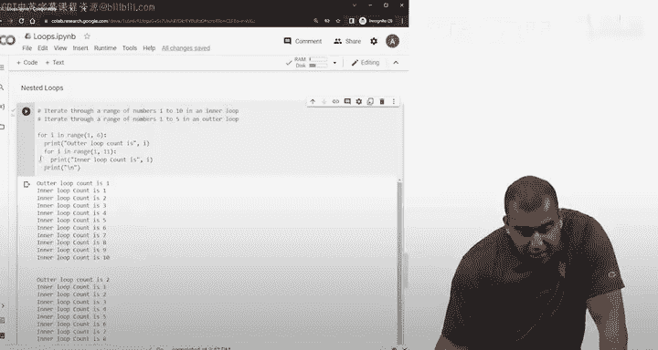

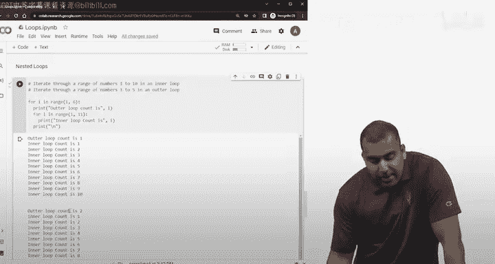

So when we're going to the second pass， we're going to execute that nested inner loop again for I in range 1 to 11 and we're going to print out the inner loop count is all the way from 1 to 10 keep in mind。

 this is the n minus1 element， so it's going to be 10 not 11 because 11 minus1 is 10。

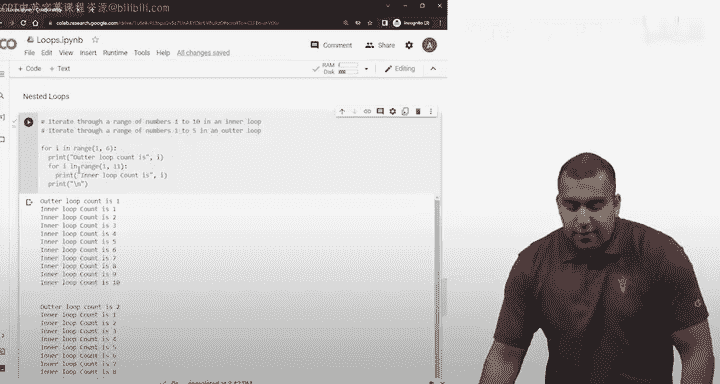

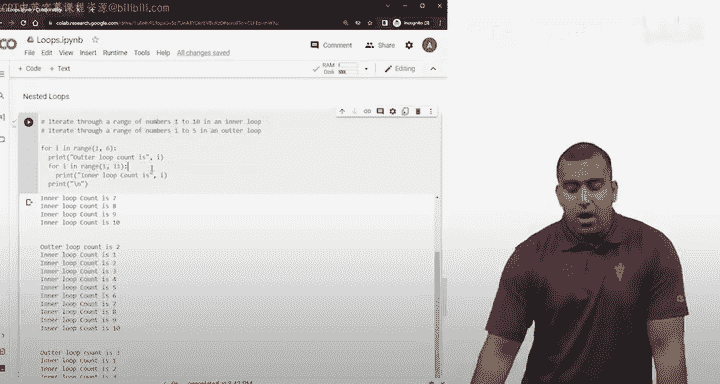

Now we keep executing until our outer loop reaches five。

 so here we can see our outer loop count is three and it'll keep on executing our inner loop count。

 our outer loop count is4， our inner loop count goes from  one to 10 until our outer loop count is5。

 it goes one to 10， the inner loop count outputs from one to 10。

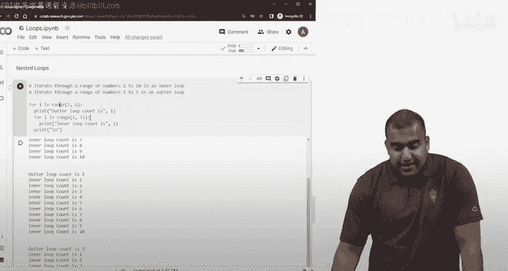

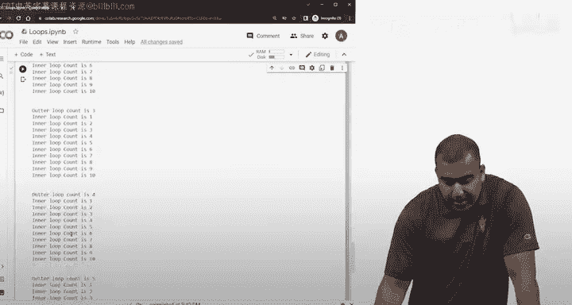

That's how your nestA loop works， it'll keep executing until the outer loop is completed executing。

Thank you for watching。