# 亚利桑那州立大学《Python： A Guided Journey from Introduction to Application》中英字幕 - P23：22_Python数学库使用指南.zh_en - GPT中英字幕课程资源 - BV1J38GzbETT

Welcome back。In this lesson， we're going to cover math library functions。

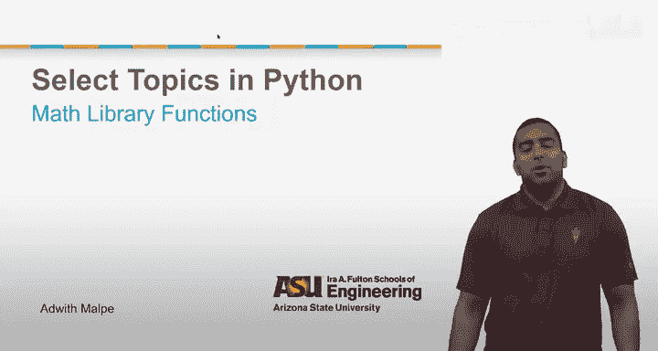

today's agenda， we'll go over what is a library。

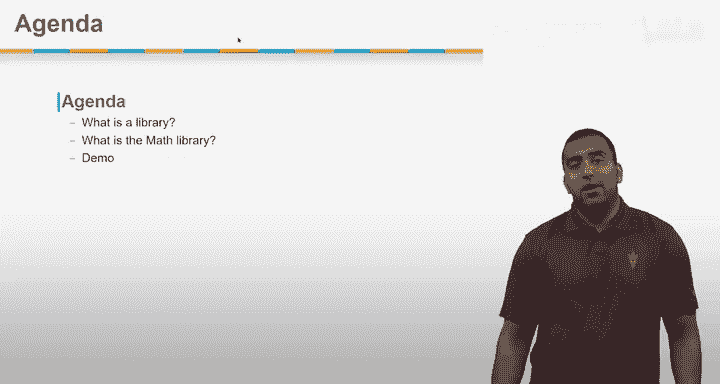

Then that's followed by what is a math library， and finally we'll go through a demo。

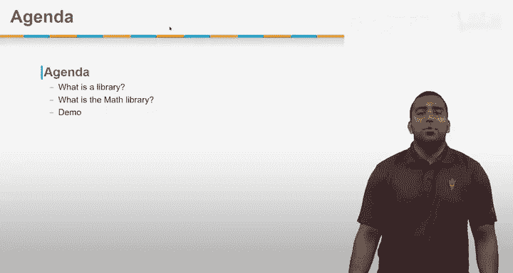

So what is a library Well， a library is basically a collection of related modules that contain precompiled code。

 which is extremely useful as we can utilize precompiled code that has been generated to basically process data that we want to operate on。

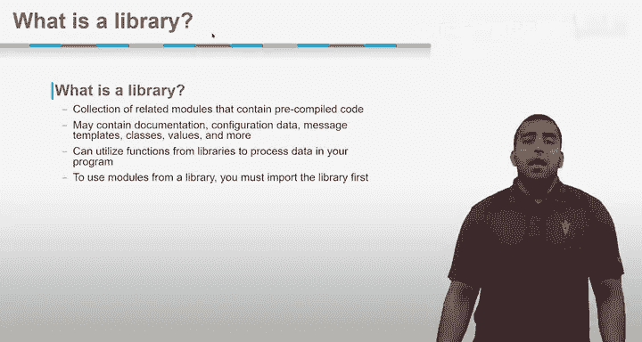

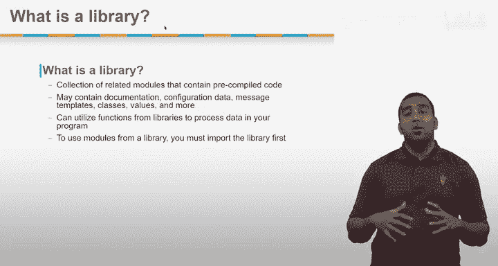

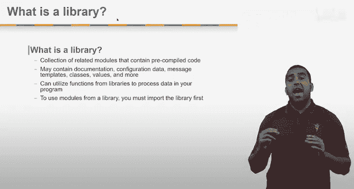

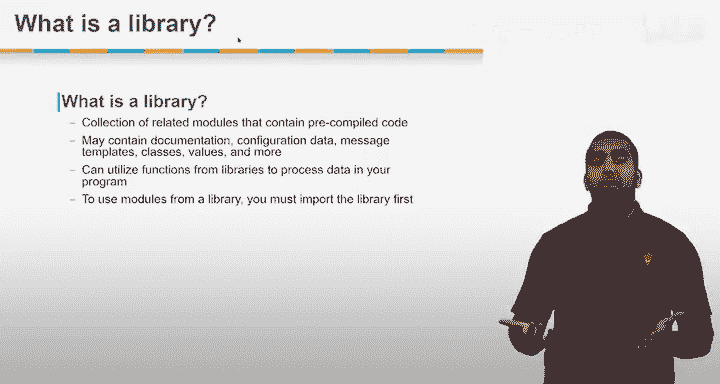

It may contain documentation， configuration data， message templates， classes， values。

 and much more libraries are extremely powerful and they help us reduce the amount of time writing redundant code by calling functions or methods that already exist。

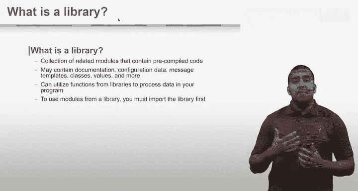

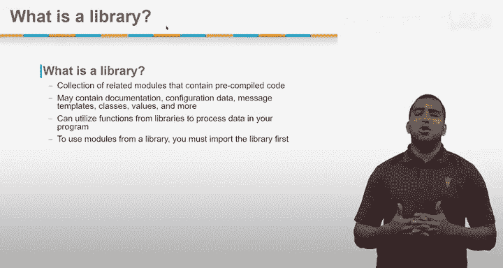

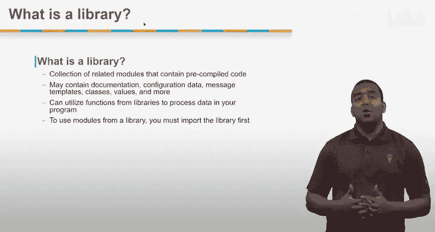

We can utilize the functions from libraries to process data in our own program。

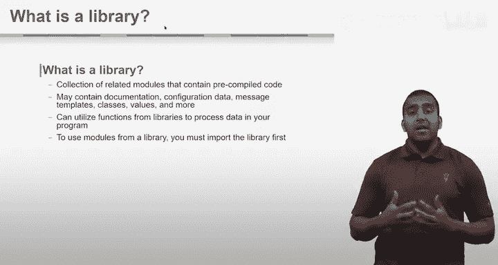

To use the modules from a library， we must use the import keyword。

 which will import the library first。

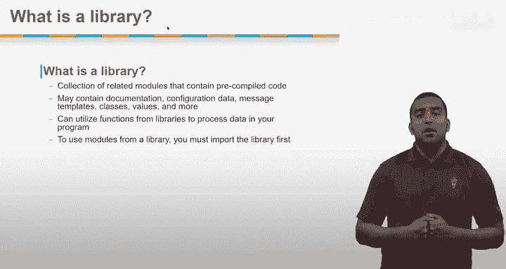

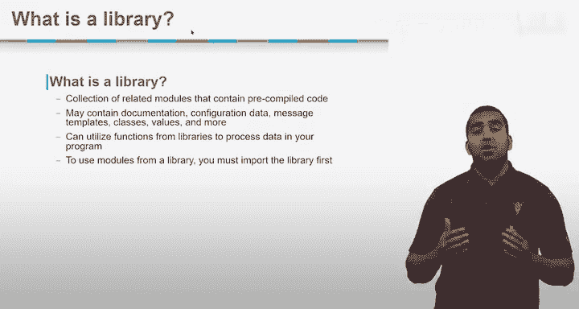

So what is the math library， The math library is a library that provides access to mathematical functions defined by the C standard。

The math library can't handle complex numbers， however， the math library does provide us many。

 many useful functions that we can utilize to perform certain operations such as taking the sum of two numbers or more。

 taking the square root of multiple numbers， and much more。

We can use the C math library to handle complex numbers because the math library can't handle complex numbers。

We know that everything， all values， all return values are floats。Except when explicitly noted。

So in this slide， you can see that we have three examples。

 I'm importing the math library by calling the import keyword。And followed by math。

 that imports to math library。 We're basically bringing in that toolkit。From there。

 I'm creating another line of code which takes the square root of 81 Now the square root function in this case is a function within the math library。

 so notice that to be able to use the square root function in this example。

 I have to call it by calling it by using math dot square root 81 basically saying that I want to use the square root function within the math library and here I'm in the next line of code I'm just printing out the result。

You'll see that in our demo what the value is。In the right hand side example。

 we can see that I'm importing a few functions from the math library using the keyword from。

So in this example， I'm saying from math， which is saying from the math library import the square root function and the power function basically here what I'm saying is I just want to use the square root function and the power function from the math library。

From there， since I'm specifying that those are the two functions I need from the math library。

 I don't need to explicitly say use the square root function or the power function from the math library。

 I could just say square root passing the parameter in this case it's 25 and for the power function I can sayPL and passing into two parameters。

 6 raised the power of 2 from there I'm just printing out the two values， the two variables X and Y。

In the bottom example， in this case， our last example， I'm importing math using a shorter name。

 so rather than typing out math dot square root， maybe I want to use fewer characters to save time in typing so what I'm going to do is I'm going to import math as is a keyword where basically it means that I'm renaming that library。

And I'm calling it M。 So basically I'm calling the math library M in this case。

So here I'm printing M dot square root of 25， basically what that says is I want to use the square root function within the math library。

 which is known as M because I have defined it as M。In the next example。

Keep in mind that just because it's defined as M doesn't mean that you can't use the math keyword or the math library name。

 You can still print out math dot square root of 36， if you would like。

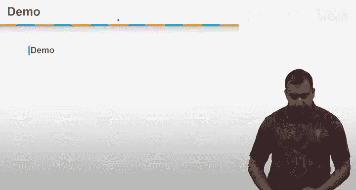

Alrighty， so let's go ahead and move on to our demo。So in this Python script。

 I'm going to show you some examples that work with the Ma Library。

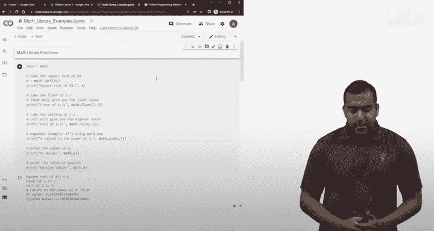

Here I first import the math library so that I can utilize the functions within the math library After I've imported the library。

 I want to use the square root function to be able to take the square root of 81。

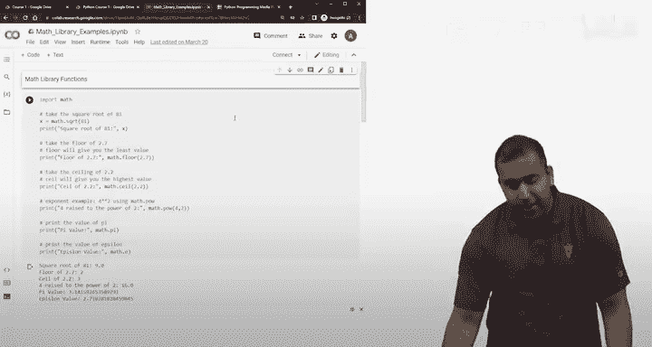

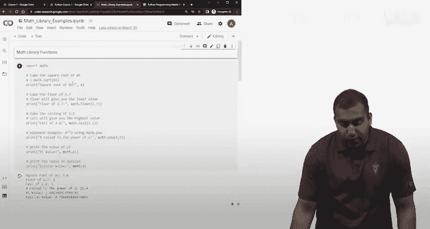

What I do is I call a math library， I call a square root function from the math library and pass an 81 as the parameter。

 what that will do is it'll take the square root of 81 and store it in variable x。

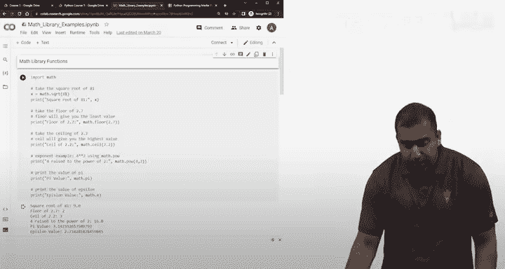

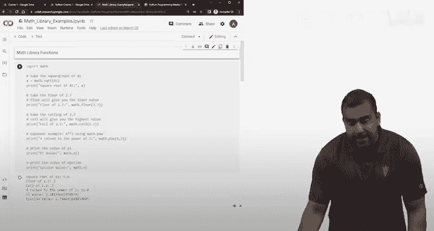

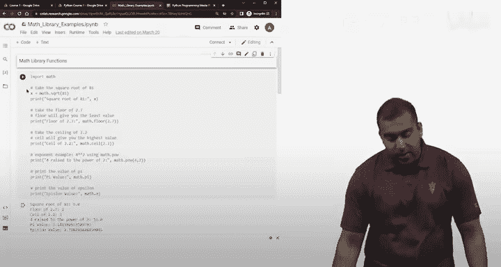

Finally， I'm printing out what the value is by calling the print function and passing the parameter square root of 81 is x。

 and as a result you can see that the square root of 81 is 9 and mind you it is returning a float value。

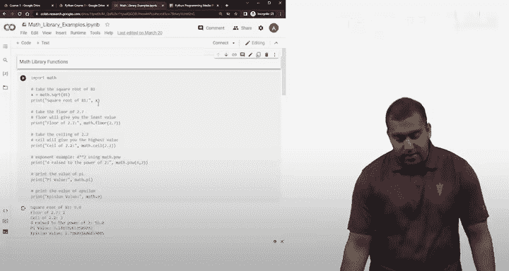

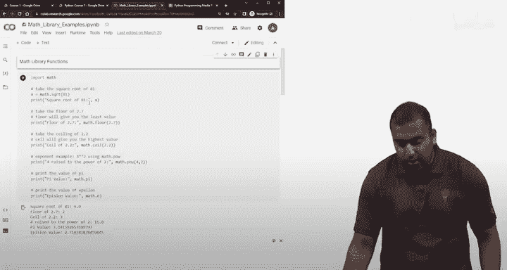

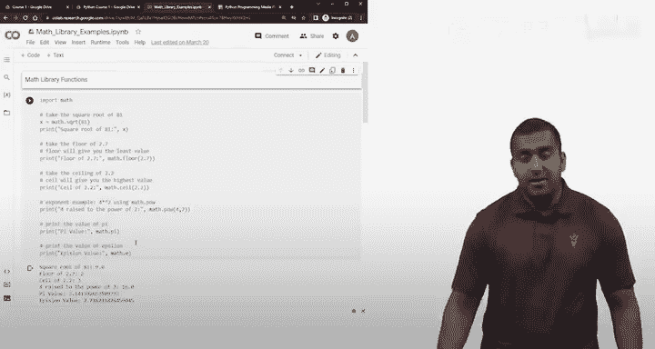

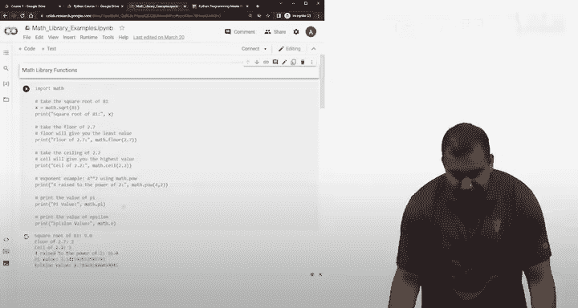

In this next example I'm printing the floor of 2。7 what the floor will do is it'll give you the least value。

 it will return the least value based on the parameter passed in。

 so in this case I have passed in a value of 2。7， so if I call the floor function from the math library。

 itll return a value of 2。

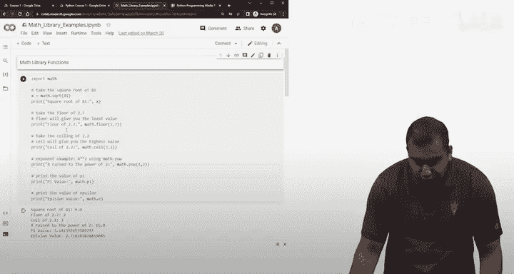

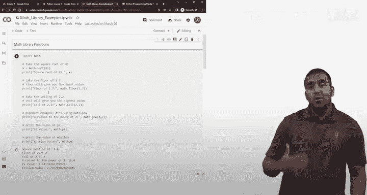

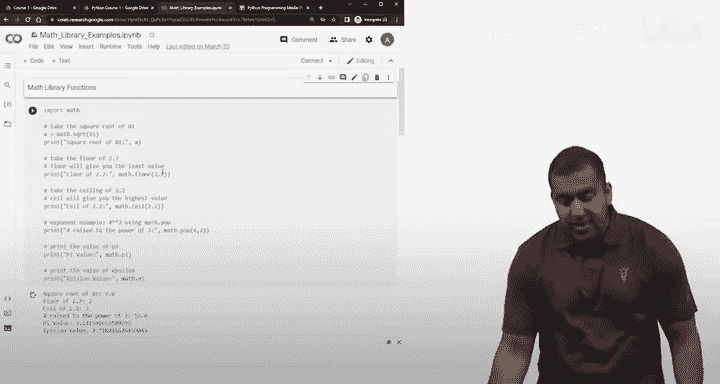

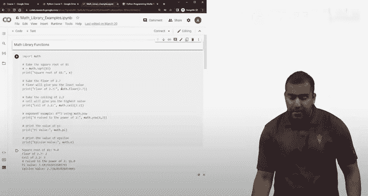

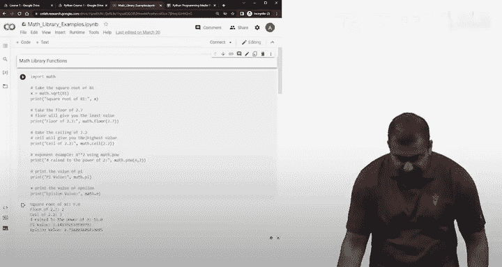

Now， let's say I want the highest value returned。 Well， in that case。

 I would have to call the ceiling function from the math library。

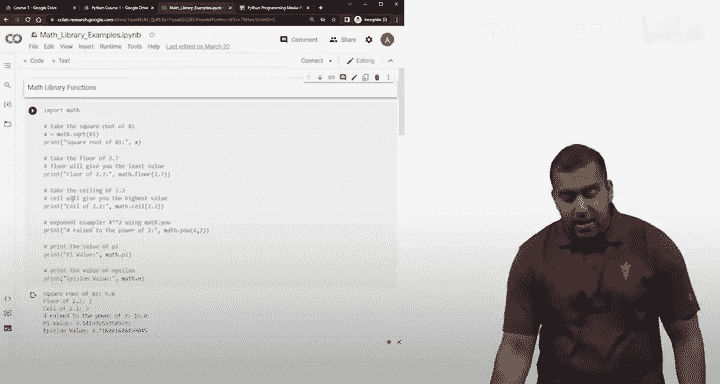

So all I would need to do is call the ceilinging function from the math library of 2。2。

 and that will return 3。

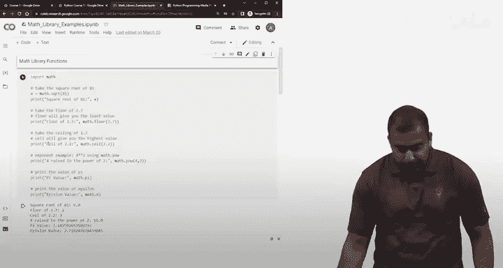

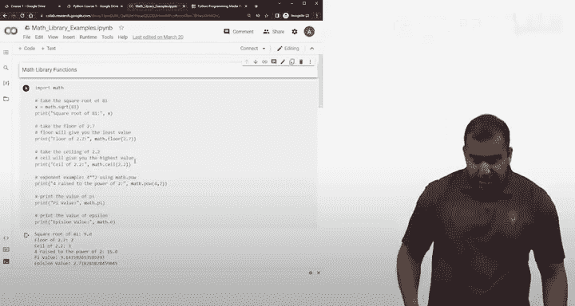

I was displayed in the output right here。

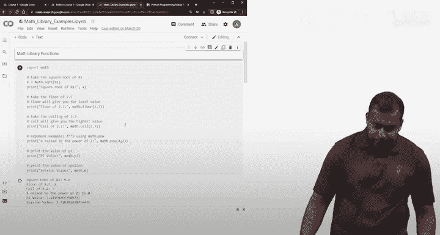

In the next example， let's say I want to find four squared using the power function in the math library。

 Well， all I got to do is print。

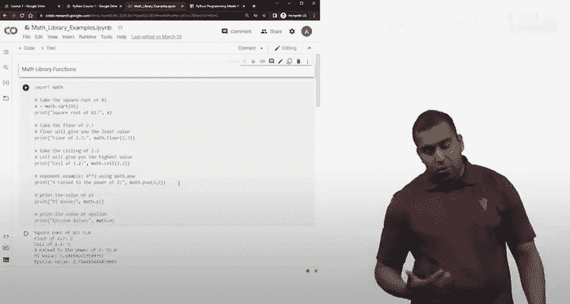

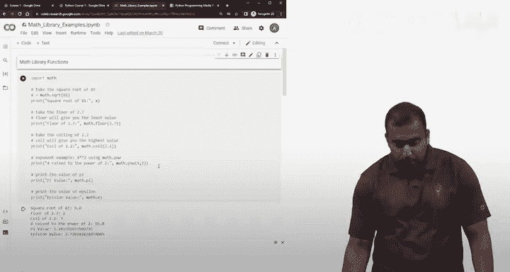

createreate my print statement， which has four raised to the power of 2。

 and then I pass in another parameter that says that's calling the power function from the math library and you're passing in your parameters 4 raised to the power of 2。

 and here you can see the when computed the result is 16。

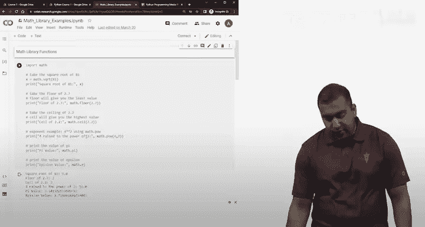

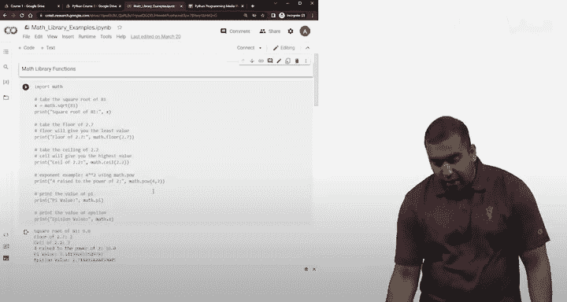

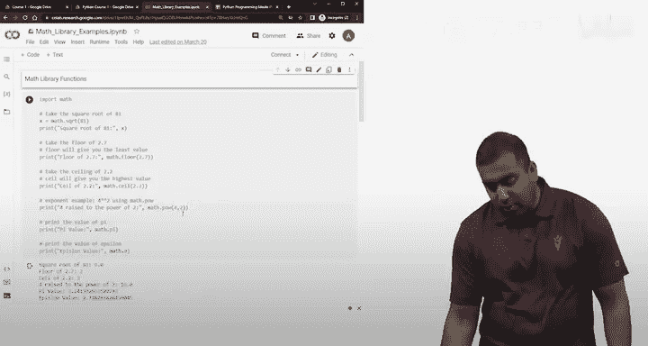

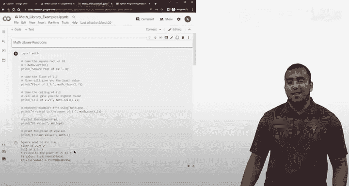

In our last two examples， the nice thing about the math library is it also includes constants。

 So let's say I want to include the value of pi or print the value of pi。

 All I would need to do is call pi from the math library。

 And you can see here when I run the code that the output is the value of pi。

 That's a really cool thing about the math library。

 It has a lot of constants that you may utilize and that you don't need to define in a variable which is extremely useful。

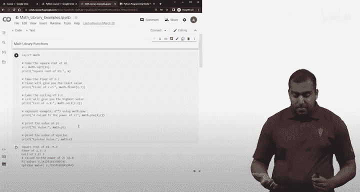

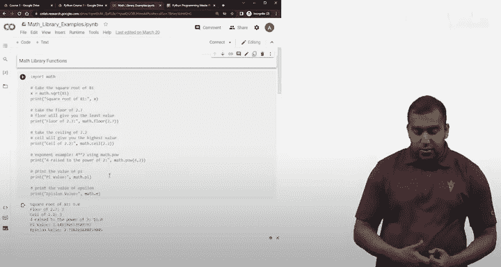

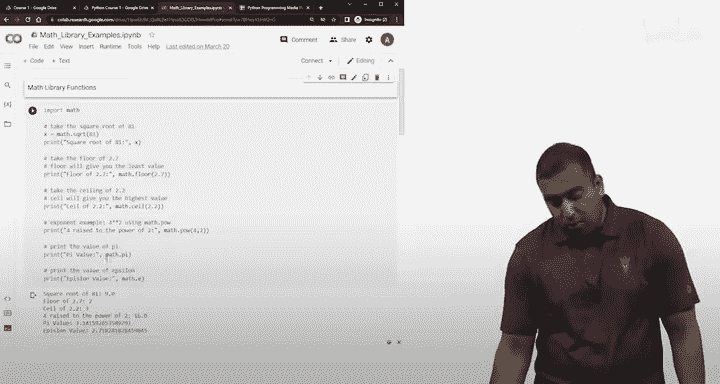

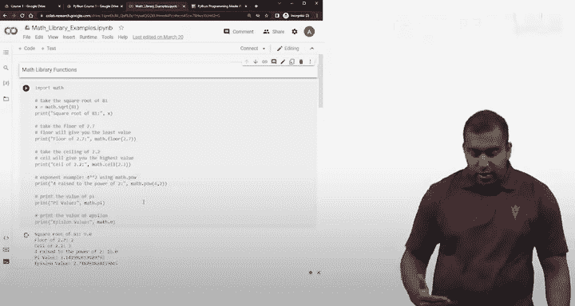

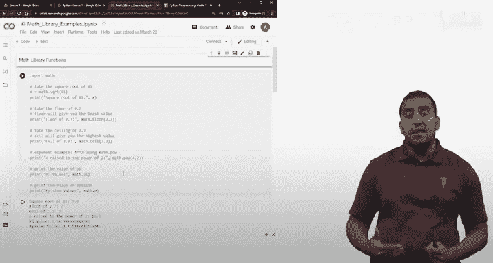

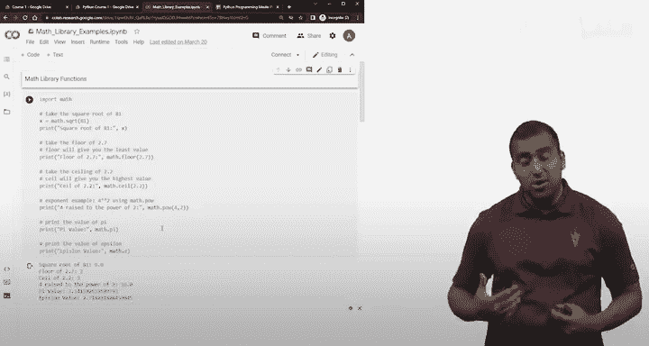

Finally， you can also see that I've printed the value of Epsilon here by calling it from the math library。

 and you can see it's being displayed in the output。

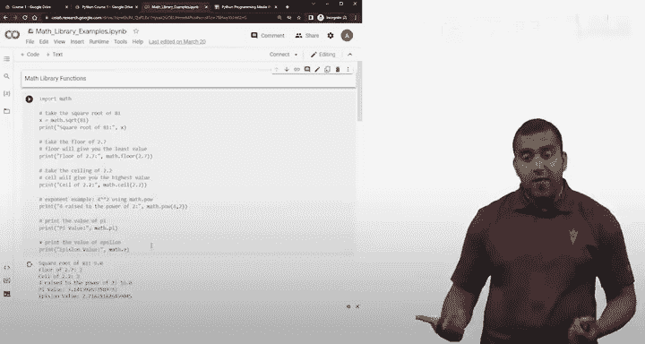

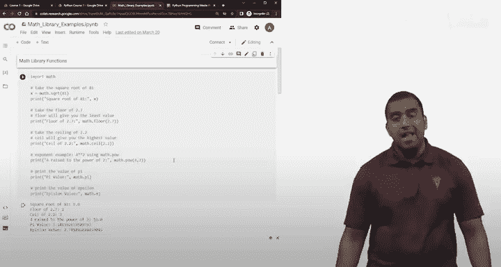

Let's keep moving forward to our next few examples。

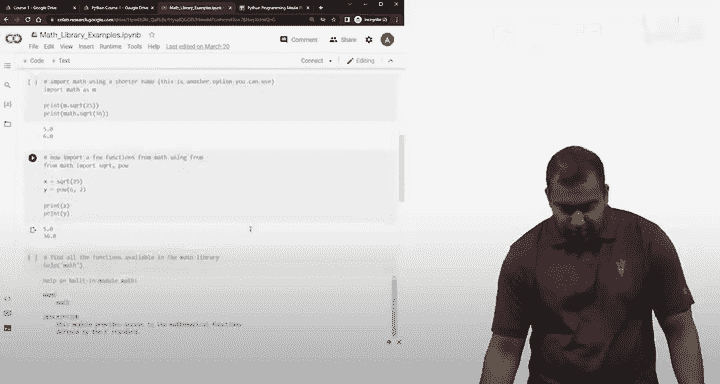

In our next example， as you saw before， I'm importing the math library and I'm renaming it M using the as keyword。

 so I'm basically saying importm the math library as M。

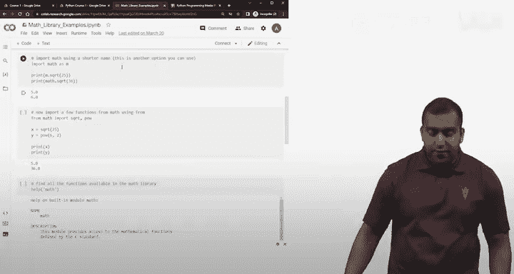

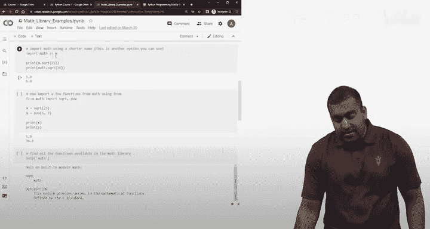

So if I want to call those functions from M using。

The newly named library M。 All I would need to do is print M dot square root of 25。

 What that is doing is it's calling the function square root from the math library。

 which is now known as M。

Now mind you， as I have mentioned before。That the math library's name still exists。

 so if you want to go ahead and call it the square root function from math， you can do that as well。

In our next example， you can see that I want to just import a few functions from the math library。

 So here what I'm doing is from the math library， I want to import the square root function。

And power function。 So when you're importing multiple functions from a library。

 just make sure to list， you can list on the same line rather than including multiple lines I say。

 from math import， so and so。 you could just do square root comma P。

Now here， since I'm explicitly saying that I only want to utilize the square root function in the PA function from the math library。

 I don't need to specify what library I'm calling it from。

 I can just call the function square root of 25 P of6 raiseds to the exponent of 2 and when I print those values out you can see that the square root to 25 is 5 and6 squared is 36。

Now， if you're really interested in finding all the functions available in the math library。

 all you need to enter or right is a line of code that says help and in parentheses passing the parameter and single quotes math When you run the line of code。

 it will display the name of the library description of the library and all the functions you can utilize with it from this library to operate on different pieces of data in your program。

So here you can see we're using sine functions， tangent functions， ceiling， cosine。

 there's just so many different functions you can play around with。

 it's really up to you in what you're trying to achieve at the end of the day。

 but this is a quick way rather than googling and finding what functions you can utilize。

 you can type help and pass in the name of the library in single quotes。Thank you for watching。

