# 亚利桑那州立大学《Python： A Guided Journey from Introduction to Application》中英字幕 - P25：24_课程回顾.zh_en - GPT中英字幕课程资源 - BV1J38GzbETT

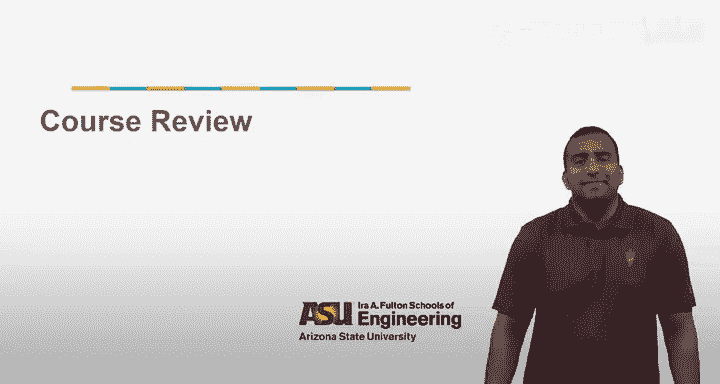

Welcome back。In this final lecture， we'll be going over our course review。

 which covers everything that we have learned in this course。

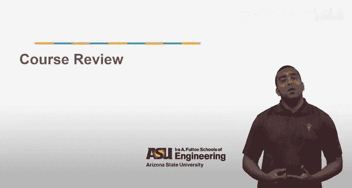

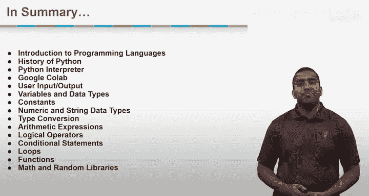

In this course， you have learned everything that discusses programming languages and what they are。

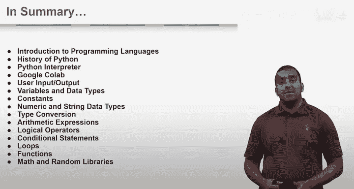

A brief history of Python and how it came to be。

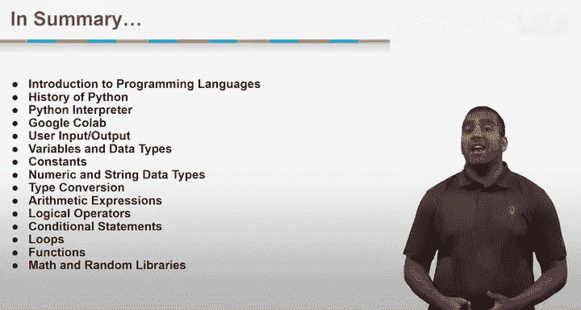

What is the Python interpreter？

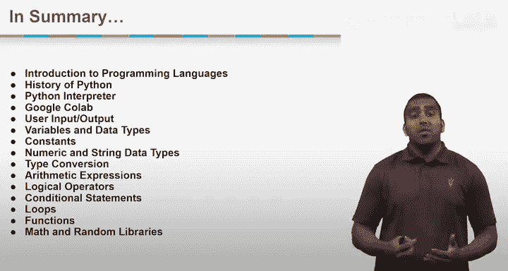

You learned a little bit about the online I that we are using， which is Google coab。

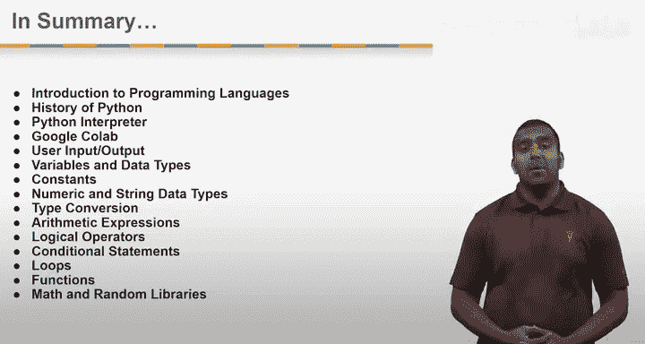

You learned how to handle user input and output。You learned about variables and data types。

 followed by constants。

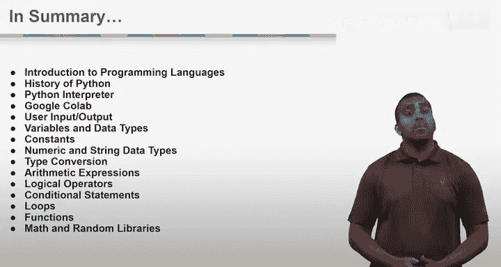

You also learned about numeric and string data types。

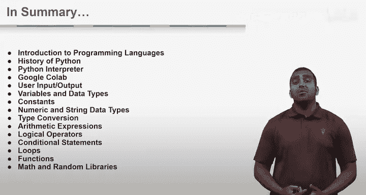

While and also learned about type conversion， other topics that you learned in this course include arithmetic expressions。

 logical operators， conditional statements， loops， functions， math and random libraries。

 These are all useful tools that you will be utilizing for the next upcoming courses。

 It's extremely important that you make sure you understand everything that's covered and taught in this course。

 as it is essential to know for the next coming courses。 I wish you all the best。 and thanks。😊。

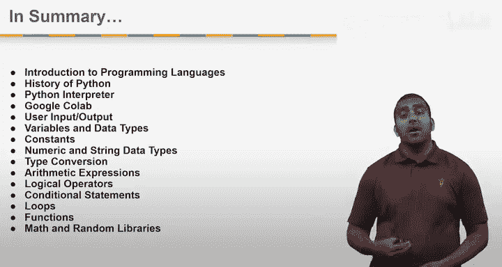

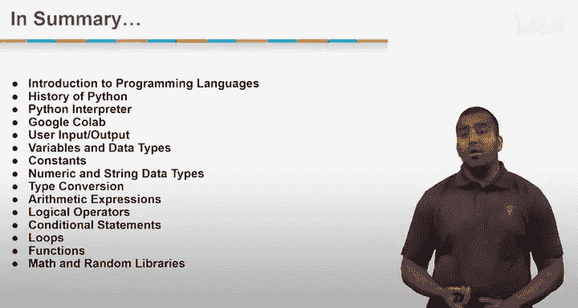

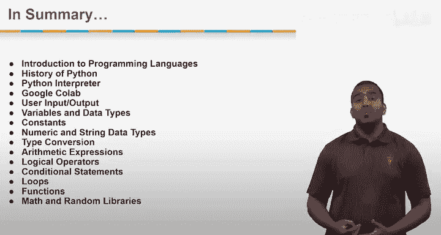

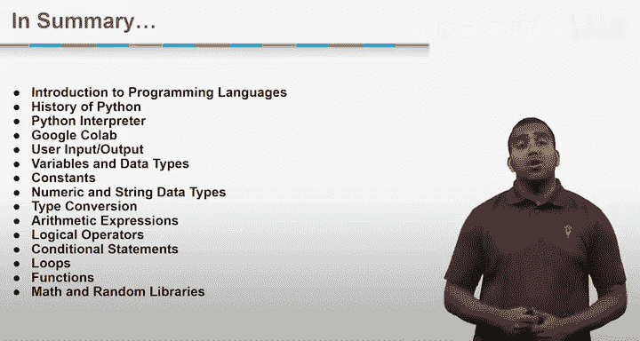

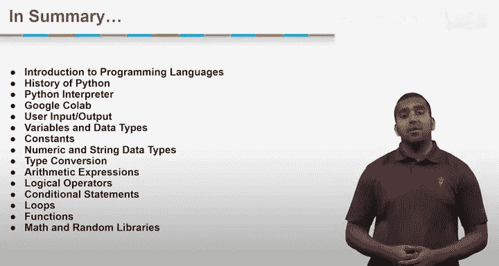

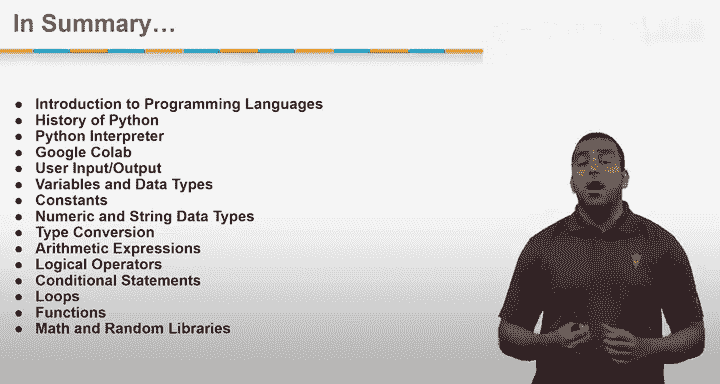

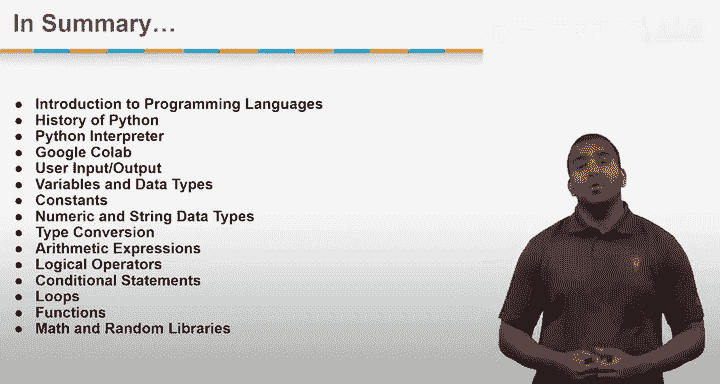