# 亚利桑那州立大学《Python： A Guided Journey from Introduction to Application》中英字幕 - P26：0_课程介绍.zh_en - GPT中英字幕课程资源 - BV1J38GzbETT

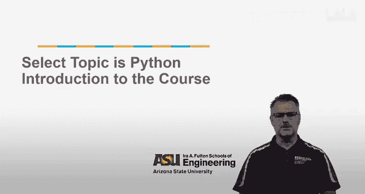

Welcome everyone to the introduction to the course in module2， and this objectives for this course。

 we're going to cover list tus， dictionaries， sets。

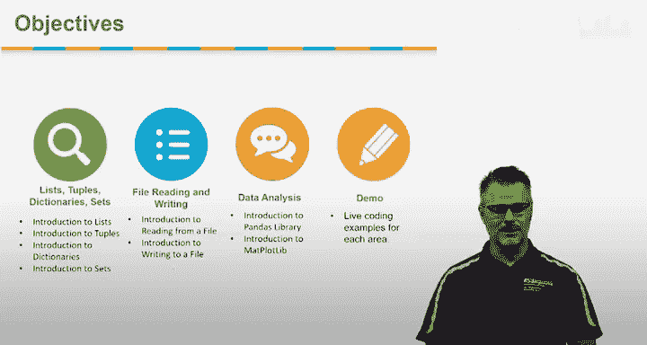

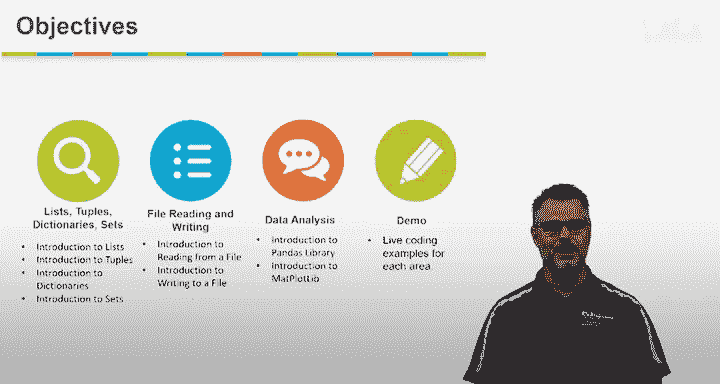

Be able to deal with reading in from a file and writing to a file。

 we're going to look at some data analysis and then from there I'm going to do some live demos throughout the entire module。

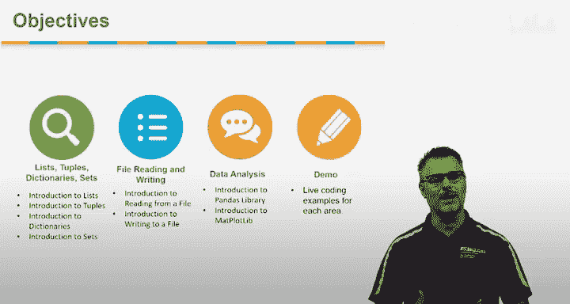

Some things you're going to need for this course。 You're going to need a Python I DE。

 I recommend using the coabab。 The coabab is part of Google。

 and so it already has the libraries and everything that you're going to need for this module。

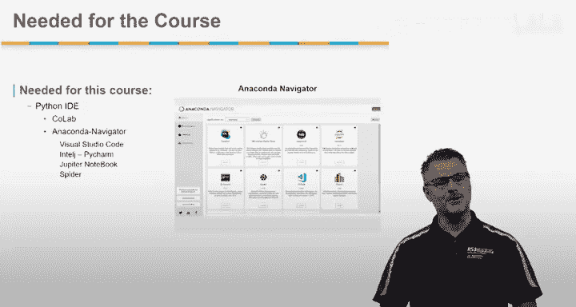

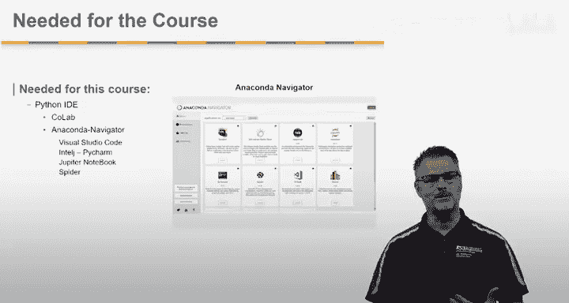

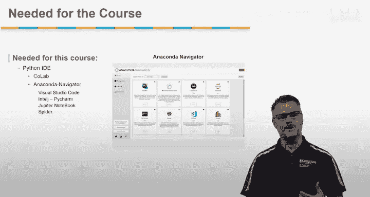

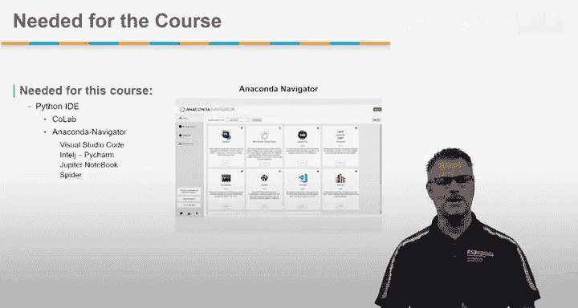

Some other ones that you could look at， there's Anaconda， which is a navigating system。

 and from within that navigating system you can go ahead and install Vis Studio code， pie Char。

 Jupiter notebook， and then Spider。

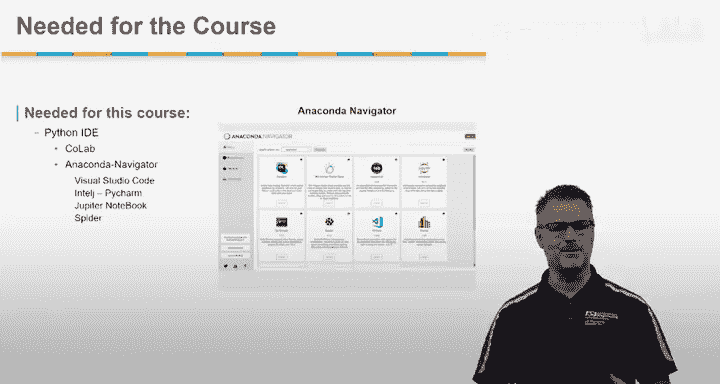

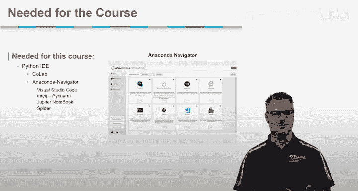

I look forward to working with you guys in this module， and I will see you soon。 Thank you。

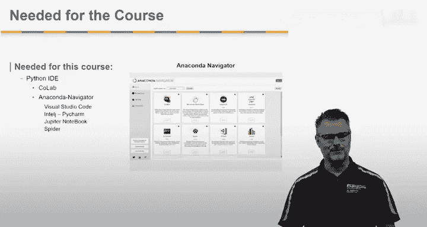