# 亚利桑那州立大学《Python： A Guided Journey from Introduction to Application》中英字幕 - P27：1_列表的创建与使用.zh_en - GPT中英字幕课程资源 - BV1J38GzbETT

Welcome everyone today we're going to cover a list today's agenda I'm going to cover the introductions to lists in Python。

 we're going to talk about initializing a list， We're going to talk about how to add items to a list。

 We're going to then make calls to that list being able to identify and pull objects from a list。

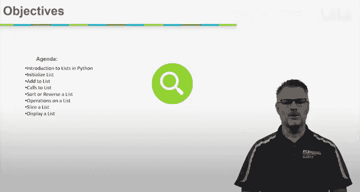

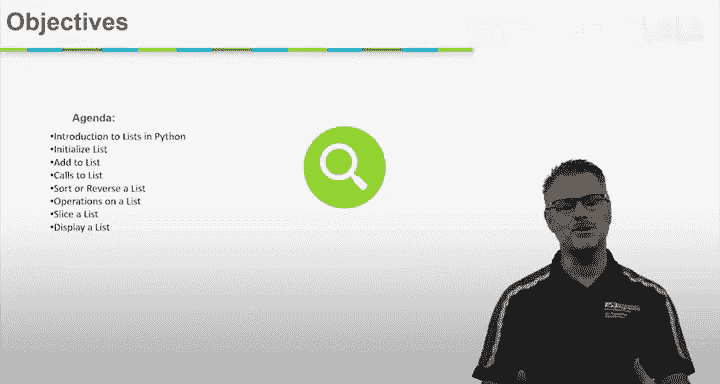

Then we want to look at how we can sort or reverse a list。

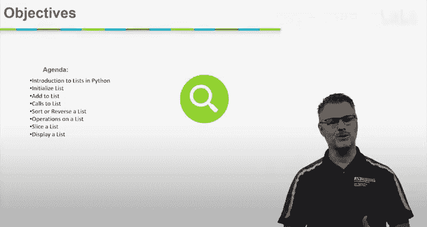

Then we're going to talk about some other options that you or operations that you have that you can do on a list。

Then we're going to slice or less。And then finally。

 we want to talk about the different ways we can display the data in the list。

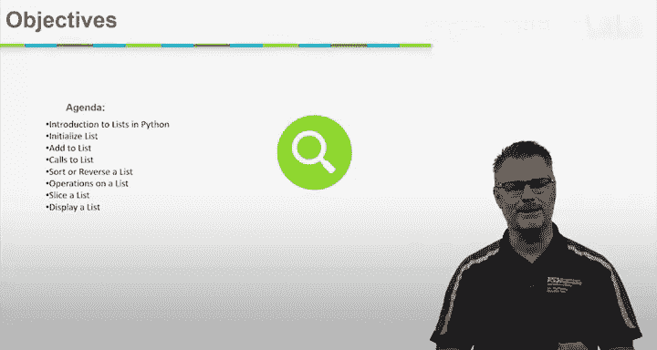

So to start off， let's talk about what a list is。So we need an easy way to hold individual items without needing to make lots of different variable names as an example。

 if I were to ask about grades， we'd have bo grade equals 94。

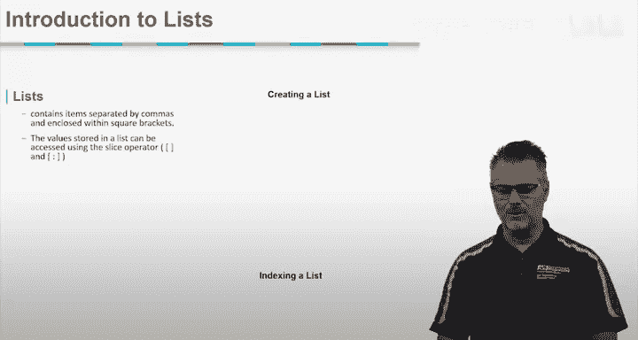

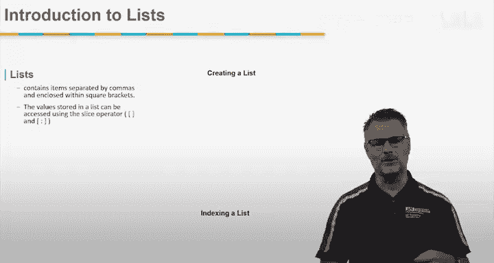

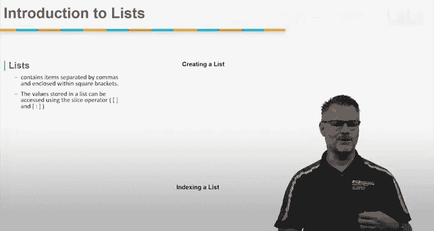

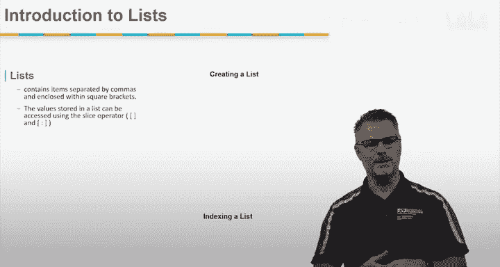

Cindy equals 42。Jan equals。

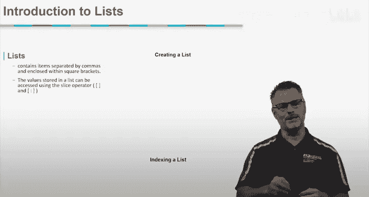

74 et cetera， if I had to keep track of more than just one grade for each of those students。

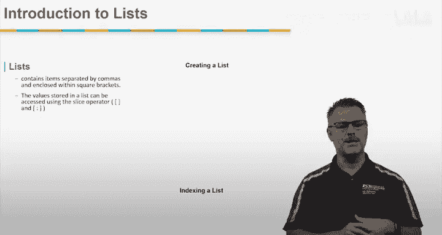

Let's say that I had to keep track of 100 grades。

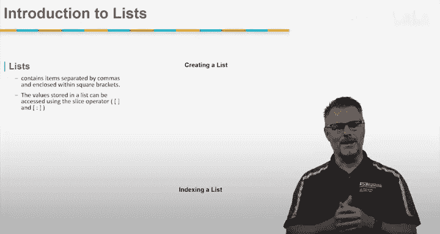

This would be more difficult to do because then I have to create variables for each one of those。

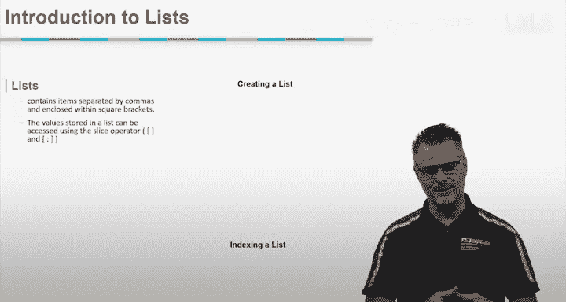

Well， with lists， what what it can do is I can make a list with one variable name and assign that variable name with all those different grades attached to it。

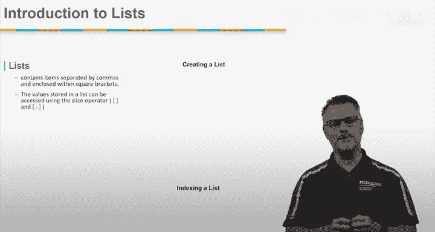

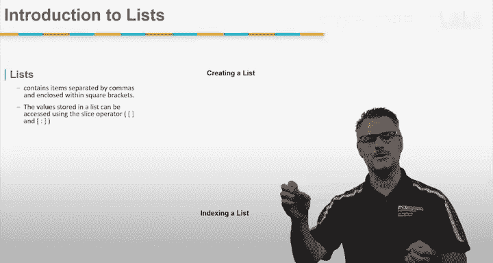

Now。What we can do is we're going to use our list， we're going to use square brackets to identify the elements inside and we're going to separate each value by a comma and then later on what I'll do is I will talk to you guys about how to slice that data or how to pull that data out。

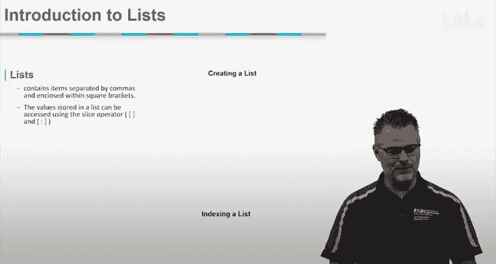

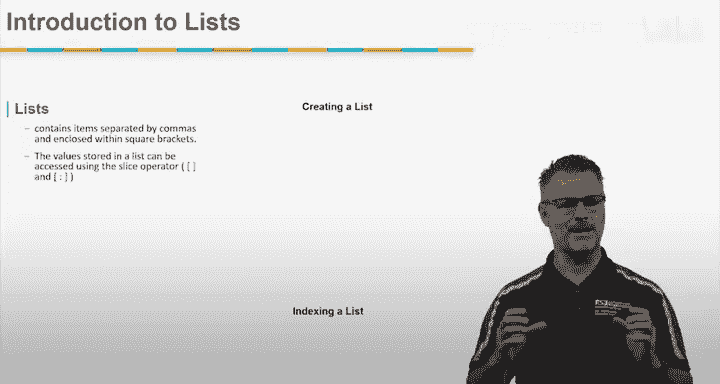

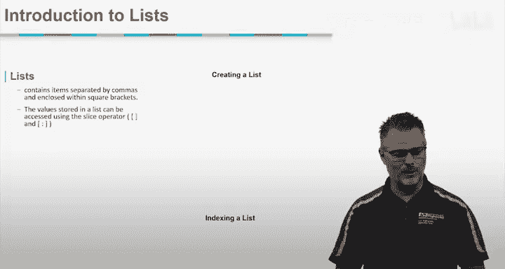

But as you see in the notes here， we can slice that operator by using colons。

So let's first look and see how all this is created。

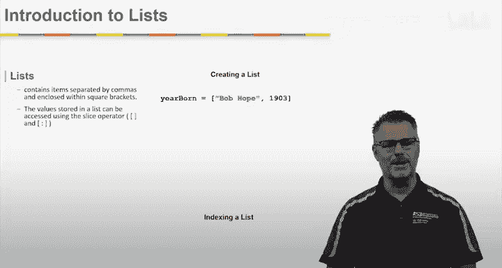

So as you can see here on the left hand side， I've got years born。

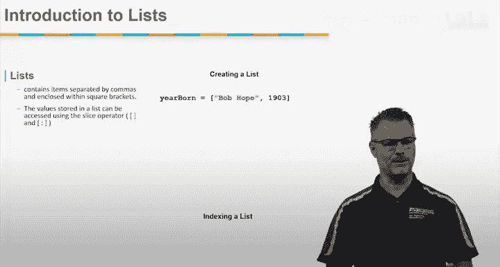

Year born is my variable。Okay， and that's the name of the list。

 Then what I've done is I got the first element。 in this case， Bob Hope。

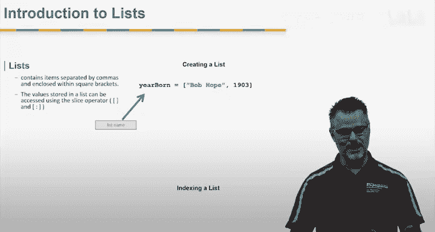

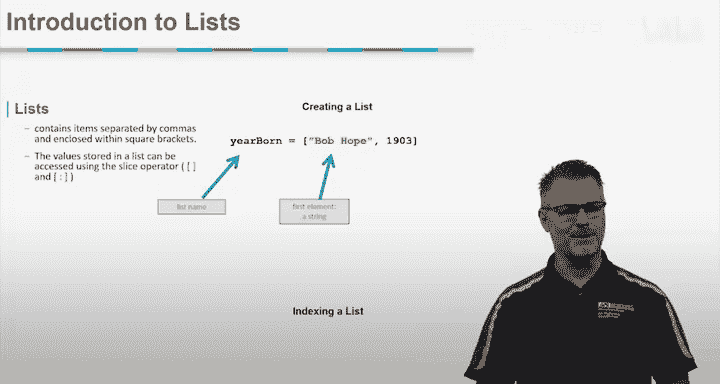

Then my second argument inside that list is the year he's born in 1903。

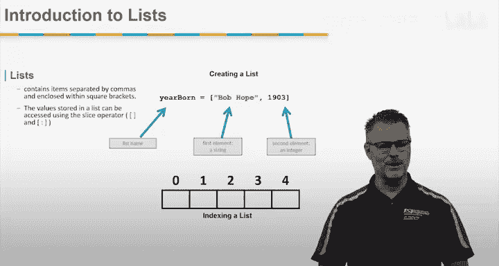

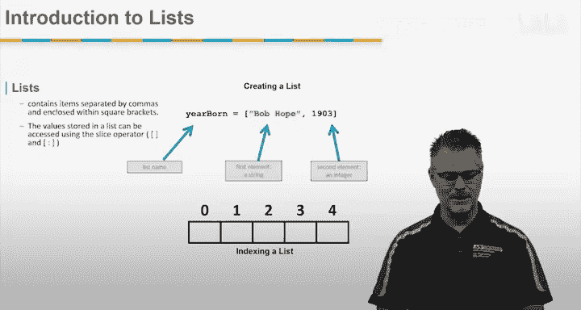

Now， we can think of a list as an index of an array。

 We started the variable or the value of 0 as the first element， which would bestore Bob Hope。

 One would store the value of in 1903。 If we continue to add more elements to this。

 it would increment by one for each one of those items that we inserted into the list。

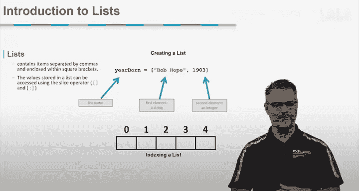

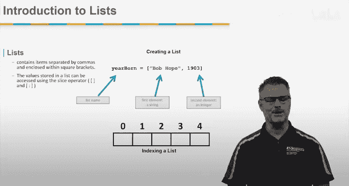

So let's take a look at an example of how to create a list。 So what I want to do first。

 I'm going to go and zoom into my code so we can take a look at this a little bit closer。

So we've got my first list up here。I've got list one is identified as mic。123，123。4 Sam and 34。1。

 Now， what I want to point out in this list is that I've got a mixture of different data types。

 I've got strings。 I've got an integer and then I've got double and for those who come from different programming languages。

 you may be familiar with those terminologies， but if you're not an integer is basically a data point that has no decimal point value。

 A double is something that has a decimal point with a number after it。

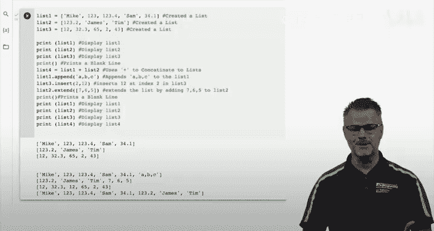

A string is basically a list of characters Now， if you're from a different programming language。

 one of the things that you're going to notice it's different in Python versus Java C or any other language is that Python doesn't care whether you use single quotes or double quotes it recognizes both of those as strings。

My second list I created here， I've got list 2， 123， which is a double， I have a string。

 and then I have another string called1。My third list I've created， I've got 12， 32。3， 65，2 and 43。

This list here is just of data type of doubles and integers。Now， to display each one of those lists。

 I just simply called the print command and then I put that list in there and it displays the data as seen above。

I can do that for list one， two， and three。If I want to concatenate two lists together。Mean。

 add them。Then what I can do is I can do list four equals list1 plus list two by doing that and then I will。

I'm able to display the very last line of my output。

 you can see that I've added list number one and list number two together。If I do list1 dot append。

 basically append adds that value to the end of my string。So I'm inserting the string value A。

 comma B， comma C。To my end of my list。Now。If I'm doing insert。Insert requires two parameters。

 The first parameter is the index of where I want to insert that data in my list。In this case。

 my insert location would be index number two。So what that does is it moves anything that's two or afterwards down one location to make room for the value of 12。

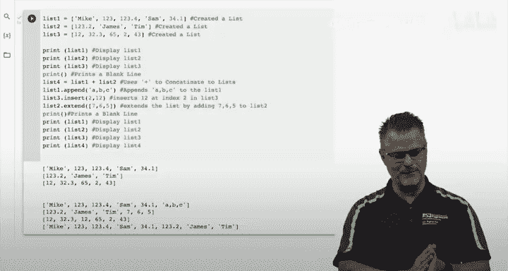

If I do list dot extend， basically what I'm doing is I'm extending my list by adding those values，7。

6 and5。

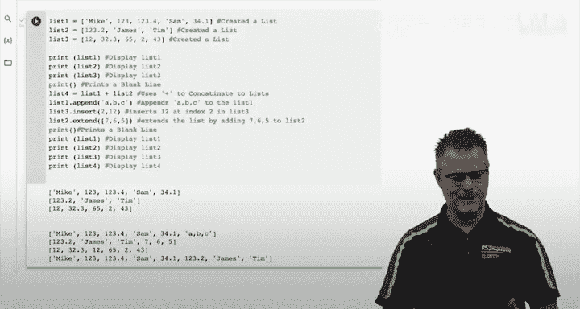

And so from here， what I can do is print out each one of those lists and display the changes。

 as I said in the first list。You can see here， I've gone ahead and added the ABC to it。By pen it。

And my second list。I went ahead and extended it by adding the six。Dver series the7，6 and the five。

My third list， I inserted the value of 12。At location2， zero，1。Qiu。😔，And then， of course。

 my fourth list is a combination of list one and list2 being displayed list one， having mic，1，2，3，1。

2，3。8， I'm sorry，1，23。4。Sam。34。1，123。2， James， and then10。So to make a call。

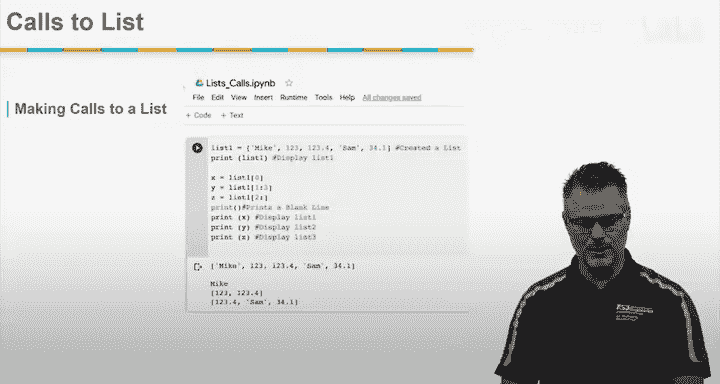

To a list。We can identify different elements that we want to print from that list。

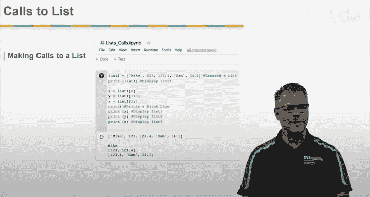

As you see here， I've assigned the value of x。

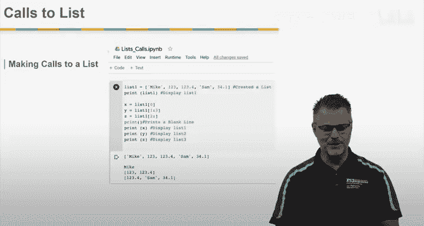

So if I do list one at location zero， what that's telling me is I want the element at the zero location。

 so I'm going to store the wordmic or the string mic in X。

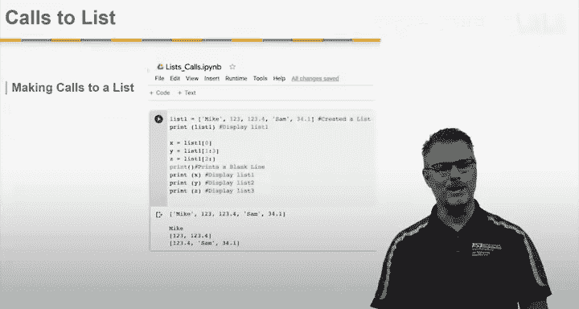

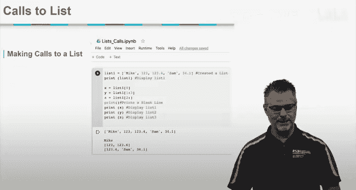

My next one， y equals list， now this is slicing。

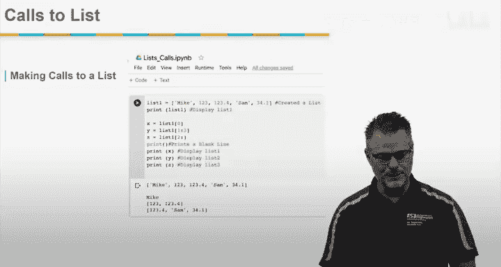

Because I'm using the colon， I'm saying I'm want elements between one， two。

 three to be displayed or stored in the value of y。

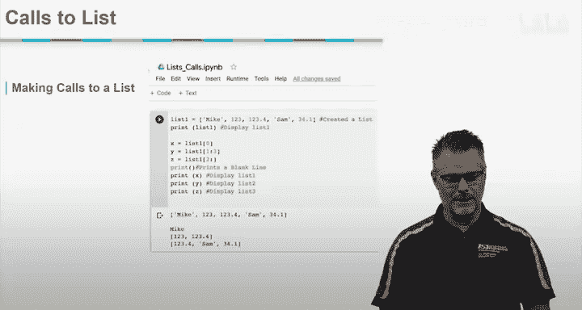

On Z， I have my list。 I'm taken from elements number starting at location 2 of my index。

 and I'm taking everything else after2。

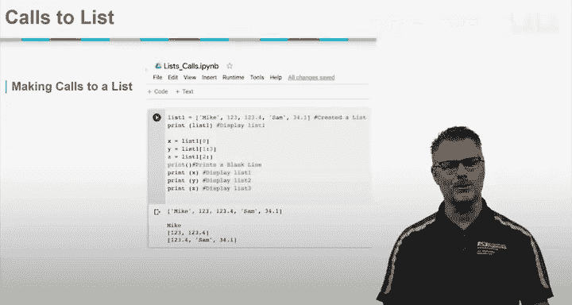

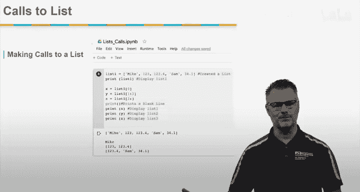

So as you can see here， based upon my list， I have Mike， 123， 123。4， Sam， and then 34。1。

When I printed out my x value here， basically what I'm getting is the value of mic。As I said earlier。

Then the second one I said， I picked up my range from one to three。So index zero was mic。

 so I didn't want that index 1 was one，2，3。So I'm going to include that。 Then I did two。

 which is one。123。4。And then I went up to 3， but I did not include that in my list。

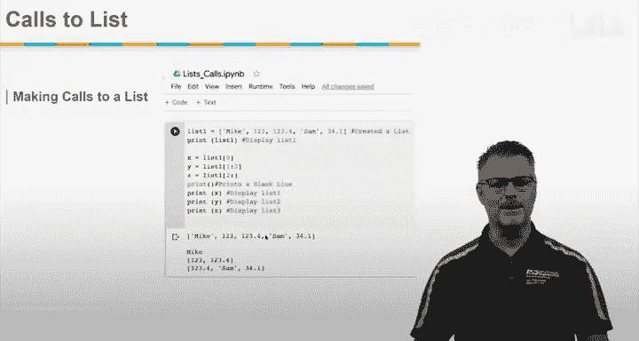

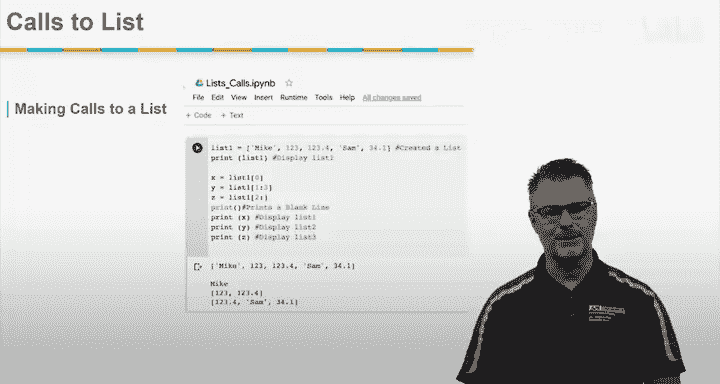

So that's kind of the stopping point so it goes it's kind of like a brick wall。

 you run up to that location of three and then you stop。

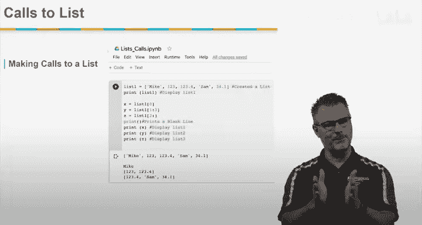

You do not include what's stored in that value。

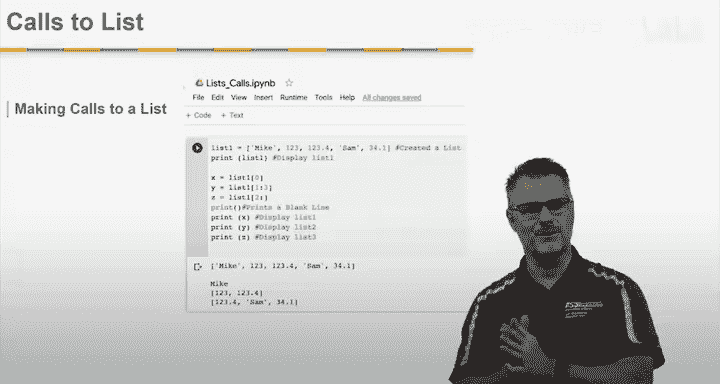

And then of course。Z。We included everything from location one， which was 123。4。We included SA。

 and then we also included 34。1。

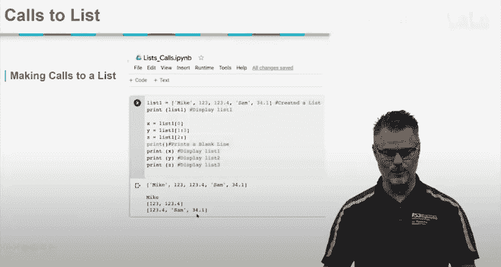

So。

A lot of times most people want to sort a list because if you sort a list。

 basically what that allows you to do is quickly search for values。

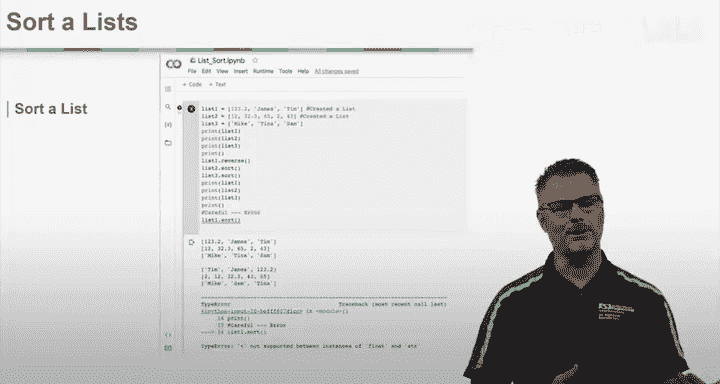

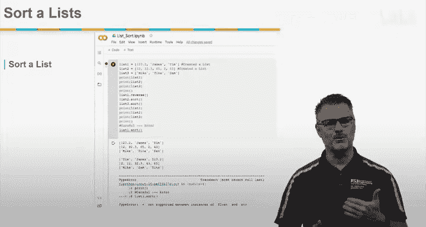

Using different types of algorithms。

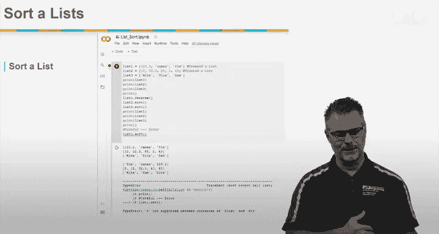

And so I've got three different types of lists here。And we can do different things on this list。

The first thing we can do is we can reverse order the list。

And the way we do that， we do list one dot reverse。

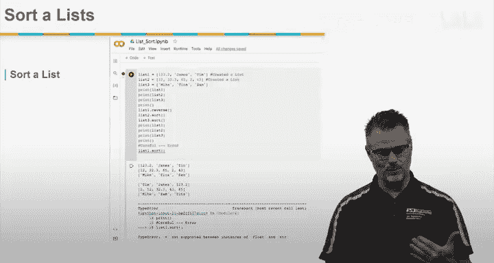

Okay。List number two。

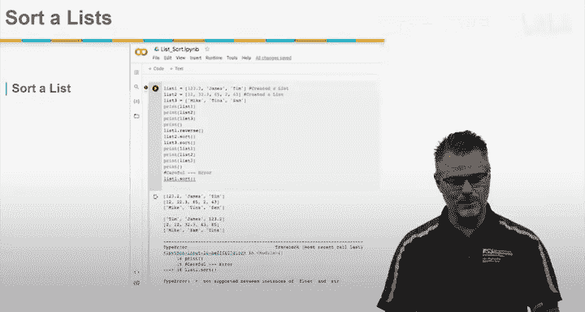

I did specifically as just integers and doubles。

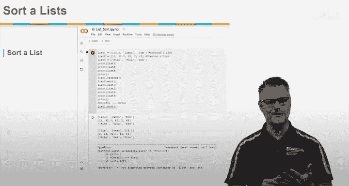

And notice I didnt mix different data types like a string in there。

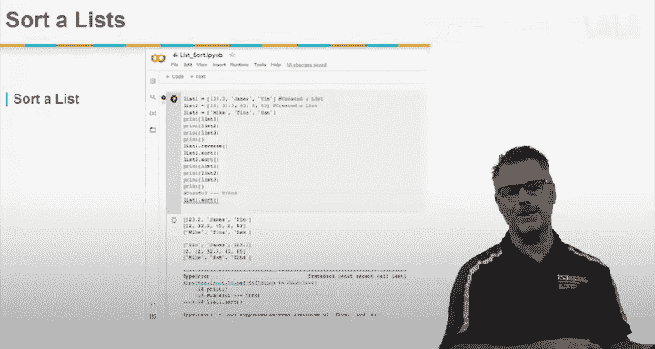

This is very important because I'm going to point that out here shortly。Okay。

If I tried to order that list， notice that I went ahead and displayed。Down below。

 this is the list as they are。 and then here I ordered it to12，32。3，43， and then， of course， 65。

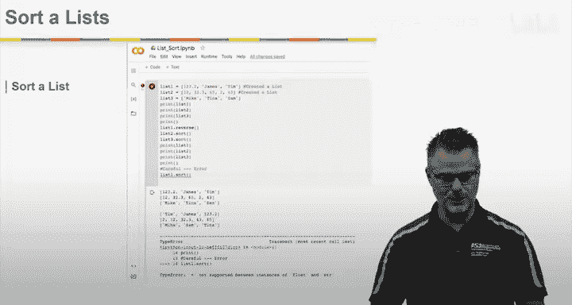

I also sorted my list。Of names， I've got Mike， Tina and Sam。

 and notice it put it in alphabetical order。

Now， one thing that you're going to run into is if you're mixing data。

 things like strings and integers。

And you try to do sort。 You will run into some issues。 As you can see here from the compiler。

 I was able to print out my list 1，2 and3 without any issues at all。

But notice here， I said， be careful。 there's going to cause errors。

 And the reason why because I did mix my in my double with strings。

 It doesn't know how to differentiate between the two being mixed together。

It has no problem identifying strings， and in order said。

And it doesn't have an issue doing numbers， but when you try to mix it to。

 the compiler doesn't know what to do and therefore it will show or throw an error。

 as you can see here。

So to do to make sure you don't do that， make sure that your lists are either of one data type or another if you're going to use the sorting methods。

Some additional items that you may want to do with your operations with lists。

 you may want to find out the index of an item。

You may want to find out how many elements that are in the list。

You may want to remove an item from the list， and then of course you may want to slice the list。

 and we've already talked a little bit about slicing， but it's a very important piece。

So the first thing I want to do is talk about the list， we've got the values of 2， 32。3， 652。

 and then of course， 43。

And again here， I just want to recognize that I am keeping track of just integers and doubles in this list。

 I'm not mixing strings in this。

So the first thing I want to do is I want to find the index of a location of the value of 65。

So when I'm searching my list， it's going to go through each one of the elements starting at zero and identify the index of where the value 65 is stored。

In this case， the value is being stored， and the location is zero。1an。2。😡。

So as you see out here on my display， I get the value of two。

The next thing I want to look at is list。 count。

It's basically going to give me inside the parameters。

 I'm going to tell it what I want to count to identify。 so in this case I put in the value2。

 so it's going to search the list to see how many instances the value2 shows up in this list。

And in this case， there are two cases， it starts at index zero。

And then if you go to index 1， two， and then three， there's another two。

So on my output that I see here， that's the reason why I see the value too。Again，0，1，2。

 and at location  three， there's another two。

That's why I'm getting that value there。If I want to remove an element。

 all I need to do is do list dot。

Remove， and then I put the element that I want to remove。 Now， in this case here。

 I wanted to remove the value of 2。

Okay， now what it's going to do is it's going to go through the list。

 it's going to find the first instance of the value of  two， and it's going to remove that value。

But in this case， I had two twos in here。As you can tell from when I printed out the list down below。

 it removed the first two， but it did not remove the second two。

So it's important to recognize that if you want to remove all the twos。

 the first thing you want to do is find out how many instances there are of that number。

In this case， there were two twos。Then what I would do is I would create a four loop and have it iterate through that remove item that many times to make sure I removed all those values of two。

 and I can do that in an example later on。

The next thing I would want to do is if I wanted to print a range again。嗯。

By using the slice function， using the colon is the most important piece to identify that range。

I can do one colon three again that's going to give me。

Index number one， index number two， I get to index number three， I stop。

 but I do not include that into my final display。

So I'm getting 65 and I'm getting the value of two。

So up to this point， we've gone ahead and I've。Been using displaying a list up to this point by using the print function。

 and that's the most common way to do it。

If you wanted to just print certain elements。From the list。Again。

 just use the print function and then identify that by using list， bracket， the index。

 if you only wanted one element， use the slice feature if you want to print multiple elements in that list or what you could do is assign it to a value as I did x equals list count。

Then display that value of x。So there's multiple ways to display that information。

Now， what I'm going to do here is I'm going to go ahead and stop on this video。

 and I'm going to come back。 and I've got a fresh video that I'm going to do a live demo。

 It's going to take about 15 to 20 minutes。 We're gonna go through and actually do coding on making lists。

 modifying the list and doing some changes。 I look forward to seeing you in the next video。😊。

