# 亚利桑那州立大学《Python： A Guided Journey from Introduction to Application》中英字幕 - P2：1_讲师介绍视频：Steven Osburn.zh_en - GPT中英字幕课程资源 - BV1J38GzbETT

Welcome everyone， today what I'm going to do in this video is just kind of give you a little introduction about who I am as far as the instructor and a little bit more about my personal background。

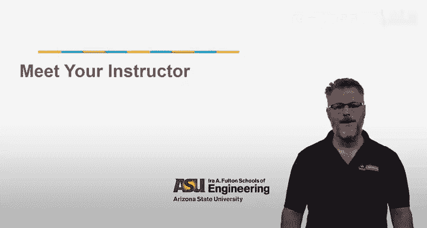

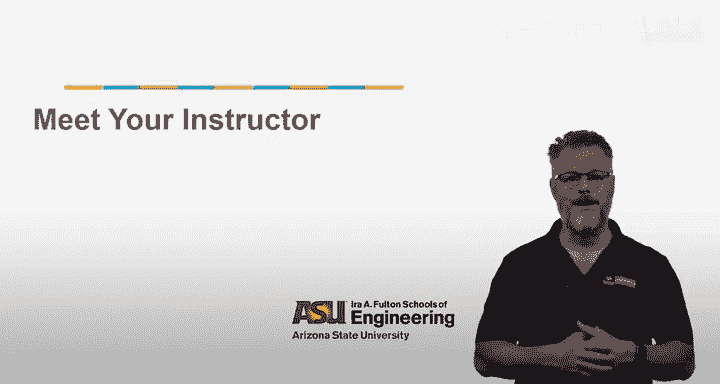

My professional history， I've worked in industry for over 19 years as a systems engineer during that time as a systems engineer。

 I managed and worked with servers， I've dealt with application development。

 I've dealt and with hardware interfaces， and so I bring that experience of programming and hardware integration into the industry。

 from the industry， into the work environment that I do here at ASU。

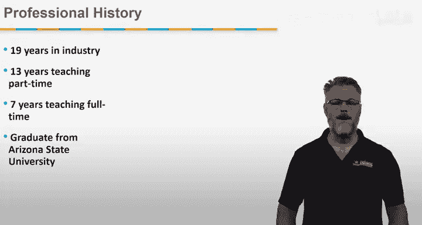

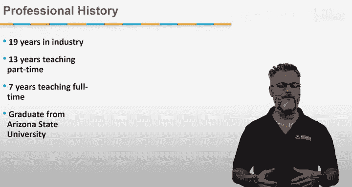

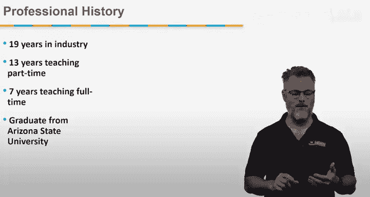

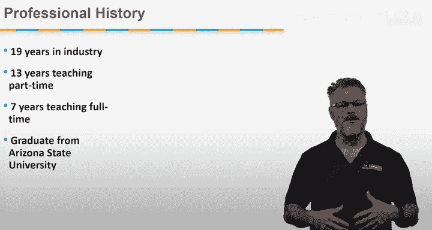

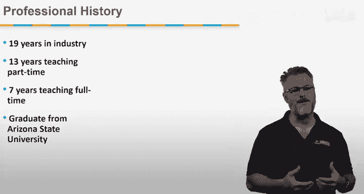

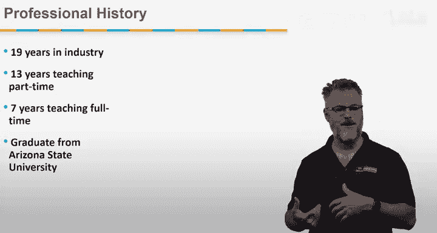

During this time， I also taught part time teaching through the community colleges。

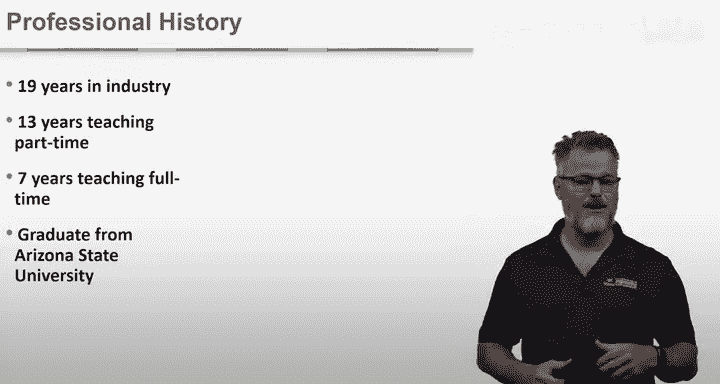

And other facilities。Over the last seven years， I've been。

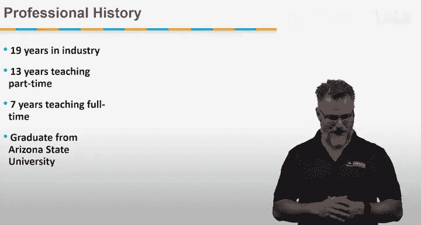

Transitioning from a industry environment to a full time teaching position。

 the last six years have been here strictly at Arizona State University。

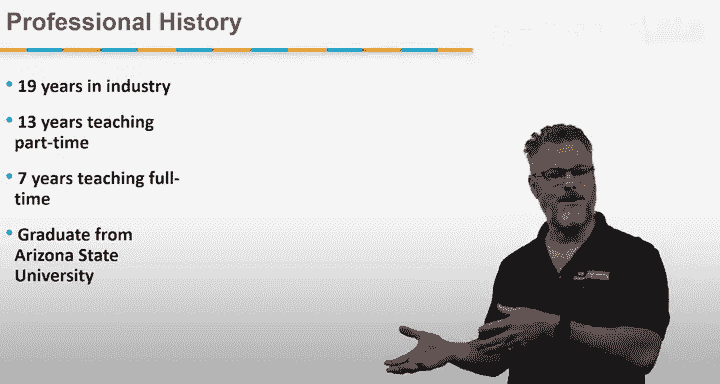

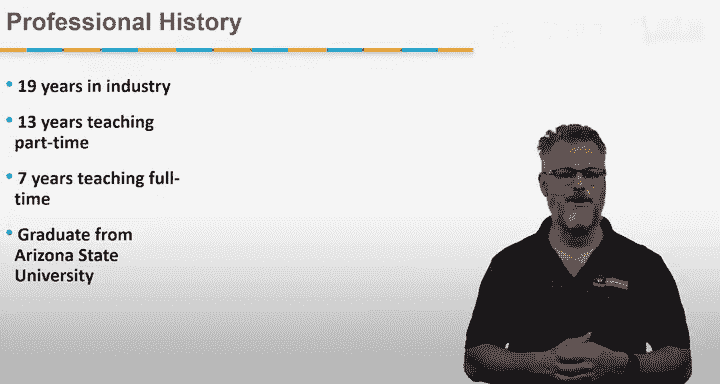

My degree， I graduated my master's and my bachelor's degree here at ASU。

 my degrees in computer system engineering， I went to school a little bit later in life。

 I'm not your typical college student who went right from high school into education。

 I went from high school into the military， and then after the military I went into education。

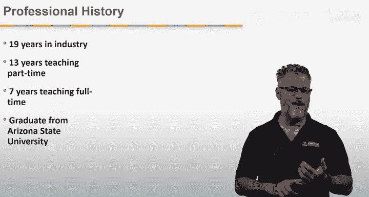

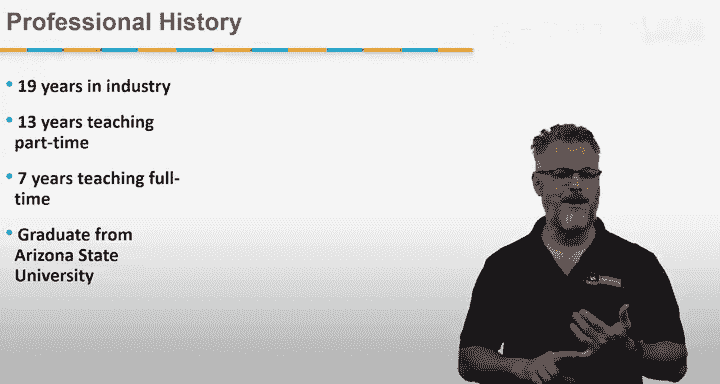

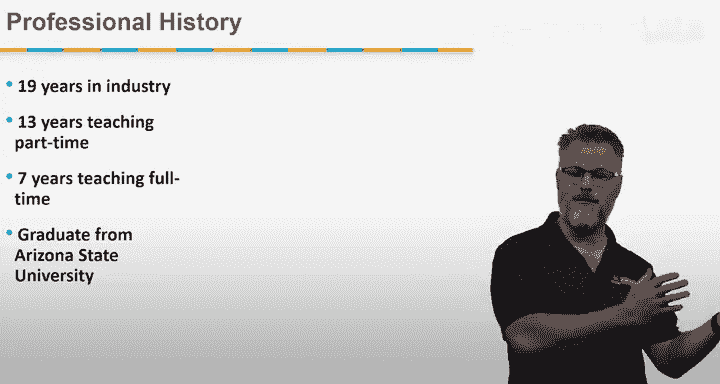

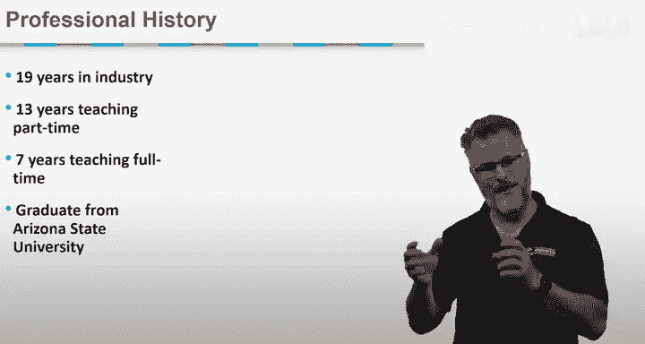

After working in an industry for 19 years。

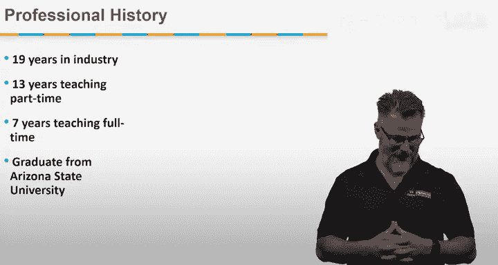

Some of my personal interests， I like to get outdoors， I love spending my time hiking， traveling。

 kayaking， fishing， some of the photos that you see。

 I'm also a certified drone pilot that one of the pictures is the valley just shot just a couple days ago of the sunset。

Of course， we have some of the most amazing sunsets here in Arizona。

 So if you love photography and you want to come out to Arizona， great place for sunsets。

 The other photo there is the Salt River Canyon， some horses。😊，So going down the Salt River。

 you can actually run into a lot of these wild horses。

 and so this is just me sitting on the banks of the Salt River while I'm kayaking down the river。

 they were just crossing the river in that area and I got some great photos。Part of my traveling。

 that's a photo from Ireland。More specifically， it's near outside of Dublin。I've been to London。

 Germany， Ireland， Poland。Ookkinawa， Guam。I've traveled many different places around the world So far。

 I have to say that one of the most beautiful places for me so far has been Ireland。

 It's been an amazing place to visit。 The countryside out there is just。😊，Breathtaking。

And then fishing take me anywhere as long as it's got a place of water。

I've got a fishing and pole for it， so I'm always willing to go out and have fun。

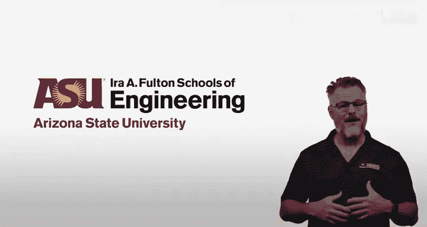

I look forward to being in this course with you and we'll see you in the videos。

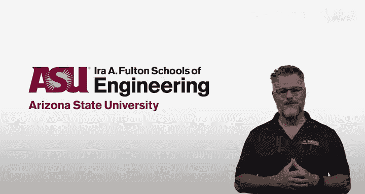