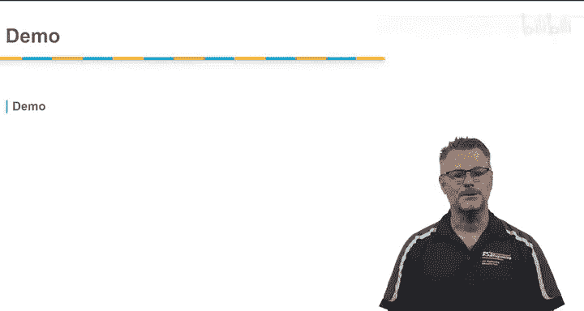

# 亚利桑那州立大学《Python： A Guided Journey from Introduction to Application》中英字幕 - P36：10_Python中使用Pandas库进行数据分析.zh_en - GPT中英字幕课程资源 - BV1J38GzbETT

So today's objective， what is pandas， we're going to talk about how to slice the data frame。

 we're going to concatenate the information， We're going to change the index and also look at how to change the headers。

So what is pandas Well， pandas is basically a tool that we can use to bring up data and look at it。

And look and modify some of that information。As far as how we want to format that data。喵。

We can do simple series， data frames， missing data and group data Series are very similar to one dimensional nuumpy arrays。

 We can also look at the data parameters， and this definition could easily be a constant value。

 It could be a list。 It could be a numpy array。 It could be a dictionary。

 so you can think of a data frame as a table with different types of columns rows。

 and so that we can process the data a little bit more easily。

 You can also think of it as a two dimensional array。Now what we can do is if the data is missing。

 we don't have that information in there， what do we do and a lot of times you know if we're running a program that could actually crash the program well here what happens is that the value of NA gets put into its place to show that it's not available。

Now， the grouping of data， you know， you can kind of think of it as where does it get used。

 economics， big data， advertisement， stock predictions are some of the most common places that you see data performance and operations being done。

So how do we slice the data？Well， first of all， what we want to do is I'm going to show you how to display all the data。

And then after I've displayed all the data， then I want to be able to show a number of rows or a number from the head and then also show a number of rows from the tail。

Let me go and zoom in here。As you can see here， I've got importport Pans SPD。

Now the PD is a library that I'm referencing that's within the。As you see here。

 I'm going to import pandas as PD， so anytime you see PD inside the code。

 I'm referencing the Pada library。So here I've defined conference。It's in the form of a dictionary。

 I've got my day represented by 1，2，3，4，5， and 6。I have my attendees。

The number of people being attended to a conference。And then I gave the rating values based upon。

How well they did during those days。So the first thing I want to do is I want to go ahead and take and put this in a data data form。

 so I'm going to use PD dot data frame。Put in my conference。

Now when I go ahead and run this and I print it out。As you can see here。

 I've got my day listed in a column form， I've got my attendees listed in column form。

 and then I have my overall rating for each one of those。

And notice that it tied them together based upon the index of location1。13，20， and then five。

My index is over here on the left hand side，01，2，3，4，5。Next。

 if I wanted to display the top three cells， then all I need to do is say D F dot head。

 I the number of cells that I want to see。 In this case， I only want to look at the top  three。0，1，2。

And it displays that data。If I want to look at the from the backside of it or the tail end of the data。

 I can identify it that way as well by doing D F dot tail and specify how many rows that I would like to see。

 In this case， I specified3。 So I went 3，4 and 5。And I've displayed the data accordingly。

Now in Kcanation， basically what I want to do is I want to be able to join two different data sets。

 I can use mergege and I can use join as one of them。The features， let me go and scroll down here。

 zoom in。Now， as you can see here， I'm going to ahead and imported the pandas。

I've created my data set for Conference1， and I displayed that data， as you see here。

And I specified my index， my index is1 are 10， 20，30，40，50 and 60。 So unlike the last example。

 it showed12 our 0，1，2，3，4，5 here Now， what I've done is I've specified how I wanted it to be displayed as far as the index goes。

Now， I've done the same thing for my conference， too。 I've created my data set。 Now。

 conference number 3 is a little bit different because I specified here the year and then the profit。

And we're going to use this as a different part of an example to merge data together。

So the first one I did is I did print。PD dot mergech， Conference1 and Conference 2。Well。

 when I did that， what I end up getting is where the data is similar。 Notice here。

 I output was day 2， day 4，5 and 6， where 9021， and my rating of 4。2。 If I go up here to my data set。

 notice here on my first conference the first value was ignored。Here。921。

 it also matched with this data here from my conference， too。

So everything that matches between table one and table two is displayed in table3 Next I did PD。

merch， I did my conference one， conference2， and then I did on because I want to specify one I wanted to do the merge on。

And I did that on overall rating。And so notice here， now， instead of it printing。

It based upon the similarities， I printed all the data， but it did it based upon the overall rating。

 My left hand side was my original table from one。 And then， of course， my attendees on2。And then。

 of course。Last I use joined。Here I'm doing conference dot conference 1， dot join conference 3。

What they ended up doing here for me is I ended up adding the day attendings overall rating。

 year and profits。So， now。Conference one and conference three are combined。

What I want to point out that specifically is notice here that N A is put in if the values were not available。

So。What I want to point out here， the values NA AN are put in。Referencing that is not available。

I the data set for that set is not there。If I want to set an index。

All I need to do is specify the index that I want to set。 Here's my conference one， the data set。

Then I went ahead and did conference1。 set index。I identified what the index was that I wanted it to display。

And then I put it in place as equal to true。 So here's the original displayed。Here。

 I went ahead removed my index with the 10，2030，40，50，60 and replaced it with day。

I can also modify the header， so here I've got day as one of my headers attendees overall rating。Now。

 if I want to replace it to year， all I would have to do is do conference1。 rename。Columns equal。

 And then I specify which 1 I want to replace。 In this case， day to be replaced with year。

 When I go ahead and run and print this out， as you can see here， day was the original 1，2，3，4，5，6。

I replace the header with year， now it is one， two， three，4，5，6。

I'd like go and stop here and we're going to go ahead and move forward and then do a demo of how to utilize。

Pandice， I look forward to seeing any of them。

