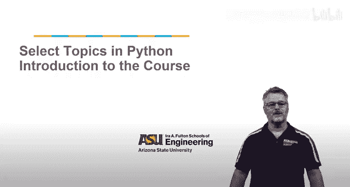

# 亚利桑那州立大学《Python： A Guided Journey from Introduction to Application》中英字幕 - P39：0_课程导论3.zh_en - GPT中英字幕课程资源 - BV1J38GzbETT

Welcome everyone， today what we're going to do is we're going to talk about object learning programming and graphical user interface。

On the left hand side， we've got object gradient programming and in that section what we're going to do is we're going to talk about how to create objects within Python。

 then we're going to talk about inheritance， we're going to go and move forward into polymorphism and then we're going to talk about the basic concepts of implementing this all within the actual Python code。

 because there are some strict there are restrictions that we're going to have to utilize when it comes to inheritance。

Okay， and so about halfway through the module， we're going to going to move forward to the right hand side。

 which is graphical user interfaces。During this process。

 I'm going to teach you how to utilize tininker， also be able to use widgets within graphical users user interface and then implement shapes。

 and then from there we will review。All the things that we've learned。

 and that we're going to try to implement a game using a graphical user interface。

Look forward to working with you through this module。

