# 亚利桑那州立大学《Python： A Guided Journey from Introduction to Application》中英字幕 - P3：2_讲师介绍视频：Adwith Malpe.zh_en - GPT中英字幕课程资源 - BV1J38GzbETT

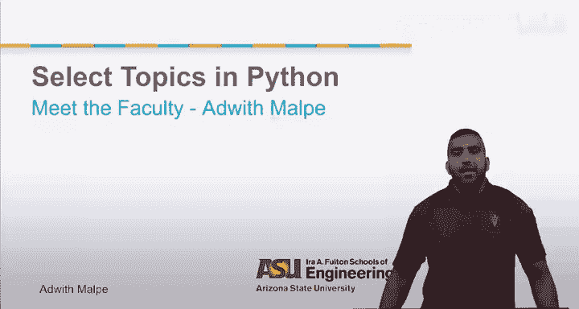

This lesson is going to be the Meet the F introductiontro video to Add with Mpe。

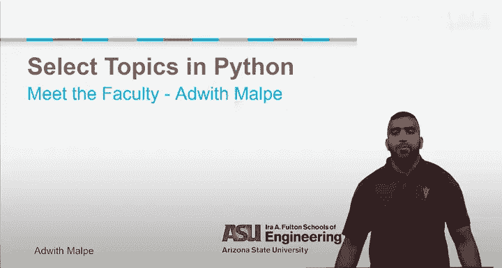

Welcome。So before we jump into any of the lessons， you might want to know a little bit about your faculty or the instructors you're working with so in this lesson I'll be introducing who I am my name is Add Mpe。

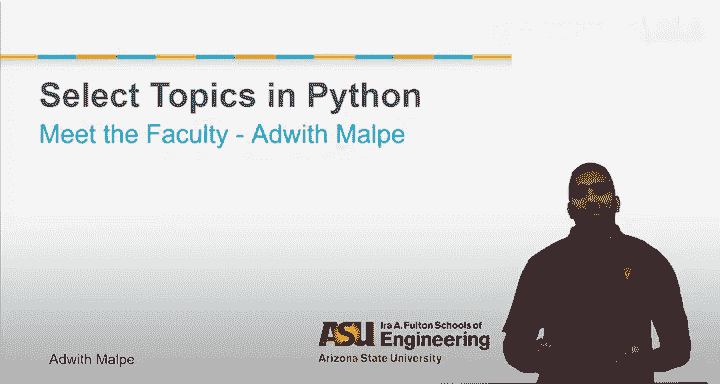

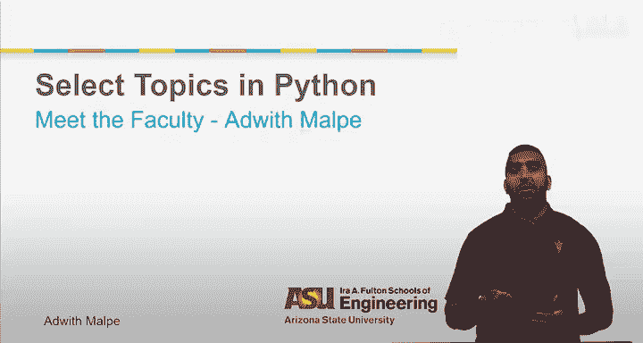

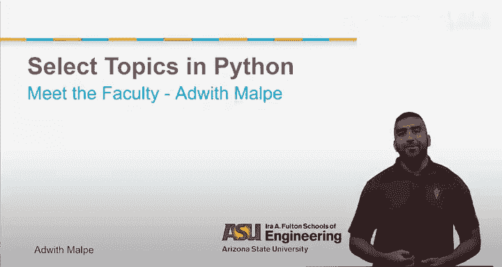

So。My name is Ad， I went to Arizona State University。

 I completed my bachelor's in engineering in computer systems engineering or in， I want to say 2020。

 and then I also completed my master's in Comp engineering December of 2021。

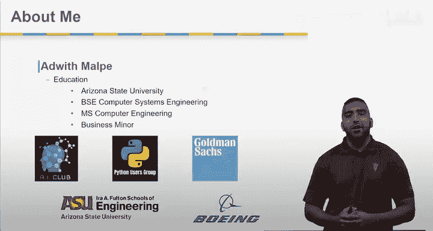

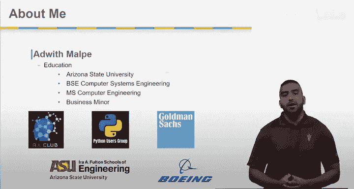

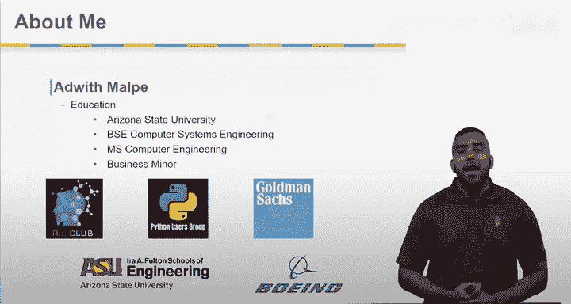

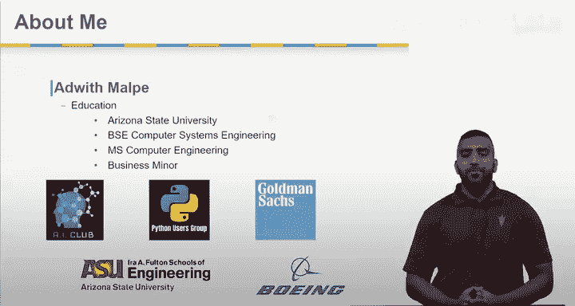

When I was in school I was really passionate about Python， I used it。

 I was one of the most important skill sets that I for programming languages that I utilized everywhere。

 I was a part of many student organizations including their artificial intelligence club。

 Python users group where I got to make many connections learn from professionals in the industry and kind of understand how important Python is in today's community and understand and work in workshops where I could enhance my Python programming skill sets。

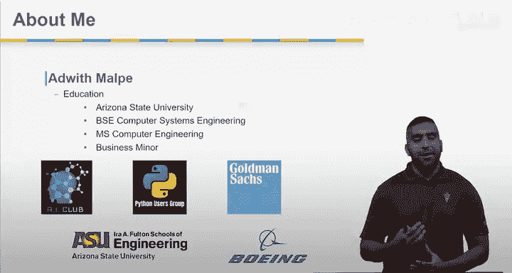

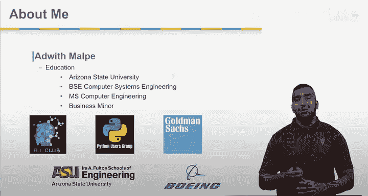

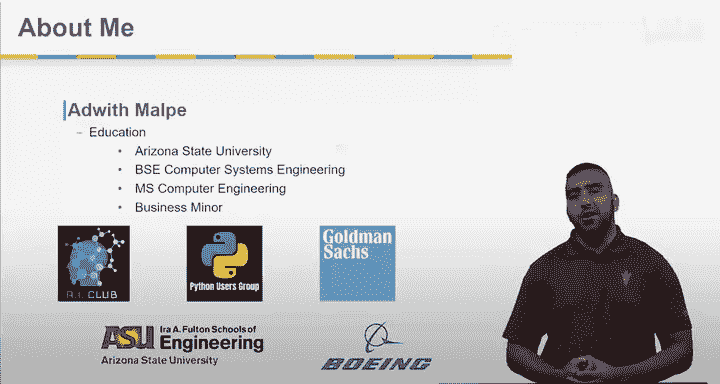

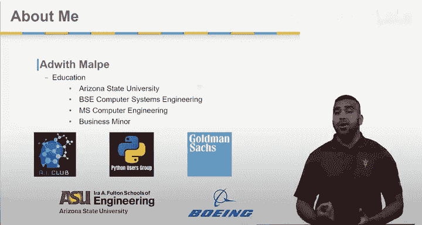

I also worked as a graduate TA and an undergraduate TA during my time in university where I got to teach students and teach them how to code。

 teach them basic software engineering skills， and much more。

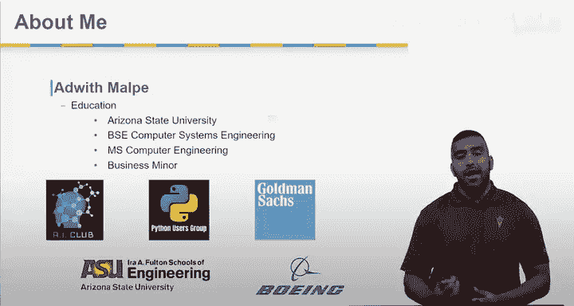

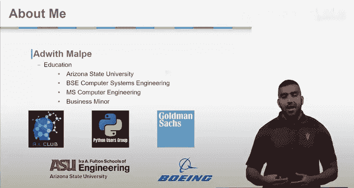

I also had the opportunity to work at Goldman Sachs as a data analyst。

 I learned a lot about how to manipulate data and Python was such a strong skill set that helped me so much during my internship and also working at Boeing as a software engineer。

 Python really can be utilized everywhere so I do have a good amount of industry experience and just overall love my time during university so very excited to work with you。

 I hope you'll learn a lot throughout these next four courses and I just want to emphasize that these skill sets。

 these tools that you're going to be learning about how to code in Python it's going to help you out so much in the future so I'm very excited to work with you。

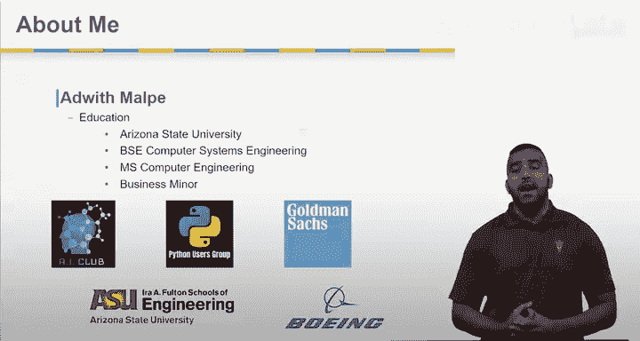

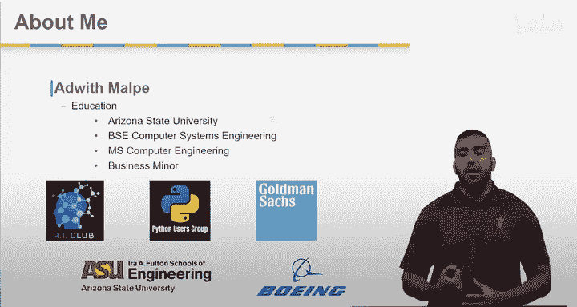

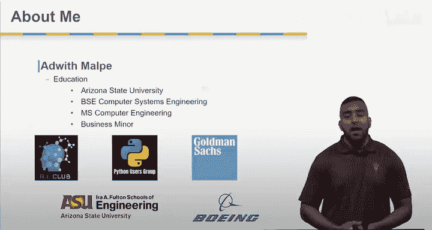

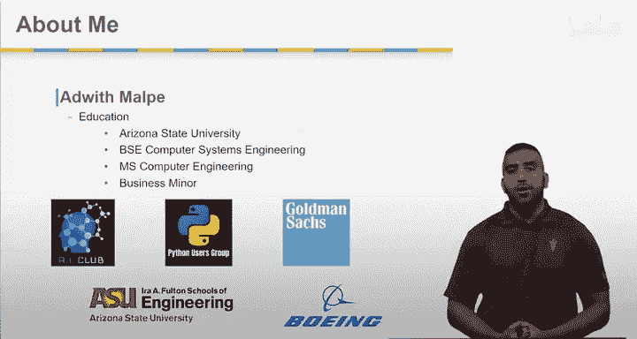

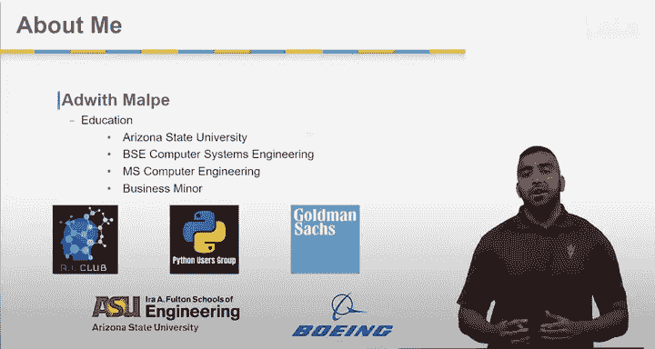

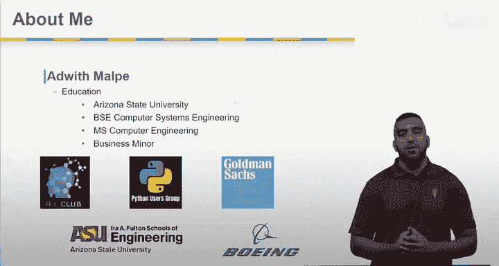

Thanks。