# 亚利桑那州立大学《Python： A Guided Journey from Introduction to Application》中英字幕 - P43：4_Python继承机制配置.zh_en - GPT中英字幕课程资源 - BV1J38GzbETT

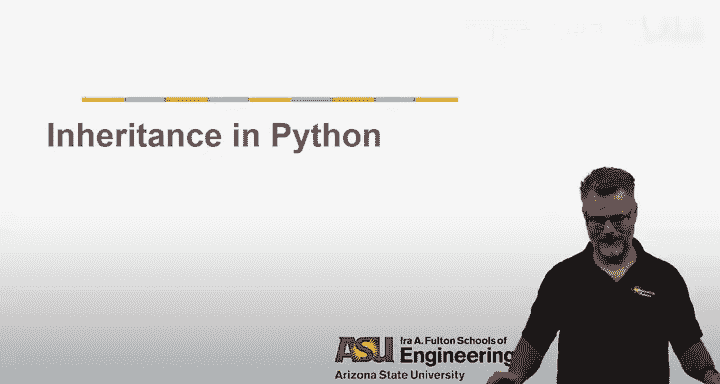

Welcome to Python Inheritance。Today， what we want to do is we want to talk about inheritance。

 what inheritance is， and then how it relates to Python。

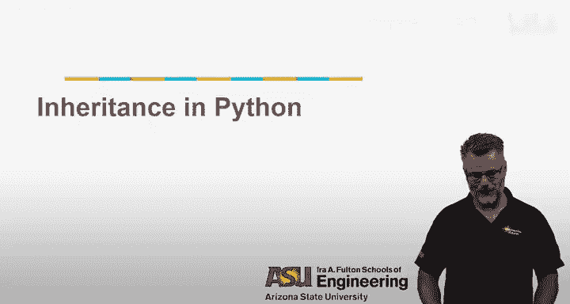

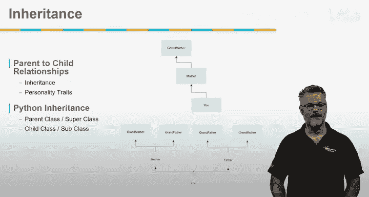

So the first thing I want to do is kind of just step back away from programming and kind of just talk about inheritance。

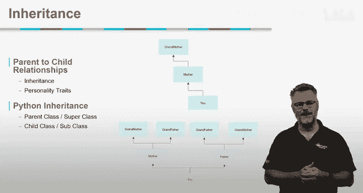

Now。As a child， I have my parent and my parent has their parent or my grandparent。

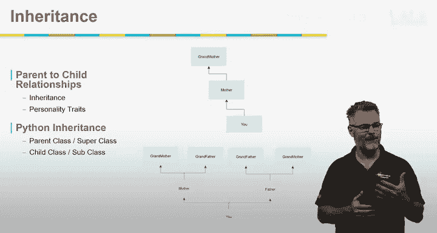

And one of the important things about inheritance is that when I bring up the topic inheritance。

 the first thing that everybody thinks of is money。

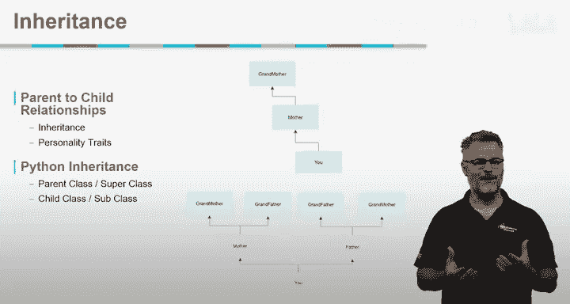

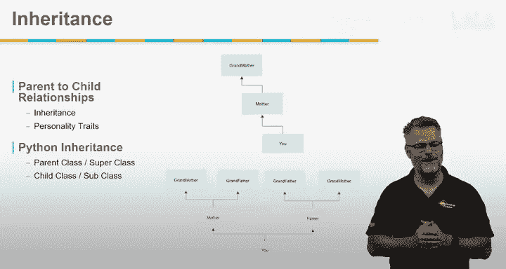

In this case， you know， it doesn't necessarily mean in money， but it could。

 it could also mean you inherit certain traits from your parents， there are certain attributes。

 you may have the same color eyes as your parents， you may have a smile that's similar to your mother's or you have hair like your grandmother or grandfather。

 so these are traits that are passed down from generation to generation to generation。

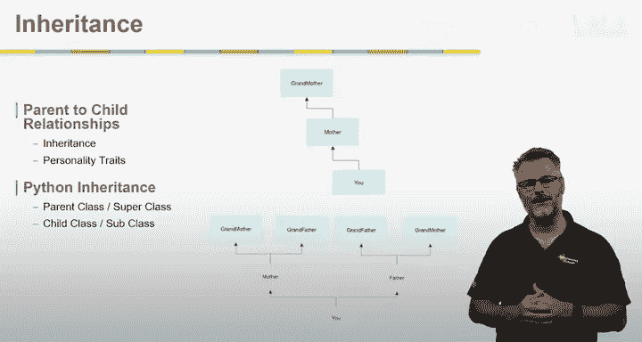

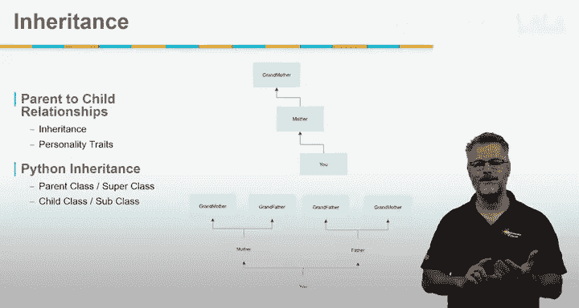

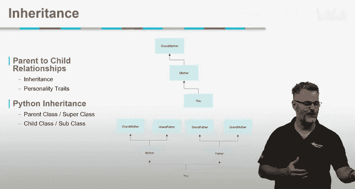

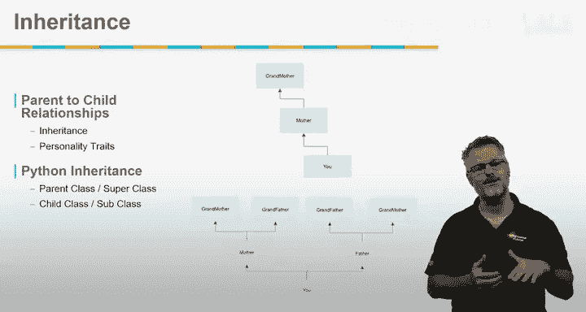

Now， one thing about generational passing down， if I have a trait， I can pass it to my child。

 but I cannot pass that up to my parent。

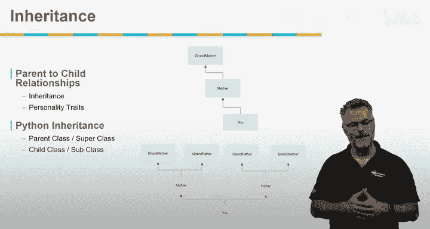

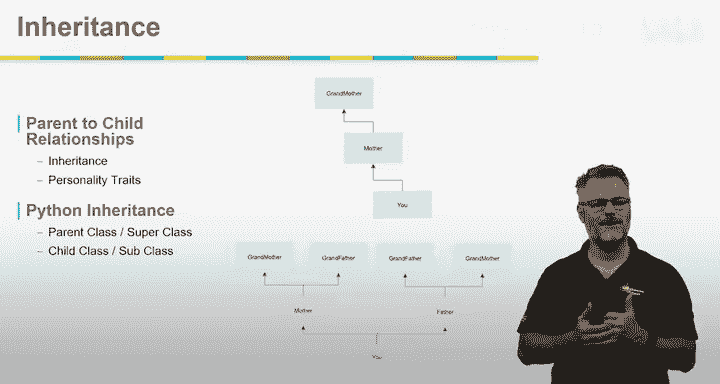

The same thing is true when we started looking at programming in Python。

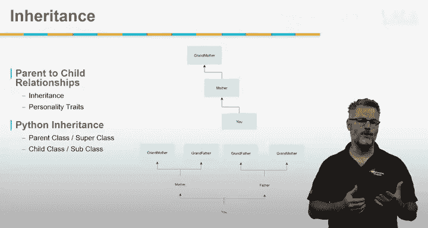

If you come from a programming background and you've used C+ plus Java， C sharpp。

 or any other languages。

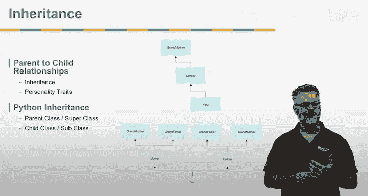

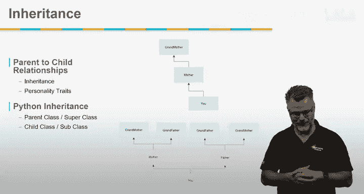

You'd know that inheritance is a very common thing that you use。

 especially with object ority programming。

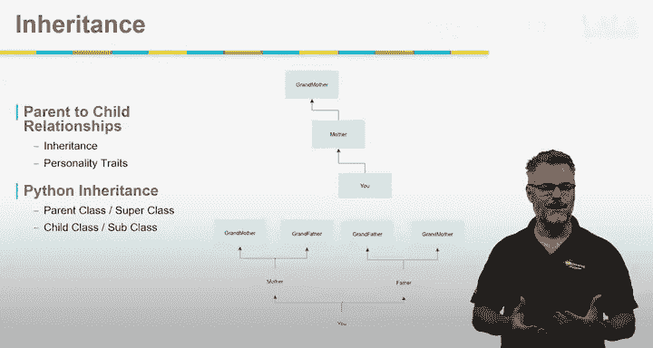

But。There is only a single relationship when we talk about that relationship。

 meaning that I only have one parent that I can pass up to or one grandparent。

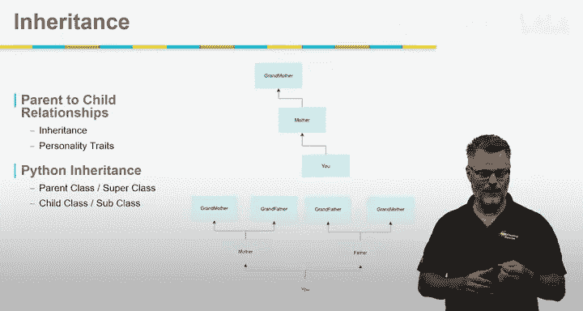

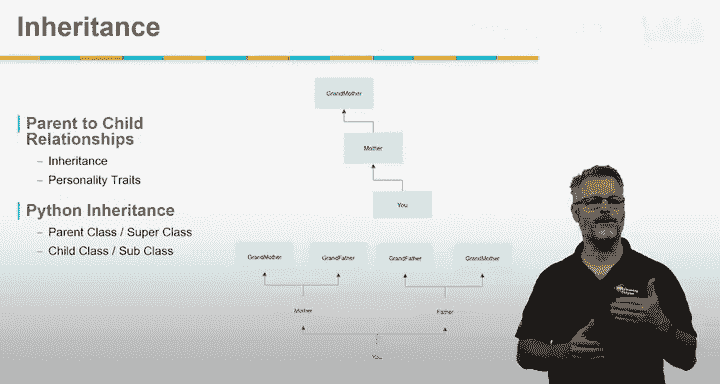

Python is very unique in this aspect that it allows for the language to have multiple inheritance。

 I can have a mother or a father that I can pass traits。

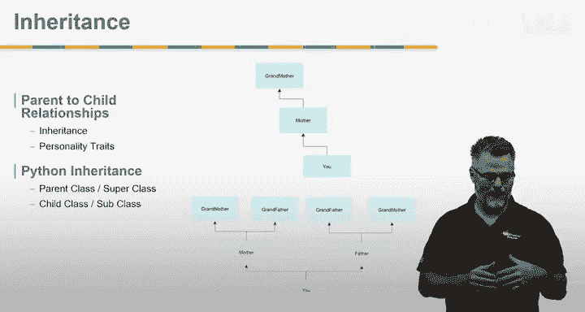

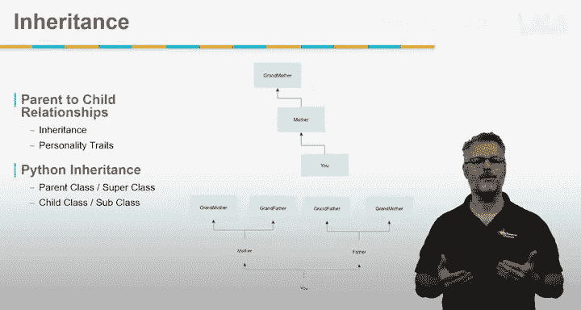

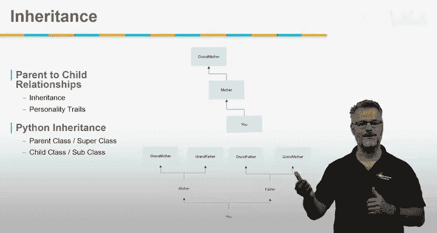

That they pass the traits down to me， or I can get traits from my grandfather on my dad's side or traits from my grandmother on my mother's side。

 And those are passed down to me。😔。

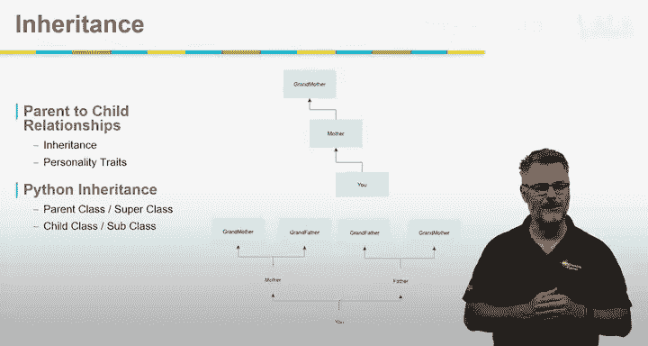

When we talk about the relationships within Python。

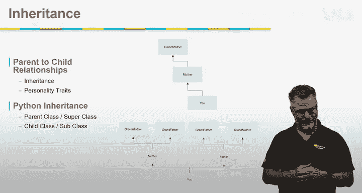

We use two common terms。

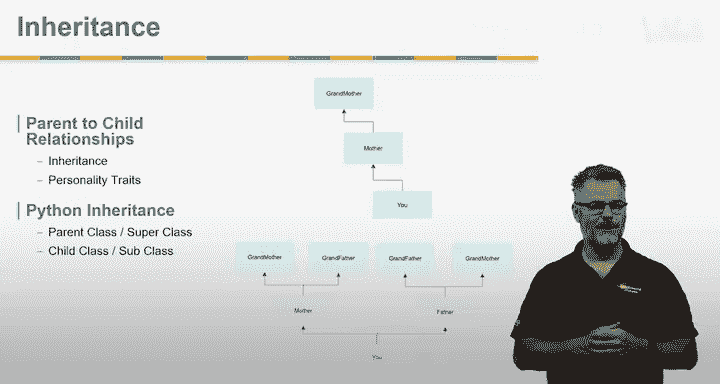

The first one is the parent class， the parent class is。The parent。

 the main or the highest level of class in this case。

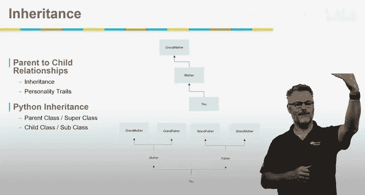

Our parent class would be。

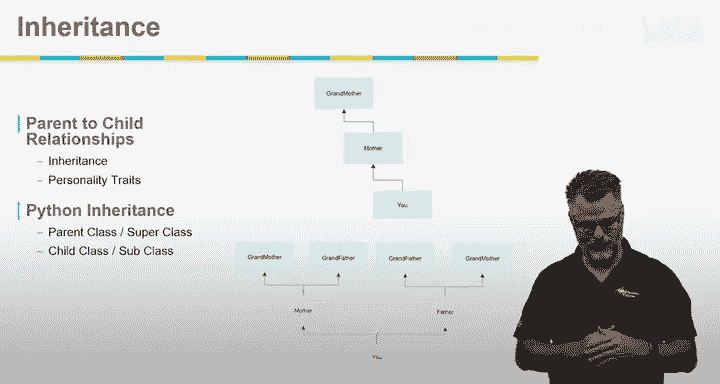

I'm looking at this one here it says you。

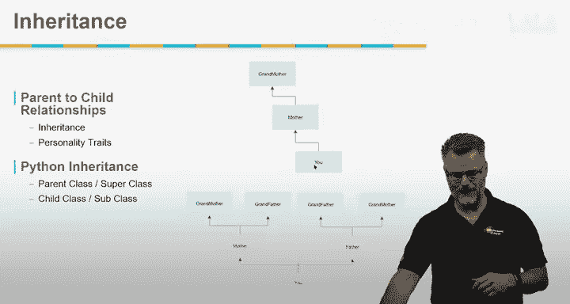

Would be my mother。My mother's parent class would be。

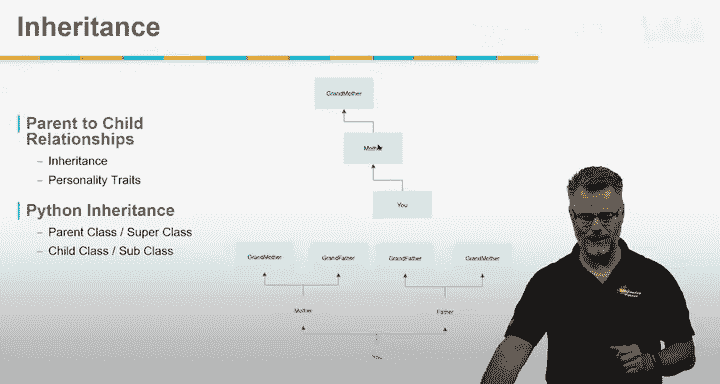

Grandmother。But because I am a child of my mother， I still have access to the methods or the attributes that are part of my grandmother。

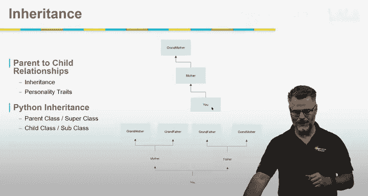

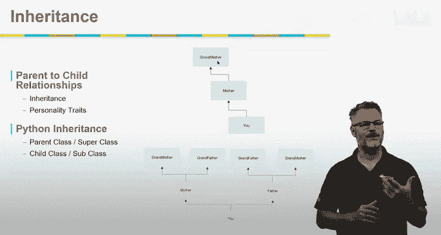

This is also known as the Superclass。

The child class or the subclass。

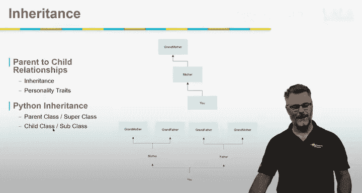

Is the one that's at the below the parent class in this case。

 the child of my grandmother is my mother， the child of my mother is me。

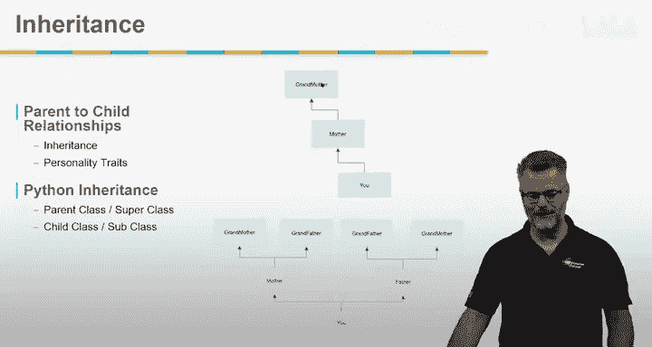

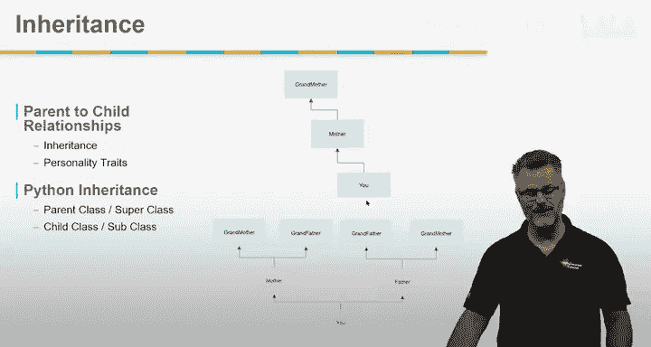

And the same is true when we look at multiple inheritance。

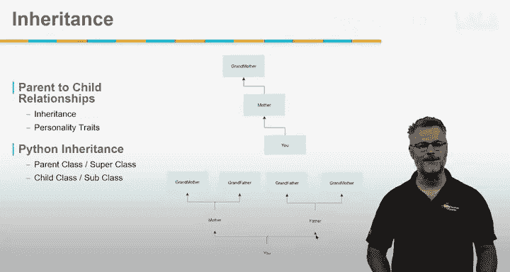

So as I mentioned earlier， there are two types of inheritances that are built into Python。

 there's the single and we'll use the super to call our parent class。Or there's the multiple。

 in this case we'll use method resolution order to kindu。

Organize what we call those different objects。啱嗯。Now when we're using method order or MOR。

 basically it always looks left to right， meaning or if you've built it in a hierarchy from top to bottom。

 it always looks at the highest level and works down。

One of the things that I find most useful when I'm using multiple inheritances and try not to do it very often。

 but if you use it， youd make sure you're doing explicit calling within that method。

And let's take a look at the code and we can kind of talk about each case。The first case。

 as I said before， which is the single， I've got my grandmother。And notice here。

 after I say class grandmother， there is no parents after grandmother。

 That means that's the highest level for this class。If I come down below， I have a class mother。

 notice I have parentheses and now this is saying that this is a mother is a child of grandmother。

Come down here to me or you。You is a child of mother and of course， incite each one of these。

 I have a class defined。 I have a constructor where I'm passing in the grandmother's name。

 and then I'm。Creating that object of G name。I've done the same thing for mother him name。

And here I'm using super。 so in this case， I'm going to call the method for mother。

 I'm going to go and assign my mother's name。Then I'm going to call the super。

 which means I'm going to go up to my parents class， in this case， my grandmother。

And then I'm going to go ahead and pass in the gene name， which was passed into my mother。

And assign that value there。If I come all the way down to where it says class U。

 notice here that I am doing name， mother's name， and then grandmother's name。

I go ahead and do self dot name equals name， I'm calling my super。

 my super is going to automatically go to my parent class， in this case my parent class is my mother。

And then here I'm going to go ahead and pass those values of mother's name and grandmother's name。

And to curl that object。I created by D Y1 equals U， I've got Bob is my name。

 Tina is my mother's name， and then Sam or Samantha would be my grandmother's name。

This is a single inheritance method。Now let's look at a multi。

Inheritance here I have my mother and her parents， so like before。

 my mother's grandmother is at the highest level。My mother's grandfather is also at its highest level。

But then I come down to my mother， my mother is a child of both my mother's grandmother and my mother's grandfather。

Then I come down to my dad's side。My dad's grandmother is at its highest level。

 same thing with my dad's grandfather。Then my father is the son of。

Like dad's grandmother and my dad's grandfather。And then of course， there is view。

You are the child of your mother and you are also the child of your father。And in this case。

 what I'm doing is I'm passing in the parameters for each one of those values。In my constructor。

 I'm doing a name， mother's name， mother's grandmother's name， mother's grandfather's name。

Dad's name， dad's grandfather's name， and then my dad's grandmother's name。

Now here I'm instead of doing， like we did up here with the word super。

 I am using explicitly mother dot。And now I'm calling the constructor inside of my mother's class。

And I'm passing in mother's name， mother's grandmother's name and grandfather。

 So now I'm going to go up here to my mother。I'm in the constructor。Notice here explicitly again。

 now I'm calling my mother's grandmother。Passing that value into its constructor。At the same time。

 I'm calling my mother's grandfather constructor， and I'm passing that value in at the same time。

And that's really all there is to dealing with inheritance。

What I'd like to do is go ahead and take a minute and go into an example for you。

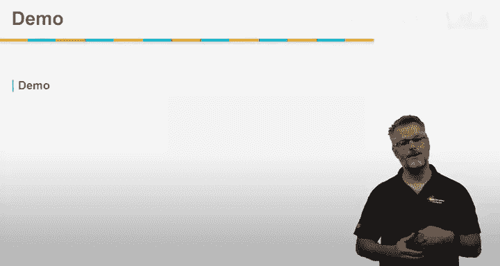