# 亚利桑那州立大学《Python： A Guided Journey from Introduction to Application》中英字幕 - P47：8_使用Tkinter构建图形界面（第一部分）.zh_en - GPT中英字幕课程资源 - BV1J38GzbETT

Welcome， everyone to Goos and Python， and GoIs is another term for graphical user interfaces within Python。

So what are we going to do in this module， we're going to talk about what GoUies are。

 how does it relate to poet Python？We're going to talk about the label function buttons， text boxes。

 layouts， frames， menus， event driven events， and then mouse clicks， list box， and then dialog box。

So let's go ahead and get started。

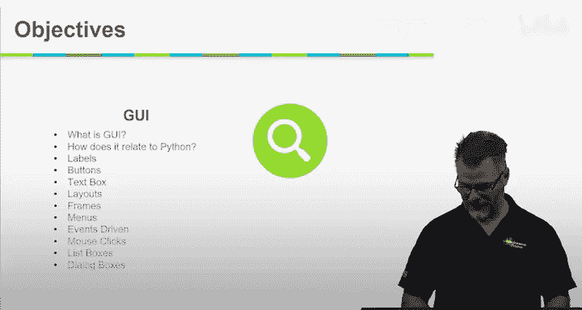

So what is a GoI Well Gooys are basically graphical user interfaces。

 and so what that it does is it allows the user to be more interactive with your program instead of a command prompt that we've done up to this point。

Now， up to this point， also I've been using more of the coLab as my programming utility。

 I'm going to switch that over to using more of an IDE process using something called Spider。

 you can use whatever IDE application that you would like for this。

 and the reason why is because if it's running more on your system。

 the graphical user interface pieces run more efficiently。

And so we're going to import the tool that's going to basically build our graphical user interface。

And so the widgets that we're going to look at today are objects。

We're going to look at the text label， the button， drop down menu， scroll bar。

 and we've got a bunch more that we're going to talk about as we go through the session。

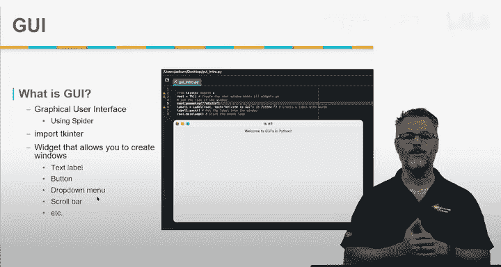

So let's go ahead and look at the code here and I'll kind of break down The first thing I'm going to do is I'm going to import my tool and notice I'm using the asterisk here。

 I'm basically importing all the libraries of the K kinker tool。 Then what I'm going to do is。

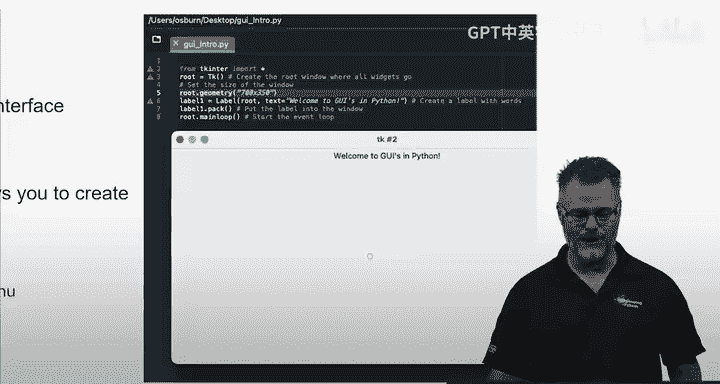

I'm going to build my frame window that it's going to be sit on and you can kind of think of it like a piece of pizza。

 you have the first layer， which is the dough， then you have your sauce and your different cheeses that you want to put on your pizza。

 This is the same thing it's true when you're talking about graphical user interface。

 The first thing you need to do is you build the lower layer and then you're going to start adding the different objects on top of it。

So the first thing I'm going to do is build。The dough， in this case， root equals T K。

 Thiss going to build my frame。 I'm going to specify the size of that frame。 In this case。

 I'm going to save 700 by 350 gives me this nice user interface。Then I'm going to create a label。

 that label， its first part root is going to be tied to。

 and then therefore I'm going to put the text Wele to GoUies and Python。

And then I'm going to assign that value to a label。

The next thing I need to do is take that label 1 dot pack。

 This part right here is what actually adds the element or the object to the frame。

Then I'm going to run my root into a main loop， and basically that keeps that running continuously until I hit the red X over here。

 or I manually go into the application itself and stop it。

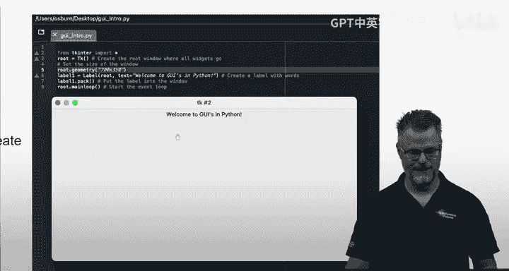

So let's take a look at labels first。

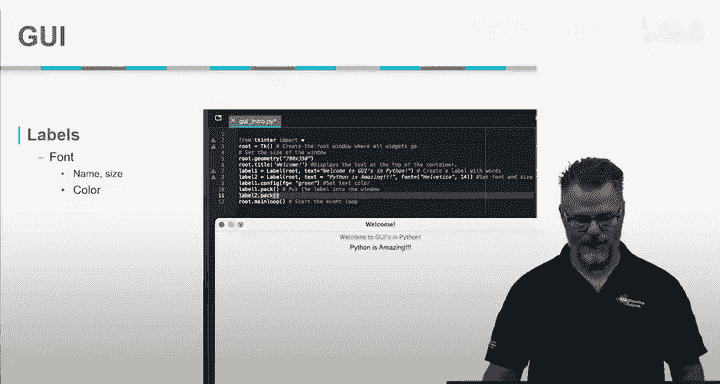

So what can we do with our labels， well we can do some modifications。As you see here， I've got。

The tininker。I've imported the asterisk， and then now I've created the frame。

Now I've set the geometric size， I said the welcome。I have the label from one。

 and then I have label 2。 La 2 says Python is amazing Here。 I went ahead within that same area。

 put the comma after my comet。 I'm adding my font and inside that font。😊，Helalvetica。

 and then I also set the size。I could also set the color if I wanted to by doing F G or foreground。

You can also do BG， which is for background to set a color for that as well。Just like I said before。

 based upon the order。If we looked at the pizza scenario， the dough， the first element。

 the second one， here I've got my frame。Now I've got my label。

1 dot pack that adds that first comment to there， then I've done my label 2 dot pack that I got Python is amazing。

So the order on which you add the dot pack is important on how things show up on your frame。

If we wanted to create buttons。What we're going to do is we're going to look at how to set the font。

 the name， the size， the position， color， some different actions。

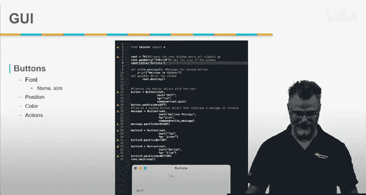

So the first thing I want to do is I'm going to write a message and say welcome the Python。

 and then I'm going to set quit。And then do root do destroy。

Route De destroy will actually allow the program to quit and exit the program。

So my first button button， I define the root whether it's going to be tied to。

 Then I'm going to put the text。I can do FG。 I set the color to red。

And then the command that I'm going to call is root doc quit。

 root doc quit is going to then come up here and look at the definition。That I have defined up here。

 and it to destroy。Second one， I have a button。Welcome message。Print pink。

And then it'll write a message to the screen。As soon as it does the right message。

 it can then come up here to the definition for the command and it says welcomelcome to Python。Now。

 one thing that I want to point to is I've do this in button dot pack。

 Now here I said side is equal to left。 if you look at my diagram here。

 notices it's on the left hand side。The next one。For the second button， I did side dot equals right。

And it's over here on the right hand side。I created two more buttons， button 3 and 4。

 and basically called one top。 and then one bottom and， as you can see。

 based upon the side is equal to top and side is equal to bottom。 They are placed accordingly。

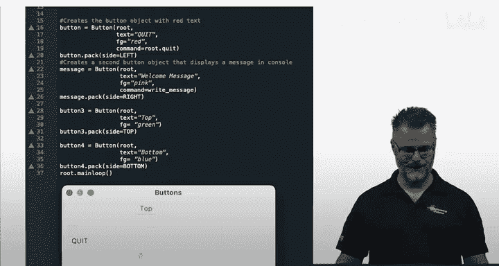

Next， one of the most important features of GoUIs is being able to have user input。

 so we've got text boxes。So here what I've done is I've created the box， I have insert text。

So I'm doing text field do get。 This is going to allow me to read from the text box。

And then in the second part of the insert text， I'm going to basically take that user input and put it into the other box。

 as you see in this example here。So I have to first declare a variable string so that way I can store it and pass it from each one of the methods。

Next thing I want to do is create my label into your name， then I create my text box。

 so my text field， I'm going to use the function or the widget called text。I have the root。

 Then what I want to do is I'm going to set my height width， and then my background is yellow。

 You can also set the foreground color。 but in this case， background color is perfect。

Then after I do that， then I'm going to set the row and columns。Now。

 using the textflow dot grid allows me to set。This would be zero。

 this would be one and notice how everything is lined up perfectly here in a column format。

I go down to my button。B one， I set the text update the width the 10。Red。

And then I went ahead and set insert text。Okay， then I went ahead and added that。Button 1， grid。

 row 2， column 2。 Not here。Row zero or row1。Wrote2。Coollumn 2。Then。I added my third text box。

I set the background to pink。Roow 3， column 2。That's how we got everything lined up there nicely。

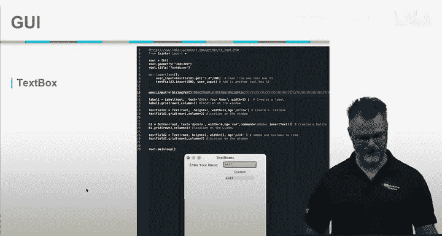

Next， talk about the different types of layouts that there are。So the first one is very simple。

 We can just use the pack and basically what the pack does without any parameters is that it allows it to just fill in。

From the center point of your GuUI interface， and it puts it straight down the line。

If we want to fill the。Element， we could use the fill equals x。For our pack， and notice here。

 now instead of it just given us just the one little small segment。

 now it fills the entire gooey interface。Or what we may want to do is we may say fill X。

 and then we're going to pad X by 15， and what that does is it gives us shrinks it down on both sides。

 gives us a little padding on the left and right side of 15 spaces。The other one is fill X pad Y。

 notice now we've got the gap in between each one of those elements。And then last。We can do fill X。

 pad Y。 And now if I do side equals left， notice it puts it on the left hand side。

I can also do pad Y left hand side here again。Puts it right next to the element that I just put in prior。

And then the last one here， label three， I put it on the right and therefore it showed up on the right hand side。

Framees are something that is kind of important in the aspect that if you want to make things look nice and organized。

 you can kind of think of these as different frames。

This would be considered kind of one frame on this side。

This could be considered in another frame here in the middle。

 you've got another frame over on the right hand side。

 and then down here you have one down at the bottom。So as we look at the different frames。

 I've got my left frame。Frame equals roots。My pack left side， our side equals left。

Same thing for my pack equals right，s equals top， and then side equals bottom。

 very similar to what we just saw in the last example。So。Once I've defined the different left frames。

 right frames， top frames and bottom frames， then what I could do is come down here。

 I've got my different buttons。Side equals left。Right， left， right。But notice here。

Instead of doing root。What I'm doing is my button top frame。

 it's defining which frame that I want it in。My bottom frame。Is my second button。

My button number three is on the right。 My button number four is on the left。And then。

There's also something called framed label。To where if you want something within a frame。

 we can do this， we can give it a name， and then anything inside that frame is going to be identified。

So I create the frame label。I call an attack， our con of fruit。Then for each one of these label 1，2。

 I went ahead and identified the different elements that I'm going to put in there here I did。

Frame label， apples。Frame label， oranges， frame label， bananas， frame labeled， strawberries。

 you need to make sure that you're identifying instead of root here that you're identifying the frame label that you want to use because you can have multiple frame labels。

Next， talk about menus。 Now menus， most people get a little confused about this because they think that they're going to show up right on the goI here。

 but in reality， when you create these menus， they actually show up at the very top。

 especially if you're on a Mac。

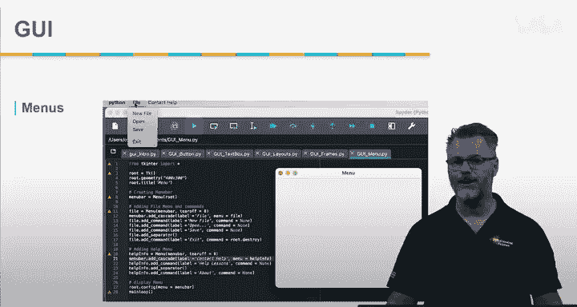

To create a menu is very simple by creating fileile equals menu， I have a menu bar。

And then from here， I can go ahead and create the different elements。So my minibar。 add Cascade。

 I'm going to give that the name file， as you can see up here。Okay。And then for each one of these。

 I'm going to go and do file dot new file， file dot add command， label equals open。

 file dot add command， save。 And then of course， I have a separator， which is that line right there。

Then I added the exit。I can also add a help menu bar by doing the same thing。

 again creating the object by using Help info equals menu。Then I can do menubar。add contact help。

And then each element that belongs to the help info。Images。

 who does not love having images within their goi interfaces。With images， basically。

 we can use the teainker only supports Giff。PGMs， PBms and JPex。

 you need to make sure that you are using that one of those。

 if you're going to be using this specific library to utilize for graphics。

 so we went in and created the root。 Now， one thing to keep in mind up to this point。

 we've been doing root equals Tk and brackets here we need to make sure that we're using root equals top level。

Then we can specify the title。And then we have our photo image。 Now， if your own。

 your photo image is in the same folder as your Python script。

 you do not have to give it the complete address of location of where that file is located。

 In my case， I had it on my desktop。 So therefore， I had to specify the full path of that location of users。

 Osborne and desktop and then smile P And G。Otherwise， you would just use smileile。pNG。

Then I went ahead and used the simple， then I created a label for that。

 said my image is equal to my photo， and then I placed the photo inside as the label。

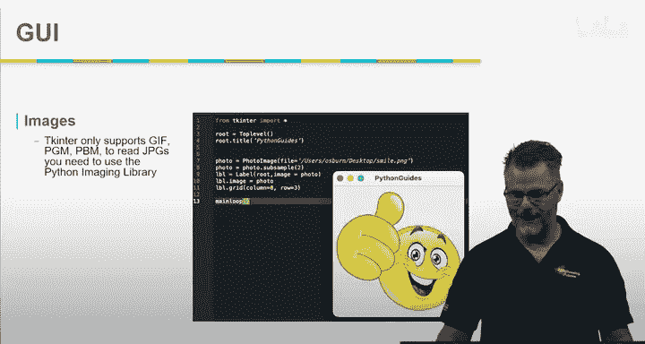

And they continuously ran that。When we get to some of the different things we may want to have the user do。

 a lot of times we have things that are called event driven。

And I have a couple of different definitions， a program that is paradigm where the flow of the output is driven by the sensor outputs or user actions。

Are defined as an event， and then there batch programming。

 which is where the paradigm where the flow of the event is determined completely by the programmer。

So up to this point， we've been programming everything in a batch programming style。

But now what we want to do is we want to give some control to the user by allowing them to do things like keyboard entry or utilizing mouse clicks to set off different events。

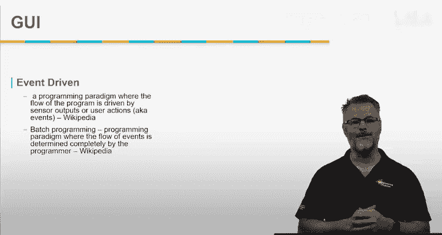

So as you can see here， I've gone ahead created mouse clicks and we've got events and we've got bindings。

 the binding is what kind of puts the program and the event together so that they knows what to do in a situation。

So the first thing I want to do is define if button is pressed。

And if I press it's going to give me the location， I'm going to do the event dot X and the event dot Y and give me that location。

I'm going to create that string and then I'll print that string out at the very bottom。

If a button is released， I want to know where it's being released， I specify the event。

Dot x and Y location。If my cursor is outside of the box or the gooeI interface。

 then it will tell me the mouse is outside。If it's within。The box itself。

 it'll tell me if it's in the areaea。I took a couple screen shots from here。 As you can see here。

 the mouses exited the window， meaning my cursor was no longer in that screen。 If I。

 in this event here， my mouse is in the in the window。

 If I were to have clicked in one of the locations。

Then it would give me the location of my X and Y location。

So how do we set this up to where it knows exactly what's going on？Again， root equals Tk。

I gave it mouse Vnce is my title， I set my frame， my height and way width。

And then I created a variable。Then I went my variable do set。

 mouse Even status will be displayed here， which is what you see down below here when you first launched the program。

Then。I have go ahead and set my label， and then I set it at the very bottom。

Here is where it's going to start looking for the different events。

So button one is basically the button luckmost button。There's a button two。

 if I were to use button dash two， that would be the middle button。

 and then button dash three would be a right hand button。

And then the function is pressed is what's going to come when it sees that the button is down。

When the button is released， meaning button 1， then it's going to go up to the definition of button released。

If it's entered， meaning my cursor goes into it。I'm going to go to En window。If it exits。

 then the put's going to show the mouses exited the window。Sometimes we may want to make a list box。

And simply being able to select the mode to be able to either select one option， as you see here。

 or you can do select multiple to select multiple items。We can also use the list box do get。

And we'll put in an integer value， and that will go in and give me that value。And then also。

 this box cursor select， and we can identify what is currently being selected。 In this case。

 tires is being selected， so it would actually return。0，1，2 as my value。

 then I would use that inside of here to display that value of tires。

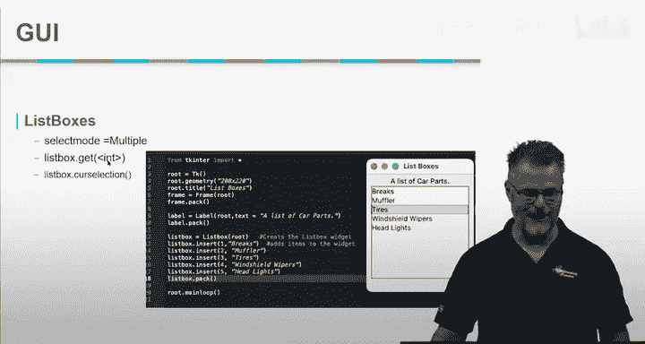

As we look inside here， again， this is all very similar to what we've already covered。

 we've put a label on here。I've created the list box。I'm using my root。

Then all I need to do to add elements to that is do list box dot insert。1 breaks。

 And you can also do list dot delete to remove one as well。So here we've added brakes。

 mufflers tires， windshield wipers and headlights， and then we added it to the frame and then this is continuously running that app。

 then we have dial boxes， dialo boxes are kind of a way that we can use to help the user identify when there's a problem。

嗯。If they put in an incorrect value， we want them to maybe reenter a new value if we so the program's going to close。

 we want to make sure that they have some kind of identification of why it closed。

So in this case here， I went ahead and display the different types， there's show info， show error。

 show warning， ask a question。Asking okay， cancel。Ask yes or no， or ask， retry or cancel。

So as you can see here， when you run this， each one of these elements say it says， are you sure。

 I can say， okay or cancel。And you see that's the OA cancel。Please call support。

This is the show info。This is a warning， show warning。Do you want to continue yes or no。

 this was the ask yes or no question。Then we also have。Do you want to proceed another yes or no。

 And then we have failed。 Do you want to try again， This is the retry or cancel。From here。

 what I'd like to do is step into the demo and I will see you there。

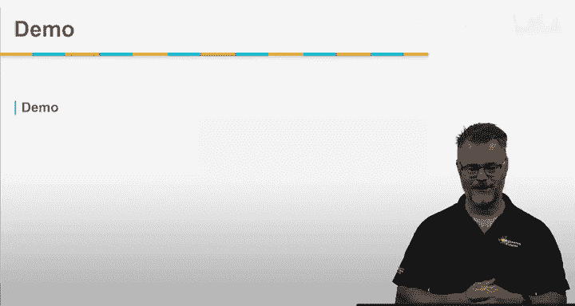