# 亚利桑那州立大学《Python： A Guided Journey from Introduction to Application》中英字幕 - P49：10_Python控件创建技术.zh_en - GPT中英字幕课程资源 - BV1J38GzbETT

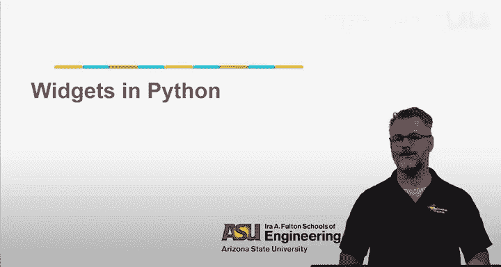

Welcome everyone， today we're going to talk about widgets in Python。And so what is a widget？

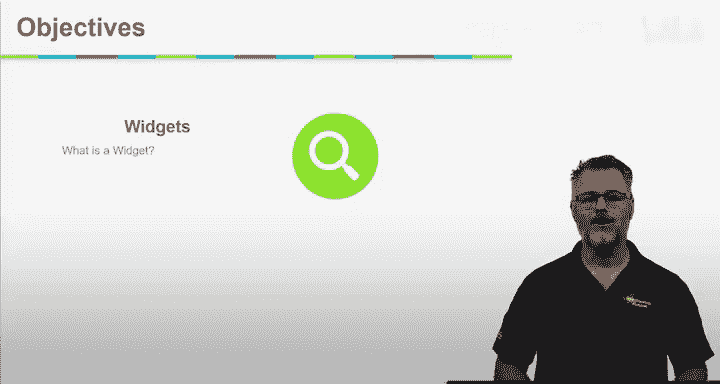

We're going to examine how we use them within Python structure。

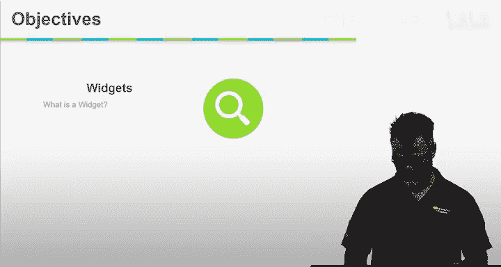

So。Exactly what are widgets and I've got a couple different diagrams here。

 and I've got some code we're going to go over because widgets are basically objects。

 and we've already looked at some of these objects we've been using throughout this course。

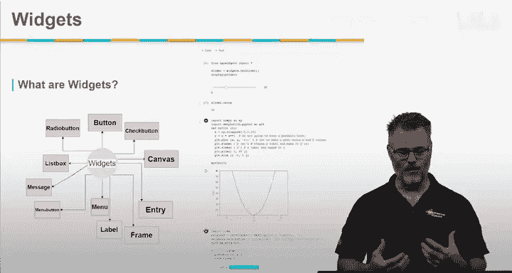

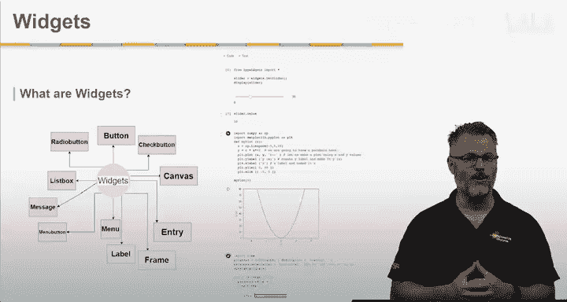

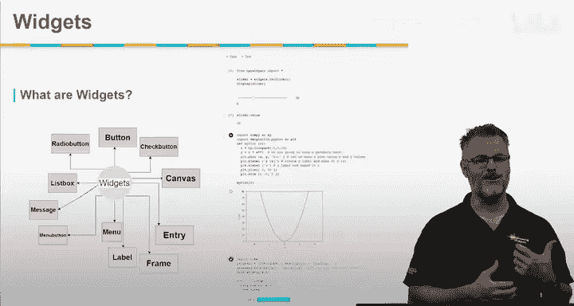

But we've never really identified them as an object， or I should say， as a widget。

 we've referred to them many times as an object。

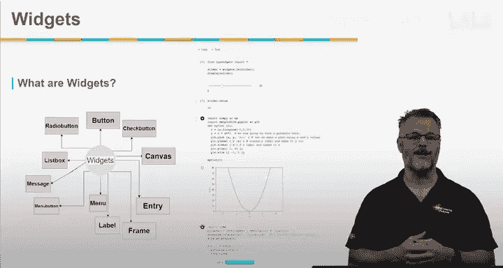

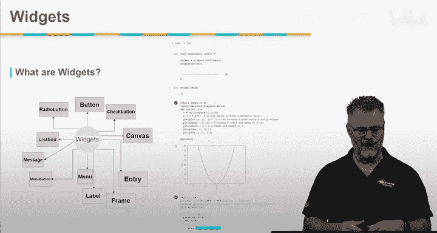

So here we've got things like radio buttons。We have buttons， checkboxes， canvas， list boxes。

 messages， menu button， we have some menu items， label frames。

 these are all different types of widgets that are built into a class。

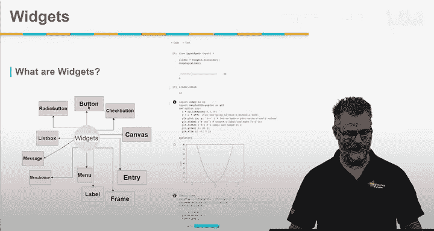

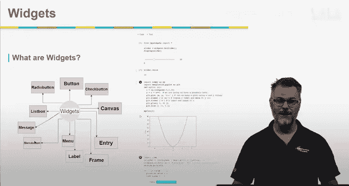

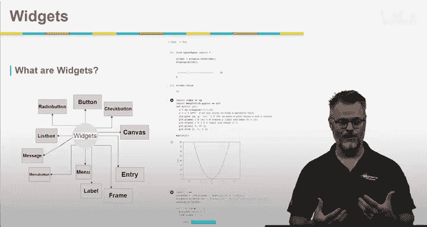

Another class that we're going to look at。

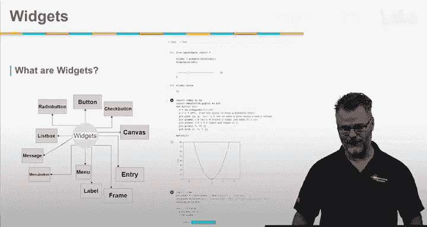

Bring it over here。

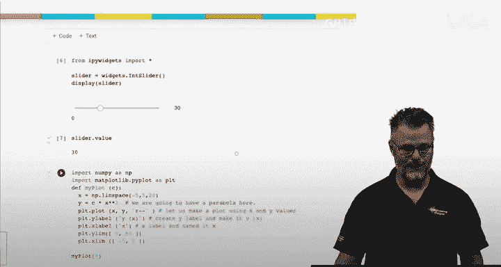

We've got IPY widgets。And in this example here， I've got a slider。

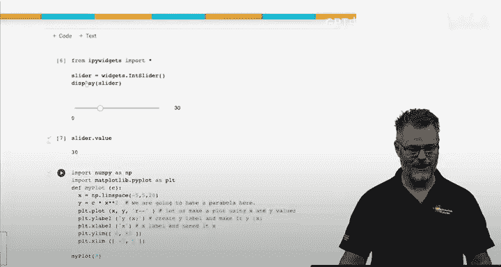

This slider is a widge。 It allows me to move this thing back and forth。

 And as I move it back and through forth， it changes the values of that slider。

 And I can use the slider dot value to receive that value。

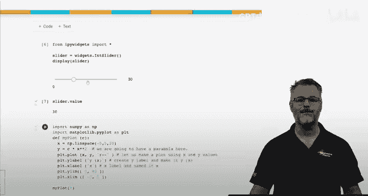

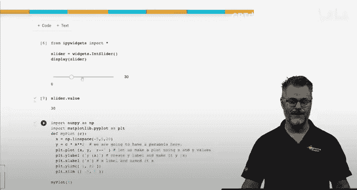

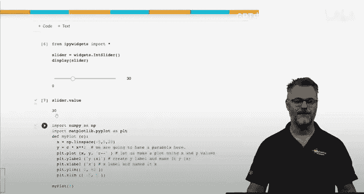

Here is another class that I would use， I imported nuy。

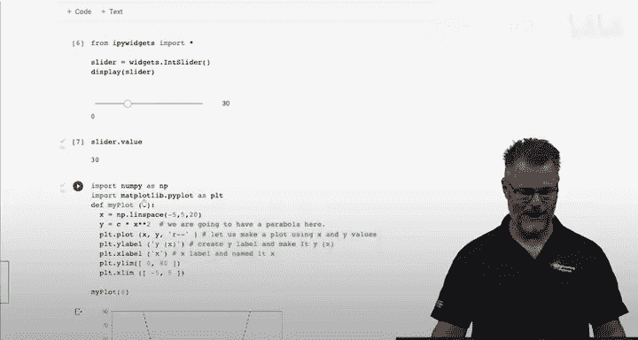

And I'm also using。Pie plot。

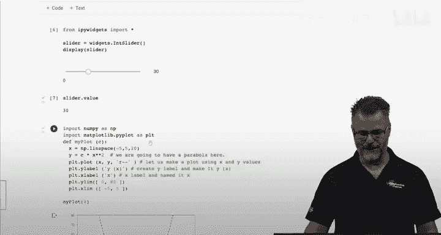

To from the math plot library to be able to display the data。

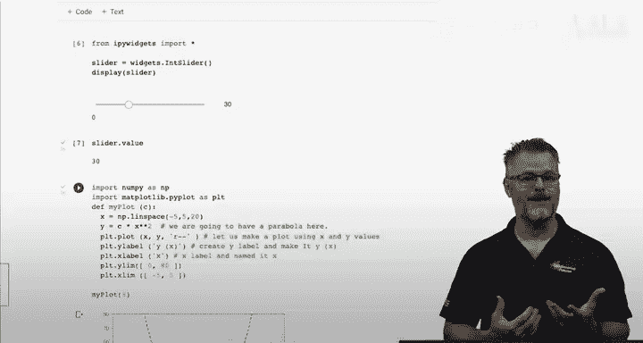

So as you can see， a lot of widgets are basically ways we can visually see or manipulate data。

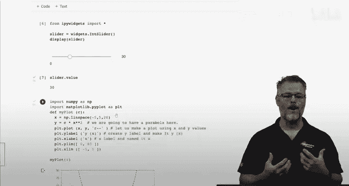

Here I was able to basically draw a graph。

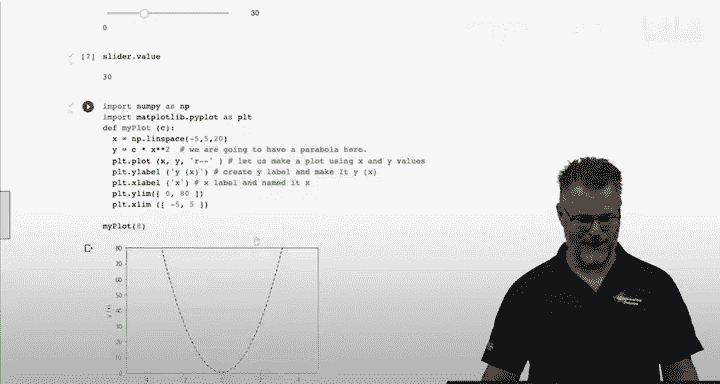

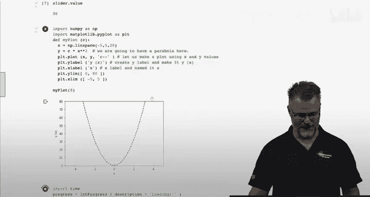

Another example is。I'm going to import time， time has its own widget that goes in progress。

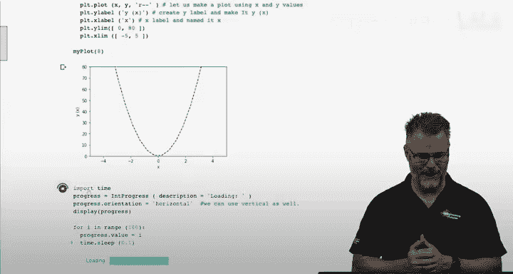

And as I do this， I can run it from a range from high to 100 certain0。

 and it starts loading this menu item here。

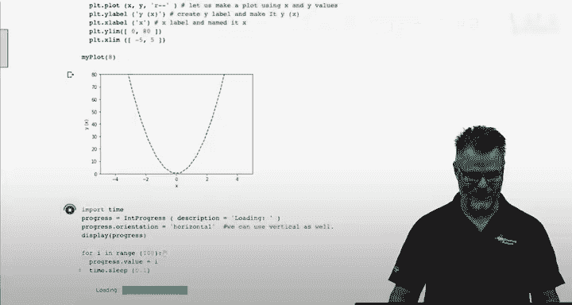

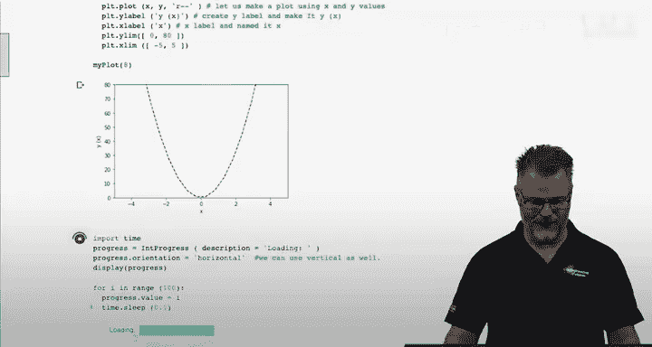

As it gets to the end， it go then stops。

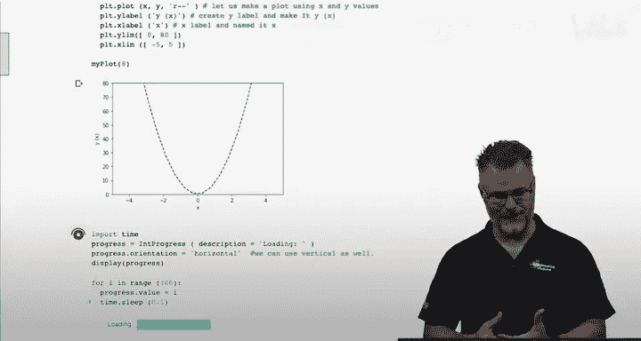

So coming back to what widgets are。

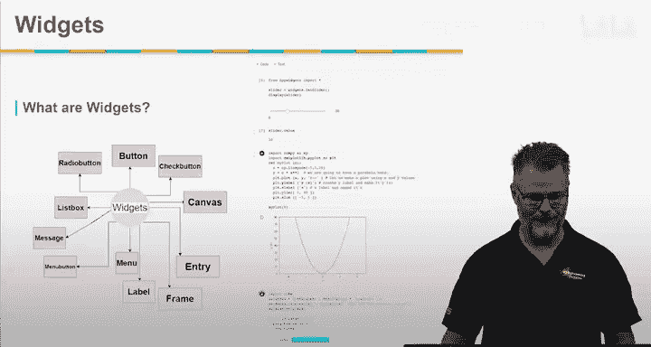

Basically， they are a graphical representation of data。

We use them throughout all of Python and GuUI interfaces let's go and take a look at the demo。

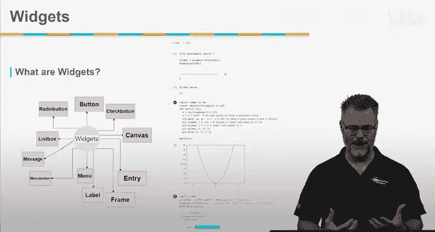