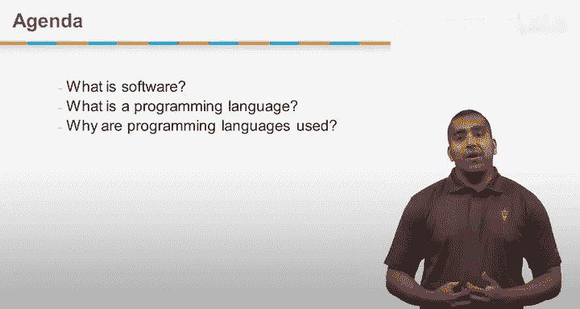
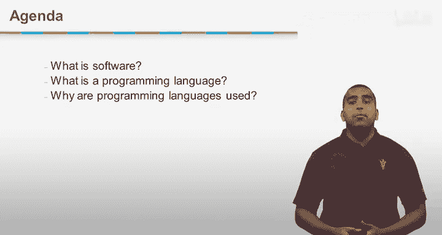
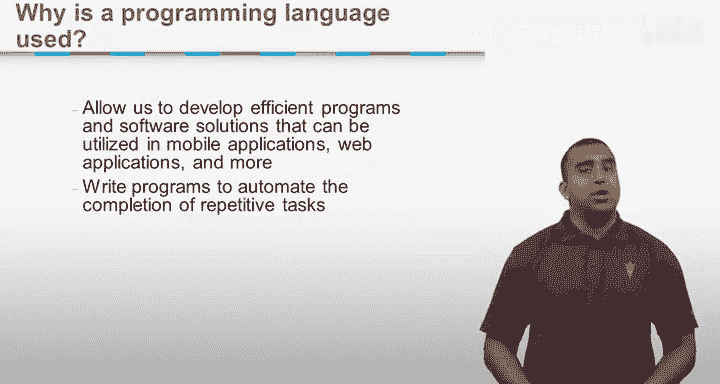
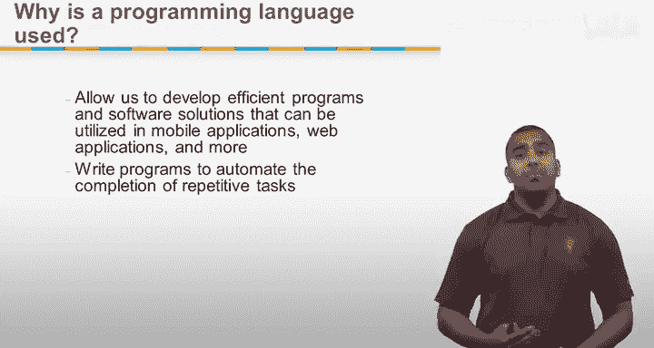
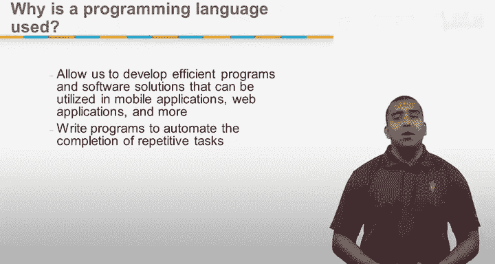
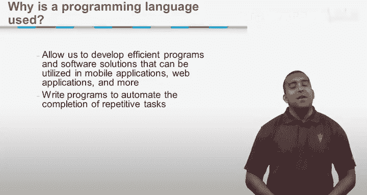

# 亚利桑那州立大学《Python： A Guided Journey from Introduction to Application》中英字幕 - P4：3_编程语言导论.zh_en - GPT中英字幕课程资源 - BV1J38GzbETT

Hi there。 welcome In this lesson， we're going to be covering an introduction to programming languages。

So what we're going to be covering is what is software， what is a programming language。

 and why are programming languages used today？

So what is the software？A software is a set of instructions that is utilized by a computer to execute specific。

Specific tasks。All functional components of a computer that does not refer to any physical component or material pertains to software。

So video games， computers， phones， smart devices， they all run on software。

And what is a programming language， Well， a programming language is a tool that is utilized to write instructions for computers to follow。

Programming languages help translate binary or ones and zeros into something that people understand。

Low level programming languages are closer to machine code， which is binary。

 and provide control over how the computer will function efficiently。

High level programming languages is where code is utilized so that with human understandable text that is then translated to machine code。

So why is a programming language used Well， programming languages allow us to develop efficient programs and software solutions that can be utilized in mobile applications。

 web applications， and much more。

They allow us to write programs to automate the completion of repetitive tasks。

Thank you for watching。

