# 亚利桑那州立大学《Python： A Guided Journey from Introduction to Application》中英字幕 - P50：11_界面控件功能演示.zh_en - GPT中英字幕课程资源 - BV1J38GzbETT

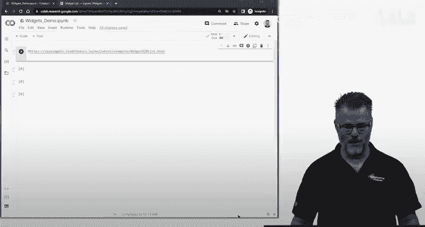

Welcome to widgets Timmo so the first thing I want to do is I want to go and go to this website that I'm kind of putting a note there are a lot of different widgets that are out there and this kind of gives you some ideas of what you can do with some of the different functionalities。

 the different sliders， float ranges。

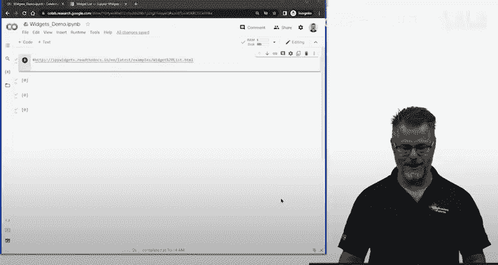

Tol bars。And so what I would like to do is I just grabbed a couple of these that I thought were kind of fun and entertaining。

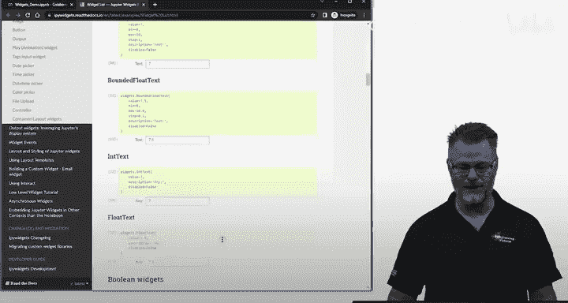

The first one that you're going to find that's really common。

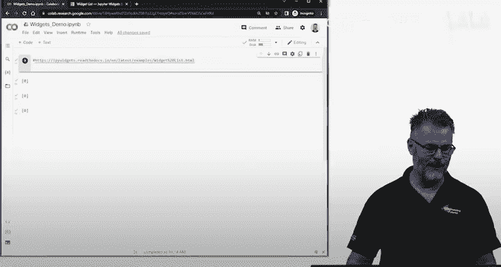

Is being able to utilize。

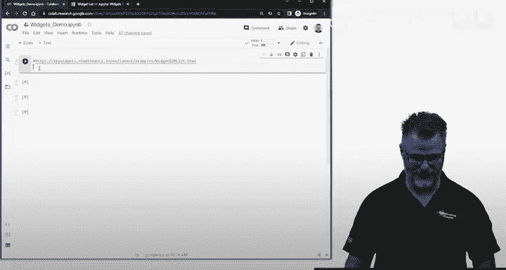

Being able to take in user password。So here， what I'm doing is I'm taking in my w widget。

t password and what that does is it allows me to run this。

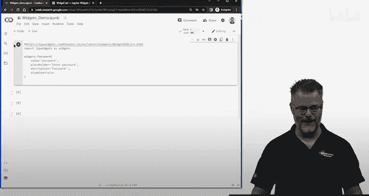

It gives me an area for passwords， so if I put in。

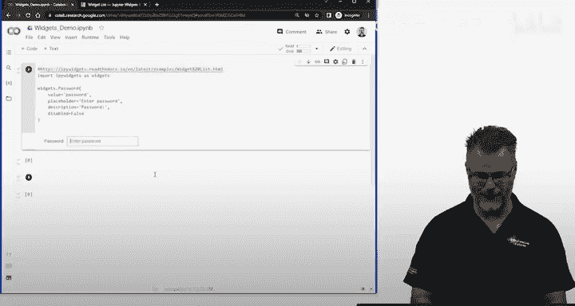

Bob knows how it puts the asterisks there for me automatically。

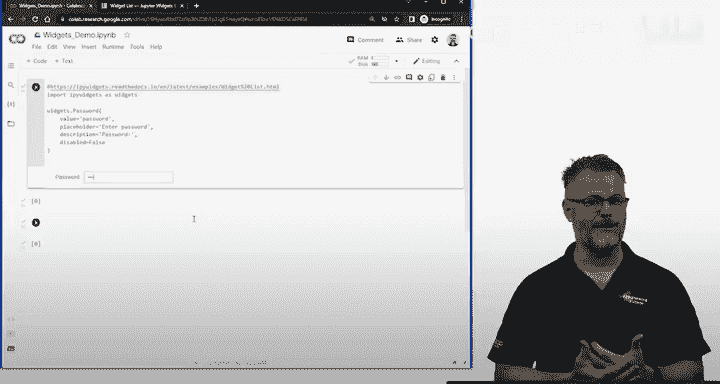

It's a really nice simple widget。

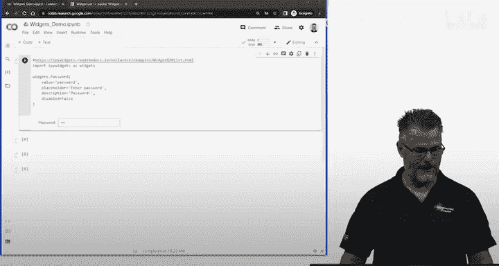

We have another widget。

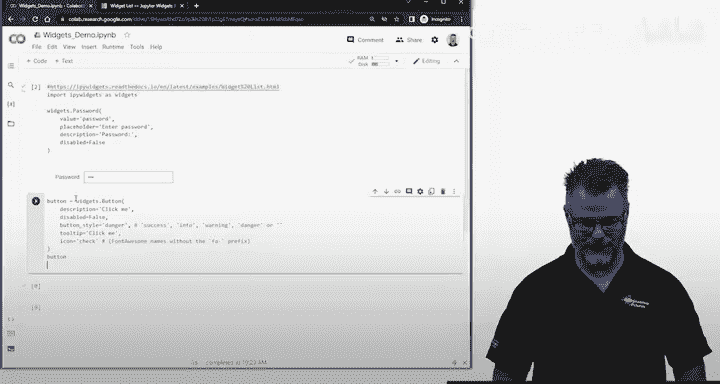

As far as buttons， if I go and run this， as you see here， it gives me a button says click me。

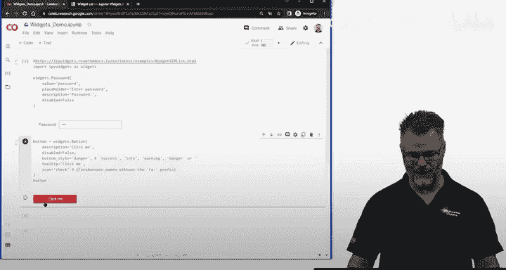

I can go ahead and change this from danger to success。

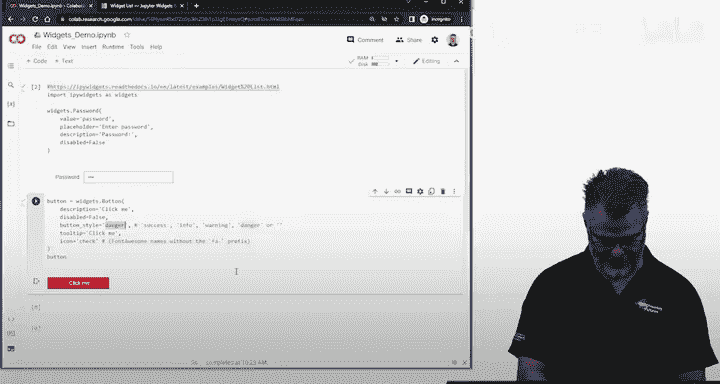

Go ahead and run it again and watch what happens。 It gives me a nice green button there。

 I can also change it from success to info。

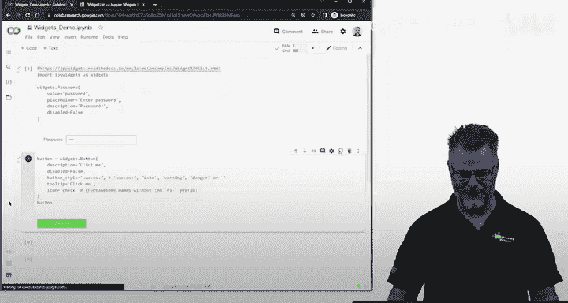

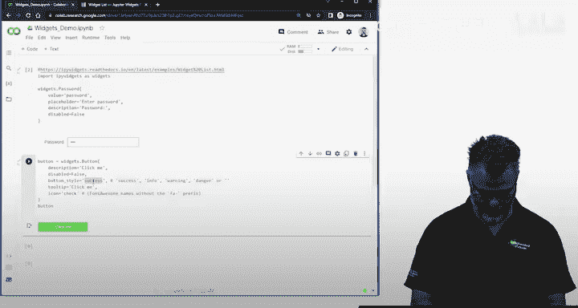

Gives me kind of a blue warning I can do。

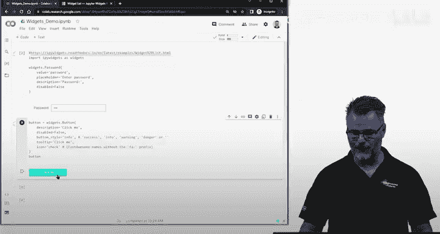

Morning。

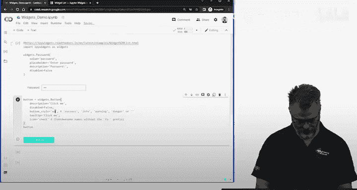

IGo ahead and run it， gives me kind of an orange， kind of a kind of interesting and nice little interaction button。

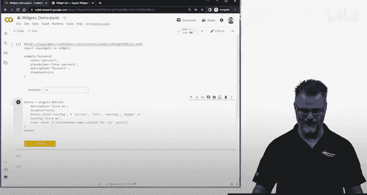

Another one that's always useful is having a color picker。

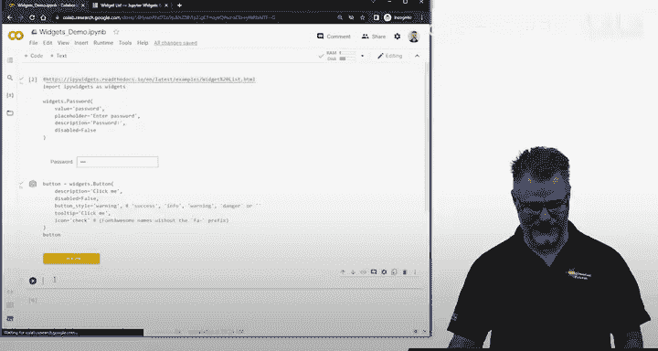

So that way users can identify or pick their own kind of colors that they would like to add。

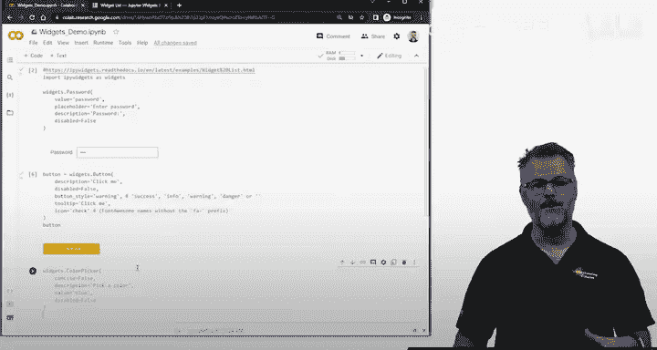

Go ahead and run this。Gives you a simple color picker it says blue。 If I open this up。

 I can now go in here， go green， click on it。

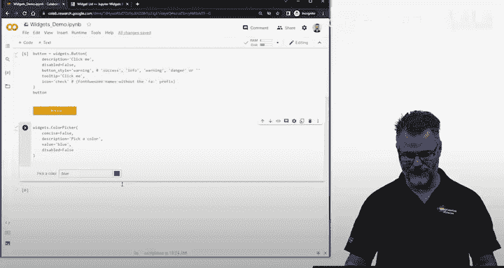

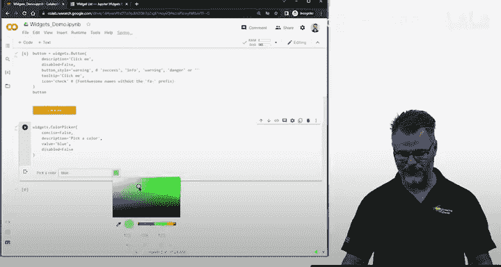

Psenter， and it gives me the hex value of that value。

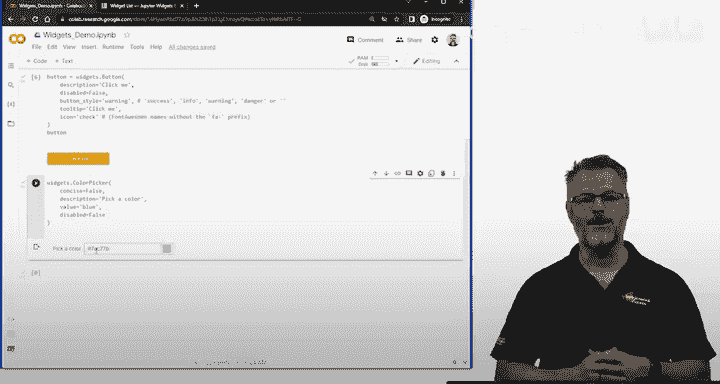

And then of course， the other one that you'll find useful。

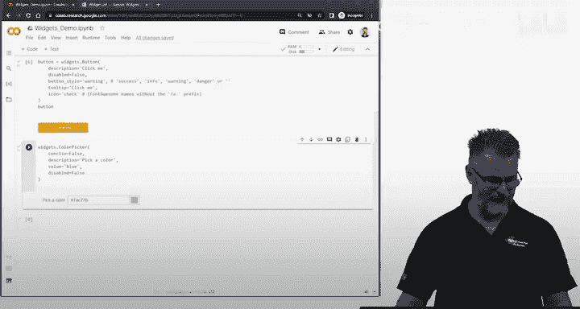

Is being able to have a slider。

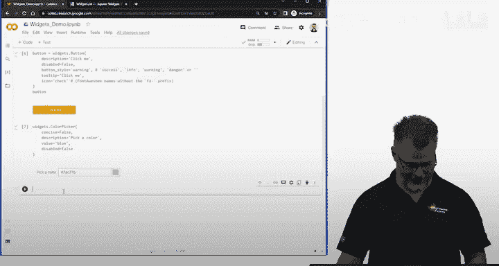

Here。Go ahead and run it。 I've got a slider on multiple ranges so I can select the high and the low values in this situation。

 If I wanted to， I could go ahead and do just a range slider and only get one value as it slides from 0 to whatever value I want to set。

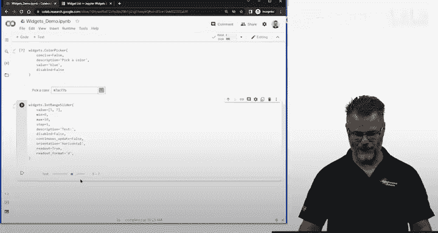

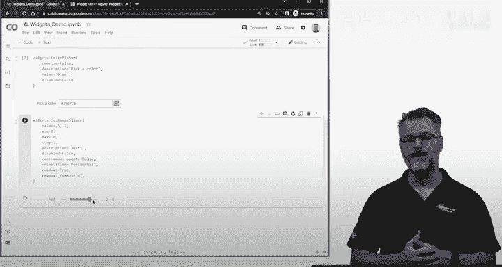

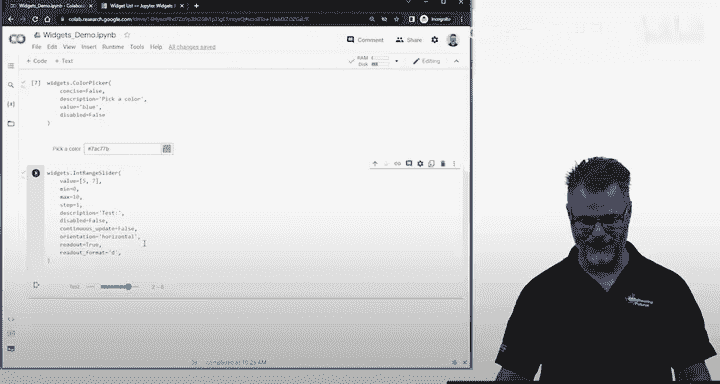

Hopefully this gives you some ideas of some simple widgets and how they are used。

 as I said in the lecture， they're basically used for graphical data output。

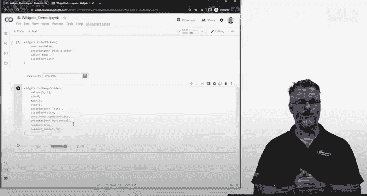

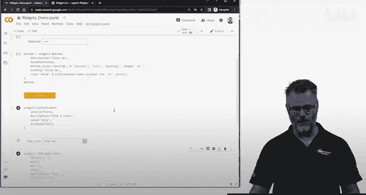

As you see here， we have data input from P for password。

 we have a click me button that displays different colors。

 we're able to pick different colors and get the hex values for those values。

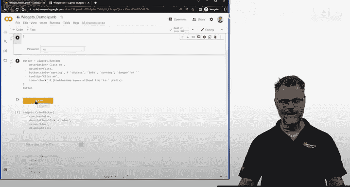

And then we have a widget that allows us to create a slider。

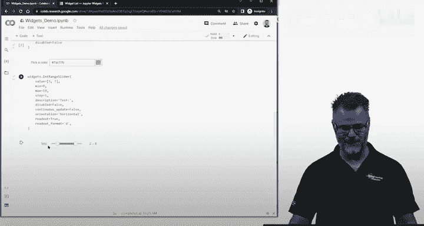

I look forward to seeing you guys in the next video。

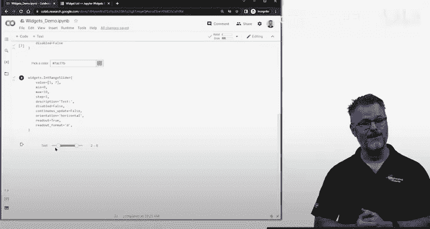