# 亚利桑那州立大学《Python： A Guided Journey from Introduction to Application》中英字幕 - P51：12_几何图形绘制方法.zh_en - GPT中英字幕课程资源 - BV1J38GzbETT

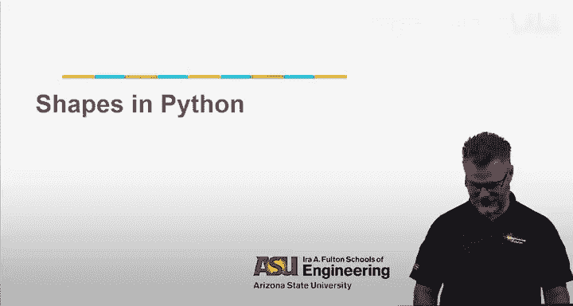

Welcome number one， today we're going to talk about shapes and how to draw shapes within Python。

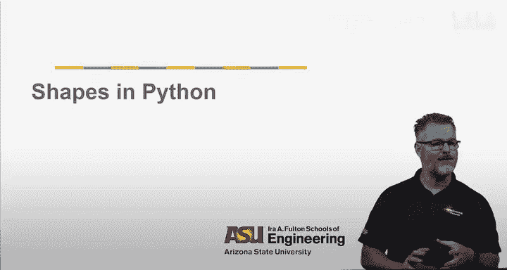

So to do that， we're going to take a look at how to create a simple line。

 we're going to create a square， we're going to create a circle。

 and then I had some fun and I created some advanced shaped as well。

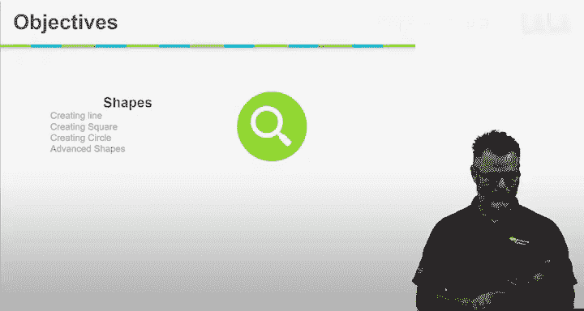

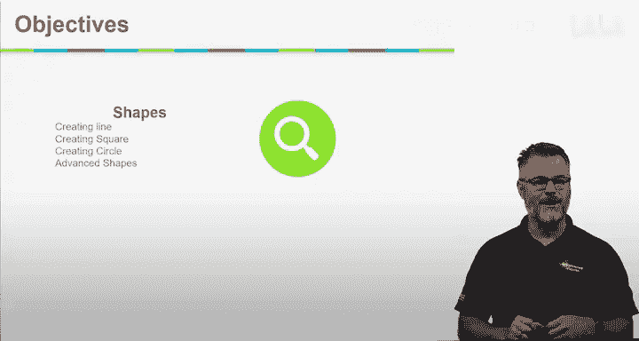

The first thing we're going to do is we're going to use a thing called turtle and turtle basically creates objects。

 and within that object， we're able to move that item either left， right up or down。

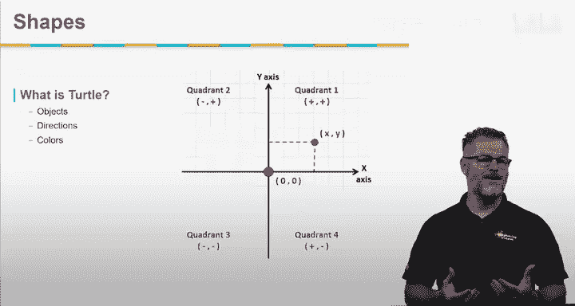

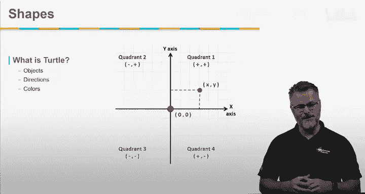

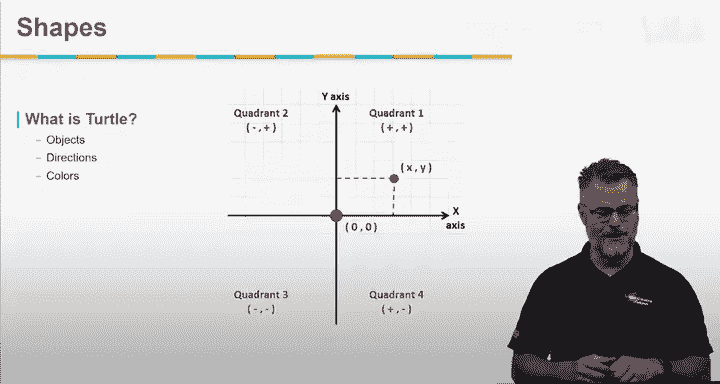

Or we can pick up our pencil it's kind of like when you're drawing， pick it up。

 move it to another location， and then put it down in that location and then continue drawing。

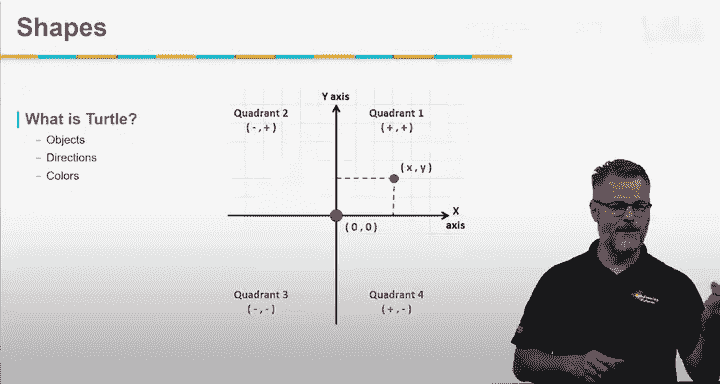

And then we can also manipulate colors with turtle， Trtle's been around for quite a while。

 and it is a part of the Python library。

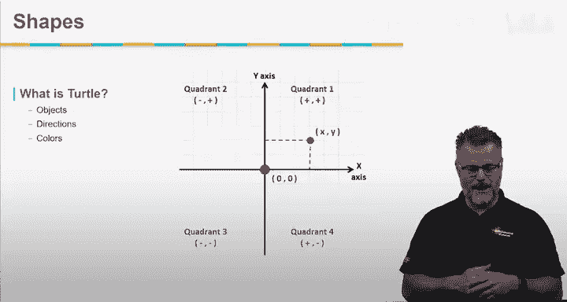

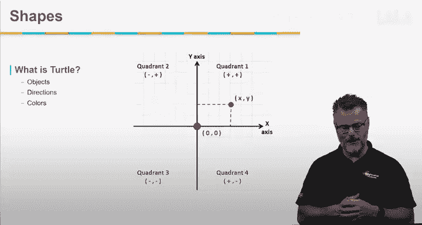

Now I can tell you that I've tried using it within the coab and it doesn't seem to work well within coLB。

 so again， this is something that you'd want to run on an IDE that you're running locally on your system。

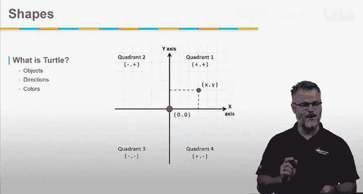

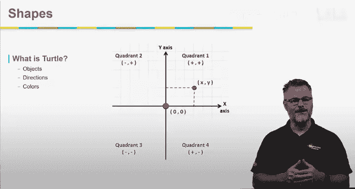

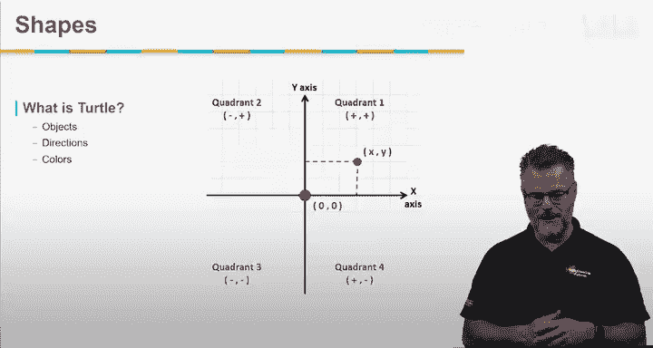

Now， the way it's broken out as its simple is， is that inside the window it's broken up into four quadrants。

The first quadrant being certain at 0，0， and anything positive positive will be in the top right hand side of the quadrant。

 If it is a negative x positive y， it will be in the left hand side。 Ne negative being quadrant 3。

 and then of course， a positive X and a negative y will put in quadrant 4。

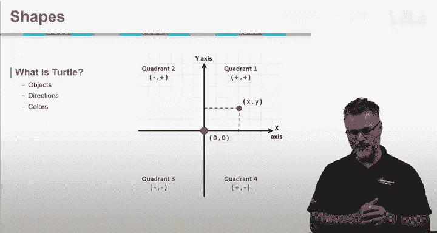

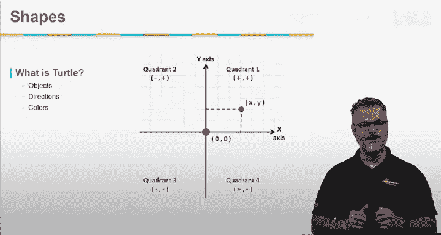

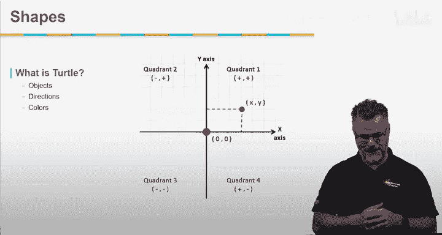

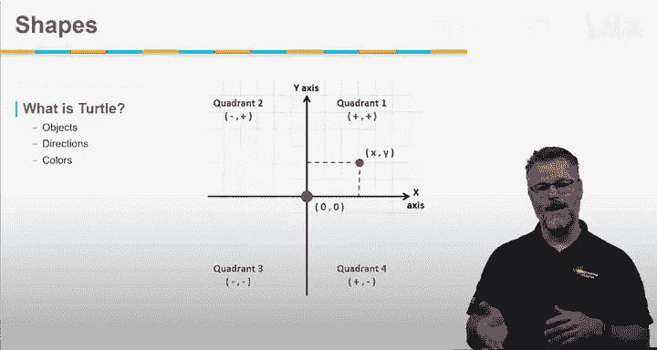

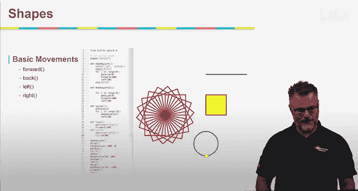

So some of the basic movements， like I said， we can move forward backward upright。

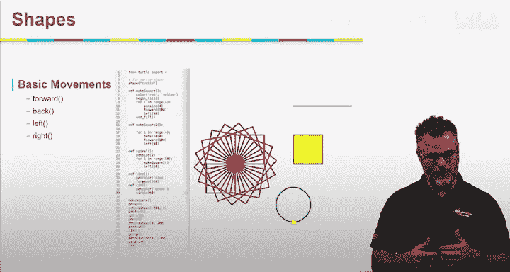

And what I want to do is I want to just take a look at some examples， as I said before。

 I'm going to show you how to draw a simple straight line。

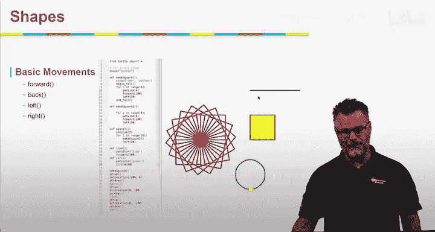

I created a square and I filled that square in with color。

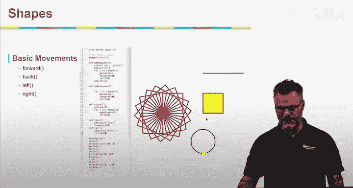

I also created a circle。

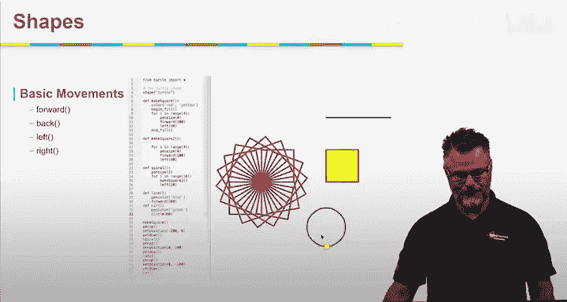

Now the shape here， notice I chose a shape of a turtle。

 you can modify and change the different shapes， you can change it to an arrow。

 there are some other different shapes if you would like， that are part of the library。

 I thought since's the application or the tool that we're going to be using it's called turtle。

 it would be cute to use the turtle to help draw these up。

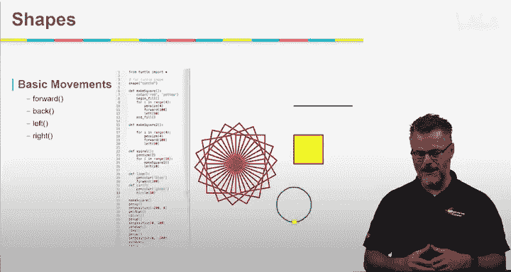

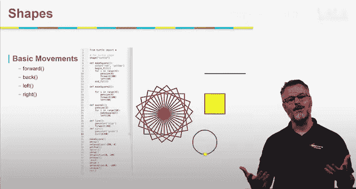

So let's take a look at each one of these real quick。The first one saysM square。This one right here。

 what I'm doing is that I'm going to use two different colors， I'm going to use red first。

 and then I'm going to come back and I'm going to use yellow。Now， to begin my fill。

 I'm going to basically set my pen size。To 4， I'm going to move forward by 100。

Then I'm going to turn 90 degrees， so anytime you make a left or right hand turn。

 basically you're change rotating in degrees。And so here I'm in a for loop。

 and I'm continuing this process over and over again。As you can see here， if I started right here。

 I move 100， I turn 90 degrees， move 100 again。Turn 90 degrees， move 100 again， turn 90 degrees。

And then when I get back here to the end of my last range。

I get to four now I've completed the square and then I end my fill by coloring this in yellow。

The second one is my make square tune here basically all I'm doing is I'm keeping my pen size at four。

I'm moving forward the same distance as I did here。And then I'm making my rotation turn left。

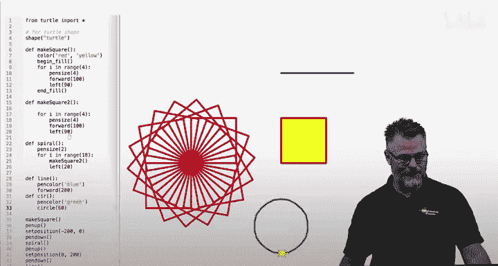

The difference is， is that in this situation here， what I did not do is I did not begin my fill or end my fill。

 so therefore I'm not coloring it in。

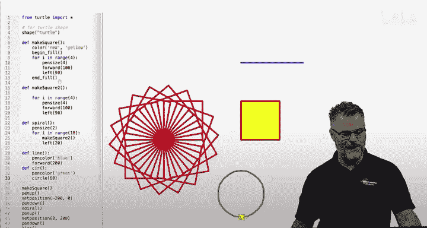

Now in my spiral， and this is how the spiral is built。I'm basically taking my pen size。

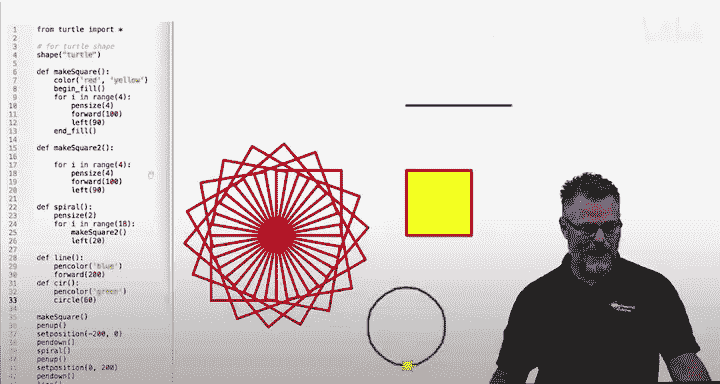

To2。And then from here， I'm just rotating this。Going move through and making 18 different squares。

And then rotating each square by 20 degrees， and that gives you this。Really cool element。Then。

To draw a line。I simply grabbed a location。And basically moved it forward by 200，200。

Then to do a circle， I change the color to green。

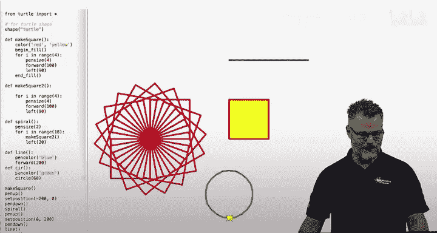

And then set my radius to 60。

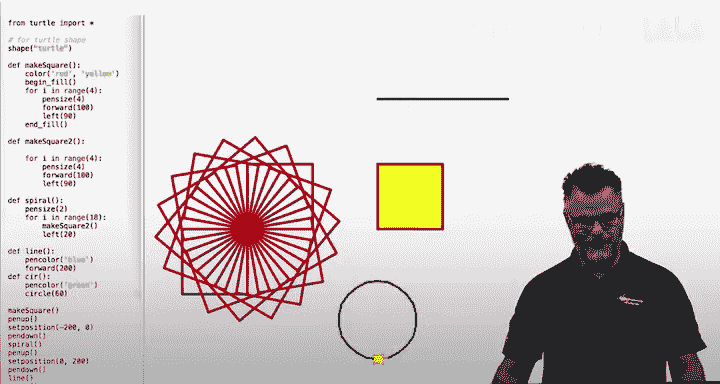

So when I get down here， my make square， I called about， made my square。Now， I did my pen up。

 Basically， what you're doing。 you can think of this is kind of like a piece of paper。

 I'm lifting my pen up off the paper。And then I'm going to move it to the location of minus 200 and0。

So if my zero0 is roughly right about here。Then I moved it to this location right at this point。

 And then I started to make my first spiral。Then I did my pen up again。 Then I moved it to 0，200。

 moved it back to center。And then I moved up。To 200。And so therefore。

 that's where you're getting the straight line。 Then I went ahead and moved it from the straight line down to my position of 0 and -200。

And then down here， as you can see， we've created our circle。As you can see。

 it's very simple to integrate and utilize。Turtle， hopefully he found this useful in being able to create some basic shapes。

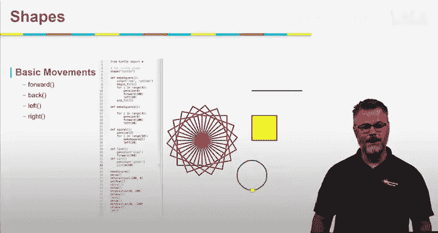

And I look forward to seeing you in the demo。

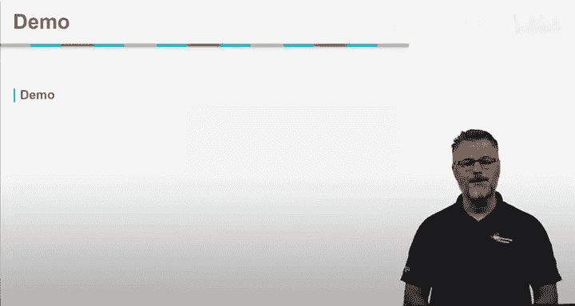