# 亚利桑那州立大学《Python： A Guided Journey from Introduction to Application》中英字幕 - P52：13_事件处理机制.zh_en - GPT中英字幕课程资源 - BV1J38GzbETT

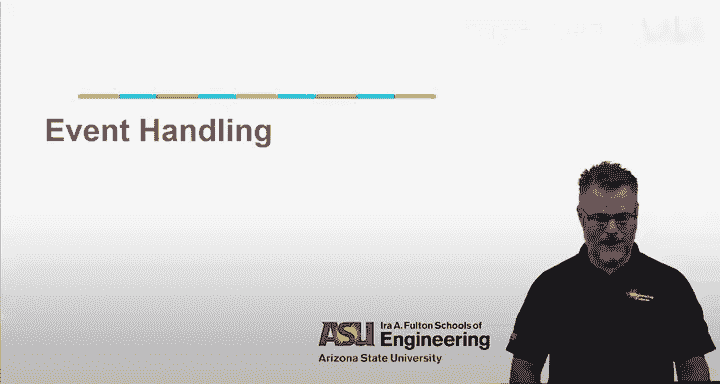

Welcome everyone， today we're going to talk about event handling and exactly what it is and how does it relate to Python。

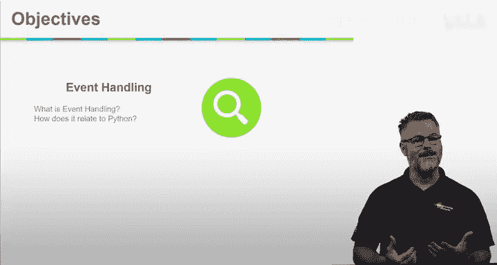

So up to this event so far， we have been actually working with events。

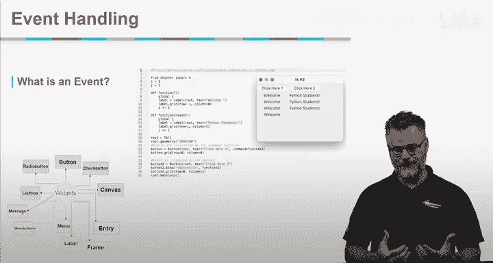

We have seen how to interact with buttons， we've done Canvas。

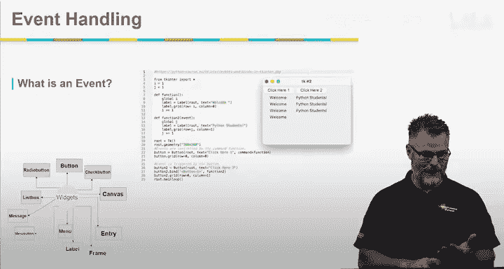

We've done entries。 We've worked with frames。 We've dealt with labels。 We've done messages。

 list boxes。 There's all kinds of different events that we've been creating。 And really。

 when an event is， is basically something waiting for a user response。 In this case。

 as you can see here， I have a simple app， click here or click here。

 If I click here on the first button， basically， it's going to put welcome。 And as you can see here。

 I've clicked it four times。 and displayed welcome。

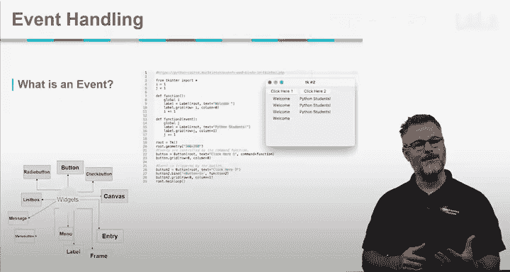

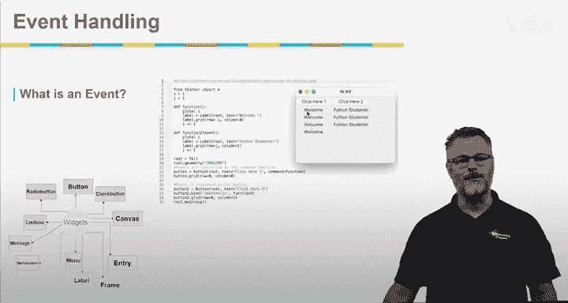

Then I went ahead and clicked here on the second one and it displayed Python students。

 So basically an event handling is just that it's just waiting for you to do something。

 And in return， once you do that event， whether it be a mouse click or keyboard。

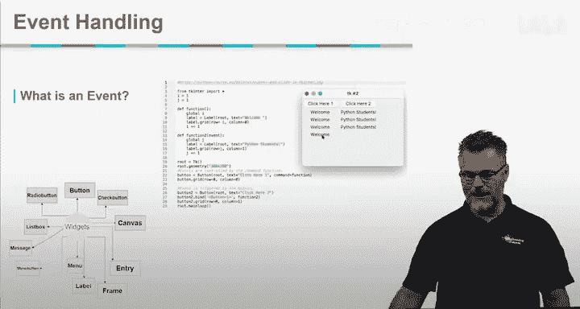

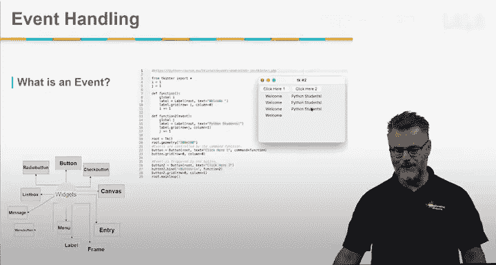

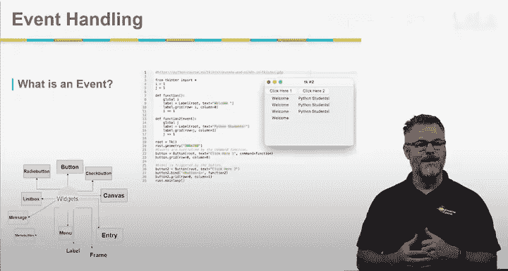

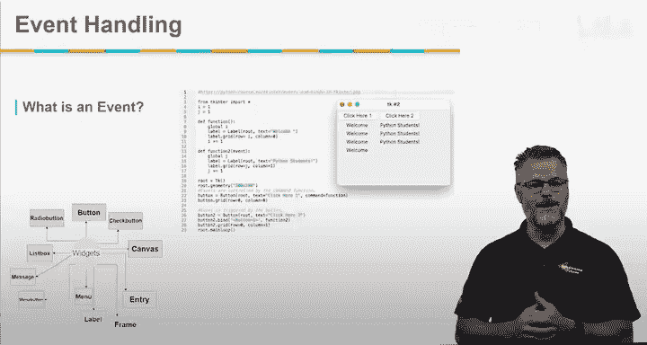

Then the application is going to do something different。 Let's take a look at the code。

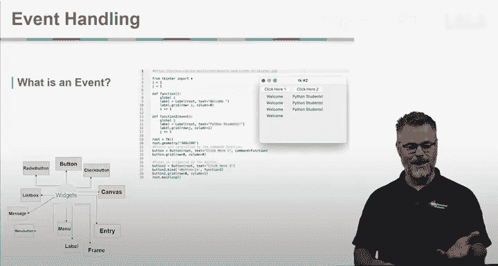

So as you can see here， we go ahead and import the tools that we're going to need。

 I set some global variables， I to 1 and J to1。I define my two different functions。

 I've got function 1 and function 2。Now function one， I'm bringing in I again。

And here I'm just going to put the label as welcome， as you can see here。

And then I'm going to be setting it up in a grid format。 So every time I click that button。

 my row is incremented by one， and the reason why I had to use global here is because I'm actually modifying that value。

 I need to make sure that it gets updated globally。And therefore， my row now does one， two， three。

 four every time I click that button。Same is true down here。Functioned， now。

 I'm doing something a little bit different here。 Notice in this function。

 there is nothing inside the parentes Here， I'm actually adding an event。

 And we'll kind of break that down in just a little bit。Again， global J。

I went ahead and put in Python students from my label。And just like before above。

 I went ahead and set my row to equal to J， so every time I increment or click the button。

 the action increment J and that action displayed in a new line。

So now what I've done down below is I've created my frame。Or my window。 I set the size of my window。

Now the first button is really simple， we just say command equals function。Now。

 the command equal function is basically anytime that button is clicked， I'm going to have it go。

From here， up to function and execute that information。But down here on my button， too。

 notice I did not define a command。What I did is I took button two and I binded at it。

To the actual button。 So now I'm looking physically at the button itself， button 1。

And then I'm saying if that button is clicked， then I'm going to go to function 2。

And then I just set the loop。Now， again， these different events can be either triggered by a mouse button or a keyboard stroke。

 Let's take a look at another demo。

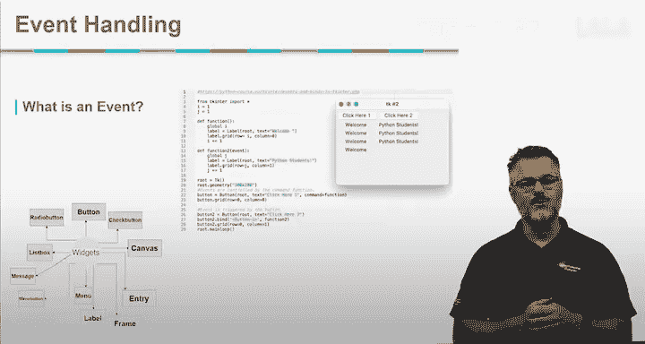

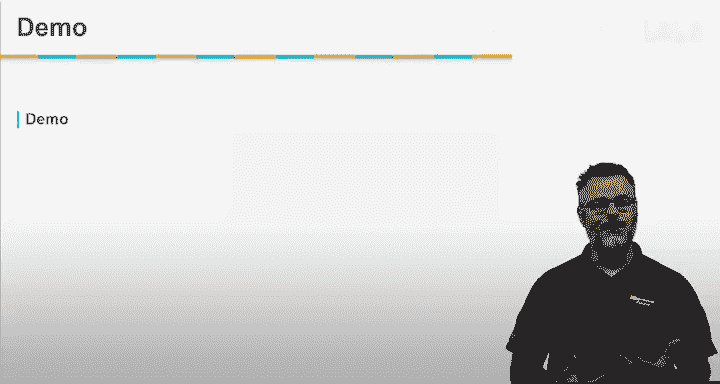