# 亚利桑那州立大学《Python： A Guided Journey from Introduction to Application》中英字幕 - P53：14_事件处理功能演示.zh_en - GPT中英字幕课程资源 - BV1J38GzbETT

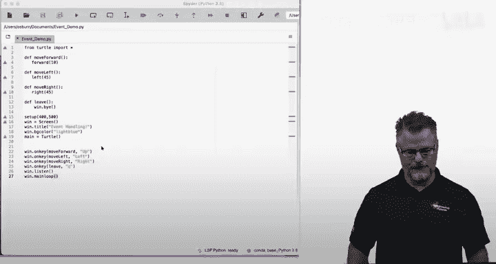

Welcome to the event demo what I want to do today is I'm going to use the keyboard to show you how we can use the keyboard to make events on our application and make it do things we'd like。

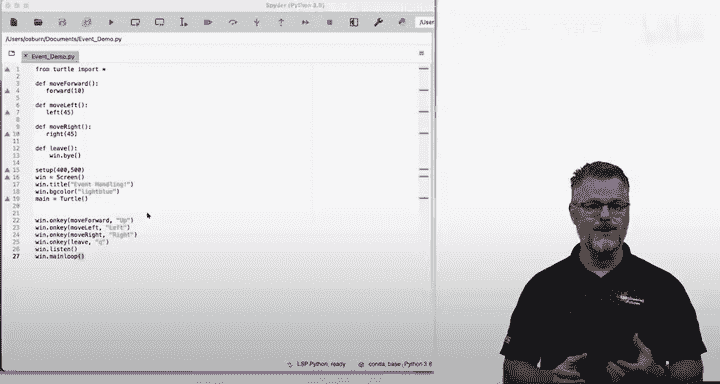

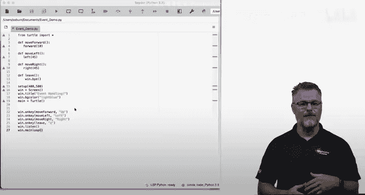

For this demo， I'm going to utilize Trtle。 Trtle is basically the drawing application。

 So I'm going to use my up down left right buttons to go ahead and move my cursor around on the screen。

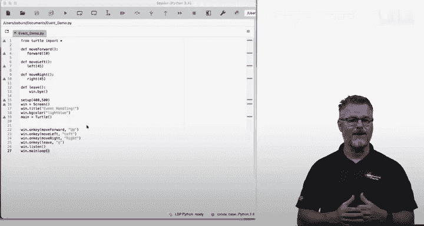

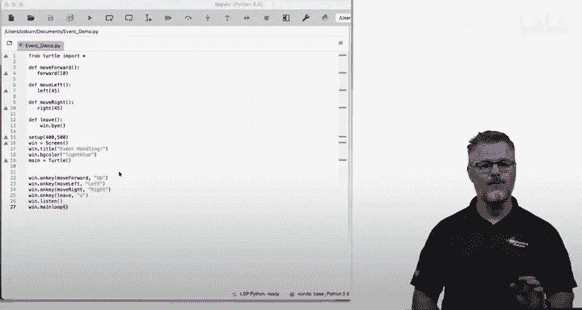

And then when I'm ready to query， I can just press the Q key to exit my application。

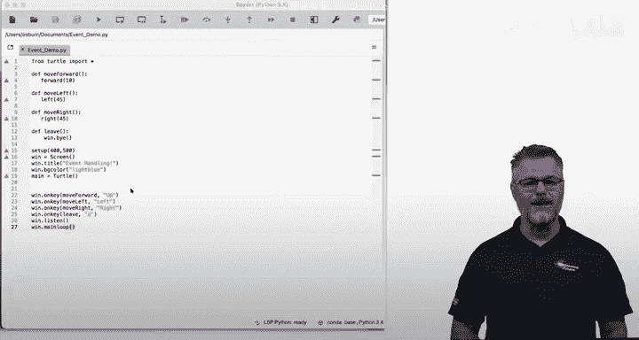

So as you can see here， I can move forward， I'm going to move it basically 1 spaces。

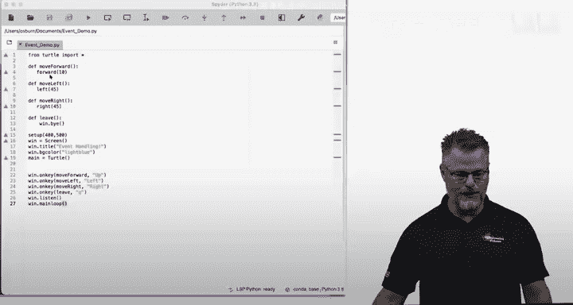

If I'm going to move left， I'm going to move at a 45 degree angle。

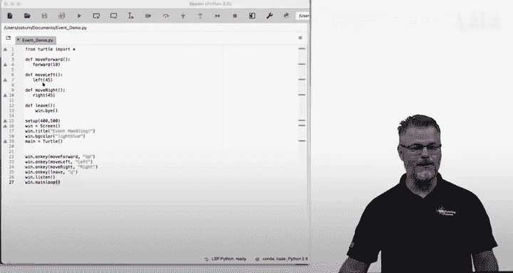

If I'm going to move right， I'm going to move at a 45 degree angle。

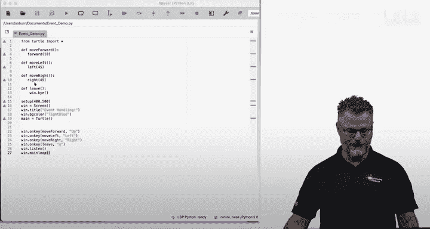

Then if I want I'm ready to leave， I'm just going to say bye and exit out of the action program。

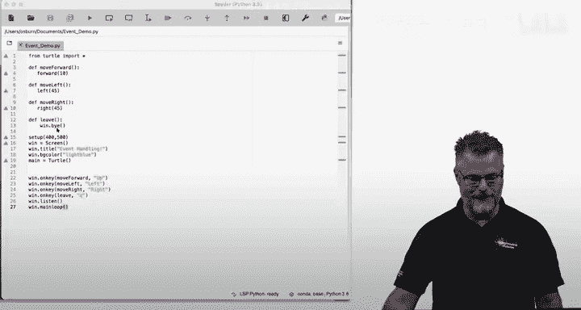

Then。Here I'm just setting up my window frame， my window frame is going to be 400 by 500。

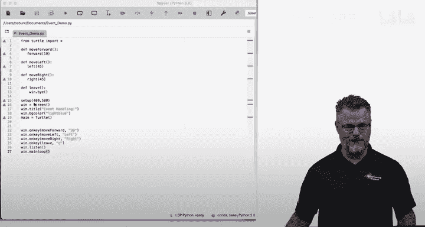

Go and tie that to my screen。

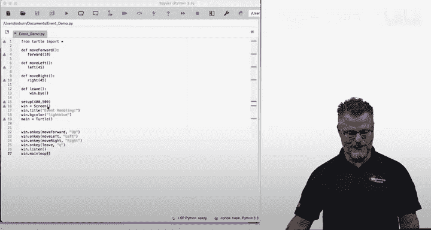

Give it a title。 this case， it's called event handling。 I'm going to set my background to light blue。

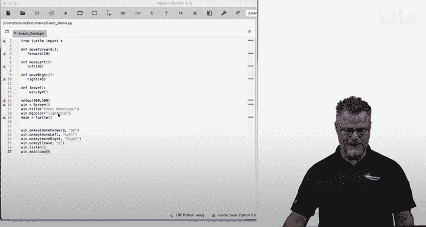

Then。

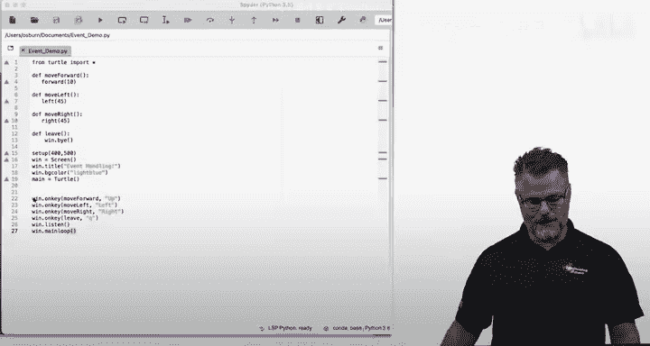

So here you can see we're going to go and set up our keyboard to be able to listen for commands。

 The first one for the on key， meaning when I press the key down。

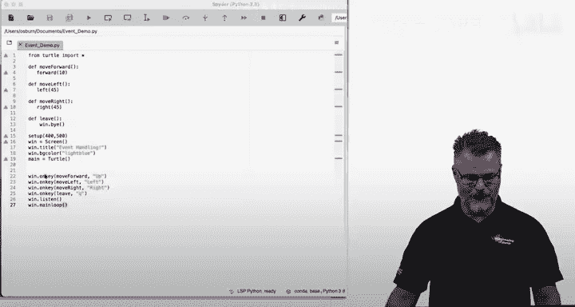

Basically， it's going to look for the up key。 and then I'm going to move forward。

 If the left key is pressed， then I'm going to move left。 If the right key is pressed。

 then I'm going to move right。 If I hit the Q key on the keyboard。

 then it's going to leave the application。

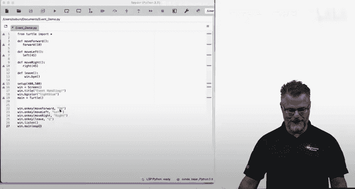

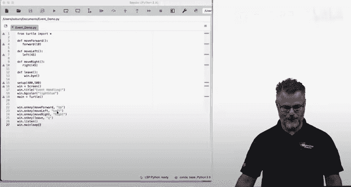

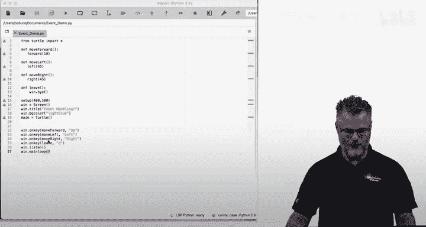

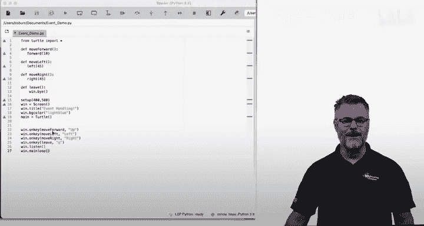

And then of course， the most important thing is to set the listen if without this。

 basically the application is not going to know what to look for。

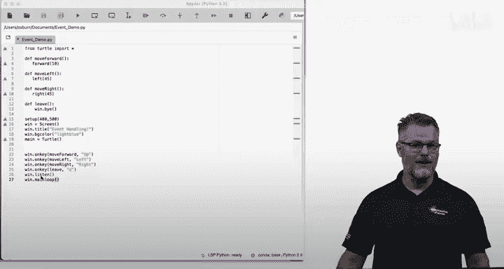

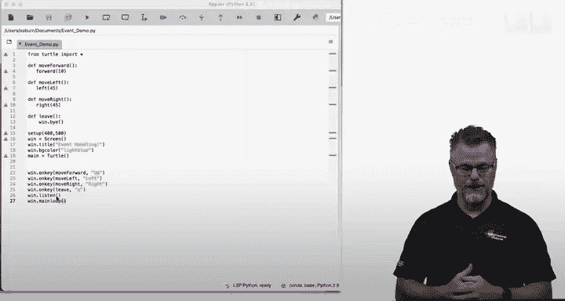

Don't forget to include this in your program。Let me go and run it real quick。

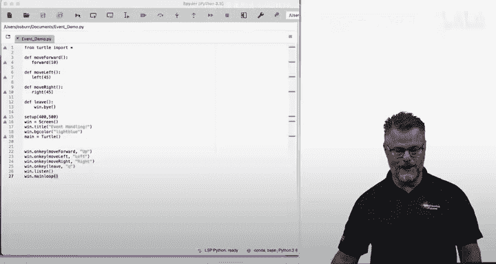

Going to move this over a little bit so you can see the code while I'm executing this as I'm pressing the keyboard up。

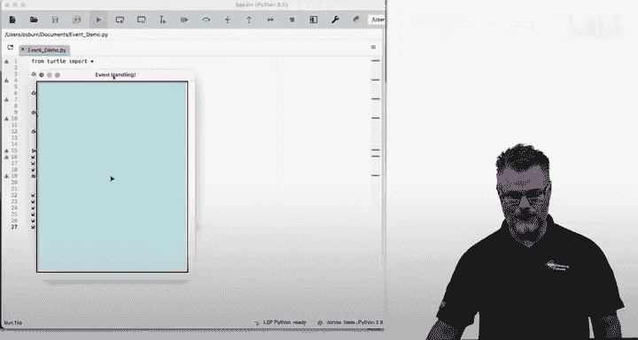

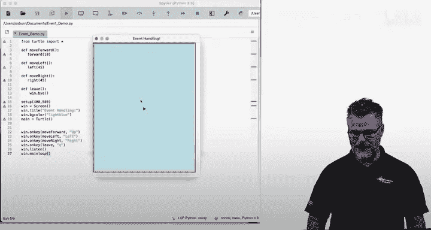

Notice that it's drawing a straight line， I went ahead and press left。

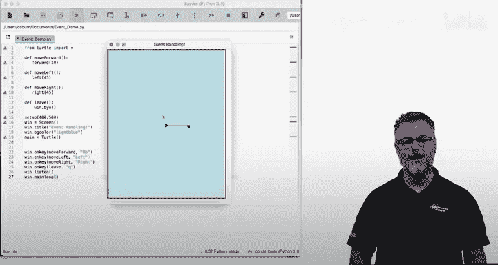

And went up 45 degrees if I press right。

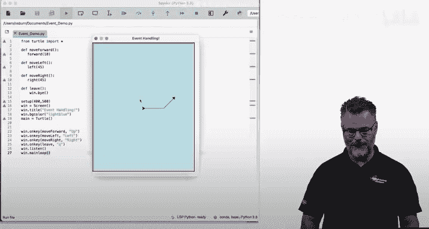

Another 45 degrees。 Do another right。And you can see I can then draw。This amazing looking beaker。

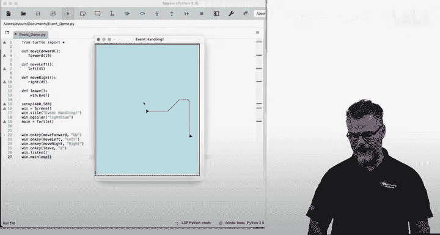

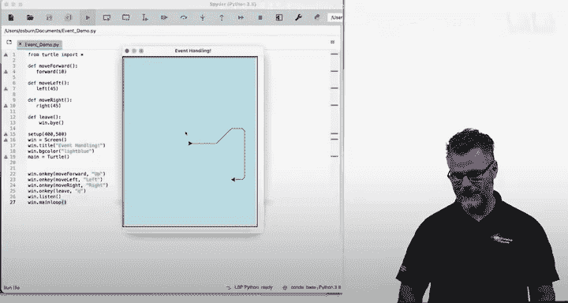

Again， this is why I'm a programmer and not a artist。

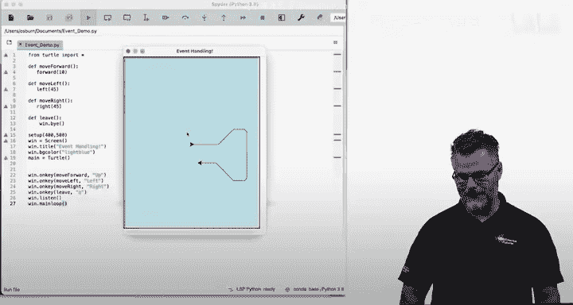

Because I would not do very well。

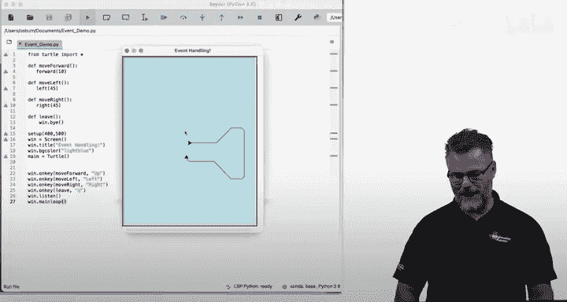

An art school， but as you can see here， I was able to use my keyboard strokes to listen for events and those events responded by drawn in line or by moving in an angle of 45 degrees。

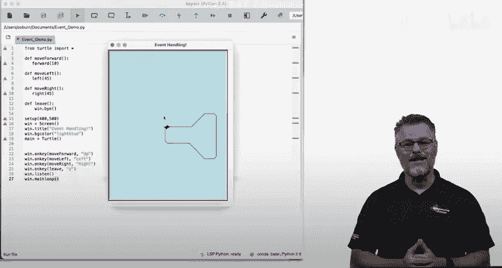

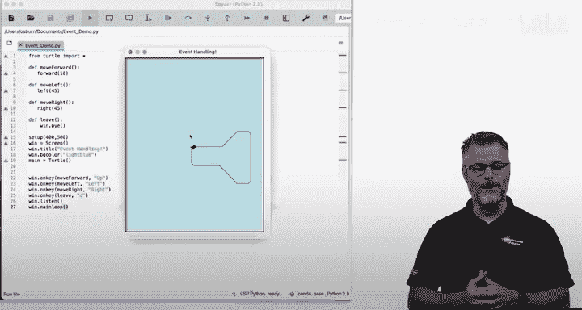

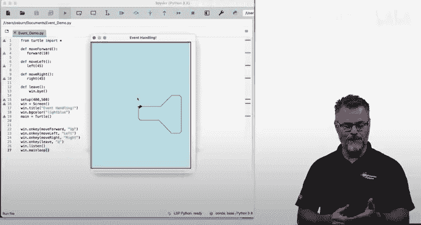

Hopefully this was insightful and I look forward to seeing in the next video。

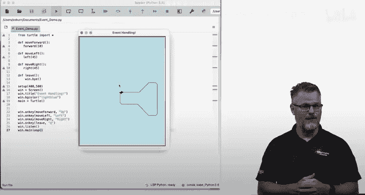

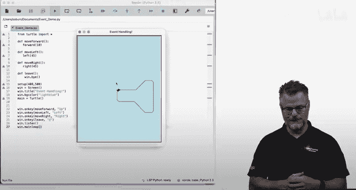