# 亚利桑那州立大学《Python： A Guided Journey from Introduction to Application》中英字幕 - P54：15_课程总结.zh_en - GPT中英字幕课程资源 - BV1J38GzbETT

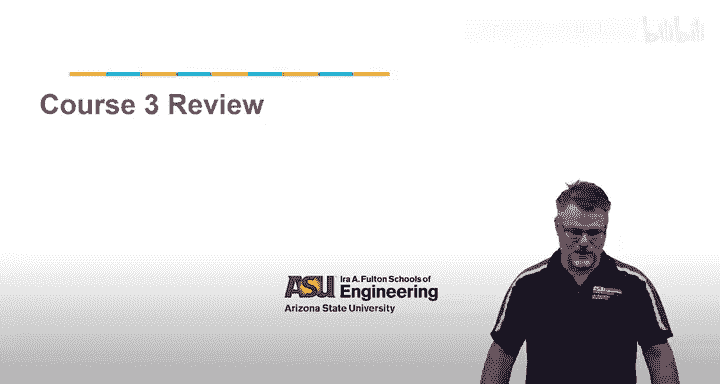

Welcome everyone， to do is just recap on what we've covered in this section。

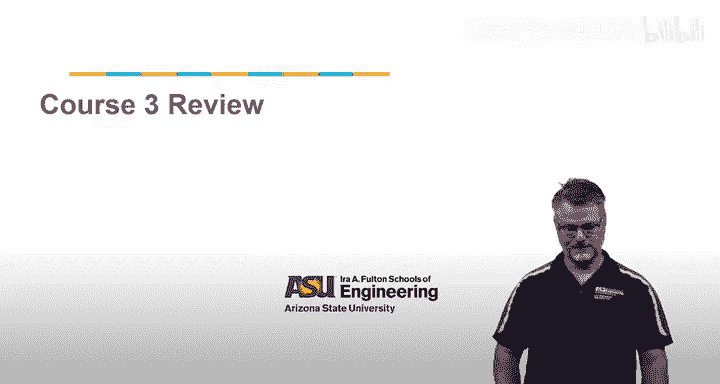

So here we went ahead and examine the basics of object learning programming。

 I showed you how to create an object， how to discuss the concept of inheritance and how to use inheritance and utilize it in a hierarchy we also talked about polymorphism and how to use polymorphism within Python。

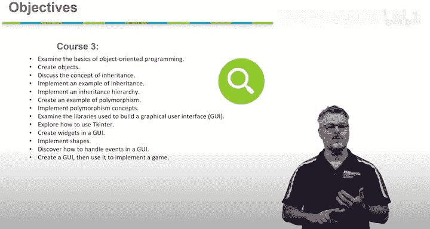

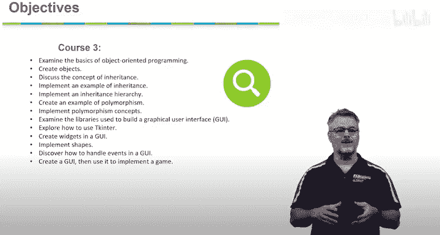

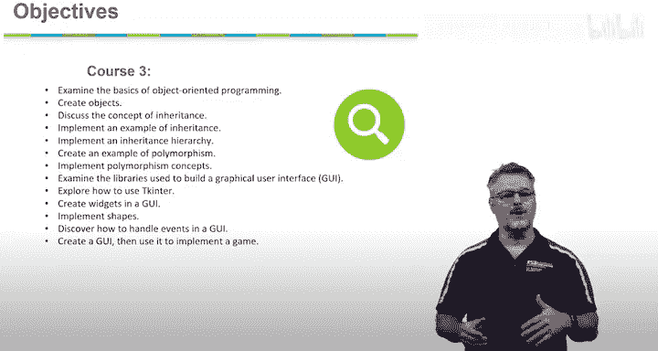

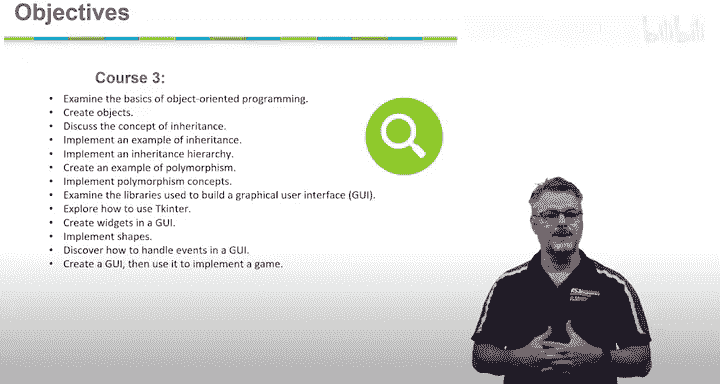

We also went into using some graphical user interfaces， weve used some simple tools as tininker。

 we used other widgets within the GuUI and then you were able to create a very simple GuUI interface and be able to design and create your own game and hopefully from this you can go ahead move forward to the next module and we'll see you there。

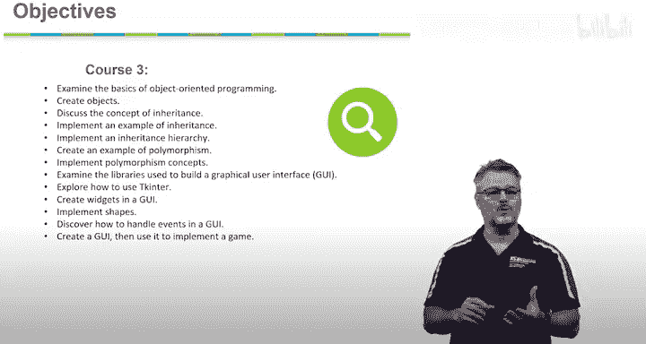

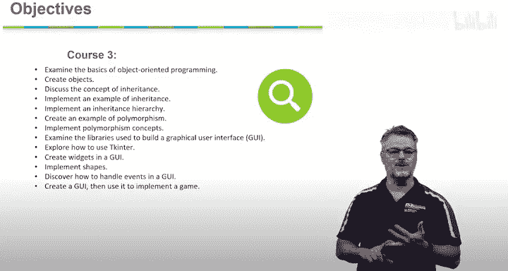

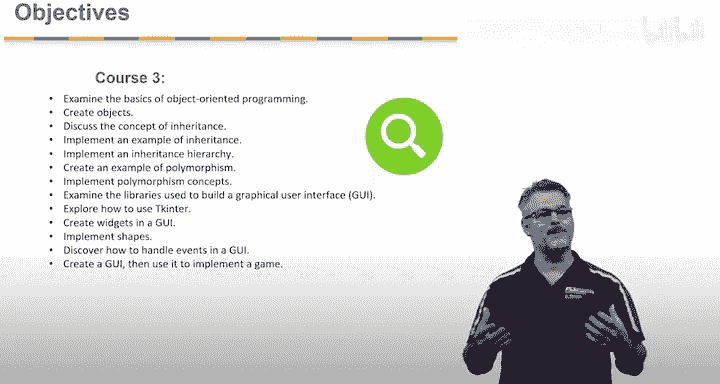

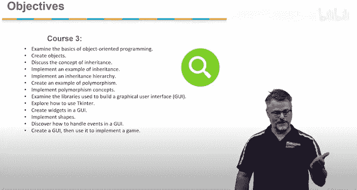

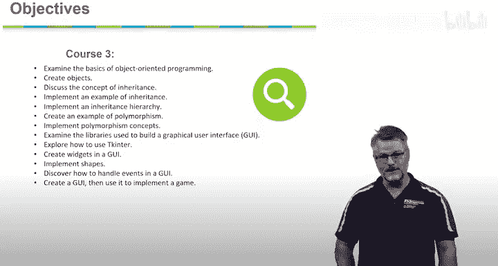

Thank you。