# 亚利桑那州立大学《Python： A Guided Journey from Introduction to Application》中英字幕 - P55：0_课程介绍4.zh_en - GPT中英字幕课程资源 - BV1J38GzbETT

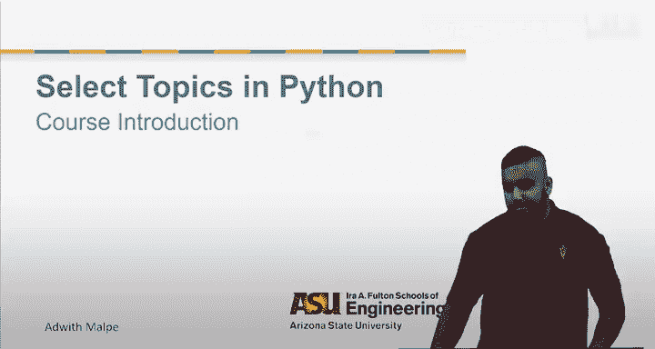

This lesson will be going over a course introduction。Welcome。

In this lesson， we'll be going over the course introduction to an introduction to machine learning。

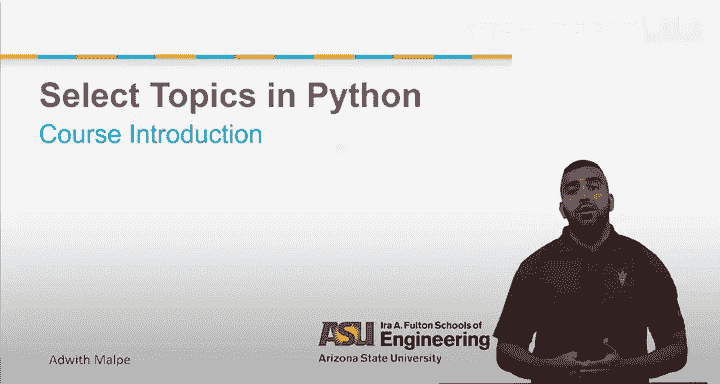

Today's agenda will cover a little bit about what you're going to learn in this course。

 you're going to learn several topics listed here on this slide which is what is machine learning。

 why I learn machine learning， what are some companies that use machine learning。

 data and machine learning， and some of the branches of machine learning。

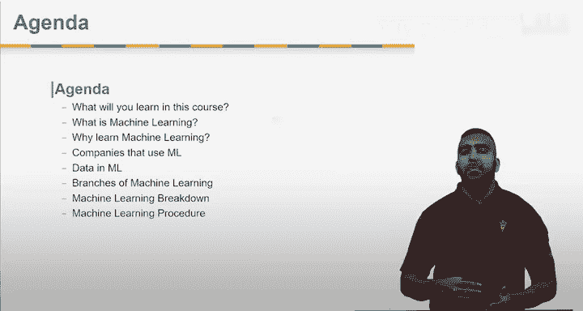

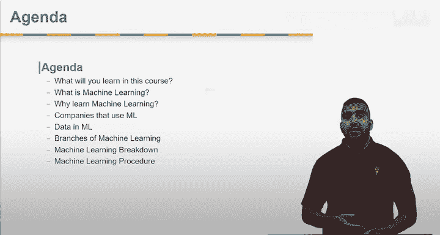

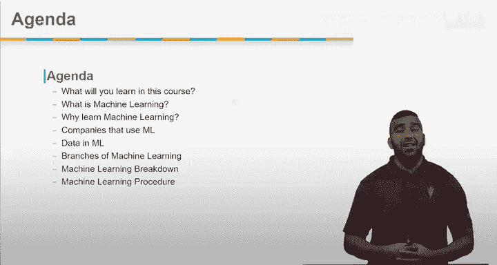

So what will you learn in this course？

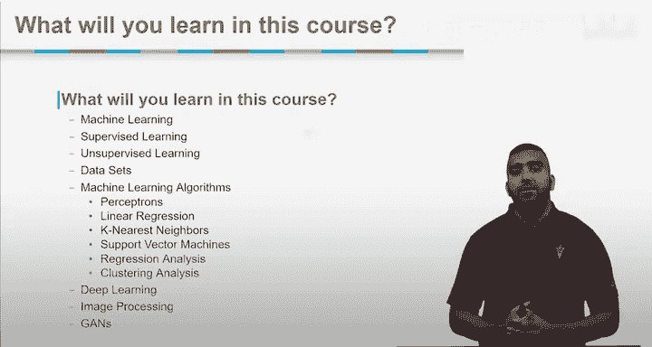

Everything pertained to this course covers to the study of machine learning and we're going to learn how to develop code in Python that addresses this concept。

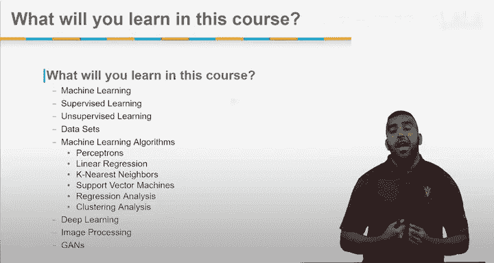

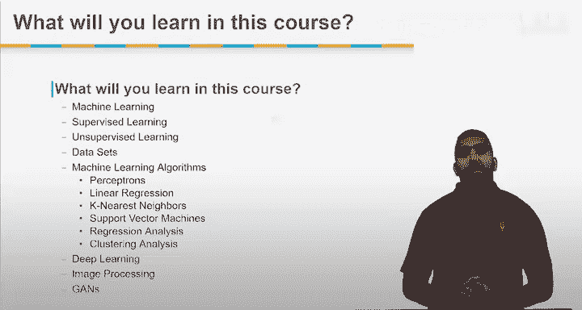

Now you're also going to learn about some of the theory behind it or how these branches of machine learning work now these branches that you will learn about include supervised machine learning and unsupervised machine learning。

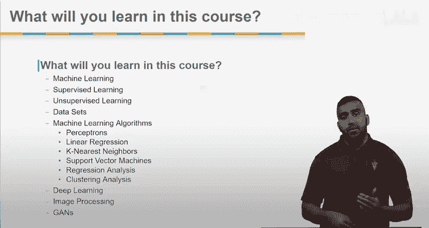

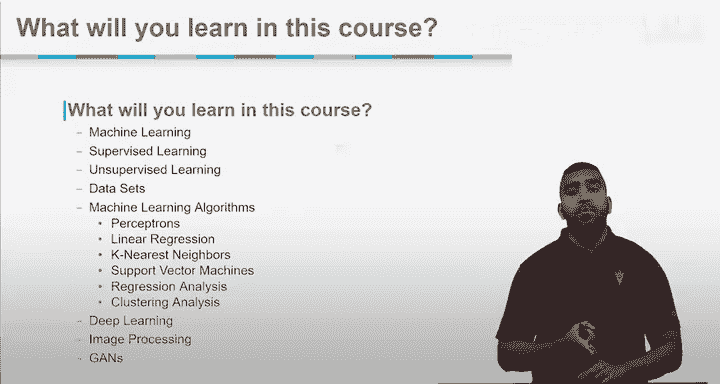

You'll also learn how to handle data using Python and how to load data sets using Python。

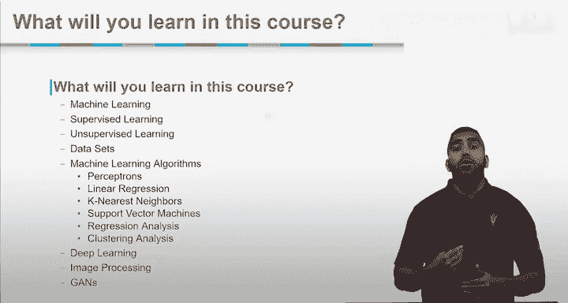

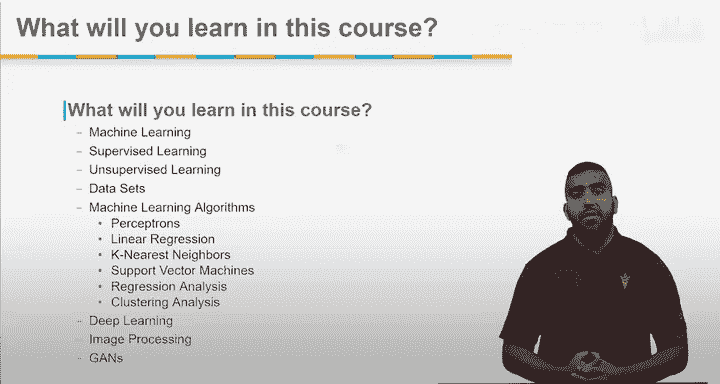

You'll also learn how to implement certain machine learning algorithms in Python that include perceptrons。

 linear regression， caners neighbors， support vector machines。

 regression analysis and clustering analysis。

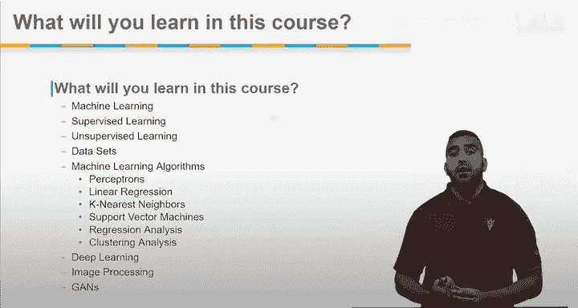

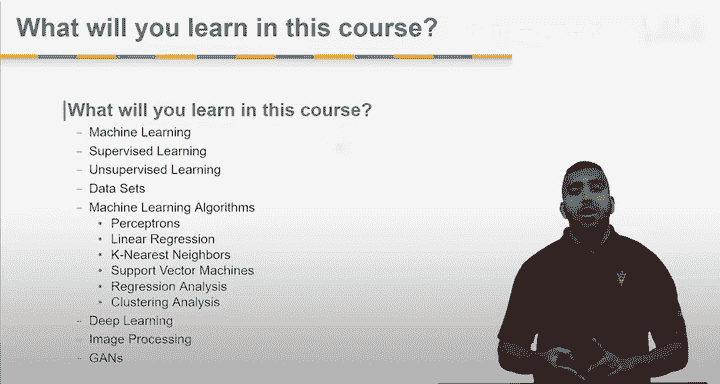

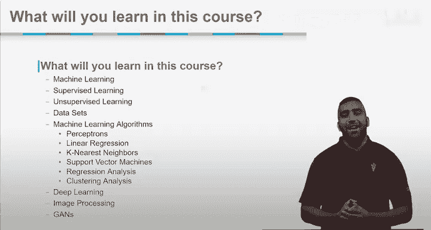

And finally， we'll conclude the course by learning briefly or going over a brief overview of three topics that include deep learning。

 image processing， and generative adversarial networks。

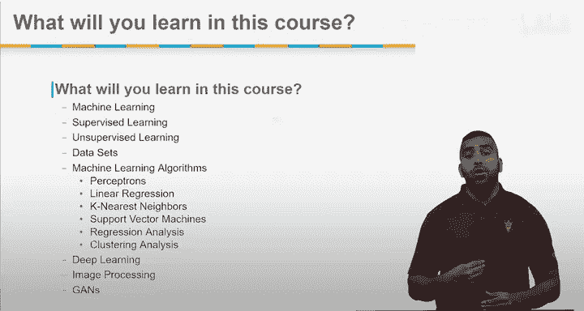

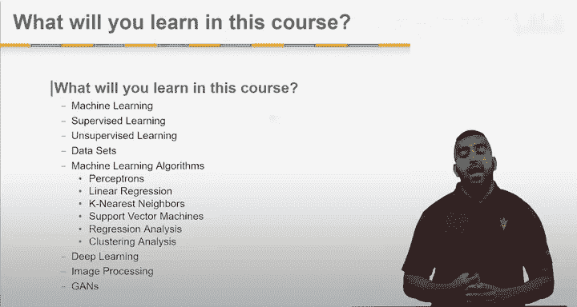

Thanks for watching。

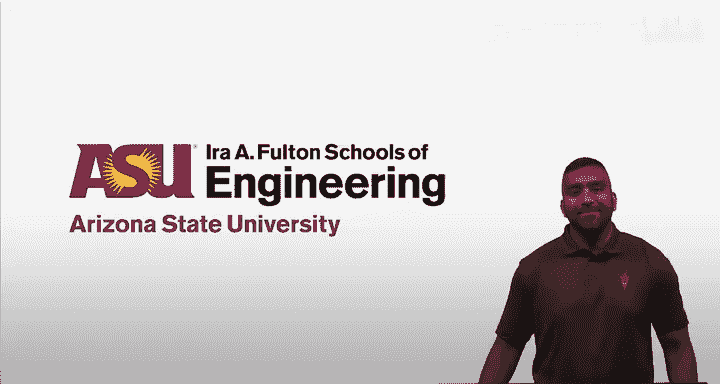