# 亚利桑那州立大学《Python： A Guided Journey from Introduction to Application》中英字幕 - P56：1_机器学习概述.zh_en - GPT中英字幕课程资源 - BV1J38GzbETT

This lesson we'll be going over an overview of machine learning。

Welcome back。In this lecture， we'll be going over an overview of machine learning。

So in today's agenda， we're going to cover what is machine learning， why learn machine learning。

What are some companies that utilize machine learning in the development of their products。

How is data used in machine learning。

What are the branches of machine learning and we're going to go over a breakdown of machine learning followed by the procedure or the steps that's commonly taken in performing machine learning。

So what is machine learning？Machine learning is a branch of data science。

 it's to field a study that focuses on the creation of a mathematical model used to make decisions。

Now， machine learning requires a large amount of data for development and is computationally expensive。

It's not the same thing as artificial intelligence。 That's one thing you need to keep in mind。

 What is the difference between machine learning and artificial intelligence。 Well。

 machine learning trains and makes decisions based on the training。

 Artificial intelligence is set to encounter a new situation and succeed in meeting an objective。

So why learn machine learning Well this popular concept is utilized everywhere。

 its use in recommendation systems， anomaly detection， video surveillance， social media features。

 online customer support， search engine relining， or refining。

 other things could even be an autonomous driving， so machine learning is pretty much used everywhere in today's society。

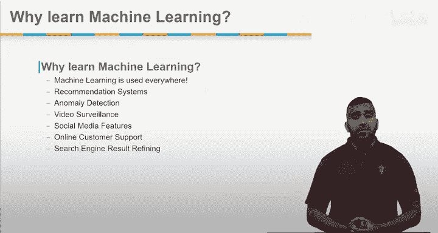

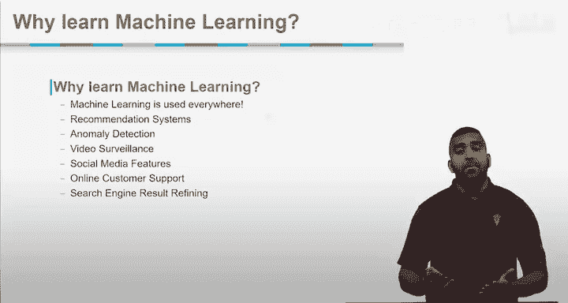

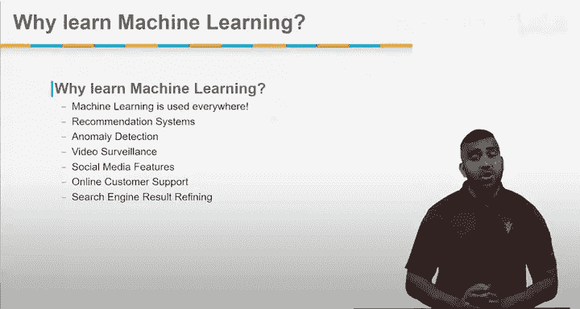

So what are some companies that utilize machine learning well some companies that probably come into mind are Tesla。

 Google， Meta and Amazon， you see machine learning frequently used in Tesla's autonomous driving。

 you see it in recommendation systems that Google and Meta and even Amazon develop so it's such a big concept that's utilized everywhere and learning it is such a useful tool that can if you decide to work for any of these companies in the future。

 it's always a good tool to know。

So how is data and machine learning used or what is data in this case？

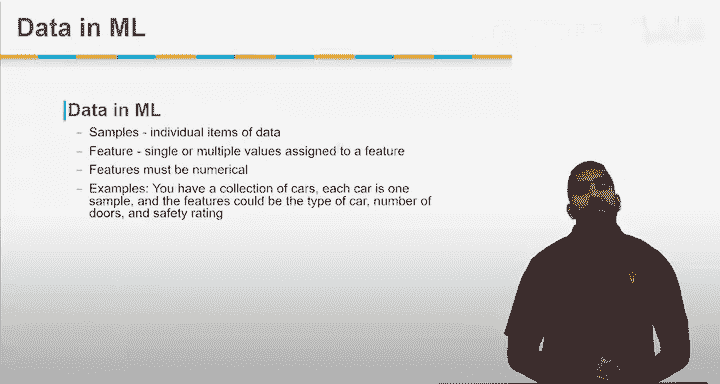

Well， data is broken down into several terms。

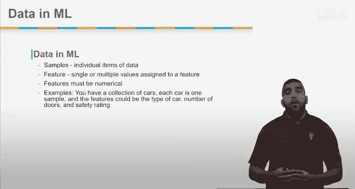

We have samples which are individual items of data。

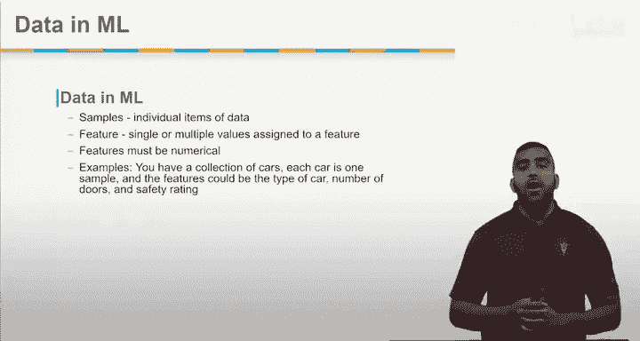

We have a feature which is a single or multiple values assigned to a feature。

 a feature it typically describes a certain aspect of a sample。

 so let's say we have a sample that's a person， a feature of that sample or a feature of that person could be shape of eyebrows or type of haircut or type of skin color。

 it could be anything for that matter。

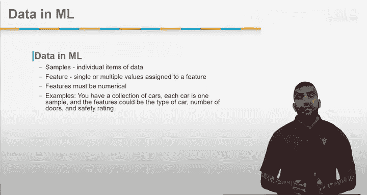

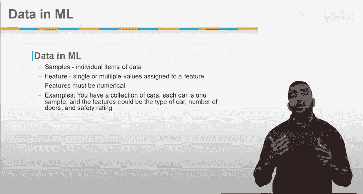

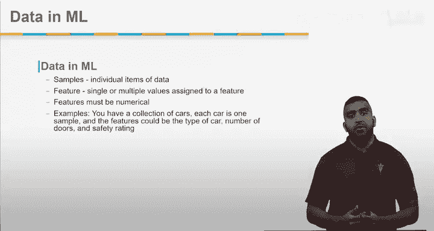

Now， keep in mind， features must be numerical in this case。

 so maybe you could do a number of fingers or。

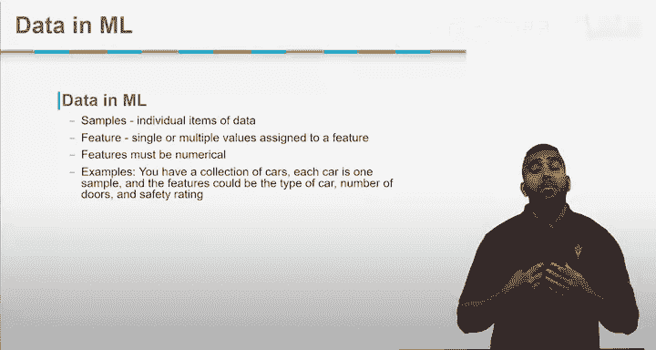

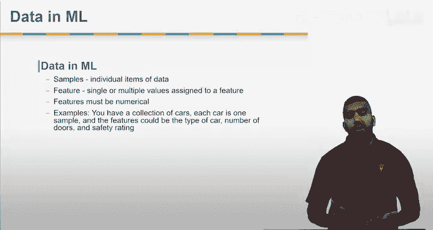

Anything of that sort。Here's another example， let's say you have a collection of cars。

 each car is one sample， and the features could be the type of car。

 the number of doors and the safety rating。

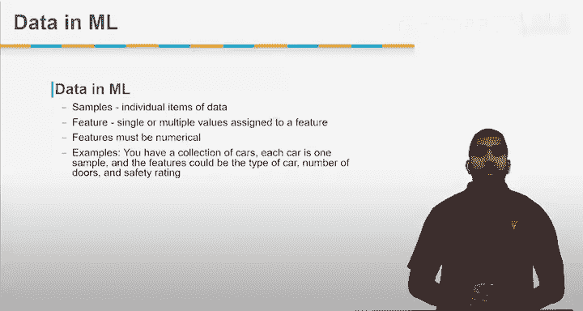

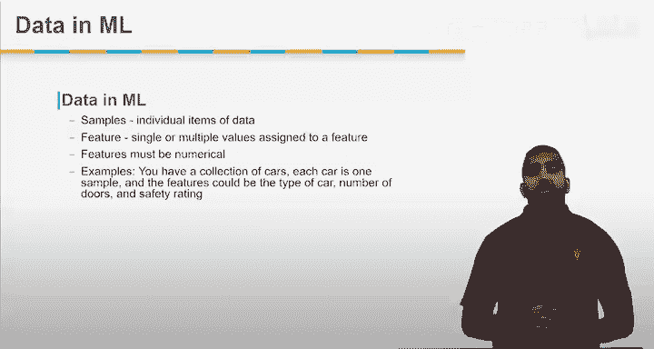

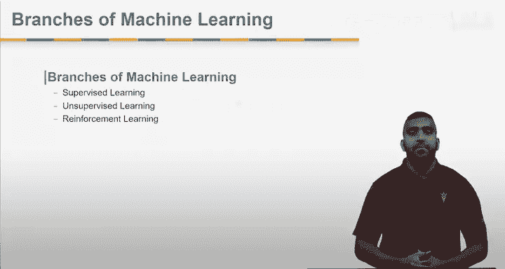

So what are the branches of machine learning there are three branches to machine learning。

 we have supervised machine learning， unsupervised machine learning and reinforcement learning。

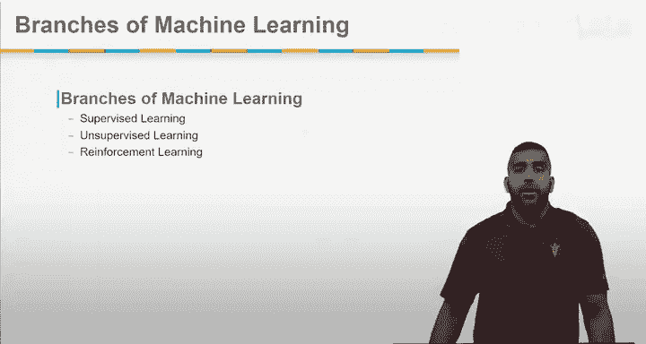

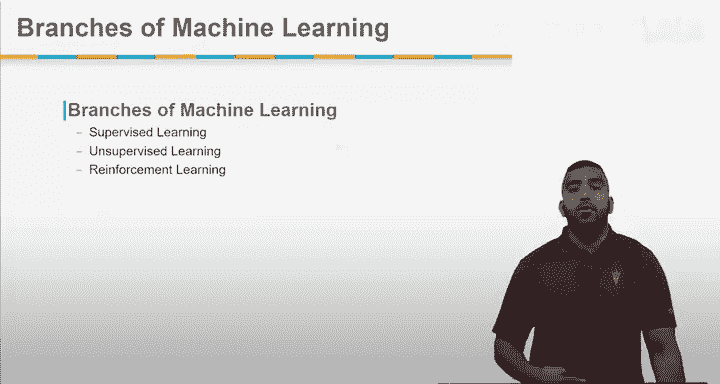

Now in this course you will be learning about the first two supervised machine learning and unsupervised machine learning reinforceforment learning is another third interesting field of branch of machine learning that would take a little bit more time。

 so for the sake of simplicity we'll be prioritizing supervised and unsupervised machine learning。

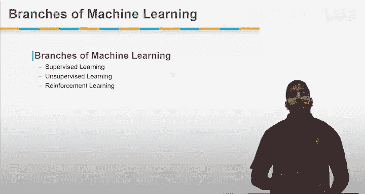

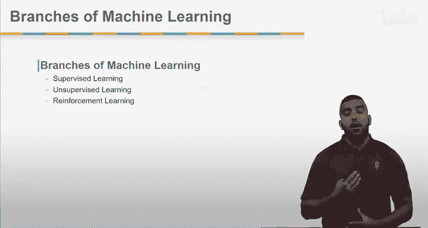

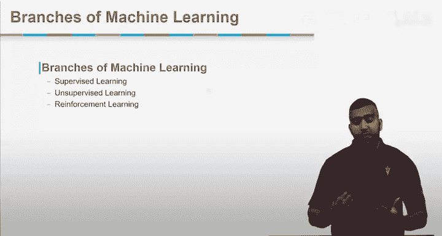

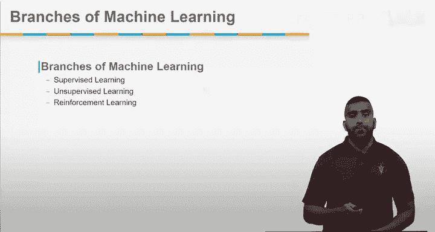

Okay， so here's a little breakdown of what machine learning is or how it works。

We have classification and regression are the two types of machine learning。In classification。

 samples are divided into classes， this entails supervised learning and unsupervised learning。

Supervised learning is where a ground truth exists。

 meaning we have labeled data features that describe the data we know each what the data means unsupervised learning is where we there is no ground truth or no ground truth exists This means we don't have labeled data or any features that describe the type of data we're looking at Now we handle unsupervised learning very differently from supervised learning and you'll learn this a little bit later down the course。

Now regression creates a number and uses continuous values as opposed to classes。

 that's another thing that you're going to keep in mind when we're going over regression analysis。

So what are the steps to performing machine learning， here's a general overview。

First step is to collect all your samples from your data set。

You want to collect a data set there are many， many famous repositories out there。

 such as UCI's machine learning repository， where they have clean preprocessed data sets that you could really play around with and for this course we'll be working with data sets from that site。

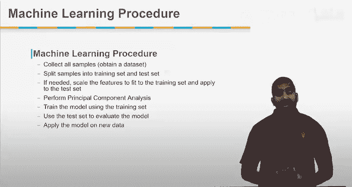

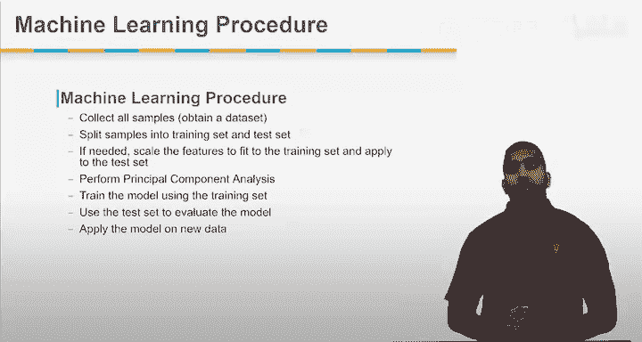

The next step after you've collected all your samples is to split the samples into a training set and a test set。

The third set， if needed， is to scale the features to fit to the trading set and apply it to the test set。

The fourth step is to perform principal component analysis now that's just a way to refine your model and basically omit anything that's any redundant information。

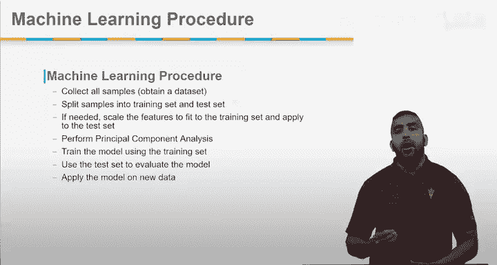

The fifth step is to train your model using the training set。

 followed by testing your model using the test set。Finally。

 you want to apply the model on new data to see how effective your model is。

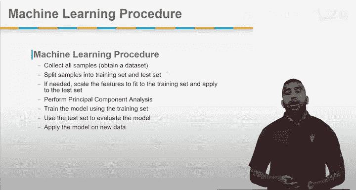

Thanks for watching。

