# 亚利桑那州立大学《Python： A Guided Journey from Introduction to Application》中英字幕 - P57：2_监督学习导论.zh_en - GPT中英字幕课程资源 - BV1J38GzbETT

Welcome。In this lesson， we'll be going over supervised learning。

So we're going to cover what is supervised learninging。

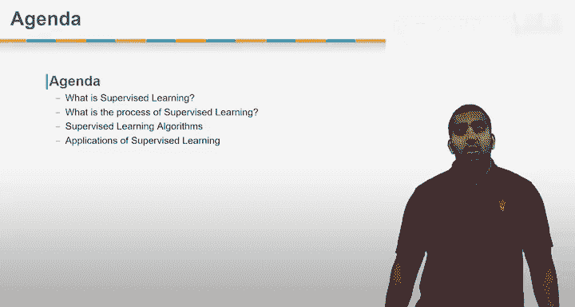

What is the process of supervised learning， some supervised learning algorithms along with the applications that follow this concept？

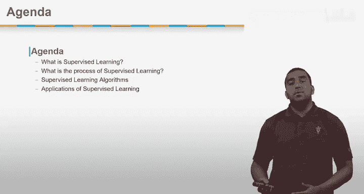

So what is supervised learning， Superervised learning is one of the branches of machine learning。

It refers to a class of systems and algorithms that basically creates a predictive model using data samples with known outcomes。

 otherwise known as labeled data。Now， the basic concept of how supervised learning works is you train a model using labeled input and output。

Which is basically data that has descriptive features that describe what the input is and what the output data is。

 And then you apply that data。To the model and you basically utilize that data to make predictions。

The known labeled data or labeled input and output is also known as the known ground truth。

Supervised learning can be broken down into classification and regression problems。

 where classification is where the output variable is a category。

 whereas regression is where the output variable is a real value。

So how to supervise learning work Well here's the generic process you first gathered all labeled training data。

Then you want to split the label of data into a training and a test set。

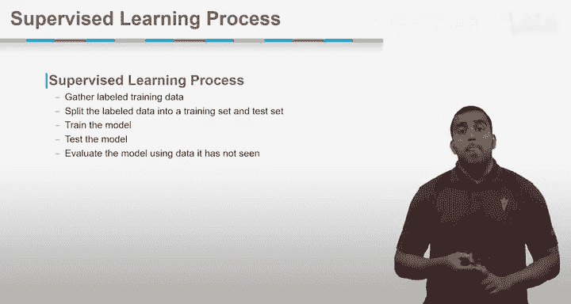

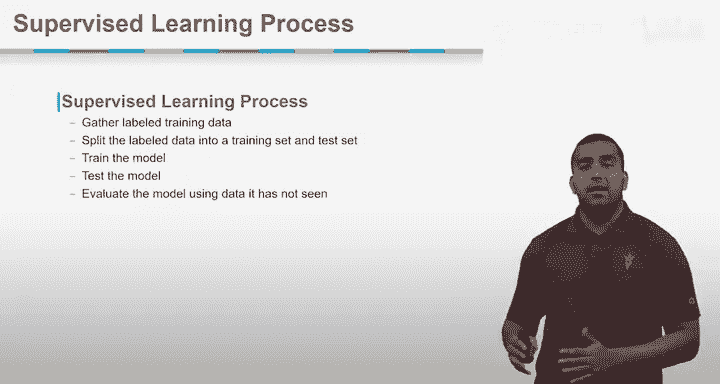

From there， you then train the model to make sure it it understands what the data is and it's able to make accurate predictions。

 And finally， once you've trained your model， you can go ahead and apply your train model onto your test data。

 which is known as testing the model， This will show you how accurate your model is when exposed to data it hasn't seen before。

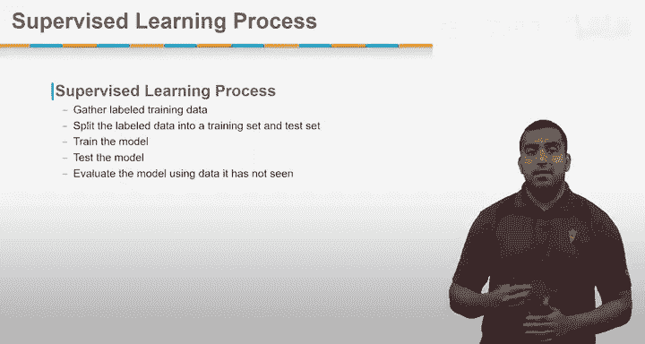

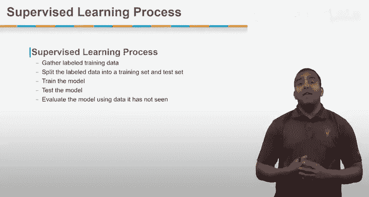

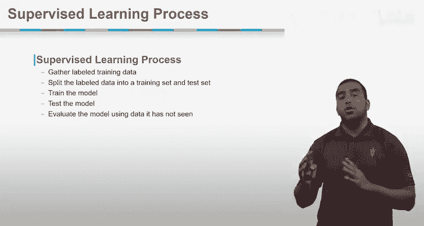

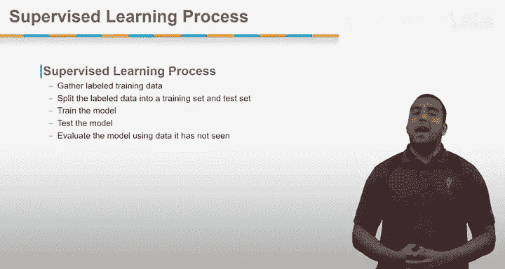

Finally， you evaluate the model using data it has not seen using certain metrics such as accuracy to see how accurate your model is when performing on new data。

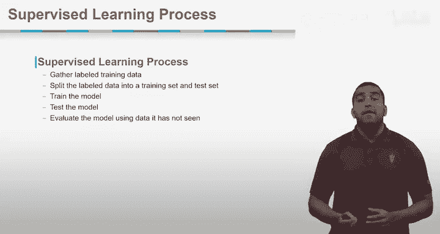

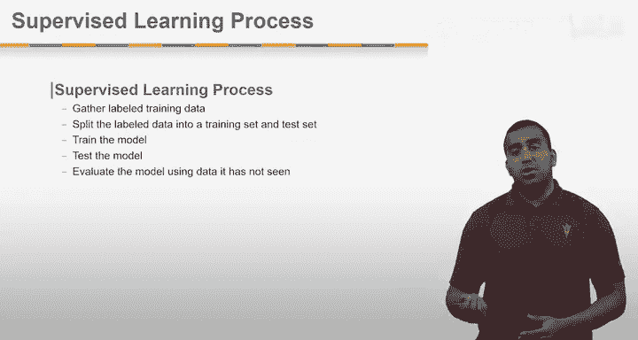

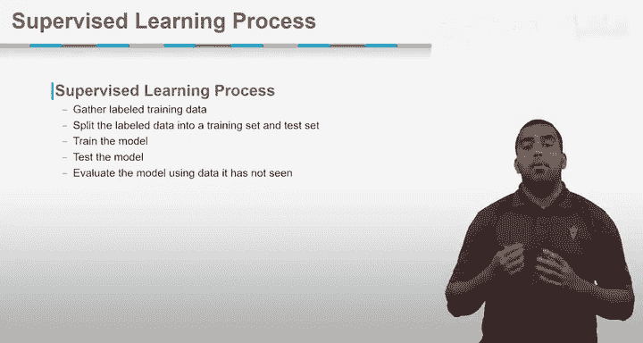

So what are some supervised learning algorithms？

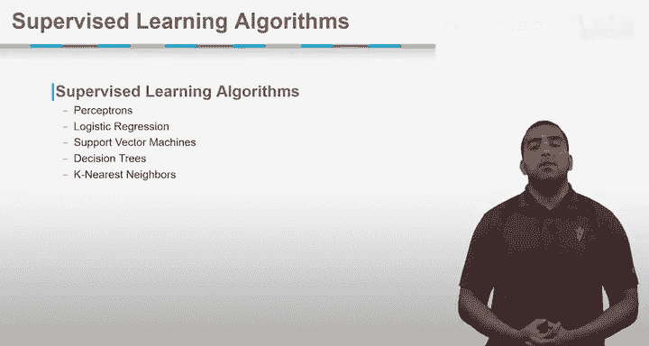

There are perceptrons， logistic regression， support vector machine， decision trees。

 KNN or K nearest neighbors， These are all supervised learning algorithms that we'll learn throughout this course and understand how they work。

 not only will we understand the concept of how they work。

 but we will also go through how to implement each of these algorithms to create our own supervised machine learning models and apply it to data that it has not been seen before。

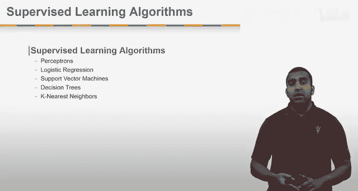

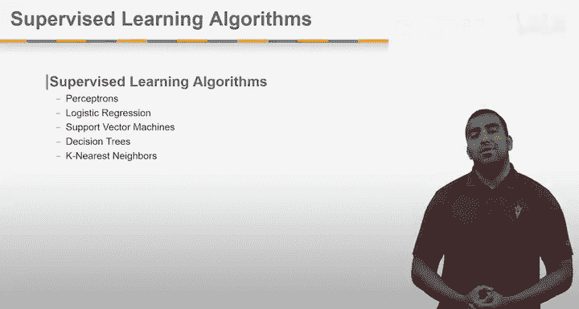

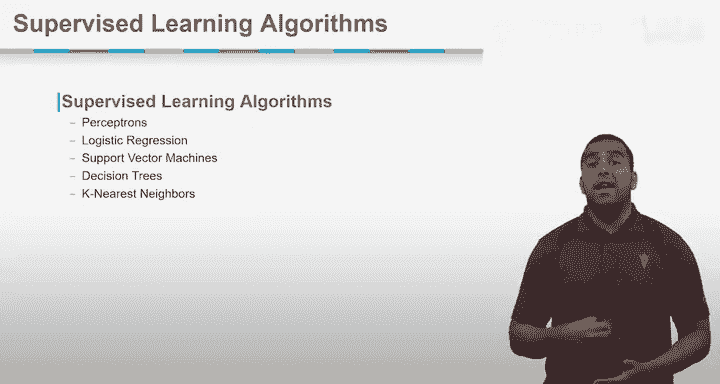

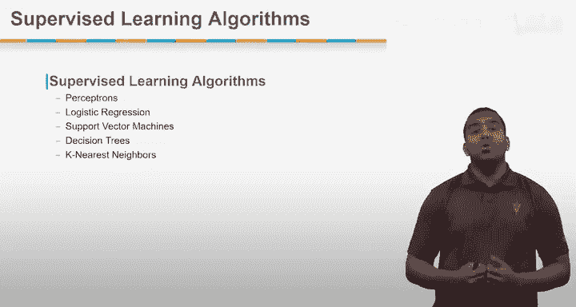

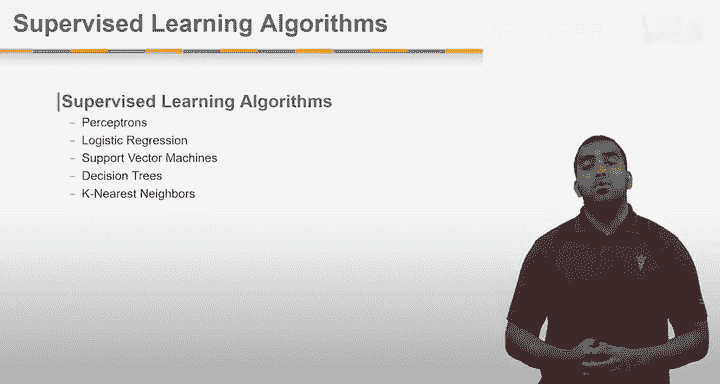

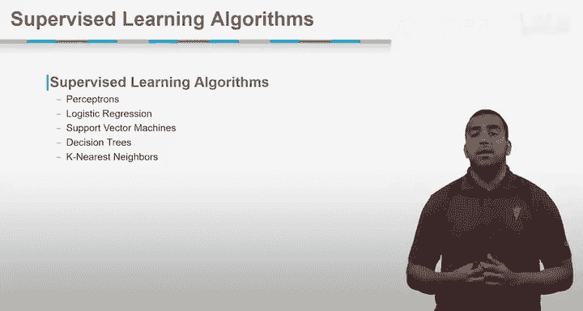

So in these two images you can see some really useful examples where supervised learning is used such as the self-driving Google car web search results。

 you also have it in market pricing models and so forth in this example you can see what supervised learning is also used in so we have like diagnostics。

 it's used within customer retention， image classification all within classification itself。

Then we also have the regression example where we can develop projects that pertain to advertising popularity prediction。

 basically anything that's used to predict a continuous value。Thank you。

