# 亚利桑那州立大学《Python： A Guided Journey from Introduction to Application》中英字幕 - P58：3_无监督学习导论.zh_en - GPT中英字幕课程资源 - BV1J38GzbETT

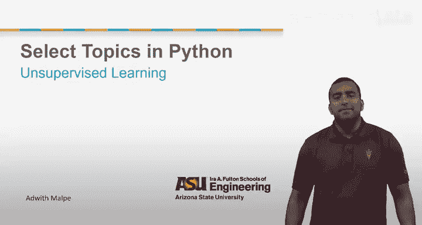

Welcome back。 In this lesson， we'll be going over unsupervised learning。

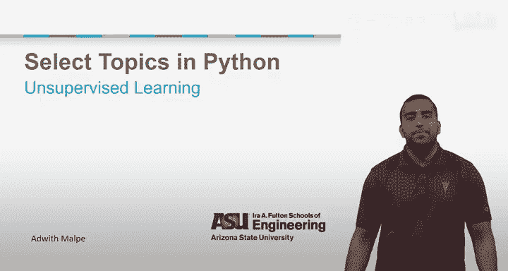

So we're going to cover a little bit more about what is unsupervised learning and learn more about this second branch of machine learning we're going to go over the process how does it work followed by some of the algorithms that pertain to unsupervised learning finally we'll go over some applications that utilize unsupervised machine learning。

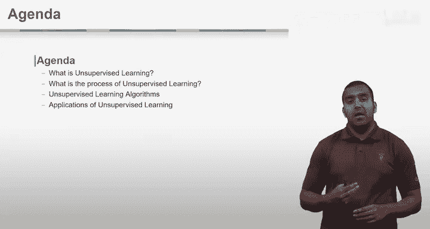

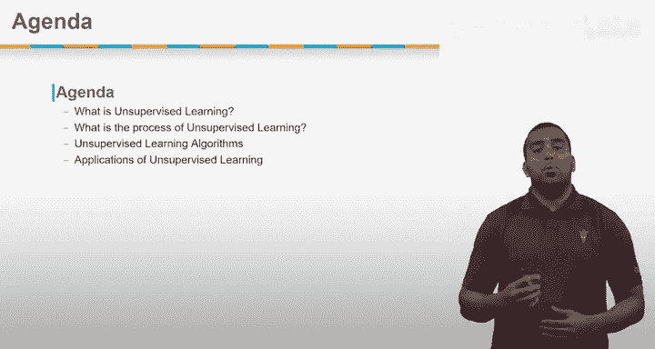

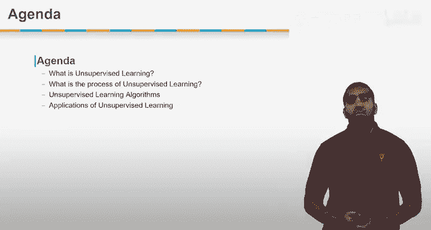

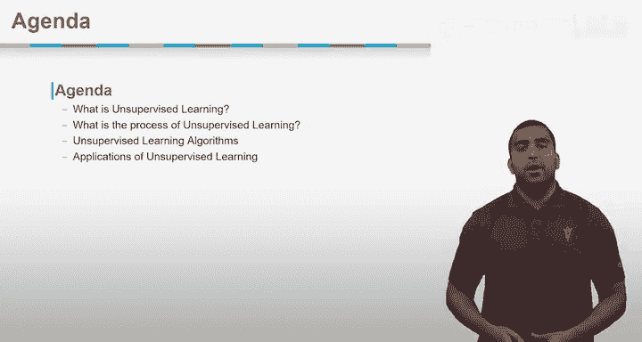

So what is unsupervised learning？Unsupervised learning is another branch of machine learning that refers to a class of systems and algorithms that creates a predictive model without using any labeled data or without a ground truth。

Basically we are feeding a machine learning model， a bunch of data that has no descriptors。

 there's no description of what the data is， and essentially the way the unsupervised machine learning model works is that we train a model using the unlabeled input and output data and then apply the model to new data to make certain predictions。

So the unknown ground truth and the utilization of many samples basically helps us understand and try to identify any patterns in the data。

 we want to see if maybe there is some clusters in the data that we can use to see if there's any similarities within the data it based on the pattern so when we're visualizing this and plotting it on graphs。

 it can be very useful to like see if theres certain data that cluster and certain areas。

 we can distinguish it and probably make some sort of argument that the data is similar。

 but we can the whole purpose of unsupervised machine learning is to ensure that there is a pattern to identify that pattern in the data since it's not been labeled。

Yep， and pretty much we can also make sure that we analyze and cluster unlabeled data sets。

 That's our main objective。So what is the unsupervised machine learning process and how does it work？

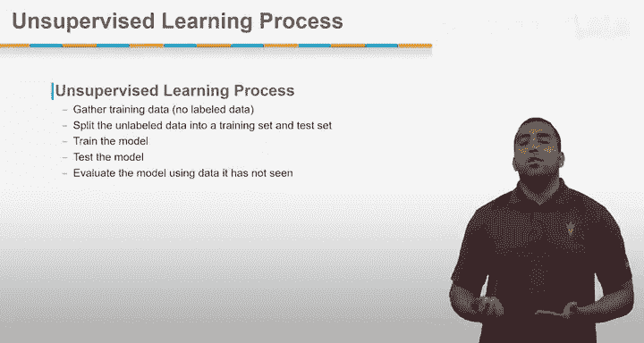

Basically it's very similar to the supervised machine learning process。

 however we are using unlabeled data where our data does not have features that describe what the data is so our first step is to gather all trading data without any features or basically without any labeled data we then split the unlabeled data into a trading set and a test set。

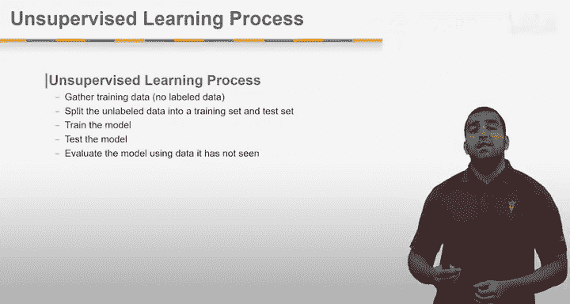

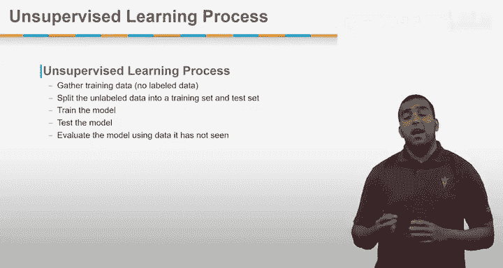

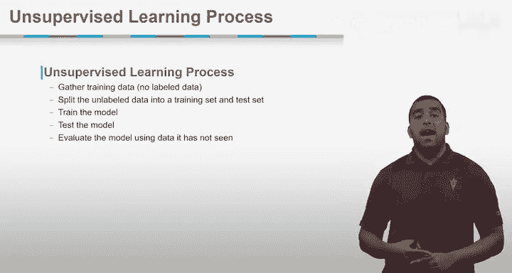

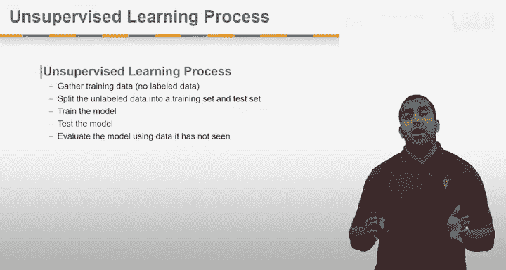

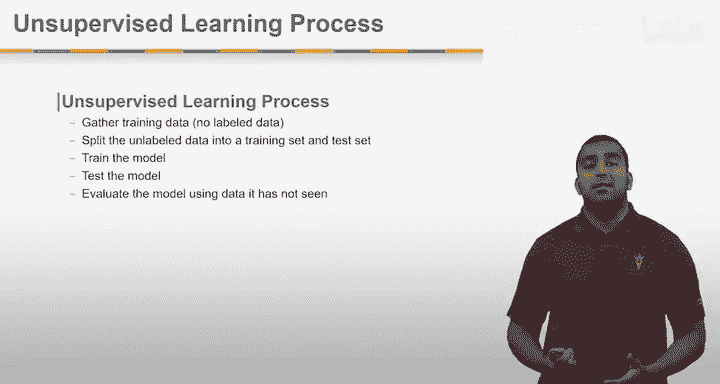

We then train the model on the unlabeled data， make sure that we can get it up to a high enough accuracy where we will then be able to test it on data that it has not seen before。

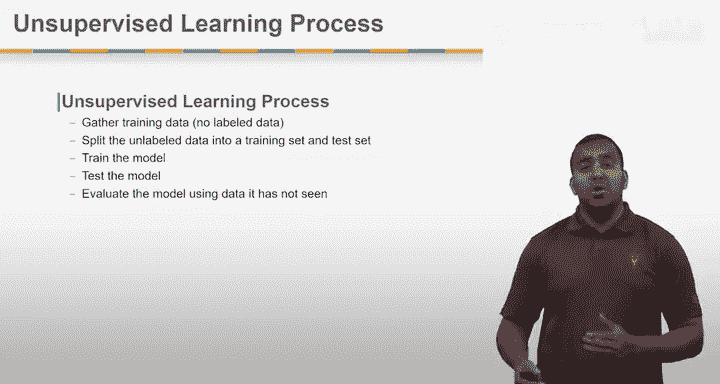

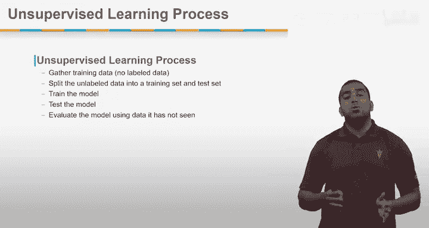

After we've tested it on data， we have not seen before we evaluate the model using the data has not seen and use a certain metric such as accuracy to see how powerful our model is and how accurate or optimal it is。

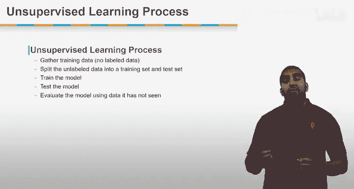

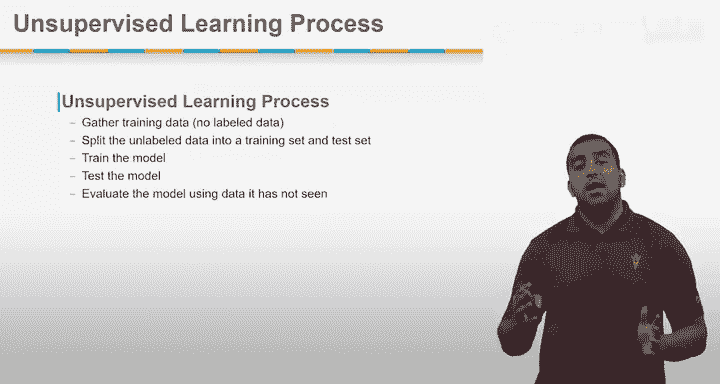

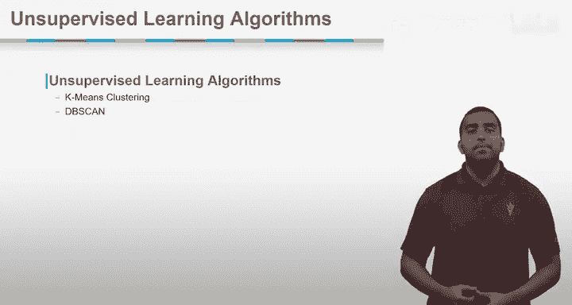

Some of the unsupervised machine learning algorithms that we will be covering in this course include K means clustering and DB scan。

 which we will discuss a lot more in their respective lessons。

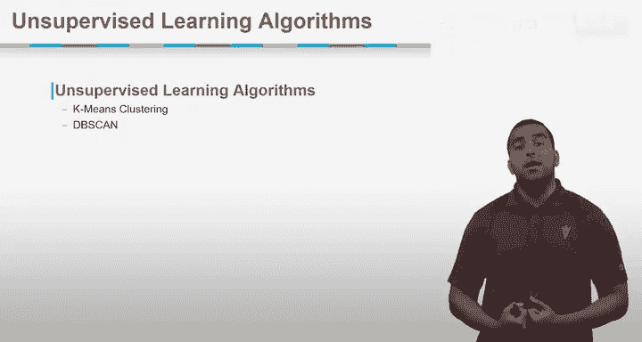

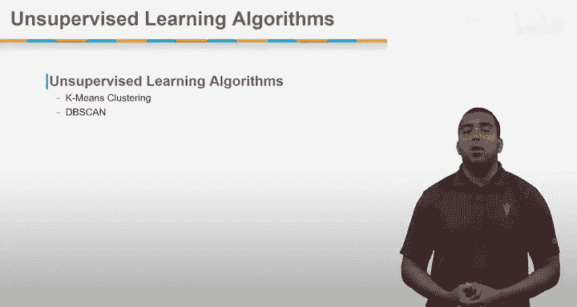

So again， here are some applications of unsupervised machine learning using those same examples that we looked at。

 it is also used in examples such as the self-driving cars， fraud detection。

 credit scoring pattern recognition， we can also look at certain concepts such as recommendation systems which frequently is used by Netflix。

 customer segmentation and marketing where we can find how people utilize certain social media sites。

It's also very useful in big data visualization and feature eitation。Thank you。

