# 亚利桑那州立大学《Python： A Guided Journey from Introduction to Application》中英字幕 - P59：4_数据集加载与处理方法.zh_en - GPT中英字幕课程资源 - BV1J38GzbETT

Welcome back。In this lesson， we're going to be going over datas。

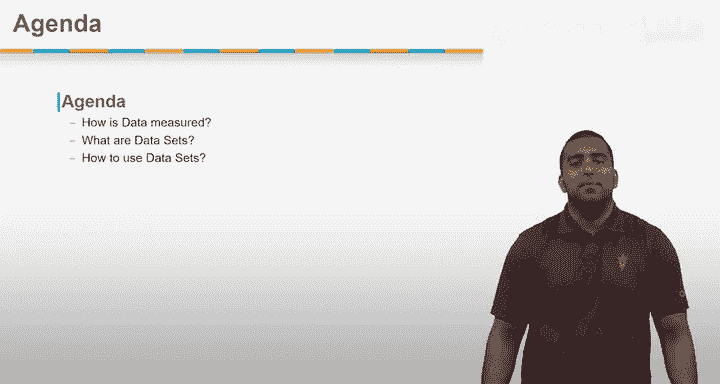

Well be learning how is the data measured or how is data in general measured what are data sets and how do we use data sets in machine learning。

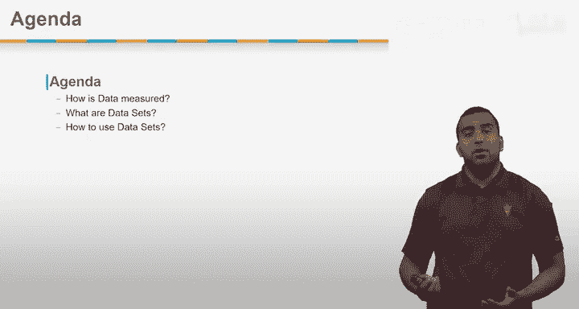

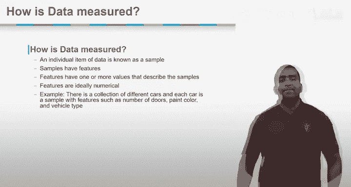

So how is data measured？Well， an individual item of data is known as a sample。

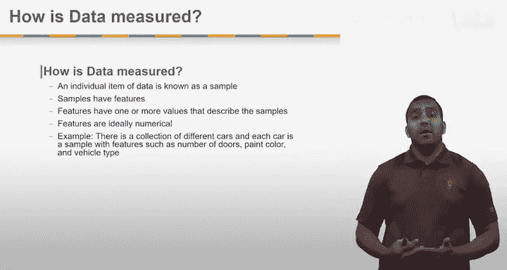

And samples have features。 Think of features as descriptors of what samples are。 For instance。

 we could have samples of different eyes and something that could be used to describe those eyes are eye colored。

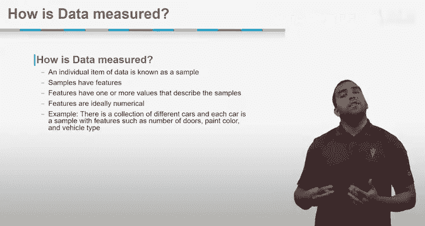

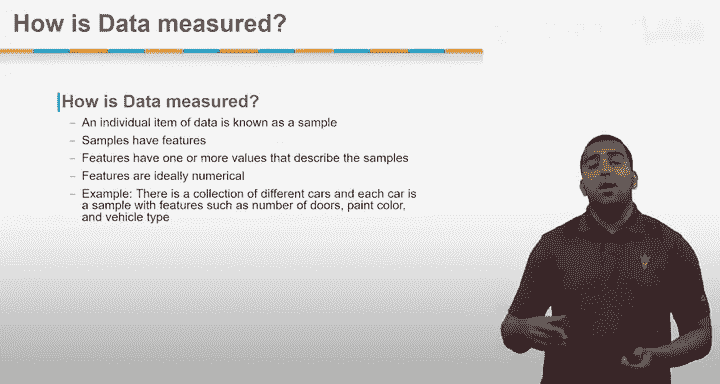

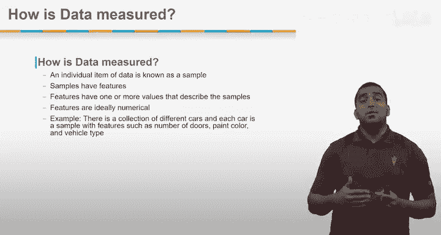

That eye color is known as a feature。 it is what describes each eye or each sample。

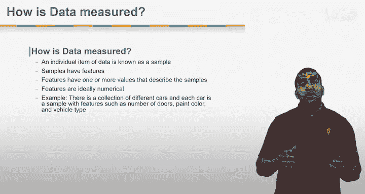

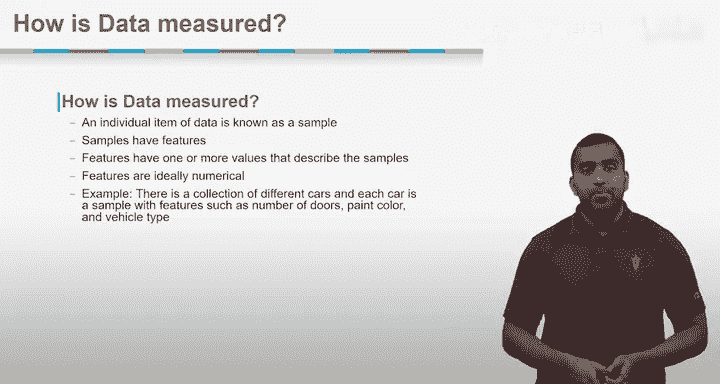

Features have one or more values that describe the samples。

 and they could be ideally numerical kind to show you or to describe what the sample is like。

 it's easy to process numerical values。

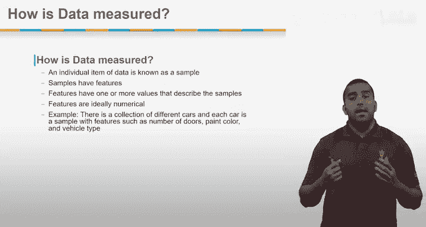

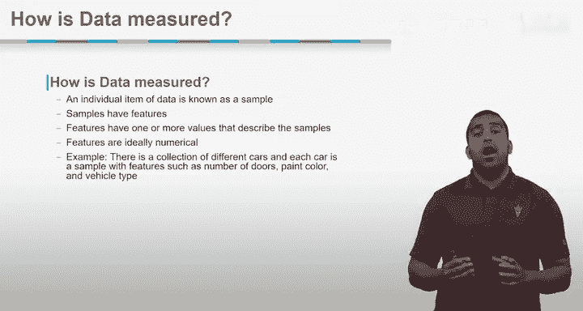

So another example is that say we have a collection of different cars and each car is a sample with features such as the number of doors。

 the paint color and maybe the vehicle type as well。

 that's what features and samples are and that's how data is measured。

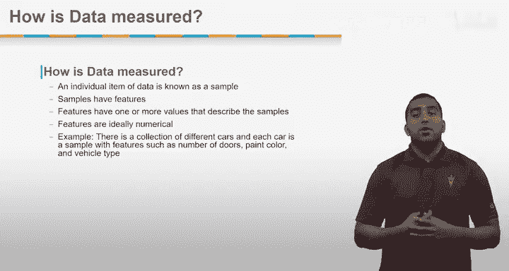

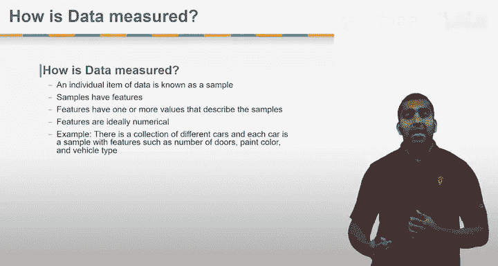

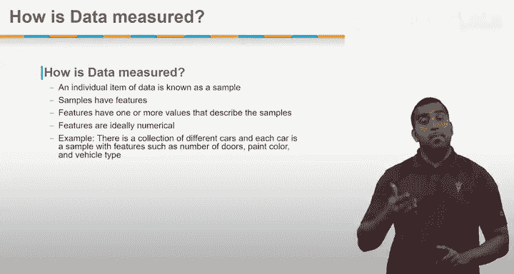

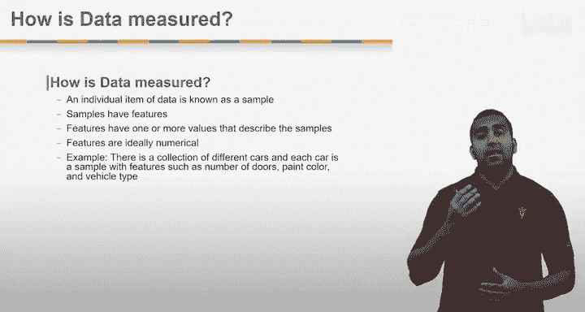

So what are data data sets are a structured collection of data that are structured in a tabular pattern？

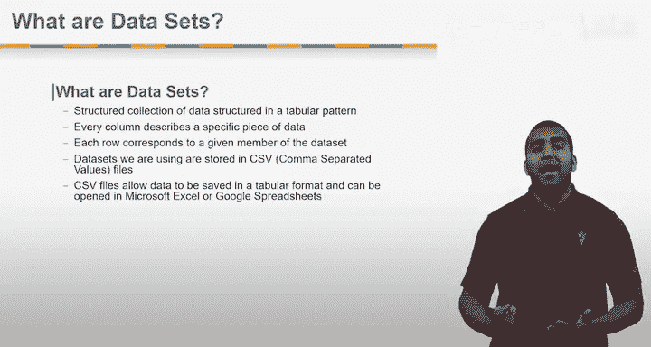

Every column within a data set describes a specific piece of data。

Each column header for label data is known as a feature， which describes each sample。

Each row corresponds to a given member of the data set。

 so it corresponds to basically the samples within the data。

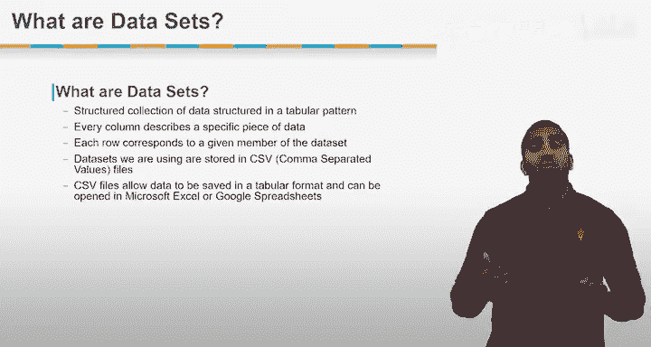

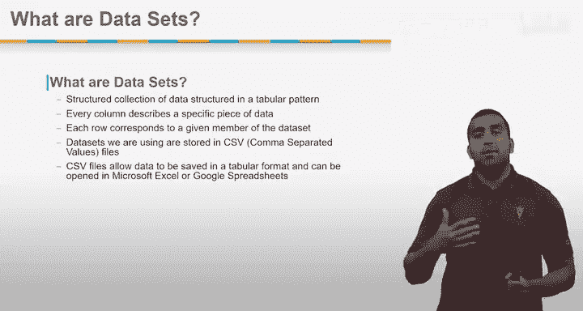

Data sets we are using are stored in CSV file format， CSV stands for comma Se value。

 which means that all data within the CSV file is separated by commas。

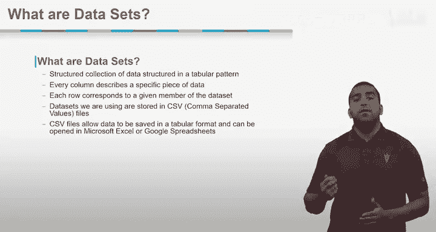

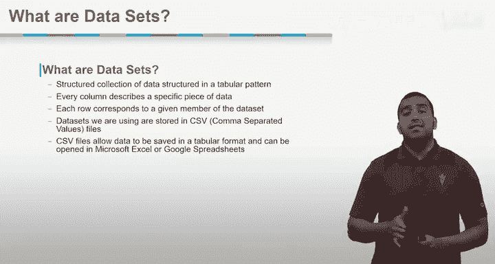

That separator or the comma is also known as a delimiter。

 So when I say we have a delimiter or were specifying the delimiter to be a comma， we're saying that。

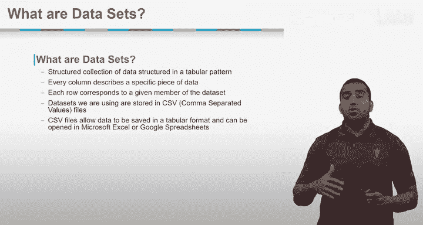

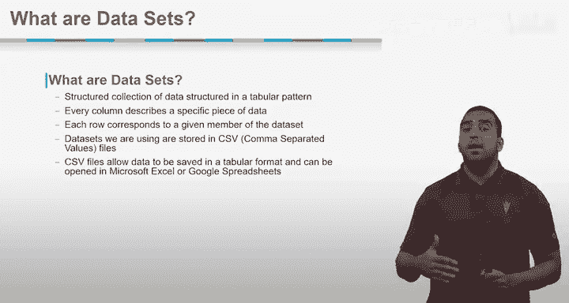

Coma is what is used to separate each sample from each other。

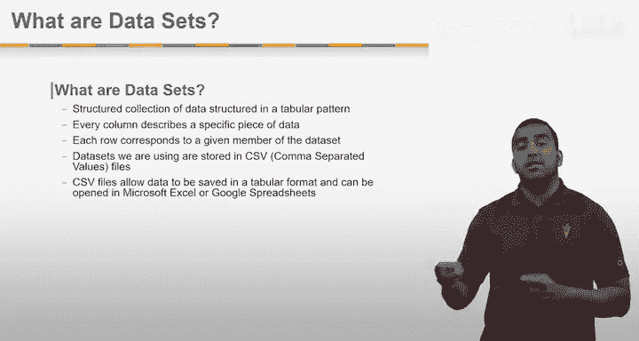

Now， CSV files allow data to be saved in a tabular format and can be used and opened in Microsoft。

 Excel or Google Spreadsheets。

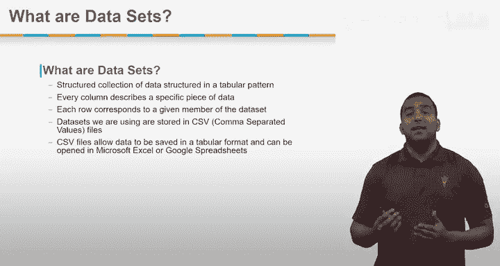

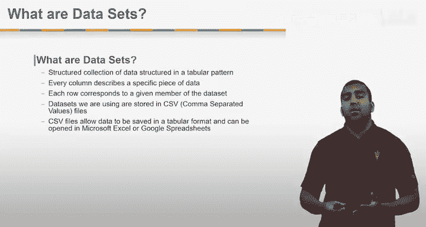

So how do we use data sets data and data sets are used to train and test machine learning models what's the process like Well we developed the model on training data and evaluate the model on the testing data。

The rule of splitting data in machine learning using a data is that 70% of the data is supposed to be used for training data。

 whereas 30% of the dataset is supposed to be split for the testing data。

So that training data is the data that the model will be seeing to to be continuously trained until it performs optimally。

 whereas the testing data is data that the model will not be seen until we would like to evaluate our model's performance。

 basically the testing data is data that's never been seen before。

So in these two examples we have an example of how we load a dataset in this case。

 we're working with the IIS dataset and the nice thing is we are working with the datasets library where we are calling the load IIS function now what the load IIS function does is it basically loads the IIS dataset from the datasets library and restoring that in a variable called IIS dataset。

Now let's say if I want to separate the data from it within this data set right。

 so what I'm doing is I'm using I'm calling the IISO data set and I'm calling I'm splitting the data to make sure that we want to include all rows within the data。

And we're utilizing columns  two and3。That's basically what I'm doing in that second line of code。

In the third line of code， where I'm calling Iris_ datas。 target。

 I'm basically specifying that we want to store the target or the variable we want to predict。

In Y target is basically the prediction variable that we want to to basically evaluate。

 what are we trying to predict， It's the target。 That's what the target is。

 And we're storing that again in variable Y。Finally， in the next example。

 you can see here that I have a line of code that's splitting the data into the training data and the testing data here you can see that we're specifying。

 we're calling a function called the Tra test split function。

 Now we'll go more over this in our demo。But the general idea of how this works is that we are passing in our X data。

 which is basically all the data we want to use for the features to be able to make the prediction our y data which is basically the target and then we're specifying or setting the value of our test size parameter Now we're setting our test size parameter to be 0。

3， which is 30%。See， you can see here that we specified that the ideal rule of splitting data is that 30% should be utilized for the testing data。

 where 70% should be utilized for the training data by specifying that our test size is 0。3。

 we are saying that the sample size of our test data is 30%。

 This implies that our training size is going to be 0。7 or 70%。

 and that's not something we have to specify because it is implied。Now。

 one thing you want to make sure is you always follow this format when you're splitting the data Xtrain。

 comma X test， comma Ytrain， comma Y test， What that will do is once it'll split this data to make sure that it stores all of the 70% into the training data in Xtrain and Y train and the 30% of the testing data into the X test and Y test。

 That's how we train we split our training data and our testing data using a data set。Now。

You want to keep in mind that training data should meet the following criteria。

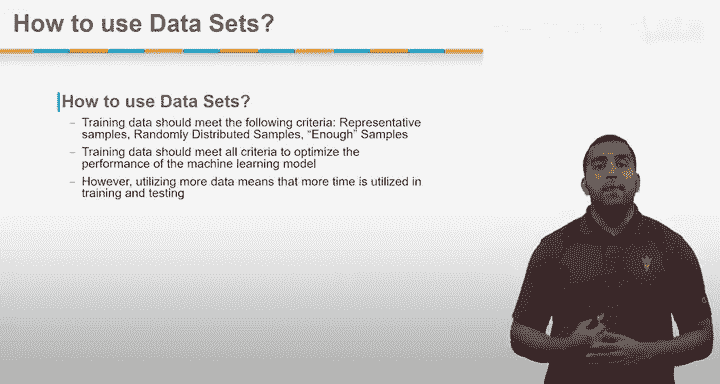

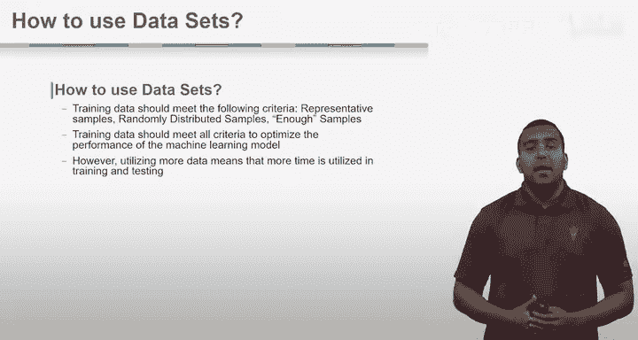

We have representative samples。Randomly distributed samples and were utilizing enough samples to train our model。

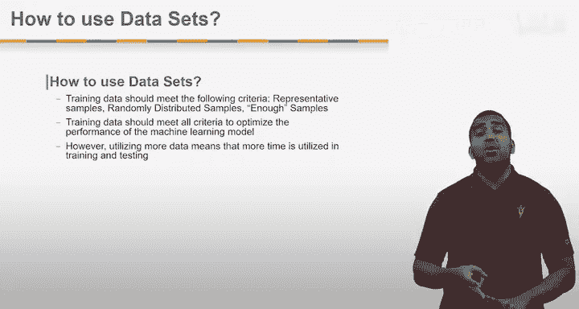

Now， the training data should meet all the criteria to optimize the performance of the machine learning model。

 If we're not using representative samples， our model will underperform。

 meaning itll make inaccurate predictions or classifications if we are not using enough samples to train our model。

 then our model will not have enough information to be able to make accurate predictions same with using randomly distributed samples if we are using data that is very。

 very similar all the time， when there is variation that the model will see then itll more the probability of it making an inaccurate prediction is higher。

😡。

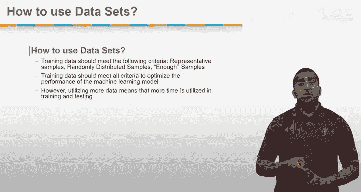

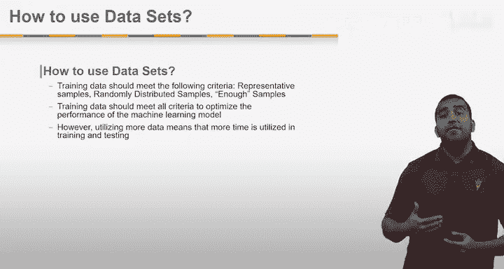

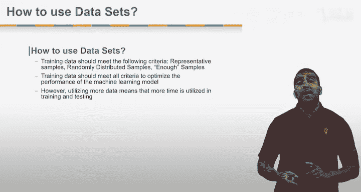

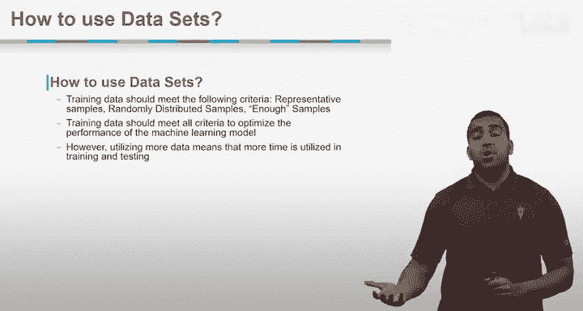

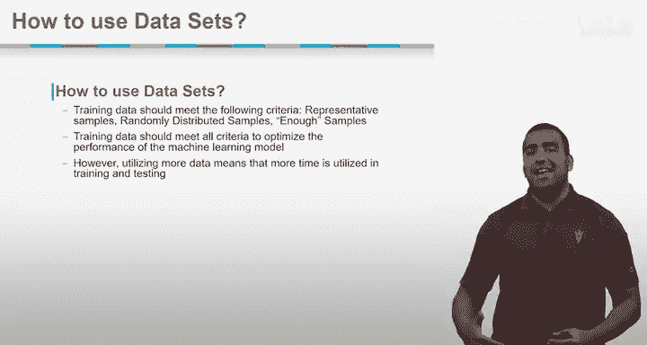

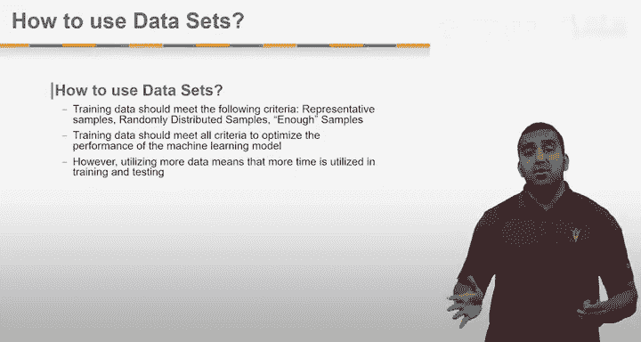

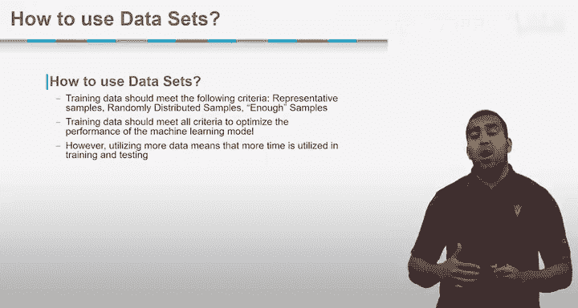

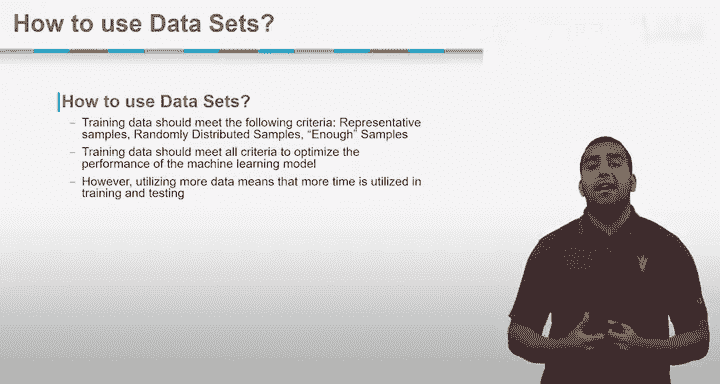

So we want to make sure that all three of these criteria are fulfilled when。

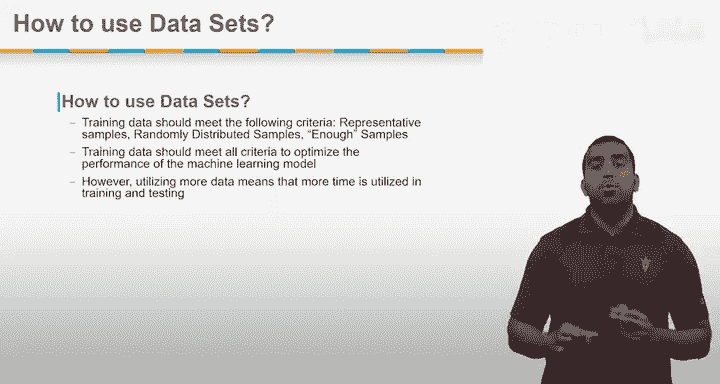

Providing data to our model。

However， keep in mind that utilizing more data means that more time is utilized in training and testing。

 our model typically becomes more complex at the time and there's a higher overload。

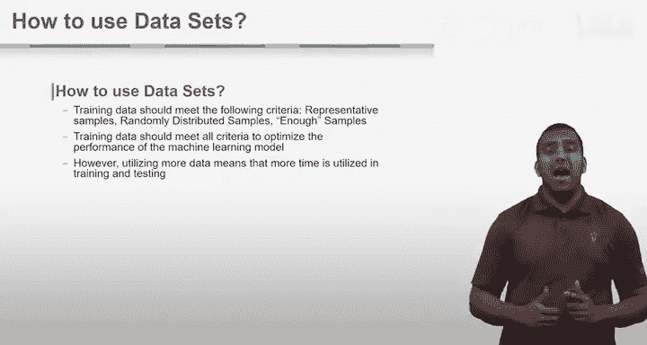

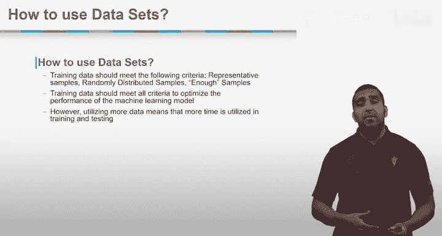

So that brings me to my next point， overfitting versus underfitting。

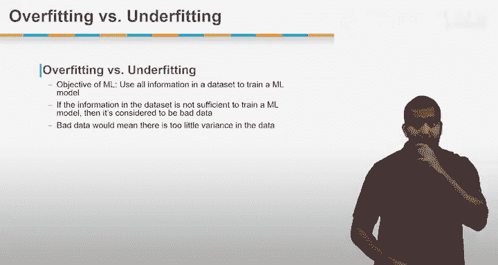

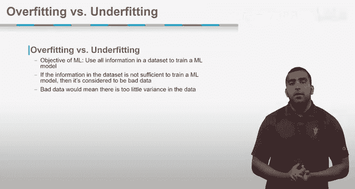

So the main objective of machine learning is to make sure that we utilize all the information in our data to train our machine learning model。

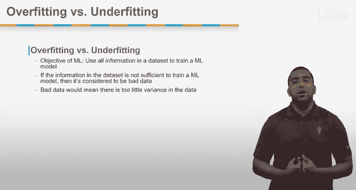

Now if the information in the dataset is not enough to train the model。

 then it's considered to be bad data， why， because our machine learning model will not be able to make accurate predictions or understand what the data is if it doesn't have enough data to it has studied from basically。

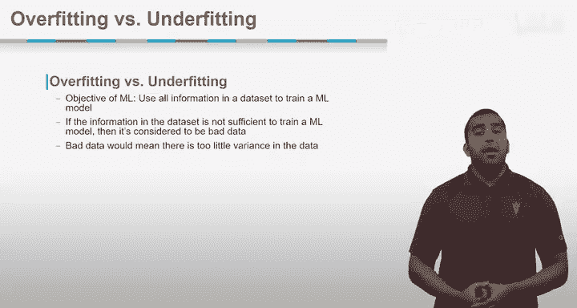

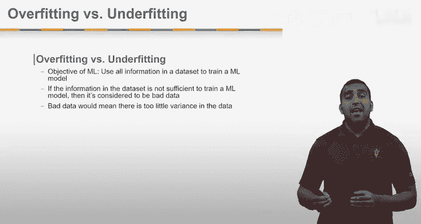

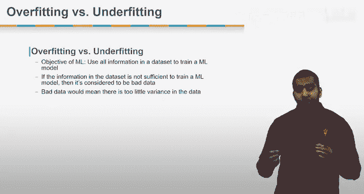

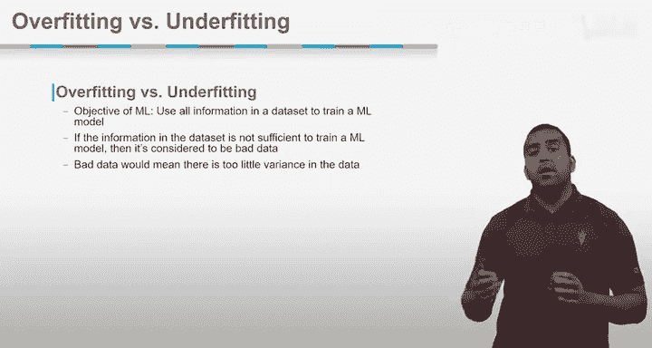

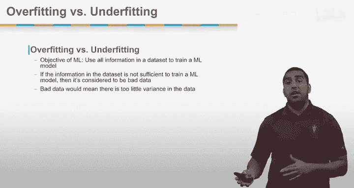

Bad data would mean that theres too little variance in the data。

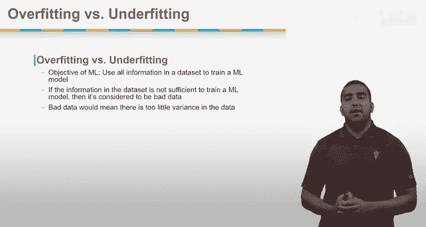

So think of an analogy， say we have a student。

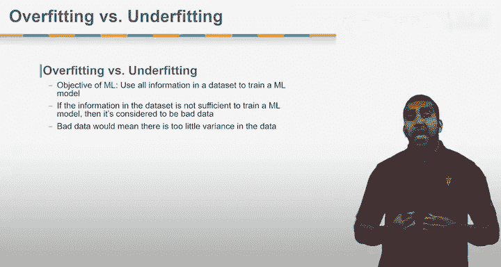

And that student is preparing for an exam。If that student doesn't go through enough examples and practice examples。

 then that student will have a harder time doing well and performing well on the exam just because they haven't trained themselves to be able to see a pattern or to be able to identify differences in what they are learning。

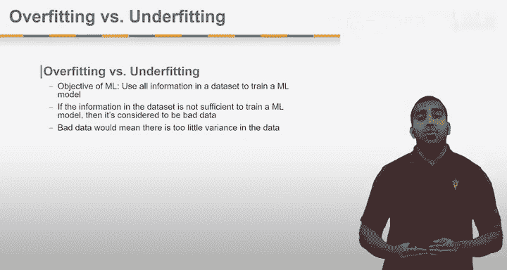

So more on overfitting and underfitting。

If too little information is utilized， the model may experience underfitting underfitting occurs when all the variance in the data is not utilized。

With underfitting， we need to keep in mind that the model is not sufficiently complex and experiences good training results but bad test results。

 What that means is that when we're operating on our training data， we might get great results。

 but when the model has not seen enough samples and it's being applied to new test data where there is a greater variance in change or difference in the samples。

 then it will not perform that well。

Overfitting occurs when more information or data variance in the form of noise in the data is utilized what that means is we are providing too much information。

 too much data too much variance to the model which basically would confuse the model overfitting causes the model to be too complex。

 which also leads to good training results， but bad test results。

Thank you for watching。

