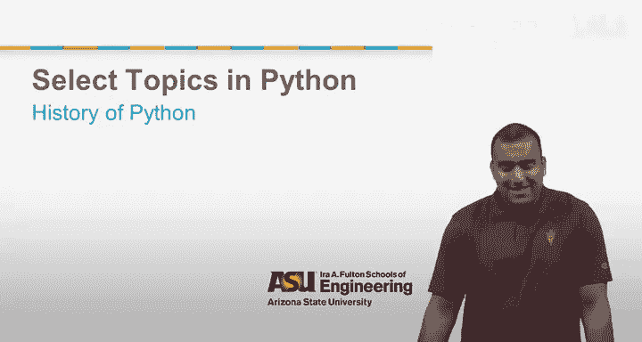
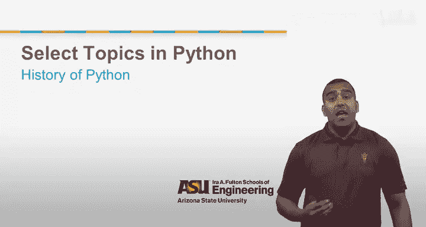
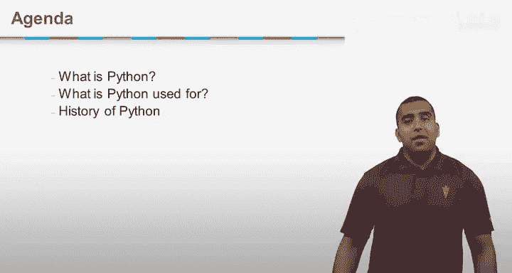
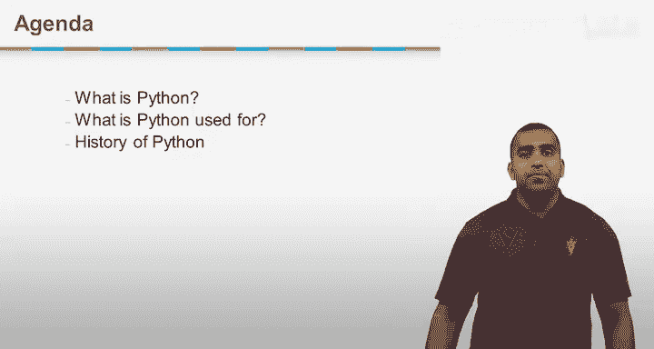
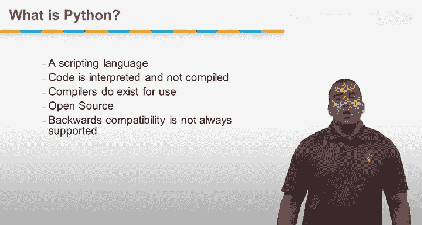
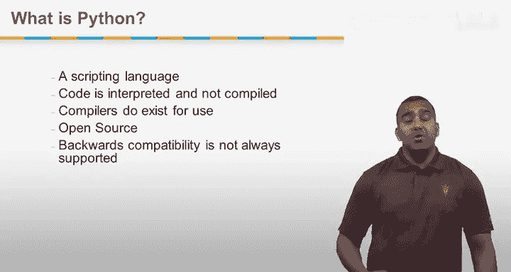
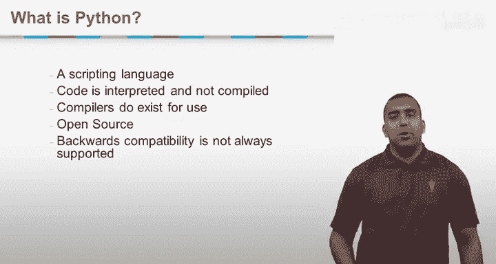
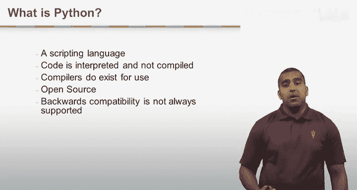
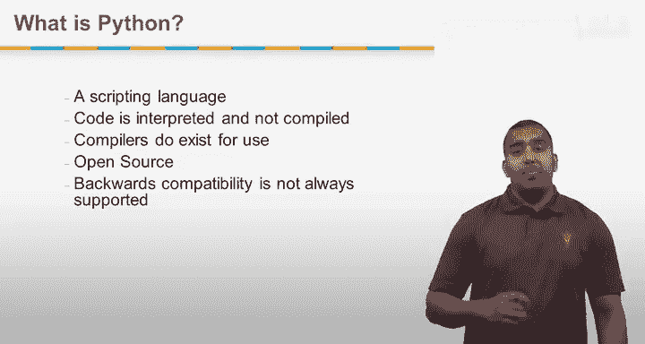
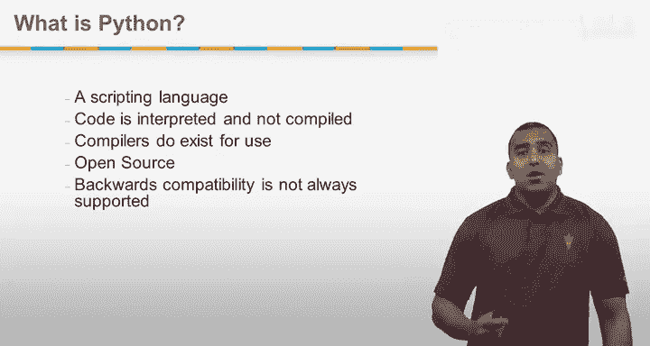

# 亚利桑那州立大学《Python： A Guided Journey from Introduction to Application》中英字幕 - P5：4_Python发展历史.zh_en - GPT中英字幕课程资源 - BV1J38GzbETT

Welcome。In this lesson， we're going to go ahead and go over a history of Python。

Today， we're going to cover what is Python， what is Python used for， and the history of Python。

So what is Python？Python is a scripting language where code is interpreted and not compiled。

Compilrs do exist for use in Python。 However， we primarily utilize the interpreter。

One of the biggest benefits of utilizing Python is that it's open source。

 meaning that anyone can commit code to it and also understand different programs that have already been created for it。

Python it， however， is not always supporting backwards compatibility。

So why are scripts used Well first of all what is a Python script a Python script is a collection of commands in a file that is designed to be run from the command line or within a Python interactive shell。

Writing scripts can be done much quicker than developing compiled code。

 which is one big reason why we utilize scripts today。

Scrriip solutions can be converted to compiled languages；

 we know that scripts can be utilized to develop algorithms， perform what if analysis。

 and establish one off solutions。So here are a few fun facts that cover a brief history of Python。

Python was released in 1991 and was created by Guido von Raum at Centrum Wconunde and Informatica in the Netherlands。

Ourum was a Dutch programmer who received a master's degree in mathematics and computer science。

The place he worked at， which is the Ckunde and in Formatica。

 is a research center in the field of mathematics and theoretical computer science。

Rom usually had the last say in making decisions for any new Python features that were created。

Currently， the steerering Council now makes the decisions for future development for any Python feature。

So one of the greatest things about Python is the vast number of applications it could be applied to。

Some of these applications include machine learning。

 which is a topic we'll be covering in course for。Cybersecur。

 computer networks and artificial intelligence。Thank you for watching。

