# 亚利桑那州立大学《Python： A Guided Journey from Introduction to Application》中英字幕 - P60：5_感知机原理.zh_en - GPT中英字幕课程资源 - BV1J38GzbETT

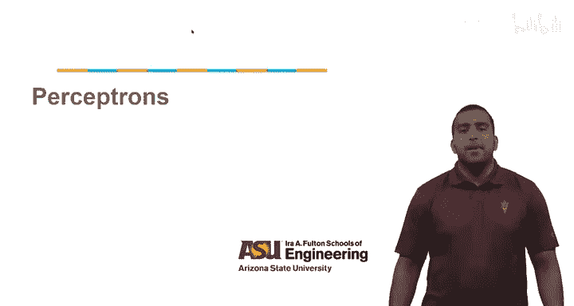

Welcome back。In this lesson， we're going to be going over perceptrons。

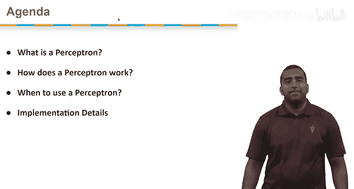

So we're going to cover what is a perceptron， how does a perceptron work， when to use a perceptron。

 and how to basically create our own， so we'll be going over demo in this lesson as well。

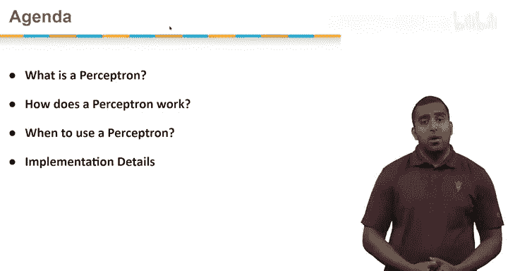

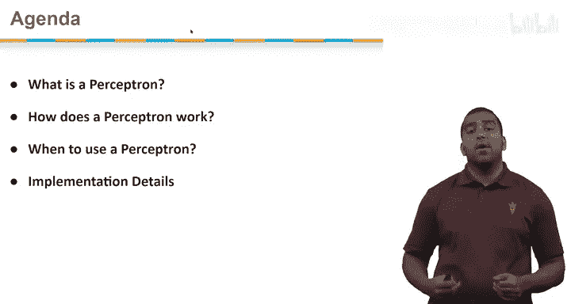

Now， what is a perceptionron， A perceptionceptron is a supervised machine learning algorithm that is based on the neuron model concept。

 Basically what that means is that we have in the neuro model concept。

 neurons receive one or more input signals or a stimulus。

 which is then used to perform computations to arrive at an output， So the example could be this。

 if we show a baby a picture of a dog and that baby sees the picture of the dog。

 that picture is a stimulus， and then the baby will be able to output or state that this is a dog。

 a picture of a dog。

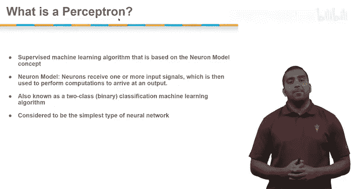

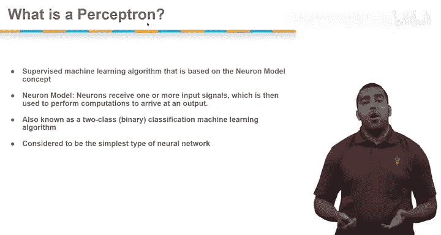

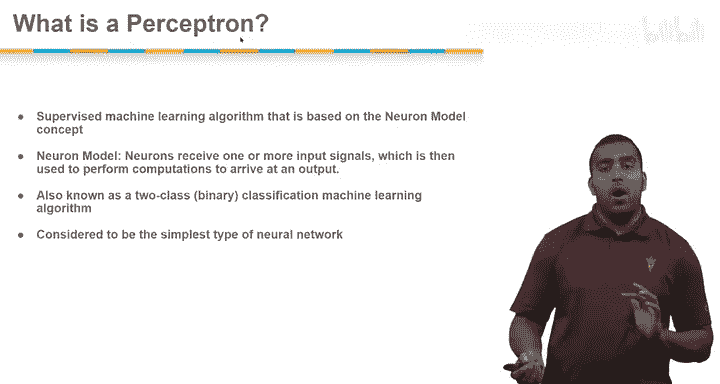

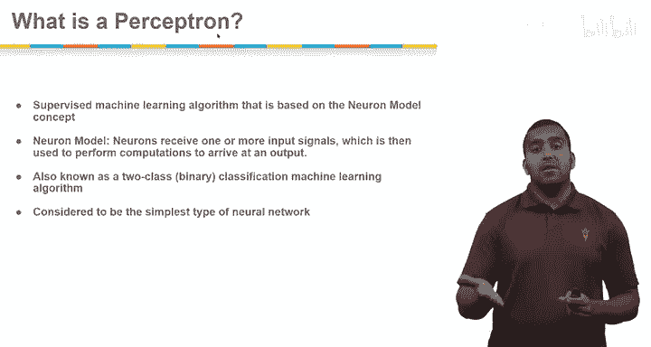

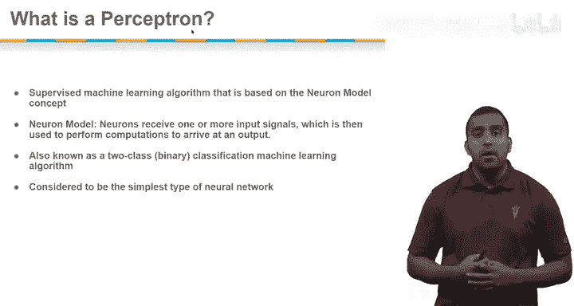

Now a perceptron is also known as a two class binary classification machine learning algorithm。

 basically what that means is are this algorithm will determine whether it's a plus one or a minus one。

 what is it is it a dog or a cat like two different classes， what is it trying to identify。

 that's what the perceptron does。

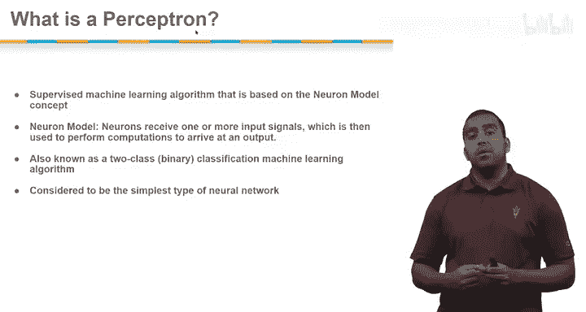

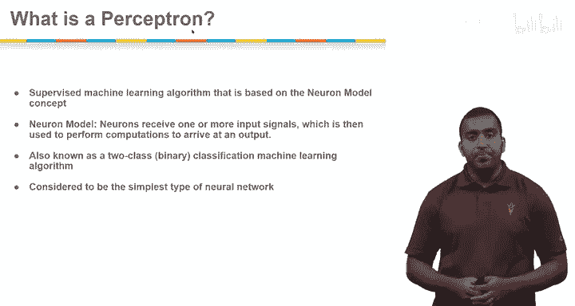

And it's considered to be the most simplest type of the neural network。So how does a perceptron work？

A number of features are passed in as input now I'll show you a visual representation of this in the next slide。

 but essentially we pass in all the features that are utilized in our labeled data and we pass that in as input。

The number of features that we're going to be utilizing are stored in a variable M。

 which you will see in the next slide。Each feature is then multiplied by a respective weight to see which one has a greater priority。

 if one features is weighted more than another， what's more important。

 that's what the weights basically help us determine。Now。

 the sum of the products is computed and results in the value z。

This value Z will be used to determine whether it's either class1 or class2 or plus1 plus two dog or cat。

 What is the class is it going to be identified in， That's what we use the value Z for。

Z is then passed into a function which will determine the classification output in this case。

 plus 1 or -1。 I'll show you that in the example。Now initially。

 the resulting values will be incorrect and itll be fed as input to an error function。

 which you'll see in the next picture， which will then adjust the weights and iterate through the algorithm again until it meets the specified number of iterations through the algorithm。

 essentially we want to optimize what our weight values are so that we can make better predictions。

So here's how a perceptionron works。 We are passing a list of features in this case we're using three features。

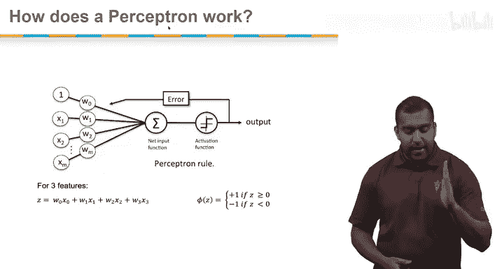

And each feature is multiplied by their respective weights， W0 all the way to W subM。

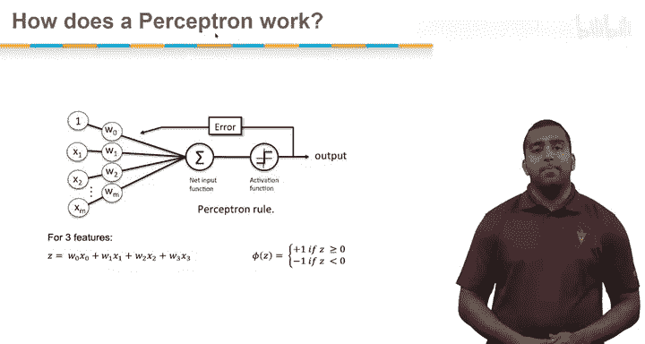

From there， we compute the sum of those products which is passed into the net。

 which is performed by using the net input function。

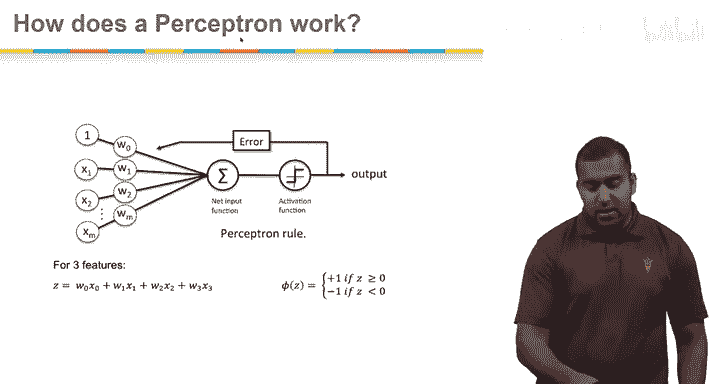

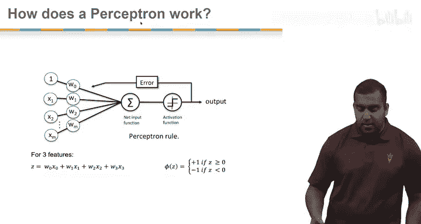

From there， that will output a value Z right here that value Z is passed into the activation function to be able to determine whether the it's classified as a plus one or a minus1 Now。

 depending on what the output is， we can pass into output and pass it into the error function and that error function will then be utilized to see how accurate are our results。

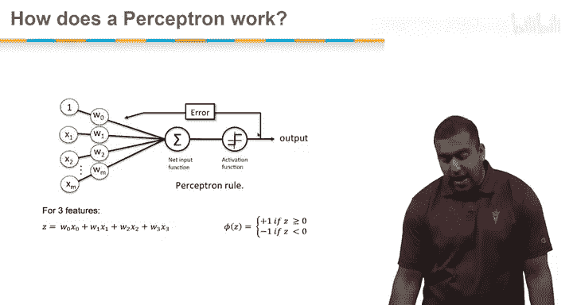

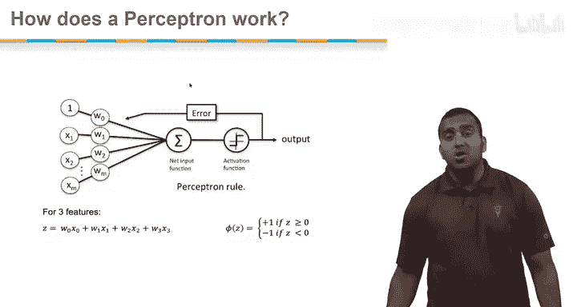

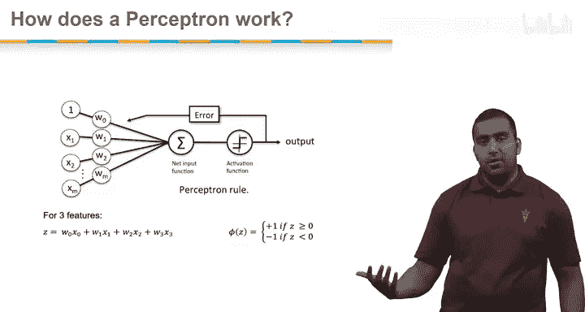

And if our results are not very accurate， then what the air function will do is it'll adjust the weights respectively to make sure that we can improve our results through each iteration for the number of iterations we specified our model to execute。

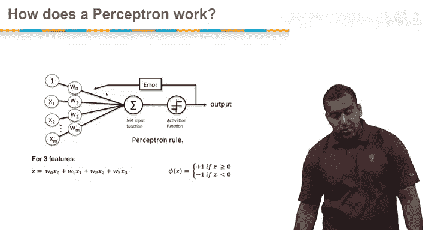

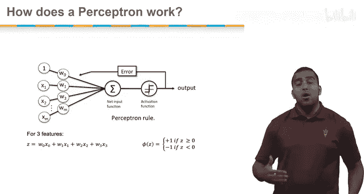

So here you can see that we have the weights multiplied with their respective features and that returns to sum。

 as sum then the sum Z will be used to make the classification whether it's plus 1 or minus1。

 if z is greater than equal to  zero and if z is less than equal to zero or less than  zero。

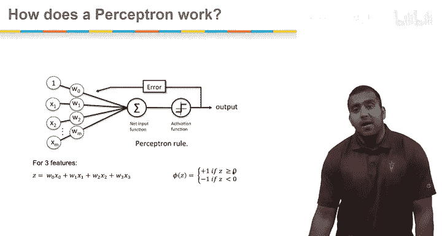

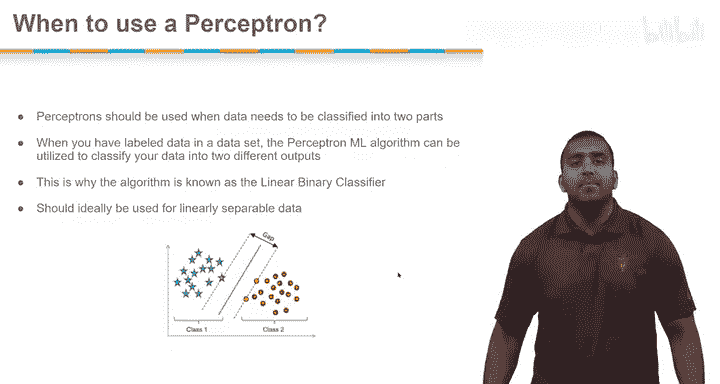

So when do we use a perceptionceptron Percepts should be used when data needs to be classified into two parts when you have labeled data in a data set。

 the perceptron algorithm can be utilized to classify your data into two different outputs。

 that's why it's a two class binary classifier。This is why the algorithm is known as a linear binary classifier。

 as I mentioned earlier。We should it should ideally be used for linearly separable data。

 that's when we want to use a perceptron， so in this example you can see that we were able to linearly separate our data into two separate classes。

 stars and circles， and it's separated by some gap margin。

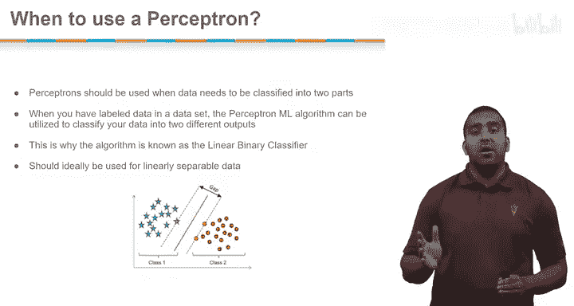

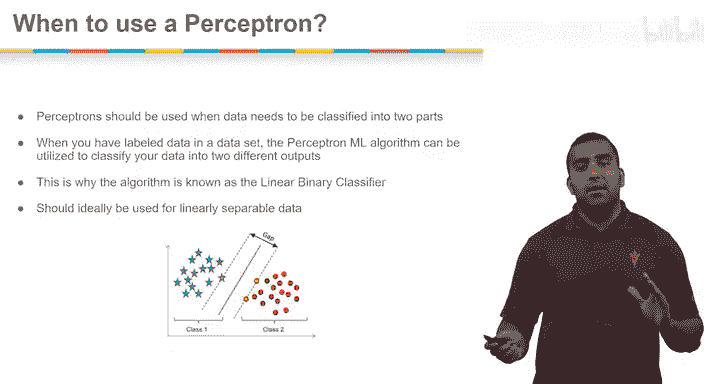

Or distance margin。Here in our implementation details， this is how we create our model。

 We want to iterate through all the samples to make sure we adjust the weights。

An epoch is in iteration through all the samples。

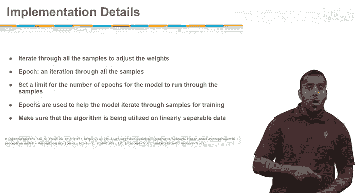

That's something you're going hear me say a lot when I'm describing how many times the model will go through the data。

we want to set the limit of number of epos for the model to run through the samples。

Epochs are used to help the model iterate through the samples for training。

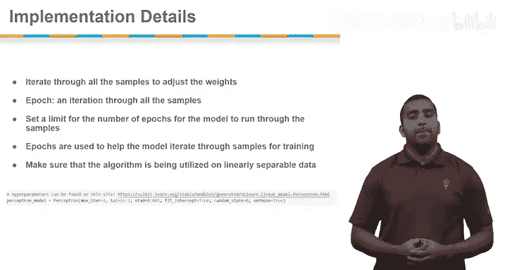

We want to make sure that the algorithm is being utilized on linearly separable data as I mentioned before。

 and if you're interested to know a little bit ahead of time。

 how do you create your model in a single line of code， what you can see in this line of code。

 we're calling the perceptron function or method， which I'll explain a little bit more in the code or in the demo。

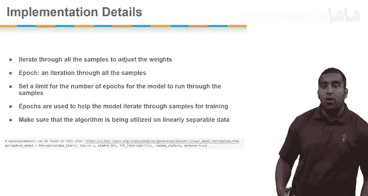

And here I'm specifying some hyper parametersa now hyper parameterss are basically features of the model that are going to be tuned or adjusted to improve the performance of the model I'll talk a little bit more about that in our demo。

Let's go ahead and move on to our demo。Alrighty， so let's go ahead and jump right into our demo。

 So what I first need to do is I need to import all the libraries that I'm going to be utilizing for this project。

 So in this case， we're going to be using the SKLar machine learning library Now notice that in this example which you have access to I have listed comments for every single line of code to explain what I'm using what is it doing and how should it be used I strongly recommend you to look at each comment and make sure you understand if you have any questions anyways。

The SK Learnear library is commonly used for importing machine learning algorithms so from SKLarn we're going to need to import a couple things we're going to need to import data sets because we're going to be using the IIS data as we went through before we're going to be using the train test split function to be able to split our data into testing and training data。

And that'll be utilized or that'll be accessed specifically from model selection within SK Learnearn library。

We also want to import the algorithm that we will be utilizing， which is the perceptron。

 so in this case from the linear we're going to import the Perceptron machine learning algorithm from the SK Learnear library within linearar model。

Finally， from the SKLear Library in metrics， we want to import accuracy score which will be utilized to help us determine or evaluate how accurate is our model。

That's what we're doing， you want to make sure you first import your libraries。After that。

 the next step， or in this case， when we actually begin creating our model。

 the first step is to load the data and store the labels in variable X and the target in variable Y。

 which you can see that we're doing here as I mentioned before So here we're calling the function load Iis。

 which will load the IIS data set from datas and store that in a variable called IIS data set。

From there， I'm going ahead and I'm basically loading the features that I want to use to train the model and make the predictions which will be stored in variable X。

 that's what this line of code is doing right here。In the third line of code。

 I want to specify the target what are we trying to predict so as I mentioned。

 we want to make sure that from the IIS data set we call target and that'll identify the target and store it in variable Y。

Now that we have categorized our data， we want to go ahead and split our data set into our training data and our testing data。

 that's what step two is so utilizing the train test split function we call the train test split function。

 we pass in the parameters， our X data in our Y data。

 which is our target our features in our target and we specify that our test size should be 0。

3 because we're using 30% of the data of the overall data set should be for the test set and 70% of the data should be utilized for the training set。

That's what this line of code does right here and it'll store it in the x train。

 x Y train Y test data。Our third step is to officially create the model。So to create the model。

 we're going to go ahead and call the perceptron function and pass in the following hyperparameters As I mentioned before。

 hyperparameters are what we use to tune or improve certain features to improve the performance of our model In this case。

 we're setting our maximum number of iterations that the perceptionron should undergo to3 we're setting our tolerance to1 e minus-3 now keep in mind I'm going through this at a high level so if you want to know more about what these hyperparameters do。

 you're more than welcome to read more about it on the psyic learn website it has very in-depth explanation of what each of these hyperparameters do I'm just going over the Python code you can utilize to build your very own machine learning model。

Moving forward， we also want to make sure we fit the intercept we set that to true our ETA zeros is a constant by default we set it to 0。

001 random state set to 0 and we're sending over verbose to true so again if you're very curious to learn more about those hyperparameters I suggest you click on that link in the comment and it'll take you there on Python's website where you can learn more about it。

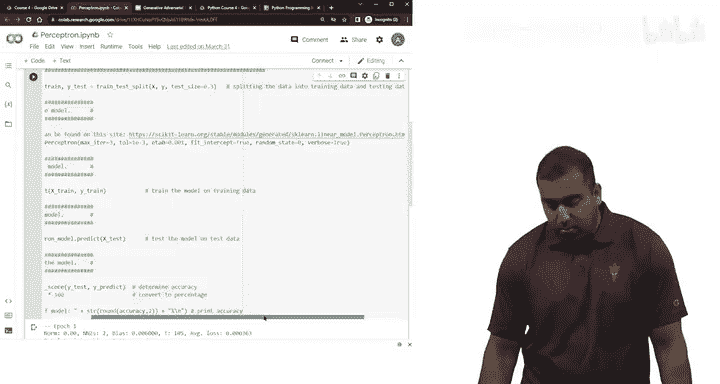

Our fourth step is to train the model。So we train the model by calling the fit function using our we're applying the fit function on our model using Xtrain data and Ytrain data we want to train the model using the training data and that's how that line of code works our next step or step five is to finally test the model we test the model by calling the predict function on the X test data and what that'll do is it'll create all the predictions and we're going to store that into Y predict so that'll create all the Y prediction values。

Finally we want to evaluate our model and see how accurate is our model so I'm calling the accuracy score basically what I'm doing is I'm comparing what our y test data was。

 what we split and what we specified our target to be earlier and why predict which is basically all the predictions that we generated when we were testing our model up here we're comparing the two then finally we just multiply by 100 because we wanted it in two decimal places and we're going to print our accuracy of our model right here。

So you can see that in the output， our code is running through our epos， in our epoOs。

 it's going through three iterations and for every three iterations， we're going to three epoCs。

 which will run through all of the training data each time。And finally， after all of our data。

 after our model has been trained on the training data and it's been applied on the testing data。

 we can finally use it and compare it to how accurate our model is。In this case。

 our predictions were not very accurate。 We got an accuracy of 31。11%， which is not that great。

 What you can do to improve this is you can mess around with the hyperparameters and set up a configuration and play around with it till you see an improvement in your accuracy。

Once you've set up and make sure you understand why are you setting the values of your hyperparameter to improve your accuracy。

 make sure you understand what each hyperparameter does。

 and you'll only be able to do that after reading this article。

That's basically how you create your own machine learning model using the Perceptron algorithm Now don't be overwhelmed if this is all really complex。

 it gets easier and you'll notice that for other machine learning algorithms。

Things will be very similar， so it'll get a lot easier moving forward。Thank you。

