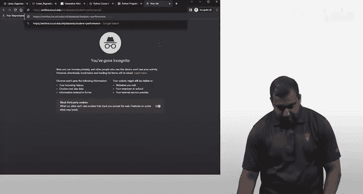
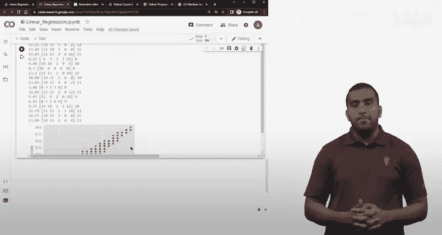

# 亚利桑那州立大学《Python： A Guided Journey from Introduction to Application》中英字幕 - P61：6_线性回归原理.zh_en - GPT中英字幕课程资源 - BV1J38GzbETT

Welcome back。In this lesson， we're going to go ahead and go over linear regression。In today's agenda。

 we'll cover what is linear regression， how does linear regression work。

 and when do we use linear regression。So what is linear regression Linear regression is a supervised machine learning algorithm that finds the best fit linear line between an independent and dependent variables。

 so you may have learned about the equation or formula y equals Mx plus B in algebra。Basically。

 linear regression follows that concept， and we are utilizing that in machine learning to make predictions。

In other words， the algorithm identifies the linear relationship between the dependent and the independent variables。

 independent variables being what we control， dependent variables being what actually is the result based on an adjustment in the independent variables。

Now there are two types of linear regression， the first type is simple linear regression。

Where one independent variable is used for the model。To identify a relationship。

 whereas multiple linear regression is the second type of linear regression where multiple independent variables are utilized for the model to identify a relationship。

So how does the new regression work。The objective is to find the best fit linear line and the optimal values of intercept and coefficients such that the error is minimized。

 Basically we want to find the line of best fit that best fits to the data in this graph here you can see we have our independent variable X and our dependent variable Y we want to identify the line of best fit that basically demonstrates how close or what the ideal relationship is between these two variables。

Given the independent variable on the x axis and the dependent variable on the y axis。

 the line of best fit is predicted by the model and fit on the graph。Now。

 the linear regression model will fit the predicted line of best fit on the test data and will then be evaluated after it has been trained。

So when do we use linear regression， when we're given a data set with labeled data。

 linear regression can be utilized to predict the value of a dependent variable given a certain independent variable or multiple independent variables。

We utilize linear near regression when trying to predict a continuous value rather than a class。

When utilizing one independent variable， we use simple linear regression。

 and when we're using multiple independent variables， we use multiple regression。😊。

In this line of code right here， this is what we utilize to create our linear regression model。

 so from the linear model library in Askkiar we are calling the linear regression function。

 which will create our linear regression model and we are storing that in a variable called linear regression model。

Let's go ahead and jump right into our demo。

So as I mentioned before， the first thing you always need to do is make sure you import the libraries that you will be utilizing for your project In this case the libraries will need is pandas which is use for data frames now data frames are utilized to basically structure your data so that you can visually see what your data looks like in a frame。

Or a table。We also want to import nuumpPI， which is going to be used for arrays。

 a topic that you have learned earlier， and that's going to be utilized for splitting our data。

The next library we're going to need is Maplot LibB Maplloot LibB is used for graphing or plotting your data and if you want to see what it looks like visually。

Finally， we need to import linear model from SKLn because that's what we'll be utilizing to create our linear regression model。

 and we also need to import train test split from model selection within SKLn because that's what we're going to be utilizing to splitter data。

Now， one thing you need to make sure is this time we are using a CSV file to load or to train our model。

 so to load your CSV file in Google Collab， what you need to do。

As you need to click on the file Explorer icon right here。Click on the upload button above。

 go to your downloads and click on studentmat。csv Now what that does is it'll upload your CSv or your Excel file onto your drive temporarily so you can execute your Python script on that。

ExceptThat's on that CSv or Excel file now if you're utilizing another。Local。Tool or IDE。

 a local IDE such as Microsoft Visual Studio code， or you're using something else。

 you need to make sure that that CSV or Excel file is within the same directory of your Python script。

 otherwise it'll have a hard time navigating and finding that Excel or CSV file。

After you have imported all of your libraries。The first step to do to create your model is so you need to load the data and store the labels in variable X and the target and variable Y。

So what we're going to do is we're going to call the Read CSV function from the panndas library which we named it as PD and basically what that does is it says we want to access the studentmat。

csv file and we want to make sure that we specify that our separator is by a semicolon so in our CSV file every sample or data sample is separated by a semicolon they're their own samples。

And we stored that in a variable called data。If you want to look at what that data looks like before it's been。

Processed you can print data。head What head does is it reveals what the first five rows of your data in your data frame looks like。

From there， we want to extract the features that we want to utilize a train our model。

 so in this case， the features that we want to utilize from our data is G1， G2 G3。

 which are our three grade periods。Study time， which is the amount of time the student utilizes to study。

The number of failures that student goes through and the number of absences。Now， after you do that。

 you can go ahead and print data head again to see what does our data look like under these attributes or features right here and what are the first five rows。

 what do they look like Now， if you want to know more about what these basic。

Features look like and what kind of data do they hold？

Where you need to go is you need to go to the data you need to go to this site here。

 the UCI machine learning repository。 This is a website that contains many。

 many really useful preprocessed data that's clean and that can be utilized to train your own machine learning model。

 it consists of descriptors that describe what are your features， What is the data used。

 So if I were to click on this link right here or I copy paste it。And let's say I open up a new tab。

Where I go here， it'll take me to my UCI machine learning repository website where you can see that we have a student performance data set Now you can access the CSv file from our course。

 but in case you want to access the CSv file from here， all you need to do is go to data folder。

 click on student。 zip and then just extract the folder and that's where you can find the studentmat CSv file。

But more on this website， you can see that we have different dataset set characteristics which is super useful that describes the data。

 the number of attributes or features utilized to describe the data， and the number of samples。

 in this case， 649 samples。And you can find the descriptions of all the features right over here if you're curious to learn more。

 so again， I've linked that in the code within the comment。

 just make sure you navigate to that link so you can learn more。Moving forward。

 I specified my target to be G3。 That's the variable that we are trying to predict。And finally。

 I'm splitting my data into the X and Y data where our y is our target and our X data is all the features we are using to predict our target。

 So notice here I'm calling data dot， I'm calling drop， basically telling that。😊。

All data should be utilized， all data should be utilized in X， except for our target， which is G3。

 which is the student's final grade that we are trying to predict。Okay。

 so now that we've split our data respectively， we want to go ahead and train our model that's our actually before we train our model。

 we want to split the data into the test set and training set。So again， as you've seen before。

 we call the Tra test split function， specify that our test size is 0。3 for 30% for our test set。

 70% for our training set， and so forth。Step three。

 create the model that's like what you've seen before using the linearar model library in asLn。

 we call linear regression and that will create our linear regression model。

Our fourth step is to train the model。To train the model we call the fit function Now we're basically fitting our model on our training data in this case。

 which is x train and Y train。Finally， in our step 5。

 we test the model where we're basically telling our model to make predictions on our X test data。

 and that will create what our Y predict values are。

 what our predictions are and then we move on to evaluating the model， which is step6。

 to evaluate the model we're calling the score function on our linear regression model。

 and we pass in our X test and y test parameters， so basically what we're using this to make sure that we evaluate how accurate are our results。

From there I'm just multiplying it by 100 and rounding it to two decimal places and then I can print out my accuracy to see how accurate my model is and if it works optimally。

Now in these next two blocks of code， if you're curious to see what your results were compared to what the expected results were。

 you can create a for loop that will iterate through all of the predictions that your model made and you can go ahead and print out what your prediction was followed by the input parameters that were used to make the test。

Followed by the actual result， which was denoted in Y underscored test so do prediction and your expected is here。

And finally， if you're curious to graph and plot your results， that's where mapplloot Lib comes in。

 so our x or independent variable is grade period2 if we want to just see what it looks like with respect to grade period2 and our dependent variable in this case is y is G3 which is what we're trying to predict。

 and basically I' want to plot this on a scatter plot and you can see that when I'm plotting it on a scatter plot I'm using data X data Y。

And you can see that I am specifying the x label to be x。

 which is G2 and from our Y label should be labeled as final grade。And finally。

 I'm calling show function for PLT because that will like display what your plot looks like。

 So here you can see after I've run the code， my the accuracy of my model is 85。7%。

 which is pretty good。😊，And you can see what my actual prediction was versus what the expected result is and what are the input parameters which are right over here。

And you can go through that， see how accurate your model。

 Some predictions are going to be off because we don't have 100% accuracy。 That's okay。

 That's where you just have to work on improving your model， training it。

 messing around with the hyperpara， making sure it improves with the higher accuracy。

 And you'll see similar， closer results。 For instance， here we have our。

Expected our predicted value to be 8。14， whereas our expected value is 8 Now if you want to see what the graph looks like。

 if in this case we're visualizing what grade2 we're predicting we're using grade2 to make the predictions we're going to put down the x axis and our final grades here。

 we can see we have a linear relationship right here。

 which is why linear regression would work the best for this project。Again。

 if you have any questions or you still don't understand something。

 I would highly recommend you go back to the model， play around with the hyperparameters。

 try to understand it and just play around with it， but yeah， thank you。

