# 亚利桑那州立大学《Python： A Guided Journey from Introduction to Application》中英字幕 - P62：7_K最近邻算法.zh_en - GPT中英字幕课程资源 - BV1J38GzbETT

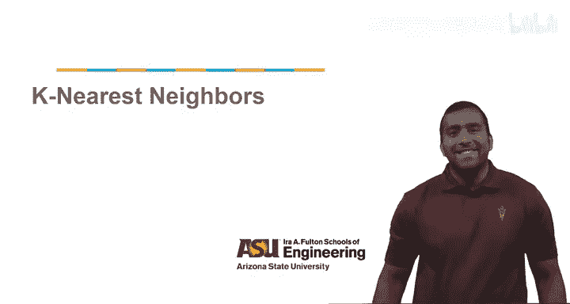

Welcome in this lecture， we'll be going over Kaer's neighbors。

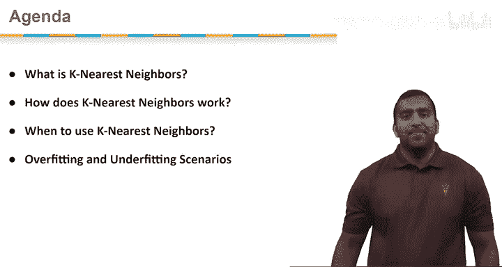

We're going to be covering what is Canier neighbors， how does Can neighbors work。

 when do you use Canier neighbors， and we're going to go over some overfitting and underfitting scenarios that pertain to this machine learning algorithm。

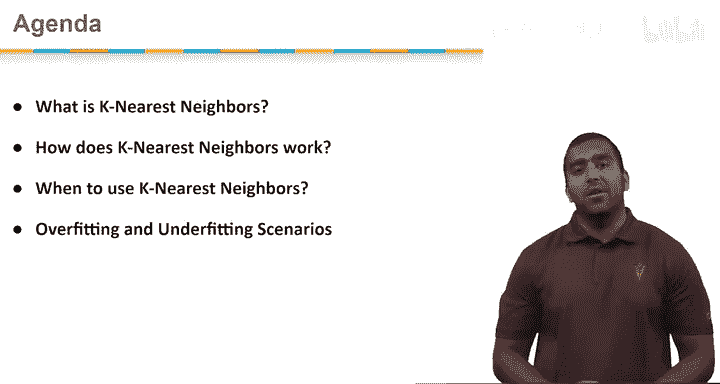

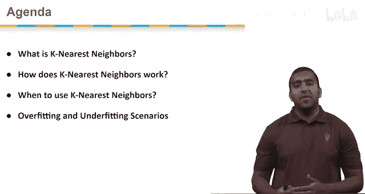

So what is Ken years neighbors， it's a supervised machine learning algorithm which means that we are utilizing data that are labeled。

 we have labeled data to train our machine learning model。

 it can be used for classification and regression problems。

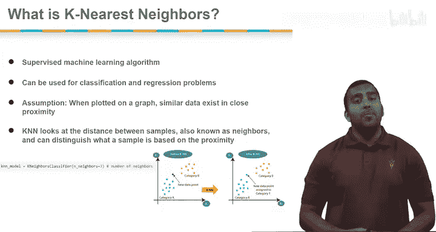

One major assumption we make when utilizing the Can nearest neighbors algorithm is that when it is plotted on a graph。

 similar data exists within close proximity， so looking at this example or this image right here。

 we could see that data points that are within a close distance are considered to be of the same class。

 whereas data points that are within a distance threshold that's too far away are considered to be of different classes。

 and essentially for every data point we want to make sure that based on how close it is to another data point we can identify its class。

Kenier's neighbors looks at the distance between the samples。

 also known as neighbors and can distinguish what a sample is based on its proximity。

 as I mentioned before。In this line of code right here。

 you can see that we are creating ouraneers neighborighs model。

 I'll talk a little bit more about this in our demo。

 but here you can see it takes in a parameter calledN_ neighbors which is the number of neighbors we want to specify。

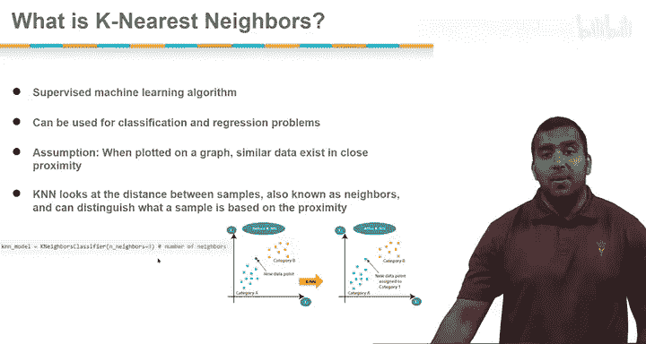

So how does Caniers neighbors work Well here's the basic procedure your first step is to load your labeled data labeled data meaning features that describe the data are known we have a ground truth。

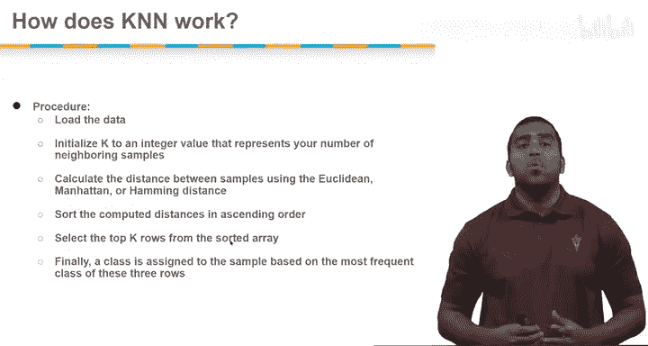

The next step is to initialize K to an integer value that represents your number of neighboring samples。

 we want to specify basically how many neighbors should a sample be surrounded by。

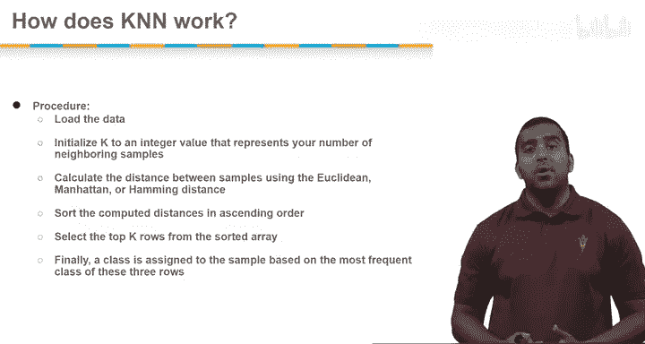

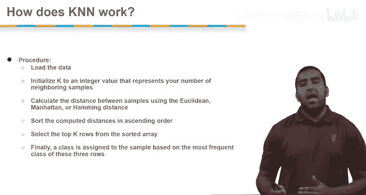

Step3 is to calculate the distance between the samples using the Euclidean。

 Manhattan or heming distance In our example， we're going to stick with the Euclidean distance for now。

Step4 to sort the computed distances in ascending order。

Followed by selecting the top K rows from the sortded array， you'll see how this works in our demo。

Finally， a class is assigned to the sample based on the most frequent class of these three rows。

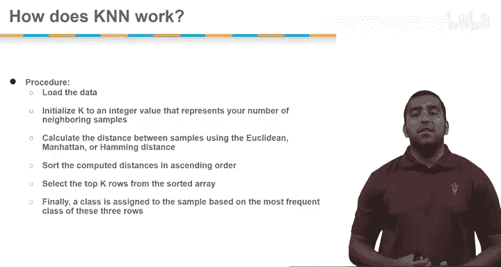

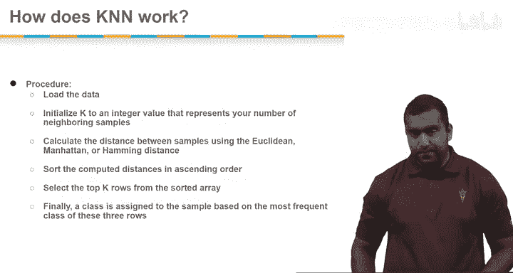

When given a labeled data set， Caner's neighbors can be utilized as it is a supervised machine learning algorithm that operates on the labeled data。

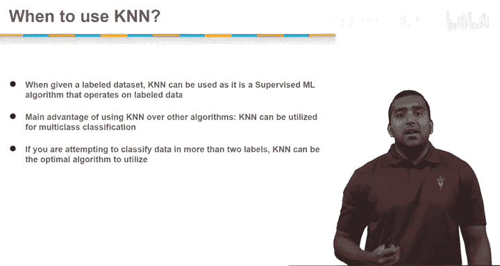

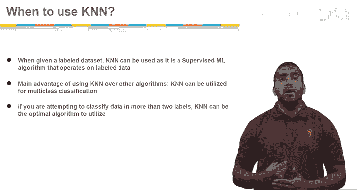

If we had unlabeled data， then we wouldn't be able to use Can nearest neighbors because it's a supervised machine learning algorithm。

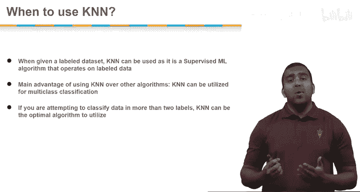

The main advantage of using this algorithm over any other algorithms is that it can be utilized for multi class classification。

 meaning that we can identify more than one class。

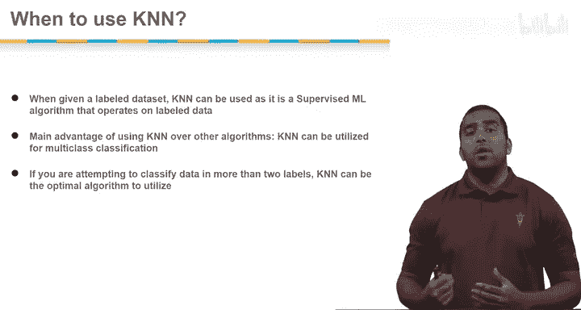

Now， if you are attempting to classify data in more than two labels。

 K&N can be the best algorithm to utilize for this scenario。

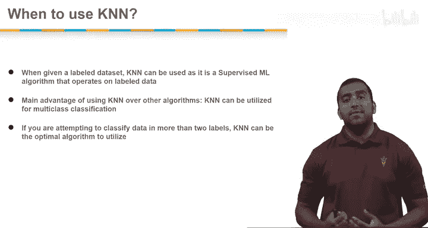

So overfitting and underfitting。Now， if we have too many neighbors or we utilize too many neighbors in our model。

 then underfitting may occur， which means that the samples are not considered to be important enough。

 there's just too much information that we are utilizing。

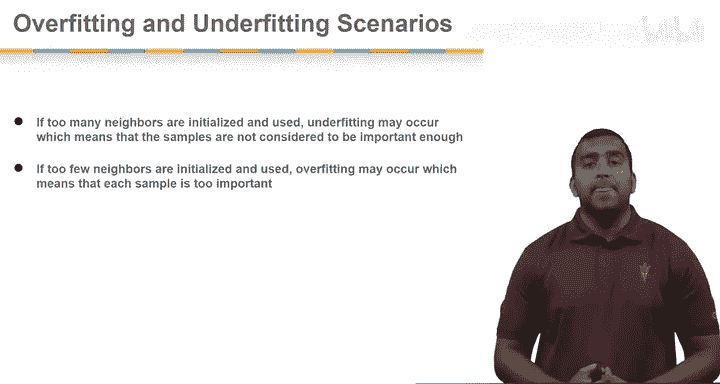

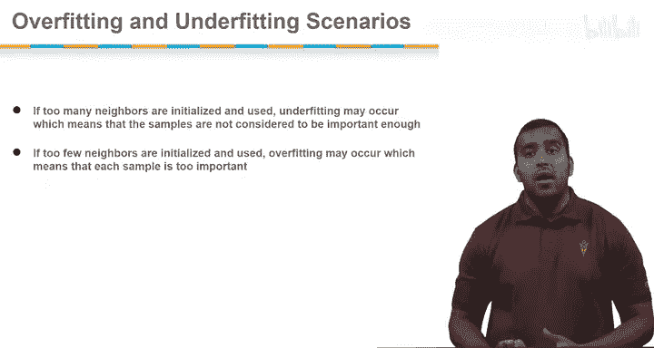

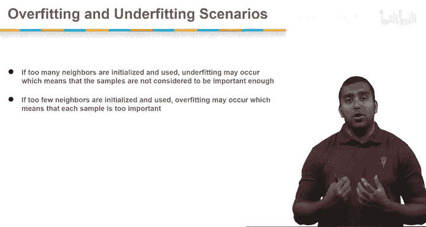

If too few neighbors are initial and utilized， overfitting may occur。

 which means that each sample is way too important。

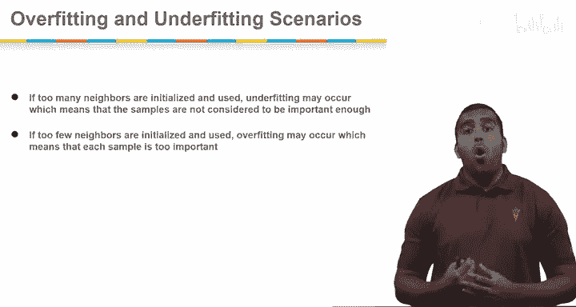

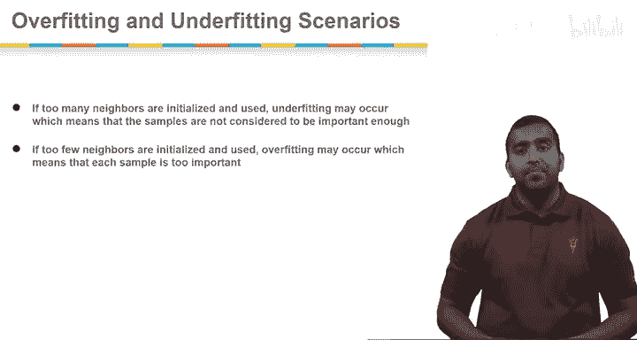

Now let's go ahead and jump right into our demo。So as always。

 our first step is to initialize our libraries here you can see that I'm using the panndas libraries since we'll be working with data frames。

 the Numpy libraries since we're working with array arrays from the SK Learn machinechine learninging library。

 we want to import K nearest Neighs classifier to be able to create our K&N model。

And then basically from SK learn， we also want to import Tra test split to be able to split our training data from our testing data。

Followed by importing a linear model just for the sake of comparison and pre processing to basically pre processces the data or structure the data to make sure it's clean。

So there you can see that we went ahead and imported our libraries now one thing I want to make sure you do before you run that code or we proceed is that you upload the Car dot data file now I have it saved on my desktop。

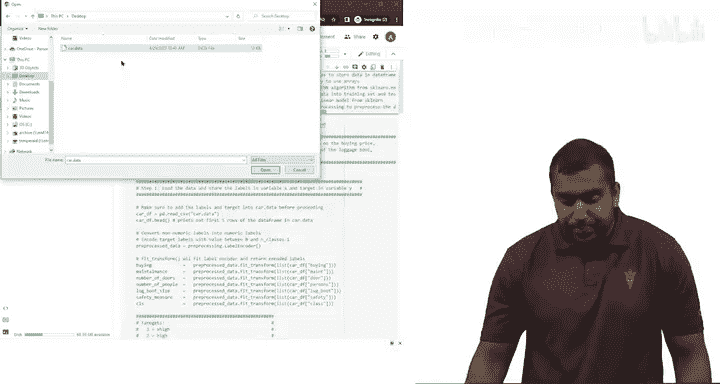

You just want to click on the file upload button， load your data file。

 and basically we're trying to create a classifier that's able to identify a car's value based on certain attributes Now I'll describe that more as we go through but just make sure you load the CarO data file which you can find on our class page。

Now if you want to know more about the dataset， the CA data。

 I have provided the link in the Python script， which you can look up and Google and learn more about the dataset。

 learn more about the attributes that will be utilizing。

 I'll let you navigate that and explore at your own time。

 highly recommend you do that before you proceed throughout the rest of this tutorial。Now。

 the first step you want to do is you want to make sure you load your data and the labels in variable X and you load your target in variable Y。

So here you can see that I am first basically taking in the data file。

 taking all the data from the CarA data file and storing it within a data frame by calling the Read to underscore CSV file。

 that's a unique function specific todas that will help you convert data into a data frame。Now。

 if I did CA underscore DF do head， what that we'll do is'll print the first five rows of the data frame from Car dot data and you can see an organized tabular structure of your data。

Let's see if I have it loaded so yeah， you could see when you run the script。

 you'll be able to see it。

The next thing we want to do is we want to convert nonnumeric labels into numeric labeled data。

 so one of some of our attributes you'll notice are not numeric values。

 meaning they're not integer values and that makes it very hard to classify data since we don't want to have a mixture of numeric values in nonnumeric values。

 so we want to convert everything to numeric values and then we want to encode those target labels with values between zero and like your number of classes minus1。

That's what I'm doing here。 So basically I'm preprocessing my data I'm structuring it to get everything into a numeric value by first calling the label encoder function to encode everything And then from there I'm going to go ahead and call fit transform on the features that I want to utilize to basically convert it into those numeric values Now here you can see the attributes that we're going to be utilizing are buying。

Maintenance， number of doors， persons， which is the number of people。Lug boot。

 which is the size of your trunk in the car， safety， so the safety rating of the vehicle。

 and then the class the class type of the class of the vehicle itself。

And basically after I've here I'm just preproces it to make sure that they're all numeric values and I store them in their respective feature variable name。

 so here you can see that I'm calling it buying maintenance， number of doors， number of people。

 log boot size， safety measure， and those are all numeric values。

And here you can see that'm specifying what our targets are。

 so we could see that if a car is ranked to be a three its class is very high， if it's ranked two。

 its class it's just high if it' one it's medium and if it's a zero it's low。

 meaning how affordable and like how affordable is the car and how yeah。

 basically how expensive is that's why it's describing what we're trying to predict。

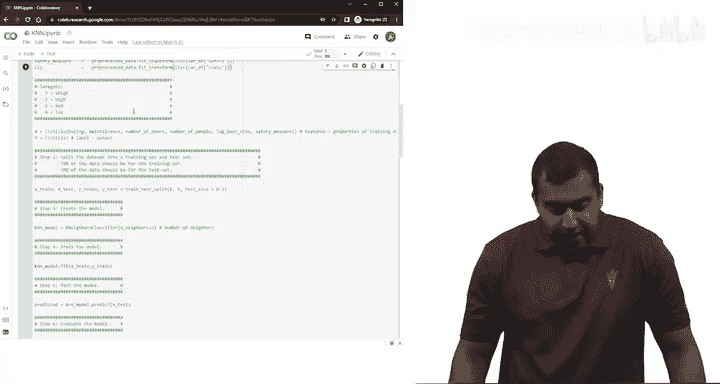

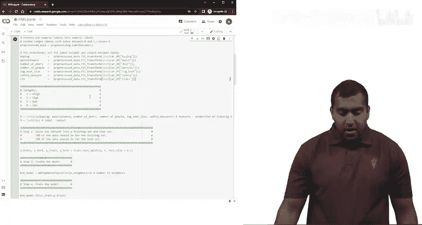

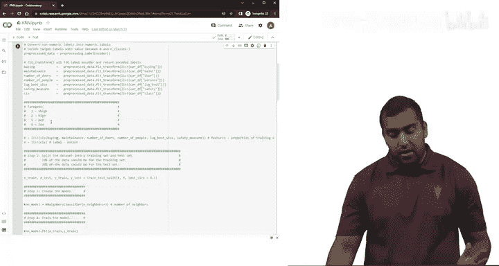

From there， we want to go ahead and pass in all of our basically our label our features into our X variable and our target into our y variable。

 so here what I'm doing is I'm calling the zip function and I'm storing it into a list to store all of our features into a list and that's our features our buying maintenance number doors number people Luwood size and the safety measure。

 and then I'm also going to store our class values into a list as well。

 which is why I'm calling the list function here and I'm storing that into variable Y。

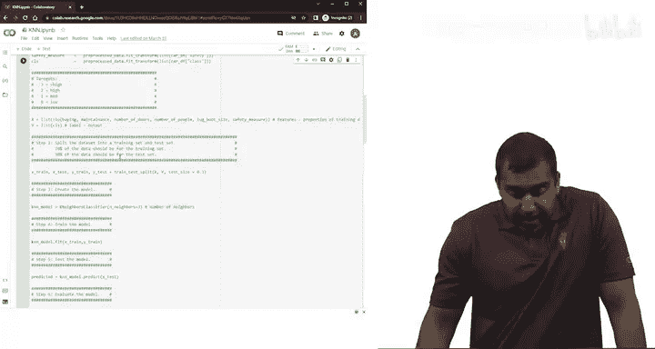

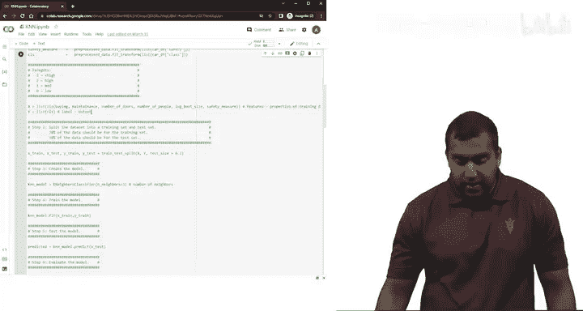

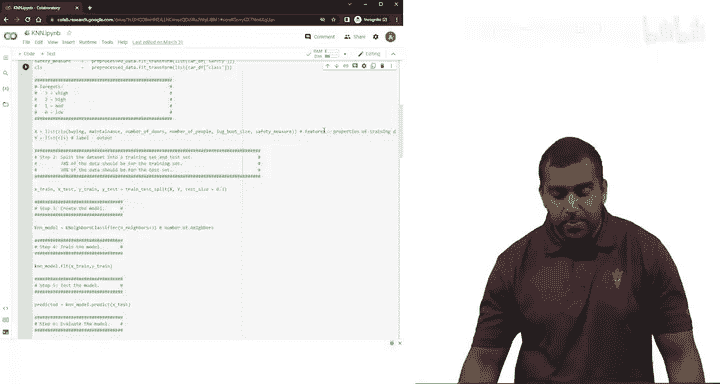

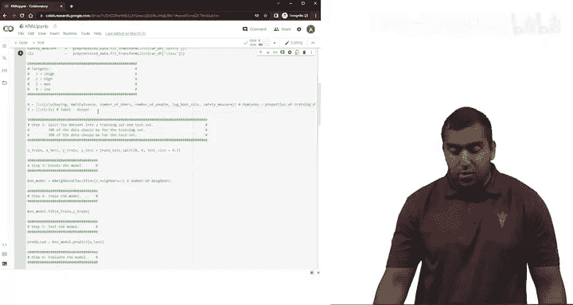

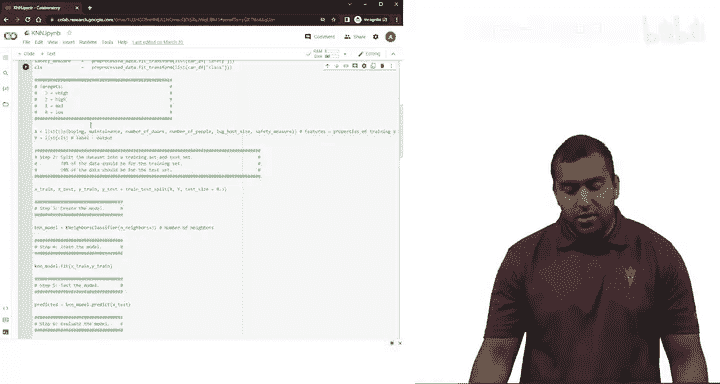

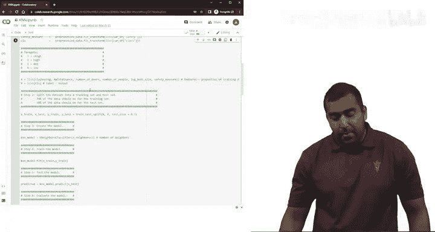

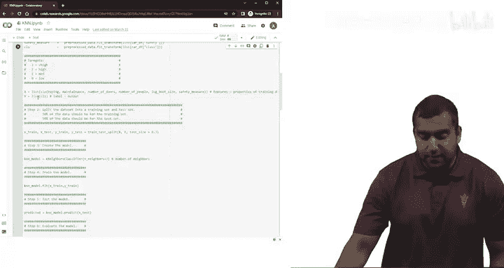

So this is a little bit complex， I highly encourage you to go through that portion again。

 the whole purpose of that was to make sure you understand that we are converting nonnumeric values of our features and our classes to numeric values so we can make those classification。

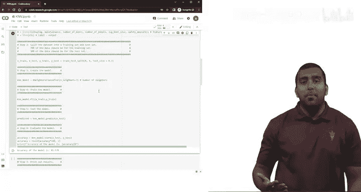

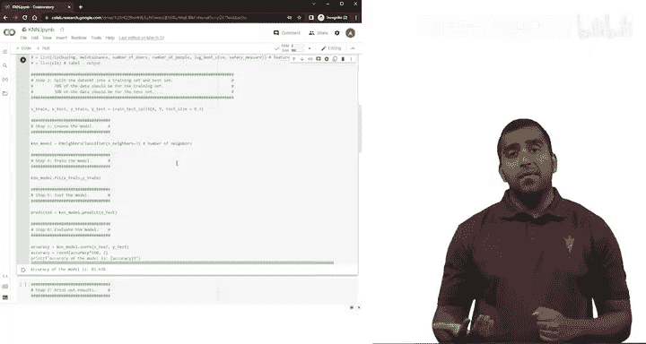

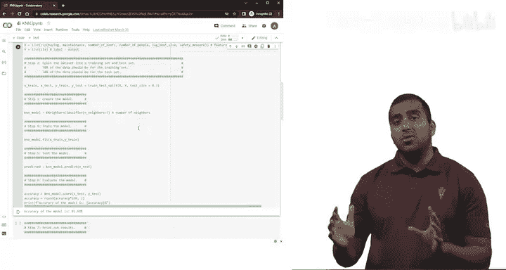

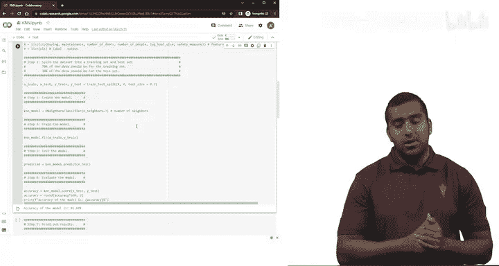

Step 2， our second step is to split our data set into training data and testing data。

 70% of the data has to be for training， 30% of the data has to be for tests。

 that's our typical rule of thumb， as mentioned before。

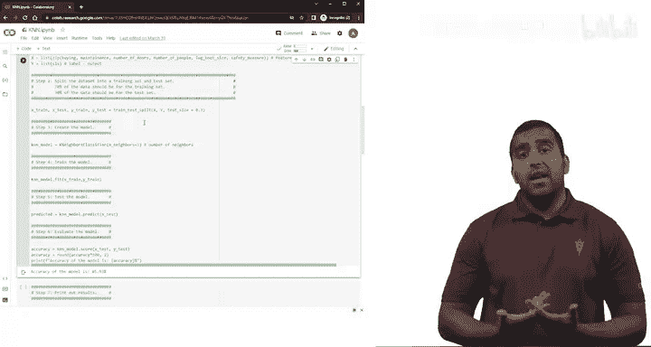

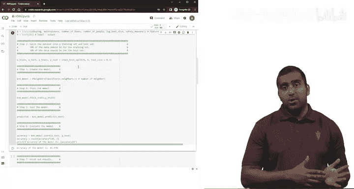

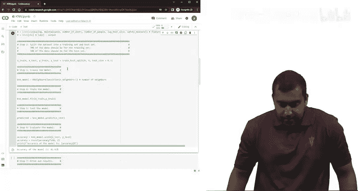

Here you can see it's just like the other models for linear regression that you've seen before。

 pass in x create xtrain X Ytrain Y test as your variables， called the train test split function。

 pass in your X data and your Y data and specify your test size to be 0。

3 so that that indicates that's 30% of the entire data set is allocated for the test data。

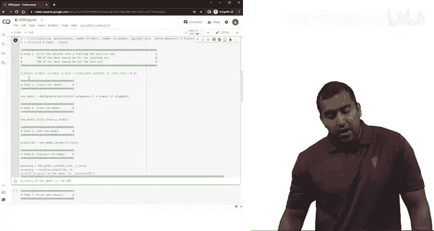

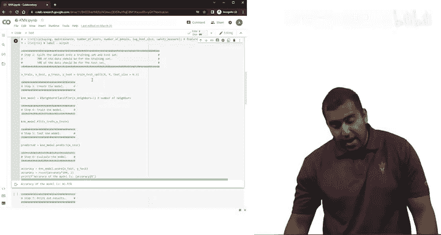

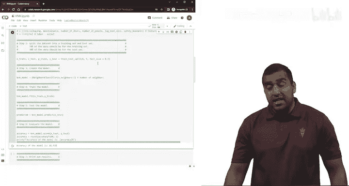

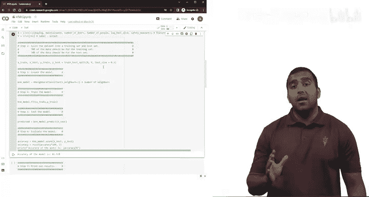

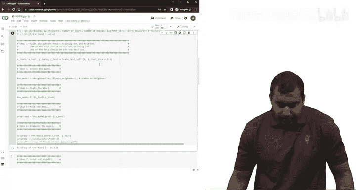

Step three， create the model， as you've seen before。

 I called it KNN underscore model and you're calling the K nearest neighborighs classifier function from your SK Learn library and you're specifying that the number of neighbors that we want to use in this case are three so for every sample there are three surrounding neighbors。

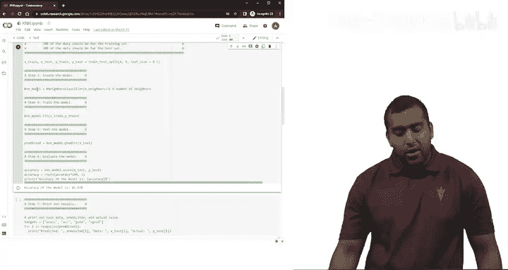

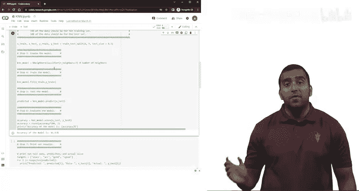

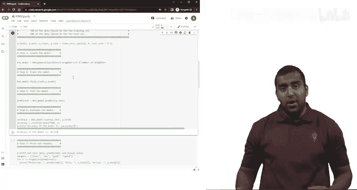

Step four， you want to train your model， so what you do is you're called the fit function using you apply the fit function on your KNN model and you pass in your X train data and your Y train data。

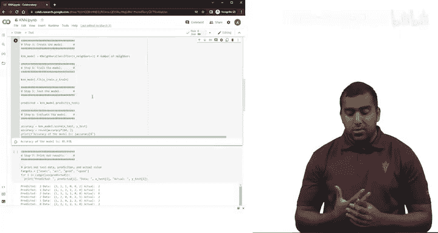

After you've trained your model， go ahead and test your model。

 you test your model by calling the predict function on your model while passing in your testing data。

 so in this case we pass an X test and we want to store our results in a variable called predicteddicted to see what our results are。

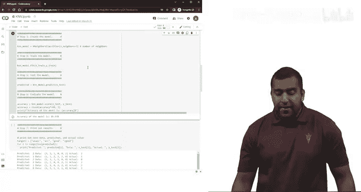

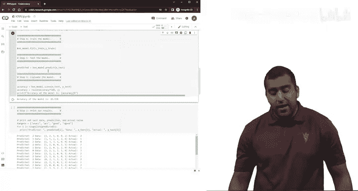

Finally， let's evaluate how accurate is our model。So I created an accuracy variable and I basically scored my model on the testing data X test Y test from there I just rounded up two decimal places and I printed out what my accuracy is。

 and here you can see that I achieved an accuracy of 85。93%。

Now if you want to see if you can get a better accuracy so that your model performs even better。

 what you can do is you can play around with your hyperparameter， your number of neighbors。

 and you can increase it or you can even decrease it to see what would work best。

 what's the best configuration to get the best accuracy or the best performance from your model。

 that's what you can do。

Now， our final step to see how well our model performed is to print out our results。

So here what I did was I just passed in all of our targets， which is unacceptable， acceptable。

 good and very good， because I just want to see what our prediction was like。

 and I'm going to iterate through everything so for every value I want to see what's been predicted。

 what were the data values that were passed， and then what was the actual value to see what we predicted correctly and what was predicted incorrectly。

So now you can see here， mind you， I have everything stored in numeric values so zero being as mentioned before。

 low， one being medium， two being high and three being very high Now if you want to see what that looks like in terms of comparisons。

 you can scroll through all of your output。

And when you scroll through all of your output you can see that some of our predictive values were actually correct。

 we predicted a value of two which is high and the actual value of the car was high。

 which is a two so you can see that our model is pretty accurate for 85% we do get some predictions correct however you'll notice that if you go through even more samples。

 not all of our predictions are correct， there will be a few that are incorrect so you just want to make sure you tune your hyperparameter by changing the number of neighbors seeing what the best accuracy you get is and you can see how that will affect your results later on。

And that's Ka nearest neighbors for you。 Thanks for watching。

