# 亚利桑那州立大学《Python： A Guided Journey from Introduction to Application》中英字幕 - P63：8_支持向量机原理.zh_en - GPT中英字幕课程资源 - BV1J38GzbETT

Welcome。In this lecture， we're going to be going over support vector machines。

So today we're going to cover what is the support vector machine。

 how does it work and when do we utilize this machine learning algorithm。

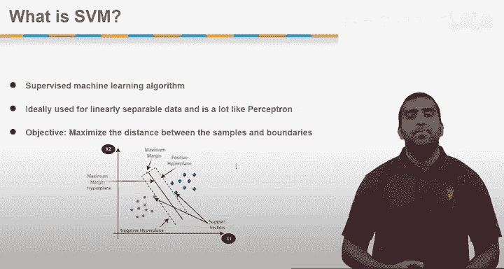

So what is a support vector machine。It's a supervised machine learning algorithm that is ideally utilized for linearly separable data and it looks a lot like a perception。

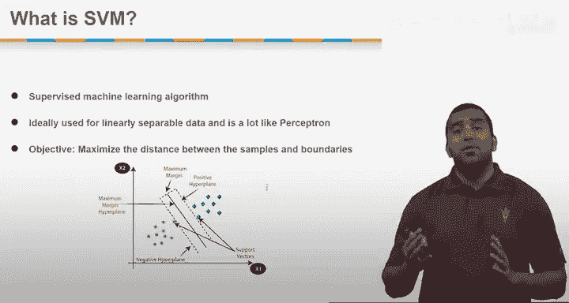

When I say it's nearly separable， think of it like this。

 we have a hyperplane right over here or a line and that line can be used to separate groups of data Now those groups of data can be classified as a certain type of data that's essentially how support vector machine works where inserting a hyperplane or a line that can separate the data into different groups of data。

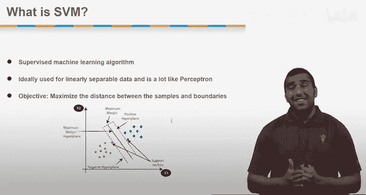

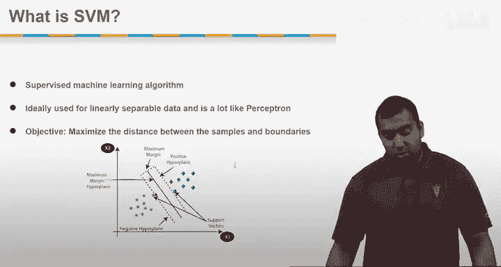

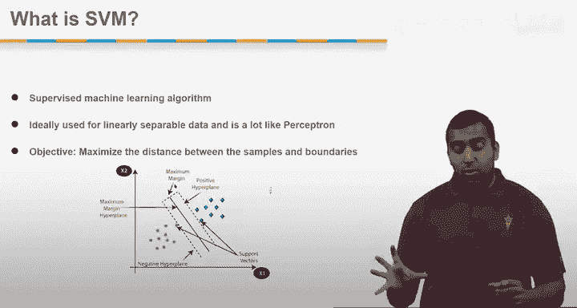

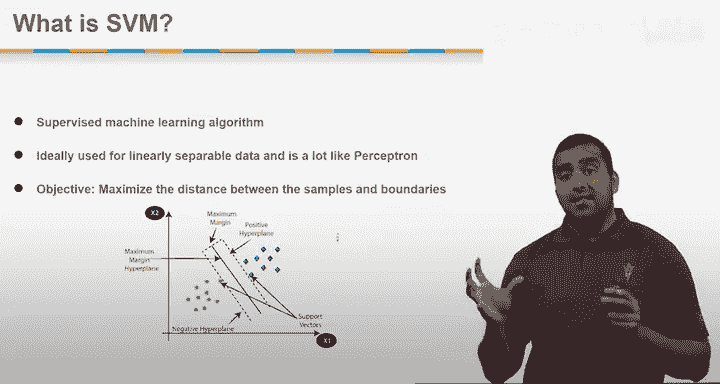

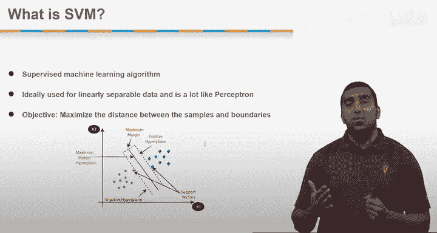

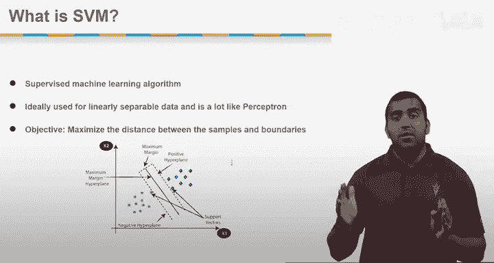

Now our objective or our goal is to maximize the distance between the samples and the boundaries。

 What I mean to say by that is we have a hyperplane or a line right here。

 and we want to make sure that we maximize the greatest distance to make sure that the data。

 all data points are separated as distinctly as possible so we have this group of data that's well separated from the group of data here which are green points versus the blue points。

 we want to separate it as much as possible。

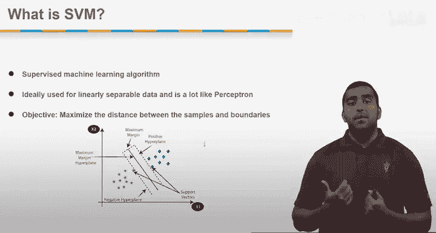

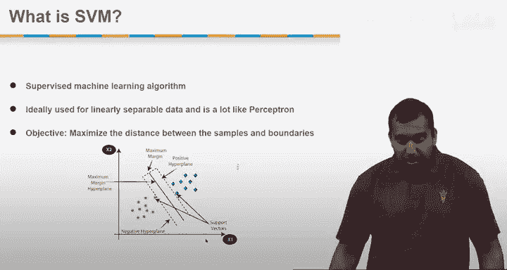

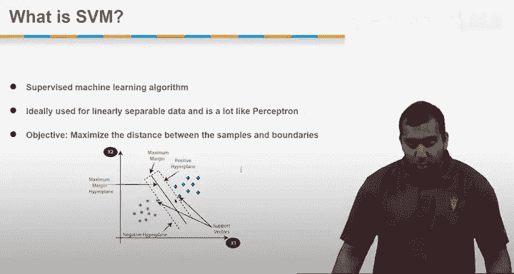

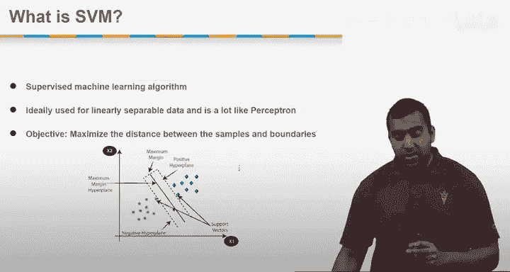

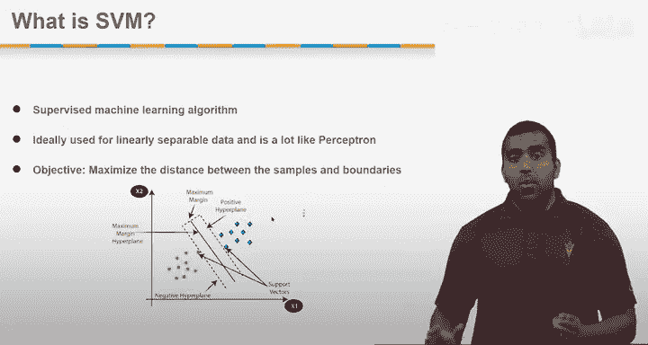

U and each data point is known as a support vector。

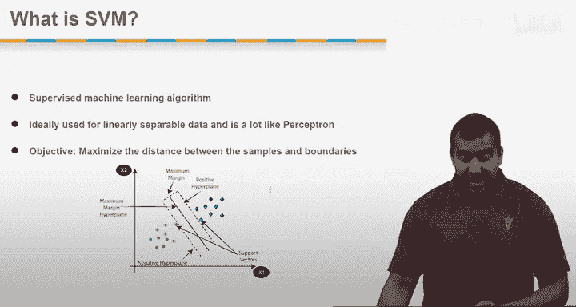

So how does it work Well， basically this algorithm works by creating a hyperplane that I showed you before that will separate the data into classes。

Now， the hyperplane is known as the decision boundary。

 it makes the decision of what the data should look like basically。

Anything that falls on one side of the hyperplane is classified as one class。

 while data on the other side of the hyperplane is classified as another class。

 and you can see here we have another example where we have our best hyperplane over here and all of our blue circles are one class and all of our red triangles are another class that are really well separated by maximizing the distance from the hyperplane。

Now， the support vector machine algorithm prioritizes finding the best hyperplane by identifying the hyperplane that maximizes the margins from those tags。

And another thing in this slide you could see is I included the line of code that shows you how to create a support vector machine model in one line of code Basically we're from the SVM library we're calling SVC。

 which stands for support vector classification， and we're specifying our hyperparameter to be linear。

 our kernel to be linear because we are separating our data linearly。

 that's why we're specifying it to be linear。Now， when do we use the support vector machine algorithm？

Since it's a supervised machine learning algorithm。

 we typically utilize it when we have a labeled data set。

Support vector machines are more effective to use over other algorithms when the number of features is greater than the number of samples in the dataset。

 that's one key thing to know when you utilizing this algorithm。

 when you have more features than data samples， then you should typically use this SVM。

 especially when your data is labeled。Now， you may utilize all the supervised machine learning algorithms covered so far on a label dataset and identify which algorithm works the best on the data by comparing their performance after execution so you can use accuracy。

 which is what we've been doing so far as a metric to compare which model has been performing the best on the data that you're trying to analyze。

So let's go ahead and jump right into our demo。

As always， our first step is to load our libraries。

So we're going to be using the SK to Learnear Library and the two things we need to import from it are data sets because this time we want to use a data that already exists within the SK Learn library and I'll tell you which data we're going to be using in just a second。

 and we need to import SVM or our support vector machine algorithm。

We also need to import。Accuracy score from our metrics in SK learn because we're going to be using that to evaluate our performance of our model。

And we're also going to need train test split to split our data again into testing and training data。

Now， in this program， we're basically going to be classifying a tumor as malignant or benign using the supervised machine learning algorithm SVM。

the features that will be used to train this model include everything from the mean radius of the tumor。

 the mean texture perimeter mean area the mean smoothness and so forth we're going to go through all of these different features now these are a lot and if you want to know more about what do these features mean what you can do is on Google。

 you can Google the cancer tumor data data set from SKL。

 and that will take you to a page where you can actually learn more about what these features mean and how like how does it describe a tumor。

So those are all the features that we're going to be utilizing and our classes are going to be benign or malignant。

 benign， meaning it's fine， malignant， meaning it's bad。

and yeah， we're going to go ahead and create our classifier。

 so our first step is to load the data and store the labels in the variable X and the targets in variable Y。

So here you can see what I'm doing is from data sets as we imported it from SKLarn。

 we're going to call the load breast cancer function now what that does is it'll load the entire breast cancer data set from SKLn。

 which we are then storing into a variable called Cancer data。

And that will consider all of our data that represents the breast cancer data set。

From there， if you want to see all the features and all the targets that are being classified are utilized。

 then what you could do is I printed it out right here and you run this and then you can see that all the features that are going to be utilized for the training will match this and all the classes that we're going to be utilizing for classification will match benign or malignant。

From there。We're going to go ahead and separate our data Now。

 since this is a data set that's already been created within SKLn。

 the nice thing is we don't have to manually specify what features we want to use。

 we could just specify that from our cancer data， we want to use data and we want to store that in X that'll consist of all of our features that we want to use to train our data with and our targets are what we're trying to predict。

 we're just specifieding our target because it's already been specified in the data set and we're going to store that into variable Y。

Now， our second step is to basically split our data， as always。

 70% of our data has to go into our training data， 30% of our data has to go into our testing data。

And we want to make sure that we specify our classes to be either malignant or benign。

Mignant being zero and benign being one， we're converting into a numeric remember。

Our third step is to create our model as I have shown you before。

 we're going to create call it SVM model and we're going to call the support vector classification function from SVM。

 and we're going to specify our kernel to be linear our kernel is our hyperparameter that we specify we specify to make sure that we identify what kind of data are we handling and how do we want to handle it So we want to handle it to make sure that our data are linearly separable as I've shown you before。

Step four is to train the model， so we call the fit function on Xtrain Y train for our SVM model。

 dental trainer model。

And finally， we then test our model using the predict function while passing in X test as our parameter。

 and we're going to call that on our SVM model and store that into a variable called predictedicted。

 which will consist of all of our predicted values。

Next up， we want to evaluate our model so we're going to call it accuracy score and we're going to pass in our Y test and our predicted what that will do is it'll compare our Y test and our predicted values and they'll see wherever there's a match to one wherever there's not it's a zero so and we compute the total accuracy of that and I want to round it up to two decimal places so I multipied by 100 and I round it up by two decimal places and here is where I'll print it out。

And finally I want to see what how good our model is and what were our results。

 so what I'm doing is I created a loop that'll iterate through all of our results and it'll display our predicted values。

 what were the input data and what were the actual values that were compared to。

So after running this script， you can see that the features that we are utilizing is printed here。

 the targets that we are using for classification is printed here。

The accuracy of our model is actually really good， it's 96。

49% that is that means we are sorry our hyperparameter that we used the linearly separable data was good now you can mess around with that there are other types of ways to handle support vector machines it's just' you don't need to necessarily do the linear way you can do some research by googling the support vector machine algorithm online and going on the Python website and they'll show you other ways you can configure your hyperparameter。

But since we're working with linear nearlyly separable data， our results are pretty good， we got 96。

49% accuracy and here you could see that when we're predicting our values and our actual values。

 these are all of our input data and you could see it's all numeric values stored within the list。

Our predicted value for that first sample was benign。 Our actual value was benign。

 which meant that's good。 Our predicted value is benign。 Our actual value is benign。

 So our model is performing pretty well in terms of our making predictions。 Now。

 you'll notice it's not 100% accurate。 So， for instance， here we predicted benign。

 but our actual value was malignant。 So that for approximately 4% inaccuracy will lead to results like this。

 where our predictions aren't matching our actual values。😊。

The goal is to make sure that we adjust our hyper parameters。

 we improve or clean up our data even more to make sure that our model。

Performs optimally， and we achieve a better prediction performance。

Thank you。