# 亚利桑那州立大学《Python： A Guided Journey from Introduction to Application》中英字幕 - P64：9_回归分析基础.zh_en - GPT中英字幕课程资源 - BV1J38GzbETT

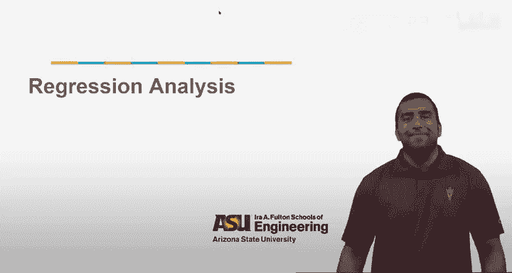

Welcome， in this lecture， we're going to go over regression analysis。

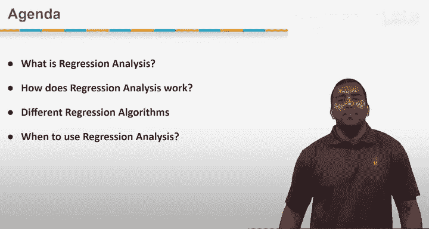

We're going to talk a little bit about what is regression analysis， how does it work。

 we're going to cover some different regression algorithms。

 and finally we're going to identify when do we utilize regression analysis。

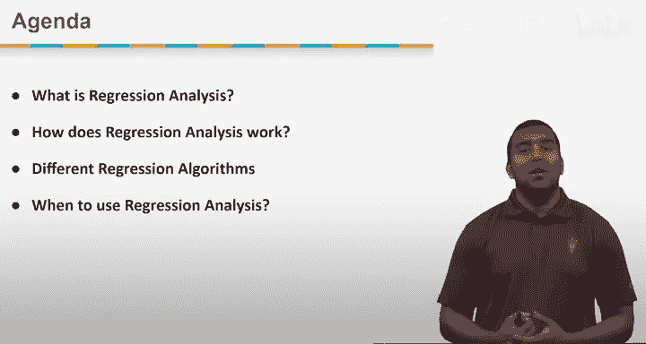

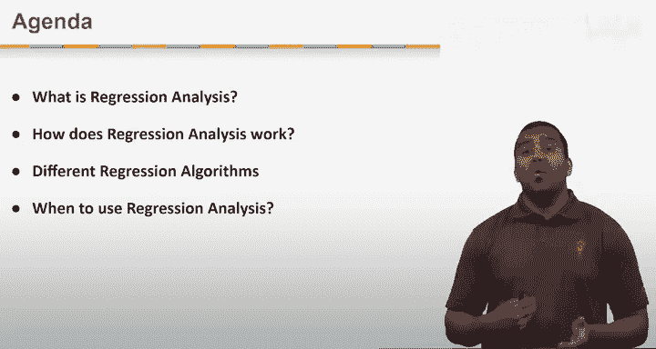

So what is regression analysis？Regression analysis is a methodology that consists of machine learning algorithms that are used to predict a continuous variable rather than classify them or rather than identify a class Now in the past few examples we' have seen how to identify a class。

 however， regression analysis is utilized to predict a continuous variable。

 we're not predicting a class anymore， One example that you have already seen and learned about regression analysis is near regression where we saw the model predict a value as opposed to a class。

Now， regression Ana can make the prediction based on multiple independent variables。

 everything on our axis axis。Our objective is to create a mathematical model that represents the dependent variable or y everything on the y axis as a function of the independent variable X。

Basically， we want to create an intercept that's basically minimizing the number of errors and is able to identify or predict the continuous value accurately。

So how does regression analysis work？Regression analysis is a mathematical model that is created to identify a relationship between an independent variable and a dependent variable。

When the mathematical model is applied to a data set。

 a relationship between the dependent variable and the independent variable is identified。

 and that will be used on the new data to make the predictions。Now。

 different regression algorithms can be used to find the best relationship between dependent and independent variables。

The goal is to minimize errors in predicting the continuous value of the dependent variable。

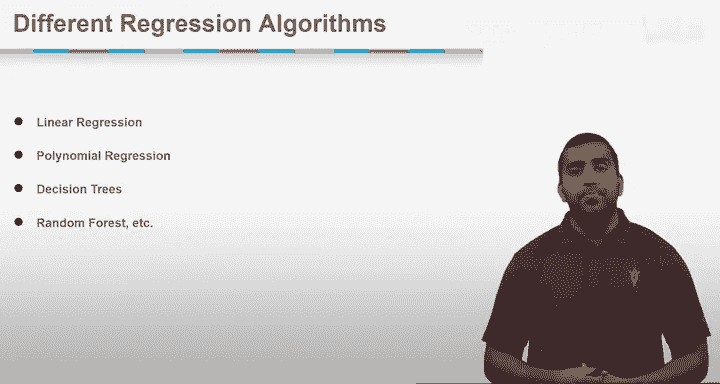

Now， there are different regression algorithms that we can utilize， one that you've already seen。

 which is linear regression。

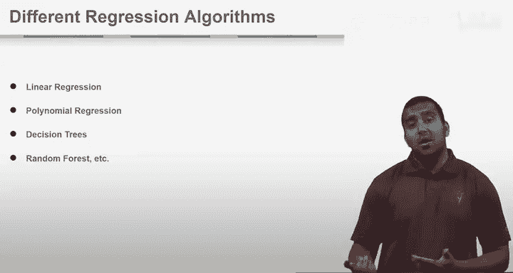

Other regression algorithms include polynomial regression， decision trees and random forest。😊。

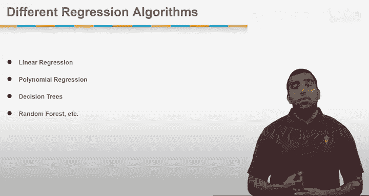

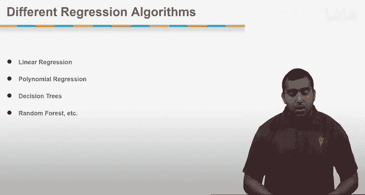

We won't be going over these other machine learning algorithms as they are a little bit more on the advanced side。

 however， if you are interested in learning more about these regression algorithms。

 I highly encourage you to look at some online resources on Python's website or some forums that you can refer to that'll discuss and talk a little bit more about how do these algorithms work and when are they typically used。

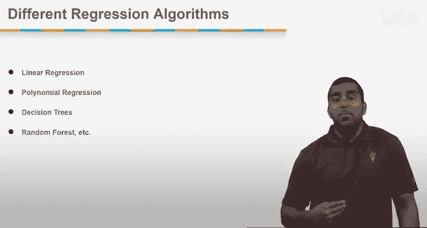

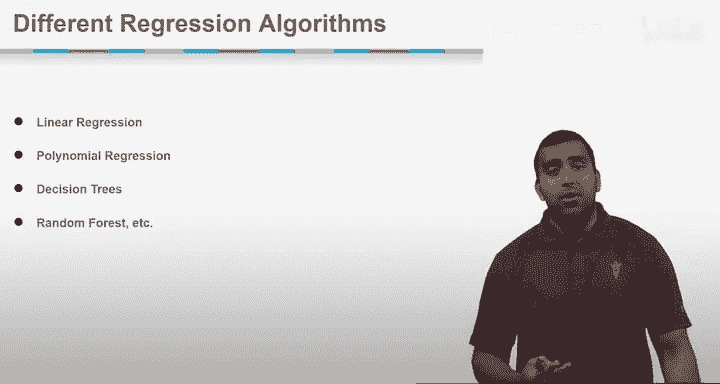

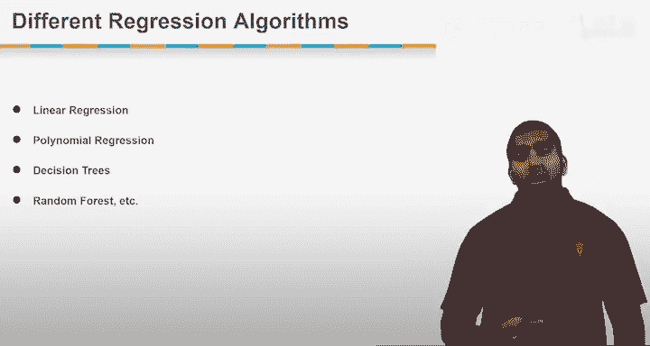

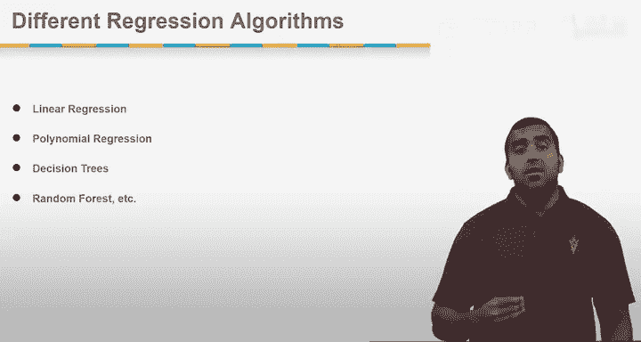

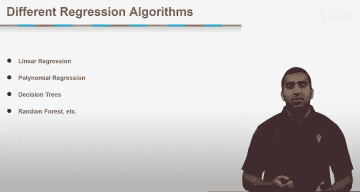

So when do we use regression analysis， it should be used when the objective is to identify or predict a continuous dependent variable from one or more independent variables。

In simple terms， if you want to predict a continuous outcome。Variable Y based on the variable X。

 make sure you use regression analysis。 We have some really good examples here where we have our independent variables on our x axis。

 Our dependent variables， which is what we're trying to predict on our y axis。

 and we apply our line of best fit to our data points。

 and this is a common practice of linear regression。

 Now you can see it's different from classification as classification。

 we are trying to classify and separate the data。 whereas with linear regression。

 we are trying to predict a continuous value。 That's the difference between regression and classification。

Thanks for watching。