# 亚利桑那州立大学《Python： A Guided Journey from Introduction to Application》中英字幕 - P66：11_深度学习概述.zh_en - GPT中英字幕课程资源 - BV1J38GzbETT

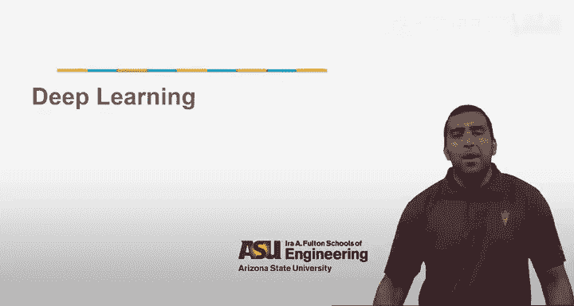

Welcome in this lecture we'll be going over deep learning。We're going to cover what is deep learning。

 how do neural networks work and applications of deep learning Now bear in mind that this is an introductory leveled concept。

 we are not going to the nitty gritty details we're just going over a brief overview of deep learning。

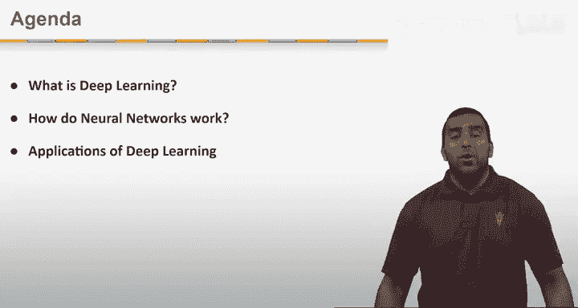

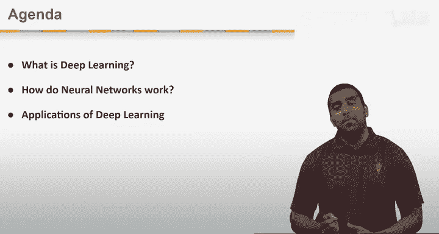

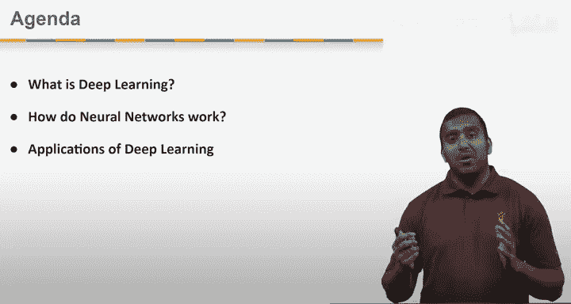

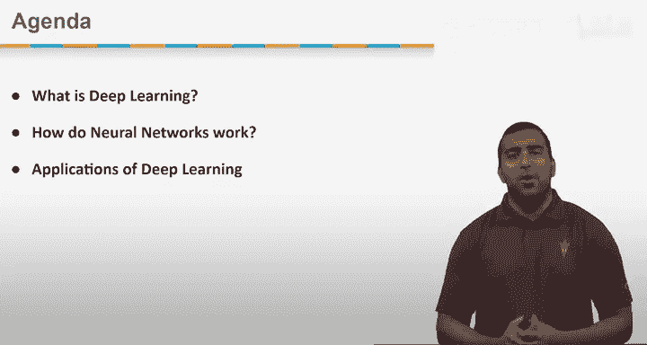

So what is deep learning？Deep learning is a subset of machine learning where the algorithms are structured based on the functionality of the brain。

The basic concept is this in a brain， neurons fire when detecting certain features on an object。

 for instance， if we see the tip of a pencil， we'll be able to identify the tip of a pencil as our neurons fire。

This concept led to the development of artificial neural networks。

Neural networks are built to simulate how the brain interacts when provided with a stimulus to process data and learn from the new information。

Neural networks can utilize a single layer to make predictions and can utilize additional layers to optimize and improve the model's performance。

So here's what deep learning looks like on a visual basis， Basically， we have a bunch of。

Artificial neural networks that are intertwined and will fire when detecting some sort of stimulus。

So here's another depiction of what a simple neural network looks like versus a deep neural network。

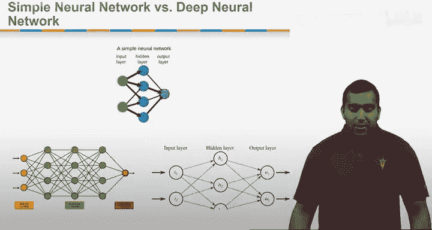

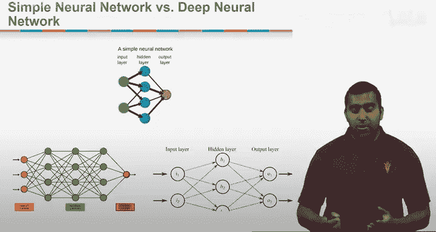

In a simple neural network， we have one hidden layer。

 one single hidden layer which takes in an input layer and will display it to an output layer。

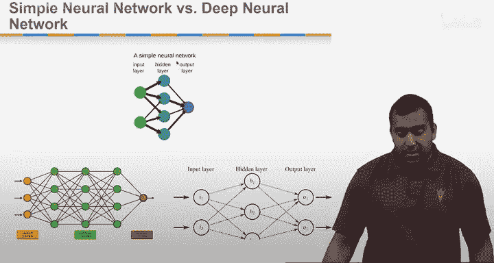

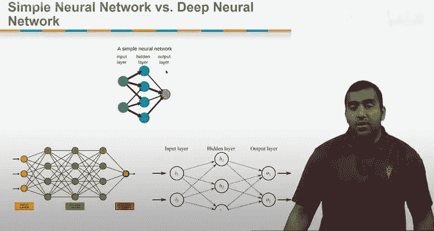

Now a deep neural network looks like this where we have multiple hidden layers where an input layer is passed into a series of multiple hidden layers。

 and that will be passed into an output layer。

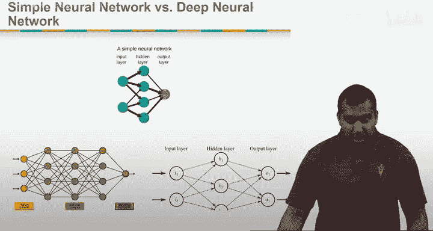

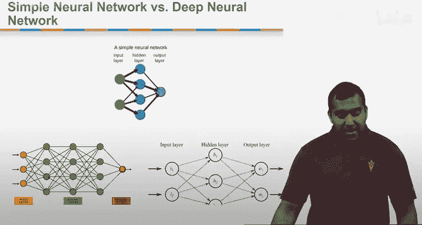

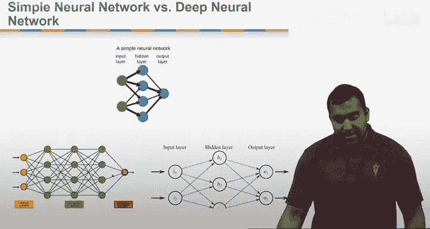

And here in each hidden layer， it's represented by H sub 1， H sub 2， although H sub3 and so forth。

 depending on how many layers we have， and then we have our input layer and what connects each input layer to each hidden layer is our respective weight。

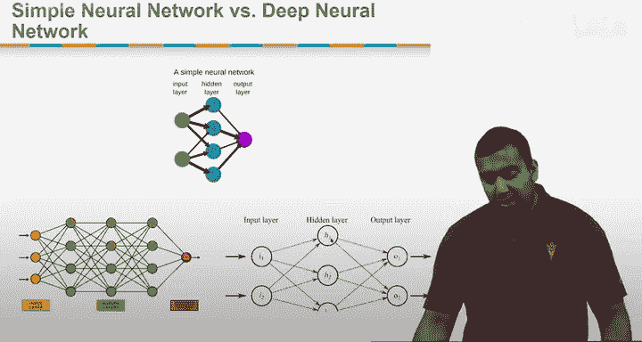

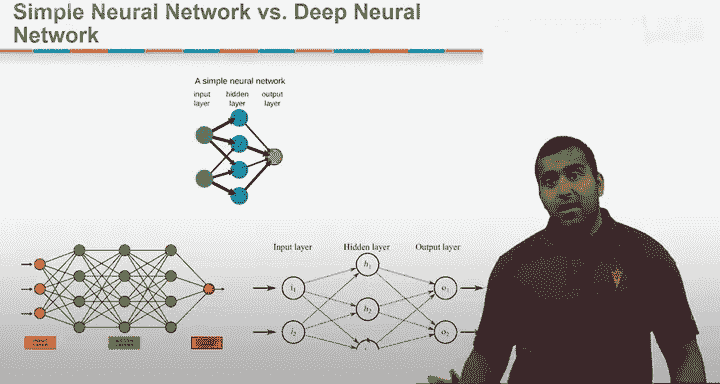

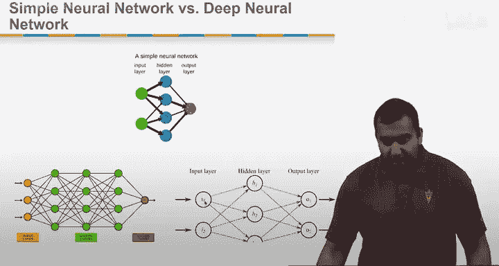

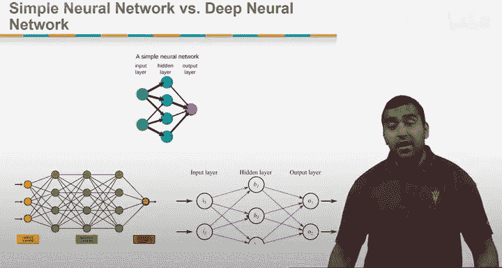

Finally， our hidden layers will be connected to a certain output layer。

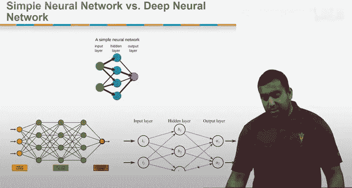

Now， how do neural networks work？In a neural network， layers are categorized in the following。

 we have our input layer， our hidden layer， and our output layer， as mentioned before。

Neural networks utilize activation units to perform a weighted sum of the inputs for processing data。

Each layer in the network can have a different number of activation units。

The activation function and units control how well the model learns the training data set。

So here we have our inputs。With their respective weights that and then the sum is finally taken care of with respect to a certain bias that is then passed into an activation function and we can finally yield the output。

So what are some applications of deep learning Well deep learning is pretty much used everywhere today We have it in virtual assistants such as Alexa。

 we have it in social media， which includes Facebook， Messenger， Instagram， WhatsApp and so forth。

 we also have an autonomous vehicles so cars like Tesla， Luccid。

 all these different vehicles are slowly integrating deep learning to develop some sort of autonomy so that they can become self-driving。

We also use it in healthcare to be able to make predictions and identify health problems before they even get into anywhere worse stages。

Thanks for watching。